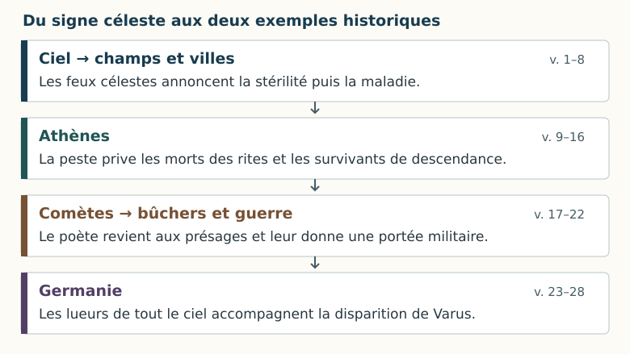

# BEL A/L — Version latine (Lyon) 2026 · Corrigé guidé

*Corrigé rédigé par IA, non officiel. Signalez toute erreur.*

**Lecture du rapport du jury** · GPT-6.2 Astra Ultra · vitesse non renseignée

**Rédaction** · GPT-6.2 Astra Ultra · vitesse non renseignée

**Autocontrôle** · GPT-6.2 Astra Ultra · vitesse non renseignée

**Révision (tour 1)** · GPT-6.2 Astra Ultra · vitesse non renseignée

## Lire le poème en prose

Dans les *Astronomiques*, Manilius présente les comètes comme des signes de calamité. Pour traduire ces vingt-huit vers en quatre heures, commencer par distinguer les maux énoncés au présent et les deux événements historiques qui les illustrent. La consigne autorise les dictionnaires latin-français. Les dix notes du sujet précisent des formes, des ellipses et le contexte historique.

## Vers 1 à 8 · Des champs aux villes

La première négation donne sa portée à tout le passage. Dire que les feux célestes ne sont jamais *futiles*, c’est annoncer que chacun a des conséquences pour les hommes. Le parfait *excanduit* autorise une constatation fondée sur l’expérience du passé. Le jury accepte aussi le présent de vérité générale. Le premier exemple passe des champs aux sillons puis au joug. *Elusi* se rapporte aux cultivateurs, *defessus* au laboureur et *maerentes* aux jeunes bœufs. *Frustrata*, neutre pluriel, se rapporte à *iuga*. La peine des travailleurs s’éclaire par la stérilité du sol.

*Aut* ouvre une seconde possibilité. Le sujet de *corripit* et de *rapit* arrive après l’objet *corpora*. C’est *letalis flamma*, la fièvre figurée comme un feu. L’ablatif absolu *exustis … medullis* lui permet d’atteindre jusqu’à la moelle. *Labentes* vient de *labor*, « glisser, tomber ». La deuxième note renvoie au pluriel *iusta*, les rites dus aux morts. Le passage aboutit à des funérailles collectives célébrées à travers des villes tout entières.

Entre les vers 16 et 23, relever le passage de l’exemple athénien à l’énoncé général, puis le nom qui situe le dernier exemple. Les temps français doivent rendre lisibles ces changements de portée.

## Vers 9 à 16 · Athènes portée en terre

La phrase ouverte par *qualis* illustre les calamités précédentes. Elle prend tout son relief si l’on conserve l’image funèbre du verbe *extulit*. La peste fait porter en terre Athènes elle-même. *Erectheos … colonos* désigne les habitants du pays d’Érechthée, l’ancien roi d’Athènes. *Per funera pacis* reçoit du sujet une précision déterminante. Ces morts frappent la ville en temps de paix. L’imparfait *ruebant* évoque le mouvement collectif, tandis qu’*alter … alterius* ramène la scène à la rencontre de deux corps.

Qu’est-ce qui manque aux morts ? *Mortibus* est un datif avec *derant*, graphie contractée de *deerant*. Les sujets *funera* et *lacrimae* encadrent ce datif. *Officium* désigne auparavant le devoir que l’on accomplit envers autrui et que la maladie rend impossible. Les deux plus-que-parfaits *cesserat* et *defecerat* marquent l’épuisement déjà atteint, y compris celui du feu personnifié. Dans le dernier vers, *heres* est sujet du singulier *contigit*. Le resserrement sur un héritier à peine trouvé achève l’image de la disparition d’une ville.

## Vers 17 à 28 · Comprendre la comparaison historique

Revenir au ciel avec *talia*, accusatif neutre pluriel qui reprend les catastrophes précédentes. Les comètes sont au nominatif et *lucentes* s’accorde avec elles. Dans la proposition introduite par *cum*, le monde et la nature éprouvent la maladie. Le participe déponent *sortita* se rapporte à la nature et exprime le sort qui lui est échu.

Le vers 21 élargit le présage avec *quin et*. Les trois accusatifs *bella*, *tumultus*, *arma* dépendent de *canunt*, à comprendre au sens prophétique indiqué en note. À l’intérieur de l’exemple, isoler *foedere rupto*, puis lire *Germania* comme sujet des deux parfaits. La Germanie est personnifiée et *Varum* est l’objet de *rapuit*. Après la subordonnée introduite par *cum*, on retrouve la proposition principale. Ce sont les *lumina* qui brûlent et menacent de toutes parts. Le dernier mouvement reprend *natura* et donne aux verbes *opposuit* et *minata est* le destinataire *nobis*, précisé par la note 10. Le texte parcourt ainsi toute la distance entre le ciel en feu du premier vers et les humains auxquels ces feux s’adressent.

## Traduction suivie

Jamais le ciel ne s’est embrasé de feux sans conséquence. Les paysans déçus se lamentent sur leurs champs desséchés et, entre les sillons stériles, le laboureur épuisé ramène ses jeunes bœufs attristés sous un joug qui n’a servi à rien. Ou bien une flamme mortelle, qui leur brûle la moelle, saisit les corps en les accablant de graves maladies et d’une lente consomption. Elle emporte des peuples qui s’effondrent et, à travers des villes tout entières, on célèbre des funérailles publiques dans l’embrasement des tombeaux.

Telle fut l’épidémie qui décima les habitants du pays d’Érechthée et porta en terre l’antique Athènes au fil des convois de gens morts en temps de paix. Ils se précipitaient alors vers leur destin, chacun s’abattant sur le cadavre d’un autre. L’art du médecin n’avait plus sa place et les prières restaient sans effet. Les devoirs envers les morts avaient cédé devant la maladie. Aux morts manquaient les funérailles et les larmes. Le feu lui-même, épuisé, avait défailli, et les corps brûlaient, leurs membres entassés pêle-mêle. Ce peuple, jadis si grand, eut à peine un héritier.

Voilà les malheurs que présagent souvent les comètes quand elles brillent. Avec leurs torches viennent les funérailles, et elles menacent la terre de bûchers qui se consument sans fin, alors que le monde est malade et la nature elle-même, à qui il est échu d’être le tombeau des hommes.

Bien plus, les feux du ciel annoncent les guerres, les troubles soudains et les prises d’armes que suscitent de secrètes trahisons. Ainsi, tout récemment, en pays étranger, quand, le traité rompu, la farouche Germanie emporta le général Varus et teignit les campagnes du sang de trois légions, des lueurs menaçantes s’allumèrent çà et là dans tout l’univers. La nature elle-même nous fit la guerre par ses feux, nous opposa ses forces et nous menaça de la fin.

[Énoncé officiel](https://www.ens-lyon.fr/sites/default/files/2026-04/Epreuve%20de%20sp%C3%A9cialit%C3%A9%202026.pdf#page=4) · [Rapport du jury](https://www.ens-lyon.fr/sites/default/files/2026-10/Latin%202026.pdf#page=2)
