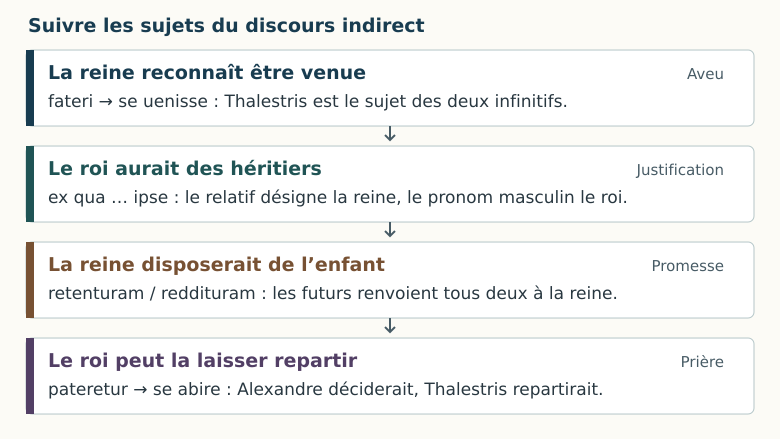

# BEL A/L — Version latine (Ulm) 2026 · Corrigé brut

*Corrigé rédigé par IA, non officiel. Signalez toute erreur.*

**Lecture du rapport du jury** · GPT-6.2 Astra Ultra · vitesse non renseignée

**Rédaction** · GPT-6.2 Astra Ultra · vitesse non renseignée

**Autocontrôle** · GPT-6.2 Astra Ultra · vitesse non renseignée

**Révision (tour 1)** · GPT-6.2 Astra Ultra · vitesse non renseignée

## La rencontre de Thalestris et d’Alexandre

Comme on l’a dit plus haut, le peuple des Amazones était voisin de l’Hyrcanie. Elles habitaient les plaines de Thémiscyre, aux abords du fleuve Thermodon. Elles avaient pour reine Thalestris, qui régnait sur tous les peuples entre le mont Caucase et le fleuve Phase. Brûlant du désir de voir le roi, elle sortit des frontières de son royaume. Lorsqu’elle ne fut plus très loin de lui, elle envoya des messagers en avant pour annoncer que la reine était venue, impatiente de le rencontrer et de faire sa connaissance.

L’autorisation de venir lui fut aussitôt accordée. Elle fit arrêter les autres et s’avança avec trois cents de ses femmes. À peine eut-elle le roi en vue qu’elle sauta elle-même de cheval, tenant deux lances devant elle de la main droite. Le vêtement des Amazones ne leur couvre pas tout le corps. Le côté gauche est nu jusqu’à la poitrine, le reste est couvert. Pourtant le pan de leur vêtement, qu’elles ramassent en un nœud, ne descend pas au-dessous des genoux. Elles gardent un sein intact pour en nourrir leurs filles. On leur brûle le sein droit pour qu’elles puissent plus aisément bander leurs arcs et brandir leurs traits.

Thalestris regardait le roi sans la moindre appréhension. Elle examinait son apparence, qui lui semblait bien loin de répondre à la renommée de ses exploits. C’est que tous les Barbares révèrent la haute stature et ne croient capables de grandes œuvres que ceux que la nature a daigné douer d’un physique exceptionnel.

Comme on lui demandait si elle avait une requête à présenter, elle n’hésita pas à avouer qu’elle était venue pour avoir des enfants avec le roi. Elle était digne, disait-elle, que lui-même eût d’elle des héritiers pour son royaume. Si c’était une fille, elle la garderait. Un garçon, elle le remettrait à son père. Alexandre lui demande si elle voudrait faire campagne avec lui. Mais elle, faisant valoir qu’elle avait laissé son royaume sans gardien, persistait à le prier de ne pas la laisser repartir déçue dans son espoir.

Le désir d’amour était plus vif chez cette femme que chez le roi, et elle le décida à s’attarder quelques jours. Treize jours furent consacrés à satisfaire son désir. Puis chacun prit sa route, elle vers son royaume, le roi vers la Parthie.

**Repère de lecture**

Les deux participes futurs au féminin attribuent à la reine les deux décisions envisagées sur le sort de l’enfant. Dans la demande finale, Alexandre devient le sujet du verbe qui exprime la permission, tandis que la reine reste celle qui part. Cette alternance explique les changements de pronom en français.

[Énoncé officiel](https://www.ens.psl.eu/sites/default/files/al_version_lat-grec_261103.pdf#page=2) · [Rapport du jury](https://www.ens.psl.eu/sites/default/files/2026_al_rapport_ecrit_version_latine.pdf)
