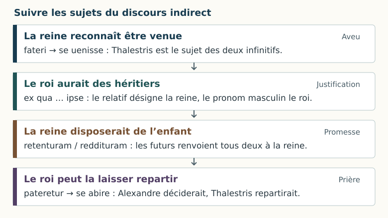

# BEL A/L — Version latine (Ulm) 2026 · Corrigé guidé

*Corrigé rédigé par IA, non officiel. Signalez toute erreur.*

**Lecture du rapport du jury** · GPT-6.2 Astra Ultra · vitesse non renseignée

**Rédaction** · GPT-6.2 Astra Ultra · vitesse non renseignée

**Autocontrôle** · GPT-6.2 Astra Ultra · vitesse non renseignée

**Révision (tour 1)** · GPT-6.2 Astra Ultra · vitesse non renseignée

## Le point de vue du récit

Quinte-Curce raconte la rencontre d’Alexandre et de la reine des Amazones dans son *Histoire d’Alexandre le Grand* (livre VI). L’épreuve commune d’Ulm demande une version en quatre heures. Le récit interrompt la rencontre pour décrire les Amazones, puis rapporte leurs paroles au style indirect. Conserver les changements de temps et les relais de parole permet de traduire la représentation antique de ce peuple en la laissant à son narrateur.

## De la géographie à l’arrivée de la reine

Dans la première phrase, *gens* est le sujet de *erat*, *finitima* son attribut, *Hyrcaniae* le complément de l’adjectif. Le participe au génitif pluriel *incolentium* s’accorde avec *Amazonum* et reçoit son propre objet, *campos*. La deuxième phrase passe du nom collectif aux femmes qui composent ce peuple. Le verbe pluriel *habebant* autorise donc « elles avaient ». *Reginam* est l’attribut de *Thalestrin*. Le datif *omnibus* dépend du participe *imperitantem*.

Qui veut voir qui ? Dans *cupidine uisendi regis*, l’adjectif verbal au génitif s’accorde avec *regis*. En français, la reine désire voir le roi. La chaîne *praemisit indicantes uenisse reginam* comporte ensuite trois niveaux. La reine envoie des personnes, ces personnes annoncent quelque chose et le contenu de l’annonce est la venue de la reine. Les deux adjectifs verbaux qui suivent dépendent d’*auidam*, accordé à *reginam*.

Les groupes *facta potestate* et *ceteris iussis* ont chacun leur nom et leur participe à l’ablatif. Le premier donne la permission reçue, le second l’ordre donné aux autres. *Trecentis* se rattache au participe *comitata*, lui-même accordé à la reine, sujet de *processit*. *Feminarum*, génitif partitif, précise sur quel ensemble sont comptées les trois cents accompagnatrices.

## Le portrait et le regard

*Ut primum* fixe l’instant où la reine aperçoit Alexandre. *Praeferens* décrit ce qu’elle tient devant elle au moment où elle descend de cheval. Avec *obducitur*, le présent introduit les usages attribués à tout le peuple. Dans *quem nodo colligunt*, le relatif masculin reprend *sinus*, le pan ou le pli du vêtement. La négation *nec* porte sur la longueur de celui-ci. Dans la relative *qua … alant*, *qua* est un ablatif de moyen et le subjonctif exprime le but. Le génitif *muliebris sexus* qualifie *liberos* et prépare la distinction ultérieure entre fille et garçon.

La rencontre reprend à l’imparfait. *Intuebatur* est déponent et fait de Thalestris celle qui regarde. *Eius* renvoie à Alexandre. L’accusatif *habitum* est l’objet de *perlustrans* et reçoit la qualification *haudquaquam … parem*. La reine confronte la silhouette d’un homme à la renommée de ses actes. *Quippe* introduit l’explication du narrateur. On peut rendre *non alios … quam* par la restriction française « ne … que ».

## La demande et ses suites

À côté de chaque verbe du discours indirect, écrire le nom qui remplacerait son sujet. Vérifier particulièrement la différence entre celui qui accorde la permission et celle qui en ferait usage.

*Interrogata* est passif. La reine reçoit la question et en donne la réponse. Après *fateri*, on peut rétablir *se* devant les infinitifs futurs *retenturam [esse]* et *reddituram [esse]*. Leurs formes féminines assurent que les promesses viennent de la reine. Au milieu de ce discours, *ipse* est masculin et sujet de *generaret*. Le français peut lever cette alternance en nommant successivement le père et la mère.

Dans la réponse au roi, isoler le participe déponent *causata* et son infinitive. On retrouve ensuite le groupe principal *petere perseuerabat*. La prière dépendante contient *pateretur*, dont Alexandre est le sujet, et *se … abire*, dont Thalestris est le sujet à l’accusatif. Pour vérifier l’ensemble, restituer mentalement la demande au discours direct, « Ne me laisse pas repartir déçue. »

Le comparatif *acrior* rapproche le désir de la reine et celui du roi. Le génitif *feminae* a ici un référent précis. *Perpulit* introduit le résultat de son insistance par *ut* suivi du subjonctif. Dans la phrase suivante, *XIII dies* est le sujet du passif. Enfin le verbe pluriel *petiuerunt* distribue deux destinations entre deux voyageurs. Le mouvement final reprend et inverse celui de la rencontre.

## Traduction suivie

Comme on l’a dit plus haut, le peuple des Amazones était voisin de l’Hyrcanie. Elles habitaient les plaines de Thémiscyre, aux abords du fleuve Thermodon. Elles avaient pour reine Thalestris, qui régnait sur tous les peuples entre le mont Caucase et le fleuve Phase. Brûlant du désir de voir le roi, elle sortit des frontières de son royaume. Lorsqu’elle ne fut plus très loin de lui, elle envoya des messagers en avant pour annoncer que la reine était venue, impatiente de le rencontrer et de faire sa connaissance.

L’autorisation de venir lui fut aussitôt accordée. Elle fit arrêter les autres et s’avança avec trois cents de ses femmes. À peine eut-elle le roi en vue qu’elle sauta elle-même de cheval, tenant deux lances devant elle de la main droite. Le vêtement des Amazones ne leur couvre pas tout le corps. Le côté gauche est nu jusqu’à la poitrine, le reste est couvert. Pourtant le pan de leur vêtement, qu’elles ramassent en un nœud, ne descend pas au-dessous des genoux. Elles gardent un sein intact pour en nourrir leurs filles. On leur brûle le sein droit pour qu’elles puissent plus aisément bander leurs arcs et brandir leurs traits.

Thalestris regardait le roi sans la moindre appréhension. Elle examinait son apparence, qui lui semblait bien loin de répondre à la renommée de ses exploits. C’est que tous les Barbares révèrent la haute stature et ne croient capables de grandes œuvres que ceux que la nature a daigné douer d’un physique exceptionnel.

Comme on lui demandait si elle avait une requête à présenter, elle n’hésita pas à avouer qu’elle était venue pour avoir des enfants avec le roi. Elle était digne, disait-elle, que lui-même eût d’elle des héritiers pour son royaume. Si c’était une fille, elle la garderait. Un garçon, elle le remettrait à son père. Alexandre lui demande si elle voudrait faire campagne avec lui. Mais elle, faisant valoir qu’elle avait laissé son royaume sans gardien, persistait à le prier de ne pas la laisser repartir déçue dans son espoir.

Le désir d’amour était plus vif chez cette femme que chez le roi, et elle le décida à s’attarder quelques jours. Treize jours furent consacrés à satisfaire son désir. Puis chacun prit sa route, elle vers son royaume, le roi vers la Parthie.

[Énoncé officiel](https://www.ens.psl.eu/sites/default/files/al_version_lat-grec_261103.pdf#page=2) · [Rapport du jury](https://www.ens.psl.eu/sites/default/files/2026_al_rapport_ecrit_version_latine.pdf)
