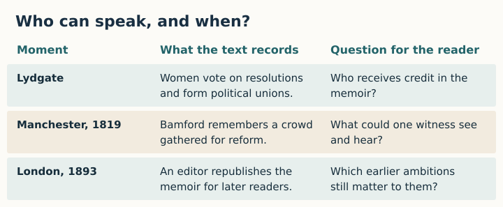

# BEL B/L — Anglais (oral à option) — Bamford et Peterloo 2026 · Corrigé guidé

*Corrigé rédigé par IA, non officiel. Signalez toute erreur.*

**Rédaction** · GPT-6.2 Astra Ultra · vitesse non renseignée

[Sujet officiel](https://www.ens.psl.eu/sites/default/files/2026_bl_rapport_oral_option_anglais.pdf#page=2) · [Rapport du jury](https://www.ens.psl.eu/sites/default/files/2026_bl_rapport_oral_option_anglais.pdf)

## Préparer l’explication

Le rapport donne 1 h 30 de préparation, 20 minutes d'explication en anglais et 10 minutes d'entretien, sans ouvrage autorisé. L'exemple reproduit à cheval sur les pages 2 et 3 est un extrait des mémoires de Samuel Bamford dans l'édition de Henry Dunckley publiée à Londres en 1893. L'événement remonte à 1819. Il faut commenter la sélection présentée aux candidats, y compris ses coupures, et distinguer la voix du témoin de l'acte ultérieur d'édition.

**Préparer l'explication.** Donner à chaque élément une date et un statut. Une main levée à Lydgate relève de la pratique politique locale. Le souvenir de l'orateur relève de la construction du témoignage. La réédition au moment où se fonde l'Independent Labour Party relève de l'histoire de sa réception. Ce dernier rapprochement est proposé par le jury. Le passage ne livre aucune déclaration de Dunckley sur un parti.

**Distribuer les vingt minutes.** À titre d'entraînement, réserver deux minutes à la nature de la source et au problème, cinq minutes à la fabrication d'un public politique, six à la bataille autour du mot *mob*, cinq à l'autorité et aux limites du témoin, puis deux minutes au retour sur le sens de *Radical*. Lire à voix haute une ou deux expressions à chaque étape et en expliquer la grammaire ou la valeur. L'entretien permet de revenir sur les personnes dont le récit transmet la présence sans donner la parole directement.

## Who has the right to describe the people at Peterloo?

[Début du document dans le PDF officiel](https://www.ens.psl.eu/sites/default/files/2026_bl_rapport_oral_option_anglais.pdf#page=2)

At one meeting people laugh as women put up their hands to vote. At another their cries are heard, and unheard in a quite different sense. These are two of the sounds Samuel Bamford remembers in his account of popular reform. Between them lies a question about political recognition. What must a body of people do before others acknowledge it as a public with a claim to be heard? The issue matters particularly at Peterloo, the name given to the violence at a parliamentary reform meeting on St Peter's Field in Manchester on 16 August 1819. The name itself, with its echo of Waterloo, could invoke a national military triumph to expose the scandal of violence against people assembled at home.

The document we have is an excerpt from a memoir, in a London edition prepared by Henry Dunckley in 1893. Samuel Bamford, a Lancashire weaver and radical reformer, took part in the movement he describes. He had lived and written his account well before this edition appeared. We therefore have an actor remembering what the people of Middleton and their neighbours did, and a publication that made his version available to another political generation. The cuts in our excerpt matter as well. We move quickly from meetings to the procession, from an address to a scene of violence. We cannot assume that this is the whole shape of the original work.

I want to ask how Bamford establishes the demonstrators' authority to speak for themselves, and what limits his own claim to speak for them. I shall begin with a form of voting that made a political public visible. I shall then turn to the dispute over the appearance of the procession. Finally I shall consider what a person in the crowd could see, and what readers in 1893 might find in his account.

Consider first where his history of reform begins. Habeas corpus has been restored after suspension. A motion for reform has been defeated in the Commons. The opening moves in a few sentences from parliamentary proceedings in London to meetings in Lancashire and on the edge of Cheshire. One reason for that move is geographical. Industrial Manchester had no parliamentary representation of its own in 1819, although the area had grown rapidly. There is also a reason within the story. A reader expecting a record of motions carried or defeated must learn to recognise moments of political invention outside Parliament. When a motion fails at Westminster, the people in Bamford's account can still put a question to a meeting and see who supports it.

Lydgate gives him a particularly exact example. Women are already present in considerable numbers. Their attendance precedes his speech. What he claims to have done is to argue for their right and the propriety of their voting on resolutions by a show of hands. The pairing of right and propriety is revealing. Right asks whether someone has a legitimate claim. Propriety asks how a woman who makes that claim will be judged in public. Bamford's memoir preserves this second question even as it celebrates the first. The men offer no objection, the women raise their hands and the meeting laughs. He tells us that the women were pleased. He does not allocate a single meaning to everyone's laughter, and I would hesitate to do so. We can hear both the novelty of the occasion and the social pressure under which the gesture was made.

That gesture altered what people could know about a meeting. To attend is to be counted by an observer as part of an audience. To vote publicly is to let neighbours see one's own judgement on the motion. The resolution can now be described as one that women and men have considered together. Bamford says that the practice continued. He names chairwomen, committees and officials of female political unions. These nouns mark an important shift from consent to responsibility. A committee can arrange another meeting, deal with disagreement and keep the association going between public occasions. It would be a serious historical error to call this a parliamentary franchise. It would be equally misleading to assume that people excluded from parliamentary elections therefore lacked experience in making collective decisions.

There is a complication in the distribution of credit. Bamford puts his own intervention at the origin of the change. Later he speaks of “our females” and of a practice borrowed “from us” for charitable and religious uses. The possessive sounds affectionate and proprietary at once. A woman who served on one of those committees might have told the story differently. She might have started with the work that brought women to the bleak ridge in the first place. We cannot supply her missing testimony. We can notice what the first-person story makes easy to remember, one speech and one vote, and what it leaves much harder to recover, the work that made the vote an institution. This is one way to take Bamford seriously as evidence without treating him as the only available point of view in principle.

The second question is how a public proves its intentions to people determined to call it a mob. The authorities have declared the object of a proposed meeting on 9 August illegal. That meeting is called off and another arranged for the sixteenth. A reformer could tell this as a story of defiance. Bamford takes care to include the cancellation. It shows an effort to preserve a public meeting under scrutiny. The same effort shapes his account of Middleton in the morning. Some people turn out to march, others to look. They are watching an event whose appearance, he tells us, was new in the neighbourhood. Before the procession reaches Manchester, it already has a local audience capable of judging it.

What does that audience see? The narrator remembers silk, gold lettering and crimson velvet. This precision restores handiwork and expense to an event that the word “rabble” would render shapeless. People had to choose the inscriptions and make objects that neighbours could read at a distance. The banners combine fellowship with demands for annual parliaments and universal suffrage. In 1819 frequent elections meant putting representatives more often before the people to whom they were accountable. The breadth of “universal” is a more difficult question. Many reformers envisaged an adult male parliamentary electorate. The record of women voting at radical meetings makes that potential boundary worth asking about. It does not settle the intended meaning of this particular banner. One merit of reading the scenes together is that the inconsistency remains audible.

The laurel has an expressly peaceful meaning in the memoir. Yet Bamford also tells us that the young men were chosen for their presentable appearance. His account refuses to leave the political meaning of their looks to chance. To win a hearing, the demonstrators must look respectable by standards that might themselves exclude the poor, the awkward or the disorderly from recognition. I think this is where his case is most powerful and most vulnerable. His close description defeats the fiction that the crowd lacked purposes, objects or associations. But the right to meet would be precarious indeed if it depended on every participant being able to pass an inspection of manners and dress. We can understand why someone facing hostile scrutiny would adopt that defence and still ask what it cost.

The recounted address presses this difficulty further. Bamford says that hostile observers had repeatedly misrepresented the reformers. He urges his companions to maintain composure even under provocation and asks them to allow officers to carry out an arrest peacefully. His concern is the possibility that a disturbance will be treated as a reason to disperse the meeting. In retrospect these remembered instructions also address a reader inclined to find the crowd responsible for the outcome. They establish what he says the leaders had sought. A historian would still want to know how far his voice carried and how others understood him. A very large gathering does not acquire one intention simply because one of its organisers later sets down an address. This limit strengthens the importance of the earlier details. They give evidence of habits and occasions of collective judgement as well as of his individual leadership.

The third issue is what happens to a narrator's authority when he loses the ability to direct the scene. Before the violence, his speech seems to hold the people together. When Henry Hunt steps forward, Bamford can identify the speaker and remember his white hat. Then the sound comes from somewhere else. People around him offer an explanation of what they hear. Bamford stands on tiptoe. For a moment the reader occupies his very limited physical position. He is too low down to see easily and dependent on other people's guesses. The change is an important feature of his testimony. We can locate a witness precisely even where that witness cannot offer us a complete view.

Listen especially to the qualification “as I understood it”. Bamford is interpreting a shout which he takes to be friendly. He cannot know what every throat in the crowd intended or how the shout sounded to the people who received it. Everyday language might treat a loud noise as evidence that the crowd was threatening. His small qualification opens the gap between a sound and an attribution of hostility. It also gives a later reader grounds for trusting his sincerity, since he acknowledges the act of interpretation. Sincerity, of course, does not establish that every detail has survived intact. Memoir can preserve an uncertainty so exactly that it becomes one of the most persuasive features of a reconstructed scene.

In the last lines women and young people become visible as the crowd breaks apart. Earlier, women were people who put a question to a vote and served on committees. Here we hear their suffering, but no individual account in their own words. Changing the scale from the political gathering to the vulnerable person is central to Bamford's moral case. The appeal should have been intelligible even to someone with no sympathy for parliamentary reform. The narrator makes the reader confront the failure of that appeal. We should also notice the change in vocabulary. Young women appear in white and young men are scarcely more than boys. The description draws on conventions of innocence that make the harm particularly affecting. That very choice can narrow the range of people a reader is invited to defend. An adult with strong political convictions was equally entitled to bodily safety. The active women at Lydgate and the vulnerable women at Peterloo belong in the same account of political rights.

Finally, what did it mean to encounter this testimony in 1893? By the later nineteenth century the Reform Acts had altered parliamentary representation and extended the electorate, while women still lacked the parliamentary vote. In 1893 the Independent Labour Party was founded at Bradford. These facts give Dunckley's edition a context. They cannot establish that Dunckley intended his readers to support that party, much less that Bamford in 1819 foresaw it. Some readers might find an ancestry for independent political organisation in the district processions and committees. Others might understand reform chiefly as a gradual enlargement of the constitution. The document troubles an easy version of either account. Its local associations include women whom later parliamentary reforms continued to exclude. Its vivid memory of violence also makes it difficult to tell a wholly reassuring story of uninterrupted constitutional progress.

I can now return to the word “Radical” in the title. In this excerpt radicalism has very concrete meanings. A hand goes up that conventional practice might have kept down. An association makes itself answerable to members. A procession carries proposals that would change who could choose a Parliament and how often. There is also a struggle over who will be believed when the public account of a meeting is written. Bamford has an exceptional claim to our attention because he helped to organise what he describes and admits moments at which his understanding was limited. The same position helps explain his insistence on discipline, his claim of initiative at Lydgate and the voices his memoir cannot transmit. Reprinting the testimony keeps those struggles available to later readers. Reading it closely lets us hear both the radical demand to be recognised and the disagreements concealed within the apparently simple word “people”.

### Entretien d’entraînement

**If Bamford was there, why ask about the date of the edition?** Being there gives him access to the gesture of a hand, the position from which he tried to see and his memory of the meeting. A memoir is a later account of that experience. The 1893 edition adds a further audience for whom electoral reform had a different history.

**Were the women at Lydgate enfranchised?** They took part in votes on resolutions at public radical meetings. This demonstrates political practice and competence outside parliamentary elections. It did not give them a parliamentary vote.

**Does the label “Peterloo” occur in the excerpt as Bamford's explanation of events?** The extract names St Peter's Field and describes what occurred there. I used Peterloo as the historical name when introducing the document. The label and its resonance should not be mistaken for words spoken by Bamford to the meeting.

**Why give so much attention to the change of pronoun?** The narrator can tell us what he urged his listeners to do. A shift to “we” or “our” claims a larger shared experience. I would check which people can actually be heard speaking before assuming that everyone saw the scene in the same way.

**Does 1893 mark the end of a direct path from Peterloo to the Independent Labour Party?** It provides a suggestive setting for republication. A line of inevitable descent would ignore the other political traditions that claimed memories of reform and the demands that remained unmet by 1893.

**What would you look for in another source?** A woman organiser's account could help test who first raised the question of voting and what committee work involved. For the final scenes, other witnesses' positions would matter. Two sincere observers need not have been able to see the same thing from different parts of the field.

