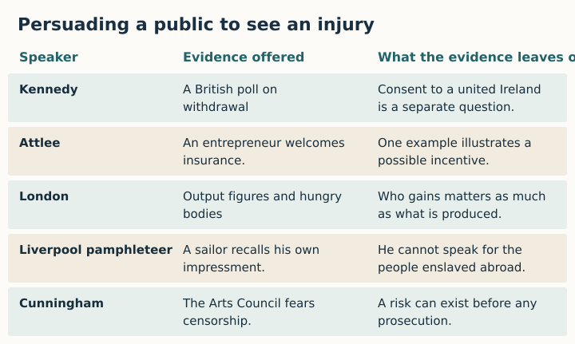
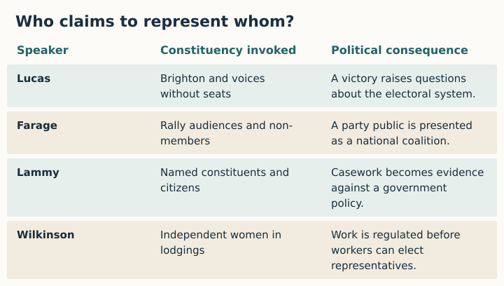
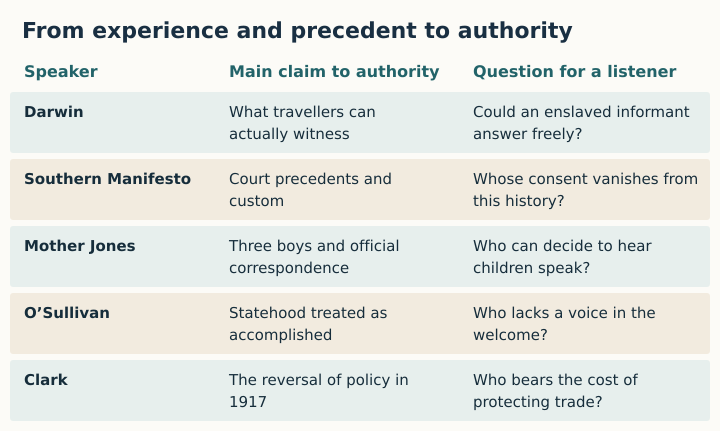
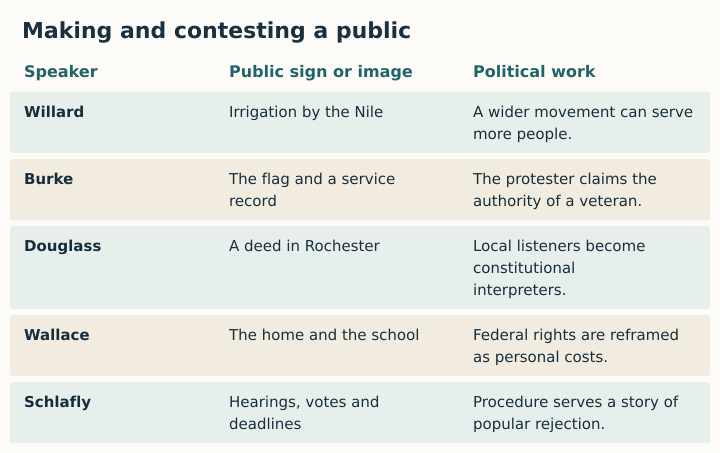

# BEL B/L · Anglais tronc commun, oral 2026 — Corrigé guidé

*Corrigé rédigé par IA, non officiel. Signalez toute erreur.*

**Rédaction** · GPT-6.2 Astra Ultra · vitesse non renseignée

Le fascicule officiel donne dix-neuf documents historiques et politiques sur vingt-six pages. Le candidat tire un seul document, le prépare en 1 h 30 et présente son commentaire en anglais pendant vingt minutes, avant dix minutes de questions. Les pages ci-dessous désignent les pages physiques du fascicule et permettent de retrouver les lignes analysées.

[Fascicule officiel, 26 pages](https://www.ens.psl.eu/sites/default/files/2026_bl_sujets_oral_anglais_tronc_commun.pdf) · [Rapport du jury](https://www.ens.psl.eu/sites/default/files/2026_bl_rapport_oral_tronc_commun_anglais.pdf)

## Préparer et développer un billet

**Pendant la préparation.** Consacrez le premier quart d’heure à la date, au genre, à la fonction de l’auteur et aux destinataires. Inscrivez les premiers et derniers mots de votre passage de lecture sur le brouillon si vous souhaitez citer un moment décisif. Réservez une demi-heure aux articulations du document. Marquez chaque changement d’interlocuteur, d’échelle ou de sens d’un mot. Examinez ensuite ce qui, dans le contexte historique, éclaire les formulations relevées. Gardez le dernier quart d’heure pour répéter votre introduction, vos transitions et la réponse à une objection.

**Construire les vingt minutes.** Introduisez la source en deux minutes et formulez le problème historique qu’elle pose. Développez trois mouvements de cinq minutes en revenant à chaque fois sur les lignes du document. Pour chacun, formulez la proposition de l’auteur, commentez un mot ou un exemple, puis montrez ce que ce choix révèle ou rend invisible. Deux minutes suffisent pour faire apparaître ce que cette source permet d’établir. La minute restante donne de la souplesse aux transitions. Les dix-neuf développements ci-dessous se préparent séparément.

**Répondre à une relance.** Si l’on vous interroge sur un chiffre, un fait juridique ou un jugement moral, repartez du locuteur qui l’énonce et de son intérêt à le présenter ainsi. Distinguez ce que montre le document, ce que l’on peut en inférer et la preuve supplémentaire qu’il faudrait pour vérifier une généralisation.

## 1. Ted Kennedy and the American claim to speak for Ulster — p. 1

**Au brouillon.** Entourez les trois publics que Kennedy mobilise successivement, puis relevez ce qu’aucun d’eux ne peut décider depuis Washington. Reliez la mention de Londonderry au passage sur la minorité. Mettez enfin « 59 % » en face de la question effectivement posée par le sondage. Vous pourrez expliquer à quel moment la conclusion dépasse la preuve invoquée.

In the US Senate on 20 October 1971, Edward Kennedy introduces a resolution with Abraham Ribicoff. A matching proposal is being introduced in the House. Neither chamber has adopted the position that he advocates. Why should a senator from Massachusetts believe that a platform in Washington gives him a hearing on the constitutional future of Northern Ireland?

Kennedy first turns a potential charge of interference into an obligation. Irish migrants have made America what it is. Repeating the word *land* allows him to address the country of his listeners and the island their ancestors left in almost the same breath. Emigration becomes the outward sign of a long struggle for self-determination. The appeal to Americans of every faith seeks allies beyond an Irish Catholic constituency. Yet the cost of bringing everyone into his address is apparent when he speaks of Ireland as a single political subject. Partition left a substantial unionist population in Northern Ireland whose preferred national future this account hardly allows us to hear.

Kennedy next gives the proposal the authority of the American civil rights struggle. The minority's equal rights and the effects of repression offer a language familiar to the Senate. The ghetto, the detention camp and the British soldier enter the argument as signs that force cannot produce reconciliation. In 1971 the introduction of internment without trial gave detention particular urgency. The leap in the speech is from the necessity of equality to the asserted necessity of immediate withdrawal and unification. One could accept the first without conceding the second. The absolute terms in which he couples them are part of his political intervention.

Finally, the Vietnam analogy changes America's role. Its own intervention furnishes a warning to an ally. The comparison puts Kennedy in the position of a critic who has learnt from his country's mistakes. A British poll then allows him to appeal over the head of the British government to its public. Even on his reading, support for bringing troops home does not establish support for reunification. The resolution gives distant suffering a domestic constituency while simplifying the question of consent within Northern Ireland.

**Jury question. What does Vietnam add to the civil rights analogy?** Civil rights supplies a vocabulary of equality. Vietnam supplies a timetable of escalation and allows the senator to urge withdrawal while Britain can still avoid what America failed to avoid.

**To develop at the board.** Contrast the time scales. Centuries of dispossession establish a long moral debt, the alleged brink of civil war makes delay intolerable, and Vietnam supplies a future that Britain can still avoid. The same resolution is made to answer all three clocks. Which of its two demands, withdrawal or unification, follows most directly from each?

## 2. Clement Attlee and the price of insecurity — p. 2

**Au brouillon.** Tracez deux colonnes, financement et production réelle. Classez la clause sur les cotisations, les prestations du second tableau, le travail disponible et la consommation. Faites varier oralement une cotisation en période de ralentissement et expliquez le passage par le pouvoir d’achat, sans attribuer au texte un taux précis.

Attlee speaks to the House of Commons in February 1946, after Labour's electoral victory and before the National Insurance Bill becomes law. Why does the prime minister defend social protection by talking to MPs about what happens to people's purchasing power?

His opening makes an unemployed or sick worker visible as a consumer. If people cannot buy what industry produces, their misfortune becomes a loss for the whole economy. The apparently inclusive *we* lays claim to a consensus, only for the reference to his side of the House to remind MPs who has long argued for it. The cuts of 1931 provide a counterexample in recent memory. The 1944 employment White Paper and Sidney Webb allow him to locate planning both in wartime agreement and in an older Labour tradition. Clause 3 gives that history a practical consequence. Contribution rates could move up or down with specific parliamentary approval. Altering what people keep in their pockets might help to moderate a slump. A benefit system and a policy for managing demand can thus be discussed together.

His imagined opponent asks whether Britain can afford it. Attlee returns the question with a choice. Are Britain's total goods and services insufficient to secure a modest minimum, or do some claim such priority over the common product that others must live in want? The idea of a common pool changes the object of calculation from a government account to the distribution of national production. Attlee still makes provision conditional on productive effort, organisation, trade and hard work. Keeping these qualifications in view matters in a country emerging from a costly war.

The businessman who welcomes Beveridge gives the conclusion an unexpected witness. With a minimum beneath him, he can attempt something uncertain. The movement from cushion to springboard makes security an incentive to take risks. In this account, enterprise and insurance have a common enemy in the fear of losing everything. When Attlee invokes the wartime struggle, he transfers collective exertion from national defence to a promise of security across the life course. The document shows Labour trying to make a programme of redistribution sound both economically necessary and patriotic.

**Jury question. How far is flexibility in Clause 3 a blank cheque?** Attlee explicitly mentions parliamentary approval. He presents variable contributions as a response to changing employment while retaining a role for the elected legislature.

**To develop at the board.** The question about affordability is spoken in an imaginary opponent's voice. Attlee does not promise limitless resources. He asks MPs who is entitled to a share in a finite pool, then accepts an obligation to expand the whole pool. This qualification gives the businessman's story its force as evidence of what security might do for production itself.

## 3. Jack London audits the civilisation of the East End — p. 3

**Au brouillon.** Reconstituez les deux comptes que Londres pourrait présenter, production totale et consommation réelle du travailleur. Localisez le passage qui étend le raisonnement de l’atelier à l’Empire. Entraînez-vous à citer l’image des deux quartiers puis à expliquer exactement ce que la comparaison avec les Inuit suppose de hiérarchie.

Writing at the end of *The People of the Abyss* in 1903, an American visitor to London asks why industrial productivity has brought so little comfort to the people who make it possible. What would happen if the British Empire had to justify its existence by the ordinary worker's dinner and shoes?

Bread, cloth and boots are articles one can count in units and then look for on an actual body. The opening sets the remarkable output of individual producers against the wants recorded in the preceding book. The word *average* changes its function as it travels from productive capacity to quality of life. A society may boast about the first average while withholding the goods necessary to sustain the second. The capitalised verdict of mismanagement gives the discussion the sound of an inquiry at which a jury has already heard the evidence.

London then borrows business language and turns it on the beneficiaries of empire. If commercial supremacy is a profitable enterprise, show who shares the profits. If gentlemen list no occupation, what do they produce? The proposal to grow potatoes on game preserves gives the reader a test case in the uses to which land can be put. Census classification makes privilege visible while sarcasm invites the reader to try defending it. The two ends of a single London become a map of a divided kingdom. To call such a distribution bad management is to ask whose interests count when success is measured.

There is a limit to this attack on hierarchy. London distinguishes the failing political machinery of empire from a supposedly vigorous community founded on blood. His comparison with Inuit people likewise makes their living conditions a standard that mass industry ought to surpass while relegating them to an imagined Stone Age. Identifying this hierarchy helps explain how he can condemn imperial management so fiercely and retain a racial view of human progress.

The close leaves the reader with mouths to feed and bodies to clothe. They are the witnesses before an imagined court that can hold an entire managing class answerable. Returning to the necessities with which he began makes the reader repeat the test on different terms. The relevant figure is the share actually reaching those bodies.

**Jury question. Does London call for the unconditional abolition of empire?** The argument initially states a condition about profits and their distribution. Its most radical indictment concerns the political machinery and the class running it. His idea of an enduring community of descent complicates any simple anti-imperial reading.

**To develop at the board.** Try the condition about the gentleman of no occupation twice, once in his own voice and once in a worker's. Both can use the word *profitable*, yet they must name different beneficiaries. That reversal explains why repurposing an estate as a potato field is a serious challenge dressed as a joke.

## 4. A Liverpool pamphleteer defends West Indian slavery — p. 4

**Au brouillon.** Faites trois lignes pour l’Inde, les Antilles et le navire de guerre. Demandez qui témoigne dans chaque cas, qui peut quitter sa condition et qui est autorisé à la comparer aux autres. Repérez à quel moment un argument de degré bascule vers une prétendue impossibilité raciale de l’émancipation.

An anonymous pamphlet printed in Liverpool in 1823 takes aim at advocates of emancipation. British participation in the transatlantic slave trade had been outlawed in 1807. Enslavement in the colonies continued. How does a writer who claims to have experienced forced labour himself turn that experience into a defence of enslavers?

A concession about philanthropic intentions gives the writer the appearance of a fair opponent. His first substantive move is comparative. He invokes Indian cultivators, treats their situation as entirely determined by religion and material necessity, and asks whether conditions are truly better there. The questions announce in advance that only one answer is admissible. By defining any severe constraint as slavery, he erases distinctions between poverty, inherited status, forced service and a system in which people can be owned and sold. As a result the driver's whip, elsewhere a visible emblem of plantation rule, can be presented as one hardship among others.

The invitation to look at British prisons and naval punishment has genuine critical potential. The speaker remembers returning from a voyage only to be seized at his own door and sent to India. A reader who condemns coercion at home might have been expected to condemn it abroad. Instead the narrator offers a hypothetical choice between naval impressment as he suffered it and an *indulgent* West Indian master. He controls the terms of comparison by choosing the kinder master. The enslaved person has no voice in this supposed exercise of preference. A personal memory supplies considerable emotional authority for a claim about a quite different institution.

In the final paragraph the nature of the premise becomes especially clear. An argument supposedly based on comparing material conditions becomes an assertion that Africans are inherently unwilling or unable to profit from European education. Climate is called on to make that claim seem permanent. Returning people who abandon European dress can be described only as reverting to vice. The comparison with legislating for the moon closes the argument by placing the objects of philanthropy beyond any possible common political understanding. Liverpool's commercial connections with the Atlantic economy make the place of publication significant, although anonymity prevents us from identifying a particular occupation or financial interest. The text documents the work required to make coercion appear both relative and natural.

**Jury question. Does the press-gang story establish the author's identity?** It establishes the persona on which the pamphlet relies. Even if taken as personal testimony, it gives the speaker no authority to decide what another person would choose.

**To develop at the board.** Notice the rhetorical advantage of conceding something shocking. British readers are invited to condemn the treatment of a British sailor, and the author converts their sympathy into credit for his next comparison. Ask whether attending more consistently to that sailor's loss of agency might lead the same reader to the opposite conclusion about emancipation.

## 5. The Commons debates Clause 28 — p. 5

**Au brouillon.** Écrivez trois verbes distincts pour posséder un livre, le fournir et le promouvoir. Replacez-les dans une bibliothèque municipale, puis reprenez le raisonnement du parlementaire sur le risque d’autocensure. Jouez enfin les deux répliques de fin, chacune avec sa propre définition de la majorité.

In March 1988 MPs debate a restriction on local authorities later known as Section 28. Dr Jack Cunningham opposes the clause. Tony Marlow intervenes to dispute his account of public opinion. What changes when a debate nominally about promoting homosexuality becomes an argument about who may decide which books or plays reach the public?

Cunningham widens the field in his opening. Local councillors, educators, public libraries and the arts all enter a dispute often presented as a narrow question of teaching. If the intention to *promote* must be assessed before a council distributes a book, caution may prevent lawful works from being made available. A prohibition addressed to local government can therefore affect a reader even though reading the book is lawful. This is the mechanism behind his distinction between deliberate censorship and censorship by default. The Arts Council gives him an institutional ally and challenges any assumption that only a small and self-interested constituency objects.

He then sets the proposed law beside anti-discrimination legislation. Such laws can signal which forms of discrimination cease to be respectable. His fear is that this clause would authorise a movement in the other direction at a moment when AIDS was already intensifying hostility towards gay people. Legal ambiguity does political work even before anyone tests the clause in court. The argument shifts from the direct effect of wording to the conduct it might encourage.

The parliamentary exchange matters because it gives us two uses of the word majority. Cunningham suspects the government of seeking an electoral profit from prejudice. Marlow replies that he is insulting the public and asking the government to ignore public feeling. Cunningham refuses that account, attributing bigotry to the government's political calculation and claiming ordinary British decency for his own position. The interruption is thus evidence of a struggle for democratic legitimacy. Both sides claim to speak for the public, but neither intervention measures its views. The document lets us see opponents arguing that freedom of expression, minority protection and democratic institutions themselves are at stake in the drafting of one clause.

**Jury question. Does the clause prohibit the possession of a novel?** The concern in the debate is the indirect effect of restricting local authorities' provision of materials. Confusing that with a general prohibition on possession would obscure Cunningham's strongest point.

**To develop at the board.** Compare the possibilities of discrimination encouraged by a law's social meaning and those of censorship produced by uncertainty about enforcement. The first depends on a newly respectable attitude, the second on an official's unwillingness to take a risk. Cunningham presents both as practical effects of a provision whose authors call it neutral.

## 6. Caroline Lucas enters the Commons — pp. 6–7

**Au brouillon.** Établissez le lien entre quatre scènes, le costume de Hardie, le portrait de Brighton, les élus verts hors de Westminster et le choix du mode de scrutin. Précisez quelles propositions de Hardie sont entrées dans les usages et laquelle Lucas considère comme toujours en suspens.

On 27 May 2010 the first Green MP elected to Westminster delivers her maiden speech. Brighton Pavilion has entitled her to speak in the Commons. Why does her arrival lead her to call into question how the Commons is elected?

Lucas first acknowledges the institution's history and the obligations of a new member. She recasts that history as a record of former outsiders becoming ordinary legislators. Keir Hardie's clothes once scandalised the House. Her joke about which outfit would look odd today allows her to move from fashion to policies now cherished by former opponents. The House of Lords supplies an exception to the list of accepted reforms and an opening for criticism inside a convention of courtesy. When Lucas describes Brighton's small enterprises and welcome for difference, her local portrait explains how an electoral constituency could become an agent of political innovation.

The Green Party's long journey gives that single victory a different meaning. A political organisation founded in the 1970s had already won representation on councils, in the European Parliament and in London. Continuing work on doorsteps is something other MPs have reason to recognise. Its value also makes the delay in obtaining a Commons seat harder to defend. Lucas suspends celebration long enough to ask what the debate has lost by excluding such voices, particularly during decades of warnings about energy and pollution. An achievement can be evidence against the system through which it was finally achieved.

The passage closes on two different kinds of responsibility. The public should have a genuine choice about electoral arrangements, including proportional representation. Holding a referendum on the Alternative Vote would not settle that issue, since AV in single-member seats does not allocate seats proportionally. As for climate change, people already suffering in poorer countries have little access to this chamber. The first-person plural at the end invites those seated there to take responsibility. The maiden speech honours its audience by asking what it must change if representation is to mean more than a seat won after four decades.

**Jury question. Is this just an account of her party's success?** The years before the breakthrough and the earlier successes under other electoral arrangements turn a personal milestone into an argument about whose ideas reach Westminster.

**To develop at the board.** A maiden speech normally turns backwards to a constituency and its predecessors. Lucas uses that convention to speak for future movements whose members have not yet been elected. The demand that the public choose its electoral system therefore follows from the account of the party's journey, even for an MP unconvinced by Green climate policy.

## 7. Nigel Farage imagines the audience beyond his party — pp. 8–9

**Au brouillon.** Distinguez les présents au congrès, les personnes ayant assisté aux réunions publiques et l’ensemble des électeurs. Associez chacun aux pourcentages ou quantités que Farage avance. Suivez le glissement de l’immigration aux frontières, puis au Parlement et au commerce extérieur.

At UKIP's conference in September 2013, Farage speaks to activists who have already made a choice. Why devote so much of the speech to the people who have yet to join? He proposes a way of turning a discussion of immigration into a constituency for withdrawal from the European Union.

The opening couples admiration for individual migrants with alarm over their numbers. The assertion about a thousand years is offered as a self-evident measure without a comparable historical series in evidence. Calling the problem obvious to anyone honest gives disagreement a moral cost. The speaker also claims to speak for settled ethnic minorities, moving the boundary of the *we* from ethnicity to the distinction between established residents and new arrivals. He next makes an itinerary of towns counter the geographical and professional authority of London commentators. A show of hands in his audiences is vivid evidence that non-members attend his meetings. It is a poor sample of opinion across the country.

The list of workers and employers, old and young, activists and abstainers deliberately makes it difficult to recognise a typical UKIP voter. Farage offers an alternative principle of solidarity in a shared dislike of politicians portrayed as interchangeable and calculating. The short fragments and barrages of nicknames perform the plain speaking that he claims for his party. Dissent within UKIP briefly surfaces through a joke about members' use of Facebook. He absorbs it into an image of independence before declaring the party opposed to racism and extremism. The declaration is a piece of self-presentation taking place in a charged political debate.

The closing step makes withdrawal sound like recovery. Borders, money, Parliament and fisheries become things *we* can get back. Aspirations to trade with the Commonwealth make a break with the EU sound internationalist. An appeal to an exceptional national history turns a specific institutional choice into a conclusion about identity. In 2013 the referendum and its outcome still lay ahead. The speech tries to produce the coalition that subsequent events can tempt us to take for granted.

**Jury question. Is the meeting evidence that UKIP already speaks for a majority?** It tells us how Farage stages his constituency, including the interested non-member. A self-selected theatre audience gives him a story about outreach but no national mandate.

**To develop at the board.** Compare the short clauses about people in his audiences with the closing sequence in which the first-person plural keeps getting things back. The first sequence emphasises difference and the second makes the action of all those different people sound identical. Refer to the £55 million as Farage's stated figure, distinguishing the claim from audited net savings.

## 8. David Lammy and the right to call someone a citizen — pp. 10–11

**Au brouillon.** Sous les mots *subject*, *citizen* et *immigrant*, distinguez statut juridique, terme ministériel et soupçon social. Choisissez deux situations de circonscription dont les conséquences diffèrent matériellement. Lisez-les en parallèle avec le comptage des mots employés par l’ancienne ministre.

On 30 April 2018 the Labour MP for Tottenham addresses the Commons over the Windrush scandal. Ministers have talked of helping long-settled people to obtain citizenship. Why does an offer of help sound to Lammy like a further injury?

He refuses to begin the history in 1948, with the arrival of the *Empire Windrush*. Enslavement, colonisation and Caribbean labour move the beginning several centuries back. The antithesis between Britain's arrival overseas and the descendants' arrival in Britain reverses the usual direction of explanation. Stuart Hall's image of sugar in English tea translates the relationship into a familiar household act. Historical precision requires a distinction. Lammy invokes the scale of the whole Atlantic slave trade in attributing responsibility to British traders. His figure should not be quoted as a measured British share. His political purpose is to put empire inside British national history.

A ministerial suggestion that people might choose to apply seems conciliatory only if one supposes they have no rights already. The extract from the 1948 British Nationality Act establishes the language of citizenship of the United Kingdom and Colonies and British subjecthood. Legal categories subsequently changed and individual cases could differ. Lammy's point is that the government cannot treat established rights as a new discretionary gift. His constituency files turn an abstract administrative dispute into lost work, a cancelled visit to a sick mother and denied access to benefits. Repeating *British citizen* before each name makes a political reply to administration by category.

Finally, he counts a minister's repetitions of *illegal* and the absence of the word *citizen*. What looks like an unfortunate confusion of terms becomes the way policy works. Employers, landlords and health workers are made to carry out checks and people who merely look like migrants bear the burden of proving otherwise. The MP's two sources of authority, Parliament's own statutes and constituents' lived encounters, expose the distance between enjoying a right and being able to exercise it. The speech makes historical remembrance part of ministerial accountability.

**Jury question. Are all those examples separate anecdotes?** Their differences map the institutions in which one burden of proof operates. In the Chamber they are also pieces of casework brought by a representative calling the executive to account.

**To develop at the board.** Lammy places an Act of Parliament beside school reports, tax records and individual careers. Statutes should establish categories of right. The documents in a claimant's hands show how badly recognition can fail in practice. His return to everyday paperwork gives the otherwise sweeping account of empire a precise point of contact with parliamentary oversight.

## 9. Ellen Wilkinson and the independent worker missing from the electorate — p. 12

**Au brouillon.** Inventez deux cas simples de femmes de plus de trente ans, l’une couverte par une qualification de 1918 et l’autre salariée vivant en meublé. Ces exemples illustrent le mécanisme sans devenir des personnages que l’on attribuerait à Wilkinson. Revenez au véritable exemple de la travailleuse du Lancashire.

When Ellen Wilkinson takes the floor on 29 March 1928, women are already sitting in the Commons. Yet some of the women directly affected by the laws she discusses cannot vote. What does this anomaly tell us about the difference between a franchise extended to some women and equal citizenship?

Wilkinson begins by treating her opponent's arguments as museum pieces. His appeal to the supposed preferences of Muslim subjects of the Crown is met with counterexamples, including Victoria's rule and women's participation in Indian provincial elections. She uses the imperial frame against him while retaining a hierarchy of peoples that can make her own comparison uncomfortable. She then accepts that coal and stokehold work are hard. Lancashire women's factory hours followed by housework and childcare change the unit of measurement from a paid occupation to a whole working day. The suggestion that some MPs might fail their own labour test uses humour to expose the arbitrariness of the qualification.

The case becomes more exact at the point where she distinguishes an age group from a class. The settlement of 1918 had given many women of thirty and above the parliamentary vote subject to qualifications linked to property, occupation of premises or marriage. A single worker living in furnished lodgings might still be excluded. The joke about needing a husband or furniture exhibits the odd legal consequences of accepting women's competence while measuring independence through a household they may not own.

Trade boards and factory legislation supply the conclusion with its institutional setting. Parliament already regulates pay and conditions for many of these workers. On what democratic principle can their representatives legislate about them while they cannot help choose the representatives? Equal franchise at twenty-one would therefore do more than lower an age threshold. It would bring politically independent wage earners into a system already exercising authority over their working lives. The language of closing a drama registers a historic achievement. The detail about rented accommodation explains precisely which ending Wilkinson has in mind.

**Jury question. Why mention domestic work in a parliamentary argument?** Her opponent treats difficult paid work as evidence of political worth. Adding factory and household hours makes that criterion rebound on those who proposed it, before she moves to a more fundamental right of representation.

**To develop at the board.** Listen for two kinds of laughter. Calling the opponent's arguments museum pieces dismisses them as old-fashioned. Grouping husbands with furniture exposes the legal dependence of a woman who is economically independent. The second joke provides a sharper answer to why this particular bill mattered in 1928.

## 10. Charles Darwin tests the testimony of travellers — p. 13

**Au brouillon.** Faites l’inventaire des verbes de témoignage dès les premières lignes. Comparez le cri dont Darwin ne peut établir la cause, les scènes qu’il dit avoir vues et les paroles potentiellement surveillées des personnes interrogées. Revenez en conclusion à l’avis qu’il donnerait à un futur voyageur.

Darwin's retrospective on the *Beagle* voyage opens here with relief at leaving Brazil and ends by asking who would benefit from such a voyage. What connects his indictment of slavery to a naturalist's reflections on the uses and limits of travel?

A sound heard from a house near Pernambuco returns whenever he hears a distant scream. Darwin explicitly distinguishes what he suspected behind that door from what he later saw. The sequence of first-person statements then separates places, informants, observations and acts he failed to prevent. A child's father trembles under a master's glance. A man regarded as kind readily contemplates separating families. These examples challenge two comforts available to readers, that violence requires a visibly violent master and that better treatment in one colony could vindicate the institution there.

The text also asks who gets to see what. Travellers received in wealthy households meet selected people under their masters' eyes. Even a question addressed to an enslaved person offers no guarantee of independent testimony when the answer may be reported to the owner. Darwin attacks the quality of an inquiry that mistakes constrained speech for consent. His own description still makes racial generalisations and his authority remains a free visitor's. The precision of his criticism does not make those limits disappear.

He then considers arguments about an owner's interest in preserving valuable property and comparisons with the British poor. Poverty at home may itself indict British institutions. It supplies no reason to own a person abroad. The invitation to imagine one's children sold shifts the reader's position from observer to potential victim. Christian professions and Anglo-American claims to liberty supply standards against which slaveholding becomes especially damning. At the end of the indictment, however, the British *we* becomes capable of congratulating itself on an exceptional sacrifice to expiate its sin, a reference intelligible in the context of British emancipation. The final return to the costs and benefits of exploration gives the whole complaint an epistemic point. A voyage undertaken for the pleasure of seeing difference cannot guarantee knowledge. The traveller must attend to the conditions under which another person's suffering can be seen, hidden or credibly reported.

**Jury question. Was the torture at Pernambuco directly observed?** He heard moans and records his suspicion twice. Contrasting that careful qualification with what he says he personally witnessed is central to his claim to be a more reliable traveller.

**To develop at the board.** Darwin objects to an interviewer who forgets that an answer might reach the master's ears. Apply that question to his own testimony. He is able to move on and speak safely. A person subject to the owner's power has no equivalent freedom. This explains why the visitor's apparently simple prescription to ask the people concerned can fail.

## 11. The Southern Manifesto and the uses of precedent — pp. 14–15

**Au brouillon.** Construisez la chronologie de la démonstration des signataires et placez à part ce que décide *Brown*. Identifiez la fonction politique de leur inventaire d’États du Nord. Préparez une phrase décrivant la catégorie de personnes que l’expression de « consentement » rend presque invisible.

Walter George presents the declaration in the Senate on behalf of legislators opposed to the Supreme Court's school decisions. In 1956, two years after *Brown v. Board of Education*, why do defenders of racial segregation choose to speak in the language of checks, balances and constitutional fidelity?

The opening charges the justices with substituting power for law. Invoking the Founders, the authors assign constitutional change to the amendment process and portray adjudication as disguised legislation. Education does not appear by name in the Constitution or the Fourteenth Amendment. The authors press the inference that equal protection could therefore have no such application to state schools. The inference is the contested part. A general guarantee of equal protection need not name every institution subject to it. So the document is an intervention in constitutional interpretation by elected politicians whose states stand to be affected by enforcement.

Their chain of examples performs two tasks. Segregated schools in Washington and in states at the time of ratification are used to claim original intent. By recalling a Massachusetts ruling and naming other northern states, the authors also make segregation's history national. That geographical correction serves a particular purpose. If northern states changed by local decisions, southern authorities too should control the timetable. *Plessy* and *Lum* provide precedents for separation, whereas *Brown* held that separate public educational facilities were inherently unequal. The manifesto's story supplies extensive evidence of how long separation lasted and no answer to the question of what it did to children denied equal educational opportunity.

In the final movement legislators put parental control, established custom and supposedly amicable race relations on one side and outside intervention on the other. The language of consent becomes especially revealing. Whose consent counts when Black families who went to court to contest segregation are missing from the picture? By declaring that the Court has created racial suspicion, the text treats litigation as the origin of a conflict whose existence actually explains the litigation. The Senate presentation gives sectional resistance a national platform, and constitutional continuity a powerful political use.

**Jury question. Is this an alternative judgment of the Court?** It is a political declaration entered into the Congressional Record. The citations borrow judicial authority for resistance by lawmakers. They are selected by authors seeking to discredit the actual ruling.

**To develop at the board.** The declaration moves from senators and representatives speaking formally for states to parents apparently speaking simply for themselves. Ask what happens to the Black parents who also claim a say in their children's future. Their absence reveals the political work that a shift from constitutional procedure to private family life can accomplish.

## 12. Mother Jones asks for an audience — p. 16

**Au brouillon.** Sur une ligne de temps, placez les deux lettres antérieures, le déplacement avec trois enfants, la réponse du secrétaire et l’adresse donnée pour la réponse. Demandez ce que l’on sait du travail des garçons et qui, dans ce document, parle effectivement. Distinguez le pouvoir législatif fédéral et la capacité présidentielle à rendre la cause visible.

In an open letter published in July 1903, the labour organiser Mother Jones seeks an interview with Theodore Roosevelt about child labour. The president has already failed to answer earlier approaches. Why might another letter be effective even if it does not open the president's door?

The text gives an unusually concrete account of access. Two letters went unanswered. A visit to Oyster Bay with three children met a secretary who required a further written request. Jones follows the rules scrupulously and records the promise of personal delivery. Newspaper readers can now witness the exchange and judge whether it receives an answer. The letter's ostensible modesty, a request for the president's advice, lays a public obligation on its recipient.

Jones calls the children future citizens and mothers of citizens. That gendered distinction makes a claim about the entire republic while revealing contemporary assumptions about who participates politically and how. Twelve hours of unhealthy work stunt the bodies and minds that self-government will eventually require. School and a working childhood are presented as competing futures. The three boys, the eldest eleven, have worked despite state laws meant to regulate the mills. Their proposed testimony illustrates enforcement failure more effectively than an abstract appeal to good intentions.

By reporting what she has seen in factories, Jones connects labour organisation, personal observation and public proof. The boys have walked a hundred miles and are available to speak for themselves. Yet their spokesperson is still the adult who arranges the encounter and interprets their experience. Finally, she moves from enforcing existing state rules to seeking federal legislation backed by penalties. Roosevelt cannot enact such a law on his own. Calling on him as the nation's chief representative addresses the difference between formal legislative power and a president's capacity to direct attention. The last lines give an address for the early reply the secretary promised. An apparently routine courtesy turns a public appeal into a test that has a place, a date and witnesses.

**Jury question. Why use the press when requesting a personal interview?** Publication creates a second audience. The reader can assess both the children's conditions and the executive's willingness to receive them, even if the interview never occurs.

**To develop at the board.** The passage moves from three boys to all future citizens, and then returns to those three boys ready for a meeting. The first movement gives national scale to a local labour dispute. The second makes a national claim answerable to identifiable witnesses. The newspaper lets those two movements reach people who cannot enter the president's house.

## 13. John O'Sullivan writes Texas into the Union — pp. 17–18

**Au brouillon.** Notez séparément le statut que l’auteur donne au Texas, les démarches qu’il annonce et ce qu’il attribue au Mexique. Analysez le premier *already*, puis la métaphore finale de la faute mexicaine. Vous pourrez expliquer pourquoi le présent du texte doit rester distinct de l’entrée effective du Texas dans l’Union en décembre 1845.

In a Democratic periodical in the summer of 1845, O'Sullivan tells readers that Texas already belongs to them. The remaining steps towards statehood have not all been taken. Why speak of an outcome still in progress in the language of completed possession?

He begins by claiming to know what the Texas convention will have done by the time his words are read. Repetition of *already* brings administrative procedure forward into patriotic feeling. A star, a stripe and an eagle's wing remake a geographical territory in the image of the United States. The distinction drawn in French between a country and a homeland makes readers feel that something dear to them has already been constituted. Objections can now be represented as an insult paid to a newcomer to the national family.

The sequence of imperatives urging an end to party discord reveals how much opposition there was to overcome. The writer presents a past election as a terminus after which debate has become ungracious. He next invokes Britain and France as interfering outsiders. In this setting the phrase *manifest destiny* gives demographic growth a providential entitlement to occupy a continent. Annexation can be pressed as a defensive reaction to foreign hostility. The people already living on that continent, including Indigenous peoples, scarcely enter the deliberation.

The final paragraphs accept the need to address a serious objection, that annexation could amount to conquest behind peaceful forms. O'Sullivan asserts Texas's independence in fact and in right. He attributes settlement to Mexican invitation and subsequent separation to Mexican breaches of a compact. The argument turns settlers who enlarged US influence into victims seeking redress. By treating the province as a rightful recovery he assumes the very claim that a Mexican account would dispute. Enslavement in Texas and the political stakes of admitting a slave state also recede behind the language of national family. The source reveals how a controversial expansion could be naturalised through grammar, feeling, constitutional argument and providence before its consequences had run their course.

**Jury question. Why dwell on the verb in the opening sentence?** Its present tense installs the reader inside the result, while the following predictions acknowledge that the process is unfinished. That difference is doing political work.

**To develop at the board.** The friendly metaphor of family membership can sound harmless until we ask who gets to welcome whom. The United States appears as the host, Mexico as an intruder or a failed sovereign, and Indigenous claims disappear from the arrangement. What the metaphor leaves out is as consequential as the emotion it creates among readers.

## 14. Bennett Champ Clark and neutrality before the emergency — p. 19

**Au brouillon.** Placez côte à côte les deux slogans de 1916–1917, le salaire de guerre et le chômage ultérieur. Faites une phrase en anglais distinguant le profit individuel provisoire, les coûts sociaux et l'obligation publique de protéger un commerce privé. Situez la référence à la « dernière guerre » depuis décembre 1935.

Writing in *Harper's Monthly* in December 1935, Senator Bennett Champ Clark assumes that many Americans want to stay out of another war. His question is why that desire proved an insufficient safeguard the last time. How does he turn neutrality from a public mood into a proposal about political obligations?

Wilson's re-election in 1916 and American participation in the First World War five months later supply the opening reversal. The distance between the slogans of keeping out and saving democracy is short enough to be alarming. Public intention is vulnerable to pressures that grow after other powers have gone to war. On this reading the period before an emergency, when interests and emotions have not yet hardened, is the time to establish definite rules for relations with belligerents. Neutrality requires active political choices.

The imagined profiteer then invites readers to remember high wages, high agricultural prices and wartime contracts. Clark changes the time scale. War-boom pay did not protect labour from subsequent unemployment. Farmers continued to pay for wartime inflation and industrial expansion could end in a crash. The pairing of war and depression as twins asserts a sweeping causal link. The extract shows how such a claim appealed to people living through the Depression. It is not by itself an economic demonstration that the First World War caused every subsequent loss. The central political distinction concerns who pocketed temporary gains and who had to bear long-term risks.

Finally, an opponent invokes national honour, while admirals appear among those concerned about defending American rights. Clark sets the ordinary young citizen's life against the profits of a privileged few. To risk one's own money in wartime is one matter. To claim military protection for that investment is another. By reserving the language of patriotism for his own position, he tries to prevent opponents from treating restraint as cowardice. The article shows how memory of the earlier war and anger over economic inequality could sustain a programme of non-intervention that required considerable government foresight.

**Jury question. Would unanimous dislike of war satisfy Clark?** His example from 1916 says why it would not. The point of prior rules is to limit the pressures that could override such a mood once commerce and national prestige become entangled.

**To develop at the board.** Clark quotes opponents twice, first as defenders of profit and then as guardians of national honour. His argument asks whether the second language supplies public dignity for the first interest. The contrast does more than ridicule an opponent. It tells us why regulation before an emergency might be necessary even if nearly everyone claims to want peace.

## 15. Frances Willard's case for doing everything — p. 20

**Au brouillon.** Choisissez le violon, la montagne ou le Nil. Racontez en deux phrases ce que l’image permet d’établir et qui pourrait s’y opposer. Replacez l’argument choisi entre la prière des débuts et les trois mouvements réunis à la fin. Gardez l’exemple du mauvais abstinent pour l’entretien.

Frances Willard addresses an international gathering of Christian temperance activists in 1893. Some within her own movement worry that broadening the cause will diminish its strength. Why should a woman who joined a campaign against alcohol also feel called to participate in politics and labour reform?

The opening imagines a nerve that can be dissected out of the body politic. Following that nerve takes the investigators farther than anticipated. Willard then gives the audience a common past in the praying bands of Ohio, whose appeal to men about drinking and selling liquor seemed to have just one note. A violin can continue to play that note in an orchestra transformed by the instruments of science, legislation and politics. The expansion thus sounds faithful to the original cause. It also provides a case for extending women's influence beyond the home by following threats to those they love wherever those threats are produced.

Willard next scrutinises the abstainer. A person who has never touched liquor may be cruel, dishonest or narrow. Abstinence alone confers no moral authority over neighbours brought up differently. She moves from a criticism of conduct to an argument about knowledge. The mountain that appears isolated from the valley becomes one summit among many when seen from a new position. The scientific analogy appeals to an audience that wishes to appear capable of investigating connections as well as holding firm convictions.

Finally, she takes over the opponents' favourite image. A river divided into channels could lose its force, they say. But the Nile fertilises fields precisely by distributing its waters. The appropriate measure is what happens in the fields served, and not what happens inside the original channel. This change of measure makes the concluding alliance of prohibition, women's liberation and labour's uplift intelligible. A Christian sisterhood that calls itself an army can claim a political remit even as it grounds that claim in a conventional language of care. The argument documents a contested expansion of organised women's public authority before national woman suffrage in the United States.

**Jury question. Is Willard addressing only people hostile to temperance?** Some of the most important opponents are other temperance women. The Nile comparison answers their specific fear that a broader agenda will dilute a common cause.

**To develop at the board.** The opponents' river analogy and Willard's Nile may describe exactly the same physical event, water divided among channels. Their difference is a conflict over what success means. The first wants the river to remain concentrated. The second asks whom it nourishes. That distinction captures the strategic disagreement within the movement.

## 16. Philo D. Burke disputes who may carry the flag — pp. 21–22

**Au brouillon.** Classez le drapeau, les masques, les baraques et les numéros matricules selon la preuve qu’ils apportent à Burke. Pour chaque accusation, introduisez un verbe d’attribution suffisamment précis. Montrez pourquoi une lettre qu’il s’attend à voir ignorée finit néanmoins par une demande de vérification de réception.

The day after the eviction of Bonus Army veterans from their Washington camps in July 1932, a disabled veteran writes to President Hoover. The marchers had sought early payment of promised compensation during the Depression. How does Burke turn an accusation of disloyal agitation into a charge against the government itself?

His opening places the flag in the veterans' hands. An attack on their camp becomes an attack on the symbol the president is supposed to defend. Calling Hoover Mellon's president implies that financiers have captured an office nominally responsible to the people. Burke acknowledges that voters too once neglected public affairs when times were good. This partial admission helps him invite them back into politics as witnesses to the treatment of former servicemen.

The repeated assertion that the executive had the *power* to act acquires a bitter irony. Legal command of troops scarcely settles whether their use against former soldiers, families and makeshift homes was legitimate. Gas masks once given to men serving their country stand in painful contrast to the lack of protection for veterans in the capital. Hoover's public reputation as an engineer and food administrator makes the failure to provide shelter and food a more pointed accusation. Burke also alleges that a paid provocateur was used. As historians we can identify the allegation's function in his account without certifying it from his letter.

The ending discloses the public destination of this seemingly personal address. Burke expects neither a presidential reading nor publication but sends a copy to the press and asks it to verify delivery. His unit, service details and official numbers function as evidence of who is speaking. They rebut the anticipated label of communist or convict before an audience wider than Hoover. At issue is who may define patriotic conduct in conditions of mass deprivation. A veteran denied immediate relief claims that protesting against his government's actions continues the public service for which he was once honoured.

**Jury question. What kind of evidence is the signature?** It authenticates a service identity the writer expects others to challenge. It cannot, on its own, authenticate every allegation about the authorities' intentions or conduct.

**To develop at the board.** In wartime, an issued gas mask signalled that the authorities equipped this man to act for them. In the camp, his family has no comparable protection. The indignation rests on a claim of continuity between military service and civilian citizenship. His numbers at the foot of the letter make that continuity visible to a sceptical reader.

## 17. Frederick Douglass claims the Constitution for abolition — p. 23

**Au brouillon.** Soulignez les passages du *you* à l’affirmation d’une citoyenneté commune. Cherchez l’objection pro-esclavagiste et la réponse sur les mots de la Constitution. Nommez enfin le texte dont Douglass invoque les principes dans la conclusion, sans le confondre avec la Constitution.

Speaking in Rochester to a women's antislavery organisation on 5 July 1852, Douglass invokes the republic celebrated the day before. How can the former enslaved man address his listeners as fellow citizens while calling their republicanism fraudulent?

Possessives make the contradiction audible. Listeners are his fellows, yet it is *your* republicanism he indicts. The repeated subject designating slavery does a remarkable amount of work. It corrupts politics, damages education, mocks Christian claims and undermines American moral authority abroad. Slavery is then imagined as something the nation holds close for safety even while it endangers the body that nurses it. By giving his listeners a second person and slavery such force as a grammatical agent, Douglass lets them feel accused without allowing them to treat slavery as the isolated sin of distant southerners.

An objection interrupts. What if the founding document itself protects the right to own or pursue another human being? Douglass invites an audience in the North to read the Preamble, weigh the purposes of the instrument and notice the absence of the word *slave*. The hypothetical deed giving Rochester land without ever naming land brings constitutional interpretation home to this particular audience. He knows others consider the Constitution proslavery. Under the Fugitive Slave Act of 1850 northern communities were already implicated in the return of escapees. Indirect references in the original Constitution did serve slaveholding interests. Douglass's plain-language challenge is a political and interpretative claim about how the document ought to function in the struggle over freedom.

He closes with hope supplied by several kinds of authority, Providence, the Declaration and a changing world in which unjust customs can no longer remain hidden. Greater circulation of knowledge makes national self-congratulation more vulnerable but also makes it harder for oppression to continue unchallenged. The conclusion preserves the initial indictment. Precisely because the republic fails its own principles so badly, those principles can furnish an exacting abolitionist standard.

**Jury question. Why speak on 5 July rather than adopt the ordinary language of a Fourth of July celebration?** The occasion gives the audience some distance from the ritual of unanimity. His shifts between fellowship and *your* nation expose who can celebrate independence without contradiction.

**To develop at the board.** Rehearse the hypothetical deed that never mentions land as a challenge addressed to a Rochester listener. A point of local common sense opens onto a national constitutional dispute. Its simplicity is strategically powerful precisely because the text's historical application to slavery was in fact complicated and contested.

## 18. George Wallace takes states' rights to New York — p. 24

**Au brouillon.** Relevez les pronoms dans les passages sur la location et sur le transport scolaire. Qui dispose du bien, de l’argent ou de la voix électorale, et qui est décrit seulement comme un tiers imposé ? Replacez le meeting à New York, la présidence restant encore un objectif de campagne.

Less than two weeks before the US presidential election of 1968, George Wallace takes his third-party candidacy to Madison Square Garden. Why should a former governor of Alabama expect a states' rights appeal to draw support in New York City?

He first places fear inside the audience's school and family. He then makes Nixon and Humphrey, the major-party nominees, share responsibility for what he calls anarchy, along with a Supreme Court appointed by both parties. The chronology he attributes to his rivals makes their recent support for law and order look opportunistic. A third-party candidate can claim both that powerful institutions agree against ordinary people and that they are late imitators of his own programme.

The examples translate the vocabulary of state autonomy into conflicts over federal civil rights enforcement. Open housing becomes the right to decide who may buy one's property. Bussing becomes the use of a taxpayer's money to send a child somewhere the family has not chosen. Fair-housing legislation in 1968 addressed racial discrimination. By centring the property owner's prospective loss of discretion, Wallace leaves the excluded prospective tenant almost entirely out of view. He also claims that enforcement threatens basic legal protections. Treating those claims as his account matters, particularly when the language of coercion substitutes for a precise description of how legislation operates.

Finally, police and firefighters appear as indispensable protectors of urban life. Professors, newspaper editors and national politicians become a contrasting class of distant experts. Wallace anticipates being labelled an extremist and argues that the label proves critics have no rational reply. Examples of newspaper judgments about overseas revolutionaries import Cold War distrust into a domestic argument. The speech thus carries a politics historically associated with southern resistance into a northern metropolitan setting. It offers listeners a common role as homeowners, parents and taxpayers while allowing the racial distribution of rights and losses to fade from view.

**Jury question. Why is the venue analytically important?** Wallace repeatedly says *you* to New Yorkers and addresses urban schools and streets. The setting lets us see a bid to build a national constituency, beyond voters already identified with southern segregation.

**To develop at the board.** Compare a child's threatened safety, a homeowner's freedom to choose a tenant and a taxpayer's right to control spending. These are three different relationships to government. By addressing the same *you* in all three situations, Wallace invites listeners to experience measures against discrimination as one continuous series of personal intrusions.

## 19. Phyllis Schlafly narrates the defeat of the ERA again — pp. 25–26

**Au brouillon.** Séparez le passage du texte au Congrès, les ratifications par les États, la prorogation du délai et les décisions de justice. Préparez une réponse sur le sens de *moot*. Identifiez la part que Schlafly s’accorde dans la campagne grâce à la première personne et au chiffre des auditions auxquelles elle dit avoir témoigné.

Writing in the *Los Angeles Times* in April 2007, a prominent opponent of the Equal Rights Amendment answers its renewed introduction in Congress. Why retell the campaign of the 1970s a quarter-century after its extended deadline expired?

Schlafly begins with the amendment's seemingly irresistible promise and a record of support crossing party lines. She quotes the equality provision, names politicians as different as Edward Kennedy and George Wallace, and notes that thirty states moved towards the required thirty-eight in the first year. Overwhelming early support creates a puzzle whose resolution will justify the campaign in which she played a part. Adjectives attached to feminists, references to celebrities and the complaint that hearings were sometimes omitted invite the audience to distrust that initial consensus.

The countercampaign gives the history another leading character, the women who organise against a constitutional amendment presented in their name. The text mobilises fears about traditional roles, government obligations and the consequences attributed to gender neutrality. In particular, the Houston conference enables Schlafly to connect the amendment to public funding of abortion and gay rights. A Missouri governor's reported change of mind offers a miniature conversion narrative. The association does not demonstrate that the amendment's sentence legally requires every item on that conference's agenda. It does illustrate the political advantages of joining those issues for her readers.

She then shifts from mobilisation to procedural legitimacy. Two deadlines, contested rescissions and court decisions make proponents' attempts at revival sound like changes to the rules after defeat. Her description distinguishes a lower court's decision from the Supreme Court's subsequent disposal of the dispute as moot. Mootness should not be mistaken for a Supreme Court ruling upholding every proposition about extensions or rescissions. Her claim that *the American people* have repeatedly rejected the ERA translates a federal amendment procedure involving Congress and state legislatures into the language of a popular verdict. In 2007 the article seeks to make that retrospective interpretation govern a new initiative. Its certainty about future rejection is a prediction by an interested political actor, not a fact about the years after publication.

**Jury question. Why quote the amendment's favourable reception rather than minimise it?** It makes the reversal seem both extraordinary and earned. Once widespread approval is attributed to prestige and haste, the countercampaign can be represented as democratic correction.

**To develop at the board.** The column recounts campaigning before conservative talk radio and the internet were at its disposal. This retrospective comparison casts the speaker as an underdog and offers a precedent for present organisation. Read the prediction about 2007 as another attempt to shape public expectations. Do not supply later developments as if the speaker already knew them.

