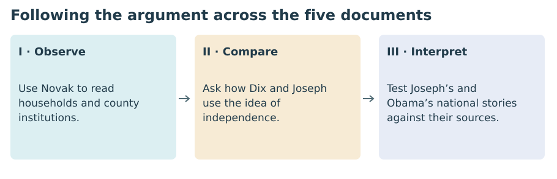
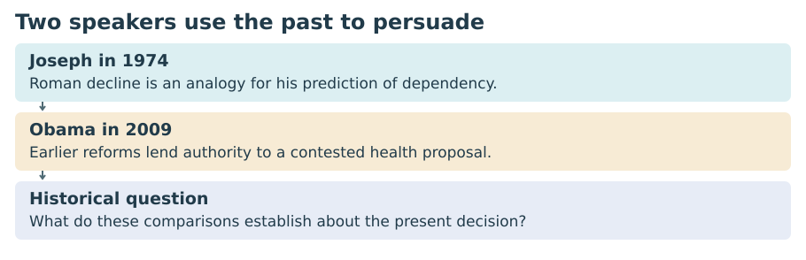

# BEL B/L — Anglais 2026 · Corrigé guidé

*Corrigé rédigé par IA, non officiel.*

**Rédaction** · Modèle : OpenAI Codex (famille GPT-6) · Effort de raisonnement : non renseigné · Mode de vitesse : non renseigné.

**Révision** · Modèle : OpenAI Codex (famille GPT-6) · Effort de raisonnement : non renseigné · Mode de vitesse : non renseigné.

**Question directrice** — How does everyday government change our understanding of the political uses of freedom in Britain and the United States?

[Sujet officiel, p. 9 à 13](https://www.ens.psl.eu/sites/default/files/livret_lve_allege.pdf#page=9) · [Rapport officiel](https://www.ens.psl.eu/sites/default/files/fait_2026_bl_rapport_ecrit_option_anglais.pdf)

## Définir le statut des cinq documents

Le livret commun demande de commenter en anglais les cinq documents des pages 9 à 13. L’épreuve écrite à option dure six heures et son coefficient est 3. Dans le guide, les renvois numérotés suivent le livret. La copie est entièrement rédigée en anglais.

| Document | Situation de l’énonciation | Question à poser au texte |
|---|---|---|
| 1. William J. Novak, 1996 | Un historien discute les interprétations de l’État américain au XIXe siècle. | Quel récit critique-t-il et quels faits faudrait-il observer pour le mettre à l’épreuve ? |
| 2. Harriet Martineau, 1834 | Une autrice britannique introduit une œuvre de vulgarisation de l’économie politique. | À qui profite le savoir et qui souffre de la répartition des richesses ? |
| 3. Dorothea Dix, 1848 | Une réformatrice pétitionne le parlement de Caroline du Nord pour financer un hôpital. | Qui paie et qui soigne lorsque le malade passe du foyer à la prison du comté ? |
| 4. Keith Joseph, 1974 | Un député conservateur d’opposition prononce un discours à Birmingham. | Que cherche-t-il à prouver en rapprochant budgets sociaux et désordres ? |
| 5. Barack Obama, 2009 | Le président américain réunit les deux chambres autour d’un projet de réforme de la santé. | Comment la lettre d’un sénateur décédé transforme-t-elle une demande privée en devoir public ? |

## Mettre les sources en relation

Le cadre proposé par Novak invite à chercher le site concret de chaque décision. Un comté peut déjà consacrer de l’argent à une prison alors qu’un réformateur réclame davantage d’action de la part de l’État fédéré. Le législateur fédéral auquel s’adresse Obama n’est pas celui que Dix cherchait à convaincre. Utiliser la question de l’échelle pour discuter la thèse d’un développement linéaire de l’État.

> [!INDICATION]
> Martineau admire Adam Smith tout en contestant la répartition que son lecteur découvre dans le foyer. Joseph fait l’éloge d’une police publique alors qu’il s’oppose à l’extension de l’aide sociale. Repérer ce que chacun juge légitime permet d’affiner l’analyse du mot « liberté ».

## Distinguer une affirmation, un argument et sa limite

Comparer la position de l’orateur en 1974 et du président en 2009. L’un associe l’assistance à une dépendance dangereuse, l’autre invoque les précédents de 1935 et 1965 pour présenter une assurance comme une protection de l’autonomie. Une association de phénomènes chez Joseph et une analogie historique chez Obama ont un effet persuasif. Elles demandent aussi des vérifications pour servir de preuve. Le rapport analyse le statut des cinq pièces aux pages 2 à 7 et la construction du commentaire aux pages 7 à 9.

## Commentaire rédigé en anglais

### Introduction

In 1848 a North Carolina jailer told Dorothea Dix that he had heard a prisoner's cries on the night a fire killed him. He had grown so accustomed to hearing the man scream that he failed to recognise the alarm. Government was already present in this story: the county already bore the cost of keeping this man in jail. The question concerned what that expenditure accomplished, and whose suffering it made ordinary. It exemplifies the change of perspective urged by the American historian William J. Novak in *The People’s Welfare* (1996, document 1). An account that treats independence as the triumph of individual rights and a minimal state can tell us remarkably little about the purposes public authorities actually served. The British and American texts assembled here also pose a difficulty for Novak’s reader. Harriet Martineau, Dix, Keith Joseph and Barack Obama were all trying to persuade an audience. Their accounts reveal practices, and they compete to give those practices a moral and national meaning. How does attention to everyday government change our understanding of the political uses of freedom on either side of the Atlantic?

### I. Bringing the household into view unsettles a familiar account of liberal society

Novak makes the list of attributes associated with American exceptionalism sound almost like a familiar speech already underway. Industry, opportunity and enterprise follow one another so readily that their combination hardly seems to require historical explanation. Yet an inference separates admiration for industrious citizens from the claim that nineteenth-century Americans lived under a government barely involved in their affairs. Novak challenges the inference by asking what officials actually did. He also questions the date at which older habits of public obligation allegedly vanished. The Revolution transformed political authority. It would take another kind of evidence to establish that inherited ways of regulating social life disappeared in 1776.

Martineau’s British preface to *Illustrations of Political Economy* (1834, document 2) suggests what one such transatlantic inheritance might look like. A reader used to celebrating the efficient household is invited to look upstairs and downstairs in the same house. Well-fed diners and hungry servants might inhabit one apparently prosperous building. When Martineau enlarges that household into a nation, a judgement about good housekeeping becomes a question about the distribution of necessities. Her praise of Adam Smith matters here. She admires the reach of his inquiry and wants its findings to reach the people whose lives give it importance. She can value the study of markets while demanding that the quality of an economic arrangement be assessed from more than the proprietor’s vantage point. Her reference to clothing suited to different social stations also sets a limit to the analogy. A well-run house in her example can retain distinctions of rank.

Dix’s memorial to the North Carolina legislature (document 3) likewise opens a household to inspection. A farmer becomes ill, is placed in a county jail, and eventually returns to the cabin of his elderly mother. A change in the person paying for his care has taken place. His illness and his mother’s isolation persist. Where Martineau asks her readers to compare floors, Dix follows a person through several buildings and asks the legislators to consider a state hospital. Reading these sources together supports Novak’s emphasis on concrete relationships. A private family may be made to shoulder a burden through an entirely public decision about which institution the community will fund.

### II. Appeals to responsibility divide reformers who profess to value independence

Dix begins with a concession to those worried about disorder. Some people in distress may indeed need supervision. The concession enables her to challenge the use of a prison for that purpose and to claim care for poor patients on terms comparable to those available to wealthy families. The jailer’s recollection puts a voice beside a sum of money. Legislators who hear the story acquire a responsibility that they could previously leave to county officers. Yet Dix’s account continues to treat confinement as potentially appropriate. Her campaign in a slaveholding state reveals the political possibilities of petition for a woman excluded from the vote, while leaving the much broader exclusions of that society outside its immediate claim. The memorial establishes the scope of one proposed reform. It cannot establish a general equality of rights.

Keith Joseph, addressing a Birmingham audience as a Conservative opposition spokesman in October 1974 (document 4), also links government to conduct learnt within the family. His question is what public provision teaches its recipients to expect of themselves. Rising incomes and welfare expenditure are set beside a list of social troubles, as if their concurrence disclosed the moral effect of intervention. The arrangement of these lists is a political argument. The excerpt supplies no comparison showing that the policy caused the reported increase in disorder. Joseph’s example of parents choosing to spend on their children’s schooling turns a contested distribution of purchasing power into a question about the freedom to use one’s earnings well. Parents with little disposable income are less visible in that account. A mother with an ill son in Dix’s petition makes a revealing comparison: willingness to care gives her little power to deliver the treatment he requires.

Joseph nevertheless honours Robert Peel for establishing a police force to protect people in public places. His beneficiaries need security to exercise their independence, and he allows that help can enable poor people to help themselves. His disagreement with Dix concerns the institution, the judgement made about the recipient and the behaviour expected to follow. Likewise, Martineau’s educated public and Joseph’s responsible parent both act for themselves, yet one author wishes to diffuse knowledge about social interdependence while the other fears that demands for state provision will weaken initiative. Treating freedom as a word with a single fixed political implication would miss the argument within this shared vocabulary.

### III. Political speakers turn the history of public responsibility into rival national stories

In his address to a joint session of Congress in September 2009 (document 5), President Obama faces critics who associate health reform with an alien political tradition. He concedes the appeal of self-reliance and distrust of government before claiming an equally American capacity to recognise another person’s predicament. Like Dix, he passes from private testimony to a public audience. His witness, the recently deceased Senator Ted Kennedy, already belonged to that audience. Reading his letter turns a former colleague’s absence into a moral claim on the legislators in front of the president. Potential bankruptcies and loss of health coverage connect that appeal to the practical effects of leaving existing arrangements intact. The speech anticipates the Affordable Care Act of 2010 in a system where private insurance will retain a major role. Its audience could still reject the proposal at the time of speaking.

Obama invokes Social Security in 1935 and Medicare in 1965 to make earlier fears of socialism familiar and their present equivalents less persuasive. Joseph, by contrast, leaves twentieth-century Britain for imperial Rome in order to predict the consequences of dependency. These histories ask listeners to inhabit different futures. One associates public security with reforms that later generations came to value, the other makes political collapse the final term of a story about public provision. Neither analogy proves what the measure currently under debate will achieve. Even Obama’s account, which gives collective provision a long American ancestry, arranges conflicts retrospectively into a pattern of national progress. Novak’s criticism of the tidy historical turning point can be applied to a reforming president as well as to defenders of a minimal state.

The institutional differences also matter. Dix would move responsibility beyond a county system to one US state. Obama seeks federal legislation in an insurance market already shaped by public programmes. Joseph speaks inside a British debate in which a national system of social provision has operated for decades. Similar appeals to independence travel among these settings, while the public action contested in each is different. Martineau’s move from a single dwelling to the nation was an invitation to ask a larger question. These documents show why one must then return to particular institutions to answer it.

### Conclusion

Looked at from the jail, the household or the insurance office, the alleged contrast between individual freedom and public responsibility becomes a set of decisions about who carries a risk and who has the means to act. Close attention to those decisions vindicates Novak’s challenge to the myth of a uniformly individualist tradition. The primary documents also explain the myth’s political durability. Its language can call a parent’s choices into service against provision, or help a president present security as a reward for responsible effort. The task of historical comparison is to recover the people, audiences and jurisdictions through which those competing claims acquired their force.
