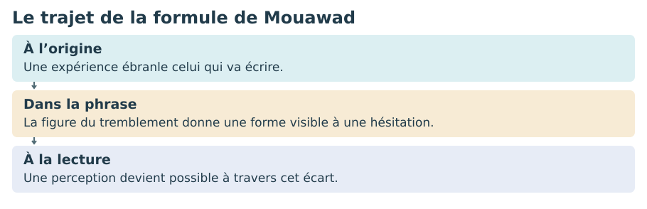
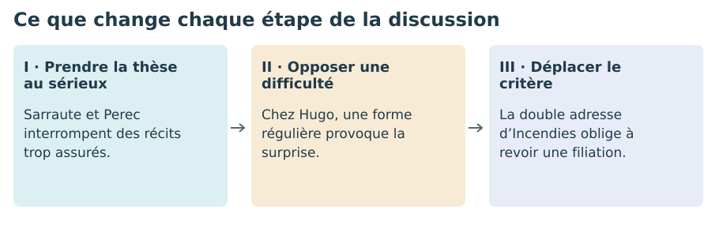
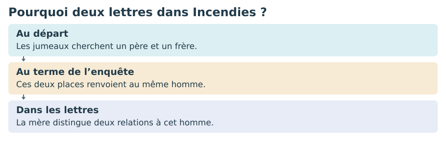

# BEL B/L — Composition française 2026 · Corrigé guidé

*Corrigé rédigé par IA, non officiel.*

**Rédaction** · modèle exact non renseigné (famille GPT-6) · effort non renseigné · vitesse non renseignée

**Révision** · modèle exact non renseigné (famille GPT-6) · effort non renseigné · vitesse non renseignée

**Lecture du rapport du jury** · GPT-6.2 Astra Ultra · vitesse non renseignée

**Révision** · GPT-6.2 Astra Ultra · vitesse non renseignée

**Révision (tour 3)** · GPT-6.2 Astra Ultra · vitesse non renseignée

**Révision (tour 4)** · GPT-6.2 Astra Ultra · vitesse non renseignée · 26 novembre 2026

« Jamais aucune intelligence artificielle ne saura saisir l’idée de ce que peut être ce tremblement d’où surgissent les mots dans une imperfection qui traduit le tremblement. Ce n’est pas la perfection qui est précieuse, mais la sincérité de nos imprécisions. C’est d’elles que naissent nos visions. Jamais un tremblement ne saura tracer une ligne droite et c’est cette impossibilité qui rend l’écriture si nécessaire. »

Wajdi Mouawad, Jusqu’au bord de son ravin. Les verbes de l’écriture, Paris, Seuil, 2025, p. 104.

Vous discuterez cette citation en vous fondant sur des exemples précis.

Le jury signale en page 1 la correction du patronyme et reproduit en page 3 le libellé corrigé.

**Question directrice** — À quelles conditions le tremblement devient-il une nécessité littéraire ?

[Libellé reproduit par le jury, p. 3](https://www.ens.psl.eu/sites/default/files/2026_bl_rapport_ecrit_tronc_commun_francais.pdf#page=3) · [Rapport officiel](https://www.ens.psl.eu/sites/default/files/2026_bl_rapport_ecrit_tronc_commun_francais.pdf)

## Lire la citation de Mouawad

Le jury distingue les conseils sur la dissertation, le libellé corrigé, son analyse et la discussion des plans. Pour exercer votre jugement sur le « jamais », essayez de formuler séparément deux questions. Quelles marques de l’hésitation saurait-on imiter ? Quelle expérience ce travail de forme donne-t-il à faire au lecteur ? Le retard de « ta tombe » chez Hugo fournit une réponse vérifiable à la seconde.

> [!INDICATION]
> Relire les deux occurrences de « jamais », la reprise du « tremblement » et le passage du singulier au pluriel lorsque paraissent les « visions ». Le futur prend la forme d’un pronostic absolu. La main qui n’arrive pas à tracer droit fait ensuite de cette limite une raison d’écrire.

## Choisir les passages qui font progresser la démonstration

Comparer le dialogue à l’ouverture d’*Enfance* avec l’attente qu’organisent les quatrains de « Demain, dès l’aube… ». Dans le premier cas, le lecteur entend aussitôt la contestation d’une formule. Dans le second, la destination du trajet se révèle à la fin et modifie le sens des premiers vers. Revenir alors à l’opposition entre perfection et sincérité. Les deux textes donnent des raisons différentes de s’en méfier.

## Déplacer l’argument vers le lecteur

Au chapitre des comices de *Madame Bovary*, identifier l’auditeur de Rodolphe dans la scène et le lecteur que le montage de Flaubert place à distance de cette scène. Dans *Incendies*, suivre les destinataires que les jumeaux croient devoir trouver. La découverte de leur identité oblige le lecteur à mesurer le sens de deux adresses. Cette distinction donne un contenu vérifiable à la « vision » qui peut naître de l’écriture.

Formuler d’abord en une phrase ce que l’enquête a appris aux jumeaux. Se demander ensuite ce que cette phrase perdrait si elle tenait lieu des deux lettres. La différence éclaire la notion d’imperfection discutée dans la citation.

> [!METHODE]
> Le rapport examine la place de l’IA et le paradoxe de l’imperfection aux pages 3 à 7. Les pistes des pages 8 à 14 permettent de confronter la spontanéité à la reprise du texte, puis d’éprouver l’effet d’une forme sur ses lecteurs. La dissertation qui suit choisit une progression et des lectures singulières.

## Proposition de dissertation

### Introduction

Au début d’*Enfance*, une voix demande à une autre si elle va vraiment évoquer ses souvenirs. Il suffirait au lecteur de tourner la page pour entrer dans un récit continu. Nathalie Sarraute le retient sur le seuil, le temps de faire entendre ce que la décision de raconter a d’incertain et même de suspect. Un récit plus assuré aurait-il été un récit plus juste ? Wajdi Mouawad, dans *Jusqu’au bord de son ravin. Les verbes de l’écriture* (2025), prête à l’écriture une main qui tremble. L’intelligence artificielle peut produire une suite de mots. Selon lui, il lui manquerait la compréhension de cette épreuve dont les mots portent l’empreinte. Le défaut de rectitude prend alors une valeur considérable. L’imprécision peut être sincère, faire naître une vision et rendre nécessaire l’acte même d’écrire. Reste à comprendre comment une irrégularité se distingue d’une maladresse quelconque, et une vision d’un simple embarras. Si une main habile sait contrefaire l’hésitation et si une forme exacte peut porter une douleur, à quelles conditions le tremblement devient-il une nécessité littéraire ?

### I. Il arrive que la phrase la mieux assurée soit précisément celle qu’il faut interrompre

Sarraute a une excellente raison de se méfier du premier élan autobiographique. La langue dispose, avant même qu’elle écrive, d’un répertoire de récits d’enfance, d’émois attendus, de paysages attendrissants. Affirmer d’emblée qu’elle va raconter ses souvenirs lui ferait emprunter une assurance dont elle ignore encore si elle a le droit. Le dédoublement de la voix permet à un soupçon de prendre la parole avant que le récit se fixe. L’une avance une formulation, l’autre en éprouve la justesse, s’inquiète de ce qu’elle embellit ou simplifie. Le lecteur saisit ainsi simultanément l’image qui cherche à paraître et la pression des mots qui menacent de l’altérer. Cette hésitation a une portée très précise. La sincérité consiste à laisser voir les conditions incertaines dans lesquelles la parole présente s’approche d’une expérience passée. Une page parfaitement sentimentale pouvait ménager au lecteur un attendrissement immédiat. La reprise nous met en présence de quelque chose qu’il était impossible de reconnaître à l’avance.

Dans *W ou le souvenir d’enfance*, Georges Perec donne à cette difficulté une forme qui occupe tout le livre. Des fragments autobiographiques alternent avec un récit qui conduit à l’île de W, société vouée au sport. Le fonctionnement prétendument exemplaire de cette cité se révèle soumis à des règles arbitraires et cruelles. Au seuil de la seconde partie du livre, des points de suspension entre parenthèses occupent à eux seuls une page. Il serait facile de remplir cette place par une déclaration générale sur les pertes de l’enfance pendant la guerre. Le blanc laisse au lecteur la charge de rapprocher deux récits que l’auteur ne superpose pas. À mesure que se défait la promesse d’équité sportive, la difficulté du témoin à donner à son passé une suite intelligible prend une autre force. La « vision » dont parle Mouawad peut donc naître de l’intervalle entre deux séries. Elle donne à percevoir une relation historique et affective qui serait moins exacte si elle prenait la forme d’une équivalence expliquée trait pour trait.

Le propos de Mouawad se vérifie jusque dans son mouvement verbal. Le terme de tremblement revient à la place où l’on attendrait qu’une définition le remplace ; la main qui ne parvient pas à tracer droit donne finalement à voir ce que le mot abstrait de sincérité laissait en suspens. Une paraphrase régulière pourrait en extraire une doctrine de l’expression personnelle. Elle perdrait cette reprise par laquelle la pensée cherche sa propre figure. Reste un embarras. Dans les livres de Sarraute et de Perec, tout paraît précisément composé, jusqu’à la place du blanc. Se peut-il que l’artifice fasse apparaître ce que Mouawad attache à l’imperfection ?

### II. La sincérité d’un texte ne se lit pas dans ses seules marques d’irrégularité

Un lecteur du poème « Demain, dès l’aube… » ne rencontre d’abord aucun désordre. Les trois quatrains d’alexandrins à rimes croisées soutiennent une marche dont le locuteur a prévu le départ et la durée. L’être rejoint demeure assez longtemps un « tu » pour que le lecteur puisse imaginer un rendez-vous entre deux vivants. Lorsque le geste de déposer du houx et de la bruyère sur une tombe révèle le terme du trajet, le futur des verbes précédents s’éclaire autrement. Il promettait la fidélité d’une visite et nous laissait espérer un échange auquel le mort ne pourrait répondre. Hugo fait travailler la justesse du vers contre l’assurance de notre lecture. Briser le mètre à chaque pas pour afficher la douleur eût donné une issue immédiate à ce qui devait rester quelque temps suspendu. Le tracé régulier est ici la condition de l’ébranlement.

Au vers 2 de ce poème des *Contemplations* (livre IV, XIV), le verbe « attends » prêtait à l’être aimé l’activité de celui qui guette une venue. Au vers 11, les deux mots « ta tombe » obligent le lecteur à revenir sur ce présent. Le bouquet n’est nommé qu’au dernier vers, après le geste annoncé et son lieu. Le poète retarde ainsi deux fois la rencontre avec l’objet concret. Le marcheur sait où il va dès l’aube. C’est ma compréhension de son chemin qui cesse d’aller droit. L’exactitude du mètre fait sentir la différence entre la résolution fidèle du marcheur et le trouble de celui qui le suit.

À l’inverse, quelques hésitations savamment disposées peuvent servir une entreprise entièrement calculée. Aux comices agricoles de *Madame Bovary* (deuxième partie, chapitre VIII), Rodolphe mène sa séduction pendant que les discours officiels et la proclamation des récompenses se poursuivent dans l’espace public. L’orateur et le séducteur semblent au départ occuper deux scènes indépendantes. Flaubert rapproche pourtant sur la page leurs fragments de paroles, laisse un prix agricole couper l’élan d’une déclaration qui prétend venir du plus profond de l’âme. La juxtaposition met au jour ce que la parole de Rodolphe partage avec l’éloquence officielle : elle connaît son effet d’avance et sait ramener son auditoire vers les formules que celui-ci désire entendre. Le lecteur peut entendre dans les mots que Rodolphe destine à Emma un calcul dont elle mesure mal les ressorts. Son mouvement des doigts reste d’ailleurs susceptible de deux interprétations dans la phrase de Flaubert. Toute phrase émue serait donc un mauvais certificat de l’émotion de celui qui l’écrit. Ce que nous appelons la sincérité de l’œuvre entière se joue à une autre échelle que la sincérité d’un discours représenté.

On comprend pourquoi l’argument de l’intelligence artificielle est à la fois éclairant et difficile. Une consigne pourrait demander qu’une voix interrompe l’autre, qu’un récit comporte des blancs, ou qu’un vers conserve sa régularité pendant une scène de deuil. Ces procédés peuvent se décrire et se reproduire. La ressemblance obtenue laisserait ouverte la question soulevée par Mouawad, qui porte sur le rapport entre un événement éprouvé, le surgissement des mots et ce que leur forme nous fait voir. Juger une œuvre en comptant ses ruptures reviendrait à en faire la recette la plus facile à imiter. Comment interroger ce rapport sans prétendre accéder à la conscience privée d’un écrivain ?

### III. L’écriture devient nécessaire quand sa forme oblige à réviser une façon de voir

Chez Mouawad lui-même, *Incendies* donne à deux lettres la charge d’accomplir une mission apparemment limpide. À la mort de Nawal, ses jumeaux doivent retrouver leur père et leur frère et remettre une lettre à chacun. La forme de l’adresse leur indique deux destinataires. Leur enquête les conduit à découvrir qu’un seul homme occupe les deux places dans leur histoire. Ce qui semblait être une ligne droite, allant d’un expéditeur à un destinataire, se replie sur une filiation que les mots de père et de frère, énoncés isolément, ne permettaient pas de concevoir. Or la distinction des deux lettres demeure nécessaire précisément lorsque l’identité de l’homme est découverte. La mère a à s’adresser au fils qui lui a été enlevé et à celui qui l’a violentée. Un récit qui fondrait ces deux adresses en une explication unique effacerait la différence entre les relations qu’un seul corps porte. Ici la nécessité d’écrire se mesure à ce qu’une parole trop vite réconciliée ferait disparaître.

Le lecteur n’a nul besoin d’avoir éprouvé dans sa propre vie une histoire analogue pour en reconnaître le trouble. Il doit en revanche avoir suivi la multiplication des adresses et s’être lui-même trompé sur leur partage. Une expérience lui devient accessible dans le temps du déchiffrement. La sincérité peut dès lors se juger à la fidélité de la forme envers une difficulté qu’aucune déclaration d’intention ne résout. Chez Perec, cet enjeu appelait une lacune à la jointure de deux récits ; chez Hugo, il exigeait la continuité d’une marche. L’écrivain peut travailler, couper, mesurer longtemps pour trouver la forme qui interdira au lecteur de s’en remettre à une image toute faite. La vision naît aussi chez celui qui lit.

Il reste possible qu’un système produise une ligne semblable à l’une de ces lignes. Le « jamais » de Mouawad résiste mal comme pronostic sur la forme future de tous les textes. Il garde une force comme exigence adressée à celui qui prend la parole : qu’accepte-t-il de risquer en s’éloignant d’une explication séduisante ? Une imitation pourrait reproduire le blanc de Perec. L’alternance des deux récits et la place historique du témoignage permettent de demander, dans un autre livre, quelle expérience singulière rendrait vraiment ce blanc nécessaire. Ces questions restent ouvertes à un auteur qui se sert d’un outil, comme à un auteur qui écrit à la main. Elles portent sur les choix qu’une œuvre engage et sur la possibilité pour autrui d’en éprouver les conséquences.

### Conclusion

L’imprécision est précieuse lorsqu’une forme trop tôt arrêtée donnerait une image mensongère de l’expérience. Le dialogue de Sarraute et le blanc de Perec en font l’épreuve. L’exactitude du vers hugolien, l’ironie des comices et la double adresse d’*Incendies* montrent aussi combien de travail peut être nécessaire pour que le lecteur rencontre cette difficulté à son tour. La main de Mouawad peut tracer une ligne métriquement droite et laisser sa destination vaciller. Ce qui rend l’écriture nécessaire, dans ces œuvres, est la possibilité qu’une forme construite nous apprenne à voir ce que nos phrases les plus sûres ne laissaient pas paraître.
