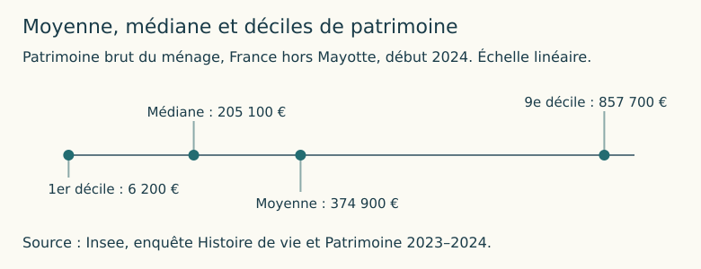

# BEL BL — Économie (oral) 2026 · Corrigé brut

*Corrigé rédigé par IA, non officiel. Signalez toute erreur.*

**Rédaction initiale** · GPT-6 · effort et vitesse non renseignés

**Relecture antérieure** · configuration non renseignée

**Lecture du rapport du jury** · GPT-6.2 Astra Ultra · vitesse non renseignée

**Révision** · GPT-6.2 Astra Ultra · vitesse non renseignée

**Révision (tour 3)** · GPT-6.2 Astra Ultra · vitesse non renseignée

**Révision (tour 4)** · GPT-6.2 Astra Ultra · vitesse non renseignée · 26 novembre 2026

**Couverture vérifiée.** Les onze exposés et leurs guides ont été rapprochés des 52 documents du fascicule officiel de 93 pages. Les compléments ci-dessous vérifient les dénominateurs, unités et populations des tableaux, cartes et graphiques. Les sujets individuels sont connus pour chacun des onze dossiers. Les relances sont des propositions de préparation à l’entretien.

Onze dossiers de la banque officielle de 93 pages, dans leur ordre de publication. Pour chaque tirage : 1 h 30 de préparation, puis 30 minutes devant le jury, dont 15 minutes d’exposé et 15 minutes d’entretien. Chaque texte ci-dessous propose un exposé complet ; les réponses possibles de l’entretien dépendent des questions du jury.

## Dossier 1 — Les échanges économiques empêchent-ils la guerre ?

**Problématique** : à quelles conditions l'interdépendance commerciale réduit-elle la probabilité d'un conflit armé entre États — et le commerce suffit-il, à lui seul, à garantir la paix ?

* * *

En 2012, la Russie rejoint l'Organisation mondiale du commerce ; dix ans plus tard, elle envahit l'Ukraine. Dans le même temps, les points d'étranglement du commerce maritime — canal de Suez, canal de Panama, détroit de Gibraltar — redeviennent l'objet de rivalités entre grandes puissances. Ces faits suffisent à poser le problème : l'intensification des échanges économiques éloigne-t-elle réellement la guerre ?

Précisons les termes. Les *échanges économiques* désignent les flux de biens, de services et de capitaux entre nations. La *guerre* s'entend ici des conflits armés entre États — le dossier note que les guerres civiles, elles, se sont multipliées depuis un demi-siècle. « Empêcher » suppose un lien de causalité, et non une simple corrélation : c'est précisément ce lien que le sujet interroge.

Le dossier croise cinq sources qu'il faut hiérarchiser, car elles n'ont pas la même portée. Le document 2 (Federle, Meier, Müller, Mutschler et Schularick, *The Price of War*, 2024) est un travail de recherche qui mesure, sur la période 1870-2023, la performance économique des pays en guerre autour du déclenchement du conflit. Le document 3 (Martin, Mayer et Thoenig, *La mondialisation est-elle un facteur de paix ?*, 2006) est une analyse académique qui distingue les effets de l'ouverture bilatérale et de l'ouverture multilatérale. Le document 1 (Rohner, *The Conversation*, 2025) et le document 4 (Murray, tribune au *Monde*, 2025) sont des textes de presse : le premier vulgarise des résultats de recherche, le second est une tribune d'opinion, qu'il ne faut pas mettre sur le même plan que les travaux scientifiques. Enfin, le document 5 réunit deux textes philosophiques fondateurs — Montesquieu (1748) et Kant (1795) — qui posent la thèse même que le dossier met à l'épreuve.

Le paradoxe apparaît dès le document 3 : le commerce mondial a atteint dans les années 1990 des niveaux sans précédent, sans que les statistiques montrent une baisse des conflits militaires. D'où la question : à quelles conditions l'interdépendance commerciale réduit-elle la probabilité d'un conflit armé entre États — et le commerce suffit-il, à lui seul, à garantir la paix ?

Nous verrons d'abord que les échanges élèvent le coût d'opportunité de la guerre, ce qui exerce un effet pacificateur réel. Nous montrerons ensuite que cet effet est conditionnel et que sa causalité est incertaine. Nous verrons enfin que le commerce doit être replacé dans un cadre institutionnel plus large, où la paix apparaît comme un bien public.

* * *

**Première partie — Les échanges élèvent le coût d'opportunité de la guerre : un effet pacificateur réel.**

La thèse du « doux commerce » est posée par le document 5. Pour Montesquieu, « l'effet naturel du commerce est de porter à la paix », car « deux nations qui négocient ensemble se rendent réciproquement dépendantes ». Kant ajoute un ressort matériel : « c'est l'esprit du commerce, qui ne peut coexister avec la guerre », qui pousse les États à favoriser « la noble paix », « contraints (certes non par des mobiles moraux) ». L'argument n'est pas moral mais intéressé : il relève de l'analyse économique.

Le mécanisme est celui du **coût d'opportunité**. L'échange procure à chaque partenaire des gains mutuels, fondés sur les avantages comparatifs : un surplus que chacun perdrait en entrant en guerre. Le document 3 formule exactement ce raisonnement : un conflit militaire, « en détruisant des infrastructures de transport, en réduisant la confiance entre agents nationaux et étrangers, rend durablement le commerce entre les deux pays plus difficile et plus coûteux » ; « le commerce bilatéral observé est ainsi une mesure partielle du coût d'opportunité d'un conflit militaire bilatéral ». Plus ce coût est élevé, plus les pays « tenteront d'éviter une escalade militaire ». La paix devient le choix rationnel, parce que la guerre revient à renoncer aux gains de l'échange.

Ce coût est massif, et le dossier permet de le chiffrer. Le document 1 rapporte que les guerres entraînent « en moyenne une baisse d'environ 20 % du PIB des pays concernés », « la reprise économique étant extrêmement lente ». Ordre de grandeur pour une économie de la taille de la France :

$$
\begin{aligned}
\text{Coût} &\approx 20\,\% \times \text{PIB} \\
&\approx 0{,}20 \times 3\,000\ \text{milliards d’euros} \\
&\approx \boxed{600\ \text{milliards d’euros}}
\end{aligned}
$$

soit environ **600 milliards d'euros d'écart sur une année de production**, pour cet exemple hypothétique. Le coût cumulé dépendrait ensuite de la trajectoire de reprise : il ne faut pas confondre perte de PIB annuelle, coût budgétaire et richesse détruite. Le document 2 mesure une autre grandeur. Son graphique ne chiffre pas la perte de PIB en niveau. Il montre que la croissance de la production, proche de sa moyenne les années précédant le conflit, chute brutalement l'année du déclenchement (de l'ordre de −7 points de pourcentage par rapport à la moyenne du pays) et reste le plus souvent inférieure à la moyenne ensuite, avec un retour près de zéro à la deuxième année ; dans le même temps, l’inflation augmente après le déclenchement, jusqu’à environ +11 points à la deuxième année. La guerre apparaît ainsi comme un **choc de stagflation** pour le pays concerné.

Le document 1 ajoute une lecture géographique : les principaux points d'étranglement du transport maritime « sont devenus des zones de conflit armé principalement lorsque le commerce mondial était faible » ; à l'inverse, en période de forte mondialisation, les grandes puissances, qui ont « des intérêts en jeu », veillent à ce que les routes maritimes restent sûres et accessibles. **Plus les échanges sont intenses, plus la guerre est coûteuse pour les belligérants, et plus elle est évitée.**

* * *

**Deuxième partie — Un effet conditionnel, à la causalité incertaine : le commerce ne suffit pas.**

L'effet pacificateur est d'abord **conditionnel à la nature de l'ouverture**. Le document 3 établit un résultat contre-intuitif : le commerce a « un effet contradictoire sur la prévalence des conflits armés » selon que l'on analyse l'ouverture bilatérale ou l'ouverture multilatérale. L'ouverture *bilatérale* pacifie, car elle élève le coût d'opportunité d'un conflit entre les deux partenaires. Mais si ces deux pays commercent aussi avec de nombreux tiers, leur dépendance bilatérale diminue : « une plus grande ouverture commerciale peut agir comme une assurance en cas de conflit bilatéral », et « l'incitation à faire des concessions pour éviter l'escalade militaire est amoindrie ». La mondialisation, qui combine les deux mouvements, a donc « un effet ambigu sur la paix » : elle ne réduit pas mécaniquement le nombre de guerres, elle peut seulement « rendre les conflits militaires plus localisés », entre pays voisins. **L'effet pacificateur du commerce n'est pas une loi générale : il dépend de la structure de l'ouverture commerciale.**

Ensuite, le verbe « empêchent » impose de discuter la **causalité**. La corrélation entre commerce élevé et paix peut être inversée : la paix permet le commerce autant que le commerce la paix. L'histoire citée par le document 1 est à cet égard un avertissement : après le renvoi de Bismarck, « cette dissolution des alliances a été un facteur crucial dans la chaîne d'événements qui a conduit à la Première Guerre mondiale », alors même que l'intégration économique de l'Europe était alors très forte. On peut convoquer ici Norman Angell, qui avait soutenu dans *La Grande Illusion* (1910) que la guerre était devenue économiquement irrationnelle. Le déclenchement de 1914 montre qu'une guerre économiquement destructrice demeure politiquement possible. La variable décisive peut donc être diplomatique et politique, non commerciale.

Le cas russe illustre enfin les limites du commerce. Membre de l'OMC depuis 2012 et partenaire énergétique majeur de l'Europe, la Russie a envahi l'Ukraine en 2022. Le document 4 avance une explication : la guerre serait « la conséquence du système de corruption généralisée qui gangrène la Russie », le pays n'étant pas parvenu à « démocratiser et moderniser son économie » en dépit de ses ressources. Il faut manier cette source avec prudence : c'est une tribune d'opinion, pas une démonstration statistique. Elle suggère néanmoins un mécanisme : lorsque des élites captent une rente et « peuvent tirer un bénéfice personnel de la guerre » (document 1), le calcul collectif de coût d'opportunité ne s'impose plus au décideur. **Le commerce pacifie lorsque les décideurs supportent eux-mêmes le coût social de la guerre.**

* * *

**Troisième partie — Replacer le commerce dans un cadre institutionnel : la paix comme bien public.**

Le document 1 présente la démocratie comme « l'autre face de la même médaille » : la « paix démocratique » — les démocraties ne se font pratiquement jamais la guerre entre elles — a été décrite comme « la chose la plus proche d'une "loi" en sciences sociales ». Le mécanisme est économique : dans une démocratie, « la population en général subit des pertes immenses » de la guerre, et des électorats « peu enclins à prendre des risques » sanctionnent par le vote les dirigeants agressifs. Les institutions démocratiques font ainsi supporter aux décideurs le coût d'opportunité du conflit.

Les engagements réciproques et la répétition des échanges peuvent rendre la coopération plus intéressante. Cela ne garantit pas la paix : il faut comparer les gains de l'échange, ceux qu'un décideur espère de l'agression et les coûts qu'il supporte effectivement. Des institutions qui rendent les engagements crédibles et exposent les dirigeants aux conséquences de leurs choix peuvent renforcer l'effet pacificateur de l'interdépendance.

La paix apparaît alors comme un **bien public** : non rivale et non exclusive à l'échelle du système international, elle est exposée au problème du passager clandestin — chaque puissance peut être tentée de s'emparer d'un territoire pour un gain propre tout en profitant de la stabilité générale. Le document 1 le formule en termes d'externalité : étendre son contrôle territorial peut sembler accroître la sécurité d'un pays, mais « l'impact global de tels agissements sur le système international est profondément néfaste ». D'où la préconisation du dossier : « investir dans le multilatéralisme, à renforcer les relations commerciales et à défendre un ordre international fondé sur des règles ». **Le commerce ne pacifie durablement qu'adossé à des institutions qui produisent effectivement le bien public « paix ».** On nuancera toutefois : certaines dépendances commerciales (énergie, intrants stratégiques) peuvent être instrumentalisées et devenir des armes ; l'interdépendance peut alors se retourner en vulnérabilité, ce qui justifie les politiques actuelles de réduction des risques (*de-risking*).

* * *

Les échanges économiques n'« empêchent » pas mécaniquement la guerre : ils en modifient le calcul. En augmentant les gains d’échange auxquels il faudrait renoncer, l’interdépendance *bilatérale* peut réduire le risque de conflit. La perte de production rapportée par le document 1 inclut aussi des dommages étrangers à ce mécanisme. Cette interprétation est conforme à l'intuition de Montesquieu et de Kant. Mais cet effet est conditionnel : l'ouverture *multilatérale* peut au contraire désinhiber (document 3) ; la causalité est incertaine (1914, Ukraine) ; et le commerce échoue lorsque les décideurs ne supportent pas le coût social de la guerre. **Le commerce pacifie donc conditionnellement et partiellement — jamais à lui seul.** La montée des guerres commerciales et des rivalités sur les routes stratégiques illustre la fragilité d’une paix fondée sur les seuls échanges et l’importance des institutions qui les encadrent.

Le graphique du document 2 donne un repère distinct du chiffre de perte de PIB cité dans la presse. L’année du déclenchement, le taux de croissance de la production se situe environ 7 à 8 points au-dessous de la moyenne nationale de référence. Deux ans après le début du conflit, l’inflation se situe environ 11 points au-dessus de sa moyenne. Les barres verticales représentent des intervalles de confiance à 90 %. Ces écarts de taux ne mesurent pas une perte cumulée de production.

**Relance d’entretien.** Deux voisins qui échangent beaucoup se font-ils moins souvent la guerre en raison du commerce ? Une comparaison brute mêle causalité inverse et facteurs communs comme la stabilité des institutions. Suivre les mêmes couples de pays et examiner des variations du coût des échanges indépendantes de la relation politique améliore l’identification, sous réserve que ces variations n’agissent pas directement sur les conflits.

## Dossier 2 — Écologie : les nudges (« coups de pouce ») peuvent-ils remplacer les politiques contraignantes ?

**Problématique** : comment exploiter les changements de comportement sans leur demander de résoudre seuls une défaillance collective qui appelle aussi des prix, des règles et des investissements ?

Une imprimante réglée par défaut sur le recto-verso économise du papier sans interdire l'impression simple face. Ce dispositif, cité dans le document 2, paraît offrir une transition écologique sans conflit : une modification discrète du contexte de décision suffirait à modifier les pratiques. Pourtant, le document 3 montre qu'un pays capable de déployer massivement des technologies bas carbone peut conserver des engagements climatiques insuffisants. La facilité d'une action individuelle ne garantit donc pas l'ampleur d'une transformation collective.

Un nudge modifie l'architecture du choix sans supprimer d'option ni changer fortement les incitations monétaires. Une interdiction, une taxe carbone ou un plafond d'émissions n'est donc pas un nudge. Remplacer les politiques contraignantes signifierait obtenir avec ces seuls changements de contexte une réduction durable et suffisante des dommages environnementaux. Nous montrerons que les nudges corrigent certaines limites de la décision individuelle, mais qu'ils ne suffisent pas à internaliser les externalités ; leur intérêt est de rendre plus efficace un ensemble cohérent d'instruments.

Le dossier confronte quatre regards. L'article d'Albin Wagener de 2022 propose une critique politique de la compatibilité entre démocratie capitaliste et écologie ; ce n'est pas une mesure expérimentale des effets des nudges. La présentation ministérielle de 2019 en donne la définition, des exemples et les limites. L'article d'Harold Thibault de septembre 2025 analyse les engagements chinois. Enfin, la note de Patrick Criqui et Dominique Bureau de 2009 retrace le choix entre taxes et quotas ; son état de la négociation doit être replacé dans sa date.

* * *

La première justification des nudges tient à l'écart entre préférences déclarées et pratiques. Un consommateur peut souhaiter économiser l'énergie tout en reportant indéfiniment un réglage, en oubliant sa consommation ou en imitant une norme sociale défavorable. Les coûts de recherche d'information, l'inertie et l'attention limitée empêchent de réduire tous les comportements à un calcul parfaitement informé. Le document 2 propose donc d'agir au moment même où se forme le choix.

Le recto-verso par défaut réduit le coût d'une décision économe : il faut une action supplémentaire pour revenir au gaspillage. L'information sur la consommation énergétique peut rendre visibles des dépenses jusque-là abstraites. Une présentation claire de la réparabilité rapproche l'information du moment d'achat. Ces instruments laissent une possibilité de refus et peuvent être peu coûteux à déployer. Ils évitent ainsi qu'un manque d'attention annule une préférence écologique déjà présente.

Il faut toutefois distinguer le mécanisme comportemental de son support. Un compteur intelligent est une infrastructure ; c'est l'information rendue saillante qui peut jouer le rôle de nudge. Une récompense matérielle importante modifierait les incitations et sortirait de sa définition stricte. L'exemple du concours étudiant cité par le ministère combine ainsi émulation collective et petite récompense : il n'autorise pas à qualifier toute subvention écologique de coup de pouce.

* * *

L'environnement pose ensuite un problème que l'attention seule ne résout pas. Lorsqu'une activité émet des gaz à effet de serre, une partie de son coût est supportée par d'autres populations et par les générations futures. Même informé et cohérent, un individu peut avoir intérêt à poursuivre cette activité si son prix n'intègre pas le dommage. L'équilibre privé ne coïncide alors pas avec l'optimum collectif : il existe une externalité négative.

Une taxe environnementale augmente le coût privé des émissions ; un plafond assorti de quotas négociables limite leur quantité globale. La note Criqui-Bureau explique que l'échange de quotas permet de répartir l'effort vers les agents capables de réduire leurs émissions à moindre coût. Une taxe donne davantage de visibilité sur le prix, tandis qu'un plafond effectivement contrôlé donne davantage de maîtrise de la quantité. Aucun de ces résultats ne découle d'un réglage par défaut : ils modifient les contraintes économiques.

Les limites recensées dans le document 2 confirment cette différence d'échelle. L'efficacité varie selon le contexte, peut s'atténuer avec le temps et susciter des compensations : économiser ici peut autoriser psychologiquement une consommation plus forte ailleurs. Un nudge ne finance pas à lui seul l'isolation d'un logement et ne construit pas un réseau de transport collectif. Faute d'alternative matériellement accessible, inviter un ménage à abandonner sa voiture risque de rester sans effet.

Le cas chinois éclaire aussi les limites d'une opposition entre liberté et contrainte. L'article de 2025 rapporte une cible de baisse de 7 à 10 % par rapport au pic d'émissions à l'horizon 2035, alors que les experts cités préconisent au moins 30 % par rapport au niveau alors courant. Ces bases ne sont pas identiques : on ne soustrait pas directement les deux pourcentages. Le développement rapide des renouvelables coexiste avec celui du charbon. Le régime politique et l'intensité d'une industrie verte ne suffisent donc pas à établir l'ambition effective d'une trajectoire d'émissions.

* * *

La réponse pertinente est une complémentarité évaluée. Pour réduire les émissions du transport, l'offre de transports publics et l'aménagement du territoire rendent un autre choix possible ; des règles et un signal-prix en modifient l'intérêt ; une information simple facilite enfin le passage à l'acte. Le nudge peut améliorer l'usage d'un dispositif contraignant, mais ne doit pas servir de justification à son absence.

Cette combinaison doit être socialement et démocratiquement soutenable. Une taxe peut peser fortement sur des ménages aux ressources faibles ; l'affectation de recettes à des aides et à des alternatives améliore l'équité sans supprimer le signal marginal. Inversement, une architecture du choix opaque peut manipuler. La possibilité de refus, la transparence du but et le contrôle public sont donc nécessaires même quand aucune interdiction n'est prononcée.

La critique de Wagener attire l'attention sur l'influence des intérêts économiques dans la décision collective. On peut en retenir la question de la capture des politiques sans adopter comme une loi démontrée l'impossibilité de toute transition dans une démocratie de marché. Des règles publiques peuvent précisément changer les rendements privés et les rapports de force. Leur qualité se juge à leurs effets, à leur répartition et à leur légitimité, non à l'étiquette douce ou dure qui leur est attachée.

Enfin, l'évaluation doit mesurer les émissions réellement évitées, leur permanence, le coût et les effets redistributifs, en comparant si possible des groupes soumis ou non au dispositif. Une hausse des intentions déclarées ne vaut pas réduction d'émissions. Les nudges **ne remplacent donc pas les politiques contraignantes** : ils constituent un instrument utile lorsque le problème tient au contexte du choix, au sein d'une politique qui traite aussi les externalités, les infrastructures et les inégalités.

Sur la pancarte de l’hôtel, 75 % désigne la proportion annoncée de clients qui ont accepté de réutiliser leurs serviettes. Ce nombre fait partie du message adressé au client. Pour mesurer l’effet causal de la pancarte, il faudrait comparer le taux de réutilisation de chambres exposées au message à celui de chambres semblables soumises à une autre consigne. L’économie de lavage, puis celle d’énergie, constitueraient deux étapes supplémentaires.

**Relance d’entretien.** Une taxe et un quota donnent-ils le même résultat ? Si le décideur connaît la demande de permis, il peut fixer une taxe égale au prix d’équilibre du plafond. En présence d’incertitude, la taxe stabilise le prix payé et le quota, la quantité. Les recettes ou la valeur des droits dépendent en outre de la mise aux enchères ou de l’allocation gratuite.

## Dossier 3 — Changement climatique et inégalités

**Problématique** : comment les inégalités déterminent-elles les responsabilités et les vulnérabilités climatiques, et à quelles conditions l'action climatique peut-elle les réduire au lieu de les renforcer ?

Un ménage qui consacre une forte part de ses ressources au chauffage peut émettre peu tout en étant particulièrement exposé à une hausse du prix de l'énergie. Ce paradoxe résume le dossier : les agents ne contribuent pas également au réchauffement, n'en subissent pas les mêmes dommages et n'ont pas les mêmes moyens de s'adapter. La transition elle-même redistribue des coûts et des possibilités.

Les inégalités désignent ici des écarts de revenus, de patrimoine, de conditions de vie et de pouvoir, entre pays comme à l'intérieur des pays. Le changement climatique agit sur ces écarts, mais résulte aussi de structures de production et de consommation socialement différenciées. Le dossier associe une synthèse du GIEC diffusée en 2023 par le portail public belge Climat.be, une analyse de Luis Reyes publiée en 2019, un entretien engagé de Mary Robinson en 2015 et un rapport de l'IGAS de 2024. Ces dates et ces statuts interdisent de présenter tous leurs chiffres comme une photographie uniforme de 2026.

Nous étudierons d'abord les inégalités de contribution et d'exposition, puis leur aggravation possible par les mécanismes économiques et par certaines politiques, avant de montrer que justice sociale et efficacité climatique peuvent se soutenir mutuellement.

* * *

La contribution au réchauffement varie selon la manière de compter. Une carte d'émissions territoriales décrit le lieu où le carbone est rejeté ; une empreinte de consommation réattribue notamment aux acheteurs les émissions incorporées dans leurs importations. Le document 2 rappelle l'intérêt de cette seconde approche dans une économie mondialisée. Il faut également distinguer un total national, fortement dépendant de la population, d'une émission par habitant et d'une responsabilité historique cumulée.

La carte de 2016 situe la Chine et les États-Unis parmi les principaux émetteurs annuels. Le graphique par groupes de revenus montre pourtant que les contrastes traversent les frontières : les catégories riches émettent bien davantage que les pauvres à l'intérieur d'un même pays. L'estimation Oxfam de 2015 citée par Reyes attribue environ la moitié des émissions de consommation aux 10 % les plus riches. C'est une estimation datée et délimitée, non la part de toutes les émissions territoriales en 2026.

L'IGAS fournit une illustration française : pour 2019, les émissions moyennes annuelles sont d'environ 5 tonnes équivalent CO₂ par personne pour la moitié la plus modeste, 9 pour l'ensemble de la population et près de 25 pour les 10 % les plus aisés. Sur ces ordres de grandeur, le rapport entre catégories extrêmes est de cinq. Les consommations de transport, de logement et de loisirs expliquent une partie du contraste, auquel s'ajoutent les effets d'imitation sociale analysés par Reyes.

À cette inégalité de contribution répond une inégalité souvent inverse de vulnérabilité. Les dommages dépendent de l'exposition à l'aléa, de la sensibilité et de la capacité de protection. L'agriculteur dont la récolte dépend directement de la pluie, l'habitant d'un logement surchauffé et la personne sans domicile ne disposent pas des mêmes marges qu'un ménage possédant une épargne et un logement adaptable. L'IGAS rapporte que 70 % des habitants des quartiers prioritaires déclarent en 2022 avoir souffert de températures excessives dans leur logement, contre 56 % de l'ensemble de la population : l'écart est de 14 points, pas de 14 %.

* * *

Le climat peut donc reproduire et amplifier les inégalités. Une récolte détruite diminue le revenu, oblige à emprunter ou à vendre un actif, puis réduit la capacité de résister au choc suivant. Les dépenses de santé augmentent alors que la productivité du travail peut baisser. Le document 2 prend l'exemple du Vietnam : une journée supplémentaire au-dessus de 33 °C est associée à des pertes d'efficacité rizicole et de revenu, différentes selon les groupes. Il décrit un mécanisme cumulatif, pas une fatalité uniforme touchant chaque individu du même montant.

Mary Robinson insiste sur le climat comme multiplicateur de menaces : pauvreté, insécurité alimentaire, déplacements et défaut de perspectives peuvent fragiliser les sociétés. Son exemple syrien doit être manié avec prudence. La sécheresse peut aggraver des tensions ; elle n'explique pas seule la guerre civile, qui engage aussi la répression, les institutions et les conflits politiques. Transformer une interaction en causalité climatique unique ferait disparaître les responsabilités humaines.

Les politiques de transition peuvent également être régressives si leurs instruments sont mal conçus. Quand une taxe renchérit une dépense énergétique peu compressible, le prélèvement représente une part plus forte du revenu d'un ménage modeste. L'IGAS rapproche les taux d'effort de 16 % et de 4 % : leur rapport est **quatre**, malgré la mention « trois fois » dans l'extrait. De même, une subvention à la rénovation qui laisse un reste à charge équivalent à plusieurs années de revenus exclut précisément les ménages auxquels elle est destinée.

Il faut distinguer incidence moyenne et situation individuelle. À revenu comparable, l'isolement géographique, le statut de locataire, la santé ou la composition familiale modifient les besoins et les possibilités d'ajustement. Une moyenne par décile ne suffit pas à déterminer une compensation juste. L'acceptabilité politique dépend ainsi du sentiment que l'effort tient compte des responsabilités et des alternatives disponibles.

* * *

Une transition juste peut toutefois réduire les deux types de dommages. La synthèse du GIEC souligne les bénéfices sanitaires de l'atténuation, l'urgence de l'adaptation et le rôle de la coopération financière. Isoler un logement réduit durablement les émissions et la précarité énergétique ; développer des transports publics accessibles diminue simultanément la dépendance automobile et les dépenses contraintes. Ces actions relèvent d'un investissement collectif, pas d'une simple injonction à la sobriété.

Un signal-prix reste utile pour internaliser le dommage climatique, mais ses recettes peuvent financer une redistribution forfaitaire ciblée et les alternatives. Le remboursement forfaitaire évite de subventionner chaque unité supplémentaire d'énergie consommée : il peut protéger le revenu tout en conservant l'incitation à réduire les émissions. Il doit être complété pour les contraintes spécifiques que la seule catégorie de revenu saisit mal.

À l'échelle mondiale, la différenciation de l'effort suppose de combiner émissions, capacité financière et besoins de développement. Les transferts d'adaptation et l'accès aux technologies permettent aux pays vulnérables de ne pas choisir entre besoins essentiels et réduction du carbone. Le montant de 100 milliards de dollars évoqué par le document de 2019 est l'engagement alors discuté pour 2020 ; il ne doit pas être présenté comme l'intégralité du cadre financier actuel.

Enfin, la participation des populations concernées améliore la connaissance des contraintes et la légitimité des choix. Réduire les inégalités peut renforcer la coopération, la confiance et l'accès aux innovations sobres. Le climat et les inégalités forment donc **une relation à double sens** : une transition efficace doit répartir justement les efforts, et la réduction de certaines inégalités constitue elle-même une condition de sa réussite.

Les deux images du document 2 changent d’unité et de population. La carte de 2016 donne la part de chaque pays dans les émissions mondiales annuelles de CO₂. Sur le graphique de ménages, la barre des 10 % les plus aisés des États-Unis atteint environ 50 tonnes de CO₂ par personne, contre environ 17 en France pour le même groupe de revenu national. Attribuer ces valeurs à la moyenne de chaque pays effacerait précisément l’inégalité que le document met en évidence.

**Relance d’entretien.** Une baisse des émissions territoriales prouve-t-elle qu’un ménage a réduit son empreinte ? Non. Une production délocalisée réduit les émissions du territoire producteur initial mais peut rester incorporée dans la consommation de ses résidents. Le calcul d’empreinte rattache les émissions aux biens et services consommés.

## Dossier 4 — Les géants du numérique menacent-ils la concurrence ou révèlent-ils la nécessité de la régulation publique des marchés ?

**Problématique** : comment préserver les gains d'efficacité des plateformes numériques tout en empêchant leurs avantages de se transformer en pouvoir durable d'exclusion ?

Le développement du cloud permet à une petite entreprise d'accéder à des capacités informatiques qu'elle ne pourrait construire seule. Il peut en même temps la rendre dépendante d'un nombre limité de fournisseurs. Les géants du numérique offrent ainsi des services performants tout en posant un problème de pouvoir de marché. L'alternative du sujet est trompeuse : leur capacité à menacer la concurrence peut précisément révéler la nécessité d'institutions publiques qui la rendent possible.

La concurrence est un processus de rivalité et de possibilité d'entrée, non la simple présence d'un grand nombre d'entreprises. Une position dominante n'est pas, à elle seule, un abus. Le problème tient à la possibilité d'imposer durablement des conditions moins favorables aux utilisateurs ou d'exclure des rivaux autrement que par la qualité du service.

Le document 1, texte de discussion attribué à The Conversation, défend la construction institutionnelle des marchés. Le bilan 2022 de l'Autorité de la concurrence présente une enquête sectorielle, non une condamnation. La lettre de la DAJ de mars 2023 situe le DMA et les priorités de régulation. Le document 4 est un résumé éditorial de la pensée de Karl Polanyi, non un extrait démonstratif de son ouvrage. Enfin le graphique Omdia renseigne la concentration du cloud mondial. Sa courbe va du premier trimestre 2021 au troisième trimestre 2025 : il faut suivre cette légende plutôt que la mention 2024 du sommaire.

* * *

Les plateformes peuvent d'abord procurer de vrais gains. La mutualisation informatique amortit des coûts fixes élevés sur de nombreux clients. Les utilisateurs accèdent rapidement à des services, réduisent des investissements initiaux et adaptent leurs capacités à la demande. Plus généralement, une plateforme rapproche deux catégories d'agents : hébergeurs et voyageurs, commerçants et acheteurs, annonceurs et utilisateurs. Elle réduit les coûts de recherche et peut améliorer l'appariement.

Ces mêmes mécanismes favorisent cependant la concentration. Lorsque le coût moyen diminue avec l'échelle, les grands fournisseurs bénéficient d'un avantage durable. Les effets de réseau renforcent cet avantage quand l'utilité d'un service augmente avec le nombre de ses participants. L'accumulation de données et la possibilité d'offrir une gamme intégrée rendent alors l'entrée plus difficile. La concentration peut donc être en partie le résultat de gains d'efficacité, sans être pour autant sans risque.

Le graphique du document 5 situe, au troisième trimestre 2025, AWS autour de 32 %, Microsoft autour de 22 % et Google autour de 11 %. Leurs parts réunies représentent environ 65 % du marché mondial mesuré. Cette somme décrit une concentration élevée, mais ne démontre ni entente ni pouvoir identique sur tous les segments. La définition du marché pertinent, demandée dans le document 2, reste indispensable : quels services les clients peuvent-ils réellement substituer ?

* * *

La menace apparaît lorsque l'avantage devient verrouillage. L'enquête de l'Autorité de la concurrence mentionne des obstacles techniques à la migration et au recours à plusieurs fournisseurs, ainsi que des pratiques commerciales, contractuelles ou tarifaires susceptibles d'élever les barrières à l'entrée. Un client qui a développé ses logiciels pour un environnement propriétaire ne peut pas nécessairement changer au seul motif qu'un concurrent propose un prix inférieur.

L'intégration verticale peut créer un autre conflit : l'opérateur d'une infrastructure vend aussi ses propres services sur cette infrastructure. Il peut avoir intérêt à leur accorder un accès ou une visibilité privilégiés. Des acquisitions peuvent supprimer un concurrent potentiel avant même qu'il soit capable de rivaliser. Il faut alors examiner les effets réels sur l'entrée, l'innovation et la qualité, plutôt que confondre toute grande entreprise avec un monopole nuisible.

Le prix monétaire nul sur une face d'une plateforme ne supprime pas le problème économique. L'utilisateur peut fournir des données ou de l'attention ; les annonceurs paient sur l'autre face. Une hausse du pouvoir de marché peut donc se traduire par davantage de publicité, une moindre protection des données ou une restriction du choix, sans hausse visible d'un abonnement.

Les documents 1 et 4 aident à interpréter ces phénomènes : les marchés reposent sur des droits, des normes, des contrats exécutoires et une infrastructure politique. La propriété intellectuelle elle-même est une règle publique qui organise l'appropriation de l'innovation. La question n'est donc pas de choisir entre un marché sans institutions et l'État, mais entre différents agencements de règles et différentes répartitions du pouvoir.

* * *

La régulation doit conserver les gains de mutualisation tout en rendant la rivalité possible. La politique de concurrence traite les ententes, les abus et les concentrations. Elle peut imposer des remèdes proportionnés à un problème documenté. La logique du DMA, présentée dans le document 3, ajoute des obligations préventives pour les contrôleurs d'accès désignés : agir seulement après plusieurs années de contentieux peut être trop lent lorsque les effets de réseau ont déjà fermé un marché.

L'interopérabilité et la portabilité réduisent les coûts de changement de fournisseur. Des conditions d'accès transparentes peuvent limiter l'auto-préférence. L'information sur les acquisitions aide les autorités à repérer les risques. Ces instruments n'abolissent ni la propriété privée ni le profit : ils modifient les conditions dans lesquelles les acteurs peuvent se concurrencer.

Une régulation mal conçue peut toutefois renforcer les acteurs installés. Des obligations fixes très coûteuses sont plus faciles à absorber pour un géant que pour une petite entreprise. Imposer une compatibilité générale sans précautions peut aussi créer des problèmes de sécurité. Les autorités doivent donc ajuster leurs règles aux fonctions essentielles, vérifier leurs effets et coordonner concurrence, protection des données et cybersécurité.

Enfin, soutenir la recherche, les compétences et les infrastructures peut élargir les possibilités d'entrée ; subventionner durablement un acteur sans condition ne garantit pas une concurrence effective. Il faut évaluer les effets sur l'accès, la qualité, les coûts de changement et l'innovation, et pas seulement sur le nombre de fournisseurs nationaux.

Les géants du numérique **menacent la concurrence lorsqu'ils convertissent leurs avantages en possibilités d'exclusion**. Ils montrent aussi que le marché concurrentiel n'est pas un état naturel qu'il suffirait de laisser agir. La bonne régulation doit rendre les positions contestables, protéger les utilisateurs et préserver les économies utiles, plutôt que choisir abstraitement entre gigantisme privé et suppression du marché.

On peut chiffrer la concentration sans connaître les petits fournisseurs. Si les parts sont exprimées sur 100, les trois premiers contribuent déjà approximativement $32^2+22^2+11^2=1\,629$ à l’indice de Herfindahl-Hirschman. Le total dépend de la répartition des 35 % qui restent. Une telle mesure décrit une structure de marché. Elle ne permet pas, à elle seule, de constater un abus.

**Relance d’entretien.** Les parts de marché permettent-elles de calculer exactement un indice de concentration ? Le graphique donne seulement les principaux fournisseurs. On peut sommer leurs parts et les carrés de leurs parts, mais pour un Herfindahl-Hirschman complet il manquerait la distribution entre tous les autres acteurs.

## Dossier 5 — Qui paie le coût de la dette ?

**Problématique** : comment distinguer le débiteur qui verse contractuellement les échéances des groupes qui supportent finalement le coût économique, social et sanitaire de l'endettement ?

Le débiteur paraît supporter le coût de sa dette puisqu’il rembourse. Mais un État peut ajuster les impôts ou les services publics, une famille renoncer aux soins, un créancier subir une restructuration. Identifier celui qui paie demande donc de distinguer paiement contractuel, incidence économique et conséquences sociales.

La dette est un engagement de remboursement ; son encours est un stock, alors que les intérêts et les remboursements périodiques sont des flux. Le service de la dette comprend intérêts et remboursement du principal : ce dernier restitue un capital reçu antérieurement et ne peut être assimilé intégralement à un coût net. Le dossier associe dette des ménages et dette souveraine, sans autoriser à confondre leurs budgets.

Natal et Guérin proposent en 2026 une estimation mondiale de la dette nécessaire aux dépenses courantes. Sweet et ses coauteurs présentent en 2013 une recherche sur dette et santé de jeunes adultes américains. Les trois graphiques issus d'un document PNUD de 2026 décrivent la dette extérieure publique et garantie des pays en développement. Leur numérotation interne diffère du sommaire : le document 3 mesure le dépassement de 15 % des exportations, le 4 la comparaison avec santé et éducation, le 5 les ratios d'encours et de service. Nous partirons de l'utilité du financement, puis examinerons les charges inégalement distribuées et les moyens d'en limiter les effets destructeurs.

* * *

La dette ne crée pas nécessairement un appauvrissement. Elle permet de décaler une dépense dans le temps : un ménage finance un logement, une entreprise une machine, un État une infrastructure. Si l'usage des fonds produit un revenu ou un service durable suffisant, le remboursement peut être compatible avec une amélioration du bien-être. L'endettement mutualise aussi certains risques, en évitant de vendre immédiatement un actif après une baisse temporaire de revenu.

Le prix du crédit rémunère le report de consommation du prêteur, les frais d'intermédiation et le risque. À la date du versement des intérêts, le débiteur paie et le créancier reçoit ; cette opération est d'abord un transfert. Les ressources réelles mobilisées par le financement et ses effets sur les comportements déterminent le coût pour la collectivité. Un prêt intérieur ne s'analyse donc pas comme une disparition intégrale de richesse nationale.

Le problème change lorsque le crédit devient un substitut permanent au revenu. Le document 1 estime à plus de 2,5 milliards le nombre de personnes recourant à la dette pour les dépenses ordinaires ; selon les indicateurs, la proportion varie entre un quart et plus de 40 % de la population mondiale. Cette fourchette révèle l'incertitude de mesure, particulièrement pour les prêts informels et les retards de factures. Elle ne permet pas de classer tous les emprunteurs comme surendettés.

Lorsque les dépenses essentielles excèdent durablement les ressources, le nouveau prêt peut servir à payer les précédents. Les intérêts absorbent alors une part croissante du revenu disponible. Natal et Guérin mentionnent environ 30 % dans certaines enquêtes au Tamil Nadu, contre 10 % au Brésil et 9 % aux États-Unis : ces champs d'enquête différents interdisent une comparaison mécanique des populations entières. Le mécanisme reste clair : le financement protège momentanément la consommation, puis peut l'éroder durablement.

* * *

La charge dépasse le prélèvement financier. Réduire l'alimentation, différer un traitement médical ou travailler davantage affecte la santé et le capital humain. Le document 2 étudie précisément les associations entre différentes mesures de dette, stress, dépression, santé déclarée et pression artérielle chez des adultes de 24 à 32 ans. L'endettement peut être une source de stress, mais une maladie peut aussi provoquer dette et perte de revenu. Tenir compte de la situation antérieure est donc essentiel ; les extraits ne justifient pas un effet causal universel chiffré.

Le coût est distribué à l'intérieur des familles. La gestion quotidienne des échéances peut reposer davantage sur les femmes, comme le souligne le document 1. Un même encours nominal ne signifie pas une même charge selon les actifs possédés, la stabilité du revenu et le soutien familial. Dette brute, dette nette et capacité de paiement doivent être distinguées.

Pour un État débiteur extérieur, les remboursements mobilisent des recettes fiscales ou des devises. Le document 5 montre que les ratios médians de dette extérieure publique rapportée au PIB ont augmenté entre 2010 et le début des années 2020, avec des profils régionaux différents. Son graphique de droite exprime le service en proportion des exportations, non du PIB : il renseigne une contrainte de financement externe distincte. Une dépréciation monétaire peut aggraver la charge d'un emprunt libellé en devise étrangère.

Le document 4 montre que, dans un nombre croissant de pays de son échantillon, le service de la dette dépasse certaines dépenses de santé ou d'éducation. Il ne prouve pas que tout remboursement supplémentaire a été prélevé sur ces budgets, mais rend visible le coût d'opportunité de l'arbitrage public. Les usagers des services peuvent payer par la dégradation de leur accès, tandis que l'ajustement fiscal dépend de l'assiette choisie. Le document 3 décrit quant à lui les pays franchissant un seuil de service de 15 % des exportations ; ce seuil d'analyse de soutenabilité n'est ni une loi universelle de faillite ni une proportion de ménages endettés.

* * *

Qui paie finalement dépend des institutions et du partage des pertes. Des impôts progressifs et une priorité donnée aux services essentiels ne répartissent pas la charge comme une hausse uniforme des taxes à la consommation. L'inflation peut réduire la valeur réelle d'une dette nominale dans la monnaie nationale, au détriment du prêteur, mais n'est pas une solution neutre : elle affecte aussi les détenteurs de monnaie et ne supprime pas une dette extérieure en devise.

Une restructuration fait supporter une perte au créancier et peut restaurer des perspectives de paiement réalistes. Elle a aussi des coûts possibles : accès au financement plus difficile, pertes pour les établissements qui détiennent les titres. Il faut comparer ces effets aux coûts d'une poursuite indéfinie du remboursement, et distinguer un défaut de liquidité d'un problème de solvabilité.

Pour les ménages, prévenir le crédit abusif, rendre les frais lisibles et organiser le traitement du surendettement sont nécessaires. Ils ne remplacent pas des revenus suffisants et une protection contre les dépenses de santé ou les interruptions d'emploi. Refuser tout crédit exclurait aussi des ménages capables de financer un projet utile ; généraliser le crédit comme seule réponse à la pauvreté déplacerait le problème.

Ainsi **le débiteur n'est pas toujours le seul payeur, et un paiement n'est pas toujours un coût social net**. La question décisive porte sur l'usage initial des fonds, la capacité de remboursement et les règles d'ajustement. Une politique responsable cherche à préserver les financements utiles tout en empêchant que leur charge soit transférée silencieusement vers les populations les moins protégées.

En 2021, sur le graphique du document 4, on lit environ 48 pays dont le service de la dette dépasse la dépense d’éducation et environ 38 pour la santé. Une même administration peut figurer dans les deux colonnes. Additionner les deux effectifs compterait alors certains pays deux fois. Il convient aussi de distinguer un dépassement constaté d’une réduction de dépenses provoquée par la dette.

**Relance d’entretien.** Une dette extérieure de 60 pour un PIB de 200 représente 30 % du PIB. Un service annuel de 6 pour des exportations de 30 représente 20 % des exportations. Dépasser le seuil de 15 % du dossier signale une vulnérabilité de paiement en devises ; il ne démontre pas à lui seul l’insolvabilité.

## Dossier 6 — Plateformes collaboratives type Airbnb : risques et opportunités

**Problématique** : comment conserver les gains de mise en relation et d'utilisation du parc procurés par les plateformes de location tout en limitant leurs effets sur l'accès au logement ?

Une chambre proposée pendant l'absence de son occupant et un immeuble retiré du marché résidentiel pour être exploité toute l'année ne produisent pas les mêmes effets. Les deux offres peuvent pourtant apparaître sur une plateforme identique. L'économie dite collaborative recouvre donc des usages et des propriétaires hétérogènes. Le sujet invite à comparer les possibilités ouvertes par la mise en relation numérique et les coûts supportés par les autres habitants.

Une plateforme comme Airbnb organise un marché entre hébergeurs et voyageurs. Elle diminue les coûts de recherche, d'information et de transaction, mais tire ses revenus du volume d'échanges qu'elle facilite. Les données Eurostat du document 1 décrivent les nuitées réservées par les plateformes concernées, non celles d'Airbnb seul. Le document 2 mesure les nuitées hôtelières, le 3 les indices de loyers et le 4 la répartition de la propriété. L'entretien de Sauveur Giannoni présente une étude sur la Corse ; l'article juridique de Frédérique Perrotin décrit les règles locales et les litiges. Ces sources éclairent des mécanismes complémentaires, sans constituer toutes une estimation causale.

* * *

Les plateformes augmentent d'abord les possibilités d'échange. Le voyageur accède à une gamme de localisations, de capacités et de prix ; le propriétaire peut valoriser une pièce ou un logement temporairement disponible. La réputation et l'information standardisée réduisent une partie de l'incertitude de la transaction. À capacités touristiques existantes données, une meilleure utilisation des logements peut éviter certains investissements supplémentaires.

Le tableau Eurostat en montre l'ampleur : en France, les nuitées passent d'environ 85,5 millions en 2018 à 192,4 millions en 2024 sur le champ mesuré. Le rapport est d'environ 2,25. Il s'agit de nuitées de visiteurs, pas d'un nombre de logements ; il ne faut pas non plus attribuer la totalité du mouvement à une plateforme particulière. La forte baisse pendant la crise sanitaire rappelle la sensibilité de cette activité aux chocs touristiques.

Le graphique hôtelier du document 2 montre lui aussi ce choc puis une reprise, avec une saisonnalité persistante. L'essor des plateformes n'implique donc pas nécessairement une substitution intégrale aux hôtels : il peut combiner déplacement de clientèle et élargissement de la demande touristique. Les effets sur l'emploi, la consommation locale et les recettes publiques dépendent de cette composition.

L'entretien sur la Corse mentionne des revenus complémentaires pour certains propriétaires et une valorisation de maisons rurales. L'accès numérique peut rendre visibles des zones auparavant peu dotées en offre hôtelière. Le gain n'est donc pas limité aux centres urbains déjà attractifs. Mais un supplément de revenu pour le bailleur n'est pas encore un gain net pour tous les résidents.

* * *

Le risque principal vient de l'arbitrage entre location touristique et résidentielle. Un propriétaire compare les recettes attendues, les coûts de gestion, les périodes de vacance et la réglementation. Si le rendement touristique augmente, il peut retirer son logement de la location longue durée. Lorsque l'offre de logements est peu réactive à court terme, cette contraction exerce une pression sur les loyers et les prix d'achat. Les habitants sans patrimoine, les nouveaux entrants et les travailleurs locaux supportent alors une partie du coût.

Giannoni rapporte qu'une hausse de 10 % des annonces dans une section cadastrale est associée, dans les estimations de son étude, à environ 1,4 % de hausse du prix immobilier. Cette relation porte sur des variations relatives : ce ne sont pas 1,4 point de loyer ni une règle automatiquement valable dans toute la France. L'auteur décrit une stratégie destinée à isoler l'effet de la plateforme, mais l'entretien ne fournit pas à lui seul tous les tests permettant d'en juger la robustesse. Il souligne surtout l'hétérogénéité territoriale : une partie de la valeur touristique était déjà intégrée aux prix sur les littoraux très fréquentés.

Le document 3 montre que les indices de loyers du secteur libre et du secteur social évoluent différemment. Il s'agit d'indices, non de niveaux de loyers : on ne peut conclure que le logement social coûte plus cher à partir d'une courbe d'indice plus élevée. La hausse nationale des loyers ne démontre pas davantage une causalité Airbnb ; revenus, construction, taux d'intérêt et réglementation peuvent aussi intervenir.

Le document 4 invite à regarder la répartition des bénéfices. En 2022, 35 % des propriétaires possèdent au moins deux logements. Le tableau précise qu'un logement détenu par plusieurs personnes peut appartenir à plusieurs groupes de propriétaires : additionner les parts de logements des catégories conduirait donc à un double compte. L'intérêt économique est de distinguer un ménage louant occasionnellement sa résidence d'un opérateur disposant d'un portefeuille important.

Des externalités s'ajoutent au marché immobilier : bruit, rotation rapide des occupants, coût de nettoyage ou transformation des commerces. Les habitants peuvent en supporter la charge sans participer au contrat conclu sur la plateforme. La commission perçue par cette dernière ne rémunère pas automatiquement la commune pour ces coûts.

* * *

La régulation doit donc distinguer les usages et les territoires. Enregistrer les offres permet de connaître l'activité et de contrôler les règles. Limiter les jours de location d'une résidence principale vise un usage occasionnel ; soumettre la transformation d'un logement à une autorisation et, dans certains cas, à compensation agit sur la sortie du parc résidentiel. Le document 6 décrit le renforcement de ces dispositifs à Paris et à Marseille, notamment la réduction à 90 jours du plafond local de location des résidences principales.

L'effectivité dépend des données, des moyens de contrôle et des sanctions. Le montant élevé d'une amende ne prouve pas à lui seul que le parc locatif augmente ; il faut observer les conversions réellement évitées ou inversées. Une politique trop uniforme peut supprimer des revenus utiles dans une zone peu tendue sans améliorer l'accès au logement ailleurs. Une réglementation contournable peut simplement déplacer les offres vers d'autres canaux.

Les pouvoirs publics doivent aussi agir sur l'offre résidentielle, l'accès au foncier et les besoins des habitants. Interdire une plateforme ne construirait pas les logements manquants. Inversement, demander seulement de construire davantage négligerait les effets immédiats de l'arbitrage touristique sur un parc existant rare. La transparence fiscale et la contribution aux charges locales permettent enfin de mieux rapprocher bénéfices privés et coûts collectifs.

Les plateformes collaboratives **créent des possibilités réelles mais répartissent inégalement leurs gains et leurs risques**. Leur régulation doit préserver la location occasionnelle et les gains d'appariement, tout en empêchant que l'exploitation touristique permanente d'un parc contraint dégrade durablement l'accès au logement. L'indicateur décisif n'est pas seulement le nombre de réservations, mais aussi l'évolution du parc résidentiel, des prix et des conditions de vie locales.

Dans le document 4, 35 % est une proportion parmi les propriétaires. Le tableau indique par ailleurs que 65,3 % des logements de son champ ont au moins un multipropriétaire, et la carte donne 81,5 % à Paris. Un logement détenu en indivision peut figurer dans plusieurs catégories de propriétaires. Ces chiffres renseignent sur la propriété disponible pour différents usages, sans indiquer quelle fraction est mise en location touristique.

**Relance d’entretien.** Comment tester l’effet d’une limitation ? Comparer les variations d’offre résidentielle et de loyers dans une zone traitée et une zone comparable avant et après l’entrée en vigueur, vérifier leurs tendances antérieures et les reports d’annonces sur les zones voisines.

## Dossier 7 — De la dénatalité au déclin économique ?

**Problématique** : la baisse des naissances condamne-t-elle le niveau de vie, ou impose-t-elle surtout d'adapter l'emploi, la productivité et la protection sociale à une structure démographique nouvelle ?

Une population qui vieillit ne vit pas nécessairement moins bien. L'allongement de la vie est lui-même un progrès, mais il modifie le rapport entre personnes en emploi, personnes à charge et besoins de soins. La question du déclin exige donc de distinguer baisse des naissances, diminution de la population et baisse de la richesse disponible par habitant.

Le dossier confronte quatre documents. Les projections Insee de juin 2026 décrivent des scénarios conditionnels jusqu'en 2070. L'article de Didier Blanchet discute les mécanismes économiques du vieillissement. Le graphique Insee sur l'emploi de 2019 à 2024 sépare effets démographiques et effets des taux d'emploi. L'infographie OCDE de 2025 rapproche vieillissement, emploi, formation et perspectives de niveau de vie. Nous montrerons que la démographie crée des contraintes réelles, mais que leurs effets économiques dépendent des comportements et des institutions.

* * *

La dénatalité désigne une baisse des naissances ; elle peut résulter d'une moindre fécondité ou d'un plus petit nombre de femmes aux âges de maternité. L'indicateur conjoncturel de fécondité n'est pas la descendance finale d'une génération : le report des naissances peut infléchir l'indicateur de période. Enfin, la population dépend aussi des décès et du solde migratoire.

Le scénario central du document 1 retient une fécondité stabilisée à 1,45 enfant par femme après 2028 et un solde migratoire annuel de 150 000 personnes à partir de 2026. Le graphique conduit à environ 65,9 millions d'habitants en 2070, contre 60,9 millions dans la variante de migration basse. Ces valeurs ne sont pas des prévisions certaines. Elles montrent la sensibilité du résultat aux hypothèses : modifier une composante, toutes les autres étant conservées, change la trajectoire.

La pyramide des âges indique surtout une transformation de structure. Le poids relatif des âges élevés augmente, tandis que les cohortes jeunes se rétrécissent. Le vieillissement peut se produire « par le haut », avec l'allongement de la vie, et « par le bas », avec une moindre fécondité. Comme l'explique Blanchet, revenir au seul seuil de remplacement des générations ne neutraliserait pas durablement les effets d'une vie plus longue : les enfants ou migrants supplémentaires vieillissent eux aussi.

* * *

La contrainte économique la plus immédiate concerne la production et la redistribution. À productivité et taux d'emploi donnés, moins de personnes en emploi impliquent une production plus faible et une base de financement plus étroite. Un système de retraite par répartition distribue les cotisations contemporaines aux retraités contemporains ; son équilibre dépend donc du nombre de cotisants, des salaires et du niveau des pensions.

Mais compter seulement les habitants ou les personnes d'âge actif serait insuffisant. On peut écrire l'identité :

$$\frac{Y}{N}=\frac{Y}{E}\times\frac{E}{A}\times\frac{A}{N},$$

où $Y$ est la production, $E$ l'emploi, $A$ la population d'âge actif et $N$ la population totale. Le premier facteur mesure la productivité par personne en emploi, le deuxième le taux d'emploi, le troisième la structure d'âge. C'est une décomposition comptable, non une garantie que les facteurs puissent évoluer indépendamment.

Le graphique du document 3 illustre ce point : entre 2019 et 2024, la contribution démographique défavorable pour les personnes nées dans certains pays a pu être partiellement compensée par une amélioration de leur taux d'emploi. Pour les personnes nées à l'étranger, les variations de population et d'emploi contribuent aussi au mouvement global. Ce graphique ne permet pas de réduire tout changement d'emploi à la migration, ni de confondre pays de naissance et nationalité.

L'infographie de l'OCDE montre un ralentissement projeté du PIB par habitant avec vieillissement, tout en indiquant qu'une meilleure mobilisation des ressources de travail peut limiter ce ralentissement. Un ralentissement de la hausse n'est pas une baisse du niveau. Il faut de même distinguer PIB total et PIB par habitant : une population plus petite peut produire moins au total sans que chacun dispose de moins.

* * *

L'adaptation passe d'abord par l'emploi. Faciliter l'activité des personnes qui souhaitent travailler, réduire le chômage, améliorer la santé au travail et lever les obstacles pesant sur les femmes et les seniors renforcent la base productive sans supposer une hausse immédiate des naissances. La formation continue des travailleurs âgés, mise en avant par l'OCDE, peut préserver leurs possibilités d'emploi et l'efficacité de leur travail.

La productivité compte aussi, mais elle ne doit pas être invoquée comme une solution magique. Les investissements, l'organisation et la formation peuvent accroître la valeur produite par heure ; leurs gains prennent du temps et demandent des ressources. Le texte de Blanchet évoque des théories de croissance : on peut en retenir la distinction entre nombre d'actifs, capital disponible et qualification, sans développer un modèle hors du programme de B/L.

Le financement social implique des arbitrages explicites entre cotisations, pensions, durée d'activité et financement collectif. Une hausse de l'âge de retraite n'a pas le même effet pour des professions et des états de santé différents. La migration peut soutenir l'emploi, à condition de prévoir l'accueil, la reconnaissance des qualifications, le logement et l'insertion ; elle ne supprime pas à elle seule le vieillissement à long terme.

La politique familiale, enfin, peut rendre possibles les naissances souhaitées en réduisant l'insécurité économique et les difficultés de conciliation. Elle ne doit pas être assimilée à une commande mécanique du nombre d'enfants. Même si elle modifie les naissances, ses effets sur la population active sont décalés de plusieurs décennies, tandis que les besoins éducatifs augmentent d'abord.

La dénatalité **ne conduit donc pas mécaniquement au déclin économique**. Elle transforme les contraintes de production, de solidarité et d'investissement. Le critère pertinent demeure le niveau de vie et sa distribution, dans une société capable d'adapter ses institutions et de prendre en compte également ses ressources naturelles.

La table de la projection centrale permet de comprendre le point de retournement. De 2026 à 2037, le solde naturel moyen est de −94 000 personnes par an, compensé par 150 000 de solde migratoire, soit +56 000. De 2037 à 2070, le solde naturel passe à −268 000 dans le scénario et, avec la même hypothèse migratoire, la population diminue de 118 000 par an en moyenne. La comparaison décompose une projection conditionnelle.

**Relance d’entretien.** Si le nombre d’emplois par habitant diminue de 1 % tandis que la production par emploi augmente de 2 %, le PIB par habitant est multiplié par 0,99 × 1,02 = 1,0098. Il croît donc d’environ 0,98 %. Ce petit calcul explique pourquoi dénatalité et déclin ne sont pas synonymes.

## Dossier 8 — Supprimer un jour férié

**Problématique** : à quelles conditions un jour travaillé supplémentaire accroît-il réellement la production et les ressources collectives, plutôt que de déplacer l'activité et d'en faire porter le coût à certains salariés ?

Supprimer un jour férié semble offrir une recette simple : plus de travail, donc plus de production et de recettes publiques. Pourtant, ce jour peut déjà être travaillé dans certains secteurs et constituer un moment de forte demande touristique. La proposition mêle une décision de calendrier, une organisation du travail et un mécanisme de prélèvement ; ces trois dimensions doivent être séparées.

Le dossier comporte une note méthodologique de l'Insee adaptée par le jury, une présentation de la journée de solidarité par les Décodeurs du Monde, une analyse de Xavier Timbeau publiée par l'OFCE en 2005 et un article des Échos de 2025 donnant la parole au secteur touristique. Les deux derniers textes ne décrivent donc ni la même date ni exactement la même mesure. Nous examinerons le gain potentiel, ses conditions de réalisation, puis la répartition de ses coûts et bénéfices.

* * *

Un jour férié est un statut légal ; il n'est pas nécessairement chômé par tous. Supprimer son caractère férié ne garantit donc ni sept heures supplémentaires pour chaque travailleur ni la disparition de tous les congés conventionnels. Il faut préciser la mesure étudiée : journée effectivement travaillée en plus, déplacement d'un repos, maintien ou suppression des majorations de salaire, contribution nouvelle ou simple augmentation attendue des recettes fiscales.

Le document 1 rappelle que le nombre et la position des jours ouvrables affectent la production mesurée. L'Insee corrige cet effet dans les comptes trimestriels pour isoler une évolution indépendante du calendrier. En 2023, l'extrait donne 0,94 % de croissance brute et 1,12 % corrigée : l'écart est de −0,18 point. Une correction statistique n'efface pas la production réellement perdue ou gagnée ; elle permet de comparer les périodes sur une base calendaire commune.

À titre d'ordre de grandeur, un jour sur 220 représente $1/220$, soit environ 0,45 % du temps annuel retenu par Timbeau. Ce calcul n'est pas une prévision de croissance de 0,45 % du PIB. Il suppose que ce temps soit réellement ajouté, que les autres facteurs et la demande permettent de produire et qu'aucune activité ne soit déplacée. L'annexe sur 2026 montre aussi que la répartition des jours de semaine varie : tous les jours supplémentaires n'ont pas les mêmes effets sectoriels.

* * *

La journée de solidarité illustre la différence entre temps travaillé et recettes. Créée après la canicule de 2003, elle associe du travail supplémentaire sans rémunération additionnelle pour les salariés concernés et une contribution employeur de 0,3 % de la masse salariale. L'article du Monde rappelle l'assouplissement de son calendrier en 2008 : elle ne se confond plus nécessairement avec le lundi de Pentecôte. Les recettes sont destinées à l'autonomie ; leur existence juridique est plus certaine que le volume de production additionnelle.

Lorsque les carnets de commandes sont pleins et les capacités adaptées, les heures supplémentaires peuvent accroître la production. Lorsque la demande est insuffisante, elles peuvent simplement permettre la même production avec moins de salariés, ou déplacer du travail depuis d'autres journées. L'analyse de 2005 insiste sur cette différence entre court et long terme. Ses simulations chiffrées sont conditionnelles et datées : ce ne sont pas des effets observés de toute future suppression d'un jour férié.

L'emploi net dépend aussi de l'usage des recettes. Financer des services d'aide peut créer des emplois tandis que l'allongement du temps annuel en réduit ailleurs. Timbeau obtient, sous certaines hypothèses de réorganisation complète et de dépenses intégrales, une compensation des destructions et créations d'emplois ; d'autres hypothèses donnent un résultat différent. Un budget affecté à une caisse ne constitue pas toujours une ressource publique nette nouvelle : il faut retrancher les transferts internes et les éventuelles charges induites pour les administrations.

La productivité horaire peut en outre varier. Fatigue, organisation, disponibilité des équipements et des fournisseurs modifient le rendement d'une heure. La règle « plus de jours implique une hausse proportionnelle du PIB » néglige ces adaptations.

* * *

Le document 4 apporte un contrepoint sectoriel. Les jours fériés et les ponts organisent une demande de courts séjours, de restauration et de loisirs. Les professionnels interrogés craignent donc une perte de chiffre d'affaires. Leur point de vue est informatif, mais intéressé : une dépense touristique évitée peut être reportée vers un autre service, un autre moment ou l'épargne. Il faut mesurer l'effet net, pas additionner un gain industriel supposé et toutes les pertes déclarées.

La répartition de la charge varie également. Un salarié dont le salaire mensuel reste constant travaille davantage pour la même rémunération ; son salaire horaire effectif baisse. Un salarié qui travaillait déjà ce jour peut perdre une majoration selon les règles applicables. L'indépendant, l'employeur, le fonctionnaire et le retraité ne sont pas affectés par les mêmes canaux. Une politique de solidarité doit expliquer pourquoi ces contributions diffèrent.

Le loisir a lui-même une valeur, même s'il n'entre pas directement dans le PIB. Un jour de repos commun facilite les activités familiales, associatives et culturelles ; il n'est pas parfaitement remplaçable par un repos isolé. Le bilan pertinent est donc un bilan de bien-être et de distribution, pas seulement de production marchande.

Une décision cohérente doit préciser son objectif : financer l'autonomie, réduire le déficit ou augmenter les capacités productives. Elle doit ensuite comparer cette mesure à d'autres prélèvements ou à d'autres organisations du travail, avec leurs effets redistributifs. Les gains annoncés doivent être confrontés aux comportements réels, à la demande et aux emplois financés. **Supprimer un jour férié n'est ni une recette gratuite ni nécessairement une perte collective** : son résultat dépend du dispositif concret et de la manière dont sont partagés le travail, le revenu et le temps libre.

Le tableau de calendrier de l’Insee donne pour 2026 trois jeudis ouvrés de plus et deux vendredis ouvrés de moins que l’année précédente. Le nombre total de jours ouvrés en semaine hors lundi reste pourtant à 202. Pour convertir un calendrier en activité agrégée, il faut tenir compte du jour et des secteurs concernés. Le résultat d’une suppression permanente doit en outre intégrer les reports de consommation et la négociation sur le temps de travail.

**Relance d’entretien.** Le salaire mensuel restant constant, qui finance la mesure ? Le temps travaillé augmente pour le salarié concerné et le salaire horaire moyen baisse. L’employeur peut gagner un supplément de production, mais supporter une cotisation. Les clients ou les travailleurs peuvent ensuite en supporter une partie selon la réaction des prix et des salaires.

## Dossier 9 — L’accord UE-Mercosur

**Problématique** : comment apprécier les gains d'un accord commercial lorsque ses effets sectoriels, sociaux et environnementaux sont beaucoup plus contrastés que son effet macroéconomique moyen ?

Présenter l'accord UE-Mercosur comme un échange de bœuf contre des voitures rend visible un conflit distributif, mais masque la diversité des secteurs concernés. L'ouverture peut procurer des gains aux consommateurs et aux exportateurs tout en fragilisant certaines productions. Le sujet demande donc d'évaluer un accord, ses règles et ses conséquences, plutôt que de choisir abstraitement entre libre-échange et protectionnisme.

Le document 1 est une prise de position d'Antoine Bouët, directeur du CEPII, publiée en janvier 2026. L'Eurobaromètre mesure des opinions sur la politique agricole. Le document 3 juxtapose un article sur l'industrie brésilienne et une note du Trésor sur des intérêts agricoles. Enfin, les tableaux d'Ambroziak et de ses coauteurs comparent les moyens de production et certaines pratiques agricoles. La validation évoquée dans le document 1 n'autorise pas à supposer que toutes les étapes d'application sont achevées : l'analyse porte sur les dispositions et perspectives exposées dans le dossier.

* * *

Un accord commercial réduit des obstacles à l'échange entre partenaires. Dans le raisonnement des avantages comparatifs, chaque pays peut gagner en développant les productions dont le coût d'opportunité est relativement faible, même s'il n'est pas le plus productif dans toutes les activités. Il faut comparer des coûts relatifs et non déduire mécaniquement une spécialisation d'une seule ressource abondante.

Prenons un exemple pédagogique en heures de travail par unité, indépendant des statistiques du dossier. En Europe il faut 10 heures pour produire une voiture et 2 pour une unité de bœuf. Au Mercosur, respectivement 18 et 2. Une voiture coûte donc 5 unités de bœuf sacrifiées dans l’UE et 9 dans le Mercosur. L’Europe dispose de l’avantage comparatif automobile et le Mercosur de l’avantage comparatif en bœuf. À un prix international de 7 unités de bœuf par voiture, produire et exporter la voiture procure à l’Europe deux unités de bœuf supplémentaires par rapport à la transformation de ses heures chez elle. Importer la voiture économise au Mercosur deux unités par rapport à son coût domestique. Cela explique une possibilité de gain mutuel, sans supposer que les économies réelles se spécialisent intégralement dans deux biens.

Les données agricoles éclairent néanmoins des différences de dotation. En 2023, le dossier donne environ 389 millions d'hectares de surface agricole au Mercosur contre 161 dans l'UE ; l'écart porte particulièrement sur les prairies. À l'inverse, le stock de capital agricole présenté est d'environ 1 117 milliards de dollars dans l'UE contre 186 au Mercosur. Ces ordres de grandeur suggèrent des intensités productives différentes. Ils ne mesurent pas directement la productivité par travailleur ni les coûts complets.

Le document 1 décrit des réductions tarifaires touchant aussi les machines, la pharmacie, les instruments, les boissons et les produits laitiers. Certains producteurs agroalimentaires européens peuvent donc gagner à l'accord. Du côté brésilien, l'article du Monde montre des industriels initialement exposés à la concurrence mais désormais intéressés par des débouchés et un positionnement stratégique. La réduction progressive des droits leur laisse un délai d'adaptation.

Les gains agrégés annoncés restent modestes par rapport aux économies concernées. Il convient de ne pas transformer une simulation en observation. Une anomalie du document 1 appelle en outre la prudence : le couple « 77,6 milliards d'euros » et « 0,05 % » correspondrait à une base de 155 200 milliards, sans que l'extrait précise un agrégat permettant de le réconcilier. On peut retenir la thèse d'un effet macroéconomique limité sans utiliser ce couple comme donnée cohérente.

* * *

Un gain collectif potentiel ne garantit pas que chacun gagne. À court terme, le capital et les compétences ne se déplacent pas instantanément entre activités. La concurrence importée peut réduire les revenus de certains producteurs, dévaloriser des investissements et affecter des territoires spécialisés. Les gains des consommateurs, dispersés, sont souvent moins visibles que les pertes concentrées des exploitants.

L'Eurobaromètre montre cette importance politique de la répartition : 68 % des répondants français placent un niveau de vie équitable pour les agriculteurs parmi les priorités présentées, contre 49 % dans l'UE. L'écart de 19 points renseigne une préférence dans l'enquête ; il ne mesure ni l'opposition au traité ni son coût économique. Le résultat invite à examiner les revenus et la transition des producteurs plutôt qu'à invoquer seulement un supplément global de PIB.

Les positions ne se réduisent pas davantage à Europe contre Amérique du Sud. Le document 3 montre que les producteurs brésiliens de vin redoutent les importations européennes, tandis que les exportateurs bovins attendent un bénéfice. Les industriels et les agriculteurs de chaque région ne forment donc pas un intérêt unique.

Les contraintes environnementales et sanitaires soulèvent une autre question. Le graphique du document 4 indique une utilisation de pesticides par hectare plus élevée au Brésil que dans l'UE sur son champ et pour son année. Les tonnes de substances utilisées ne mesurent cependant pas à elles seules leur toxicité. Les tableaux de limites de résidus doivent également être lus par produit et substance, sans transformer un seuil isolé en indicateur général de danger.

L'accès au marché européen reste soumis aux normes d'importation : le traité ne supprime pas automatiquement une interdiction sanitaire. Mais le maintien d'une règle n'assure pas son contrôle effectif et ne résout pas toutes les externalités liées au mode de production. Une denrée conforme à une limite de résidus peut encore soulever une question de déforestation ou de différence de coûts réglementaires.

* * *

L'appréciation de l'accord dépend donc des dispositifs qui accompagnent l'ouverture. Le contingent préférentiel de 99 000 tonnes de viande bovine à taux réduit cité par Bouët doit être distingué d'un plafond sur toutes les importations : il délimite l'accès à un avantage tarifaire. Une clause de sauvegarde peut suspendre des préférences sous conditions de dommage ; elle ne garantit pas l'absence de toute difficulté.

Des contrôles traçables, des moyens douaniers et une évaluation environnementale sont nécessaires pour rendre effectifs les engagements. L'accompagnement des exploitations exposées et des investissements de transition permet de traiter les coûts d'ajustement sans supposer que les gagnants compensent spontanément les perdants. Les bénéficiaires exportateurs peuvent eux aussi avoir besoin d'accès au financement et aux normes du marché partenaire.

La diversification commerciale possède enfin une valeur stratégique. Réduire une dépendance excessive à un seul débouché ou fournisseur peut renforcer la résilience. Ce bénéfice ne supprime pas l'exigence d'évaluation des impacts sectoriels et ne rend pas souhaitable n'importe quelle ouverture.

L'accord UE-Mercosur **ne se juge ni au seul volume des échanges ni à un affrontement simplifié entre deux produits**. Son intérêt dépend des gains d'accès au marché, de la répartition de l'ajustement, du contrôle des engagements et de la protection des biens collectifs. La question économique centrale est de rendre compatibles ouverture, transition productive et capacité des sociétés à en partager les bénéfices.

Le document 4 mesure l’utilisation de pesticides en 2023 en kilogrammes de substance active par hectare agricole. Le rapport entre le Brésil (12,63) et l’Union à 27 (2,67) est d’environ 4,73. Ce rapport est distinct des limites maximales de résidus propres à un produit et à une substance. Il n’établit ni le résidu sur une denrée précise ni l’effet causal d’un accord qui vient d’être signé.

**Relance d’entretien.** Si l’Europe est plus productive en niveau, peut-elle encore gagner à importer ? Oui. C’est le rapport entre temps nécessaires aux deux productions dans chaque zone qui détermine les possibilités d’échange. Dans l’exemple, passer de cinq à sept unités de bœuf pour une voiture représente un gain pour l’Europe même si elle produit chaque bien avec au moins autant d’efficacité.

## Dossier 10 — Le patrimoine des ménages français

**Problématique** : que révèle le patrimoine des ménages sur leurs ressources et leurs inégalités, et comment cette lecture change-t-elle lorsque l'on tient compte des dettes, du cycle de vie et des droits à retraite ?

Deux ménages disposant du même revenu peuvent vivre des situations très différentes si l'un possède son logement et une épargne, tandis que l'autre rembourse un emprunt sans réserve financière. Le patrimoine offre des revenus, des services et une protection contre les risques ; il se transmet aussi. Étudier celui des ménages français ne revient donc ni à étudier uniquement les riches ni à mesurer seulement les revenus.

Le patrimoine brut est la valeur des actifs détenus ; le patrimoine net déduit les dettes. Le revenu est un flux sur une période, le patrimoine un stock à une date. Le document 1 fournit l'enquête Insee 2023-2024 sur les ménages en logement ordinaire, hors Mayotte. France Stratégie valorise les droits à pension d'autres générations et années. Le travail de la BCE compare retraites et épargne dans sept pays. Enfin, les données administratives de la DGFiP éclairent le haut de la distribution, selon un champ fiscal distinct. Ces différences interdisent de fusionner les résultats sans précaution.

* * *

Le patrimoine privé est très inégalement réparti. Début 2024, le document 1 indique une moyenne brute de 374 900 euros et une médiane de 205 100 euros. Une moyenne sensiblement supérieure à la médiane signale le poids du haut de la distribution. Le premier décile est à 6 200 euros et le neuvième à 857 700 euros : leur rapport est d'environ 138, mais ces seuils ne sont pas les moyennes des groupes pauvres et riches.

Entre le premier décile et la médiane, l’écart atteint 198 900 euros. Entre la médiane et le neuvième décile, il monte à 652 600 euros. Chaque intervalle couvre pourtant quarante points de rang dans la population des ménages. Cet étirement du haut de la distribution aide à comprendre pourquoi le patrimoine moyen dépasse la médiane.

Les parts de masse confirment la concentration : les 10 % les mieux dotés en patrimoine brut en détiennent environ 48 %, les 1 % environ 15 %. La moitié la mieux dotée en possède 93 %, laissant 7 % à l'autre moitié. Ces groupes sont définis par le patrimoine, pas par le revenu annuel. On ne peut pas non plus additionner les pourcentages des différentes composantes : les personnes les plus dotées en actifs professionnels ne sont pas nécessairement les plus dotées en immobilier.

La composition varie avec le niveau. L'immobilier représente 61 % du patrimoine brut total selon l'enquête, les actifs financiers 22 % et les actifs professionnels 11 %. Les patrimoines intermédiaires sont particulièrement immobiliers ; dans le centième supérieur, la composante professionnelle devient importante. Pour les ménages aux actifs très faibles, les dettes et les biens résiduels occupent une place relative différente. Leur part élevée n'indique pas nécessairement un montant élevé en euros.

La distinction brut/net change la lecture. Un logement acquis à crédit est un actif brut important, mais l'emprunt réduit la richesse nette et crée une échéance. Les distributions brute et nette n'ordonnent pas exactement les mêmes ménages. Soustraire les médianes des deux distributions ne donne donc pas la dette d'un ménage médian identifiable.

* * *

Le patrimoine résulte de l'accumulation, des transmissions et des prix d'actifs. L'épargne transforme une partie du revenu en stock ; un héritage accroît ce stock sans être une épargne issue du revenu courant du bénéficiaire. Une hausse immobilière enrichit le propriétaire en valeur mais rend l'accès plus coûteux pour l'acheteur qui n'est pas encore entré sur le marché. Les inégalités peuvent ainsi se reproduire indépendamment des écarts de rémunération.

Le profil par âge du document 1 est compatible avec une accumulation au cours de la vie : le patrimoine brut moyen est de 104 400 euros pour les moins de 30 ans, puis dépasse 460 000 euros dans les groupes de 50 à 69 ans. Il ne s'agit toutefois pas du suivi des mêmes personnes. Effets de génération, héritages, composition familiale et sélection des personnes encore en logement ordinaire se mêlent au cycle de vie. La baisse aux âges élevés ne démontre donc pas à elle seule une désépargne individuelle.

Les données DGFiP distinguent en outre très hauts revenus et très hauts patrimoines immobiliers. Dans le tableau présenté, les deux ensembles de 40 700 foyers ne se recouvrent qu'à hauteur de 6 900 foyers. Les revenus et la richesse sont liés mais non confondus. Les modifications de déclaration fiscale changent aussi l'observation : les séries portant sur l'ISF puis sur l'IFI n'ont pas un périmètre d'actifs inchangé. Une rupture statistique ne doit pas être interprétée automatiquement comme une perte économique.

* * *

Les droits à retraite élargissent la notion de ressources futures. France Stratégie calcule un équivalent patrimonial comme somme actualisée des pensions attendues, tenant compte de leur durée. Le montant moyen de 447 000 euros concerne les individus de 50 à 65 ans étudiés en 2017, valorisés au départ en retraite : il ne faut pas l'ajouter à la moyenne Insee 2024 de tous les ménages.

Ce patrimoine retraite apparaît moins concentré que le patrimoine privé. Il peut donc protéger des personnes possédant peu d'actifs cessibles. Le document montre aussi qu'une valeur actualisée légèrement supérieure pour les femmes peut coexister avec une pension annuelle inférieure : durée de vie et réversion modifient la somme attendue. Cela n'autorise pas à conclure que toutes les inégalités de retraite sont inversées.

Un droit à pension n'est toutefois ni librement vendable ni transmissible comme un logement. Sa valeur dépend des règles, de l'actualisation et des hypothèses de durée. L'intégrer à une mesure élargie est utile pour comparer des ressources, mais ne remplace pas la mesure de l'épargne immédiatement mobilisable.

Le travail de la BCE éclaire enfin le comportement d'épargne. Une meilleure retraite attendue peut réduire le besoin d'accumuler des actifs privés. Les auteurs estiment en moyenne une baisse de 53 centimes du patrimoine financier pour un dollar supplémentaire de richesse retraite, mais soulignent l'hétérogénéité entre pays et groupes. Il ne s'agit ni d'une substitution euro pour euro ni d'une règle individuelle certaine ; des complémentarités apparaissent même dans certains déciles inférieurs.

Le patrimoine des ménages français est donc **à la fois très concentré, hétérogène dans sa composition et incomplet si l'on ignore les ressources sociales futures**. L'action publique doit articuler accès au logement, fiscalité des transmissions, protection contre les risques et retraite, en distinguant richesse nette, liquidité et sécurité économique. Une seule moyenne ne suffit pas à mesurer ces dimensions.

La table fiscale du document 4 compte environ 40 700 foyers à très haut revenu et autant à très haut patrimoine immobilier en 2022. Seulement 6 900 appartiennent aux deux groupes, soit environ 17 % de chacun. Le revenu est un flux annuel et le patrimoine un stock. Le calcul concerne le champ fiscal défini dans ce document, à distinguer de celui des ménages interrogés par l’Insee.

**Relance d’entretien.** Classer les ménages d’après le patrimoine brut puis soustraire la dette du « ménage médian » donne-t-il la médiane du patrimoine net ? Non. La dette modifie l’ordre entre ménages. Il faut calculer le patrimoine net de chacun puis les reclasser.

## Dossier 11 — Les prix négatifs de l’énergie sont-ils anormaux ?

**Problématique** : comment un prix de l'énergie peut-il devenir négatif sans contredire le raisonnement économique, et que révèle ce signal sur l'organisation du système énergétique ?

En avril 2020, le contrat pétrolier américain WTI pour livraison en mai a atteint un prix négatif. Dans l'électricité, des épisodes de prix de gros négatifs deviennent plus fréquents. Un vendeur qui paie pour livrer semble contredire la notion ordinaire de prix ; il peut pourtant faire un choix rationnel lorsqu'interrompre la production ou conserver le produit lui coûte encore davantage.

Le dossier réunit l'explication du marché électrique par RTE, des statistiques de prix, une série de consommation, l'article des Échos sur le WTI, une analyse prospective de RTE, une dépêche Reuters sur les centres de données et une présentation du stockage par Enedis. Le dernier texte est bien le document 7 dans le corps, malgré sa numérotation répétée au sommaire. Nous distinguerons l'explication des prix négatifs, leur portée économique et les réponses qu'ils appellent.

* * *

Un prix d'équilibre peut être négatif quand la valeur de la quantité supplémentaire pour l'acheteur est inférieure aux coûts qu'il doit supporter pour la prendre, tandis que le vendeur accepte de payer afin d'éviter un coût supérieur. L'énergie ne s'échange pas indépendamment du temps, du lieu, du transport et du stockage. Un mégawattheure produit maintenant ne rend pas le même service qu'un mégawattheure disponible lors de la pointe du soir.

Dans l'électricité, production et consommation doivent être équilibrées en permanence. Le document 1 rappelle la logique du prix marginal sur le marché de gros : les offres retenues pour satisfaire la demande fixent, à la marge, le prix de la période. La formule simplifiée ne signifie pas que toute centrale européenne peut alimenter n'importe quel lieu sans contrainte ; les réseaux et les interconnexions limitent les possibilités d'arbitrage.

Lorsque la demande est faible et la production disponible abondante, certains producteurs peuvent consentir un prix négatif. Arrêter puis redémarrer une unité peut être coûteux ; des obligations techniques ou certains contrats peuvent aussi rendre préférable la poursuite temporaire de la livraison. Ce comportement dépend de la situation de l'installation : on ne peut en déduire que toutes les énergies renouvelables produisent toujours à perte, ni que leur coût total est négatif.

Le graphique du document 2 montre une hausse du nombre cumulé d'heures à prix négatif : environ 360 en 2024 et un peu plus de 500 en 2025. Celui par heure de la journée concentre les occurrences autour des heures solaires, ce qui est cohérent avec une production photovoltaïque abondante face à une demande insuffisamment ajustée. Il s'agit de fréquences de marché, non de la part de chaque facture payée aux ménages.

* * *

Le cas du pétrole partage ce problème de débouché, mais son mécanisme concret diffère. L'article du 20 avril 2020 décrit l'effondrement du contrat WTI proche de son échéance dans un contexte de confinement et de saturation du stockage. Le prix de −37,63 dollars concerne ce contrat et ses contraintes de livraison : il ne signifie pas que tout le pétrole du monde, ni l'essence à la pompe, avait un prix négatif.

Quand il reste du stockage accessible, un acheteur peut acquérir à bas prix et revendre plus tard. Lorsque les capacités, les droits de livraison et le transport sont saturés, cet arbitrage devient coûteux ou impossible. Le prix rémunère alors aussi la prise en charge d'une contrainte matérielle. L'événement ne contredit donc pas la rencontre de l'offre et de la demande ; il révèle que le bien pertinent inclut lieu et date de livraison.

Dans l'électricité, la série de consommation du document 3 passe d'environ 475 TWh en 2018 à 449 TWh en 2024, avec des variations intermédiaires. Il s'agit d'une consommation corrigée de la météo et du calendrier. Mise en regard du rétablissement de l'offre bas carbone décrit par RTE, elle aide à comprendre les périodes d'abondance ; elle ne prouve pas, à elle seule, la cause de chaque épisode de prix négatif.

Ces épisodes transmettent un signal utile : consommer ou stocker davantage à ces moments, réduire certaines injections, mieux relier les zones et déplacer les usages. Mais leur répétition peut fragiliser les revenus attendus des producteurs, donc le financement des capacités nécessaires aux autres heures. Une abondance à midi ne garantit pas la sécurité d'approvisionnement à toute heure. Le prix spot ne doit pas être confondu avec la rémunération totale d'une installation, qui peut aussi dépendre de contrats conclus à l'avance.

* * *

La réponse commence par la flexibilité. Le stockage absorbe de l'énergie lorsque sa valeur est faible et la restitue quand elle est plus élevée, avec des pertes et un coût d'investissement. Enedis distingue les stations de transfert d'énergie par pompage et les batteries. Les 5 GW de STEP et les 529 MW de batteries mentionnés dans le dossier sont des puissances ; ils ne donnent pas l'énergie stockable ni la durée de restitution. Pour comparer des services de stockage, il faut également connaître les MWh ou GWh, le rendement et la disponibilité.

Le pilotage de la recharge des véhicules, de certains usages thermiques ou de procédés industriels peut déplacer une partie de la demande. Les réseaux et les échanges rendent possible une mutualisation géographique, sans supprimer toutes les contraintes. Certaines productions peuvent aussi être réduites temporairement lorsqu'une livraison supplémentaire a une valeur sociale négative.

RTE envisage une électrification d'usages aujourd'hui fossiles pour décarboner transports, bâtiment et industrie, ainsi que des besoins numériques. Augmenter la demande électrique n'est pas un objectif en soi : l'intérêt dépend des émissions évitées, du service rendu et du moment de consommation. La facture d'importation d'hydrocarbures peut diminuer sans que toute consommation supplémentaire soit souhaitable.

La dépêche Reuters rappelle cette nécessité d'un bilan complet pour les centres de données. Le sondage cité mesure les craintes des personnes interrogées quant aux tarifs, à l'eau et au territoire ; il ne prouve pas mécaniquement une hausse de prix donnée. De nouveaux usages peuvent absorber des excédents mais aussi créer des besoins de réseau et des tensions à d'autres heures. Leur implantation doit donc être évaluée localement.

Les prix négatifs ne sont ainsi **ni économiquement impossibles ni, par eux-mêmes, la preuve d'un système optimal**. Ils peuvent constituer un signal rationnel d'excédent temporaire dans un environnement contraint. L'enjeu est de développer la flexibilité et des règles de financement adaptées, afin que l'abondance bas carbone d'une période bénéficie aux utilisateurs sans compromettre la fiabilité du système.

En lisant les fins de courbe de 2024 et de 2025, on passe de quelque 360 à un peu plus de 500 heures de prix négatif. Cinq cents heures représentent de l’ordre de 6 % des 8 760 heures d’une année ordinaire. Le prix de gros peut donc devenir négatif à certaines heures sans que le prix moyen de l’année, ou la facture finale d’un ménage, prenne ce signe.

**Relance d’entretien.** Pourquoi une batterie ne fait-elle pas immédiatement disparaître tous les prix négatifs ? Il faut qu’elle soit accessible au bon nœud, qu’elle dispose encore de capacité de charge et qu’une revente ultérieure couvre pertes et coût du cycle. Si toutes les batteries locales sont déjà pleines, la contrainte persiste.

[Énoncé officiel](https://www.ens.psl.eu/sites/default/files/2026_sujets_economie_tronc_commun.pdf) · [Rapport du jury](https://www.ens.psl.eu/sites/default/files/2026_bl_rapport_oral_economie_tronc_commun.pdf)
