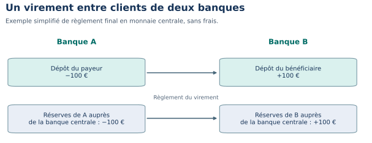
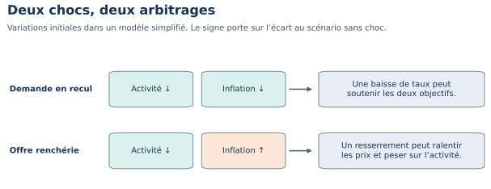
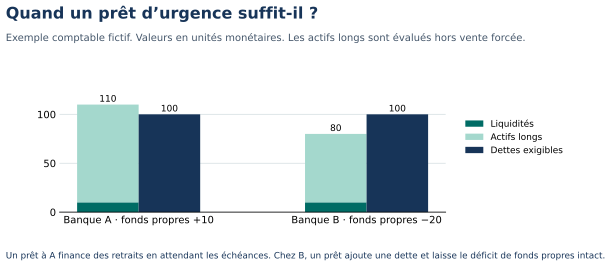

# BEL B/L — Économie 2026 · Corrigé brut

*Corrigé rédigé par IA, non officiel.*

**Rédaction** · modèle exact non renseigné (famille GPT-6) · effort non renseigné · vitesse non renseignée

**Révision** · modèle exact non renseigné (famille GPT-6) · effort non renseigné · vitesse non renseignée

**Révision** · GPT-6.2 Astra Ultra · vitesse non renseignée

**Révision (tour 3)** · GPT-6.2 Astra Ultra · vitesse non renseignée

**Révision (tour 4)** · GPT-6.2 Astra Ultra · vitesse non renseignée · 26 novembre 2026

**Couverture vérifiée.** La dissertation et le guide répondent à l’intitulé « Que peut-on attendre d’une banque centrale ? », reproduit sous la rubrique ENS Paris-Saclay des annales enseignantes. Le règlement des paiements, les chocs d’offre et de demande, la liquidité et la solvabilité ont été contrôlés dans les deux éditions. Le mandat de stabilité des prix est replacé dans la stratégie de la BCE en vigueur au concours.

**Sujet** — Que peut-on attendre d’une banque centrale ?

## Introduction

En septembre 2012, la Banque centrale européenne annonce dans quelles conditions elle pourrait acheter des obligations d’État de certains pays de la zone euro. Les achats se feraient sur le marché secondaire et exigeraient un programme d’assistance assorti de conditions. Aucun plafond quantitatif n’est annoncé à l’avance. Ce dispositif, appelé OMT, a compté dans la crise de la zone euro sans qu’aucun achat ait été effectué à ce titre. Que pouvaient donc attendre les agents d’une institution dont l’intervention décisive, cette fois-là, consistait à rendre crédible une action future ?

Une banque centrale émet la monnaie dans laquelle les banques règlent leurs dettes réciproques. Elle organise ces règlements, agit sur les conditions de financement et peut fournir de la liquidité quand le crédit privé se dérobe. Le verbe « attendre » a ici deux sens. Une collectivité peut lui assigner des objectifs. Les agents forment aussi des anticipations sur ce qu’elle fera effectivement. Les deux sens se rejoignent lorsqu’une décision de prix, de salaire ou de crédit prise aujourd’hui dépend d’une intervention monétaire attendue demain. Mais les épargnants, les employeurs, les emprunteurs et les pouvoirs publics n’ont pas nécessairement les mêmes priorités. Quels résultats une banque centrale peut-elle rendre suffisamment prévisibles pour que ces intérêts divergents puissent coexister dans une même économie monétaire ? Il faut partir de la confiance qu’exige l’usage d’une monnaie commune, examiner ce que la banque centrale peut stabiliser lorsqu’un choc survient, puis préciser devant qui elle répond de ses arbitrages.

## I. Donner aux agents une unité de compte et des moyens de paiement auxquels ils puissent se fier

Lorsqu’une entreprise verse un salaire depuis une banque et que le salarié détient son compte dans une autre, le paiement crée une dette entre les deux établissements. Le règlement en monnaie centrale permet de solder cette dette. La possibilité d’échanger à parité les dépôts en euros de deux banques ne tient donc pas seulement à l’inscription du même signe monétaire sur deux relevés. Elle suppose que les paiements aboutissent et que les avoirs destinés à les régler circulent entre banques. La banque centrale fournit l’actif de règlement ultime et des infrastructures communes. La solidité des établissements et la garantie des dépôts concourent, sous des responsabilités institutionnelles distinctes, à la confiance dans la monnaie bancaire. Une première attente concerne donc la possibilité d’être payé aujourd’hui, y compris lorsque la banque du débiteur diffère de celle du créancier.

Pour un salaire de 100 euros, la banque A débite de 100 le dépôt de l’employeur et cède 100 de réserves à B. La banque B reçoit ces réserves à son actif et crédite de 100 le dépôt du salarié à son passif. Les dépôts des clients et les réserves des banques changent chacun de titulaire. Les totaux restent les mêmes après ce règlement isolé, sans frais.

Une seconde concerne ce qu’un paiement futur permettra d’acheter. Pour négocier un contrat sur trois ans, une entreprise et ses salariés doivent pouvoir raisonner en pouvoir d’achat. Des variations fortes et imprévisibles du niveau général des prix redistribuent entre débiteurs et créanciers et raccourcissent l’horizon des contrats. En zone euro, l’article 127 du traité sur le fonctionnement de l’Union européenne fait de la stabilité des prix l’objectif principal du Système européen de banques centrales. La BCE a défini en 2021 une cible d’inflation symétrique de 2 % à moyen terme. Une cible d’inflation porte sur le rythme d’augmentation du niveau général des prix. Après une flambée, la retrouver ne ramène donc pas automatiquement le coût du panier de la ménagère à son niveau antérieur. Le choix du moyen terme prend au sérieux le délai nécessaire pour qu’une intervention infléchisse les dépenses et les prix.

Le 30 juin 2025, la BCE confirme la cible symétrique de 2 % à moyen terme. Prenons un indice de prix qui passe de 100 à 110 pendant un choc, puis progresse de 2 %. Il atteint 112,2. Revenir au taux visé stabilise le rythme de hausse et laisse subsister la perte de pouvoir d’achat d’un revenu nominal resté fixe. Une promesse de ramener l’indice à 100 serait une politique différente. [Déclaration stratégique de la BCE du 30 juin 2025](https://www.ecb.europa.eu/press/pr/date/2025/html/ecb.pr250630~aabf988af8.fr.html)

Comment un taux administré peut-il modifier le prix d’un service produit par une entreprise privée ? Un relèvement des taux directeurs tend à augmenter le coût de financement des banques et les rendements auxquels les investisseurs comparent leurs placements. Toutes choses égales par ailleurs, il relève les taux proposés pour certains nouveaux crédits. Des ménages reportent un achat immobilier, des entreprises abandonnent des investissements dont la rentabilité attendue ne couvre plus leur coût. Une demande moins dynamique réduit la possibilité de relever les prix et peut ralentir les embauches. L’effet dépend du taux réel anticipé, donc de l’écart entre le taux nominal et l’inflation attendue. Il dépend aussi du contrat déjà signé. Le ménage endetté à taux fixe de longue durée est protégé du renchérissement immédiat de ses échéances, alors que le nouvel emprunteur y est exposé. Une décision unique exerce ainsi des effets différents selon les bilans et les échéances.

La crédibilité complète alors le maniement du taux. Une banque centrale qui annonce comment elle réagira à une inflation durable influe sur le taux que les marchés anticipent dans plusieurs années. Elle modifie ainsi certaines conditions de financement avant même l’ensemble des relèvements attendus. Kydland et Prescott ont montré en 1977 pourquoi un plan annoncé peut cesser de paraître optimal au décideur une fois les décisions privées prises. Si les agents anticipent que les autorités chercheront sans cesse à stimuler l’activité par surprise, cette surprise disparaît et les anticipations de prix en portent la marque. Une règle comprise et un mandat durable peuvent limiter cette difficulté. Une banque centrale gagne toutefois à expliquer aussi les circonstances d’un ajustement. Une promesse de ne jamais réviser un taux perdrait sa valeur si la conjoncture changeait radicalement.

## II. Face aux chocs, stabiliser la dépense et préserver le fonctionnement du crédit

La nature du choc commande la réponse. Imaginons une chute des commandes qui pousse des entreprises viables à réduire leurs stocks, leur production et leurs embauches. L’effet sur le coût réel dépend des deux variations. Pour un taux nominal de 4 % et une inflation attendue de 2 %, le taux réel anticipé vaut environ 2 %. Si le premier descend à 3 % et la seconde à zéro, le taux réel monte à 3 % malgré la baisse annoncée. À anticipations d’inflation données, une détente nominale réduit en revanche le coût réel des projets. En cas de désinflation rapide, l’ampleur de l’ajustement et le crédit accordé à la cible importent donc autant que le sens de la variation du taux directeur. Le soutien à l’emploi et la stabilisation des prix peuvent alors aller de pair. À l’inverse, une hausse du prix de l’énergie importée augmente les coûts de production tout en réduisant le pouvoir d’achat. Un relèvement des taux ne livre aucun mégawatt supplémentaire. Il peut freiner la diffusion du choc au reste des prix et limiter un désancrage des anticipations, au prix d’une demande et d’un emploi plus faibles pendant l’ajustement. Laisser passer un effet initial sur les prix peut être cohérent avec une cible à moyen terme si les anticipations demeurent ancrées. Le même chiffre d’inflation appelle ainsi des décisions différentes selon sa cause, sa persistance et ses effets prévisibles.

Lorsque le financement se bloque, la première question peut devenir celle de l’ouverture quotidienne des guichets. Une banque finance souvent des prêts longs au moyen de dettes que ses créanciers peuvent réclamer rapidement. Même si ses prêts seront remboursés, elle peut manquer de monnaie pour faire face à de nombreuses demandes simultanées. Les ventes d’actifs précipitées risquent de faire baisser les prix et d’affaiblir les établissements voisins. Le modèle de Diamond et Dybvig (1983) rend intelligible la dimension autoréalisatrice de la ruée bancaire. La tradition du prêteur en dernier ressort, discutée par Bagehot dans *Lombard Street* (1873), donne à la fourniture temporaire de liquidités une justification collective. Des avances contre garanties peuvent éviter de liquider des crédits sains pour une urgence de trésorerie. Si les pertes définitives dépassent les fonds propres, renouveler un prêt déplace le moment où il faudra reconnaître ces pertes. Une recapitalisation ou une résolution engage d’autres instruments et peut mobiliser, selon les règles applicables, les actionnaires, les créanciers ou la collectivité.

La crise de la zone euro montre que cette fonction s’étend au mécanisme même de transmission de la politique monétaire. Si les investisseurs redoutent une rupture de l’union monétaire, ils peuvent exiger une prime élevée sur la dette d’un État et des banques qui y sont exposées. Une entreprise solvable y emprunte alors plus cher que sa concurrente étrangère, malgré le taux directeur commun. Les OMT annoncées en 2012 visaient à protéger l’unicité et la transmission de cette politique. L’engagement conditionnel d’acheter des titres sur le marché secondaire cherchait à écarter un scénario de rupture susceptible de s’entretenir lui-même. La condition d’un programme européen d’assistance rappelait qu’une crise de financement pouvait aussi révéler de véritables pertes ou une trajectoire budgétaire insoutenable. L’engagement était puissant parce qu’une intervention crédible changeait les risques auxquels les investisseurs croyaient devoir se préparer. Sa portée dépendait d’un accord institutionnel que la BCE ne maîtrisait pas à elle seule.

## III. Préciser le mandat et rendre compte des arbitrages que la politique monétaire laisse ouverts

Que l’on puisse attendre une action sur l’activité ne dit pas quelle place on doit faire à l’emploi dans la décision. Aux États-Unis, la section 2A du *Federal Reserve Act* vise l’emploi maximal et la stabilité des prix, ainsi que des taux d’intérêt de long terme modérés. En zone euro, le soutien aux politiques économiques générales de l’Union est subordonné à l’objectif principal de stabilité des prix. Ces formulations orientent la façon d’expliquer un arbitrage quand la désinflation s’accompagne d’une montée du chômage. Elles n’autorisent toutefois aucune des deux banques à choisir durablement n’importe quel niveau d’emploi. Une baisse des taux ne forme pas, à elle seule, les soignants qui manquent à un hôpital. La formation, l’investissement productif et l’organisation du marché du travail modifient les capacités de production auxquelles se heurte une relance de la demande.

Les effets distributifs exigent eux aussi une répartition des responsabilités. Un resserrement facilite certains placements de court terme et pèse sur les nouveaux emprunts. Le ralentissement qui s’ensuit peut être plus coûteux pour les ménages exposés au chômage. Mais un ménage qui vit d’un salaire peu indexé supporte également le coût de l’inflation. Classer à l’avance tous les épargnants parmi les gagnants et tous les salariés parmi les perdants ferait oublier que chacun peut cumuler plusieurs positions. La banque centrale doit documenter ces canaux, notamment pour comprendre la transmission de sa politique. Un transfert ciblé aux ménages les plus touchés par les prix de l’énergie relève en revanche d’un choix de bénéficiaires et d’un financement budgétaire. Le budget peut cibler l’aide avec davantage de précision ; son ampleur et son mode de financement peuvent en retour modifier la demande que la banque centrale cherche à stabiliser. La coordination suppose donc de connaître les effets croisés des instruments et les responsabilités de chacun.

L’indépendance des décisions de taux prend enfin tout son sens si elle s’accompagne d’une obligation de rendre compte. Des élections rapprochées peuvent inciter un gouvernement à différer un resserrement coûteux. L’autonomie opérationnelle donne à la banque centrale un horizon plus long. Pourtant la cible elle-même, les conditions d’accès à la liquidité et les risques pris à travers son bilan concernent toute la collectivité. Publier des projections avec leurs hypothèses, expliquer pourquoi une erreur de prévision s’est produite et rendre compte des décisions devant des représentants élus permet de discuter sa conduite. On peut ainsi juger différemment un dépassement provoqué par le premier choc sur les cours mondiaux et une persistance que les autorités auraient laissé se diffuser alors qu’elles disposaient d’indices pour agir. L’exigence extérieure est alors précise : la banque doit justifier les informations qu’elle a utilisées, les délais envisagés et les coûts qu’elle a accepté de faire courir.

## Conclusion

D’une banque centrale, on peut attendre que deux dépôts libellés dans la même monnaie permettent un règlement fiable, qu’un engagement nominal conserve un horizon de pouvoir d’achat intelligible et qu’une panique de liquidité ne détruise pas inutilement des relations de crédit. Ces résultats passent par des décisions qui modifient les anticipations et les bilans, avec des délais et des coûts différents selon les agents. Une partie de sa réussite se voit dans une crise évitée, comme l’illustre l’annonce de 2012. L’évaluer exige alors de préciser le risque auquel elle répondait, le mandat qui l’autorisait à agir et les décisions que devaient encore prendre les autorités budgétaires ou prudentielles. C’est à ces conditions que l’attente de confiance échappe à la promesse impossible de protéger simultanément chaque prix, chaque emploi et chaque patrimoine.

[Libellé reproduit dans les annales enseignantes d’économie](https://pe-dm.pages-perso.free.fr/sujets/economie.html)
