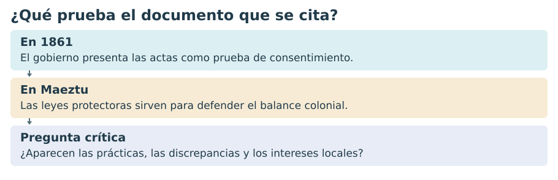
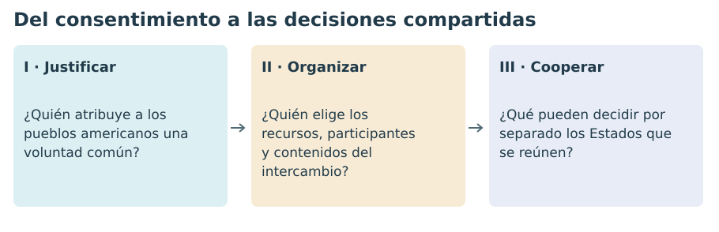

# BEL B/L — Espagnol 2026 · Corrigé guidé

*Corrigé rédigé par IA, non officiel.*

**Rédaction** · modèle exact non renseigné (famille GPT-6) · effort non renseigné · vitesse non renseignée

**Révision** · modèle exact non renseigné (famille GPT-6) · effort non renseigné · vitesse non renseignée

**Révision** · GPT-6.2 Astra Ultra · vitesse non renseignée

**Question directrice** — ¿Quién define lo común cuando España propone reconstruir sus relaciones con sus antiguas colonias americanas?

[Sujet officiel, p. 19 à 26](https://www.ens.psl.eu/sites/default/files/livret_lve_allege.pdf#page=19) · [Rapport officiel](https://www.ens.psl.eu/sites/default/files/2026_bl_rapport_ecrit_option_espagnol.pdf)

## Situer les quatre interventions

Le livret demande d’analyser et de commenter en espagnol les quatre documents des pages 19 à 26. L’écrit à option dure six heures et a un coefficient de 3. Les pièces présentées donnent toutes à lire un regard espagnol sur des interlocuteurs américains.

| Document | Auteur, genre et date | Point à contrôler |
|---|---|---|
| 1 | Gouvernement espagnol, exposé des motifs du décret du 19 mai 1861 soumis à Isabelle II. | L’unanimité dominicaine est un argument de légitimation. La note sur Santana éclaire des intérêts politiques locaux. |
| 2 | Ramiro de Maeztu, texte daté de 1932 dans le livret. | Distinguer le texte des lois de leur application. La figure de la mère rend sensible la hiérarchie derrière l’universalisme chrétien. |
| 3 | Notice de l’*Enciclopedia Universal Ilustrada Europeo-Americana*, 1955. | L’abondance des réalisations chiffrées et des superlatifs contribue à légitimer l’Institut sous Franco. |
| 4 | Discours de Juan Carlos Ier à Séville, le 11 octobre 1992. | Le roi juxtapose « descubrimiento » et « encuentro ». Les sommets de Guadalajara et de Madrid donnent au rapprochement une forme institutionnelle. |

Entre la proclamation du 18 mars et le décret du 19 mai 1861, la voix qui prétend représenter le peuple change. Identifier l’auteur et le destinataire de chacun des deux actes.

## Examiner les preuves proposées

Le rapport commente la nature de chaque texte aux pages 2 à 4, puis demande une confrontation critique aux pages 4 à 7. Chez Maeztu, suivre le passage de l’énumération des dispositions coloniales à la défense du bilan de la conquête. Dans la notice, distinguer le montant du budget et l’adjectif qui le qualifie. Le même examen peut ensuite porter sur les actas de 1861 et sur les analogies familiales de 1992.

## Rendre visible la réciprocité

Les concerts de musique hispano-américaine organisés à Madrid donnent un exemple de circulation vers l’Espagne au sein de la politique culturelle franquiste. Le discours de 1992 évoque la dette artistique espagnole envers l’Amérique. Comparer le lieu de décision, le rôle des publics et celui des gouvernements permet d’identifier des transformations précises.

> [!PIEGE]
> La note du document 3 date juridiquement le changement de dénomination de l’Institut du 31 décembre 1945 ; le corps de la notice donne un autre jour de ce même mois. L’argument chronologique de la copie repose sur l’année 1945 et sur le congrès universitaire de 1946. Pour le document 2, conserver la date donnée à l’extrait dans le livret et le situer sous la Seconde République.

## Commentaire rédigé en espagnol

### Introducción

En mayo de 1861, el Consejo de Ministros presenta a Isabel II la anexión de Santo Domingo como respuesta generosa a un deseo unánime. En octubre de 1992, otro monarca español, Juan Carlos I, invita en Sevilla a construir junto a los Estados americanos una comunidad política duradera. De un trono que recibe la soberanía de un pueblo a una cumbre en la que cada gobernante representa a un Estado soberano ha cambiado la naturaleza misma del vínculo. Sin embargo, ambos actos apelan a afectos familiares y a un pasado compartido. Entre ellos se sitúan el ensayo de Ramiro de Maeztu sobre la Hispanidad, cuyo fragmento fecha el dossier en 1932, y la semblanza del Instituto de Cultura Hispánica publicada por una enciclopedia española en 1955. Los cuatro textos permiten preguntar quién se atribuye la facultad de definir lo común cuando España reconstruye sus relaciones con sus antiguas colonias. Para responder conviene examinar primero el consentimiento que invocan, después las instituciones que dan cuerpo a la relación y por fin los límites del intercambio que anuncian.

### I. Atribuir una voluntad a los pueblos americanos es ya intervenir en su historia

El documento 1 reproduce la exposición de motivos de un real decreto. La reina es su destinataria inmediata y el gobierno necesita justificar la decisión ante quienes pudieran tacharla de conquista. De ahí la atención concedida al tiempo de espera. El pabellón español, insiste el texto, ya ondeaba cuando la Corona conoció los hechos. El intervalo entre la proclamación y la noticia serviría para establecer que Madrid careció de iniciativa. A esta presunta prueba se añade una inversión en el vocabulario de la libertad. Puesto que la independencia habría traído inseguridad, entregar la soberanía equivaldría a recobrar la capacidad de vivir en paz. El consentimiento queda demostrado según el gobierno por las actas de proclamación. Pero un documento producido para legitimar la anexión difícilmente agota las posiciones dominicanas. La nota permite distinguir dos momentos. Santana proclamó la anexión en Santo Domingo el 18 de marzo y el decreto español se firmó en Aranjuez el 19 de mayo. Hubo proclamas favorables en varios municipios y puestos militares. Ni su existencia ni el interés de Santana en neutralizar a sus adversarios permiten hablar en nombre de toda la población. La guerra de la Restauración, iniciada en 1863 y seguida por la retirada española en 1865, impide tomar la unanimidad oficial por una descripción satisfactoria de toda la sociedad.

Maeztu, en el documento 2, transforma el mismo problema en un relato sobre los orígenes. Atribuye a Alonso de Ojeda, al desembarcar en las Antillas en 1509, una declaración que sitúa a los indígenas y a los europeos dentro de una sola genealogía humana. Al explicar la «Fiesta de la Raza» del 12 de octubre, Maeztu define la pertenencia por el habla y la fe. El posesivo en «nuestra lengua» y «nuestra fe» delata el lugar desde el que enuncia una supuesta universalidad. Se incluye a personas de cualquier color de piel con la condición de que se reconozcan en esos dos atributos. La escena siguiente, sin embargo, distribuye los papeles de modo desigual: los españoles reúnen e instruyen y los indígenas aparecen como niños. Una familia puede incluir a todos sus miembros y reservar a uno de ellos el derecho a indicar qué deben hacer los demás. La exposición de 1861 presenta a los dominicanos como hijos que solicitan amparo. Maeztu desplaza la misma asimetría hacia el terreno de la tutela espiritual. En ambos documentos la voz española explica con detalle lo que los americanos habrían querido recibir.

También importa lo que el ensayista admite. Reconoce abusos y a continuación enumera las leyes destinadas a impedirlos, incluida la reglamentación de la encomienda. El paso de esas disposiciones a la afirmación de que la conquista difundió el espíritu cristiano exige aceptar que la norma describe lo ocurrido. Precisamente la necesidad de sancionar abusos proporciona un motivo para dudar de tal inferencia. El decreto y el ensayo convierten una pieza selectiva, sea el acta que registra una proclamación o la legislación que proclama una protección, en prueba de un consenso mucho más amplio. La disputa sobre lo común concierne por tanto a quién conserva el derecho de aportar testimonios de signo contrario.

### II. De la reivindicación histórica a la organización material de la influencia

El texto de Maeztu pertenece al tiempo de la Segunda República y expresa una alternativa conservadora a otros proyectos de relación con América. No se trata todavía de una política cultural adoptada por la dictadura de Franco. El documento 3 permite observar el cambio de escala. La entrada de la *Enciclopedia Universal Ilustrada Europeo-Americana* enumera publicaciones, becas, gastos de viaje, una biblioteca y hasta una cátedra que lleva el nombre de Maeztu. Un autor que disputaba una interpretación de la historia se convierte en referencia de una organización que reparte recursos y forma lectores. Esa transformación resulta más precisa que la idea vaga de una influencia ideológica que se habría extendido por sí sola.

La aparente neutralidad del inventario merece atención. La entrada cifra el presupuesto en diecisiete millones de pesetas y lo califica de modesto mientras elogia la amplitud de sus resultados. La cifra describe una asignación pública. El adjetivo invita a admirar la eficacia de quien la recibe, sin proporcionar una comparación presupuestaria. Más reveladora todavía es la convivencia de iniciativas. La entrada pondera la reunión espontánea en Madrid de universitarios hispanoamericanos en 1946. El Estado español ya había reorganizado en 1945 la institución que iba a encauzar estas actividades. La presencia de interlocutores americanos fue real según la fuente; la distribución del dinero, el establecimiento de la sede y la elección de los temas dependían en buena medida del poder español. El régimen encontró en esos vínculos un medio de proyectarse al exterior en los difíciles años posteriores a la Segunda Guerra Mundial. La inauguración solemne presidida por Franco en 1952 daba además una imagen pública del lugar que deseaba ocupar en esta red.

Sería insuficiente reducir todos esos intercambios a la repetición de una doctrina. Los conciertos de la sección de musicología permitieron a un público madrileño escuchar repertorios hispanoamericanos. La dirección de la circulación difiere aquí del modelo en que España enseñaba y América aprendía. La conservación, selección y presentación de la música seguían pasando por una institución radicada en Madrid. La pregunta por la reciprocidad gana así un criterio observable: ¿quién puede elegir qué se conserva, qué viaja y qué se interpreta ante el público? Ese criterio permite interrogar también el proyecto de cooperación formulado en Sevilla varias décadas después.

### III. Una cooperación entre Estados soberanos transforma la historia compartida y hereda algunos de sus silencios

El 11 de octubre de 1992 Juan Carlos I emplea tanto el término tradicional «descubrimiento» como la expresión «encuentro entre dos mundos». La víspera de aquel mismo 12 de octubre que Maeztu convertía en fiesta de una comunidad ya definida, el orador se pregunta qué debe España a América. La fecha conmemorativa permite así discutir quién cambió a quién. El aporte de los movimientos literarios americanos a la proyección internacional de la lengua española invierte una dirección que en Maeztu parecía natural. Aquel fijaba la pertenencia a la comunidad según la adopción de una lengua y de una fe designadas en primera persona desde España. El rey se detiene en lo que los propios españoles deben a escritores del otro lado del océano. La coincidencia léxica en torno a la comunidad encubre por tanto un desplazamiento de la deuda reconocida.

Los interlocutores también han cambiado. En 1861 unas actas locales legitimaban a ojos de Madrid la desaparición de una soberanía. En 1992 las cumbres de Guadalajara y Madrid requieren la presencia y la continuidad de gobiernos independientes. La familia pasa a ser una fraternidad entre participantes que pueden deliberar y emprender proyectos comunes. En una España democrática integrada en las instituciones europeas, el fortalecimiento de las conexiones iberoamericanas puede proporcionar un peso internacional adicional. No se necesita suponer un altruismo sin intereses para reconocer el alcance del cambio. Los principios y los medios de la política son otros, y la multiplicidad de Estados queda inscrita en la estructura de las propias reuniones.

La simetría, sin embargo, tampoco puede darse por adquirida. Llamar familiares a cinco siglos de encuentros y desencuentros invita a interpretar bajo un mismo afecto la violencia de la conquista y los frutos del intercambio. El rey acepta que ha habido una polémica saludable y anima a superarla en favor del futuro. A quienes han padecido la desposesión les podría interesar mantener abiertas preguntas que un aniversario diplomático prefiere cerrar. Los cuatro documentos proceden de España. La actividad de estudiantes, artistas y gobernantes americanos deja huellas en ellos, pero sus desacuerdos apenas pueden escucharse en primera persona. Esta ausencia delimita lo que el dossier permite concluir: conocemos las estrategias de sucesivos actores españoles para construir una relación y legitimar su forma; queda por documentar cómo las acogieron en cada sociedad americana grupos con intereses diferentes.

### Conclusión

Del decreto al proyecto de cumbres se distinguen cambios efectivos en el reparto de la autoridad, en los instrumentos disponibles y en el sentido atribuido a la circulación cultural. El amparo monárquico suponía el fin de una soberanía, la Hispanidad de Maeztu convertía la conquista en misión, el Instituto franquista financiaba una red que combinaba intercambio y selección, y la monarquía parlamentaria proponía cooperación a gobiernos independientes. La persistencia de la metáfora familiar permite reconocer la operación común a estos proyectos. Nombrar una afinidad no determina qué decisiones corresponden a cada participante. La prueba de la reciprocidad comenzaría allí donde los interlocutores americanos pudieran discutir, en sus propios términos, la memoria y las prioridades presentadas como compartidas.
