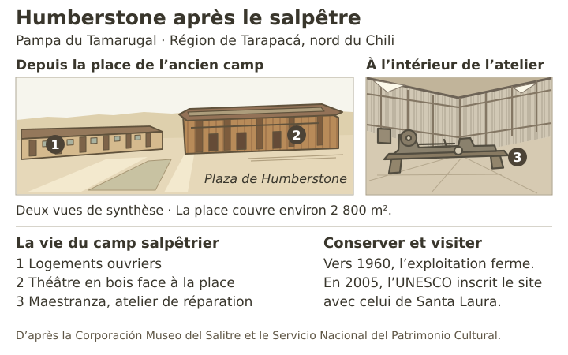
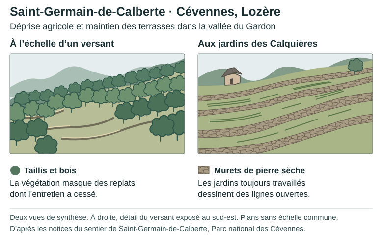
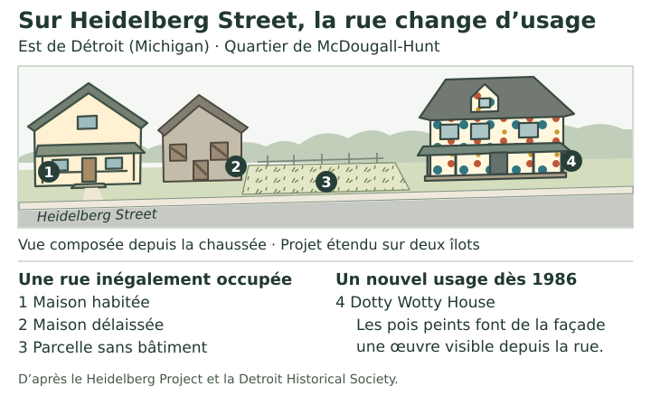

# BLSES B/L — Géographie 2026 · Corrigé brut

*Corrigé rédigé par IA, non officiel. Signalez toute erreur.*

**Lecture du rapport du jury** · GPT-6.2 Astra Ultra · vitesse non renseignée

**Rédaction** · GPT-6.2 Astra Ultra · vitesse non renseignée

**Contribution (production figures)** · GPT-6.2 Astra Ultra · vitesse non renseignée

**Révision (tour 1)** · GPT-6.2 Astra Ultra · vitesse non renseignée

**Retouches (tour 1)** · GPT-6.2 Astra Ultra · vitesse non renseignée

**Vérification finale (tour 1)** · GPT-6.2 Astra Ultra · vitesse non renseignée

**Sujet** — Les paysages de la décroissance

**Problématique** — À quelles conditions une perte d’habitants ou d’activités devient-elle sensible dans un paysage, et que font les acteurs des traces qu’ils y reconnaissent ?

Dans le nord du Chili, à une quarantaine de kilomètres du port d’Iquique, le théâtre d’Humberstone donne sur une place bordée par l’ancien magasin de la compagnie. La présence d’un théâtre dans le désert d’Atacama étonne davantage que celle d’un terrain vide. Elle dit qu’ici des familles assez nombreuses pour former un public vivaient du travail du salpêtre. L’équipement a survécu à la cité ouvrière. Encore faut-il, pour y lire un départ collectif, savoir à qui servait cette place et qui la fréquente aujourd’hui.

Une décroissance s’établit en comparant dans la durée, pour un espace délimité, des effectifs de population, des emplois ou des volumes d’activité. Le paysage, lui, se découvre depuis un lieu. Il comprend ce qui se voit, mais aussi ce qui s’entend, les habitudes qui permettent de reconnaître un changement, les significations qu’on prête à une forme. Une maison peut changer d’occupant sans changer de façade. À quelles conditions une perte d’habitants ou d’activités devient-elle sensible dans un paysage, et que font les acteurs des traces qu’ils y reconnaissent ? Certaines pertes s’inscrivent durablement dans le bâti et la végétation. Pourtant, d’un lieu d’observation ou d’un moment à l’autre, leurs indices peuvent s’atténuer ou tromper. Leur interprétation engage enfin des choix sur ce qui mérite d’être entretenu, transformé ou transmis.

* * *

La décroissance laisse les traces les plus nettes là où plusieurs usages dépendaient d’une même activité. Dans la pampa du Tamarugal, la compagnie du salpêtre réunissait à Humberstone le travail, le logement des familles et une partie de leurs loisirs. Dans la phase d’expansion ouverte en 1934, la cité a compté plus de trois mille habitants. Le nitrate extrait dans la région alimentait notamment les agricultures étrangères en engrais. Concurrencé par les produits de synthèse, ce système industriel s’est contracté, malgré des tentatives de relance. À la fermeture d’Humberstone, au tournant de 1960, les salariés ont dû chercher ailleurs leur subsistance. Le long des rues, les rangées de logements demeurent lisibles. La place conserve le théâtre et l’ancien magasin, tandis qu’une partie des installations de travail a été démontée. Ce qui signale la décroissance, c’est le décalage entre l’ampleur des équipements collectifs et la disparition du public ordinaire pour lequel ils avaient été construits. Le même désert entourait la ville à l’époque où elle prospérait.

Lorsque les emplois et les habitants se dispersent à l’intérieur d’une région urbaine, la traduction matérielle des pertes est plus discontinue. La ville de Détroit, dans le Michigan, comptait environ 1,85 million d’habitants en 1950 et 639 111 en 2020. Sur soixante-dix ans, la population municipale a diminué d’environ 65 %. La décentralisation des usines et l’accès inégal au logement de banlieue ont dissocié les lieux d’emploi et de résidence. Thomas Sugrue a montré combien les discriminations à l’emploi et sur le marché immobilier avaient pesé dans cette redistribution. À l’est du centre, dans le quartier de McDougall-Hunt, la vacance a troué certaines rangées de maisons. Un trottoir dessert encore une habitation, puis longe un lot dont la maison a disparu, avant de retrouver un porche occupé. La chaussée et la desserte des parcelles conservent la dimension d’un quartier plus peuplé. Sur la même longueur de rue, les intervalles entre voisins se sont accrus. On comprend ainsi pourquoi la superficie municipale a pu rester presque identique quand le nombre de résidents s’effondrait.

Le travail qui cesse peut aussi se faire remarquer par ce qui pousse. À Saint-Germain-de-Calberte, en Lozère, l’exode amorcé au XIXe siècle a privé d’une partie de leur main-d’œuvre des cultures qui demandaient un entretien manuel répété. La commune comptait environ 1 500 habitants en 1876, puis 445 en 1982. Les murets de pierre sèche retenaient la terre, des rigoles conduisaient l’eau et la taille des arbres maintenait la lumière dans les vergers. Sur des pentes délaissées, les taillis se sont épaissis, puis les couronnes des arbres ont masqué certaines marches du versant. La fermeture paysagère désigne ici la réduction des ouvertures visuelles qui accompagnaient les cultures. Elle s’étale sur le temps de croissance des végétaux, bien au-delà de la saison du dernier entretien. Le départ des familles a donc pu, selon les activités antérieures, ouvrir des vides entre des maisons ou fermer une vue sur les pentes. Ces indices contraires invitent à préciser qui peut les reconnaître et à quel moment.

* * *

Un paysage peut garder longtemps une trace quand le mouvement qui l’a produite s’est ralenti ou inversé. À Saint-Germain-de-Calberte, les recensements donnent 445 habitants en 1982 et 477 en 2022. Le couvert boisé des versants conserve la marque d’une déprise plus ancienne pendant cette période de légère hausse entre les deux dates. Depuis un point de vue éloigné, les cimes paraissent former un ensemble continu. Sur le sentier, le promeneur distingue le bord d’un mur sous le taillis. À proximité, aux Calquières, les alignements soignés des jardins toujours cultivés tranchent sur les secteurs boisés. Pour l’un des propriétaires qui travaille cette terre, la façon dont l’eau s’écoule entre les pierres et l’effort nécessaire pour remonter un bloc importent autant que le dessin des terrasses. Pour le parc national, ces jardins sont aussi un patrimoine à faire découvrir. Une même pente livre ainsi des renseignements différents au randonneur qui contemple son profil et à celui qui connaît les gestes de sa mise en valeur.

Le renouvellement des usagers peut même dissimuler une décroissance résidentielle derrière les signes d’une grande intensité d’occupation. Le centre historique de Venise comptait près de 175 000 résidents en 1951, contre environ 48 500 à la fin de 2024. Cette série concerne la ville historique, distincte de Mestre sur la terre ferme et des autres îles. Aux abords du Rialto, les vitrines ouvertes, la file des passants sur le pont et le bruit continu des conversations pendant les heures de visite suggèrent l’affluence. Le registre municipal compte ceux qui résident sur place. Le passant, lui, rencontre aussi ceux qui travaillent dans le centre, y passent quelques heures ou y louent une chambre pour la nuit. La divergence apparaît mieux quand on considère la nature des commerces et des logements. Un appartement loué à la semaine peut demeurer éclairé longtemps après le départ du dernier ménage qui y vivait à l’année. Pour un voisin, le changement prend la forme d’interlocuteurs sans cesse renouvelés sur le palier ou de courses quotidiennes qu’il faut faire plus loin. Et la concentration de boutiques de souvenirs près du Rialto contraste avec certaines rues de Castello, à l’écart de ces itinéraires. Une image de la foule dit donc quelque chose de la demande touristique locale. Pour y lire la dépopulation, il faut aussi connaître les rythmes d’occupation du bâti et les limites du territoire où l’on compte les résidents.

Ces décalages ont des conséquences pour ceux dont le quartier est regardé de l’extérieur. À Détroit, cadrer une parcelle en friche en laissant hors du champ les maisons entretenues suffit à donner à une rue habitée l’apparence d’un abandon intégral. Une photographie ainsi cadrée peut conforter une réputation sans fournir de renseignement sur le rythme actuel des départs. Il en va autrement du récit d’un riverain capable de dater une démolition et de nommer les familles restées sur place. Le choix entre ces lectures acquiert une portée matérielle lorsque des acteurs doivent décider du sort d’une maison ou d’une parcelle.

* * *

Dans Heidelberg Street, à Détroit, ce pouvoir de nommer s’est traduit par des interventions concurrentes. Dès 1986, l’artiste Tyree Guyton, qui avait grandi dans cette rue, s’est mis avec son grand-père à nettoyer des lots et à travailler avec des objets récupérés. Peinture sur les façades, assemblages sur les terrains et dans les arbres ont associé des morceaux de rue en une installation de plein air. Une maison peinte de pois se lit alors tout autrement depuis le trottoir. Des visiteurs s’arrêtent pour la regarder, ce qui modifie aussi l’usage d’une rue où vivent toujours des familles. Parmi les voisins, certains ont apprécié cette initiative. D’autres se sont plaints de l’attention portée à leur quartier ou ont vu dans les assemblages une accumulation de rebuts. En 1991, la municipalité a fait démolir trois maisons du projet. Ce nouvel intervalle dans la rue résultait d’une décision publique. L’artiste, les habitants et les élus avaient donné des valeurs différentes à des constructions issues de la même histoire. Le réemploi d’une parcelle et la venue de visiteurs ont suffi à modifier l’expérience du quartier, sans permettre d’en déduire un regain de l’emploi industriel ou un retour des ménages partis.

À Humberstone, la reconnaissance d’un patrimoine a modifié ce qui se transmet de la décroissance. Des anciens du salpêtre et leurs familles se sont mobilisés pour conserver le site. La Corporación Museo del Salitre l’a acquis en 2002. En 2005, Humberstone et Santa Laura, où subsistent davantage d’installations industrielles, ont été inscrits ensemble au patrimoine mondial. Les deux sites permettent désormais aux visiteurs de relier les conditions de travail et les formes de la vie collective. À l’occasion de la Semaine du salpêtre, des *pampinos* reviennent aussi sur les lieux. La place peut retrouver une foule et des voix à date fixe. Ce rassemblement commémore une société dispersée dont les revenus et les logements ordinaires se trouvent désormais ailleurs. L’action patrimoniale fait durer le signe d’une activité disparue et suscite une activité de visite. Chacune obéit à un calendrier, à des décisions et à une économie différents.

* * *

**Les paysages de la décroissance se reconnaissent à la relation que l’on peut établir entre un changement mesuré, une forme héritée et des usages présents.** La relation est étroite pour une cité de compagnie vidée de ses travailleurs, plus lente pour un versant dont les terrasses se boisent, parfois presque imperceptible au milieu des foules d’un centre historique. Elle varie encore selon qu’on entretient une maison, en décide la démolition ou la fait visiter. Le théâtre d’Humberstone permet finalement de lire les deux mouvements ensemble. Sa taille rappelle la population qui a quitté la pampa. Les voix qui, certains jours, y reviennent disent le travail de ceux qui ont voulu que ce départ laisse une mémoire commune.
