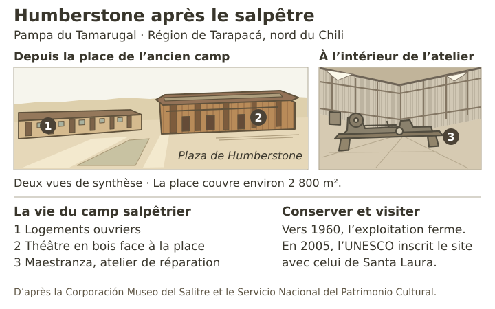
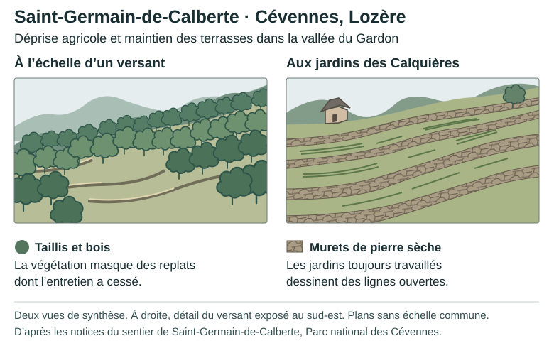
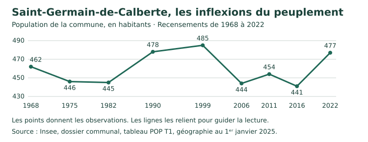
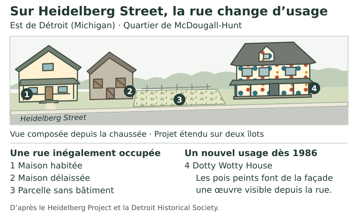

# BLSES B/L — Géographie 2026 · Corrigé guidé

*Corrigé rédigé par IA, non officiel. Signalez toute erreur.*

**Lecture du rapport du jury** · GPT-6.2 Astra Ultra · vitesse non renseignée

**Rédaction** · GPT-6.2 Astra Ultra · vitesse non renseignée

**Contribution (production figures)** · GPT-6.2 Astra Ultra · vitesse non renseignée

**Révision (tour 1)** · GPT-6.2 Astra Ultra · vitesse non renseignée

**Retouches (tour 1)** · GPT-6.2 Astra Ultra · vitesse non renseignée

**Vérification finale (tour 1)** · GPT-6.2 Astra Ultra · vitesse non renseignée

**Révision (tour 2)** · GPT-6.2 Astra Ultra · vitesse non renseignée

La session astra_lettres a révisé les séries communales et leur lecture avec les croquis.

## Présentation du sujet

« Les paysages de la décroissance » est le sujet de la **composition de géographie, option écrite de la banque Lettres et sciences économiques et sociales (BLSES), voie B/L**. Le rapport du jury reproduit cet intitulé en première page et donne une durée de six heures. La notice inter-ENS situe cette épreuve le 22 avril 2026 et précise les coefficients de l’option, 3 à l’ENS Paris et 1 à l’ENS de Lyon. Le programme « Les territoires de la décroissance » couvrait les villes et les campagnes à l’échelle mondiale. Le fond de carte fourni en salle n’a pas été retrouvé. Son utilisation était facultative. Le jury jugeait peu pertinent le croquis de synthèse sur ce sujet et appréciait les vues paysagères commentées (p. 3). Les trois croquis proposés ici sont des dessins originaux. [Rapport 2026, p. 1–3](https://www.ens.psl.eu/sites/default/files/2026_bl_rapport_ecrit_geographie.pdf) · [Notice inter-ENS, p. 31](https://www.ens-lyon.fr/sites/default/files/2026-02/notice_interens_2026_mise_en_ligne_vf260212_0.pdf) · [Lettre de cadrage](https://www.ens.psl.eu/sites/default/files/lettre_de_cadrage_-_geographie.pdf)

On peut consacrer une heure à la lecture des termes, au choix des terrains et au plan, quatre heures et demie à la rédaction et aux dessins, puis trente minutes à la relecture. Au brouillon, réserver une ligne par exemple. Y faire tenir le périmètre mesuré, la période retenue, une forme que l’on pourrait dessiner et un acteur en mesure de l’expliquer. Si l’une des cases demeure vide, mieux vaut resserrer l’exemple avant d’écrire le paragraphe.

## Analyse du sujet

> [!INDICATION]
> Imaginez que vous disposiez de deux pièces sur le même lieu, une série de recensements et une photographie. Que pouvez-vous apprendre de chacune ? Que vous faudrait-il encore pour les rapprocher ?

> [!INDICATION]
> Placez un résident et un visiteur au même endroit. Quels changements chacun aurait-il le temps et les moyens de remarquer ?

#### Solution

**Décroissance.** La comparaison doit porter sur un indicateur défini à des dates et dans un périmètre comparables. Une perte de résidents peut s’accompagner d’un maintien de l’emploi ou d’une hausse de la fréquentation. La lettre de cadrage n’impose aucun seuil universel. Un arrêt d’usine ne devient un argument sur la décroissance du territoire que si l’on explique comment la perte se prolonge ou se diffuse, par exemple par le départ des familles salariées ou la fermeture de commerces qui les desservaient. Une réflexion sur la sobriété choisie aurait sa place si un acteur en faisait le principe d’une transformation précise des lieux. Un débat général sur la poursuite de la croissance économique manquerait l’échelle de l’observation.

**Paysages.** Décrire suppose un point de vue et une étendue perceptible. Un passant peut compter les portes fermées d’une rue, entendre les voix qui sortent d’un théâtre, remarquer que la végétation interrompt la vue sur le versant opposé. Un habitant peut en outre comparer avec ce qu’il connaissait de la rue ou du versant. Le paysage comprend ces formes, ces sensations et le sens que leur donnent des observateurs situés. Le territoire sert à établir les mesures et à identifier des compétences d’aménagement. La dissertation porte sur ce que devient ce territoire pour qui le parcourt, l’habite ou en diffuse une image.

**Le rapport entre les deux termes.** Le complément « de la décroissance » invite à tester trois relations. Une perte mesurée a-t-elle contribué à produire la forme visible ? La forme permet-elle encore de reconnaître la perte ? Quelqu’un a-t-il décidé de rendre cette trace plus ou moins visible ? Ces questions conduisent de l’explication des formes à leur interprétation puis aux opérations qui en changent le sens. Comparer deux situations qui demandent des explications différentes permet de donner au pluriel toute sa portée.

## Problématique

> [!INDICATION]
> Cherchez un lieu où la disparition d’une activité se lit longtemps après sa fermeture, puis un lieu très fréquenté qui a perdu ses habitants. Qu’est-ce qui rend ces deux observations compatibles ?

#### Solution

**À quelles conditions une perte d’habitants ou d’activités devient-elle sensible dans un paysage, et que font les acteurs des traces qu’ils y reconnaissent ?** La question a une portée explicative. Entre la série chiffrée et le jugement d’un observateur interviennent la durée de vie d’un bâtiment, les usages qui succèdent aux précédents et les choix des personnes capables d’agir sur ce bâtiment. On peut aussi partir du travail de terrain en demandant comment deux observateurs placés dans le même territoire en décroissance peuvent donner des lectures différentes de ses transformations. Il faudra alors expliquer matériellement cette différence de perception.

## Plan détaillé

Le premier mouvement explique la genèse de traces différentes à partir de ce que les activités faisaient tenir ensemble. Le deuxième teste la valeur de ces traces comme indices d’une décroissance. Le troisième suit les acteurs qui les effacent, les conservent ou les remettent en usage. Revenir sur une rue déjà évoquée est fécond si le second passage y résout une question nouvelle.

### Partie I — L’organisation des activités commande les formes de leur retrait

> [!INDICATION]
> Reconstituez une journée ordinaire avant le départ des habitants. Quels équipements dépendaient du même employeur ? Quel élément du paysage exigeait, chaque saison, de nouveaux gestes d’entretien ?

#### Solution

**Une cité de compagnie associe plusieurs pertes.** Humberstone se trouve au Chili, dans la pampa du Tamarugal, à l’est du port d’Iquique. Indiquer cette relation au port explique pourquoi un vaste établissement humain a pu s’organiser dans un désert. Le nitrate naturel, notamment destiné à la fabrication d’engrais exportés, soutenait salaires, logements et commerces. Après la relance de 1934, la cité a compté plus de 3 000 habitants. L’industrie subissait déjà la concurrence des produits de synthèse. Le musée local situe la fermeture définitive en 1960. Retenir « vers 1960 » suffit pour distinguer l’arrêt, le départ des familles et la dégradation ou le démontage ultérieur des installations. Le théâtre et le magasin de la compagnie prennent alors une valeur d’indice particulièrement forte. Leur voisinage signale qu’une société organisée autour de l’usine a disparu.

Dans le dessin, observe-t-on une seule place d’où l’on pourrait voir l’intérieur de l’atelier ? Les deux vues rapprochent des lieux distincts de la même cité. Sur la copie, une phrase doit les réunir par la relation qui associait le travail aux équipements collectifs. Ce rapprochement évite aussi d’attribuer à Humberstone les grandes installations de traitement du site voisin de Santa Laura.

**Une perte urbaine peut se disperser entre les parcelles.** Dans les limites de la ville de Détroit, les recensements fédéraux comptent approximativement 1,85 million d’habitants en 1950 et 639 000 en 2020. L’ordre de grandeur est une baisse de 65 %. Le calcul ne fournit aucune carte des démolitions. Pour les comprendre, changer d’échelle. À McDougall-Hunt, les lots libérés s’intercalent entre des maisons habitées. Expliquer cette distribution exige de faire intervenir la décentralisation des emplois et l’accès sélectif aux logements de banlieue. Le récit historique de Thomas Sugrue permet de préciser cet accès inégal. La maison et la rue, dont les usages se sont espacés, inscrivent ces mutations métropolitaines à hauteur d’habitant.

**La disparition du travail d’entretien produit parfois un paysage plus dense.** À Saint-Germain-de-Calberte, la population est tombée d’environ 1 500 habitants en 1876 à 445 en 1982. L’ordre de grandeur est ici plus pertinent qu’un taux précis, car les conventions de recensement ont changé. Moins de travail sur les terrasses et dans les vergers a pu laisser place aux ligneux. L’étagement de pierre subsiste sous un couvert qui se referme au fil des années. Ce cas apporte un mécanisme distinct de la vacance immobilière. Ici la perte d’usage a accru le volume de végétation visible. La déprise agricole a pu se combiner à des choix de boisement, ce qui exige d’identifier localement l’histoire des parcelles avant de conclure.

*Transition.* Le caractère spectaculaire d’une forme ne garantit ni sa date ni sa signification. Comment distinguer un héritage d’un processus en cours ?

### Partie II — Les rythmes et les points d’observation limitent la lecture des traces

> [!INDICATION]
> Faites varier une seule condition d’observation. Qu’apprend-on en passant du sentier au versant, ou en observant une rue de centre-ville à l’heure de visite puis à l’échelle d’une année ?

#### Solution

**Un versant boisé peut témoigner du passé.** À Saint-Germain-de-Calberte, les anciennes vues du bourg commentées par le parc national permettent de situer la fermeture progressive des anciens milieux agricoles depuis l’exode rural. En revanche, le total communal est passé de 445 habitants en 1982 à 477 en 2022, avec des fluctuations entre ces dates. On ne pourrait donc pas déduire de la présence des bois une baisse continue de la population actuelle. Une observation rapprochée des Calquières montre par ailleurs des terrasses toujours cultivées et des dispositifs d’irrigation. Leur exposition au sud-est, leur entretien manuel et la présence de nombreux propriétaires expliquent l’intérêt d’observer le site à l’échelle des jardins. La variation entre parcelles et le décalage entre périodes constituent deux arguments différents.

**Lire ensemble le versant et les recensements.** Sur le croquis des Calquières, suivez un muret visible au milieu des jardins puis cherchez son équivalent dans la vue boisée. À distance, le taillis peut masquer le replat alors que la maçonnerie subsiste. Sur la courbe, choisissez ensuite 1999–2006 (485 puis 444 habitants) et 2016–2022 (441 puis 477). Les signes du changement démographique sont opposés. Pour 2016–2022, le tableau POP T2M donne −0,6 point par an pour le solde naturel et +1,9 point pour les entrées et sorties, soit +1,3 % par an au total. Le solde des entrées et sorties est dit « apparent » car il se déduit de la variation d’effectif et du solde naturel. Aucune de ces séries communales ne donne la date d’abandon d’une terrasse. Cette date demanderait une source parcellaire, par exemple une comparaison de photographies aériennes datées ou un témoignage situé.

[Insee, tableaux POP T1 et POP T2M de la commune](https://www.insee.fr/fr/statistiques/8581709?geo=COM-48155)

> [!METHODE]
> Pour commenter un paysage rural, partez d’une limite tangible. Si un muret se prolonge dans le bois, que faut-il savoir de l’ancienne parcelle, du dernier entretien et du temps de croissance des arbres pour interpréter cette continuité ?

**Une rue très animée peut masquer des départs.** La série municipale de Venise isole le centre historique des autres îles et de la terre ferme. On y compte environ 175 000 résidents en 1951 et 48 500 fin 2024. Passer à une rue voisine du Rialto oblige à distinguer les résidents habituels des visiteurs et des travailleurs présents en journée. Le commerce de souvenirs et l’hébergement de courte durée animent le centre tout en donnant aux habitants un environnement commercial et sonore différent. Les relevés de Cristina Catalanotti (2023) montrent la concentration de certains commerces sur les axes les plus visités et un moindre effet dans des secteurs de Castello ou de Cannaregio. On peut ainsi dire où les apparences de vitalité sont particulièrement trompeuses si l’on cherche à évaluer la population résidente.

**Une image peut rendre la décroissance plus visible que les habitants restés sur place.** À Détroit, un photographe placé devant une maison abandonnée peut cadrer assez serré pour écarter les jardins et les porches voisins. Un tel cadrage, rendu public et repris, peut favoriser la stigmatisation du quartier. Pour établir qu’il a pesé sur une décision de retrait ou d’investissement, il faudrait encore identifier le décideur et son choix. Cette exigence prépare le passage de la perception à l’action.

*Transition.* Qui peut donner à sa lecture assez de force pour conserver un paysage, transformer ses usages ou en faire disparaître une partie ?

### Partie III — Les arbitrages sur les traces transforment les paysages de la décroissance

> [!INDICATION]
> Sur une même rue, qui peut peindre, qui peut ordonner la démolition et qui continue à y habiter ? Dans une ancienne cité industrielle, qui peut acheter les bâtiments, les restaurer et les ouvrir aux visiteurs ?

#### Solution

**Une controverse locale change physiquement une rue.** À partir de 1986, Tyree Guyton intervient dans Heidelberg Street, où il a grandi. Des habitants et des enfants prennent part au projet. Les objets devenus matériaux d’installation, les façades colorées et les parcelles aménagées invitent à s’arrêter. Les réactions des voisins divergent. Certains apprécient cette transformation, d’autres jugent les assemblages encombrants ou supportent mal l’attention des visiteurs. En 1991, sur décision municipale, trois des maisons du projet sont démolies. Ce détail donne une issue concrète au débat sur la valeur paysagère. Là où la municipalité fait enlever une construction, l’artiste perd un support de travail et les promeneurs rencontrent désormais un vide. On peut raconter cette histoire sans faire parler « Détroit » comme si tous ses habitants partageaient le même point de vue.

**La patrimonialisation organise un retour d’un autre ordre.** À Humberstone, d’anciens membres des communautés du salpêtre ont participé à la préservation du site. La Corporación Museo del Salitre en devient propriétaire en 2002. L’inscription conjointe de Humberstone et Santa Laura au patrimoine mondial en 2005 permet de lire ensemble la cité et les installations de production. La Semaine du salpêtre rassemble des *pampinos* autour de leur histoire. Réécouter les voix sur la place donne du poids au registre sensoriel du devoir et déjoue l’image d’une ville éternellement silencieuse. Une activité de visite et des rassemblements épisodiques rendent visibles de nouveaux usages. Leur calendrier et leurs bénéficiaires diffèrent de ceux de l’emploi salarié permanent qui avait fait la ville.

## Références et exemples

Chaque source ci-dessous permet de vérifier un maillon différent du raisonnement. Un chiffre communal, un récit historique et une description de terrain n’ont pas la même portée.

- **Définir le périmètre.** Les deux recensements américains concernent la municipalité de Détroit. L’étude de Thomas Sugrue, *The Origins of the Urban Crisis* (1996), explique les déplacements de l’emploi et la ségrégation dans la région urbaine. [Recensement de 1950](https://www.census.gov/programs-surveys/decennial-census/decade/1950/census-records.html) · [Recensement de 2020](https://www.census.gov/quickfacts/detroitcitymichigan) · [Ouvrage de Sugrue](https://press.princeton.edu/books/paperback/9780691162553/the-origins-of-the-urban-crisis)
- **Confronter les acteurs.** La Detroit Historical Society retrace les réactions des habitants et les démolitions. Le projet donne sa propre lecture du rôle de l’art dans le quartier. [Detroit Historical Society](https://www.detroithistorical.org/learn/online-research/encyclopedia-of-detroit/heidelberg-project) · [Heidelberg Project](https://www.heidelberg.org/history)
- **Dater un paysage rural.** Les données de population portent sur Saint-Germain-de-Calberte. La description des jardins et des points de vue provient des notices du parc sur place. [Insee, historique depuis 1876](https://www.insee.fr/fr/statistiques/3698339) · [Insee, tableau POP T1](https://www.insee.fr/fr/statistiques/8581709?geo=COM-48155) · [Parc national des Cévennes, sentier de Saint-Germain-de-Calberte](https://destination.cevennes-parcnational.fr/fr/trek/37916-Saint-Germain-de-Calberte)
- **Distinguer population et fréquentation.** Pour Venise, consulter la série « per zone » de la municipalité, colonne du centre historique. Les cartes commerciales de l’article de Catalanotti situent les concentrations autour des itinéraires touristiques. [Municipalité de Venise](https://www.comune.venezia.it/it/content/serie-storiche) · [Article de Cristina Catalanotti](https://doi.org/10.18778/1231-1952.30.1.06)
- **Comprendre un site industriel conservé.** Le musée décrit la croissance du camp d’Humberstone, sa fermeture et les bâtiments encore lisibles. L’Unesco précise ce qui subsiste sur chacun des deux sites et le rôle des rassemblements. [Musée du salpêtre, Humberstone](https://museodelsalitre.cl/patrimonio-mundial/humberstone/) · [Place](https://museodelsalitre.cl/recorrido/plaza/) · [Atelier](https://museodelsalitre.cl/recorrido/maestranza/) · [Notice du patrimoine mondial](https://whc.unesco.org/fr/list/1178/) · [État de conservation, 2007](https://whc.unesco.org/fr/soc/957/)

## Introduction et conclusion rédigées

#### Solution

**Introduction possible.** Sur la place d’Humberstone, au Chili, il reste un théâtre. Il fallait assez de spectateurs pour qu’une compagnie exploitant le salpêtre à l’est du port d’Iquique équipe ainsi sa cité. Que l’on voie encore ce bâtiment longtemps après la fermeture de l’exploitation fait de lui un témoin singulier du départ des travailleurs. Ce que l’on peut mesurer par la perte des emplois et le départ des familles, on le découvre dans le paysage par le décalage entre l’équipement et ses usages. Mais la transformation est-elle toujours aussi sensible ? Les paysages associent des formes matérielles, les bruits et les rythmes qu’on perçoit sur place, et les significations qu’habitants ou visiteurs leur donnent. À quelles conditions une perte d’habitants ou d’activités devient-elle sensible dans un paysage, et que font les acteurs des traces qu’ils y reconnaissent ? On étudiera d’abord l’inscription des pertes dans les formes bâties et les versants cultivés, puis les limites de leur observation, avant de voir comment des décisions sur leur devenir réorientent leur signification.

**Conclusion possible.** Les formes du retrait varient avec les activités qui entretenaient les lieux. Une usine fermée laisse des installations surdimensionnées, un recul des cultures peut en revanche soustraire au regard un ancien versant de terrasses. À Venise, il faut même traverser des foules pour comprendre comment les usages touristiques se sont superposés à la perte résidentielle. La durée du regard, le périmètre de la mesure et l’expérience de l’observateur déterminent ce que l’on peut lire. Les interventions de Guyton à Détroit, comme le retour temporaire des *pampinos* à Humberstone, font de ces paysages des objets de décision et des lieux d’attachement longtemps après les premiers départs.

## Pièges à éviter

> [!PIEGE]
> Une usine détruite dans un séisme donne à voir un séisme. Si la reconstruction n’a pas lieu et que les salariés partent durablement, on dispose alors d’une autre séquence à expliquer. La cause de la destruction et les effets ultérieurs de la décroissance demandent deux démonstrations.

> [!PIEGE]
> « La friche fait fuir les habitants » inverse la chronologie si les emplois ont d’abord disparu. Pour démontrer un effet en retour, établir comment un jugement sur le lieu a effectivement pesé sur le choix d’un ménage, d’un investisseur ou d’une collectivité.

> [!JURY]
> Le rapport 2026, p. 1 à 3, demande de décrire la matérialité et d’envisager plusieurs sens, plusieurs acteurs et des terrains au-delà de l’Europe et de l’Amérique du Nord. Il recommande des légendes organisées au voisinage immédiat des croquis. Les vues paysagères ont été appréciées lorsqu’elles soutenaient l’argument. [Rapport de l’option](https://www.ens.psl.eu/sites/default/files/2026_bl_rapport_ecrit_geographie.pdf)

## Bilan

Pour vérifier un paragraphe, recouvrez le nom du lieu. La description des formes permet-elle encore de distinguer la place d’une cité de compagnie, une rue résidentielle trouée de lots libres et un versant où des jardins sont entretenus ? Puis recouvrez la donnée chiffrée. Pourriez-vous dire quelle perte elle mesure, à quelles dates et dans quelles limites ? Un exemple complet rend les deux réponses possibles et explique le passage de l’une à l’autre.
