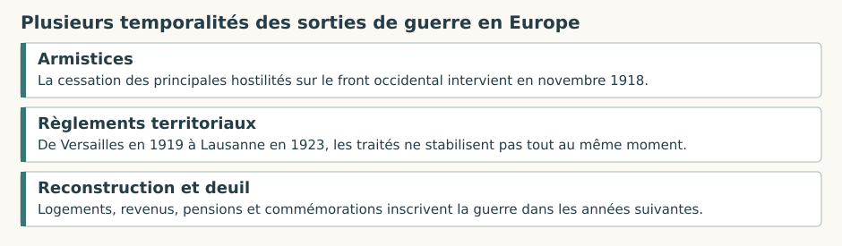

# ENS B/L · Oral d’histoire contemporaine du 16 juin 2026 · Corrigé guidé

*Corrigé rédigé par IA, non officiel. Signalez toute erreur.*

**Rédaction** · GPT-6.2 Astra Ultra · vitesse non renseignée

**Autocontrôle** · GPT-6.2 Astra Ultra · vitesse non renseignée

**Révision (tour 1)** · GPT-6.2 Astra Ultra · vitesse non renseignée

La feuille associe douze tirages à deux sujets. Avant la préparation de 1 h 30, le candidat choisit entre le sujet sur la France et celui sur le monde. Le rapport prévoit 20 minutes d’exposé et 10 minutes d’entretien. Cette proposition traite les deux possibilités de chaque tirage. Pour construire un passage, justifier les bornes chronologiques, situer les acteurs sur la carte et expliquer la transition entre les périodes au moyen d’un exemple précis. Chaque sujet est suivi d’une question d’entretien et d’une réponse.

## Tirage 1

### France · La fonction présidentielle en France de 1870 aux années 1980

La proclamation de la République en septembre 1870 laisse ouverte la question de son exécutif. Le paradoxe du siècle suivant vient de ce qu’une fonction volontairement contenue à la fin du XIXe siècle devient le centre de gravité du régime sous la Ve République. Il faut expliquer la transformation de ses ressources institutionnelles et politiques, sans confondre titulaires et fonction.

Les lois constitutionnelles de 1875 donnent au président, élu pour sept ans par les deux chambres réunies, des pouvoirs substantiels, dont la dissolution de la Chambre des députés avec l’accord du Sénat. En 1877, Mac-Mahon tente d’imposer sa lecture des relations entre l’exécutif et la majorité. Les élections d’octobre maintiennent une majorité républicaine. Après la démission de Mac-Mahon en 1879, Jules Grévy accepte la prééminence parlementaire. L’effacement relatif résulte d’une pratique politique. Le chef de l’État conserve la nomination du président du Conseil, une présence symbolique et, selon les circonstances, une influence dans les consultations.

La rupture autoritaire de 1940 suspend le fonctionnement républicain. La Constitution de 1946 rétablit une présidence élue par le Parlement et donne la prééminence à l’Assemblée nationale. Sous la Ve République, la Constitution de 1958 et l’autorité de De Gaulle renforcent la présidence. L’élection présidentielle au suffrage universel direct, adoptée en 1962 et pratiquée en 1965, ajoute une légitimité personnelle. La dissolution, le référendum et la nomination du Premier ministre deviennent des ressources effectives. L’alternance de 1981 confirme que la gauche peut exercer cette fonction. La cohabitation de 1986 montre cependant le poids de la majorité de l’Assemblée et l’autonomie du gouvernement dans la conduite des affaires. La présidentialisation n’abolit donc pas le cadre parlementaire.

> [!INDICATION]
> Pourquoi 1877 et 1986 sont-elles deux épreuves instructives ?

Dans les deux cas, le chef de l’État rencontre une majorité parlementaire différente. Les règles et les issues diffèrent, mais les deux conjonctures font apparaître la dépendance de ses pouvoirs réels à l’égard du rapport des forces électorales.

### Monde · Le pétrole, une arme géopolitique (1918–1990)

Parler d’« arme » revient ici à étudier un pouvoir de négociation dans les relations internationales. Celui-ci varie selon la dépendance des importateurs, le contrôle des ressources et les possibilités de substitution. Il faut distinguer le pétrole comme enjeu de souveraineté, comme source de revenus et comme moyen de pression collective.

À l’issue de la Première Guerre mondiale, motorisation et industrialisation donnent une importance accrue à l’approvisionnement. Les grandes compagnies anglo-américaines et les régimes de concessions structurent la production et la distribution. Le Moyen-Orient devient central, mais les États-Unis sont eux-mêmes un grand producteur. La nationalisation mexicaine de 1938 et celle décidée par Mossadegh en Iran en 1951 font de la souveraineté sur le sous-sol une question internationale. Le renversement de Mossadegh en 1953 montre la rencontre entre intérêts pétroliers, stratégie occidentale et forces politiques iraniennes.

La création de l’OPEP à Bagdad en 1960 accroît les possibilités de concertation des pays exportateurs. En octobre 1973, pendant la guerre israélo-arabe, des producteurs arabes de l’OPAEP utilisent restrictions et embargo ciblé. L’OPEP et les pays arabes qui prennent ces mesures ne se confondent pas. La hausse du prix nourrit la redistribution de revenus et la contestation de l’ordre économique international. La révolution iranienne de 1979 puis la guerre Iran-Irak accentuent l’instabilité de l’offre. Pour les pays importateurs, les politiques d’économies d’énergie, la diversification des fournisseurs et la création de l’Agence internationale de l’énergie en 1974 réduisent certaines dépendances. Le contre-choc de 1986 et l’invasion du Koweït en 1990 rappellent respectivement la fragilité des recettes des producteurs et l’implication des grandes puissances dans la sécurité du Golfe. La ressource donne un levier conditionnel, dont le prix et les effets échappent partiellement à ses détenteurs.

> [!INDICATION]
> Une hausse du prix international donne-t-elle nécessairement aux producteurs ce qu’ils demandent politiquement ?

Elle accroît potentiellement les recettes, mais modifie aussi les politiques d’approvisionnement et de consommation des importateurs. Obtenir une modification durable d’une décision diplomatique est une autre question que constater une hausse de prix.

## Tirage 2

### France · Faire grève en France (1870–début des années 1990)

En 1870, la coalition des travailleurs a cessé d’être en elle-même un délit depuis 1864. L’employeur conserve néanmoins de puissants moyens de sanction et le droit de grève ne bénéficie pas encore de la protection constitutionnelle de l’après-1945. Faire grève engage du salaire, des solidarités et une lutte pour la reconnaissance d’un interlocuteur. Comment cette pratique devient-elle une institution de la négociation tout en conservant sa capacité de contestation ?

La loi de 1884 autorise les syndicats professionnels. Les bassins miniers, le textile et la métallurgie fournissent des lieux de grève où les réseaux de métier et de quartier comptent autant que l’organisation nationale. Fourmies, le 1er mai 1891, illustre le coût de la répression et la transformation d’une revendication sur la journée de travail en mémoire ouvrière. Les ouvrières participent aussi aux conflits, même si les sources syndicales et patronales rendent inégalement visibles leurs revendications.

En mai–juin 1936, les grèves avec occupation suivent la victoire électorale du Front populaire. Les accords de Matignon, puis les lois sociales, articulent mouvement de salariés, négociation patronale et décision parlementaire. Le préambule de la Constitution de 1946 reconnaît que le droit de grève s’exerce dans le cadre des lois qui le réglementent. Les grandes grèves de 1947–1948 montrent que cette reconnaissance coexiste avec des affrontements sociaux et politiques.

En mai–juin 1968, l’extension des arrêts de travail donne au conflit une ampleur exceptionnelle. Les discussions de Grenelle ouvrent des concessions salariales et syndicales sans entraîner une reprise immédiate partout. À partir des années 1970, chômage, restructurations et fermetures modifient le risque et l’objet de la mobilisation. Les conflits pour l’emploi et ceux des services publics mettent en jeu des solidarités différentes. La diffusion du droit n’a donc pas rendu partout égal le pouvoir de suspendre le travail ni celui d’obtenir une concession.

> [!INDICATION]
> Pourquoi distinguer accords de Matignon, congés payés et quarante heures ?

Les premiers résultent d’une négociation entre représentants patronaux et syndicaux sous l’égide du gouvernement. Les deux autres mesures relèvent de lois votées par le Parlement. Leur proximité chronologique ne rend pas leurs procédures identiques.

### Monde · L’année 1989 dans le monde

Le 9 novembre, l’ouverture du mur de Berlin donne un visage à 1989. En faire le seul événement de l’année conduirait pourtant à confondre le déclassement d’un ordre européen avec une démocratisation mondiale automatique. Pourquoi des contestations jusque-là contenues obtiennent-elles des issues si différentes ?

Au sein du bloc de l’Est, les réformes soviétiques engagées par Gorbatchev et le recul de la menace d’une intervention soviétique élargissent l’espace d’action des oppositions. En Pologne, les négociations de la Table ronde et les élections partiellement libres de juin permettent à Solidarność de traduire une implantation sociale ancienne en débouché gouvernemental. En Hongrie, les transformations institutionnelles et l’ouverture de la frontière avec l’Autriche accélèrent les départs de citoyens est-allemands. Les mobilisations en RDA et l’ouverture du mur s’inscrivent donc dans un enchaînement transnational. La révolution de Velours en Tchécoslovaquie et la chute sanglante du régime Ceaușescu en Roumanie rappellent la diversité des trajectoires.

En Chine, les manifestations du printemps débouchent au contraire sur la répression de Pékin des 3 et 4 juin. Le Parti communiste chinois maintient son monopole en poursuivant une ouverture économique déjà engagée. Ailleurs, l’élection au Brésil d’un président au suffrage direct en 1989 et les élections chiliennes de décembre prolongent des transitions latino-américaines dotées de leurs calendriers. Le retrait soviétique d’Afghanistan s’achève en février, sans mettre fin à la guerre dans le pays.

1989 déplace ainsi les anticipations, les frontières et les possibilités de l’action politique. La réunification allemande vient en 1990 et la disparition de l’URSS en 1991. Dater ces résultats ultérieurs empêche de leur attribuer rétrospectivement une nécessité que les acteurs de 1989 ne pouvaient connaître.

> [!INDICATION]
> Pourquoi rapprocher juin en Pologne et juin en Chine ?

Dans les deux cas, des mobilisations rencontrent une direction communiste en contexte de réforme. Les ressources des oppositions, la position du pouvoir coercitif et l’environnement international diffèrent et expliquent des issues contrastées.

## Tirage 3

### France · Le boulangisme

Le général Georges Boulanger, ministre de la Guerre en 1886, donne son nom à une mobilisation qui traverse plusieurs camps avant de s’effondrer en 1889. Le phénomène intéresse l’histoire de la République moins par la durée de son programme que par la possibilité, révélée quelques années après l’installation du régime, d’une contestation populaire du parlementarisme en son propre langage électoral.

La défaite de 1870 et la perte de l’Alsace-Lorraine nourrissent le prestige de certains discours de revanche, tandis que l’instabilité ministérielle et les scandales fragilisent la représentation. Boulanger possède comme ministre une notoriété publique à laquelle contribuent chanson, presse et images. Son éloignement du gouvernement et la popularité qui l’accompagne transforment la personne en point de ralliement. Le mouvement réunit des républicains révisionnistes, des nationalistes et des soutiens monarchistes dont les projets ne coïncident pas. Le mot d’ordre de révision constitutionnelle laisse justement en suspens la nature du futur régime.

Les candidatures successives aux élections partielles donnent à ces consultations une dimension plébiscitaire. Le succès parisien du 27 janvier 1889 nourrit les spéculations sur une rupture avec l’ordre établi. Boulanger ne tente pas de prendre le pouvoir. Menacé de poursuites, il quitte la France au printemps. La reprise d’initiative des républicains, l’adaptation du droit électoral et les divisions de ses soutiens contribuent au reflux. Son suicide en 1891 clôt la trajectoire personnelle.

Le boulangisme n’est réductible ni à une restauration monarchiste déguisée ni à une étape inéluctable vers des mouvements ultérieurs. Il révèle la capacité d’une popularité personnelle à agréger des mécontentements contradictoires et montre aussi les ressources institutionnelles d’une République encore contestée.

> [!INDICATION]
> Pourquoi les élections partielles ont-elles tant d’importance ?

En pouvant se présenter successivement dans plusieurs circonscriptions, le général transforme des consultations locales en manifestations répétées d’adhésion personnelle. Leur accumulation ne suffit toutefois pas à créer une majorité parlementaire durable.

### Monde · Le Royaume-Uni et l’Europe

Le Royaume-Uni est une puissance européenne dont les dirigeants disposent aussi de relations impériales, atlantiques et financières mondiales. Dans le cadre chronologique du programme, de l’après-1918 au début des années 1990, l’enjeu consiste à comprendre comment évoluent les formes de l’engagement sur le continent et pourquoi intégration économique, défense et souveraineté font l’objet de compromis distincts.

Après 1918, Londres participe au règlement européen, à la Société des Nations et aux accords de Locarno de 1925. Le maintien d’un équilibre continental est jugé compatible avec les priorités maritimes et impériales. La politique d’apaisement face à Hitler, particulièrement visible à Munich en 1938, puis l’entrée en guerre en 1939 montrent le coût et les limites de ce calcul. Pendant et après la guerre, l’alliance américaine devient essentielle sans faire disparaître l’Europe de la sécurité britannique. Londres est membre fondateur de l’OTAN en 1949.

Après 1945, le Royaume-Uni soutient certaines coopérations intergouvernementales, notamment le Conseil de l’Europe, mais reste initialement en dehors de la CECA et de la CEE. Le Commonwealth, les relations transatlantiques et les préférences sur l’organisation économique rendent moins évidente l’adhésion à une communauté supranationale. Le dynamisme du marché commun et l’affaiblissement de la position impériale contribuent au changement. Les candidatures se heurtent aux refus de De Gaulle en 1963 et 1967. L’entrée dans les Communautés européennes en 1973 est confirmée par le référendum britannique de 1975.

Dans les années Thatcher, la négociation de la contribution budgétaire, réglée en 1984 à Fontainebleau, coexiste avec le soutien à l’extension du marché intérieur par l’Acte unique. Le traité de Maastricht de 1992 s’accompagne d’un statut particulier concernant la monnaie unique. Le parcours ne se résume donc pas à une opposition entre isolation et appartenance. Défense atlantique, accès aux marchés et délégation d’autorité ont suivi des rythmes distincts.

> [!INDICATION]
> Pourquoi une participation précoce à l’OTAN et une entrée tardive dans la CEE ne sont-elles pas contradictoires ?

L’OTAN répond à un problème de sécurité dans le cadre d’une alliance transatlantique. La CEE engage des politiques économiques et des institutions communes dont les effets sur les engagements extérieurs et la souveraineté ont été discutés autrement.

## Tirage 4

### France · Le monde ouvrier en France (1870–1990)

L’expression « monde ouvrier » désigne à la fois une place dans la production et des manières différentes d’habiter, de s’organiser et de se représenter. Entre 1870 et 1990, l’industrialisation puis les restructurations déplacent ces réalités. Expliquer la formation d’une classe exige de partir de sa diversité, y compris des femmes, des travailleurs immigrés et des ouvriers loin des grandes usines.

Vers 1870, les ateliers urbains, les fabriques textiles, les mines et le travail à domicile coexistent. Le développement de grands établissements et de bassins spécialisés rapproche domicile, emploi et sociabilités. L’accident de Courrières en 1906 rend visibles le risque minier et la solidarité professionnelle. La légalisation des syndicats en 1884 et la fondation de la CGT en 1895 donnent des formes durables à l’organisation collective, sans entraîner l’adhésion de tous. Les qualifications, le genre et l’origine divisent souvent la main-d’œuvre.

Les guerres, les migrations et l’essor des productions standardisées modifient les métiers. En 1936, la mobilisation ouvrière porte les revendications de salaire, de dignité et de disponibilité du temps. Après 1945, nationalisations, protection sociale, croissance de la grande industrie et implantation communiste dans certaines municipalités renforcent les institutions d’un univers ouvrier. Les ouvriers spécialisés de l’automobile et les travailleuses des industries légères ne partagent pourtant pas nécessairement la trajectoire du mineur employé à statut. Mai–juin 1968 en fait apparaître les revendications distinctes.

Dans les années 1970 et 1980, fermetures dans les mines, la sidérurgie et le textile, chômage durable et sous-traitance fragilisent certains collectifs. La baisse de visibilité politique des grandes concentrations ne signifie pas disparition du travail ouvrier. Une partie de celui-ci se déplace vers des entreprises plus petites, la maintenance, le transport et la logistique. Le singulier « monde » désigne donc une construction historique dont les bases et les frontières changent.

> [!INDICATION]
> Pourquoi juxtaposer usine et commune ouvrière ?

L’entreprise organise les métiers et les contraintes du travail. Le quartier ou la municipalité donne des lieux d’entraide, d’éducation, de loisirs et de politisation qui contribuent à faire durer le groupe hors de l’atelier.

### Monde · L’antifascisme en Europe dans l’entre-deux-guerres

L’opposition au fascisme italien précède l’arrivée d’Hitler au pouvoir. L’antifascisme désigne pourtant des expériences diverses, exil, défense des libertés, contre-mobilisation ouvrière, alliance électorale ou engagement international. Comment des acteurs aux projets concurrents réussissent-ils à coopérer, et pourquoi leurs alliances demeurent-elles fragiles ?

Dans l’Italie des années 1920, socialistes, communistes, démocrates et catholiques critiques sont confrontés à la destruction des libertés. L’assassinat de Giacomo Matteotti en 1924 et les lois d’exception des années 1920 accélèrent l’exil et la clandestinité des opposants. Les réseaux d’émigrés font circuler des témoignages et des analyses dans plusieurs pays européens. Ces expériences ne créent pas d’emblée un front unifié. Les partis communistes et sociaux-démocrates s’opposent notamment sur les priorités et la nature des régimes parlementaires.

L’arrivée d’Hitler à la chancellerie en 1933, la persécution des oppositions allemandes et les événements de février 1934 en France rendent concrète la menace. Des rassemblements et comités associent intellectuels, syndicats et partis. L’évolution de l’Internationale communiste vers les fronts populaires en 1935 facilite des accords politiques. Le Front populaire français de 1936 traduit cette coopération en victoire électorale et en programme commun. En Espagne, la victoire du Front populaire puis le soulèvement militaire et la guerre civile donnent au combat antifasciste une dimension internationale, avec volontaires, exilés et campagnes de solidarité.

L’issue dépend aussi des gouvernements étrangers. La non-intervention en Espagne limite le soutien officiel aux républicains. Les contraintes diplomatiques, les désaccords sur l’URSS et les divisions internes à l’Espagne républicaine perdurent. En 1939, la défaite républicaine et le pacte germano-soviétique ébranlent ces alliances. L’antifascisme est ainsi une expérience transnationale de défense et de politisation, qui unit sur l’adversaire sans faire disparaître les différences sur la société à construire.

> [!INDICATION]
> Pourquoi 1935 est-elle une inflexion plutôt qu’un point de départ ?

L’opposition au régime de Mussolini existe depuis ses débuts, et des rapprochements précèdent la nouvelle stratégie communiste. Le tournant des fronts populaires change les possibilités d’alliance entre organisations.

## Tirage 5

### France · Georges Clemenceau (1841–1929)

Médecin de formation, républicain opposé à l’Empire, Clemenceau est élu en 1871. Sa trajectoire apparemment contradictoire, de figure radicale de l’opposition à président du Conseil en temps de guerre, apporte un fil directeur : comment transforme-t-il une conception exigeante de la République en pratique de gouvernement, et quels conflits cette transformation fait-elle apparaître ?

Maire de Montmartre en 1870 puis député, il connaît la rupture de la Commune et défend ensuite l’amnistie des communards. Sous la République parlementaire, il attaque les républicains modérés, notamment la politique coloniale de Jules Ferry, en contestant la hiérarchie des prétendues « races » et l’usage des ressources de l’État. Sa réputation de « tombeur de ministères » et son activité journalistique montrent un parcours inscrit dans la culture parlementaire et la presse. Affaibli par le scandale de Panama et battu en 1893, il retrouve une position centrale dans le combat dreyfusard. *L’Aurore*, dont il est l’un des animateurs, publie en janvier 1898 la lettre ouverte de Zola.

Ministre de l’Intérieur puis président du Conseil en 1906, il assume le maintien de l’ordre lors de conflits sociaux. Son action fait apparaître l’écart entre solidarité républicaine et mouvement ouvrier. Rappelé à la présidence du Conseil en novembre 1917, après une crise de confiance marquée par la durée du conflit, il défend la poursuite de la guerre, affirme l’autorité civile et visite le front. La victoire de 1918 construit le personnage du « Père la Victoire ».

À la conférence de paix, il recherche la sécurité de la France face à l’Allemagne et doit composer avec les exigences américaines et britanniques. Le traité de Versailles est un compromis dont la mise en œuvre dépend d’alliés. L’échec de sa candidature à la présidence de la République en 1920 montre que le prestige de guerre ne supprime pas les oppositions parlementaires. Sa postérité a privilégié le chef de guerre, alors que la défense des libertés et les tensions de l’ordre social donnent leur profondeur aux autres phases de sa vie.

> [!INDICATION]
> Pourquoi ne pas commencer la biographie en 1917 ?

Ses expériences de député, journaliste et chef du gouvernement expliquent les instruments politiques qu’il utilise en guerre, ainsi que les oppositions et les fidélités qu’il rencontre.

### Monde · L’année 1973 dans le monde

La multiplication des événements devenus emblématiques, choc pétrolier, coup d’État chilien, guerre israélo-arabe, risque de transformer 1973 en catalogue. Le problème commun est celui d’une recomposition des rapports de puissance dans un monde où les économies et les conflits sont de plus en plus interdépendants, alors même que la détente entre les superpuissances semble progresser.

Les accords de Paris de janvier permettent le retrait des forces américaines du Vietnam, sans mettre fin à la guerre entre Vietnamiens. La visite de Brejnev aux États-Unis en juin illustre les canaux ouverts par la détente. Celle-ci ne retire pas aux conflits locaux leurs causes et leurs acteurs. Au Chili, le coup d’État du 11 septembre renverse Salvador Allende et ouvre la dictature de Pinochet. La polarisation intérieure, les milieux économiques et militaires et l’intervention américaine dans la déstabilisation doivent être distingués : réduire l’événement à une décision à Washington effacerait les acteurs chiliens. En octobre, la guerre entre Israël, l’Égypte et la Syrie montre au Moyen-Orient les limites d’un ordre réglé uniquement par les superpuissances.

La confrontation au Moyen-Orient amplifie le pouvoir des États producteurs de pétrole. Les restrictions d’exportation prises par certains pays arabes et la hausse des prix déplacent des revenus et aggravent l’inflation chez les importateurs. Cette rupture se superpose à des tensions antérieures du système monétaire international. La suspension de la convertibilité du dollar en or date de 1971 et le flottement de grandes monnaies se généralise en 1973. L’entrée du Royaume-Uni, du Danemark et de l’Irlande dans les Communautés européennes au 1er janvier montre aussi la recherche de cadres régionaux.

La portée de l’année est donc asymétrique. Certains producteurs gagnent provisoirement des recettes et un levier diplomatique, des économies importatrices entrent dans une période de difficultés, et des régimes autoritaires consolident ou étendent leur pouvoir. La fin de la croissance rapide n’a ni la même date ni le même sens partout.

> [!INDICATION]
> Les accords de Paris mettent-ils fin à la guerre du Vietnam ?

Ils organisent notamment un cessez-le-feu et le retrait américain. Les combats se poursuivent et le gouvernement de Saïgon tombe en avril 1975. La distinction éclaire l’écart entre retrait d’une grande puissance et règlement d’un conflit local.

## Tirage 6

### France · Patriotisme et nationalisme en France (1870–1914)

Aimer sa patrie, reconnaître une communauté politique et faire de la nation un principe supérieur d’exclusion ou de conquête ne sont pas des démarches identiques. Le partage entre patriotisme et nationalisme ne coïncide pourtant ni avec une frontière politique fixe ni avec une chronologie où l’un remplacerait simplement l’autre. Comment les acteurs s’approprient-ils le langage national entre la défaite de 1870 et la mobilisation de 1914 ?

La défaite et la perte de l’Alsace-Lorraine donnent à la reconstruction nationale une dimension de deuil, de mémoire et de préparation. L’école publique, le service militaire et les fêtes civiques contribuent à nationaliser des territoires et des générations. La fête nationale du 14 juillet, instituée en 1880, associe des mémoires de la Révolution, de la Fédération et de la République. Des catholiques, des monarchistes et des socialistes peuvent néanmoins aimer la France tout en discutant les symboles républicains ou les usages militaires de la nation.

Dans les années 1880 et 1890, les ligues, le boulangisme et l’Affaire Dreyfus transforment cet héritage. Défendre la nation peut signifier défendre l’armée et fermer la communauté aux prétendus ennemis intérieurs. L’antisémitisme de la mobilisation antidreyfusarde en montre la violence. Pour les dreyfusards, le droit d’un citoyen et la recherche de la vérité peuvent au contraire engager l’honneur même de la nation. Les débats sur l’expansion coloniale divisent également ceux qui invoquent la grandeur française.

À la veille de 1914, le vote de la loi des trois ans en 1913 suscite des oppositions entre projets de défense. Les socialistes internationalistes ne sont pas tous indifférents à l’indépendance nationale. L’assassinat de Jaurès le 31 juillet et l’Union sacrée d’août ne démontrent pas que tous avaient souhaité la guerre. La menace perçue, les obligations envers les proches et les contraintes de mobilisation donnent des contenus multiples à l’adhésion nationale.

> [!INDICATION]
> Que montre l’Affaire Dreyfus sur le lien entre patriotisme et opinion politique ?

Les adversaires peuvent tous invoquer la patrie tout en défendant des exigences opposées, solidarité avec l’institution militaire ou primauté du droit et de la preuve. Il faut identifier les usages du mot.

### Monde · Le plan Marshall

Le 5 juin 1947, le secrétaire d’État américain George Marshall propose à Harvard une aide à la reconstruction européenne. Elle devient en 1948 l’European Recovery Program et se poursuit jusqu’en 1952. Pourquoi reconstruire l’économie d’autres pays avec des crédits américains, et comment les Européens transforment-ils cette proposition en instrument d’organisation économique et politique ?

Après 1945, les destructions, les difficultés d’approvisionnement et le manque de dollars limitent les importations d’équipements, d’énergie et de nourriture. Les États-Unis disposent d’une capacité productive intacte et ont intérêt au relèvement de marchés solvables. Le projet a également une dimension politique dans le contexte de rupture entre anciens alliés. L’aide doit contribuer à la stabilité sociale et à la consolidation des régimes d’Europe occidentale. L’URSS refuse d’y participer et exerce des pressions sur les pays d’Europe centrale et orientale, notamment la Tchécoslovaquie. Une offre initialement formulée à l’échelle européenne se transforme en marqueur de la division du continent.

Les pays participants coordonnent leurs besoins au sein de l’Organisation européenne de coopération économique créée en 1948. Les livraisons et financements permettent des achats que les devises disponibles limitaient. Dans le mécanisme de contre-valeur, la vente intérieure de biens importés peut alimenter des fonds en monnaie nationale utilisables pour la reconstruction selon des règles convenues. Les gouvernements conservent une marge dans la destination des ressources. Les missions de productivité font aussi circuler des techniques d’organisation et un modèle de consommation dont l’appropriation varie.

Le plan ne suffit pas à expliquer toute la croissance européenne, déjà engagée avant 1948 et liée également aux politiques nationales et aux capacités industrielles existantes. Il est néanmoins un accélérateur financier et un apprentissage institutionnel de la coopération occidentale. Il faut enfin le distinguer de l’OTAN, alliance de défense de 1949, et de la CECA, initiative d’intégration sectorielle lancée ultérieurement.

Sur la dernière flèche, identifier qui verse les francs et dans quelle monnaie l’importation a été financée. On explique ainsi la contre-valeur sans confondre livraison extérieure et emploi intérieur du produit de la vente.

> [!INDICATION]
> S’agit-il uniquement d’un prêt que les Européens remboursent en dollars ?

Non. L’aide comporte surtout des dons, ainsi que des prêts. Les fonds de contre-valeur en monnaie locale relèvent d’un autre mécanisme que le remboursement intégral des dons au gouvernement américain.

## Tirage 7

### France · Mines et mineurs en France

La mine réunit un gisement, des capitaux, des infrastructures et une main-d’œuvre dont une partie de la vie est organisée autour du bassin. Entre 1870 et le début des années 1990, le charbon structure la puissance industrielle avant que les fermetures n’en fassent un enjeu régional et mémoriel. Le pluriel invite aussi à rappeler le fer lorrain et à distinguer le minerai, son extraction et son utilisation sidérurgique.

Dans le Nord et le Pas-de-Calais, en Lorraine ou dans le bassin stéphanois, les entreprises organisent l’embauche, les logements et certains services. Les corons favorisent à la fois l’encadrement patronal et des solidarités entre familles. La vie du bassin ne se limite pas aux hommes du fond, elle engage femmes, enfants, ouvriers de surface et travailleurs migrants. Le risque est visible avec la catastrophe de Courrières de 1906, qui fait plus d’un millier de morts. L’événement alimente les débats sur la sécurité, les responsabilités de l’exploitant et la capacité collective des mineurs à faire entendre leur expérience.

La Première Guerre mondiale endommage les sites du Nord et renforce l’importance de leur reconstruction. Le recrutement de travailleurs étrangers, notamment polonais dans l’entre-deux-guerres, transforme durablement les sociétés minières. Après la Libération, la « bataille du charbon » fait du mineur une figure de la reconstruction. La nationalisation de 1946 et le statut du mineur réorganisent le secteur autour des Charbonnages de France. Les grèves de 1948 puis de 1963 montrent qu’emploi public et représentation héroïque ne suppriment ni les conflits salariaux ni les inquiétudes sur l’avenir.

Le pétrole, les transformations énergétiques et la concurrence d’importations moins coûteuses mettent la production sous pression. Les fermetures désorganisent plus qu’une activité productive, car elles touchent logement, emplois familiaux et avenir d’un territoire. La dernière remontée de charbon dans le Nord–Pas-de-Calais en 1990 marque une fin régionale. L’extraction se poursuit ailleurs en France au-delà de cette date. Ce décalage interdit de confondre la disparition d’un bassin avec celle d’un métier ou d’une mémoire nationale.

> [!INDICATION]
> Pourquoi associer migrations et nationalisation dans une histoire des mineurs ?

Les recrutements transnationaux ont façonné la population des bassins avant 1946. La nationalisation transforme l’employeur et le statut, mais s’applique à une société minière déjà traversée par des écarts de qualification, de trajectoire et de nationalité.

### Monde · La SDN

Le pacte de la Société des Nations est intégré aux traités de paix de 1919 et l’organisation entre en fonction en 1920, à Genève. Son originalité est d’instituer une discussion permanente entre gouvernements et d’associer sécurité et coopération. Pourquoi cette organisation peut-elle régler certains différends tout en échouant à enrayer les crises des années 1930 ?

L’Assemblée réunit les États membres, le Conseil confie une place particulière aux grandes puissances et le Secrétariat assure la continuité du travail. Le pacte prévoit des procédures et des sanctions dont l’application dépend des gouvernements. Le refus du Sénat américain de ratifier le traité prive la SDN de la participation des États-Unis. Les vaincus et l’URSS demeurent initialement en dehors du système. Le régime des mandats soumet certaines anciennes possessions à une surveillance internationale sans abolir les hiérarchies impériales.

Dans les années 1920, la SDN intervient dans le règlement de litiges comme celui des îles d’Åland. Son action s’étend aux réfugiés, avec les passeports Nansen, à la santé et à la coopération technique. L’admission de l’Allemagne en 1926 accompagne une phase de rapprochement européen. Ces acquis supposent que des gouvernements acceptent la médiation et qu’une décision ne menace pas des intérêts jugés vitaux par une puissance déterminée à s’y soustraire.

L’occupation japonaise de la Mandchourie à partir de 1931, puis l’invasion italienne de l’Éthiopie en 1935 révèlent les limites des enquêtes et des sanctions insuffisamment soutenues. Les retraits du Japon et de l’Allemagne, les désaccords franco-britanniques et les effets de la crise économique fragilisent l’ordre genevois. La SDN est dissoute en 1946. L’ONU reprend plusieurs fonctions, mais son Conseil de sécurité donne aux grandes puissances une place et un droit de veto que l’on ne peut simplement projeter sur la SDN. Son échec dans la sécurité collective n’efface pas l’héritage d’une administration internationale.

> [!INDICATION]
> Pourquoi l’unanimité ne suffit-elle pas comme explication de l’échec ?

Elle ralentit certaines décisions, mais la disposition des États à faire respecter leurs engagements, leur représentativité et leur rapport de force déterminent aussi ce que peut produire une décision, même régulièrement adoptée.

## Tirage 8

### France · 1936 en France

La mémoire de 1936 associe congés payés, occupations d’usines et photographie des premiers départs en vacances. La date est aussi celle d’une victoire électorale, de la formation d’un gouvernement de coalition parlementaire et de difficiles arbitrages internationaux. Comment une conjoncture politique et une mobilisation sociale se rejoignent-elles sans se confondre ?

Après la crise du 6 février 1934 et l’essor des mobilisations antifascistes, socialistes, radicaux et communistes construisent un rassemblement. La victoire législative d’avril–mai 1936 ouvre la voie au gouvernement de Léon Blum, formé en juin. Les communistes le soutiennent sans y entrer. Dans le contexte du chômage et des atteintes au pouvoir d’achat, les arrêts de travail avec occupation se développent avant même la constitution du gouvernement. La victoire électorale modifie ce que les salariés jugent possible, mais les revendications prennent forme à l’échelle des lieux de travail.

Les accords de Matignon des 7–8 juin reconnaissent notamment des augmentations de salaire et des droits collectifs. Les lois sur les conventions collectives, les deux semaines de congés payés et la semaine de quarante heures inscrivent une partie du changement dans le droit. L’expérience n’est pas identique pour tous les salariés et le congé n’implique pas nécessairement un départ loin du domicile. Les loisirs populaires, les transports et les associations donnent néanmoins une réalité nouvelle à la disponibilité du temps.

Les contraintes apparaissent dans l’année même. La situation financière et la dévaluation de septembre pèsent sur le bilan. En matière extérieure, la remilitarisation allemande de la Rhénanie précède la victoire du Front populaire et la guerre civile espagnole, à partir de juillet, divise le camp qui le soutient. Le choix officiel de non-intervention illustre les contraintes diplomatiques et la crainte d’une extension du conflit. Enfin, trois femmes participent au gouvernement comme sous-secrétaires d’État alors que les femmes n’ont pas le droit de vote national. 1936 transforme des attentes et des institutions sans résoudre les limites de l’alliance, de la conjoncture économique ou de la citoyenneté.

> [!INDICATION]
> Pourquoi dater les grèves par rapport à la formation du gouvernement ?

Parce que leur chronologie empêche de les réduire à l’exécution du programme gouvernemental. Une partie de l’initiative appartient aux travailleurs, qui modifient les conditions de négociation des organisations et du gouvernement.

### Monde · Auschwitz

Auschwitz désigne un complexe concentrationnaire et un centre de mise à mort allemand nazi installé dans la Pologne occupée. Il est devenu un nom central de la mémoire de la Shoah. Une histoire précise doit articuler les fonctions du camp, les groupes persécutés et la construction de la connaissance, tout en replaçant ce site dans un génocide dont les lieux et les modalités furent multiples.

Le camp principal ouvre en 1940 et reçoit d’abord notamment des prisonniers politiques polonais. Avec l’extension d’Auschwitz-Birkenau et le développement du travail forcé, notamment à Monowitz, les fonctions du complexe se différencient. À partir de 1942, Auschwitz-Birkenau occupe une place majeure dans l’assassinat des Juifs d’Europe déportés de nombreux pays. Les déportations des Juifs de Hongrie en 1944 donnent une ampleur particulière à cette phase. Les estimations du musée d’Auschwitz-Birkenau situent à environ 1,1 million le nombre de personnes mortes dans le complexe, dont environ un million de Juifs. Des Polonais non juifs, des Roms et Sinti, des prisonniers de guerre soviétiques et d’autres détenus figurent aussi parmi les victimes. Les catégories de victimes n’ont pas toutes été persécutées pour les mêmes raisons.

Les expériences des déportés et les témoignages de survivants rendent accessibles les effets de la déshumanisation ainsi que les formes de solidarité et d’entraide. Une part considérable des victimes juives n’a jamais été enregistrée comme détenue du camp. Les archives, témoignages et recherches doivent donc être confrontés, y compris pour identifier les personnes absentes des registres. En janvier 1945, les évacuations forcées précèdent l’arrivée de l’Armée rouge le 27 janvier. La libération ne clôt pas le traumatisme des survivants.

L’établissement d’un musée polonais en 1947, les procès et notamment celui de Francfort de 1963 à 1965, les témoignages et les commémorations successives construisent progressivement la place mondiale du nom. Auschwitz ne représente pas à lui seul les ghettos, les massacres de masse en Europe orientale ni les autres centres de mise à mort. Cette précision géographique et institutionnelle fait partie du travail de mémoire.

> [!INDICATION]
> Pourquoi les numéros d’immatriculation ne permettent-ils pas de compter l’ensemble des victimes ?

De nombreuses personnes déportées pour être assassinées n’ont pas été enregistrées comme détenues. L’historien confronte notamment les listes de transports, les archives des pays de départ et les témoignages.

[Musée d’Auschwitz-Birkenau, estimation du nombre de victimes](https://www.auschwitz.org/en/history/auschwitz-and-shoah/the-number-of-victims/)

## Tirage 9

### France · Les intellectuels en France sous la Troisième République

Le terme « intellectuels » prend un sens politique nouveau pendant l’Affaire Dreyfus. Des écrivains, savants, enseignants et artistes parlent publiquement au nom de compétences acquises dans un autre domaine. Il faut expliquer à la fois les conditions de cette prise de parole et la variété des causes défendues entre les années 1870 et 1940.

L’essor de l’instruction, le développement de l’université, les éditeurs et la loi sur la liberté de la presse de 1881 rendent possible la constitution de publics nationaux. L’autonomie relative des professions savantes ou artistiques donne crédit à la signature d’une pétition ou d’un article. En janvier 1898, la lettre ouverte de Zola sur l’Affaire Dreyfus dramatise le conflit entre prestige de l’armée, raison d’État, vérité et droits individuels. La campagne n’est pas uniquement celle d’écrivains célèbres. Elle s’appuie sur des collectifs, des juristes, des universitaires et des associations, notamment la Ligue des droits de l’homme en 1898. Des écrivains antidreyfusards mobilisent eux aussi leur notoriété, au service de la nation définie autrement.

Les intellectuels n’agissent pas hors des clivages sociaux. Les femmes ont un accès inégal aux institutions qui consacrent les carrières, ce qui n’empêche ni leurs activités de publication ni leur intervention publique. Pendant la Grande Guerre, une part du monde savant et littéraire soutient l’effort national, tandis que des voix telles que celle de Romain Rolland défendent d’autres formes de responsabilité. Dans l’entre-deux-guerres, séduction du communisme, nationalisme, pacifisme et antifascisme divisent profondément ces milieux. Le Comité de vigilance des intellectuels antifascistes, fondé en 1934, vise à dépasser certains clivages face à la menace des droites radicales.

L’intellectuel n’est donc ni une profession précisément délimitée ni le porte-parole naturel d’une seule famille politique. Il se définit historiquement par l’usage public d’une autorité acquise dans un champ savant ou culturel, et par l’existence de lecteurs, d’organisations et d’adversaires qui reconnaissent ou contestent cette autorité.

> [!INDICATION]
> Quel intérêt présente l’étude des antidreyfusards pour ce sujet ?

Elle empêche de définir l’intellectuel par la justesse rétrospective de sa cause. Des adversaires de la révision mobilisent également des signatures et des ressources culturelles dans un conflit public.

### Monde · Mers et océans : un enjeu géopolitique ?

Entre 1918 et le début des années 1990, les mers sont à la fois des espaces de circulation, des ressources et des territoires que les États cherchent à réglementer. Leur étendue n’entraîne pas une liberté identique pour tous. Infrastructures, droit international, puissance économique et héritages impériaux déterminent qui peut circuler, tirer un revenu ou imposer des règles.

Après la Première Guerre mondiale, le commerce des empires dépend de routes transocéaniques et de passages stratégiques tels que Suez et Panama. Les traités navals de Washington de 1922 illustrent les tentatives de régler la concurrence entre grandes puissances. Pendant la Seconde Guerre mondiale, l’Atlantique et le Pacifique s’imposent comme des théâtres majeurs, notamment par l’importance des approvisionnements et par la vulnérabilité de populations civiles éloignées de l’Europe. La puissance maritime ne se réduit pas aux flottes militaires : ports, chantiers, marins et industries de transport donnent sa base matérielle à la circulation.

Après 1945, l’émancipation coloniale transforme la souveraineté sur les littoraux et les passages. En 1956, la nationalisation du canal de Suez par Nasser puis la crise internationale révèlent les limites de la puissance franco-britannique et le poids des superpuissances. La conteneurisation, l’essor des flux pétroliers et le développement des ports spécialisés modifient la carte économique mondiale. Les profits tirés du trafic et ses coûts écologiques sont distribués inégalement entre ports, armateurs, États riverains et travailleurs.

La conférence sur le droit de la mer débouche en 1982 sur la convention de Montego Bay, qui organise notamment des zones économiques exclusives jusqu’à 200 milles marins sous les conditions du droit applicable. Il s’agit de droits souverains sur certaines ressources et activités, compatibles avec des libertés de navigation. La convention entre en vigueur en 1994. Le sujet invite donc à dépasser la seule rivalité navale : la mer est géopolitique parce que circulations mondiales, pouvoirs côtiers, ressources et règles collectives s’y rencontrent sans coïncider.

> [!INDICATION]
> Une zone économique exclusive transforme-t-elle l’eau en territoire national ordinaire ?

Non. Elle donne à l’État côtier des droits sur les ressources et certaines compétences, tandis que subsistent notamment des libertés de navigation et de survol. La distinction révèle le compromis entre souveraineté et circulation.

[Nations unies, dates de la convention de Montego Bay](https://treaties.un.org/Pages/showDetails.aspx?clang=_fr&objid=0800000280043ad5)

## Tirage 10

### France · L’immigration en France sous la IIIe République

En 1870, la France accueille déjà des travailleurs venus de pays voisins. À la veille de 1940, l’immigration est devenue un ressort durable de certaines régions industrielles et un enjeu politique soumis à une forte instabilité législative. Il faut distinguer les personnes nées étrangères à l’étranger, la catégorie administrative des étrangers et les descendants devenus français. Un changement de nationalité peut modifier les statistiques sans déplacement physique.

À la fin du XIXe siècle, Belges, Italiens et autres migrants participent aux industries du Nord, du bassin méditerranéen et aux chantiers urbains. Les mobilités sont parfois saisonnières ou frontalières. La loi de 1889 sur la nationalité renforce le droit du sol, y compris dans une perspective d’intégration civique et militaire. Simultanément, l’épisode xénophobe d’Aigues-Mortes en 1893 révèle la violence des concurrences locales, des hiérarchies nationales et de leur mise en récit. Les étrangers agissent aussi par l’entraide, les associations, les syndicats ou les pratiques religieuses.

La Grande Guerre fait intervenir plus directement l’État dans l’organisation du recrutement, notamment colonial et étranger. Les statuts des sujets ou ressortissants de l’empire diffèrent de ceux des étrangers européens. Après les pertes démographiques, les besoins de reconstruction conduisent à des conventions avec des pays d’origine, dont la Pologne en 1919. La loi de 1927 facilite les naturalisations. Mineurs polonais, ouvriers italiens, réfugiés arméniens et exilés politiques ne partagent ni les mêmes parcours ni les mêmes ressources.

Dans les années 1930, crise économique, mesures de protection de la main-d’œuvre et pressions xénophobes fragilisent ces populations. Des réfugiés fuient les régimes fascistes puis l’Espagne républicaine vaincue : la Retirada de 1939 mène à l’internement de nombreux exilés dans des camps français. Les politiques oscillent donc entre recours à la main-d’œuvre, admission politique, intégration et exclusion. L’expérience des migrants montre que ces logiques peuvent coexister dans une même période et varier d’une administration à l’autre.

> [!INDICATION]
> Pourquoi la catégorie « étranger » ne suffit-elle pas à suivre les trajectoires migratoires ?

Un immigré peut devenir français et sortir de cette catégorie. À l’inverse, une personne née en France peut être étrangère. Il faut connaître les définitions, les dates des lois et les parcours de naturalisation.

### Monde · La Seconde Guerre mondiale hors d’Europe

Partir de septembre 1939 et terminer en mai 1945 donnerait à la guerre mondiale des bornes inadéquates en Asie. L’invasion japonaise de la Mandchourie en 1931 et la guerre sino-japonaise ouverte en 1937 précèdent la guerre européenne. En septembre 1945, la capitulation formelle du Japon clôt les hostilités entre les grandes puissances, sans ramener partout la paix. Comment les théâtres extra-européens s’articulent-ils sans être de simples prolongements du conflit européen ?

La Chine subit occupation, exodes massifs et violences contre les populations, particulièrement visibles à Nankin en 1937. Le gouvernement nationaliste se replie à Chongqing, tandis que la résistance à l’occupation coexiste avec la rivalité entre nationalistes et communistes. En Afrique, la conquête italienne de l’Éthiopie des années 1930 précède le conflit général. À partir de 1940, l’Afrique orientale et l’Afrique du Nord deviennent des enjeux pour les puissances européennes et les Alliés. Les territoires coloniaux fournissent hommes, ressources, ports et lieux d’exercice d’une souveraineté disputée.

En décembre 1941, l’attaque japonaise contre Pearl Harbor et l’extension des offensives en Asie du Sud-Est entraînent l’entrée en guerre des États-Unis et relient davantage les différents théâtres. Les conquêtes japonaises ébranlent le prestige des empires européens sans libérer les populations de la domination, des réquisitions et du travail forcé. Les mobilisations américaines, chinoises, indiennes, africaines et océaniennes ne se réduisent pas aux décisions des états-majors. Elles transforment le travail, les vies familiales et les attentes de droits politiques. La famine du Bengale de 1943 illustre les conséquences dramatiques de la guerre et des choix de gouvernement sur les civils.

En août 1945, les bombardements atomiques d’Hiroshima et de Nagasaki et l’entrée en guerre soviétique contre le Japon s’inscrivent dans la fin du conflit. La reddition est signée le 2 septembre. Les proclamations d’indépendance en Indonésie et au Vietnam et la reprise de la guerre civile en Chine montrent pourquoi la chronologie des vainqueurs ne suffit pas à décrire les sorties de guerre locales.

> [!INDICATION]
> Où placer le début du conflit si l’on adopte le point de vue de la Chine ?

1937 marque l’ouverture de la guerre sino-japonaise à grande échelle, précédée de l’occupation de la Mandchourie à partir de 1931. Expliquer ces bornes permet de relier sans les confondre les temporalités asiatiques et européennes.

## Tirage 11

### France · Les figures de la nation en France sous la Troisième République

Une nation s’apprend et s’imagine par des personnages, des images et des récits qui rendent visibles un collectif abstrait. La République cherche à établir certaines figures comme références communes, mais leur sens varie selon les territoires, les conflits et les publics. Comment la mise en scène de la nation produit-elle à la fois un langage partagé et des exclusions ?

Après 1870, la consolidation du régime passe par l’école, les mairies, les fêtes et l’armée. Marianne prête un visage féminin à la souveraineté républicaine, alors que les femmes demeurent exclues du vote national. Le 14 juillet devenu fête nationale en 1880, la Marseillaise affirmée comme hymne en 1879 et le Panthéon républicain constituent des supports distincts. Les funérailles nationales de Victor Hugo en 1885 associent écrivain consacré, foule et monuments de la capitale. Les manuels scolaires et la presse rendent ces figures disponibles loin de Paris, sans susciter partout les mêmes adhésions.

Certaines références dépassent ou divisent les frontières politiques. Jeanne d’Arc peut incarner la sainte catholique, la fille du peuple ou l’héroïne nationale. La figure du soldat républicain associe sacrifice et citoyenneté. L’Affaire Dreyfus montre toutefois qu’un officier juif peut être exclu symboliquement de la nation par ses adversaires alors même qu’il sert dans l’armée. Dans l’empire, faire célébrer les symboles français n’accorde pas à tous les habitants la pleine citoyenneté. Ces limites sont constitutives de la définition publique de l’appartenance.

Après 1918, les monuments aux morts et le Soldat inconnu sous l’Arc de triomphe déplacent l’accent vers le sacrifice des morts ordinaires. La diversité des inscriptions municipales, héroïques ou endeuillées, rappelle que le même rituel peut signifier deuil personnel, pacifisme ou fidélité patriotique. Dans les années 1930, manifestations et cérémonies mettent en concurrence plusieurs visions de la France. Le succès de ces figures tient donc autant à leurs appropriations et à leurs réinterprétations qu’aux décisions de l’État.

> [!INDICATION]
> Pourquoi comparer Marianne et le Soldat inconnu ?

La première personnifie une forme politique dans une allégorie féminine. Le second représente anonymement des morts de guerre. Ils mettent en scène des liens différents entre appartenance, genre, souveraineté et sacrifice.

### Monde · Murs et frontières dans le monde (1945–1989)

Une frontière délimite un territoire ou une juridiction ; un mur matérialise et sélectionne des circulations. Certaines frontières politiquement décisives ne comportent aucun mur continu. D’autres ouvrages coupent une ville, une zone d’armistice ou un territoire disputé. Pourquoi le second XXe siècle combine-t-il multiplication des frontières souveraines, intégrations régionales et clôtures localisées ?

Après 1945, de nouveaux tracés et déplacements de population réorganisent l’Europe, notamment autour de la Pologne et des deux Allemagnes. En Asie du Sud, la partition de l’Inde britannique en 1947 crée deux États et entraîne des migrations forcées et des violences massives. L’ancienne frontière impériale change alors de nature pour des populations qui n’ont pas choisi leur nouvelle minorité. La décolonisation multiplie les États. En Afrique, la résolution adoptée par l’OUA au Caire en 1964 affirme le respect des frontières existant à l’accession à l’indépendance, pour limiter les remises en cause territoriales. Elle ne supprime ni les circulations antérieures ni les contestations.

En Corée, l’armistice de 1953 institue une ligne de démarcation et une zone démilitarisée sans traité de paix. À Berlin, la fermeture de la frontière en août 1961 matérialise la division de la guerre froide et vise notamment à interrompre les départs de RDA. Le mur règle de manière profondément inégale les droits de circuler et sépare des familles. Sa visibilité mondiale ne doit pas masquer les autres dispositifs juridiques ou administratifs, du passeport au contrôle des réfugiés.

Dans le même temps, l’intégration européenne facilite certaines circulations économiques sans effacer les frontières politiques. L’accord de Schengen de 1985 amorce un processus dont la suppression effective des contrôles internes entre premiers pays participants date de 1995. L’ouverture du mur en novembre 1989 est une transformation majeure des possibilités de mouvement, mais ne dissout pas toutes les frontières mondiales. Leur histoire doit identifier, pour chaque catégorie de personne ou de marchandise, le droit de passer, l’autorité qui le décide et la signification de la séparation vécue.

> [!INDICATION]
> Pourquoi ne pas présenter la zone démilitarisée coréenne comme une paix conclue en 1953 ?

Elle résulte d’un armistice entre parties militaires. La cessation des hostilités et l’organisation d’une ligne de démarcation ne règlent pas définitivement le statut politique des deux Corées.

## Tirage 12

### France · Être catholique en France sous la IIIe République

La question porte autant sur les pratiques et les appartenances vécues que sur les relations entre le gouvernement et l’Église. En 1870, des institutions catholiques occupent une large place dans l’école, l’assistance et le calendrier collectif. En 1940, le cadre juridique s’est transformé, mais les catholicismes demeurent divers selon le milieu, le genre, la région et le rapport à la République.

Dans les premières décennies, les progrès de l’école publique gratuite, laïque et obligatoire et les débats sur les congrégations transforment le rôle éducatif de l’Église. Les familles choisissent ou subissent des formes différentes de scolarité selon l’offre locale et les ressources. Une partie des fidèles reste monarchiste, d’autres acceptent les institutions républicaines. L’appel au ralliement de Léon XIII en 1892 ne prescrit pas l’approbation de toute la politique gouvernementale. Les pèlerinages, les paroisses, les œuvres de jeunesse et les journaux donnent vie à une culture catholique dont les usages ne se réduisent pas au vote.

La loi de séparation de 1905 proclame la liberté de conscience et organise le libre exercice des cultes sous les conditions de l’ordre public. Elle met fin, dans son champ d’application, au système des cultes reconnus. Les inventaires de 1906 montrent comment une réforme juridique peut être vécue comme une atteinte concrète à l’espace paroissial. Les départements d’Alsace et de Moselle, alors sous souveraineté allemande, gardent à leur retour à la France un régime local distinct. L’éloignement de l’État ne signifie pas que les pratiques religieuses s’effacent simultanément.

La mobilisation de 1914 permet des rapprochements au nom de l’Union sacrée, sans abolir les divergences. Dans l’entre-deux-guerres, les patronages, la Jeunesse ouvrière chrétienne et la CFTC, fondée en 1919, manifestent des formes de sociabilité et d’action ouvrière chrétienne. La condamnation de l’Action française par Rome en 1926 révèle des conflits de loyauté. Être catholique sous la République recouvre donc des pratiques religieuses, des engagements sociaux et des options politiques qui cessent de se superposer aisément.

> [!INDICATION]
> Pourquoi le calendrier des communions ou des funérailles intéresse-t-il autant que les débats parlementaires ?

Il renseigne sur la place de la paroisse dans les trajectoires et les relations familiales. Un accord ou un conflit institutionnel ne permet pas à lui seul de mesurer l’intensité ni la signification des pratiques.

### Monde · Sortir de la Grande Guerre en Europe

L’armistice du 11 novembre 1918 met fin aux principales hostilités entre l’Allemagne et les Alliés sur le front occidental. Il ne met pas un terme instantané aux combats, aux déplacements et aux contraintes économiques en Europe. La sortie de guerre est un processus qui combine négociations territoriales, démobilisations matérielles et travail collectif du deuil.

La chute des empires allemand, austro-hongrois, russe et ottoman ouvre des possibilités de souveraineté mais aussi de nouveaux litiges sur les frontières et les minorités. Le traité de Versailles de 1919, puis d’autres règlements avec les puissances vaincues, laissent certaines populations insatisfaites. La guerre civile en Russie, les affrontements polono-soviétiques et la guerre gréco-turque prolongent les violences bien après novembre 1918. Le traité de Lausanne en 1923 et l’échange forcé de populations entre Grèce et Turquie montrent que, pour une partie de l’Europe et de ses marges, la stabilisation d’un ordre territorial prend plusieurs années.

Le retour des soldats est également inégal. Invalides, veuves, orphelins et réfugiés sollicitent pensions et reconnaissance. En France et en Belgique, la reconstruction matérielle des régions détruites impose crédits, main-d’œuvre et temps, alors que l’inflation, la question des réparations et les dettes interalliées pèsent sur les économies. Les mobilisations révolutionnaires de 1918–1919 et les réponses conservatrices montrent combien les espoirs et les peurs produits par la guerre peuvent transformer les régimes politiques.

Enfin, cimetières, monuments aux morts et rassemblements d’anciens combattants donnent un cadre au deuil. On peut tenir ensemble la revendication de paix de certaines associations et le durcissement d’autres cultures politiques. Il n’existe pas de passage mécanique de l’expérience du front au fascisme ou au pacifisme. Les calendriers différents de l’armistice, de la paix diplomatique, de la reconstruction et des mémoires invitent à parler de sorties de guerre en Europe.

> [!INDICATION]
> Pourquoi inclure Lausanne dans un sujet sur la sortie de la Grande Guerre en Europe ?

Les affrontements gréco-turcs, les déplacements de populations et la redéfinition des souverainetés en Méditerranée orientale prolongent directement la remise en cause de l’ordre impérial provoquée par la guerre. La paix y a un calendrier différent de celui du front occidental.

[Feuille officielle du 16 juin](https://www.ens.psl.eu/sites/default/files/sujet_oraux_histoire_b_l_j1.pdf) · [Rapport du jury](https://www.ens.psl.eu/sites/default/files/2026_bl_rapport_oral_tronc_commun_histoire_contemporaine_v2.pdf)
