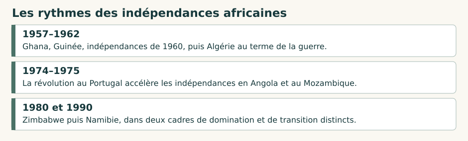
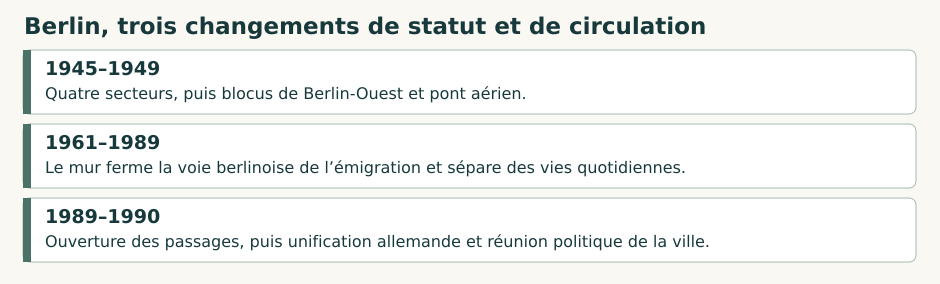

# BEL B/L — Histoire contemporaine 2026 · Autres tirages du jury · Corrigé guidé

*Corrigé rédigé par IA, non officiel. Signalez toute erreur.*

**Lecture du rapport du jury** · GPT-6.2 Astra Ultra · vitesse non renseignée

**Rédaction** · GPT-6.2 Astra Ultra · vitesse non renseignée

**Autocontrôle** · GPT-6.2 Astra Ultra · vitesse non renseignée

**Révision (tour 1)** · GPT-6.2 Astra Ultra · vitesse non renseignée

## Les tirages attestés par le rapport

Le rapport du jury recense 69 paires. Les trois feuilles datées des 16, 17 et 22 juin en documentent 36 dans le même ordre. Les 33 paires qui suivent commencent à la dernière ligne de la page 5 du rapport et se poursuivent aux pages 6 et 7. Le tableau ne précise pas la date de ces tirages. Les deux branches de chaque paire reçoivent ici une proposition de réponse, indépendamment du choix fait au concours.

Le candidat choisit entre le sujet France et le sujet monde avant son entrée en salle de préparation. Il dispose d’une heure trente pour préparer, puis de vingt minutes d’exposé et dix minutes d’entretien. Le rapport indique les atlas et chronologies mis à disposition. Chaque développement ci-dessous fournit une démonstration et des exemples à déployer oralement.

**Préparer une démonstration.** Pour chaque sujet, définir la population, le territoire et les bornes. Choisir des exemples qui permettent de comparer deux périodes, deux régions ou deux groupes. Pour un événement précis, séparer les choix ouverts aux contemporains des conséquences que connaît l’historien. En entretien, répondre d’abord à l’objection, puis revenir au fait ou à la source qui autorise la réponse. Les relances proposées ici sont des exercices pédagogiques.

## Paire 1 · Tableau du jury, page 5

### France · Vivre à la campagne en France (1870-1940)

La République arrive au village par des institutions qui s’y implantent sans faire disparaître les manières de vivre locales. En 1870, les campagnes réunissent encore la majorité des habitants. Elles ne constituent pas une paysannerie uniforme. Un journalier dépend de l’embauche saisonnière, un fermier verse un loyer, un propriétaire travaille et peut transmettre sa terre. L’artisan, le curé et le secrétaire de mairie participent eux aussi à la vie du bourg. La famille organise ensemble travail, soin et vieillesse. Selon les régions, des ouvriers alternent emploi industriel et travaux agricoles.

L’école primaire gratuite puis obligatoire et laïque dans les années 1880, la conscription et les migrations multiplient les expériences hors du village. Le chemin de fer facilite la commercialisation du vin ou du lait et rend la production sensible aux prix nationaux. Les viticulteurs du Midi qui manifestent en 1907 illustrent la capacité d’une société rurale à se mobiliser dans une économie marchande. La Grande Guerre frappe de plein fouet des familles qui doivent maintenir les exploitations. Monuments aux morts et associations d’anciens combattants inscrivent cette épreuve dans l’espace quotidien. Dans l’entre-deux-guerres, cars, bicyclette et électrification modifient inégalement les conditions d’habitation. Au recensement de 1931, la population urbaine dépasse la population rurale en métropole. « Vivre à la campagne » décrit donc désormais une expérience minoritaire à l’échelle nationale, diverse selon la distance au bourg, le sexe et la propriété.

**Relance possible.** Pourquoi le nombre d’agriculteurs ne suffit-il pas ?

Un lieu de résidence rassemble plusieurs métiers. Un ouvrier peut habiter un village, travailler en ville et continuer à exploiter une parcelle.

### Monde · L’arme nucléaire dans le monde au XXe siècle

En août 1945, Hiroshima et Nagasaki font de la destruction de deux villes japonaises une question humaine et politique mondiale. Les survivants, les *hibakusha*, subissent des séquelles durables et portent publiquement la mémoire civile de ces bombardements. L’arme devient ensuite un attribut de puissance, un objet de revendication souveraine et l’objet d’institutions qui cherchent à en limiter les conséquences. Il faut expliquer comment la volonté d’assurer la sécurité d’un État peut accroître l’insécurité collective.

La fin du monopole américain en 1949 ouvre une rivalité entre États-Unis et URSS. La crise de Cuba de 1962 rend sensible le risque d’une confrontation dont les dirigeants eux-mêmes redoutent de perdre la maîtrise. Les populations des territoires d’essais, notamment dans le Pacifique, connaissent d’autres formes d’exposition et demandent reconnaissance. Le traité d’interdiction partielle des essais de 1963 et le traité de non-prolifération, ouvert à la signature en 1968, entré en vigueur en 1970, répondent à des problèmes différents. Ce dernier associe non-prolifération, usages pacifiques et engagement de négocier le désarmement, dans un système asymétrique. Les mobilisations européennes des années 1980 et le traité américano-soviétique de 1987 sur les forces nucléaires intermédiaires montrent que les opinions et les négociations peuvent peser sur les choix. L’histoire mondiale inclut les populations affectées et les États non dotés dont le consentement est nécessaire à l’ordre international.

**Relance possible.** Le traité de 1963 interdit-il tout essai ?

Il vise les essais dans l’atmosphère, dans l’espace extra-atmosphérique et sous l’eau. Son champ explique les contestations et négociations ultérieures.

## Paire 2 · Tableau du jury, page 6

### France · Léopold Sédar Senghor (1906-2001)

Né à Joal en 1906 dans le Sénégal colonial, Léopold Sédar Senghor fait de la langue française un lieu de critique de l’assimilation et un moyen de construire des institutions politiques. Formé aussi en France, agrégé de grammaire en 1935, il rencontre notamment Aimé Césaire. Dans les échanges intellectuels des années 1930, la négritude affirme la dignité de cultures noires que le classement colonial prétendait inférieures. Son œuvre poétique, dont *Chants d’ombre* paraît en 1945, donne une place à la mémoire, aux rythmes et aux présences du Sénégal en français.

Élu député du Sénégal en 1945, il intervient dans les assemblées françaises au moment où s’élabore une citoyenneté impériale nouvelle. Son projet fédéral montre que l’indépendance sous la forme d’États territoriaux séparés n’était pas l’unique avenir envisagé. L’éclatement de la Fédération du Mali en 1960 conduit à la présidence d’un Sénégal indépendant. Le festival mondial des arts nègres à Dakar en 1966 traduit une ambition culturelle internationale. La concentration du pouvoir après la crise avec Mamadou Dia en 1962 et les contestations de 1968 éclairent les tensions internes à ce projet d’État. Senghor quitte volontairement la présidence à la fin de 1980 et est élu à l’Académie française en 1983. Sa trajectoire relie donc France et Sénégal tout en obligeant à distinguer émancipation culturelle, indépendance politique et pluralisme intérieur.

**Relance possible.** Pourquoi étudier la Fédération du Mali ?

Cette tentative fédérale, regroupant le Sénégal et le Soudan français, restitue une possibilité politique présente en 1959–1960 que le découpage national ultérieur a fait oublier.

### Monde · Combattre pendant la Seconde Guerre mondiale

Combattre pendant la Seconde Guerre mondiale désigne une expérience sociale et politique très inégalement distribuée. Un soldat mobilisé par un État, une auxiliaire sanitaire, un prisonnier de guerre et une personne engagée dans une résistance ne disposent ni des mêmes droits ni des mêmes ressources. L’invasion de la Chine par le Japon, déjà massive en 1937, rappelle que l’expérience asiatique déborde les dates européennes de 1939 à 1945. Le conflit engage les populations d’empires et des armées venues de plusieurs continents.

La contrainte et le consentement peuvent coexister. Justice militaire, propagande, solidarités de proximité et opposition à un occupant structurent diversement les engagements. Dans les forces britanniques servent des soldats originaires d’Inde. Dans l’armée française, des soldats recrutés en Afrique du Nord et en Afrique subsaharienne participent aux campagnes de libération, alors même que leurs sociétés ne bénéficient pas de droits politiques égaux. L’expérience dépend également de la hiérarchie raciale imposée par les belligérants. Les prisonniers soviétiques aux mains des nazis subissent une mortalité de masse. Le retour de captivité, les blessures et la difficulté à faire reconnaître des services prolongent le conflit dans les biographies. La participation des femmes soviétiques au combat et les trajectoires féminines de résistance démentent enfin l’idée d’une frontière simple entre soldats masculins et civils féminins. Le sujet porte sur ces conditions de vie, leurs significations et leur mémoire.

**Relance possible.** Pourquoi comparer les retours ?

La reconnaissance d’un service ou l’accès à une pension dépendent notamment du statut, du genre et de l’issue politique du conflit. Une victoire nationale ne résume pas toutes les sorties de guerre.

## Paire 3 · Tableau du jury, page 6

### France · Abîmer et protéger la nature en France (1870-1990)

Protéger la nature suppose d’abord de demander ce qu’une époque choisit de préserver. À la fin du XIXe siècle, les politiques forestières ou de restauration des terrains de montagne poursuivent des objectifs économiques et de protection contre les crues. Elles peuvent entrer en conflit avec des usages pastoraux. Dans le même temps, charbon, industries chimiques, urbanisation et exploitation des fleuves font subir des dommages localisés dont travailleurs et riverains sont souvent les premiers témoins. Le paysage que des visiteurs jugent digne de sauvegarde peut rester pour d’autres un outil de travail.

La loi de 1906 sur les sites puis celle de 1930 organisent une protection largement attachée aux monuments naturels et aux paysages. Après 1945, barrages, remembrements, motorisation et industrialisation agricole transforment rapidement les milieux au nom de la modernisation. Ils bénéficient à certains usagers et déplacent des coûts vers d’autres. La loi de 1960 sur les parcs nationaux, mise en œuvre notamment en Vanoise en 1963, puis la création d’un ministère chargé de l’environnement en 1971, élargissent l’intervention publique. La marée noire de l’*Amoco Cadiz* en 1978 rend visibles la vulnérabilité du littoral breton et les difficultés de la réparation. La politique de la nature ne succède donc pas à une époque indifférente à toute nuisance. Elle change d’échelle et redistribue entre habitants, scientifiques, associations, entreprises et administrations la capacité de définir le dommage.

**Relance possible.** Le classement d’un site garantit-il sa protection écologique ?

Le classement peut viser d’abord l’aspect paysager d’un lieu. Il faut examiner quelles activités il règle et quels processus écologiques restent hors de son périmètre.

### Monde · Les États-Unis et l’Europe au XXe siècle

La présence américaine en Europe varie selon les domaines. Les États-Unis s’engagent dans la guerre en 1917. Wilson participe à la négociation de 1919, mais le Sénat refuse de ratifier le traité de Versailles. Ce retrait institutionnel laisse subsister des liens financiers étroits, illustrés par les prêts américains à l’Allemagne dans les années 1920. Leur fragilité apparaît dans la transmission internationale de la crise après 1929. L’opposition entre isolation et intervention cache cette pluralité d’engagements.

L’entrée en guerre en décembre 1941, puis la victoire de 1945 font des États-Unis une puissance présente durablement en Europe. La proposition du plan Marshall en 1947 encourage la coopération des bénéficiaires. La création de l’OTAN en 1949 lie la sécurité de l’Europe occidentale à une alliance transatlantique. Les gouvernements européens conservent leurs initiatives. La France de De Gaulle quitte le commandement militaire intégré de l’Alliance en 1966 tout en demeurant membre de celle-ci. De l’autre côté du rideau de fer, la présence américaine s’exerce aussi par la radio, les biens culturels et l’image d’un modèle de consommation, objet d’attraction autant que de critiques. La chute du mur de Berlin en 1989 ouvre des négociations sur l’Allemagne et l’équilibre européen. De l’endettement à la sécurité et à la culture, l’Europe a donc tout à la fois sollicité, encadré et contesté la puissance américaine.

**Relance possible.** Le plan Marshall a-t-il créé la CEE ?

L’aide américaine stimule une coopération dans le cadre de l’OECE. La CEE résulte du traité de Rome signé par six pays européens en 1957.

## Paire 4 · Tableau du jury, page 6

### France · Jules Ferry

Jules Ferry condense deux ambitions de la Troisième République qui ne s’appuyaient pas sur la même définition de l’égalité. Opposant à l’Empire puis républicain au pouvoir, il exerce notamment les fonctions de ministre de l’Instruction publique et de président du Conseil. Au début des années 1880, les républicains cherchent à donner un contenu durable à leur victoire institutionnelle. La gratuité de l’enseignement primaire public en 1881 et l’instruction obligatoire et laïque en 1882 garantissent une formation élémentaire commune. L’obligation porte sur l’instruction et laisse subsister l’enseignement privé. Les inégalités entre primaire et secondaire et entre filles et garçons subsistent.

L’expansion impériale constitue un second volet de sa politique. Le protectorat sur la Tunisie en 1881 et l’engagement en Indochine donnent lieu à des oppositions politiques et financières. La nouvelle de la retraite de Lang Son précipite la chute de son gouvernement en 1885. La même année, ses justifications publiques de la colonisation au nom d’une hiérarchie des peuples sont contestées, notamment par Clemenceau. L’opposition n’est donc pas simplement celle du jugement présent et des convictions anciennes. Des contemporains débattent déjà de la coercition, de l’égalité et des priorités républicaines. Étudier Ferry jusqu’à sa mort en 1893 permet de comprendre comment une mémoire centrée sur l’école a longtemps relégué le projet colonial au second plan.

**Relance possible.** La laïcité scolaire de 1882 équivaut-elle à la séparation des Églises et de l’État ?

Les dispositions scolaires concernent d’abord les contenus et l’obligation d’instruction. La loi générale de séparation est votée en 1905, après la mort de Ferry.

### Monde · Le monde des années 1970

Dans les années 1970, le monde passe d’une croissance institutionnellement encadrée après 1945 à des interdépendances plus instables. Il faut prendre au sérieux plusieurs calendriers. La fin de la convertibilité du dollar en or annoncée en 1971 fragilise Bretton Woods. Le premier choc pétrolier de 1973–1974, puis celui de 1979 font diverger les trajectoires des pays producteurs et importateurs. Dans une grande partie de l’Occident, inflation et chômage coexistent. Les difficultés de paiement touchent aussi des pays du Sud importateurs d’énergie, alors que certains pays d’Asie orientale industrialisent leurs exportations.

La détente se manifeste aux accords d’Helsinki en 1975, où frontières, coopération et droits fondamentaux sont discutés. Cette même année voit la fin de la guerre du Vietnam et l’indépendance de l’Angola et du Mozambique après la révolution portugaise. Angola et Corne de l’Afrique illustrent l’imbrication des luttes propres aux sociétés locales et des interventions de puissances extérieures. Les revendications d’un nouvel ordre économique international portées à l’ONU en 1974 montrent que le Sud entend peser sur les règles des échanges, sans constituer un ensemble homogène. La révolution iranienne et l’entrée des forces soviétiques en Afghanistan en 1979 ouvrent d’autres conflits. L’intérêt de la décennie est précisément de croiser crises monétaires et énergétiques, transformations politiques et aspirations sociales sans les réduire à une seule rupture de 1973.

**Relance possible.** Qu’apporte l’année 1975 si l’on connaît déjà les deux chocs pétroliers ?

Elle rend visibles des transitions politiques et impériales majeures dont la chronologie ne se déduit pas du prix de l’énergie.

[Débat de 1885, discours de Ferry](https://www2.assemblee-nationale.fr/decouvrir-l-assemblee/histoire/grands-discours-parlementaires/jules-ferry-28-juillet-1885) · [Réponse de Clemenceau](https://www.assemblee-nationale.fr/histoire/7ec.asp)

## Paire 5 · Tableau du jury, page 6

### France · Le chemin de fer en France (1870-1990)

Le chemin de fer relie des marchés et distribue des positions sociales. En 1870, les grandes liaisons existent déjà. Sous la Troisième République, l’extension des lignes secondaires, notamment dans le cadre du plan Freycinet à partir de 1879, rapproche des chefs-lieux et des bourgs des grands réseaux. Un producteur de fruits ou de lait peut atteindre une clientèle plus éloignée. Une station balnéaire peut attirer des touristes. La présence d’une gare devient un enjeu local. La diffusion est cependant inégale et les compagnies ne desservent pas tous les espaces aux mêmes conditions.

Le rail emploie un personnel hiérarchisé dont les métiers, les horaires et les sociabilités favorisent des identifications collectives. Les mobilisations de 1910 et de 1920 montrent le poids politique des cheminots. Les guerres font des lignes des instruments de logistique et provoquent des destructions. Pendant l’Occupation, l’histoire des transports de déportation et celle de résistances cheminotes exigent de distinguer les décisions institutionnelles et les conduites individuelles. La convention de 1937 institue la SNCF, qui commence son exploitation en 1938. Après la reconstruction, électrification et grandes lignes rapides coexistent avec le recul de dessertes locales face à la route. L’ouverture du TGV Paris–Lyon en 1981 accélère certains trajets en concentrant les gains sur des axes privilégiés. Une histoire du réseau doit donc étudier autant les territoires qu’il rapproche que ceux qu’il contourne.

**Relance possible.** Pourquoi la date de 1938 compte-t-elle autant qu’une invention technique ?

Une entreprise nationale réorganise les responsabilités, investissements et rapports de travail d’un ensemble auparavant exploité par plusieurs compagnies.

### Monde · Penser et maintenir l’ordre mondial de 1918 à 1991

En 1918, la question n’est plus seulement de conclure la paix. Il faut organiser durablement le règlement des différends entre États. Le pacte de la Société des Nations accompagne les traités de 1919. Ses procédures de discussion et ses activités techniques obtiennent des résultats dans certains conflits ou dossiers sanitaires. Mais l’absence des États-Unis et la réticence des grandes puissances à assumer le coût de sanctions réduisent sa capacité d’action face aux agressions des années 1930. L’ordre pensé sur le papier dépend du consentement des États qui doivent l’appliquer.

En 1945, la Charte des Nations unies institue un Conseil de sécurité où les cinq membres permanents disposent du veto. Cette inégalité organisée doit garder les grandes puissances dans l’institution, tout en permettant leur blocage réciproque. L’Assemblée générale offre cependant une tribune croissante aux nouveaux pays indépendants. La crise de Suez en 1956 voit se développer le maintien de la paix par une force des Nations unies, avec des conditions politiques propres. Bretton Woods et les accords commerciaux ajoutent un volet économique à l’ordre international d’après-guerre. Cela n’empêche ni les guerres civiles ni les conflits de décolonisation. En 1990–1991, la condamnation de l’invasion du Koweït par l’Irak puis l’autorisation donnée par le Conseil illustrent une conjonction inhabituelle entre grandes puissances. L’ordre mondial apparaît ainsi comme une combinaison précaire de normes, d’organisations et de rapports de force.

**Relance possible.** Le veto paralyse-t-il toujours l’ONU ?

Il peut empêcher une décision contraignante du Conseil. Les débats de l’Assemblée générale, les agences spécialisées et certaines opérations acceptées par les parties répondent à d’autres procédures.

## Paire 6 · Tableau du jury, page 6

### France · Jean Jaurès (1859-1914)

Né à Castres en 1859, normalien et agrégé de philosophie, Jean Jaurès entre à la Chambre dans les années 1880 comme républicain. Son itinéraire vers le socialisme se comprend par l’expérience concrète des conflits. À Carmaux en 1892, le licenciement d’un mineur devenu maire met en jeu une question qui dépasse le salaire. L’employeur peut-il rendre impossible l’exercice par un ouvrier d’un mandat électif ? En soutenant les grévistes, Jaurès relie citoyenneté républicaine et pouvoir dans l’entreprise. Le mouvement ouvrier devient pour lui une condition d’achèvement de la République.

Son engagement dreyfusard défend le droit d’un individu contre une condamnation rendue au nom de la raison d’État. La fondation de *L’Humanité* en 1904 et l’unification socialiste dans la SFIO en 1905 lui donnent des moyens d’action dont il ne dispose jamais seul. Relations avec les syndicalistes, place des réformes et participation au pouvoir demeurent disputées. Son internationalisme le conduit à combattre la marche à la guerre, notamment au moment du débat sur la loi des trois ans. Son assassinat le 31 juillet 1914 précède de quelques jours l’entrée de la France dans le conflit. L’Union sacrée ne doit pas être projetée sur les intentions d’un homme qui n’a pas vécu la mobilisation générale. Sa panthéonisation en 1924 traduit un autre moment, celui des usages républicains d’une mémoire socialiste.

**Relance possible.** Pourquoi retenir Carmaux plutôt qu’une formule de discours ?

La grève montre concrètement comment le droit de vote et l’éligibilité peuvent être limités par un rapport de dépendance économique.

### Monde · La sécurité collective (1918-1939)

La sécurité collective promet de remplacer les garanties particulières entre alliés par un principe commun. Une atteinte à la paix concerne l’ensemble des membres, dont la réaction anticipée doit décourager l’agresseur. La Société des Nations, créée au lendemain de la Grande Guerre, établit des procédures de discussion et de sanctions. Les accords de Locarno en 1925 puis l’admission de l’Allemagne à la SDN en 1926 semblent rendre possible une sécurité négociée en Europe. Ils laissent néanmoins subsister des garanties géographiquement inégales et la question des États qui ne veulent pas assumer les obligations collectives.

La conquête japonaise de la Mandchourie à partir de 1931 illustre la lenteur de l’enquête et l’écart entre une condamnation et ses effets. Face à l’invasion de l’Éthiopie par l’Italie en 1935, les sanctions demeurent partielles. Londres et Paris souhaitent à la fois préserver la paix, ménager leurs intérêts impériaux et retenir l’Italie dans un équilibre européen. L’échec procède donc de choix politiques précis autant que des textes. L’URSS rejoint la SDN en 1934, tandis que l’Allemagne nazie s’en est retirée. En 1938, la conférence de Munich décide du sort des Sudètes sans participation de la Tchécoslovaquie à la décision. La crise déplace l’autorité vers une négociation entre puissances et affaiblit la promesse d’une règle commune. La guerre en 1939 sanctionne cet écart entre engagement collectif et volonté d’en assumer les conséquences.

**Relance possible.** Pourquoi comparer Mandchourie et Éthiopie ?

Les deux crises montrent des acteurs et des instruments différents, mais la même difficulté à convertir une procédure de constatation en soutien effectif à l’État agressé.

## Paire 7 · Tableau du jury, page 6

### France · Les Français à l’Allemagne (1870-1989)

Le rapport imprime « Les Français à l’Allemagne ». La construction est inhabituelle. Une lecture défendable consiste à interroger la relation des Français à l’Allemagne, en annonçant cette interprétation. Après la défaite de 1870–1871 et l’annexion de l’Alsace et d’une partie de la Lorraine au Reich, l’Allemagne devient une référence centrale de la politique française. Les discours de revanche ne résument pourtant ni les pratiques des frontaliers ni l’admiration française pour certaines universités, sciences et industries allemandes. Le point de vue des habitants d’Alsace-Lorraine ne se laisse pas confondre avec celui d’un Parisien.

L’expérience de 1914–1918 conforte l’image de l’ennemi tout en créant les conditions d’un pacifisme renouvelé. L’occupation de la Ruhr en 1923 et le rapprochement Briand–Stresemann autour de Locarno en 1925 illustrent deux conceptions contemporaines de la sécurité française. Face au nazisme puis pendant l’Occupation, les expériences vont de la persécution et du travail forcé aux résistances ou aux collaborations. Après 1945, réconciliation et institutionnalisation s’appuient sur la CECA et le traité de l’Élysée de 1963. Échanges scolaires, jumelages et liens professionnels donnent à ces accords des prolongements sociaux. Il existe désormais deux États allemands, reconnus à des dates différentes par Paris. La chute du mur de Berlin en 1989 rouvre la question de la puissance allemande. L’objet d’étude est donc la transformation de relations plurielles, pas le passage uniforme d’un peuple de la haine à l’amitié.

**Relance possible.** Pourquoi nommer les deux Allemagnes après 1949 ?

Elles inscrivent la relation dans des cadres politiques différents. La réconciliation institutionnalisée des années 1950–1960 concerne d’abord la République fédérale.

### Monde · Les États-Unis et la guerre au XXe siècle

Les États-Unis passent d’un engagement tardif en Europe au rôle d’acteur mondial permanent de la sécurité. Leur géographie et leurs ressources encouragent des représentations protectrices des océans, mais leur présence militaire outre-mer et leur intervention dans les Caraïbes sont antérieures à 1917. L’entrée dans la Première Guerre mondiale pose la question de la mobilisation d’une démocratie. Le rejet du traité de Versailles par le Sénat n’efface ni les anciens combattants ni le poids financier pris dans la guerre.

Pearl Harbor en décembre 1941 transforme la participation américaine à une guerre désormais menée en Europe et dans le Pacifique. Mobilisation industrielle et emploi féminin se développent, alors que les forces armées restent ségréguées et que l’internement de personnes d’ascendance japonaise porte atteinte aux droits civiques. La guerre froide installe des engagements durables. En Corée, la guerre se déroule sous un commandement conduit par les États-Unis au titre de résolutions de l’ONU. Au Vietnam, l’escalade puis le retrait alimentent protestations, divisions sociales et contestation du pouvoir présidentiel. La fin de la conscription en 1973 change les liens entre société et engagements extérieurs. En 1991, l’intervention pour libérer le Koweït réunit une coalition internationale dans un contexte de déclin soviétique. L’unité patriotique, l’autorisation internationale et le consensus sur les buts de guerre varient ainsi fortement selon les périodes.

**Relance possible.** Pourquoi inclure la société américaine ?

L’effort industriel, le recrutement et les résistances internes déterminent ce qu’un gouvernement peut soutenir et ce que les citoyens considèrent comme une guerre légitime.

## Paire 8 · Tableau du jury, page 6

### France · Se marier et divorcer en France (1870-1990)

Se marier et divorcer relève à la fois du droit, des stratégies familiales et des rapports de genre. En 1870, le mariage civil est l’institution qui fonde, pour l’État, l’union des époux. Le divorce, supprimé en 1816, est rétabli par la loi Naquet de 1884 sous un régime fondé sur la faute. La possibilité juridique de rompre ne garantit ni la preuve nécessaire ni l’indépendance financière pour partir. La condamnation religieuse, les sanctions de voisinage, l’accès au logement et la présence d’enfants pèsent inégalement.

La Première Guerre mondiale bouleverse la formation des couples par les décès, les séparations et le déséquilibre des générations. L’État développe des politiques familiales souvent pensées autour du couple marié. Le mouvement vers l’égalité transforme ensuite la vie dans le mariage. La suppression de l’incapacité civile de la femme mariée en 1938 et la réforme des régimes matrimoniaux de 1965 ne se confondent pas. Cette dernière permet notamment à l’épouse d’exercer une profession et d’ouvrir un compte en son nom sans autorisation maritale. Après la forte nuptialité des décennies d’après-guerre, l’union libre et les naissances hors mariage se diffusent. La loi de 1975 introduit notamment le divorce par consentement mutuel. À la fin de la période, l’institution subsiste, mais l’entrée dans la vie conjugale, l’autonomie économique et la dissolution du couple sont moins strictement liées au modèle ancien.

**Relance possible.** Peut-on expliquer la hausse du divorce par une seule loi ?

Le droit facilite certaines ruptures. Les ressources, les normes, la durée de vie et les conditions d’emploi interviennent aussi dans la possibilité de les demander.

### Monde · La Méditerranée dans les relations internationales (1918-1990)

Reliant l’Atlantique à l’océan Indien par Gibraltar et Suez, la Méditerranée est également un espace de sociétés riveraines. En 1918, les empires européens dominent une grande partie de ses rives méridionale et orientale. La dissolution de l’Empire ottoman, les mandats au Proche-Orient et la naissance de la République turque en 1923 recomposent les souverainetés sans mettre fin à l’inégalité impériale. Migrations, ports et échanges pétroliers donnent à ces frontières des effets quotidiens.

La Seconde Guerre mondiale engage les possessions européennes d’Afrique du Nord et fait de la mer un lieu de passage autant que de division. Après 1945, décolonisations et guerre froide s’entrecroisent. La nationalisation du canal de Suez par Nasser en 1956 entraîne l’intervention britannique, française et israélienne, puis leur retrait sous pressions internationales. L’épisode marque les limites de la puissance des anciens empires et la capacité d’initiative égyptienne. Les indépendances au Maghreb, les guerres israélo-arabes et la fermeture du canal de 1967 à 1975 modifient circulations et alliances. Une opposition mécanique entre les deux blocs n’explique ni le non-alignement yougoslave ni les déplacements de travailleurs maghrébins vers l’Europe. Dans les années 1970–1980, tourisme, migrations et intégration de pays rive nord à la Communauté européenne accentuent certains déséquilibres tout en densifiant les contacts. La mer unit donc des intérêts sans produire un ordre régional unique.

**Relance possible.** En quoi Suez dépasse-t-elle un contentieux franco-égyptien ?

Le canal relie des routes internationales, Israël et le Royaume-Uni participent à l’intervention et les deux superpuissances cherchent, pour des raisons propres, à faire cesser la crise.

## Paire 9 · Tableau du jury, page 6

### France · Installer la République (1870-1879)

La République est proclamée le 4 septembre 1870 après Sedan. L’acte ne lui donne ni des institutions stabilisées ni une majorité républicaine. Le gouvernement de Défense nationale hérite d’une guerre perdue. L’Assemblée élue en février 1871 compte de nombreux monarchistes et entend négocier la paix. La Commune de Paris et sa répression en mai soulignent la profondeur des divergences sur la République souhaitée et sur le rapport entre la capitale et l’Assemblée.

L’échec d’une restauration dépend des divisions des monarchistes autant que des succès républicains. Thiers doit partir en mai 1873 et Mac Mahon lui succède. Le septennat laisse du temps aux projets de restauration, sans les faire aboutir. En 1875, l’amendement Wallon puis les lois constitutionnelles établissent un président, deux chambres et des ministres politiquement responsables. Le compromis maintient un exécutif qui dispose de pouvoirs réels. La crise du 16 mai 1877 en éprouve la lecture. Après la dissolution de la Chambre, les élections législatives maintiennent une majorité républicaine. L’expérience fixe une pratique parlementaire. En 1879, la majorité républicaine au Sénat, la démission de Mac Mahon et l’élection de Jules Grévy font coïncider les institutions et leurs titulaires. L’installation s’accomplit donc par des élections, des compromis et un conflit d’interprétation. La construction ultérieure d’une culture républicaine par l’école et les fêtes relève d’une autre étape.

**Relance possible.** Pourquoi s’arrêter en 1879 ?

À cette date, les républicains tiennent l’exécutif et les deux chambres. Les grandes lois scolaires des années suivantes consolident un régime dont la maîtrise institutionnelle est déjà acquise.

### Monde · Les catastrophes écologiques dans le monde au XXe siècle

Une catastrophe écologique résulte de la rencontre entre un dommage matériel, des populations exposées et des institutions qui le rendent visible ou le taisent. Elle peut être brutale ou s’étendre sur plusieurs décennies. À Minamata au Japon, la pollution industrielle au mercure contamine les ressources halieutiques et affecte gravement les habitants. La reconnaissance officielle de la maladie en 1956 ne met pas fin aux luttes pour établir les responsabilités et obtenir réparation. Ce décalage entre dommage, preuve et décision est central.

À Bhopal en Inde, la fuite de gaz de 1984 expose des populations voisines d’une installation industrielle et pose la question de la responsabilité d’une entreprise transnationale. L’accident de Tchernobyl en 1986 fait apparaître l’insuffisance des frontières administratives devant des retombées qui touchent d’autres territoires. Il révèle aussi le rôle du secret, des mesures indépendantes et de la confiance envers les autorités publiques. L’assèchement de la mer d’Aral, accéléré par les prélèvements d’eau pour les cultures irriguées, donne un exemple progressif qui change les conditions de vie des pêcheurs et riverains. Ces cas ne constituent pas une série de malchances isolées. Choix industriels et agricoles, hiérarchies sociales et conditions d’information façonnent l’exposition et la réponse. Des mouvements d’habitants et de scientifiques traduisent enfin le dommage local en controverse publique, parfois en transformation du droit.

**Relance possible.** Pourquoi distinguer accident et catastrophe ?

Un accident désigne un événement. L’ampleur et la durée de la catastrophe dépendent des milieux, des populations exposées, des secours et de la reconnaissance du dommage.

## Paire 10 · Tableau du jury, page 6

### France · S’informer en France (1870-1995)

S’informer suppose un producteur, un canal, un public et des conditions de confiance. La loi de 1881 sur la liberté de la presse, la hausse de l’alphabétisation et le faible prix des quotidiens élargissent le lectorat. Les tirages des journaux populaires n’unifient pas pour autant l’espace public. L’affaire Dreyfus montre le rôle de journaux engagés dans la circulation de preuves, d’erreurs et de préjugés. La Première Guerre mondiale étend la censure et la communication officielle tandis que lettres et rumeurs font circuler d’autres nouvelles.

À partir de l’entre-deux-guerres, la radio rend l’information simultanée et pénètre dans les foyers. Sous l’Occupation, écouter la BBC ou lire des journaux clandestins signifie évaluer la crédibilité d’une parole dans un espace surveillé. La Libération recompose la presse et l’organisation publique de la radiodiffusion. Les journaux télévisés acquièrent ensuite une audience de masse. Mai 1968 donne une visibilité particulière aux tensions autour du contrôle de l’ORTF. La disparition de l’office en 1974, la libéralisation des radios locales en 1981 et la privatisation de TF1 en 1987 modifient les rapports entre État, marché et journalistes. En 1995, l’accès au réseau Internet se développe encore à une échelle limitée. La succession des techniques ne remplace donc pas l’histoire sociale de l’accès, du contrôle et de la concurrence entre informations.

**Relance possible.** Une technologie nouvelle écarte-t-elle nécessairement la précédente ?

Télévision, radio et presse écrite coexistent. Leurs contenus circulent entre supports, et leurs usages diffèrent selon les publics et les moments de la journée.

### Monde · Les chocs pétroliers des années 1970

Les deux chocs pétroliers modifient les termes de l’échange entre vendeurs et acheteurs d’une énergie devenue essentielle au transport, à l’industrie et à la consommation de masse. L’OPEP, créée en 1960, témoigne d’une revendication de souveraineté économique antérieure à 1973. Dans un marché déjà tendu, la guerre israélo-arabe d’octobre 1973 et les décisions prises par les exportateurs entraînent une forte hausse des prix. L’embargo décidé par certains producteurs arabes vise certains pays et ne doit pas être confondu avec toutes les décisions de prix de l’OPEP.

Dans les pays importateurs, l’augmentation de la facture extérieure nourrit inflation et arbitrages budgétaires. Économies d’énergie et diversification des sources suivent des voies nationales différentes. Certains producteurs disposent de recettes nouvelles qu’ils peuvent investir ou placer à l’étranger. Le recyclage de ces revenus par les banques contribue à l’offre de crédit international. Les importateurs pauvres connaissent, eux, une détérioration de leurs comptes et une vulnérabilité accrue à l’endettement. La révolution iranienne en 1979, les incertitudes sur l’offre puis la guerre entre l’Irak et l’Iran à partir de 1980 alimentent le second choc. Attribuer tout le chômage occidental au seul pétrole oublierait le ralentissement des gains de productivité et les changements industriels déjà engagés. La crise met surtout en évidence l’interdépendance des États et les effets inégaux d’un même prix mondial.

**Relance possible.** Tous les pays du Sud gagnent-ils en 1973 ?

Les producteurs exportateurs et les pays qui importent presque toute leur énergie connaissent des trajectoires opposées. Même chez les exportateurs, la répartition intérieure des recettes varie.

## Paire 11 · Tableau du jury, page 6

### France · La France des Trente glorieuses

Les « Trente Glorieuses », expression de Jean Fourastié, désignent une transformation économique et sociale d’après-guerre dont il faut expliquer la chronologie et les bénéficiaires. En 1945, pénuries, destructions et rationnement contrastent avec l’image d’une prospérité immédiate. Nationalisations, Sécurité sociale, planification indicative et aide américaine accompagnent la reconstruction. Puis la hausse de la productivité et du salariat, le crédit et la croissance démographique élargissent la consommation de biens durables. Logements équipés, automobiles et vacances n’entrent pas au même moment dans tous les foyers.

La transformation productive déplace les populations. Mécanisation agricole, migrations vers les villes et recrutement de travailleurs étrangers soutiennent l’industrialisation. Les grands ensembles améliorent le confort de nombreux ménages mais côtoient bidonvilles et habitat insalubre. Les femmes accèdent davantage au travail salarié sans que la division domestique du travail disparaisse. Les guerres de décolonisation démentent l’image d’une France uniformément apaisée. En mai et juin 1968, la grève massive exprime des conflits sur les salaires, l’organisation du travail et l’autorité au cœur même de la croissance. Au début des années 1970, ralentissement et chocs énergétiques marquent une inflexion, inégale selon les territoires. La formule éclaire donc une période exceptionnelle de changement des niveaux de vie. Elle devient trompeuse si la moyenne nationale efface hiérarchies, conflits et coûts environnementaux.

**Relance possible.** Pourquoi prendre le logement comme indicateur ?

Il fait apparaître à la fois les équipements nouveaux, les politiques publiques, les ségrégations urbaines et les écarts d’accès à la consommation.

### Monde · Le monde de Churchill

Le « monde de Churchill » est d’abord celui d’un dirigeant formé dans un empire britannique encore mondial, puis appelé à agir au moment où la prépondérance passe aux États-Unis et à l’URSS. Officier, journaliste et homme politique avant 1914, il accorde une place centrale aux routes impériales et à la puissance navale. Au lendemain de la Première Guerre mondiale, il participe à la gestion d’un impérialisme confronté aux nationalismes et à la recomposition du Proche-Orient. L’opposition ultérieure de Churchill à l’autonomie de l’Inde rappelle les limites impériales de sa conception de la liberté.

En mai 1940, il devient Premier ministre dans la crise de la guerre européenne. Son action diplomatique cherche à préserver l’indépendance britannique en nouant des alliances avec les États-Unis puis l’Union soviétique. L’alliance de guerre ne signifie pas convergence des projets d’après-guerre. Les réunions de Téhéran et Yalta font apparaître le poids croissant des deux grands. La défaite électorale de juillet 1945 interrompt son mandat avant la fin de la conférence de Potsdam. À Fulton en 1946, son discours sur le rideau de fer interprète une Europe divisée. Son appui à la coopération européenne ne se confond pas avec une volonté d’intégrer immédiatement son pays à un ensemble supranational. Revenu au pouvoir de 1951 à 1955, il dirige un Royaume-Uni déjà engagé dans la décolonisation. Sa trajectoire donne à voir la distance entre ambitions mondiales et ressources britanniques.

**Relance possible.** Le discours de Fulton est-il une décision gouvernementale britannique ?

Churchill le prononce en 1946 comme ancien Premier ministre. Son influence est importante, mais le statut de la parole importe.

## Paire 12 · Tableau du jury, page 6

### France · Sécurité et insécurité en France (1870-1914)

Entre 1870 et 1914, « sécurité » et « insécurité » désignent des conditions mesurables et des perceptions qu’il faut étudier séparément. Dans les villes en croissance, densité, circulation et anonymat changent les rencontres. L’éclairage, la police municipale, la gendarmerie et des services de secours modifient les moyens d’intervention. Dans les quartiers populaires comme dans les campagnes, les relations avec ces institutions sont diverses. Être protégé ou faire l’objet d’une surveillance sont deux expériences différentes du même agent public.

La presse populaire donne une audience nationale au fait divers. Le thème des « Apaches » parisiens, au début du XXe siècle, associe jeunesse populaire, peur de la rue et anxiété sociale. La répétition d’un récit spectaculaire ne forme pas à elle seule une série statistique du crime. Il faut comparer plaintes, qualifications judiciaires et manières de compter. La création des brigades mobiles régionales en 1907 exprime aussi des préoccupations sur la mobilité des délinquants. Mais la sécurité excède l’ordre public. La loi de 1898 sur les accidents du travail organise une autre prise en charge du risque professionnel. La catastrophe minière de Courrières de 1906 rappelle l’exposition très inégale aux dangers. Une histoire de la sécurité demande donc qui définit le risque, qui le subit et qui prend en charge ses conséquences.

**Relance possible.** Pourquoi les statistiques de police ne mesurent-elles pas directement toutes les violences ?

Elles dépendent aussi des définitions, du dépôt de plainte, des priorités policières et de l’enregistrement administratif.

### Monde · La mémoire de la Première Guerre mondiale dans le monde

La mémoire de la Première Guerre mondiale se construit à travers le deuil, les institutions et les usages politiques du passé. Elle varie selon l’issue du conflit et la place qu’y occupent les sociétés. En France et au Royaume-Uni, monuments aux morts et cérémonies autour du soldat inconnu donnent une présence publique à des disparitions familiales. Armistice et symboles du souvenir contribuent à des calendriers nationaux distincts. La guerre menée par des soldats coloniaux ou des dominions interroge la place reconnue à chacun dans ces dispositifs.

Dans l’Allemagne vaincue, la mémoire du front est divisée. Des anciens combattants revendiquent la paix, d’autres mouvements exploitent le récit mensonger d’une armée trahie de l’intérieur pour délégitimer Weimar. Dans les sociétés issues des empires disparus, la mémoire peut célébrer une indépendance ou rappeler des violences et des déplacements. Gallipoli occupe ainsi dans les récits australien, néo-zélandais et turc des places qui ne se superposent pas. Après 1945, la mémoire du second conflit change la visibilité du premier. La poignée de main de François Mitterrand et Helmut Kohl à Verdun en 1984 inscrit un lieu du deuil national dans une politique de réconciliation. Les commémorations montrent donc comment le sens d’un même lieu ou d’une même perte peut changer au fil des générations.

**Relance possible.** Qu’apporte l’étude d’une cérémonie ?

Son lieu, ses invités, sa date et ses absents permettent d’identifier le groupe qui est autorisé à représenter publiquement le passé.

## Paire 13 · Tableau du jury, page 6

### France · Le franc (1870-1990)

Le franc est une institution qui met en relation la confiance des épargnants, le financement de l’État et les contraintes extérieures. Avant 1914, la stabilité de fait du franc-or permet de penser les contrats de long terme dans une unité réputée durable. La Grande Guerre bouleverse cette expérience par l’endettement, le financement monétaire et l’inflation. Les prix et revenus évoluent différemment. La perte de pouvoir d’achat des créances nominales frappe les rentiers tandis que les débiteurs peuvent voir alléger la charge réelle d’anciennes dettes.

Après les difficultés des années 1920, la stabilisation Poincaré, consacrée en 1928 à une parité très inférieure à celle de 1914, met fin au projet d’une simple restauration de l’ancien franc. Les dévaluations des années 1930 et les désordres de guerre rappellent la dimension politique du taux de change. La réforme mise en circulation en 1960 échange cent anciens francs contre un nouveau. Elle simplifie la numération et accompagne une politique de stabilisation. Réduire le nombre de zéros ne double ni ne divise la quantité de biens accessible à somme convertie correctement. Dans les années 1980, le maintien dans le Système monétaire européen, notamment lors du choix de 1983, lie la politique économique française à des objectifs de parité. Le franc reste national mais les conditions de son gouvernement sont de moins en moins exclusivement nationales.

**Relance possible.** Dévaluation et changement d’unité ont-ils le même effet ?

Une dévaluation modifie la parité externe officielle. Changer toutes les unités monétaires dans le même rapport modifie les chiffres inscrits sur les prix et les comptes.

### Monde · Le non-alignement au temps de la guerre froide

Le non-alignement désigne l’effort de certains États pour choisir leurs relations internationales au moment où les deux principaux blocs cherchent des alliés. L’expérience coloniale et les indépendances nouvelles rendent urgente la souveraineté réelle sur le développement, la sécurité et la politique étrangère. Bandung, en 1955, rassemble des pays d’Asie et d’Afrique aux orientations diverses. La réunion n’est pas encore la fondation officielle du mouvement. La conférence de Belgrade en 1961 donne un cadre plus durable aux non-alignés, autour notamment de Tito, Nasser et Nehru.

L’autonomie recherchée peut passer par des accords économiques ou militaires avec l’une des puissances, par la médiation ou par un vote commun à l’ONU. Le cas de la Yougoslavie, socialiste et indépendante de Moscou, interdit d’assimiler non-alignement et appartenance à un continent. Le canal de Suez offre à l’Égypte un terrain où souveraineté politique et ressources économiques s’articulent. Dans les années 1970, la revendication d’un nouvel ordre économique international déplace une partie du débat vers les prix des matières premières, le commerce et les transferts de ressources. Intérêts divergents des exportateurs et des importateurs de pétrole, conflits régionaux et rapprochement de certains membres avec une grande puissance limitent cependant la cohésion. Le non-alignement est donc une pratique variable d’indépendance et de négociation autant qu’une revendication collective.

**Relance possible.** Faut-il mesurer le non-alignement par une stricte équidistance ?

Des rapports inégaux avec les deux blocs peuvent coexister avec la recherche d’une marge de choix. Il faut observer les décisions dans des crises précises.

## Paire 14 · Tableau du jury, page 6

### France · Enseignants et élèves en France (1870-1990)

L’enseignement en France passe d’un ensemble de filières fortement séparées à une scolarisation longue largement partagée. Dans les années 1870, l’école primaire accueille les enfants du peuple, tandis qu’un garçon des classes aisées peut commencer dans les petites classes d’un lycée et y poursuivre ses études. Les lois de 1881–1882 changent le coût et l’obligation de l’instruction primaire. La formation des instituteurs et institutrices, leur rôle à la mairie et la concurrence des établissements confessionnels donnent à la relation entre maître et élève une portée qui dépasse la salle de classe. La loi Camille Sée de 1880 développe un secondaire public féminin dont le programme reste distinct de celui des garçons.

Après 1945, croissance démographique et prolongation des études changent les échelles. La réforme Berthoin de 1959 porte l’obligation scolaire à seize ans pour les générations concernées. Le collège unique issu de la loi Haby de 1975 rapproche dans un même établissement des enfants auparavant orientés plus tôt dans des filières différentes. Les enseignants composent avec des publics plus nombreux et plus divers, alors que l’orientation, le redoublement et le choix des options maintiennent des écarts de parcours. Les lycéens et étudiants de 1968 revendiquent aussi une voix dans le fonctionnement de l’institution. Vers 1990, l’allongement de la scolarité et l’essor du baccalauréat professionnel, créé en 1985, déplacent la frontière des inégalités vers les diplômes et leurs débouchés.

**Relance possible.** Pourquoi comparer enfants d’instituteurs et enfants d’ouvriers à niveau scolaire égal ?

L’orientation dépend aussi de l’information et des attentes familiales. L’égalité d’inscription n’établit pas l’égalité des parcours.

### Monde · Le siècle du divertissement (monde, 1918–début des années 1990)

Au XXe siècle, le divertissement se transforme en secteur organisé produisant des spectacles, des images et des sons pour des publics dispersés. Le cinéma muet traverse les frontières relativement aisément. Hollywood élargit ses marchés par la puissance de la distribution et l’attrait des vedettes, tandis que des industries nationales ou régionales développent d’autres répertoires, notamment en Inde. Radio et disque permettent de faire entrer régulièrement musique, sport et feuilletons dans des foyers éloignés des salles.

Les régimes politiques encadrent les loisirs à des degrés divers. Dans l’Italie fasciste comme dans l’Allemagne nazie, les organisations de loisirs servent aussi un projet d’intégration et de contrôle. En URSS, l’accès à des espaces de culture et de repos porte une ambition d’éducation collective sous contrôle politique. Après 1945, congés rémunérés, hausse des revenus et télévision élargissent le marché des loisirs dans une partie du monde. Les Jeux olympiques de Mexico en 1968 révèlent un public planétaire et la capacité de gestes de protestation à contrarier l’image officielle du spectacle. La diffusion de genres américains se combine à des créations locales, du cinéma indien aux musiques populaires africaines et caribéennes. Le tournant des années 1990 associe chaînes privées, cassette et premiers jeux vidéo de grande diffusion. Le siècle du divertissement est ainsi aussi celui des usages actifs, des inégalités de temps libre et des circulations entre plusieurs centres.

**Relance possible.** Regarder le même programme crée-t-il une culture identique ?

Langues, conditions de réception et références locales modifient les interprétations. Les circuits de production et les significations données par les publics doivent être distingués.

## Paire 15 · Tableau du jury, page 6

### France · La séparation des églises et de l’État

La séparation des Églises et de l’État en 1905 transforme l’organisation publique des cultes en France. Le régime concordataire hérité du début du XIXe siècle organise les cultes reconnus, participe au financement de leurs ministres et donne un pouvoir d’intervention à l’État. Cette reconnaissance n’efface pas les désaccords. Sous la Troisième République, les conflits autour de l’enseignement, des congrégations et de l’engagement politique de catholiques renforcent la volonté républicaine d’autonomie. Il faut néanmoins distinguer catholicisme, protestantismes et judaïsme, dont les positions devant la réforme ne sont pas identiques.

La loi du 9 décembre 1905 garantit la liberté de conscience et le libre exercice des cultes sous les restrictions requises par l’ordre public. Elle met fin en principe à la reconnaissance, au traitement et au subventionnement publics des cultes. Les aumôneries prévues pour des établissements fermés répondent à une exigence de liberté effective. L’application ne se résume pas à l’adoption du texte. Les inventaires déclenchent des résistances en 1906, notamment dans certaines régions catholiques. Le refus pontifical initial des associations cultuelles exige des aménagements ultérieurs. En Alsace-Moselle, territoire alors allemand, la loi ne s’applique pas lors de son adoption. Les régimes coloniaux connaissent aussi des conditions particulières. La séparation instaure donc une nouvelle relation juridique dont la réalisation dépend des territoires, des institutions et des négociations.

**Relance possible.** L’article 2 rend-il impossible toute dépense publique liée à un lieu de culte ?

Il pose un principe et prévoit notamment des aumôneries. Le régime des édifices existants soulève en outre des questions de propriété et d’entretien distinctes du traitement des ministres d’un culte.

### Monde · Le dollar dans les relations internationales

Le rôle international du dollar découle d’une capacité américaine à prêter, acheter et inspirer confiance, autant que de règles formellement négociées. À l’issue de la Première Guerre mondiale, les États-Unis sont créanciers et New York concurrence Londres. Les prêts des années 1920 relient notamment versements allemands et règlements des dettes interalliées. Leur interruption pendant la crise révèle la fragilité de cette circulation. La dévaluation américaine des années 1930 illustre la priorité que les gouvernements peuvent donner au redressement intérieur.

Bretton Woods établit en 1944 un système de parités fixes mais ajustables. Le dollar est convertible en or au prix officiel dans les relations avec les autorités monétaires étrangères, les autres monnaies lui étant liées par des parités. Après la pénurie de dollars des premières années d’après-guerre, l’accumulation de créances en dollars fait douter de la possibilité d’une conversion générale en or. Le besoin mondial d’une monnaie de réserve entre alors en tension avec la confiance dans sa garantie. En août 1971, Nixon suspend la convertibilité du dollar en or. Le flottement des principales monnaies s’étend à partir de 1973. Le dollar reste pourtant central dans les réserves, les facturations commerciales et l’endettement. Le durcissement monétaire américain à partir de 1979 accroît les coûts de service de certaines dettes en dollars. La fin d’une règle monétaire internationale n’efface donc pas les réseaux et les asymétries qui soutiennent une devise.

**Relance possible.** En quoi une dette extérieure en dollars expose-t-elle un État ?

Ses recettes peuvent être en monnaie nationale. Une appréciation du dollar ou une hausse des taux sur les prêts concernés alourdit alors le service de la dette.

## Paire 16 · Tableau du jury, page 6

### France · Résistantes et résistants en France (1940-1945)

À partir de 1940, entrer en résistance signifie refuser une autorité jugée illégitime, mais cette définition doit s’incarner dans des pratiques civiles et des trajectoires diverses. Une institutrice qui fait circuler un journal, une employée qui protège des personnes persécutées, un syndicaliste ou un ancien militaire n’entrent pas nécessairement au même moment ni pour les mêmes raisons. Certaines personnes rejoignent Londres, d’autres s’organisent en métropole ou dans l’Empire. Refus national de l’occupation, défense de valeurs républicaines et solidarités religieuses ou politiques peuvent se conjuguer.

Pour dépasser la figure du héros solitaire, il faut suivre la formation des mouvements, leurs publications, leurs désaccords et les liens avec la France libre. L’entrée en guerre de l’URSS en 1941 modifie l’engagement communiste organisé. L’instauration du STO en 1943 transforme les conditions de la clandestinité sans faire de chaque réfractaire un résistant. La création du Conseil national de la Résistance en mai 1943, sous l’impulsion de Jean Moulin, associe mouvements, partis et syndicats sans effacer leur diversité. L’ampleur de la répression pèse sur les familles autant que sur les militants. À la Libération, reconnaissance militaire, décorations et récits publics ont souvent minoré des fonctions féminines essentielles ou l’engagement d’étrangers. L’entrée de résistantes au Panthéon dans des décennies ultérieures rappelle la construction tardive de certaines reconnaissances. Comprendre la Résistance oblige donc à distinguer engagement effectif, unification politique et mémoire nationale.

**Relance possible.** Ne pas partir au STO suffit-il à établir un engagement résistant ?

Le refus du départ peut répondre à des raisons variées. On doit établir comment une personne a participé ensuite à une action collective ou à une aide liée à la lutte.

### Monde · Le modèle chinois dans le monde de 1949 à la fin des années 1980

Le retentissement du modèle chinois change profondément entre la victoire communiste de 1949 et la fin des années 1980. Dans les premières années, la République populaire se rapproche de l’URSS et met en œuvre une industrialisation planifiée. La dimension paysanne de la révolution, la sortie d’une situation de domination étrangère et les interventions de Zhou Enlai, notamment à Bandung en 1955, donnent à la Chine une audience auprès de sociétés colonisées ou récemment indépendantes. Le modèle n’est donc déjà pas uniquement celui des rapports entre partis communistes.

Le Grand Bond en avant à partir de 1958 et la famine qui l’accompagne montrent les coûts humains de la mobilisation forcée. La rupture sino-soviétique et la Révolution culturelle lancée en 1966 suscitent une circulation internationale du maoïsme. Des militants en Asie, en Europe, en Afrique ou en Amérique latine sélectionnent et réinterprètent les slogans chinois à partir de leurs propres conflits. La République populaire obtient le siège de la Chine à l’ONU en 1971 et reçoit Nixon en 1972. Ces événements signalent une diplomatie d’État qui ne se réduit pas aux solidarités révolutionnaires. Après 1978, les réformes associées à Deng Xiaoping élargissent l’initiative économique et l’ouverture extérieure sous le contrôle du parti. La répression de juin 1989 met en évidence les limites politiques fixées à cette transformation. L’attrait mondial se déplace ainsi de la révolution paysanne vers la croissance et le rôle d’un État dirigiste.

**Relance possible.** Un mouvement qui se dit maoïste reproduit-il la politique de Pékin ?

L’appropriation d’un langage révolutionnaire peut servir des intérêts locaux indépendants des alliances diplomatiques chinoises.

## Paire 17 · Tableau du jury, page 6

### France · Expositions universelles et coloniales en France sous la Troisième République

Les expositions universelles veulent rassembler l’industrie, les arts et les techniques du monde dans un espace que parcourt un visiteur. Les expositions coloniales organisent plus directement la présentation des territoires dominés et de leurs populations. Sous la Troisième République, les deux entreprises se recoupent. En 1889, le centenaire de la Révolution et la tour Eiffel mettent en scène la capacité inventive d’un régime républicain. Les présentations coloniales placent les sociétés exposées dans une hiérarchie donnée comme naturelle. En 1900, infrastructures parisiennes, nouveaux spectacles et pavillons nationaux affirment à nouveau la place de la capitale dans une concurrence internationale.

L’Exposition coloniale de 1931 à Vincennes transforme l’Empire en itinéraire de visite. Architectures reconstruites, décors, objets et personnes produisent une impression de proximité tout en sélectionnant ce que le visiteur peut voir du travail, de la contrainte et des résistances. Les populations mises en scène ne forment cependant pas un ensemble passif et leurs conditions de venue et de séjour doivent être distinguées. Des opposants anticolonialistes, dont les surréalistes, appellent à refuser la célébration et une contre-exposition dénonce la domination. Le succès en entrées mesure la fréquentation, sans établir une adhésion politique uniforme. Ces manifestations montrent comment consommation de loisirs, puissance industrielle et pédagogie impériale ont pu se renforcer, tout en nourrissant des lectures concurrentes.

**Relance possible.** Pourquoi distinguer entrées et visiteurs ?

Une personne peut se rendre plusieurs fois à l’exposition. Aucun de ces deux nombres ne mesure directement les convictions des participants à la sortie.

### Monde · L’alimentation dans le monde au XXe siècle

L’alimentation mondiale est bien davantage qu’une courbe des calories produites. Elle articule techniques, répartition du revenu, politiques de ravitaillement et cultures du repas. Les guerres mondiales placent le rationnement et la priorité donnée à certains groupes au cœur des décisions d’État. La famine du Bengale de 1943 illustre l’importance des prix, du pouvoir d’achat et des droits d’accès dans un contexte de guerre et de domination coloniale. Une offre présente sur un marché peut demeurer inaccessible à ceux dont les revenus se sont effondrés.

Après 1945, la création de la FAO et les programmes de développement font de la faim un enjeu institutionnel international. La révolution verte accroît les rendements de certaines céréales, notamment au Mexique et en Asie du Sud, au moyen de variétés sélectionnées, d’irrigation et d’intrants. Son adoption dépend du crédit, du foncier et de l’accès à l’eau, avec des coûts écologiques et des écarts sociaux. Dans le même temps, chaîne du froid, grande distribution, transports et publicité allongent les circuits. Les multinationales diffusent des produits standardisés, mais les consommateurs les combinent à des pratiques religieuses et culinaires locales. Les famines du Sahel ou de l’Éthiopie rappellent, à la fin du siècle, les effets conjoints des conflits, des aléas et de l’inégale capacité à obtenir des secours. L’enjeu mondial est donc de passer de la production brute aux conditions sociales et politiques du droit de manger.

**Relance possible.** Pourquoi la hausse des rendements ne garantit-elle pas la disparition de la faim ?

Une récolte accrue peut être exportée ou rester trop chère. La possession de terres, les revenus et l’organisation du ravitaillement déterminent l’accès.

## Paire 18 · Tableau du jury, page 6

### France · Être juif en France, 1870-années 1980

Être juif en France entre 1870 et les années 1980 désigne des expériences multiples. En métropole, l’égalité civile qui remonte à la Révolution et l’intégration à la République permettent des trajectoires sociales et politiques diverses. En Algérie, le décret Crémieux de 1870 attribue la citoyenneté française aux juifs indigènes des départements concernés dans un ordre colonial inégal. Les vagues migratoires venues d’Europe centrale et orientale multiplient ensuite langues, pratiques religieuses et positions sociales. Le sujet requiert de distinguer ce que les personnes revendiquent et ce que les antisémites leur attribuent.

L’affaire Dreyfus donne une audience nationale à un antisémitisme politique sans annuler les mobilisations républicaines en faveur de la révision. La rupture de 1940 est juridique et vitale. Vichy édicte ses statuts, abroge le décret Crémieux, exclut de professions et collabore aux arrestations et déportations. La rafle du Vél’ d’Hiv de juillet 1942 montre le rôle des autorités françaises. Les possibilités d’aide, de fuite et de résistance varient selon le lieu, les ressources et le statut administratif. Après la guerre, les survivants reconstruisent des vies familiales et institutionnelles. L’arrivée de nombreux juifs du Maghreb dans les décennies de décolonisation transforme les communautés. La mémoire de la Shoah gagne une place nouvelle dans le débat public, particulièrement dans les années 1970–1980. L’histoire des persécutions est incontournable, mais elle ne saurait effacer les cultures, engagements et choix des personnes qu’elles visaient.

**Relance possible.** Pourquoi inclure l’Algérie dans une histoire française ?

La citoyenneté accordée puis retirée et rétablie y révèle le rôle juridique de l’État français, et les migrations après l’indépendance relient ces histoires.

### Monde · Les décolonisations africaines (1957-1990)

L’indépendance du Ghana en 1957 crée une référence panafricaine, mais les décolonisations africaines ne suivent ni un calendrier ni un mode uniques. Les organisations politiques africaines, les syndicats et les mouvements intellectuels ont déjà produit des projets d’autonomie, de fédération ou d’indépendance. Le référendum de 1958 dans les territoires français d’Afrique et le choix guinéen de l’indépendance rendent visibles ces alternatives. En 1960, l’accès simultané de nombreux territoires à la souveraineté donne un poids nouveau aux États africains à l’ONU.

Les transferts négociés de pouvoir côtoient des guerres et des crises prolongées. En Algérie, l’indépendance en 1962 succède à une guerre particulièrement violente. Au Congo anciennement belge, la souveraineté proclamée en 1960 est immédiatement mise à l’épreuve par la sécession, les interventions extérieures et les conflits internes. Les empires portugais s’effondrent après la révolution de 1974, avec des indépendances en Angola et au Mozambique en 1975. La fin des régimes de minorité blanche ou de domination territoriale en Afrique australe suit encore un autre rythme, du Zimbabwe en 1980 à la Namibie en 1990. L’OUA, fondée en 1963, fait de l’émancipation du continent un objectif commun, mais la dépendance économique, les frontières coloniales et les alliances de guerre froide contraignent les États. Étudier ces trajectoires, c’est saisir le passage de l’indépendance revendiquée à l’exercice souvent conflictuel d’une souveraineté.

**Relance possible.** Pourquoi s’arrêter à la Namibie en 1990 ?

L’événement marque la fin de la tutelle sud-africaine sur ce territoire. Il ne signifie pas que la transition démocratique sud-africaine soit déjà achevée.

## Paire 19 · Tableau du jury, page 6

### France · Naître, vivre et mourir en France de 1870-1990

Naître, vivre et mourir renseigne sur les conditions réelles d’une existence autant que sur les courbes démographiques. À la fin du XIXe siècle, la France est déjà engagée de longue date dans la limitation des naissances, mais l’accouchement, la mortalité infantile et les risques professionnels demeurent socialement et régionalement inégaux. Enregistrement à l’état civil, cérémonies religieuses, mariages et funérailles font apparaître des institutions qui encadrent les seuils de la vie. L’école, la conscription et l’entrée précoce au travail organisent des âges sociaux distincts selon le sexe et le milieu.

Les morts de la Grande Guerre et le déficit de naissances laissent une empreinte durable dans les familles et la pyramide des âges. Les politiques natalistes et familiales répondent à des inquiétudes militaires, économiques et morales. Après 1945, le baby-boom, le développement des maternités, les progrès sanitaires et la Sécurité sociale changent les conditions des premières années. L’allongement des études et de la vie moyenne déplace l’entrée au travail et multiplie les années de retraite. Légalisation de la contraception en 1967 puis de l’IVG en 1975 accroît la maîtrise des calendriers familiaux sans supprimer les inégalités d’accès. L’hospitalisation plus fréquente en fin de vie modifie aussi le lieu du décès et le rôle des proches. À l’horizon de 1990, la succession biologique reste identique tandis que les institutions, lieux et durées d’une vie ordinaire se sont profondément déplacés.

**Relance possible.** Quel apport d’une pyramide des âges ?

Elle permet de repérer le déficit de certaines générations et l’allongement de la survie. Elle n’explique à elle seule ni la décision d’avoir un enfant ni l’expérience du vieillissement.

### Monde · Avant-gardes littéraires et artistiques dans le monde au XXe siècle

Une avant-garde ne se définit pas seulement par une œuvre nouvelle. Elle se donne souvent un nom, un manifeste, des revues ou des expositions pour transformer ce qu’une société admet comme art. Après la Première Guerre mondiale, Dada, né pendant le conflit, puis le surréalisme, dont Breton publie un manifeste en 1924, mettent en cause les valeurs associées à la rationalité et à l’ordre bourgeois. En Russie révolutionnaire, le constructivisme cherche à redéfinir les usages sociaux de l’art. L’imposition de normes culturelles soviétiques puis la répression des arts qualifiés de dégénérés par le régime nazi déplacent et dispersent des créateurs.

Les circulations dépassent Paris, Berlin ou Moscou. Le modernisme brésilien se manifeste notamment lors de la Semaine d’art moderne de São Paulo en 1922. Les muralistes mexicains interrogent l’art public, la révolution et les héritages autochtones. Les écrivains de la négritude remettent en question les hiérarchies littéraires et coloniales en reliant Afrique, Antilles et Europe. Après 1945, nouveaux centres artistiques, indépendances, traduction et exils reconfigurent les réseaux. Des collectifs comme Gutai au Japon mettent l’action et les matériaux au premier plan. Une avant-garde peut enfin être consacrée par le musée ou le marché qui lui contestait initialement sa légitimité. La rupture dépend donc de la position dans un champ et de la circulation des œuvres autant que de leur forme.

**Relance possible.** Pourquoi utiliser une revue ou un manifeste comme source ?

Ils documentent les alliances, les adversaires revendiqués et la stratégie publique d’un collectif. Il faut ensuite vérifier comment les œuvres et les publics répondent à ce programme.

## Paire 20 · Tableau du jury, page 7

### France · La mer dans la France du XXe siècle

La mer donne à la France du XXe siècle des façades ouvertes sur des espaces différents et, par son empire puis ses territoires ultramarins, une présence dans plusieurs océans. Elle n’est pas vécue de la même façon par le marin-pêcheur, le docker marseillais, l’habitante d’une île du Pacifique et le vacancier sur la côte. Au début du siècle, ports et lignes maritimes lient métropole, colonies et marchés étrangers. Matières premières, voyageurs et migrants circulent dans des conditions très inégales. Les deux guerres interrompent les échanges et touchent profondément les ports et les gens de mer.

Après 1945, reconstruction puis conteneurisation déplacent les quais, les emplois et les pôles d’activité. Les complexes industrialo-portuaires, tel Fos-sur-Mer, montrent la relation entre littoral, pétrole et industrie lourde. La décolonisation transforme les anciennes liaisons sans effacer les échanges humains. Pêche industrielle, politiques européennes et revendications sur les espaces maritimes recomposent les usages économiques. L’essor des vacances et l’aménagement du littoral languedocien à partir des années 1960 ouvrent certains rivages au tourisme de masse. L’*Amoco Cadiz* en 1978 et la loi Littoral de 1986 manifestent la politisation du risque et de l’urbanisation côtière. La mer est donc à la fois une ressource, un passage et un milieu disputé, où une politique nationale rencontre des intérêts locaux contradictoires.

**Relance possible.** Pourquoi l’outre-mer modifie-t-il le sujet ?

Il étend les espaces maritimes et la diversité des usages bien au-delà des trois façades métropolitaines. Les habitants des îles sont des acteurs et pas seulement des points sur une carte.

### Monde · Le racisme dans le monde au XXe siècle

Le racisme construit des populations en groupes prétendument naturels et attribue à cette classification des droits ou des valeurs inégaux. Au début du XXe siècle, domination coloniale, ségrégation dans le sud des États-Unis et restrictions migratoires donnent des formes juridiques et sociales différentes à ces hiérarchies. Les catégories changent selon les lieux. L’antisémitisme racial européen ne se confond ni avec une hostilité seulement religieuse ni avec le classement colonial, même si des vocabulaires et pseudo-sciences circulent entre empires.

Le nazisme fait de la classification raciale un principe d’État. Les lois de Nuremberg de 1935 excluent les juifs de la pleine citoyenneté. Dans le contexte de la guerre, la persécution débouche sur l’assassinat systématique des juifs d’Europe. Les Roms sont également victimes d’un génocide. Après 1945, la délégitimation internationale des doctrines raciales, l’ONU et les indépendances offrent de nouvelles ressources aux luttes. Le mouvement des droits civiques américain obtient notamment les lois de 1964 et 1965 contre la discrimination et les obstacles au vote. En Afrique du Sud, l’apartheid, institutionnalisé à partir de 1948, suscite une opposition intérieure et internationale qui prépare la transition des années 1990. La fin d’une classification juridique ne supprime pas mécaniquement discriminations dans l’emploi ou ségrégation résidentielle. Le sujet porte donc autant sur l’action des dominés et les transformations du droit que sur les doctrines racistes.

**Relance possible.** Pourquoi distinguer racisme et discrimination ?

Le racisme peut s’exprimer comme doctrine ou représentation. Une discrimination s’établit dans un traitement inégal, même en l’absence d’un énoncé explicite de supériorité.

## Paire 21 · Tableau du jury, page 7

### France · Habiter en banlieue des années 1920 aux années 1980

Dans l’entre-deux-guerres, habiter en banlieue peut signifier se rapprocher d’une usine, acquérir à crédit une petite maison sur un lotissement ou vivre dans une commune encore partiellement rurale. Le développement des trains, tramways et bicyclettes rend possibles des déplacements quotidiens, mais leur coût et le temps de trajet pèsent sur les ménages. Les lotissements défectueux de la région parisienne donnent lieu à des mobilisations pour l’eau, la voirie et les équipements. Le cadre de vie ne découle donc pas seulement d’un plan conçu au centre.

Après 1945, pénurie, migrations et baby-boom mettent le logement sous pression. Les grands ensembles offrent à de nombreux habitants salle de bains, chauffage et lumière. Pendant ce temps, des travailleurs et familles immigrés vivent dans des bidonvilles ou des foyers, parfois à proximité immédiate des constructions nouvelles. Les ZUP puis les villes nouvelles répondent à ces problèmes par des interventions différentes. Dans les années 1970–1980, la désindustrialisation frappe des communes ouvrières et l’inégale desserte des quartiers limite l’accès à l’emploi. La multiplication des pavillons et des centres commerciaux accompagne la diffusion de l’automobile. Le mot « banlieue » se charge alors d’un sens médiatique souvent réduit aux grands ensembles populaires. L’histoire de l’habitat oblige à restituer aussi les communes aisées, l’entre-soi choisi et les sociabilités inventées par les habitants.

**Relance possible.** Pourquoi interroger une ancienne habitante sur son premier appartement en HLM ?

Son témoignage peut restituer un gain de confort oublié par la stigmatisation ultérieure. Il faut le situer dans son parcours et le confronter aux autres trajectoires.

### Monde · L’automobile au XXe siècle

L’automobile du début du XXe siècle est un produit coûteux dont le développement suppose routes, carburant, entretien et règles de circulation. La production de la Ford T à partir de 1908, puis la chaîne mobile introduite chez Ford en 1913, montrent comment standardisation et séries longues réduisent les coûts. Le marché américain se développe plus tôt que la plupart des marchés européens. Ailleurs, transports collectifs, véhicules utilitaires et services publics automobiles peuvent occuper une place plus importante que la voiture particulière.

Après 1945, la progression du revenu, des équipements et du crédit de consommation contribue à une motorisation de masse dans l’Europe occidentale et au Japon. La voiture permet des déplacements résidentiels et touristiques, mais impose des dépenses, des infrastructures et une dépendance au pétrole. Autoroutes, périphériques et stationnement reconfigurent l’espace au bénéfice de certains déplacements. Dans beaucoup de pays, autobus, véhicules partagés et occasions importées adaptent l’automobile à des revenus différents. Le développement des constructeurs japonais et les chocs pétroliers des années 1970 modifient la concurrence et les qualités recherchées. Les mobilisations autour des accidents, de la pollution et de la congestion contestent l’équivalence entre équipement automobile et progrès. Il faut donc combiner une histoire industrielle et une histoire des usages, où l’accès à la conduite, aux routes sûres et au temps gagné reste inégal.

**Relance possible.** Le nombre de voitures par habitant mesure-t-il toute la mobilité automobile ?

Il ignore les passagers, les autobus, les véhicules partagés et la qualité des infrastructures. Un parc peu fourni peut assurer de nombreux déplacements collectifs.

## Paire 22 · Tableau du jury, page 7

### France · Les femmes politiques en France

Sous la Troisième République, des femmes participent aux mobilisations, écrivent dans la presse, animent associations, partis et syndicats tout en restant exclues du suffrage national. Hubertine Auclert et d’autres suffragistes rendent cette contradiction politique. Les femmes nommées sous-secrétaires d’État dans le gouvernement de Léon Blum en 1936, dont Cécile Brunschvicg et Irène Joliot-Curie, ne disposent toujours pas du droit de vote. La fonction gouvernementale, la citoyenneté électorale et la sociologie des élues ont donc des histoires distinctes.

L’ordonnance du 21 avril 1944 rend les femmes électrices et éligibles dans les mêmes conditions que les hommes. Les Françaises participent pour la première fois en métropole aux municipales du printemps 1945. Leur présence dans les assemblées reste limitée par les investitures partisanes, la division du travail familial et les normes de légitimité. Les militantes d’associations et de mouvements féministes imposent aussi à l’agenda de nouveaux objets, parmi lesquels les droits reproductifs. Ministre de la Santé, Simone Veil défend le projet sur l’IVG en 1974, adopté définitivement en décembre et promulgué en janvier 1975. Yvette Roudy, ministre des Droits de la femme en 1981, travaille notamment à la loi de 1983 sur l’égalité professionnelle. Les trajectoires ministérielles visibles ne doivent donc faire oublier ni les soutiens collectifs ni les obstacles à l’accès durable au mandat.

**Relance possible.** Pourquoi appeler « politiques » des femmes avant qu’elles puissent voter ?

Pétitionner, organiser une campagne ou transformer l’agenda public constitue une activité politique. Le vote et l’éligibilité en sont des formes institutionnelles particulières.

### Monde · L’anticommunisme dans le monde (1918-1989)

L’anticommunisme se définit par une opposition mais ne forme pas une doctrine unique. Après la révolution russe et les crises de 1918–1919, patrons, gouvernements conservateurs, mouvements religieux, sociaux-démocrates et fascistes peuvent rejeter le communisme pour des raisons profondément différentes. En Allemagne, la crainte d’une révolution contribue à polariser la vie politique. Le nazisme combine antibolchevisme et antisémitisme dans une représentation raciste de l’ennemi. L’alliance de guerre entre démocraties occidentales et URSS après 1941 change les alignements sans effacer ces traditions.

Pendant la guerre froide, l’anticommunisme devient une ressource de politique extérieure autant qu’intérieure. Aux États-Unis, enquêtes, exclusions professionnelles et maccarthysme mettent en cause des libertés civiles. Dans l’Europe occidentale, des forces laïques ou démocrates-chrétiennes écartent les communistes du gouvernement tout en acceptant parfois de vastes réformes sociales. En Indonésie en 1965–1966, la répression anticommuniste s’accompagne de massacres de masse. En Amérique latine, des régimes militaires invoquent la sécurité nationale pour frapper aussi syndicalistes, étudiants et opposants dépourvus de lien avec Moscou. En Europe de l’Est, la contestation de la tutelle soviétique peut associer droits syndicaux, aspirations nationales et critiques socialistes du régime, comme dans la Pologne de Solidarność. En 1989, le rejet des partis uniques ne signifie donc pas partout la même conception de l’économie ou de la démocratie.

**Relance possible.** Toute opposition à l’URSS est-elle anticommuniste ?

La rupture sino-soviétique oppose deux États gouvernés par des partis communistes. Il faut distinguer opposition à un gouvernement, à un parti ou au principe même du communisme.

## Paire 23 · Tableau du jury, page 7

### France · Travailler à l’usine en France des années 1870 aux années 1980

L’usine des années 1870 ne se réduit pas à la grande installation métallurgique. Textiles, alimentation, chimie et ateliers mécanisés mobilisent des mains-d’œuvre dont les rémunérations, qualifications et conditions varient. Femmes et jeunes tiennent une place importante notamment dans le textile, tandis que certaines catégories ouvrières masculines font valoir un savoir de métier. La concentration des travailleurs permet l’organisation collective sans abolir les divisions entre statuts, origines ou établissements. La loi de 1884 sur les syndicats crée un cadre d’action qui n’en garantit pas le succès.

Au XXe siècle, organisation scientifique du travail, machines spécialisées et chaînes de montage séparent davantage conception et exécution dans certaines branches. La Première Guerre mondiale mobilise des travailleuses et travailleurs coloniaux sans effacer la hiérarchie salariale. Les grèves et occupations de 1936, les conventions collectives et les délégués ouvriers modifient la représentation dans l’entreprise. Après 1945, l’usine automobile devient un lieu emblématique des Trente Glorieuses. Les ouvriers spécialisés, souvent immigrés, subissent cadences et faibles perspectives de promotion. Les grèves de 1968 puis les conflits des années 1970 rendent visibles ces conditions. La fermeture de sites sidérurgiques et la restructuration automobile dans les années 1970–1980 bouleversent villes, familles et solidarités. Étudier le travail à l’usine implique donc de suivre le geste professionnel, le collectif et le territoire même lorsque la production cesse.

**Relance possible.** Pourquoi distinguer ouvrier spécialisé et ouvrier qualifié ?

« Ouvrier spécialisé » désigne souvent un poste d’exécution défini étroitement par l’organisation du travail. Le mot ne garantit ni qualification reconnue ni autonomie.

### Monde · Les épidémies dans le monde, 1918-années 1980

Une épidémie devient mondiale par la circulation des personnes, des observations et des réponses publiques, pas seulement par le nombre de malades. La grippe de 1918–1919 se déploie dans des sociétés mobilisées pour la guerre. Transports, promiscuité et inégale qualité de l’enregistrement pèsent sur sa diffusion et sur les bilans. Son nom de « grippe espagnole » révèle une géographie de l’information en temps de guerre plutôt qu’un lieu d’origine établi. Les familles subissent des deuils parfois incorporés au récit plus vaste de la guerre.

Durant l’entre-deux-guerres, l’Organisation d’hygiène de la SDN développe surveillance et échanges d’informations. Après 1945, l’OMS, créée en 1948, étend la coopération. La certification mondiale de l’éradication de la variole en 1980 atteste le résultat d’une mobilisation internationale prolongée avec des institutions locales. Elle ne signe pas la fin générale des maladies infectieuses. Le sida, identifié comme problème de santé au début des années 1980, révèle les effets du stigmate, des inégalités d’accès aux soins et de la mobilisation des malades. Les expressions de l’épidémie diffèrent selon les groupes et les continents, notamment en Afrique subsaharienne et dans les Amériques. Le passage d’un modèle de contrôle sanitaire vertical à une place accrue accordée aux associations ne s’opère donc ni partout ni une fois pour toutes. L’histoire comparée demande de regarder qui peut faire reconnaître les cas et obtenir une réponse.

**Relance possible.** En quoi l’éradication diffère-t-elle d’une baisse locale des cas ?

L’éradication concerne la disparition mondiale de la transmission naturelle. Une réduction nationale peut demeurer compatible avec une circulation ailleurs.

[OMS, résolution de 1980 sur la variole](https://www.who.int/publications/i/item/WHA33-3)

## Paire 24 · Tableau du jury, page 7

### France · Charles de Gaulle

Charles de Gaulle lie sa légitimité politique à deux crises de l’État, en 1940 et en 1958. Officier avant-guerre, il refuse en juin 1940 l’arrêt du combat et construit à Londres la France libre. L’appel ne lui confère pas immédiatement une autorité reconnue sur tous les Français. Ralliements de territoires de l’Empire, relations avec les Alliés et rapprochement avec la Résistance intérieure rendent progressivement crédible sa prétention à incarner la continuité républicaine. À la Libération, le Gouvernement provisoire rétablit l’autorité de l’État et engage d’importantes réformes. Le désaccord sur les institutions conduit à sa démission en janvier 1946.

Revenu au pouvoir en 1958 sur fond de crise algérienne, il fait adopter la Constitution de la Ve République. Une présidence renforcée demeure associée à un gouvernement responsable devant l’Assemblée. La sortie de la guerre d’Algérie, dont l’indépendance de 1962 est l’issue, se fait dans une crise politique et sociale profonde. La réforme adoptée par référendum en 1962 institue l’élection présidentielle au suffrage universel direct, pratiquée en 1965. La politique d’indépendance, illustrée par le retrait du commandement intégré de l’OTAN en 1966, n’abolit pas les liens occidentaux. Mai 1968 révèle ses difficultés à comprendre certains changements sociaux. Son départ après l’échec référendaire de 1969 met sa conception personnelle de la légitimité à l’épreuve des urnes. La durée des institutions après lui établit toutefois qu’elles ne se confondent pas avec sa biographie.

**Relance possible.** Pourquoi distinguer 1962 et 1965 ?

La première date correspond à la réforme du mode d’élection. La seconde en est la première mise en œuvre sous la Ve République.

### Monde · Le Tiers-monde dans les relations internationales

L’expression « tiers monde », proposée par Alfred Sauvy en 1952, donne une visibilité collective à des sociétés souvent pensées uniquement depuis les deux blocs. Elle ne désigne pas un ensemble homogène de pays pauvres. L’anticolonialisme, la souveraineté et la volonté de peser sur les échanges peuvent associer des régimes et des économies très différents. Bandung en 1955 et le non-alignement structuré à Belgrade en 1961 sont deux moments liés mais distincts. De nouveaux membres des Nations unies obtiennent une tribune et modifient les majorités de l’Assemblée générale.

L’action collective se déplace vers le développement et le commerce. La CNUCED et le Groupe des 77, créés en 1964, portent la critique de la dépendance aux exportations primaires et des règles commerciales. En 1974, la demande d’un nouvel ordre économique international promet d’agir sur souveraineté économique, prix et financement. Le pouvoir des producteurs de pétrole après 1973 accroît leur marge, tandis que des importateurs pauvres s’endettent. Les trajectoires industrielles d’Asie orientale s’écartent de celles d’États frappés par les guerres ou l’endettement. L’intervention de puissances du Sud dans d’autres régions et les conflits entre États issus de la décolonisation interdisent d’en faire un bloc naturellement solidaire. Dans les années 1980, la crise de la dette affaiblit certains projets communs. Le tiers monde a ainsi été à la fois une catégorie discutée, un projet de mobilisation et une pluralité d’initiatives internationales.

**Relance possible.** Pourquoi distinguer Groupe des 77 et non-alignés ?

Les appartenances se recoupent, mais le premier est une coalition de négociation économique et le second un mouvement diplomatique aux ambitions politiques plus larges.

## Paire 25 · Tableau du jury, page 7

### France · La banlieue rouge en France au XXe s.

La « banlieue rouge » est une construction politique, particulièrement visible autour de Paris. L’implantation d’usines et l’arrivée de familles ouvrières créent des conditions sociales favorables à la gauche sans produire automatiquement un vote communiste. Après le congrès de Tours de 1920, le PCF développe un réseau inscrit dans des municipalités, des syndicats, la presse, des associations sportives et des fêtes. La vie sociale entretenue entre deux élections donne à l’organisation une présence concrète dans des quartiers parfois mal équipés.

Les municipalités peuvent financer dispensaires, colonies de vacances, logements et équipements culturels. Ces services produisent des loyautés autant qu’ils traduisent un projet politique. L’interdiction du parti en 1939, l’Occupation et la participation de nombreux militants à la Résistance constituent une rupture dans les équipes locales et un enjeu mémoriel après la guerre. Pendant la forte croissance, l’accueil de grands ensembles et de familles nouvelles confronte les élus au financement des services, aux tutelles de l’État et aux conflits d’attribution. La désindustrialisation, le recul de certains collectifs de travail, la transformation du salariat et les changements de participation électorale fragilisent des bastions à partir des années 1970–1980. Les trajectoires communales divergent. Les immigrés qui travaillent et résident dans ces villes n’ont pas nécessairement le droit de voter. Relier vote, résidence et appartenance ouvrière demande donc autre chose qu’une simple superposition de cartes.

**Relance possible.** Pourquoi étudier un club ou une colonie de vacances ?

Ces institutions visibles dans la vie familiale expliquent comment une implantation politique se reproduit entre les scrutins et au-delà des seuls adhérents.

### Monde · Le pape au XXe siècle

La papauté du XXe siècle combine autorité religieuse, diplomatie et capacité à mobiliser des fidèles, bien au-delà du territoire de l’État du Vatican. Pendant la Grande Guerre, Benoît XV défend une médiation sans parvenir à imposer la paix aux belligérants. Le règlement de la question romaine par les accords du Latran de 1929 reconnaît la souveraineté de la Cité du Vatican. Il faut la distinguer du Saint-Siège, acteur diplomatique et institution de gouvernement de l’Église catholique.

Les rapports de la papauté avec les régimes autoritaires, les persécutions et la Shoah donnent lieu à des politiques et à des controverses dont l’analyse suppose de distinguer déclarations publiques, diplomatie et actions locales. Après 1945, la guerre froide rend centrale la question du communisme. En convoquant Vatican II, ouvert en 1962 et achevé sous Paul VI en 1965, Jean XXIII engage un renouvellement des rapports aux autres confessions, à la société et au monde. Les indépendances rendent plus visible la diversité géographique de l’Église. L’élection de Jean-Paul II en 1978 et son voyage en Pologne en 1979 illustrent le pouvoir symbolique d’un pape face à un gouvernement communiste. Ses déplacements et la télévision étendent son audience sans donner à Rome le contrôle de toutes les conduites des fidèles. L’histoire du pape se lit donc entre centralisation romaine, autonomie des Églises locales et réception politique.

**Relance possible.** Pourquoi distinguer Vatican et Saint-Siège ?

Le premier est un État territorial créé en 1929. Le second est le sujet institutionnel dont l’action religieuse et diplomatique existait auparavant.

## Paire 26 · Tableau du jury, page 7

### France · Le front et l’arrière en France dans la Première Guerre mondiale

Dans la France de 1914–1918, front et arrière constituent deux espaces distincts mais reliés. Les soldats vivent l’exposition au danger, les déplacements, les blessures et les attentes selon des rythmes qui varient entre unités et périodes. Permissions, correspondance et passage par les hôpitaux entretiennent des liens avec la vie familiale. La censure et l’autocensure limitent ce que chacun peut ou veut raconter. La distinction entre militaires exposés et civils protégés devient inexacte dans les départements du Nord et de l’Est occupés, où des populations civiles subissent pénuries, réquisitions et déplacements.

La mobilisation exige des récoltes, des transports, du travail industriel et du crédit. Les femmes travaillent déjà avant 1914 et reprennent ou transforment de nombreuses tâches, dans l’agriculture comme à l’usine. Les travailleurs étrangers et coloniaux participent à cette économie de guerre dans des conditions inégales. Les familles gèrent l’éloignement et l’accumulation des deuils, tandis que les enfants sont mobilisés symboliquement par l’école et les œuvres de soutien. Les grèves de 1917 et les mouvements d’indiscipline dans l’armée ont des ressorts propres et ne se réduisent pas à une réaction identique. À partir de 1918, démobiliser les hommes, réinsérer les blessés et reconstruire les régions sinistrées continuent de relier les sociétés du front et de l’arrière. L’expression « guerre totale » prend ainsi sens si elle restitue les relations et la diversité des expériences.

**Relance possible.** Quelle source fait entendre les deux espaces ?

Une correspondance familiale permet de suivre demandes, silences et nouvelles échangées. Elle dépend de la conservation des lettres, de la censure et du désir de rassurer.

### Monde · Berlin au XXe siècle

Capitale impériale puis républicaine, Berlin traverse le XXe siècle comme lieu de gouvernement, de créativité, de persécutions et de divisions internationales. En 1918–1919, chute de la monarchie et conflits révolutionnaires en font un centre de l’affrontement sur la nouvelle Allemagne. Dans les années 1920, l’extension du Grand Berlin et la culture métropolitaine rendent visibles modernité, pauvreté et polarisation. Sous le nazisme, la capitale accueille les Jeux de 1936 et sert la mise en scène du régime. Les Berlinois juifs subissent exclusion, spoliations et déportations. Les bombardements et la chute de la ville en 1945 laissent destructions et populations déplacées.

La ville est divisée en quatre secteurs, et Berlin-Ouest se trouve enclavé dans la zone soviétique puis en RDA. Le blocus de 1948–1949 transforme le ravitaillement de ses habitants en enjeu international. La construction du mur en août 1961 cherche à fermer la voie de départ vers l’Ouest et sépare des familles, des quartiers et des marchés du travail. L’espace urbain devient un symbole de guerre froide sans cesser d’être un lieu habité. Le 9 novembre 1989, l’ouverture des points de passage résulte d’une crise politique est-allemande et d’une mobilisation populaire dans un environnement soviétique transformé. La réunification de 1990 réunit politiquement la ville, sans effacer immédiatement les écarts de logements, d’emplois ou de mémoires.

**Relance possible.** Les événements du mur et de la réunification portent-ils la même date ?

L’ouverture du mur intervient en novembre 1989, l’unification allemande le 3 octobre 1990. Entre les deux se négocient institutions et conditions internationales.

## Paire 27 · Tableau du jury, page 7

### France · L’Église et la République, 1870-années 1980

Entre 1870 et les années 1980, les rapports entre l’Église catholique et la République française passent par des conflits institutionnels, des accommodements et des engagements politiques divergents. Dans les premières décennies républicaines, l’influence du clergé sur l’enseignement et les attaches monarchistes de certains catholiques suscitent un anticléricalisme républicain. Les lois scolaires de 1881–1882 retirent l’instruction religieuse des programmes de l’école publique. Les catholiques ne rejettent pourtant pas tous les institutions républicaines. L’appel au ralliement de Léon XIII en 1892 cherche à rendre possible l’adhésion politique sans renoncer aux convictions religieuses.

La loi de 1905 sépare les Églises et l’État, garantit la liberté de conscience et modifie la prise en charge publique des cultes. Les résistances aux inventaires puis les arrangements pratiques montrent la durée de la transformation. L’Union sacrée de 1914, la présence d’aumôniers et le deuil partagé atténuent certaines oppositions. Face à Vichy et à l’Occupation, les positions de catholiques et d’évêques évoluent et divergent, entre soutien initial, protestations publiques et engagements de résistance. Après 1945, démocratie chrétienne, action catholique et syndicalisme illustrent plusieurs modes de présence dans la République. La loi Debré de 1959 organise des contrats entre l’État et des établissements privés, notamment catholiques. En 1984, la mobilisation pour l’enseignement privé révèle la capacité politique conservée par cette question malgré le recul de la pratique religieuse. Le rapport entre République et catholiques ne saurait donc être réduit à un conflit achevé en 1905.

**Relance possible.** Pourquoi ne pas parler d’une seule position « des catholiques » ?

Rome, les évêques, les organisations laïques et les fidèles peuvent adopter des conduites distinctes face à une même décision républicaine.

### Monde · L’année 1936 en Europe

1936 permet d’observer une Europe où les régimes, les alliances et les sociétés prennent des directions divergentes. En mars, la remilitarisation de la Rhénanie décidée par Hitler contrevient aux engagements internationaux de l’Allemagne. L’absence de réaction décisive des puissances occidentales modifie les perceptions de la sécurité européenne. Les Jeux de Berlin en août donnent au régime nazi une scène internationale où les performances des athlètes et les débats publics échappent en partie à son contrôle. La conquête italienne de l’Éthiopie et la proclamation de l’Empire en mai manifestent les limites des sanctions de la SDN.

En France, la victoire du Front populaire, le gouvernement Blum, les grèves et les réformes sociales constituent une réponse démocratique aux crises politiques et économiques. En Espagne, la victoire électorale du Front populaire en février puis le soulèvement militaire de juillet ouvrent une guerre civile qui prend une dimension internationale. Les interventions de plusieurs États et la politique de non-intervention divisent les gouvernements et les opinions. En URSS, le premier grand procès de Moscou en août donne un caractère public à l’élimination d’anciens dirigeants bolcheviques. Le rapprochement de Rome et Berlin en automne éclaire certaines convergences autoritaires sans faire de tous les États européens les membres de deux camps déjà arrêtés. 1936 est un moment de bifurcations et d’incertitudes, dont les contemporains ne connaissent pas l’issue de 1939.

**Relance possible.** Pourquoi rapprocher Paris et Madrid sans les assimiler ?

Les coalitions antifascistes peuvent se ressembler dans leur vocabulaire. Les institutions, les rapports entre armée et pouvoir civil et les suites politiques diffèrent radicalement.

## Paire 28 · Tableau du jury, page 7

### France · Les partis politiques en France au XXe siècle

Les partis politiques français organisent des candidatures, construisent des programmes et contribuent à recruter les gouvernants. À la charnière des XIXe et XXe siècles, le poids des notables et des comités locaux demeure important à côté d’organisations nationales qui se structurent. Le Parti radical fondé en 1901 et la SFIO créée en 1905 donnent une organisation durable à des familles politiques. Le congrès de Tours de 1920 divise le socialisme français autour de l’adhésion à l’Internationale communiste. Le communisme développe un mode de représentation appuyé sur le parti, les municipalités et des organisations voisines.

Les ligues, les coalitions du Front populaire, l’interdiction du parti communiste en 1939 puis Vichy et la Résistance reconfigurent les formes de l’engagement. À la Libération, PCF, SFIO et MRP occupent une place centrale, tandis que de Gaulle critique le « régime des partis » et fonde le RPF en 1947. La Constitution de 1958 reconnaît le rôle des partis dans l’expression du suffrage. Le mode de scrutin législatif et l’élection présidentielle directe renforcent les alliances et personnalisent la compétition. La recomposition socialiste autour du congrès d’Épinay en 1971 puis l’alternance de 1981 en offrent une illustration. La montée du Front national dans les années 1980 et la cohabitation de 1986 révèlent pourtant les limites d’un modèle strictement bipolaire. Le parti n’efface ni les institutions ni les mobilisations associatives, mais les relie différemment selon les régimes.

**Relance possible.** Un parti se réduit-il à son score présidentiel ?

Ce score peut masquer des réseaux municipaux, des parlementaires, des adhérents et une influence durable sur des thèmes publics.

### Monde · Démocraties et totalitarismes en Europe dans l’entre-deux-guerres

Entre les deux guerres, l’opposition entre démocraties et totalitarismes éclaire à la fois des modes d’exercice du pouvoir et leur affrontement. Les constitutions pluralistes nées ou renforcées après 1918 reposent sur élections, partis et libertés publiques, mais coexistent avec des régimes autoritaires qui ne cherchent pas tous à mobiliser l’ensemble de la société. Le concept de totalitarisme permet d’interroger parti unique, idéologie, encadrement social et terreur. Il exige de ne pas attribuer aux régimes fasciste italien, nazi et stalinien les mêmes objectifs ni les mêmes calendriers.

La prise de pouvoir de Mussolini en 1922 est suivie d’une construction progressive de la dictature, notamment en 1925–1926. En Allemagne, la nomination de Hitler comme chancelier en janvier 1933 intervient dans une crise politique et sociale. La mise au pas et l’exclusion raciale détruisent rapidement les garanties pluralistes. En URSS, collectivisation forcée et purges accompagnent le pouvoir de Staline dans un État issu d’une révolution antérieure. Les démocraties sont confrontées au chômage, à la polarisation, aux réfugiés et à la question des alliances. La France du Front populaire ou le Royaume-Uni parlementaire traversent la crise sans basculer dans le parti unique. La guerre d’Espagne révèle le rôle des initiatives locales et des soutiens internationaux. Les décisions britanniques et françaises à Munich en 1938 engagent leurs relations avec les dictatures sans résumer l’ensemble des réponses démocratiques. Une comparaison rigoureuse doit donc partir des institutions et des pratiques, puis expliquer les choix des acteurs.

**Relance possible.** Pourquoi ne pas mettre tous les régimes non démocratiques dans une même catégorie ?

Un pouvoir autoritaire peut réprimer le pluralisme sans porter le même projet d’emprise idéologique, de mobilisation ni de transformation sociale qu’un régime totalitaire.

## Paire 29 · Tableau du jury, page 7

### France · Léon Blum

Léon Blum, né en 1872, devient une figure du socialisme par le dreyfusisme, l’action doctrinale et les responsabilités politiques. Au congrès de Tours en 1920, il refuse les conditions de l’adhésion à l’Internationale communiste et contribue à maintenir la SFIO. Sa définition du socialisme démocratique conduit à distinguer entre exercer le pouvoir dans les institutions existantes et transformer le régime de propriété. Cette distinction devient concrète lorsqu’il prend la tête d’un gouvernement de Front populaire en juin 1936.

La victoire électorale ne suffit pas à expliquer les réformes. Les grèves et occupations de mai et juin placent les relations de travail au centre de la crise. Accords de Matignon, congés payés et semaine de quarante heures procèdent d’instruments différents, négociation et loi. Blum doit aussi arbitrer entre solidarité avec les républicains espagnols, risque d’isolement international et divisions internes, dans la politique française de non-intervention. Objet d’attaques antisémites, il subit ensuite sous Vichy le procès de Riom, où il défend la politique du Front populaire, puis la déportation en Allemagne. Après sa libération, il dirige encore brièvement un gouvernement provisoire en 1946–1947. La biographie, jusqu’à sa mort en 1950, éclaire autant les contraintes du gouvernement parlementaire que la mémoire durable des droits sociaux attachée à son nom.

**Relance possible.** Les congés payés sont-ils simplement une clause de Matignon ?

Les accords du 7 au 8 juin portent notamment sur salaires, conventions et représentants. La réforme des congés payés et la semaine de quarante heures sont votées par le législateur.

### Monde · Les grands bassins miniers européens au XXe s.

Un bassin minier est un territoire de gisements, de capitaux et de travail qui produit aussi des habitats, des paysages et des cultures ouvrières. Au début du XXe siècle, Ruhr, Nord–Pas-de-Calais, pays de Galles ou Haute-Silésie n’appartiennent pas au même système politique, mais tous alimentent industrie et transports. Cités minières, migrations de main-d’œuvre, maladies professionnelles et accidents donnent une dimension sociale à cette géographie. La catastrophe de Courrières en 1906 fait apparaître en France le coût humain de l’extraction et les conflits de responsabilité.

Les deux guerres transforment ces bassins en enjeux de souveraineté et de production. Le statut de la Sarre, le partage de la Haute-Silésie après la Première Guerre mondiale et l’occupation franco-belge de la Ruhr en 1923 mettent en jeu bien davantage que des frontières abstraites. Après 1945, nationalisations, bataille de la production et statut du mineur affirment l’importance publique du charbon dans plusieurs États. La CECA de 1951–1952 propose de mettre en commun charbon et acier entre six pays. L’intégration commerciale ne supprime toutefois ni les dépendances locales ni les divergences d’énergie. La concurrence du pétrole, les choix d’investissement et les fermetures conduisent à des reconversions inégales. La grève des mineurs britanniques de 1984–1985 illustre les conflits autour du devenir des communautés. À la fin du siècle, patrimoine industriel et mémoires ouvrières reposent la question de ce qu’une région peut transmettre après la mine.

**Relance possible.** Pourquoi ne pas étudier seulement les tonnes extraites ?

Les volumes ne disent pas qui habite les cités, qui supporte les maladies, ni qui peut retrouver du travail après une fermeture.

## Paire 30 · Tableau du jury, page 7

### France · La Commune de Paris

La Commune de Paris naît de la rencontre entre défaite militaire, crise du pouvoir national et revendications d’autonomie municipale. Pendant le siège de 1870–1871, les Parisiens endurent pénuries et bombardements. L’armistice et l’élection d’une Assemblée à forte majorité monarchiste aggravent le sentiment d’abandon d’une partie de la population. La rupture du 18 mars 1871 conduit le gouvernement de Thiers à se retirer à Versailles. Les élections du 26 mars puis la proclamation de la Commune installent une autorité municipale qui revendique une légitimité républicaine face à l’Assemblée nationale.

La courte expérience associe des tendances diverses, jacobines, socialistes et militants de l’Internationale, sans doctrine unique. Remise de loyers pour la période du siège, séparation de l’Église et de l’État, discussions sur les ateliers abandonnés et projets scolaires montrent la portée sociale des décisions. Elles ne sont pas toutes appliquées uniformément ni durablement. Clubs, presse et associations de femmes donnent à la participation populaire des formes plus larges que le seul conseil élu au suffrage masculin. La répression de la Semaine sanglante en mai, les emprisonnements et les déportations marquent durablement les familles et les mémoires. L’amnistie de 1880 permet le retour d’exilés sans clore la controverse sur la légitimité de l’insurrection et son bilan. La Commune devient ensuite une référence pour les socialismes internationaux et un passé discuté dans la République française.

**Relance possible.** Pourquoi distinguer décisions et réalisations ?

L’autorité communale a existé à peine plus de deux mois dans une ville en guerre. Un décret établit une orientation, pas nécessairement une transformation effective de toutes les pratiques.

### Monde · L’anti-américanisme dans le monde

L’anti-américanisme recouvre des critiques dont les auteurs et les objets changent. Il faut distinguer opposition à une politique américaine, rejet global d’une société et mobilisation identitaire autour d’un adversaire nommé « Amérique ». Après 1918, le rôle créancier des États-Unis, leurs interventions en Amérique latine et l’expansion d’Hollywood suscitent des débats différents. Les dénonciations de la standardisation culturelle peuvent coexister avec l’adoption du jazz, de films ou de méthodes industrielles. Les régimes fascistes puis la propagande soviétique exploitent certains stéréotypes pour des fins politiques propres.

Après 1945, la puissance économique, militaire et culturelle américaine donne une portée nouvelle aux contestations. En France ou en Italie, les partis communistes critiquent l’alliance atlantique et certaines pratiques de consommation. La résistance à l’influence américaine en Amérique latine s’enracine aussi dans l’histoire régionale des interventions et des dépendances. La guerre du Vietnam réunit des opposants de nombreux pays, dont certains se réclament de valeurs démocratiques ou de mouvements venus des États-Unis eux-mêmes. En Iran en 1979, le soutien américain passé au shah nourrit une hostilité qui ne se confond pas avec les critiques européennes de l’industrie culturelle. L’anti-américanisme se comprend donc par les situations locales et les usages qu’en font États, militants et producteurs culturels. Il varie avec l’image d’une puissance tout à la fois admirée, imitée et contestée.

**Relance possible.** Toute opposition à la guerre du Vietnam relève-t-elle de l’anti-américanisme ?

Une critique circonscrite d’une intervention n’implique pas un rejet de la société américaine. Les arguments, les acteurs et les alliances permettent de les distinguer.

## Paire 31 · Tableau du jury, page 7

### France · Travailler à la campagne en France 1870-années 1980

Travailler à la campagne de 1870 aux années 1980 implique des activités beaucoup plus diverses que l’agriculture. Des femmes tiennent la ferme, des domestiques agricoles se déplacent au fil de l’année, des artisans réparent les outils et des ouvriers travaillent dans des ateliers installés dans les bourgs. Statut de propriétaire, fermage, métayage et salariat structurent des rapports différents à la terre et au temps de travail. La main-d’œuvre familiale, particulièrement féminine, apparaît souvent de manière imparfaite dans les statistiques professionnelles.

La Première Guerre mondiale déplace les responsabilités dans les exploitations. Après 1945, les politiques de modernisation, le crédit, la mécanisation et l’établissement de la PAC accélèrent la concentration des exploitations et le départ de nombreux actifs. Un tracteur change les tâches et la surface que peut travailler une famille, mais suppose un investissement. Les spécialisations régionales et les coopératives insèrent plus fortement certains producteurs dans des filières industrielles et commerciales. Des entrepreneurs ruraux et des salariés de l’agroalimentaire prennent une place nouvelle. Le recul relatif de l’emploi agricole n’implique pas la disparition du travail à la campagne. Usines décentralisées, services, tourisme et navettes vers des villes proches diversifient les trajectoires, sans compenser partout l’exode et la fermeture de commerces. Les conflits autour du foncier, de l’emploi ou des prix agricoles rappellent enfin que les campagnes transformées demeurent des espaces de mobilisation sociale.

**Relance possible.** Quelle différence avec le sujet « Vivre à la campagne, 1870–1940 » ?

Ici le rapport professionnel au travail et ses transformations après 1945 sont centraux. Un résident qui rejoint son usine en ville ne travaille pas nécessairement à la campagne.

### Monde · Les migrations internationales au XXe siècle

Migrer au XXe siècle peut signifier chercher un emploi, fuir la persécution, rejoindre sa famille ou être déplacé contre son gré. Les sources distinguent souvent étrangers, personnes nées à l’étranger, réfugiés et demandeurs d’asile, catégories qui ne se recouvrent pas. Après la Grande Guerre, nouveaux tracés européens et effondrement d’empires produisent des personnes privées de nationalité ou obligées de partir. Le passeport Nansen dans les années 1920 illustre une réponse internationale partielle. Dans le même temps, plusieurs pays d’immigration, dont les États-Unis, imposent des quotas sélectifs.

Persécutions et guerre provoquent dans les années 1930–1940 des exils immenses et des fermetures de frontières aux conséquences meurtrières. Après 1945, la convention de Genève de 1951 définit un statut international des réfugiés dont le protocole de 1967 élargit la portée initiale. Les décolonisations déplacent populations, fonctionnaires, familles et anciens sujets impériaux, avec des appartenances juridiques parfois mouvantes. Durant la croissance, Europe occidentale et pays pétroliers recrutent de la main-d’œuvre, tandis que de nombreux déplacements ont lieu entre pays du Sud. Le ralentissement des années 1970 entraîne des restrictions de recrutement sans interrompre regroupements familiaux, exils ni circulations de retour. Ces migrations transforment autant les sociétés de départ, par les transferts d’argent et les liens transnationaux, que les sociétés d’arrivée. L’État définit des catégories, mais les familles construisent dans le temps des trajectoires qui en traversent plusieurs.

**Relance possible.** Pourquoi ne pas compter tout étranger comme migrant récent ?

Une personne étrangère peut être née dans le pays où elle vit. À l’inverse, un immigré naturalisé cesse d’être étranger sans changer de lieu de naissance.

## Paire 32 · Tableau du jury, page 7

### France · L’Affaire Dreyfus

Alfred Dreyfus, officier français juif, est condamné pour trahison en décembre 1894 et déporté en Guyane. L’affaire devient une crise de la République parce que l’institution militaire, la justice, la presse et les mobilisations citoyennes se divisent sur la possibilité de revenir sur une condamnation. L’antisémitisme rend plausible aux yeux d’une partie de l’opinion l’accusation contre un officier patriote. Le fonctionnement du conseil de guerre et la communication d’éléments à l’insu de la défense mettent en cause le droit au procès équitable.

Les indices réunis par le lieutenant-colonel Picquart conduisent vers Esterhazy. Sa connaissance ne produit pourtant pas immédiatement une révision. Le rôle des proches de Dreyfus, des premiers soutiens et des mobilisations de journalistes et d’intellectuels est décisif. Après l’acquittement d’Esterhazy, Zola publie *J’accuse… !* en janvier 1898. Devenue un affrontement public sur la légitimité de l’armée et les droits individuels, l’affaire élargit aussi le champ d’action de l’antisémitisme organisé. À Rennes, en 1899, Dreyfus est de nouveau condamné puis gracié. La grâce lui permet de recouvrer la liberté sans établir juridiquement son innocence. En 1906, la Cour de cassation annule sans renvoi la condamnation, puis Dreyfus est réintégré. La distinction entre grâce et réhabilitation résume le cœur de la crise : l’apaisement politique et la réparation d’une erreur de justice ne relèvent pas du même acte.

**Relance possible.** Pourquoi ne pas dater la réhabilitation de 1899 ?

Le président peut gracier un condamné. La disparition juridique de la condamnation repose ici sur la décision de la Cour de cassation en 1906.

### Monde · Une culture de guerre froide ?

Peut-on parler d’une culture de guerre froide au singulier ? Les deux blocs projettent des visions rivales de la modernité à travers cinéma, littérature, musique, sciences et sport. Le réalisme socialiste ou les images de l’abondance américaine proposent des modèles politiques à travers des représentations du quotidien. Des États et organismes soutiennent des expositions, des tournées et des traductions. Les échanges entre écrivains et artistes ne se déroulent cependant pas tous sur commande. Les campagnes du maccarthysme et les exclusions d’écrivains soviétiques rendent visibles des contraintes de nature et d’intensité différentes.

La compétition spatiale, de Spoutnik en 1957 à l’alunissage américain en 1969, transforme une réussite scientifique en signe de prestige politique. Les Jeux olympiques mettent en scène des États mais aussi des athlètes dont les gestes peuvent contredire les cérémonies officielles. En 1959, les présentations d’équipements domestiques lors de l’exposition américaine à Moscou font du confort des ménages un argument de concurrence internationale. Les publics peuvent pourtant apprécier un disque de jazz sans adhérer à la politique extérieure américaine, ou lire un écrivain soviétique comme un critique du pouvoir. Le succès de circulations culturelles parties de sociétés décolonisées rappelle en outre que le monde n’est pas entièrement structuré par deux centres. Il existe donc des formes de concurrence communes et des expériences culturelles de la guerre froide au pluriel.

**Relance possible.** Quelle source permet de dépasser le seul discours de propagande ?

Des lettres de spectateurs, chiffres de fréquentation ou témoignages de lecteurs complètent affiches et programmes en documentant les usages, sans les réduire aux intentions officielles.

Rattacher la grâce à la présidence de la République et l’annulation à la Cour de cassation. Le passage d’une autorité à l’autre explique pourquoi la campagne pour la révision se poursuit après la remise en liberté.

[Cour de cassation, réhabilitation de Dreyfus](https://www.courdecassation.fr/toutes-les-actualites/2026/07/12/journee-de-commemoration-nationale-de-la-reconnaissance-de)

## Paire 33 · Tableau du jury, page 7

### France · Avortement et contraception en France (1920-1975)

En 1920, contraception et avortement se trouvent associés dans une politique nataliste d’après-guerre, mais leurs objets juridiques et médicaux demeurent distincts. La loi du 31 juillet 1920 réprime la propagande anticonceptionnelle et la provocation à l’avortement, ce dernier étant déjà incriminé. Les restrictions sur l’information et l’accès pèsent davantage sur les femmes aux revenus modestes. La clandestinité rend les pratiques difficiles à mesurer et expose les femmes qui interrompent une grossesse à des risques inégalement répartis. Le régime de Vichy durcit en outre la répression dans une politique de la famille associée à la Révolution nationale.

Après la guerre, le mouvement de la Maternité heureuse créé en 1956, devenu Mouvement français pour le planning familial en 1960, remet la maîtrise des naissances dans le débat public. La loi Neuwirth de 1967 autorise la contraception dans un cadre réglementé dont la mise en œuvre est progressive. Elle ne légalise pas l’avortement. Le manifeste des 343 en 1971, le procès de Bobigny en 1972 et l’action du MLAC à partir de 1973 déplacent le débat vers l’autonomie des femmes, l’inégalité sociale et la santé. Simone Veil défend un projet qui aboutit à la loi du 17 janvier 1975. Celle-ci suspend pour une durée initiale de cinq ans certaines sanctions lorsqu’une IVG est pratiquée dans les conditions qu’elle prévoit. Le résultat de 1975 demeure donc encadré et provisoire. Le passage de la répression à l’autorisation est le produit de mobilisations et de décisions distinctes.

**Relance possible.** Pourquoi tenir ensemble les deux sujets tout en gardant leurs chronologies propres ?

Prévenir une grossesse et interrompre une grossesse en cours n’emportent pas les mêmes règles. Les mobilisations se rencontrent, mais 1967 et 1975 désignent des transformations différentes.

### Monde · Les Européens et leurs colonies de 1918 aux années 1970

Après 1918, les Européens entretiennent avec leurs colonies des rapports de gouvernement, de travail, de peuplement, de consommation et de représentation. La victoire des Alliés conduit à un nouveau partage des anciennes possessions allemandes et ottomanes au moyen de mandats, alors que le langage du droit des peuples à disposer d’eux-mêmes alimente la critique de l’Empire. Les habitants des métropoles ne connaissent pas tous directement les colonies. Produits importés, expositions, école et presse façonnent des images qui peuvent coexister avec une forte indifférence. Colons, administrateurs, commerçants, missionnaires et soldats vivent quant à eux des rapports plus directs et souvent hiérarchiques avec les colonisés.

La mobilisation d’hommes et de ressources pendant la Seconde Guerre mondiale renforce des revendications d’égalité et d’indépendance déjà anciennes. L’indépendance de l’Inde et la partition de 1947, l’indépendance indonésienne reconnue par les Pays-Bas en 1949 puis les décolonisations africaines témoignent de rythmes et de conflits différents. Les sociétés européennes sont elles-mêmes divisées. Les guerres d’Indochine et d’Algérie, ou celles menées par le Portugal, mettent en question budgets, service militaire et légitimité des gouvernements. Les indépendances de l’Angola et du Mozambique en 1975 suivent la révolution portugaise de 1974. Le retour de colons et de familles, les migrations postcoloniales, les coopérations et les langues d’enseignement prolongent les relations après le changement de souveraineté. Il faut donc restituer l’initiative politique des colonisés et distinguer la disparition de l’autorité coloniale de la persistance de liens sociaux et de rapports de pouvoir.

**Relance possible.** Pourquoi les dates de 1945 et des indépendances ne suffisent-elles pas ?

Les contestations et les réseaux préexistent à la guerre. Les circulations de personnes, les dépendances économiques et les conflits de mémoire se prolongent après les indépendances.

[Tableau des tirages, pages 5 à 7](https://www.ens.psl.eu/sites/default/files/2026_bl_rapport_oral_tronc_commun_histoire_contemporaine_v2.pdf#page=5) · [Modalités et observations du jury](https://www.ens.psl.eu/sites/default/files/2026_bl_rapport_oral_tronc_commun_histoire_contemporaine_v2.pdf)
