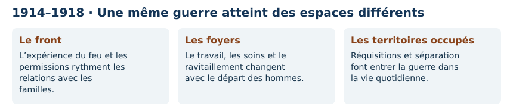
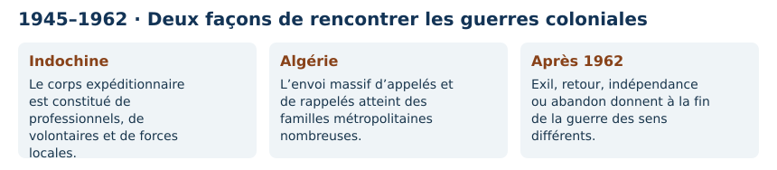
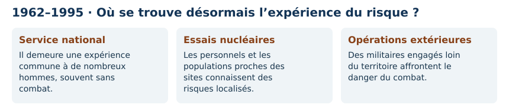

# BEL B/L — Histoire contemporaine 2026 · Corrigé guidé

*Corrigé rédigé par IA, non officiel.*

**Rédaction** · Modèle : OpenAI Codex (famille GPT-6) · Effort de raisonnement : non renseigné · Mode de vitesse : non renseigné.

**Les Français et les guerres (1870-1995)**

## Préparer la dissertation

L’épreuve commune dure six heures. Au brouillon, dresser deux colonnes : qui fait ou décide la guerre, et qui en vit les effets ? Ajouter les moments où la qualité de Français est mise en jeu. Tester ensuite les bornes de 1914 et de 1945 sur des exemples pris dans plusieurs milieux. Le plan qui suit propose une réponse parmi celles que permet le sujet.

## Introduction

À Strasbourg, le monument aux morts inauguré en 1936 représente une mère tenant ses deux fils mourants. Les deux hommes sont nus. Aucun uniforme ne dit lequel a porté les couleurs françaises ou allemandes. Dans une ville annexée en 1871 puis revenue sous administration française en novembre 1918, avant que le traité de Versailles ne consacre ce retour, présenter les morts de la guerre comme les enfants d’une même cité exigeait de suspendre ce partage. L’exemple invite à prendre le sujet dans les deux sens. Les Français ont combattu, soutenu, subi ou refusé des guerres. Ces guerres ont aussi changé les frontières du groupe qui pouvait se dire français et les conditions auxquelles chacun y appartenait.

De la défaite de 1870 à la participation française aux opérations internationales des années 1990, les guerres ne se résument donc pas aux campagnes d’une armée. Elles engagent des conscrits et des militaires de métier, des femmes et des enfants, des colonisés soumis à des statuts inégaux. Elles touchent parfois le domicile ou le lieu de travail, parfois un théâtre éloigné dont les nouvelles arrivent par l’imprimé, la radio puis la télévision. Comment les guerres ont-elles pu construire une expérience nationale commune tout en creusant des divisions entre ceux qu’elles mobilisaient ? La guerre de citoyens que la République fait sienne après 1870 atteint entre 1914 et 1945 une intensité qui bouleverse la frontière entre le front et l’arrière. Après 1945, la décolonisation et la transformation des formes d’engagement modifient la place de la guerre dans la vie des Français.

## I. De 1870 à 1914, la République organise le devoir militaire sur fond de conflits sur l’appartenance nationale

### Une défaite qui divise autant qu’elle rassemble

> [!INDICATION]
> Délimiter « les Français » en partant des habitants des territoires cédés. Pourquoi leur cas fait-il apparaître une difficulté absente d’un récit de batailles ?

À Sedan, en septembre 1870, la capture de l’empereur emporte le régime. Elle ne termine pas la guerre. Le gouvernement de la Défense nationale la poursuit, lève des hommes et appelle les provinces à secourir Paris assiégé. Pour les habitants de la capitale, le conflit signifie concrètement la raréfaction des vivres et les bombardements. La guerre produit aussi des interprétations rivales de la souveraineté. Les fédérés de la Commune, au printemps 1871, entendent conserver les armes de la garde nationale et défendre des libertés municipales et sociales. Pour l’Assemblée et le gouvernement de Thiers, il faut rétablir l’autorité de l’État. Avec la Semaine sanglante, des soldats français tuent des Français. La paix avec l’Allemagne et le rétablissement de l’ordre intérieur ne sont donc ni le même événement ni la même expérience.

Le traité de Francfort, en mai 1871, cède à l’Empire allemand l’Alsace, à l’exception de Belfort et de ses environs, et une partie de la Lorraine. L’option de nationalité rend la frontière sensible dans les familles. Pour nombre d’habitants, conserver la nationalité française suppose un départ. La défaite ne lègue donc pas seulement un thème à la littérature patriotique. Elle change les conditions matérielles de la vie et les relations entre proches.

### Faire du soldat un citoyen sans rendre les obligations uniformes

> [!INDICATION]
> Rapprocher chaque loi d’une conséquence dans la vie d’un foyer. Préciser qui sert, qui est dispensé et qui assume une partie des tâches laissées vacantes.

La loi de 1872 pose le principe du service militaire personnel, mais le tirage au sort et les dispenses différencient les obligations. La loi de 1905 supprime le tirage au sort et fixe en principe le service à deux ans. En 1913, le passage à trois ans suscite une vive contestation. Le séjour à la caserne soumet des générations de jeunes hommes à une langue de commandement commune et les déplace au-delà de leur territoire familier. Les périodes de réserve empiètent ensuite sur les calendriers du travail et sur la vie des familles. La production d’un soldat national engage ainsi des personnes qui ne portent jamais l’uniforme. Elle dessine aussi une citoyenneté fortement masculine.

L’institution militaire tire de cette mission un prestige que l’affaire Dreyfus rend particulièrement visible. Condamné en 1894, réhabilité en 1906, l’officier juif Alfred Dreyfus se trouve au centre d’un conflit sur l’honneur de l’armée, la raison d’État, la justice et l’antisémitisme. Les dreyfusards peuvent se réclamer de la nation autant que leurs adversaires. Adhérer au principe de la défense nationale ne dicte donc pas la même conduite envers les autorités militaires.

### Un horizon impérial très inégalement partagé

> [!INDICATION]
> Distinguer le regard depuis la métropole et celui des troupes recrutées dans l’empire. L’uniforme recouvre-t-il partout les mêmes droits ?

Dans le même temps, la conquête coloniale mobilise des militaires de carrière et des troupes recrutées dans l’empire et demeure souvent lointaine pour les ménages métropolitains. Les débats parlementaires sur l’expansion coloniale, particulièrement vifs en 1885, montrent cependant qu’elle engage aussi la définition de la puissance française. La République qui prépare le conscrit à défendre son territoire emploie ailleurs les armes pour étendre sa domination. Les colonisés qui servent sous le drapeau français peuvent être soumis à des obligations lourdes sans recevoir les droits politiques du citoyen métropolitain. Ces deux usages de la force, que la distance permet de penser séparément, seront étroitement liés pendant les guerres mondiales.

## II. De 1914 à 1945, les guerres mondiales font de toute la société un espace de mobilisation et de division

### Une mobilisation de masse vécue de façon inégale

> [!INDICATION]
> Choisir deux expériences de 1914 et un désaccord de 1917. Une objection contre une offensive porte-t-elle nécessairement sur la défense du territoire ?

En août 1914, l’ordre de mobilisation transforme en quelques jours les réservistes en combattants et des familles en foyers privés d’un revenu, d’un fils ou d’un père. Les manifestations patriotiques en ville ne résument pas ce que signifie le départ dans un village au moment des récoltes. Le sentiment de défendre les siens, la discipline et la solidarité des proches ou des camarades peuvent soutenir l’engagement d’un même homme. À l’épreuve des tranchées et de l’artillerie s’ajoute, dans les territoires occupés du Nord et de l’Est, celle des réquisitions et de la séparation. Des femmes prennent des emplois dans les usines d’armement, poursuivent le travail aux champs et organisent la vie familiale. Elles travaillaient déjà avant la guerre. Ce qui change est la répartition des tâches, leur visibilité et parfois leur danger. Des travailleurs et soldats venus des colonies connaissent en outre l’éloignement et des traitements inégaux.

La mobilisation tient sans produire une adhésion sans réserve. Après l’offensive du chemin des Dames en 1917, des soldats refusent de remonter en ligne dans certaines unités, tout en restant souvent disposés à tenir leurs positions. Exiger des permissions ou contester des offensives jugées meurtrières n’équivaut pas à accepter une victoire allemande. À l’arrière, les grèves révèlent également le coût de l’inflation et la difficulté de répartir l’effort. Les institutions parviennent à prolonger la guerre à travers ces contestations mêmes, en combinant sanctions et concessions.

### Entre les deux guerres, la mémoire des morts change les attentes des vivants

> [!INDICATION]
> Une pension, un monument et une manifestation pacifiste ne répondent pas à la même question. Relier chaque exemple à la guerre vécue auparavant.

Après 1918, le retour au foyer est inégal. Pour les mutilés, les familles de disparus ou les veuves, la paix ouvre un temps de soins, de démarches et de revendications. Les pensions et la reconnaissance des pupilles de la Nation font du dommage privé une dette publique. Le monument communal et le 11 Novembre inscrivent le deuil dans des lieux et des gestes que les habitants peuvent partager sans attribuer le même sens au sacrifice. Des anciens combattants réclament la sécurité du pays tout en refusant que leurs fils recommencent leur expérience. Le pacifisme français a ainsi des sources sociales autant qu’idéologiques. Le soulagement que provoquent les accords de Munich en 1938 peut s’éclairer par cette mémoire, sans que chacun partage la même opinion sur l’Allemagne nazie ni sur les moyens de lui faire face.

### De la défaite de 1940 à la Libération, agir au nom de la France devient un choix disputé

> [!INDICATION]
> Tenir ensemble occupation étrangère, politique de l’État français et pluralité des résistances. Éviter de figer d’emblée les attitudes pour les quatre années.

En 1940, la brièveté des opérations n’empêche ni les morts ni la capture durable d’une masse de soldats. L’exode déplace sur les routes des familles entières. L’occupation, les pénuries et le rationnement font ensuite entrer la guerre jusque dans les files d’attente. La politique propre de Vichy, notamment le statut des Juifs d’octobre 1940, puis la participation de la police française aux arrestations, exposent une partie de la population à une persécution que la seule distinction entre civils et militaires ne permet pas de comprendre. Des Juifs français sont eux aussi persécutés et déportés. Dès 1940, la France libre entend poursuivre le combat, en prenant notamment appui sur des territoires africains ralliés. Sur le sol métropolitain, les résistances se développent selon des rythmes et des formes variés. Le service du travail obligatoire en 1943 pousse une partie des réfractaires vers les maquis.

Une trajectoire peut donc se transformer dans la durée. Entre la collaboration active et la résistance organisée se trouvent des personnes qui essaient de nourrir les leurs, aident un voisin ou s’accommodent des autorités dans des circonstances changeantes. La Libération, à laquelle concourent Alliés, forces françaises venues de l’extérieur et résistances intérieures, ne rend pas immédiatement ces expériences compatibles. L’épuration et le retour des déportés et des prisonniers mettent en présence des histoires dont la reconnaissance publique sera longtemps inégale.

## III. De 1945 à 1995, la guerre s’éloigne du quotidien métropolitain sans cesser de diviser les Français

### Deux guerres de décolonisation font apparaître la distance entre statut juridique et expérience vécue

> [!INDICATION]
> Comparer le recrutement des forces en Indochine et en Algérie. Examiner ce que « français » signifie dans l’Algérie coloniale et à Paris en 1961.

En Indochine, le corps expéditionnaire repose sur des militaires de métier, des volontaires et des forces recrutées localement. Pour beaucoup de familles métropolitaines, la guerre reste distante, même si les mobilisations contre le conflit et le retentissement de Diên Biên Phu en 1954 la rendent visible. En Algérie, à partir de 1954, l’envoi massif d’appelés et de rappelés donne à la guerre une autre présence. Une lettre d’un fils et le silence à son retour introduisent le conflit dans des foyers alors que les communiqués officiels parlent d’opérations de « maintien de l’ordre ». Le statut de 1947 reconnaît la citoyenneté française aux Algériens musulmans, mais deux collèges électoraux de tailles très inégales élisent le même nombre de représentants à l’Assemblée algérienne. La citoyenneté coexiste ainsi avec une profonde inégalité politique. Dans les familles algériennes, déplacements forcés, violences, engagements indépendantistes ou service comme supplétif ne composent pas une expérience commune interchangeable.

La violence atteint aussi la métropole. À Paris, le 17 octobre 1961, la répression policière d’une manifestation d’Algériens, alors juridiquement français, fait des morts. Après les accords d’Évian en 1962, l’indépendance s’accompagne de l’exode massif des Européens d’Algérie, de massacres d’anciens supplétifs et de conditions d’accueil difficiles pour les familles de harkis venues en France. Le même calendrier peut ainsi marquer une victoire nationale, un départ sans retour ou une longue relégation. Pour comprendre les Français et la guerre, il faut examiner qui a le pouvoir d’en nommer la fin.

### Une puissance militaire qui expose autrement ses citoyens

> [!INDICATION]
> Partir d’un choix d’organisation de la défense et localiser ses effets sur des populations concrètes. Que voit-on depuis la Polynésie, Sarajevo ou la métropole ?

Après 1962, le service national demeure une expérience masculine de masse, mais l’appel sous les drapeaux débouche beaucoup moins souvent sur une expérience combattante. La dissuasion nucléaire, dont le premier essai français a lieu au Sahara en 1960, déplace une part de la défense vers l’expertise technique et la décision présidentielle. Elle n’efface pas la géographie sociale du risque. Des personnels et des populations voisines des sites d’essais au Sahara puis en Polynésie sont exposés aux conséquences de cette politique, tandis que la stratégie nationale se présente en métropole comme une garantie de sécurité.

La guerre du Golfe en 1991 illustre un autre écart. Des unités françaises combattent au sein d’une coalition et les familles suivent à la télévision des opérations menées loin du territoire. Les contingents déployés en ex-Yougoslavie dans les années 1990 affrontent des risques bien réels sous mandat international. À Sarajevo en 1995, la mort de soldats français rappelle que participer à une opération de maintien de la paix peut aussi signifier combattre. L’uniforme demeure dans le paysage français en 1995, mais le rapport des citoyens à l’usage effectif de la force passe davantage par les militaires directement engagés, les médias et le débat sur la légitimité de l’intervention.

## Conclusion

Entre 1870 et 1995, la guerre n’a donc pas occupé une place constamment décroissante ou croissante dans la vie des Français. L’extension du service et les deux guerres mondiales ont rapproché, à des degrés extrêmes, la guerre et la vie familiale. La décolonisation a montré combien cette rencontre dépendait aussi des statuts, des appartenances contestées et des mots par lesquels l’État désignait ses opérations. En 1995, les interventions extérieures et la dissuasion organisent une plus grande distance pour une majorité de citoyens. Les engagements, les risques et les mémoires restent inégalement partagés. C’est précisément cette inégalité des expériences qui permet de comprendre pourquoi un conflit mené au nom de la France n’a jamais eu une seule signification pour les Français.
