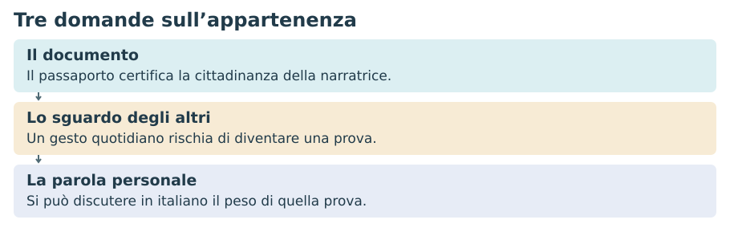
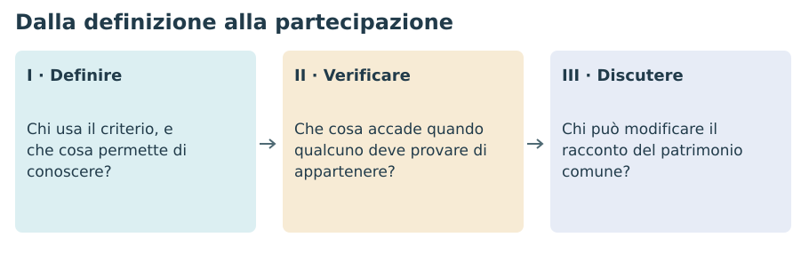
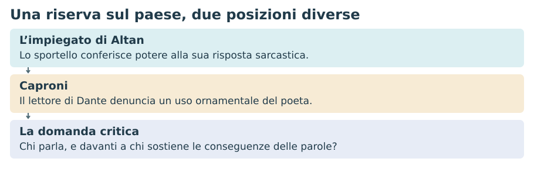

# BEL B/L — Italien 2026 · Corrigé guidé

*Corrigé rédigé par IA, non officiel.*

**Rédaction** · modèle exact non renseigné (famille GPT-6) · effort non renseigné · vitesse non renseignée

**Révision** · modèle exact non renseigné (famille GPT-6) · effort non renseigné · vitesse non renseignée

**Question directrice** — Chi riconosce l’appartenenza italiana, e che cosa cambia quando prende la parola chi dovrebbe essere riconosciuto?

[Sujet officiel, p. 27 à 30](https://www.ens.psl.eu/sites/default/files/livret_lve_allege.pdf#page=27) · [Rapport officiel](https://www.ens.psl.eu/sites/default/files/2026_bl_rapport_ecrit_option_italien.pdf)

## Six manières de prendre la parole

L’épreuve écrite à option dure six heures et porte sur les six documents italiens du livret commun, pages 27 à 30. Elle a un coefficient de 3. La langue du commentaire est l’italien.

| Pièce | Genre et circonstance | Indice à exploiter |
|---|---|---|
| 1. Ilario Cola, 2021 | Étude linguistique : comparaison de définitions. | La carte d’identité décrit certains traits et en laisse d’autres en dehors. |
| 2. Tomaso Montanari, 2018 | Article polémique dans *Il Fatto Quotidiano*. | Les limites de la Toscane actuelle et l’extension de la civilisation étrusque ne coïncident pas. |
| 3. Concetto Vecchio, 2025 | Reportage sur le discours de Mattarella lors du cinquantenaire du FAI. | L’image de la mosaïque s’adresse à des personnes qui protègent le patrimoine. |
| 4. Matteo Di Gesù, 2011 | Présentation et reprise de deux épigrammes de Caproni, publiées après sa mort dans *Res amissa* (1991). | L’association du diminutif *Italietta* et du prestige de Dante autorise une critique intérieure au patrimoine. |
| 5. Igiaba Scego, 2005 | Extrait du récit « Salsicce ». | Le passage au romanesco fait entendre l’appartenance de la narratrice pendant qu’elle la met en doute. |
| 6. Altan, 2012 | Dessin de presse dans *L’Espresso*. | Le décalage entre les positions autour du bureau donne un poids différent aux deux répliques. |

## Passer de la définition à l’épreuve

La narratrice de Scego dispose déjà d’un passeport italien. La disposition dont elle entend parler concerne les étrangers demandant un titre de séjour. Expliquer comment cette séparation administrative agit sur sa perception d’elle-même permet de rapprocher sa voix du demandeur dessiné par Altan sans assimiler leurs statuts. Le rapport souligne l’intérêt d’une véritable lecture littéraire du récit et d’une analyse de la vignette aux pages 2 à 4.

## Confronter les représentations publiques aux appropriations personnelles

Montanari prend pour cible une généalogie officielle ; Mattarella adresse à une fondation un message de reconnaissance et de responsabilité. Pour commenter leur accord sur la pluralité, tenir aussi compte des genres pratiqués. Puis vérifier ce que la critique d’un cliché coûte respectivement à Caproni, à l’employé d’Altan et à la narratrice de Scego.

> [!METHODE]
> Désigner les deux voix du document 3, le journaliste Vecchio et le président qu’il cite. Faire de même dans le document 4, qui présente les épigrammes de Caproni à travers le commentaire de Di Gesù. Cela évite d’attribuer au poète une analyse écrite vingt ans après la parution du recueil posthume.

## Commentaire rédigé en italien

### Introduzione

Allo sportello disegnato da Altan nel 2012 un uomo vorrebbe diventare cittadino italiano. Il funzionario gli risponde come se avesse appena espresso una singolare passione per il rischio. La domanda sarebbe amministrativamente chiarissima. La battuta la rende difficile perché separa il diritto richiesto dal valore che gli attribuisce chi, presumibilmente, lo possiede già. È anche la distanza che interessa, su un altro piano, il linguista Ilario Cola quando nel 2021 paragona le definizioni dei dizionari ai dati di una carta d’identità. Un documento valido identifica una persona, ma della sua vita dice pochissimo. Tra queste due forme brevi si collocano l’intervento polemico di Tomaso Montanari (2018), le parole di Sergio Mattarella riportate da Concetto Vecchio (2025), gli epigrammi di Giorgio Caproni riproposti da Matteo Di Gesù (2011) e il racconto di Igiaba Scego pubblicato in *Pecore nere* (2005). Chi ha il potere di riconoscere qualcuno come italiano, e come cambia questo potere quando a parlare è la persona che dovrebbe essere riconosciuta? Occorre confrontare i criteri di appartenenza, vedere che cosa succede quando diventano prove da superare e chiedersi infine che cosa si possa condividere anche nel dissenso.

### I. Le definizioni cambiano con lo scopo di chi le usa

Nel documento 1 le voci raccolte da Cola spostano l’accento dall’indole alla partecipazione, dalla conformità linguistica alla coscienza di appartenere a una comunità. Due persone potrebbero trovarsi d’accordo sulla storia dell’italiano e dividersi sulla necessità di parlare secondo una grammatica codificata per sentirsi italiane. Il paragone con la carta d’identità limita anche l’ambizione di chi volesse sommare tutte le voci. La squadra per cui si tifa, esempio volutamente quotidiano, manca dal documento senza che tale mancanza lo renda falso. L’errore comincia quando al documento si chiede di rappresentare interamente la vita del titolare. Lo sportello di Altan trasforma la stessa distinzione in una scena a due. L’uomo in piedi parla di cittadinanza, quello seduto alla scrivania risponde secondo la propria opinione sul paese. Il primo ha formulato una domanda a cui l’opinione del secondo non può sostituirsi.

Nel documento 2 Montanari applica una cautela analoga al territorio. Una giornata dedicata agli Etruschi potrebbe permettere di conoscere reperti e luoghi. Altra cosa è farne la prova che l’odierna Toscana fosse già inscritta nei confini del passato. Gli Etruschi vivevano anche fuori dall’attuale regione. Entro quella regione si trovavano realtà politiche che il granducato mediceo non esauriva. Nel passaggio da un’osservazione all’altra il lettore vede il lavoro necessario per *inventare* un’origine tanto lineare. L’Italia unita nel 1861 non eredita da ciascuna regione un’identità antica già pronta da assemblare. Persino il plurale delle cucine locali, ricorda Montanari, resiste al singolare di una cucina nazionale immutabile. Ed è proprio la cucina che, nel racconto di Scego, rischia di diventare un esame.

### II. Una definizione si fa più dura quando qualcuno deve dimostrare di corrispondervi

All’uscita dalla macelleria la protagonista di «Salsicce» accumula domande sui modi di cuocere la carne. Dapprima potremmo pensare a un’inesperienza domestica. Ma l’interrogativo passa quasi subito dal fornello allo sguardo degli altri: mangiando in un certo modo si potrebbe finalmente apparire italiana? La scelta del cibo urta contro un’abitudine religiosa e familiare. Nessun commensale, del resto, potrebbe vedere in quel gesto tutte le ragioni che lo hanno provocato. La lingua del racconto mette in crisi la prova mentre la narratrice ancora la immagina. L’espressione romanesca «me le magno» le viene spontanea proprio quando si domanda se saprà comportarsi da italiana. Il lettore sente già una voce situata nella lingua che il gesto alimentare dovrebbe certificarle.

L’annuncio dei rilievi delle impronte digitali legati al soggiorno degli stranieri rende comprensibile la violenza del dubbio. La protagonista possiede un passaporto italiano. Non è dunque la scoperta di una nuova nazionalità giuridica a provocare l’angoscia. Il modo in cui la misura divide il mondo fra chi sarà controllato e chi potrà sentirsi al riparo le ripropone una domanda ascoltata durante l’infanzia: bisogna voler bene all’Italia più che alla Somalia? La similitudine con il bambino costretto a scegliere fra i genitori espone l’assurdità affettiva di questa alternativa. La successione di interrogative, il romanesco e il tono irritato danno alla contraddizione una durata che l’immagine singola di Altan deve invece concentrare. Nella vignetta l’impiegato dispone del tavolo e del computer, il richiedente resta in piedi. La battuta sminuisce la condizione che un’altra persona domanda di ottenere. Il disegno lascia al lettore il compito di stabilire su chi ricada il ridicolo: l’uomo che chiede un diritto o l’ufficio che risponde con un luogo comune?

Anche chi incontestabilmente appartiene a una cultura può rifiutare i segni che la rappresentano. Nei due epigrammi di Caproni, *Patria* diventa «Italietta» e la rima di questo diminutivo con «aspetta» restituisce al paese il tono di una minaccia da cortile. In *Ahimè* l’esclamazione dolente conduce alla formula solenne della «terra di Dante». La nota introduttiva di Di Gesù impedisce un equivoco. Caproni è stato lettore assiduo di Dante. Il poeta civile e teologo è qui ridotto a ornamento di una celebrazione nazionale. Lo scherno colpisce quest’uso e la sproporzione fra la citazione prestigiosa e le meschinità del presente. Il poeta e il personaggio di Altan esprimono entrambi una riserva verso il paese, ma l’atto di parola ha un costo diverso. Uno mette in gioco il proprio rapporto con un’eredità amata. L’altro esercita il sarcasmo da una posizione che la persona di fronte a lui non condivide.

### III. Una comunità può riconoscersi anche nel modo di discutere la propria eredità

L’immagine del mosaico scelta da Mattarella offre una risposta pubblica. Nel resoconto di Vecchio, il presidente interviene al Quirinale davanti al FAI, che festeggia cinquant’anni di attività. Il contesto dà un significato pratico all’immagine. Chi cura un paesaggio o un luogo storico può contribuire a trasmetterlo pur avendo alle spalle una storia familiare diversa da quella di un vicino. Il riferimento alla tutela del paesaggio sostenuta da Benedetto Croce lega la vita della comunità a un compito di cui si può verificare l’adempimento. Proteggere un luogo comporta decisioni su ciò che si conserva, sui soggetti che possono accedervi e sul racconto che lo accompagna. Si comprende così perché la festa degli Etruschi possa diventare l’oggetto di una polemica storica, senza che quella polemica tolga ogni valore all’interesse per i resti antichi.

Il mosaico, tuttavia, visto da lontano sembra compiuto. Scego ce lo restituisce dall’interno, dal punto in cui una persona non sa quale tessera gli altri desiderino assegnarle. Le parole che don Milani pronuncia nel 1965 e che Montanari riprende propongono un’altra linea di divisione, quella che corre fra oppressi e privilegiati anche all’interno di un medesimo paese. Accanto al mosaico presidenziale, questo richiamo conserva la possibilità del conflitto. Una comunità democratica ha bisogno anche della lingua polemica di chi contesta il modo in cui si distribuiscono l’ascolto e il sospetto. Il fatto che Scego scriva in italiano una pagina sulla violenza della richiesta di scegliere costituisce già un contributo al patrimonio che Cola vedeva definito dai dizionari. La sua scrittura ne modifica i confini proprio mentre li interroga.

### Conclusione

Una carta può attestare la cittadinanza, un dizionario registra gli usi e una celebrazione può incoraggiare la cura del territorio. Quando uno solo di questi strumenti pretende di fissare la vita intera, il risultato è la genealogia selettiva denunciata da Montanari o l’esame quotidiano che tormenta la narratrice di Scego. L’italianità che emerge dal dossier ha anche una dimensione critica. Si può ereditare Dante e contestare l’impiego del suo nome, custodire un paesaggio e discuterne la narrazione, parlare italiano per raccontare un affetto che attraversa più paesi. Perché questo patrimonio sia davvero comune occorre che alla persona in piedi davanti allo sportello sia riconosciuta, oltre alla facoltà di fare domanda, quella di contribuire a dire che cosa la cittadinanza significhi.
