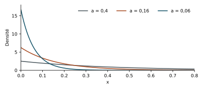
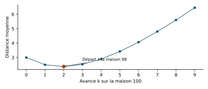
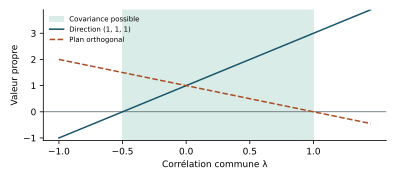

# BEL B/L — Mathématiques (oral) 2026 · Corrigé brut

*Corrigé rédigé par IA, non officiel. Signalez toute erreur.*

**Attribution archivée** · « IA (gpt-6), relue et révisée par IA »

**Révision (tour 1)** · GPT-6.2 Astra Ultra · vitesse non renseignée

## Planche 1 — Exercice 1 : Somme de projecteurs

Soit $n\ge1$ un entier.

On considère deux projecteurs $p$ et $q$ de $\mathbb R^n$ et on note $s=p+q$.

Un projecteur est un endomorphisme $u$ tel que $u^2=u$ : ici $p^2=p$ et $q^2=q$.

### Question (1)

Si $p\circ q=q\circ p=0$, alors, en développant par bilinéarité de la composition :

$$
\begin{aligned}
s^2&=(p+q)\circ(p+q)\\
&=p^2+p\circ q+q\circ p+q^2\\
&=p+0+0+q\\
&=s.
\end{aligned}
$$

Donc $s^2=s$ : **$s$ est un projecteur.**

### Question (2)

Soient $A,B\in\mathcal M_n(\mathbb R)$ deux matrices semblables : il existe $P\in\mathrm{GL}_n(\mathbb R)$ telle que $B=P^{-1}AP$.

En appliquant l'identité de cours $\mathrm{Tr}(XY)=\mathrm{Tr}(YX)$ avec $X=P^{-1}$ et $Y=AP$ :

$$
\begin{aligned}
\mathrm{Tr}(B)&=\mathrm{Tr}\big(P^{-1}(AP)\big)\\
&=\mathrm{Tr}\big((AP)P^{-1}\big)\\
&=\mathrm{Tr}(A).
\end{aligned}
$$

Deux matrices représentant un même endomorphisme $f$ dans deux bases quelconques sont semblables (elles sont liées par la matrice de passage), donc la trace de $f$, notée $\mathrm{Tr}(f)$, est indépendante de la base choisie : **deux matrices semblables ont même trace.**

### Question (3)

*On suppose désormais que $s$ est un projecteur.*

Soit $r$ un projecteur de $\mathbb R^n$.

Alors $\mathbb R^n=\ker r\oplus\mathrm{Im}\,r$ et $r$ coïncide avec l'identité sur $\mathrm{Im}\,r$.

En concaténant une base de $\mathrm{Im}\,r$ (de cardinal $\mathrm{rg}(r)$) et une base de $\ker r$, on obtient une base de $\mathbb R^n$ dans laquelle la matrice de $r$ est

$$
\begin{pmatrix} I_{\mathrm{rg}(r)} & 0 \\ 0 & 0 \end{pmatrix},
$$

de trace $\mathrm{rg}(r)$.

D'après la question (2), cette trace est $\mathrm{Tr}(r)$, indépendante de la base.

Ainsi $\mathrm{Tr}(r)=\mathrm{rg}(r)$ pour tout projecteur $r$.

Appliqué à $r=s$ :

$$
\boxed{\mathrm{Tr}(s)=\mathrm{rg}(s)}
$$

### Question (4)

Par linéarité de la trace, $\mathrm{Tr}(s)=\mathrm{Tr}(p)+\mathrm{Tr}(q)$.

La question (3), appliquée aux trois projecteurs $p$, $q$ et $s$, donne $\mathrm{Tr}(p)=\mathrm{rg}(p)$ et $\mathrm{Tr}(q)=\mathrm{rg}(q)$.

Appliquée à $s$,
elle donne $\mathrm{Tr}(s)=\mathrm{rg}(s)$.

On en déduit :

$$
\boxed{\mathrm{rg}(p)+\mathrm{rg}(q)=\mathrm{rg}(s)}
$$

### Question (5)

Pour tout $x$, $s(x)=p(x)+q(x)$ appartient à $F=\operatorname{Im}p+\operatorname{Im}q$, donc $\operatorname{Im}s\subseteq F$.

Posons $r=\operatorname{rg}p$ et $t=\operatorname{rg}q$. La concaténation d'une base de $\operatorname{Im}p$ et d'une base de $\operatorname{Im}q$ est une famille de $r+t$ vecteurs qui engendre $F$. Ainsi $\dim F\le r+t$.

La question (4) donne $\dim\operatorname{Im}s=r+t$. L'inclusion précédente impose donc $\dim F=r+t$, puis $F=\operatorname{Im}s$.

La famille génératrice de $r+t$ vecteurs est alors une base de $F$. Si $y\in\operatorname{Im}p\cap\operatorname{Im}q$, ses deux écritures dans les deux bases donnent une relation linéaire dans cette famille libre. Tous les coefficients sont nuls, donc $y=0$.

Ainsi
$$
\boxed{\operatorname{Im}p\oplus\operatorname{Im}q=\operatorname{Im}s}.
$$

### Question (6)

Puisque $s$ est un projecteur, $s^2=s$, ce qui s'écrit, en développant :

$$
\begin{aligned}
p^2+p\circ q+q\circ p+q^2&=p+q\\
p\circ q+q\circ p&=0.
\end{aligned}
$$

Multiplions cette égalité à gauche par $p$ : $p\circ(p\circ q)+p\circ(q\circ p)=0$, soit $p\circ q+p\circ q\circ p=0$, d'où

$$
p\circ q=-\,p\circ q\circ p.
$$

Multiplions-la à droite par $p$ : $(p\circ q)\circ p+(q\circ p)\circ p=0$, soit $p\circ q\circ p+q\circ p=0$, d'où

$$
q\circ p=-\,p\circ q\circ p.
$$

On en déduit $p\circ q=q\circ p$.

En reportant dans $p\circ q+q\circ p=0$, il vient $2\,p\circ q=0$, donc $p\circ q=0$, puis $q\circ p=0$ :

$$
\boxed{p\circ q=q\circ p=0}
$$

## Planche 1 — Exercice 2 : Urne à renforcement

On fixe une suite $(u_n)_{n\in\mathbb N^*}$ d'entiers strictement positifs.

Une urne contient initialement une boule blanche et une boule rouge, indiscernables au toucher.

Au $k$-ième tirage : si la boule tirée est blanche, on la replace et on ajoute $u_k$ boules blanches ; si elle est rouge, on la replace.

On note $B_n$ l'événement « la boule tirée au $n$-ième tirage est blanche ».

On pose $S_0=1$ et $S_n=1+\sum_{k=1}^n u_k$ pour $n\ge1$.

Enfin $p_n=\mathbb P\big(\bigcap_{k=1}^n B_k\big)$ pour $n\ge1$.

### Question (1)

Supposons $\bigcap_{i=1}^k B_i$ réalisé.

Initialement, l'urne contient $1$ blanche et $1$ rouge.

À chaque tirage $i\in\{1,\dots,k\}$, la boule tirée est blanche : on la replace et on ajoute $u_i$ blanches.

Le nombre de blanches augmente donc de $u_i$ à chaque tirage, et le nombre de rouges reste égal à $1$.

Juste avant le $(k+1)$-ième tirage, l'urne contient donc

$$
S_k=1+\sum_{i=1}^k u_i\ \text{boules blanches et}\ 1\ \text{boule rouge},
$$

soit $S_k+1$ boules au total.

Conditionnellement à $\bigcap_{i=1}^k B_i$, chaque boule présente est équiprobable, donc :

$$
\boxed{\mathbb P\Big(B_{k+1}\,\Big|\,\bigcap_{i=1}^k B_i\Big)=\frac{S_k}{S_k+1}}
$$

### Question (2)

Chaque événement $\bigcap_{i=1}^k B_i$ est de probabilité strictement positive, puisque c'est un produit de facteurs $\frac{S_j}{S_j+1}>0$.

La formule des probabilités composées s'applique :

$$
\begin{aligned}
p_n&=\mathbb P(B_1)\prod_{k=2}^n\mathbb P\Big(B_k\,\Big|\,\bigcap_{i=1}^{k-1}B_i\Big)\\
&=\frac{S_0}{S_0+1}\prod_{k=2}^n\frac{S_{k-1}}{S_{k-1}+1}.
\end{aligned}
$$

Au premier tirage, l'urne contient $S_0+1=2$ boules dont $S_0=1$ blanche, donc $\mathbb P(B_1)=\frac{1}{2}=\frac{S_0}{S_0+1}$.

Pour $k\ge2$, la question (1) donne $\mathbb P\big(B_k\,\big|\,\bigcap_{i=1}^{k-1}B_i\big)=\frac{S_{k-1}}{S_{k-1}+1}$.

En réindexant le produit, on obtient :

$$
\boxed{p_n=\prod_{k=0}^{n-1}\frac{S_k}{S_k+1}}
$$

### Question (3)

Les $u_k$ sont des entiers strictement positifs, donc $u_k\ge1$, et

$$
\begin{aligned}
S_n&=1+\sum_{k=1}^n u_k\\
&\ge n+1.
\end{aligned}
$$

Donc $S_n\xrightarrow[n\to\infty]{}+\infty$, et en particulier $\frac{1}{S_n}\to0$.

Posons $a_n=\ln\!\big(\frac{S_n+1}{S_n}\big)=\ln\!\big(1+\frac{1}{S_n}\big)$.

Par le développement limité $\ln(1+x)=x+o(x)$ au voisinage de $0$ :

$$
a_n\sim\frac{1}{S_n}.
$$

Les deux suites $(a_n)$ et $(\frac{1}{S_n})$ sont à termes strictement positifs, donc, par le théorème de comparaison par équivalence pour les séries à termes positifs :

$$
\boxed{\sum_{n\ge0}\ln\!\Big(\frac{S_n+1}{S_n}\Big)\ \text{et}\ \sum_{n\ge0}\frac{1}{S_n}\ \text{ont même nature.}}
$$

En particulier, à partir d’un certain rang, le terme logarithmique est compris entre $1/(2S_n)$ et $2/S_n$.

La comparaison des sommes partielles positives démontre les deux implications de l’égalité des natures.

### Question (4)

Posons $A_n=\bigcap_{k=1}^n B_k$.

La suite $(A_n)_{n\ge1}$ est décroissante et l'événement « ne jamais tirer de boule rouge » s'écrit $\bigcap_{n\ge1}A_n$.

Par continuité monotone (admise dans l'énoncé) :

$$
\begin{aligned}
\mathbb P\Big(\bigcap_{n\ge1}A_n\Big) &=\lim_{n\to\infty}\mathbb P(A_n) \\
&=\lim_{n\to\infty}p_n.
\end{aligned}
$$

D'après la question (2),

$$
-\ln p_n=\sum_{k=0}^{n-1}\ln\!\Big(\frac{S_k+1}{S_k}\Big),
$$

qui est la $n$-ième somme partielle d'une série à termes positifs.

Deux cas, exclusifs et exhaustifs :

- si $\sum_{k\ge0}\ln\!\big(\frac{S_k+1}{S_k}\big)$ converge, alors $-\ln p_n$ tend vers une limite finie $L$, donc $p_n$ tend vers $e^{-L}>0$ ;
- si cette série diverge, alors $-\ln p_n\to+\infty$ et $p_n\to0$.

Ainsi $\lim p_n=0$ équivaut à la divergence de $\sum\ln\frac{S_k+1}{S_k}$, qui d'après la question (3) a même nature que $\sum\frac{1}{S_n}$.

On conclut :

$$
\boxed{\mathbb P(\text{ne jamais tirer de boule rouge})=0\iff\sum_{n\ge0}\frac{1}{S_n}\ \text{diverge.}}
$$

## Planche 2 — Exercice 1 : Trace, rang et projection orthogonale

On utilise le produit scalaire canonique.

Pour une matrice $A$, $P$ est la matrice de la projection orthogonale sur $\operatorname{Im}A$.

### Question (1)

Si $M=(m_{ij})$, le $j$-ième coefficient diagonal de $M^TM$ vaut $\sum_i m_{ij}^2$.

Ainsi
$$
\begin{aligned}
\operatorname{Tr}(M^TM) &=\sum_{i,j}m_{ij}^2 \\
&\ge0.
\end{aligned}
$$
Cette somme est nulle si et seulement si tous les coefficients sont nuls.

**L’égalité équivaut à $M=0$.**

### Question (2a)

Les vecteurs $x-p(x)$ et $y-p(y)$ sont orthogonaux à l’image de $p$.

Comme $p(x)$ et $p(y)$ appartiennent à cette image,
$$
\begin{aligned}
\langle x,p(y)\rangle &=\langle p(x),p(y)\rangle \\
&=\langle p(x),y\rangle.
\end{aligned}
$$

### Question (2b)

Pour tous $i,j$, on a $P_{ij}=\langle e_i,p(e_j)\rangle$.

La question précédente donne $P_{ij}=P_{ji}$, donc **$P^T=P$**.

### Question (3a)

Pour tout $x$, le vecteur $Ax$ appartient à $\operatorname{Im}A$, où le projecteur est l’identité.

Ainsi $PA=A$.

L’image du projecteur étant celle de $A$, leurs rangs coïncident.

Enfin, dans une base de son image complétée par une base de son noyau, $P$ est diagonale, avec des $1$ puis des $0$.

Donc
$$
\boxed{\operatorname{Tr}(P)=\operatorname{rg}(P)=\operatorname{rg}(A)}.
$$

### Question (3b)

La question (1) appliquée à $P+\lambda A$ donne une trace positive ou nulle.

Comme $P^TP=P$, $P^TA=PA=A$ et $\operatorname{Tr}(A^TP)=\operatorname{Tr}((PA)^T)=\operatorname{Tr}(A)$,
$$
\begin{aligned}
0&\le\operatorname{Tr}((P+\lambda A)^T(P+\lambda A)),\\
&=\operatorname{rg}(A)+2\lambda\operatorname{Tr}(A)+\lambda^2\operatorname{Tr}(A^TA).
\end{aligned}
$$

### Question (3c)

Si $A=0$, l’inégalité est immédiate.

Sinon $c=\operatorname{Tr}(A^TA)>0$.

Le trinôme de (3b) reste positif ou nul pour tout réel, donc son discriminant est négatif ou nul :
$$
4\operatorname{Tr}(A)^2-4c\operatorname{rg}(A)\le0.
$$
Ainsi $\boxed{\operatorname{Tr}(A)^2\le\operatorname{rg}(A)\operatorname{Tr}(A^TA)}$.

### Question (4)

On a $\operatorname{Tr}(A)=n$, tandis que
$$
\begin{aligned}
\operatorname{Tr}(A^TA) &\le n+\frac{n(n-1)}n \\
&=2n-1.
\end{aligned}
$$
La question (3c) donne $n^2\le(2n-1)\operatorname{rg}(A)$.

Ainsi $\operatorname{rg}(A)\ge n^2/(2n-1)>n/2$, ce qui prouve en particulier **$\operatorname{rg}(A)\ge n/2$**.

## Planche 2 — Exercice 2 : Intégrabilité et limites

La fonction $f$ est de classe $\mathcal C^2$ sur $[0,+\infty[$, avec $f(0)=0$.

Les intégrales de $|f|$ et de $|f''|$ convergent.

### Question (1)

Puisque $f''$ est continue, le théorème fondamental de l’analyse donne, pour tout $x\ge0$,
$$
\boxed{f'(x)=f'(0)+\int_0^x f''(t)\,dt}.
$$

### Question (2)

L’intégrabilité absolue de $f''$ et la question (1) montrent que $f'(x)$ tend vers un réel $L$.

Si $L>0$, alors $f'(x)\ge L/2$ pour $x$ assez grand.

Après intégration, $f(x)\to+\infty$, donc $|f(x)|\ge1$ sur une demi-droite, ce qui contredit l’intégrabilité de $|f|$.

Si $L<0$, le même argument appliqué à $-f$ donne une contradiction.

Ainsi **$f'(x)\to0$**.

### Question (3)

La dérivée $f'$ est continue et tend vers zéro, donc il existe $C\ge0$ tel que $|f'(x)|\le C$ sur toute la demi-droite.

Par conséquent $|f(x)f'(x)|\le C|f(x)|$.

La comparaison avec une intégrale convergente prouve que **$\int_0^\infty|ff'|$ converge**.

### Question (4)

Pour tout $x\ge0$, puisque $f(0)=0$,
$$
f(x)^2=2\int_0^x f(t)f'(t)\,dt.
$$
La question (3) assure que le membre de droite possède une limite finie.

Le carré tend donc vers un réel $a\ge0$, et $|f(x)|\to\sqrt a$.

Si $a>0$, la fonction $|f|$ est minorée par une constante strictement positive à l’infini, contradiction.

Donc $a=0$, et **$f(x)\to0$**.

### Question (5)

L’intégrale converge absolument par (3).

Pour $R>0$, elle vaut sur $[0,R]$ la quantité $(f(R)^2-f(0)^2)/2$.

Les deux valeurs tendent vers zéro par les hypothèses et (4), donc
$$
\boxed{\int_0^\infty f(t)f'(t)\,dt=0}.
$$

## Planche 3 — Exercice 1 : Longueurs des deux premiers blocs

Les lancers sont indépendants, avec probabilité $p\in]0,1[$ de pile et $q=1-p$ de face.

$L_1,L_2$ sont les longueurs des deux premiers blocs constants.

### Question (1a)

Le premier bloc de longueur $n$ correspond aux suites $P^nF$ ou $F^nP$.

Pour chaque entier $n\ge1$, ces événements disjoints ont pour probabilités $p^nq$ et $q^np$.

Donc
$$
\boxed{P(L_1=n)=p^nq+q^np}.
$$
Pour $p=q=1/2$, cette probabilité vaut $2^{-n}$ : **$L_1$ suit la loi géométrique de paramètre $1/2$**, sur les entiers strictement positifs.

La probabilité d’un bloc infini est nulle puisque $p^n+q^n\to0$.

### Question (1b)

Conditionnellement à un premier pile, la longueur suit une loi géométrique de paramètre $q$ ; conditionnellement à un premier face, elle a pour paramètre $p$.

Les espérances sont finies.

Par la formule des espérances conditionnelles,
$$
\boxed{E(L_1)=\frac pq+\frac qp}.
$$

### Question (2a)

L’événement correspond à $P^nF^mP$ ou à $F^nP^mF$, événements disjoints.

En notant $\pi_{n,m}=P(L_1=n,L_2=m)$, on obtient
$$
\boxed{\pi_{n,m}=p^{n+1}q^m+q^{n+1}p^m}.
$$

### Question (2b)

Pour $m\ge1$, on somme des séries géométriques positives :
$$
\begin{aligned}
P(L_2=m)&=q^m\frac{p^2}{1-p}+p^m\frac{q^2}{1-q},\\
&=p^2q^{m-1}+q^2p^{m-1}.
\end{aligned}
$$
Ces probabilités somment à $p+q=1$, donc le second bloc est lui aussi fini presque sûrement.

### Question (2c)

La loi précédente est la combinaison, avec poids $p$ et $q$, des lois géométriques de paramètres respectifs $p$ et $q$.

Les deux espérances sont finies et
$$
\boxed{E(L_2)=p\frac1p+q\frac1q=2}.
$$

### Question (3)

On calcule
$$
\begin{aligned}
E(L_1)-E(L_2) &=\frac{p^2+q^2-2pq}{pq} \\
&=\frac{(p-q)^2}{pq} \\
&\ge0.
\end{aligned}
$$
Donc **$E(L_1)\ge E(L_2)$**, avec égalité si et seulement si **$p=q=1/2$**.

## Planche 3 — Exercice 2 : Itération d’un polynôme à coefficients positifs

On fixe $d\ge2$, $P(x)=\sum_{j=1}^d a_jx^j$, où les coefficients sont positifs ou nuls et $a_d>0$.

On pose $u_0=1$, $u_{n+1}=P(u_n)$.

Pour la question (2), on suppose $P(1)>1$ et on pose $w_n=\ln(u_n)/d^n$.

### Question (1)

La fonction $P$ est strictement croissante sur les réels positifs.

Si $P(1)\le1$, alors $0<u_1\le u_0$.

Par récurrence, $0<u_{n+1}\le u_n$ : la suite converge vers un réel positif ou nul.

Si $P(1)>1$, la suite est strictement croissante et $u_n\ge1$.

Une limite finie $L$ vérifierait $L=P(L)$ et $L\ge1$.

Or
$$
\begin{aligned}
\frac{P(L)}L &=\sum_{j=1}^d a_jL^{j-1} \\
&\ge P(1)>1,
\end{aligned}
$$
contradiction.

**Dans ce cas, $u_n\to+\infty$.**

### Question (2a)

Pour $u_n\ge1$,
$$
\begin{aligned}
a_d &\le\frac{P(u_n)}{u_n^d} \\
&\le P(1).
\end{aligned}
$$
Or
$$
w_{n+1}-w_n=\frac1{d^{n+1}}\ln\left(\frac{P(u_n)}{u_n^d}\right).
$$
Le logarithme est borné en valeur absolue par une constante indépendante de $n$.

La série des différences converge donc absolument, par comparaison avec $\sum d^{-n-1}$.

### Question (2b)

Le télescopage de la série de (2a) prouve que $w_n$ converge vers un réel $L$.

Posons $c=\ln(a_d)/(d-1)$.

Comme $u_n\to\infty$, choisissons $N$ tel que $\ln u_N+c>0$.

L’inégalité $u_{n+1}\ge a_du_n^d$ donne, par récurrence,
$$
\ln u_{N+k}\ge d^k(\ln u_N+c)-c.
$$
Après division par $d^{N+k}$ et passage à la limite,
$$
L\ge d^{-N}(\ln u_N+c)>0.
$$
Ainsi **la limite de $w_n$ est strictement positive**, ce qui ne résulte pas de la seule positivité de ses termes.

## Planche 4 — Exercice 1 : Deux récurrences avec une racine carrée

On pose $u_n=\sqrt{u_{n-1}}+1$ et $v_n=\sqrt{v_{n-1}}+1/n$ pour $n\ge1$, avec $v_0=u_0\ge0$.

Le terme $1/n$ est hors de la racine.

### Question (1a)

Pour $x\ge0$, posons $t=\sqrt x$.

L’équation devient $t^2-t-1=0$, dont l’unique racine positive est $(1+\sqrt5)/2$.

Ainsi
$$
\boxed{\lambda=\frac{3+\sqrt5}{2}}.
$$
Le trinôme est négatif entre $0$ et sa racine positive, positif au-delà.

Donc $x-\sqrt x-1$ est négatif pour $0\le x<\lambda$, nul en $\lambda$, positif pour $x>\lambda$.

### Question (1b)

La fonction $x\mapsto\sqrt x+1$ est croissante et fixe $\lambda$.

Si $u_0\le\lambda$, une récurrence donne $u_n\le\lambda$ et $u_{n+1}\ge u_n$.

Si $u_0\ge\lambda$, elle donne $u_n\ge\lambda$ et $u_{n+1}\le u_n$.

Dans les deux cas la suite est monotone et bornée, donc convergente.

Sa limite satisfait l’équation de (1a), par continuité : **$u_n\to\lambda$**.

### Question (2a)

On a $v_1=u_1\ge1$.

Si $1\le v_n\le u_n$, alors
$$
\begin{aligned}
1 &\le\sqrt{v_n}+\frac1{n+1} \\
&\le\sqrt{u_n}+1 \\
&=u_{n+1}.
\end{aligned}
$$
Par récurrence, **$1\le v_n\le u_n$ pour tout $n\ge1$**.

La suite $u_n$ étant bornée, il en est de même de $v_n$, en tenant aussi compte du terme initial.

### Question (2b)

Si $v_n\le v_{n-1}$, alors
$$
\begin{aligned}
v_{n+1} &=\sqrt{v_n}+\frac1{n+1} \\
&\le\sqrt{v_{n-1}}+\frac1n \\
&=v_n.
\end{aligned}
$$
Si aucune telle comparaison n’existe, la suite est strictement croissante.

Sinon, dès le premier indice où elle existe, la propriété se transmet : la suite est décroissante à partir de cet indice.

**Elle est donc toujours monotone à partir d’un certain rang.**

### Question (2c)

La suite est bornée et finalement monotone : elle converge vers $L\ge1$.

Comme $1/n\to0$, sa récurrence donne $L=\sqrt L$.

Les seules solutions positives ou nulles sont $0$ et $1$, et la borne $L\ge1$ impose **$v_n\to1$**.

## Planche 4 — Exercice 2 : Matrice formée d’un bloc et de deux bordures

Le bloc supérieur gauche de taille $K$ est rempli de $1$ ; hors de ce bloc, seules la première ligne et la première colonne valent $1$.

On a $n\ge3$ et $2\le K\le n-1$.

Posons $m=K-1$, $l=n-K$, $v=\sum_{i=2}^K e_i$ et $w=\sum_{i=K+1}^ne_i$.

### Question (1)

Pour un vecteur $x$, la première coordonnée de $Ax$ est la somme de toutes les coordonnées de $x$.

Les lignes $2$ à $K$ donnent chacune $x_1+\sum_{i=2}^Kx_i$. Les lignes suivantes donnent chacune $x_1$.

Ainsi
$$
Ax=0\quad\Longleftrightarrow\quad
\begin{cases}
x_1=0,\\
\sum_{i=2}^{K}x_i=0,\\
\sum_{i=K+1}^{n}x_i=0.
\end{cases}
$$
Ces trois contraintes sont indépendantes.

Donc **$\operatorname{rg}(A)=3$ et $\dim\ker A=n-3$**.

### Question (2)

L'image est $F=\operatorname{Vect}(e_1,v,w)$. Dans cette base, la restriction de $A$ a pour matrice
$$
B=\begin{pmatrix}1&m&l\\1&m&0\\1&0&0\end{pmatrix}.
$$
Cherchons les réels $t$ pour lesquels $B(a,b,c)^T=t(a,b,c)^T$ possède une solution non nulle. Le système est
$$
\begin{cases}
a+mb+lc=ta,\\
a+mb=tb,\\
a=tc.
\end{cases}
$$
Pour $t=0$, la troisième équation donne $a=0$, puis la deuxième $b=0$ et la première $c=0$, puisque $m,l>0$. Zéro n'est donc pas valeur propre de $B$.

Pour $t=m$, la deuxième équation donne $a=0$, puis la troisième $c=0$ et la première $b=0$. Ce réel n'est pas davantage valeur propre.

Pour $t\notin\{0,m\}$, les deux dernières équations donnent $b=a/(t-m)$ et $c=a/t$. Si le vecteur est non nul, alors $a\ne0$. Substituer dans la première équation et multiplier par $t(t-m)$ donne
$$
Q(t)=t^3-(m+1)t^2-lt+lm=0.
$$
Réciproquement, si $Q(t)=0$ et $t\notin\{0,m\}$, le vecteur
$$
\bigl(t(t-m),\ t,\ t-m\bigr)^T
$$
est non nul et vérifie les trois équations. Les valeurs propres de $B$ sont donc exactement les racines réelles de $Q$.

On a $Q(0)=lm>0$ et $Q(m)=-m^2<0$. Avec les limites à l'infini, le théorème des valeurs intermédiaires donne une racine dans chacun des intervalles $]-\infty,0[$, $]0,m[$ et $]m,+\infty[$. Le degré étant trois, ce sont **trois racines réelles distinctes**, toutes non nulles.

Ce sont également les trois valeurs propres non nulles de $A$ : tout vecteur propre associé à une valeur $t\ne0$ appartient à $F$, puisque $x=t^{-1}Ax$.

Lorsque $n>3$, **$0$ est aussi valeur propre**, d'espace propre $\ker A$ de dimension $n-3$. Lorsque $n=3$, zéro n'est pas valeur propre.

### Question (3)

La restriction à $F$ possède trois valeurs propres distinctes, donc une base de trois vecteurs propres.

Elle est inversible puisque $Q(0)\ne0$, d’où $F\cap\ker A=\{0\}$.

Les dimensions donnent $\mathbb R^n=F\oplus\ker A$.

En complétant la base propre de $F$ par une base du noyau, on obtient une base propre de $\mathbb R^n$.

**La matrice $A$ est diagonalisable.**

## Planche 5 — Exercice 1 : Itération d’une fonction logarithmique

On considère $f(x)=x/(1+\ln x)$ sur $]0,1/e[\cup]1/e,+\infty[$, puis $u_0=2$ et $u_{n+1}=f(u_n)$.

### Question (1)

Lorsque $x\to0^+$, on a $f(x)\to0$ : le prolongement continu est $f(0)=0$.

Son taux d’accroissement vaut $f(x)/x=1/(1+\ln x)$, qui tend vers zéro.

**Le prolongement est dérivable à droite en zéro, de dérivée nulle.**

### Question (2)

On a $f'(x)=\ln x/(1+\ln x)^2$.

La fonction décroît sur $]0,1/e[$, de $0$ à $-\infty$.

Elle décroît sur $]1/e,1]$, de $+\infty$ à $1$.

Elle croît ensuite sur $[1,+\infty[$ vers $+\infty$.

Pour $x>0$ dans le domaine, $f(x)=x$ équivaut à $1+\ln x=1$, donc **$x=1$**.

Pour le prolongement, **$x=0$** est également une solution.

### Question (3)

Pour $x\ge1$, la croissance de $f$ donne $f(x)\ge f(1)=1$, et $1+\ln x\ge1$ donne $f(x)\le x$.

Par récurrence, $1\le u_{n+1}\le u_n\le2$.

La suite converge vers $L\in[1,2]$.

Par continuité, $L=f(L)$ ; la question (2) impose **$L=1$**.

### Question (4)

Pour $y\ge0$, l’inégalité $(1+y)^2\ge4y$ donne $0\le y/(1+y)^2\le1/4$.

Sur $[1,2]$, on a donc $0\le f'\le1/4$.

L’inégalité des accroissements finis entre $u_n$ et $1$ entraîne
$$
\boxed{|u_{n+1}-1|\le\frac14|u_n-1|}.
$$
On peut choisir **$c=1/4$**.

### Question (5)

La question (4) donne $0\le u_n-1\le4^{-n}(u_0-1)=4^{-n}$.

Comme $\ln x\le x-1$ pour $x\ge1$,
$$
\begin{aligned}
0 &\le\ln u_n \\
&\le4^{-n}.
\end{aligned}
$$
La comparaison avec une série géométrique prouve que **$\sum\ln u_n$ converge**.

## Planche 5 — Exercice 2 : Franchissement de barrières indépendantes

Chaque tentative réussit indépendamment avec probabilité $p\in]0,1[$ ; on pose $q=1-p$.

Le temps $X_K$ est le nombre de tentatives nécessaires pour obtenir $K$ succès.

### Question (1)

Les nombres de tentatives nécessaires aux barrières successives sont indépendants, de loi géométrique de paramètre $p$ sur $\mathbb N^*$.

Chacun a pour espérance $1/p$ et pour variance $q/p^2$.

Par additivité,
$$
\begin{aligned}
E(X_K)&=\frac Kp,\\
V(X_K)&=\frac{Kq}{p^2}.
\end{aligned}
$$

### Question (2)

Pour $X_2=n$, il faut un succès à la dernière tentative et exactement un succès parmi les $n-1$ premières.

Chaque choix de sa position a probabilité $p^2q^{n-2}$, et il y a $n-1$ choix disjoints.

Donc
$$
\begin{aligned}
\boxed{P(X_2=n)=(n-1)p^2q^{n-2}} \\
(n\ge2).
\end{aligned}
$$

### Question (3)

Pour chaque $k\in\{1,\ldots,n-1\}$, l’événement « premier succès en $k$ et deuxième en $n$ » a probabilité $q^{k-1}p\,q^{n-k-1}p=p^2q^{n-2}$.

En divisant par la probabilité de (2), on obtient **$1/(n-1)$**.

La position du premier succès est donc conditionnellement uniforme.

### Question (4)

Pour $n\ge K$, l’événement exige un succès en position $n$ et exactement $K-1$ succès parmi les $n-1$ premières positions.

Par indépendance et dénombrement,
$$
\boxed{P(X_K=n)=\binom{n-1}{K-1}p^Kq^{n-K}}.
$$
Pour $n<K$, la probabilité est nulle.

### Question (5)

On a $X_K\ge n$ si et seulement si les $n-1$ premières tentatives ont fourni au plus $K-1$ succès.

Leur nombre suit la loi binomiale de paramètres $n-1,p$.

**On obtient donc** $P(X_K\ge n)=P(B_{n-1}\le K-1)$.

### Question (6)

En sommant la formule de (4), puis en utilisant (5), on obtient
$$
\begin{aligned}
p^K\sum_{i=n}^{\infty}\binom{i-1}{K-1}q^{i-K}
&=P(X_K\ge n),\\
&=\sum_{i=0}^{K-1}\binom{n-1}{i}p^iq^{n-1-i}.
\end{aligned}
$$
La série converge car elle exprime une probabilité.

En divisant par $p^K>0$ et en remplaçant $q$ par $1-p$, l’identité demandée devient
$$\sum_{i=n}^\infty\binom{i-1}{K-1}(1-p)^{i-K}
=\sum_{i=0}^{K-1}\binom{n-1}{i}p^{i-K}(1-p)^{n-1-i},\qquad n\ge K.$$

## Planche 6 — Exercice 1 : Moments et norme pour la loi de Laplace

Les $X_i$ sont indépendantes et de densité $e^{-|x|}/2$.

On pose $R=\|X\|$ pour le vecteur $X=(X_1,\ldots,X_n)$.

### Question (1)

Posons $J_m=\int_0^\infty x^me^{-x}\,dx$.

Le cas $m=0$ donne $J_0=1$.

Pour $m\ge1$, une intégration par parties sur $[0,A]$ donne
$$
\int_0^A x^me^{-x}\,dx=-A^me^{-A}+m\int_0^A x^{m-1}e^{-x}\,dx.
$$
Comme $A^me^{-A}\to0$, la récurrence prouve la convergence et $J_m=mJ_{m-1}$.

**Ainsi $J_m=m!$.**

### Question (2)

La densité est paire, donc $E(X_1^2)=\int_0^\infty x^2e^{-x}\,dx=2$.

Par linéarité,
$$
\begin{aligned}
E(R^2)&=\sum_{i=1}^nE(X_i^2),\\
&=2n.
\end{aligned}
$$

### Question (3)

De même, $E(X_1^4)=4!=24$.

Ainsi $V(X_1^2)=24-2^2=20$.

Les carrés des variables sont indépendants, donc
$$
\boxed{V(R^2)=20n}.
$$

### Question (4)

Puisque $R+\sqrt{2n}\ge\sqrt{2n}$,
$$
\begin{aligned}
|R^2-2n| &=|R-\sqrt{2n}|(R+\sqrt{2n}) \\
&\ge\sqrt{2n}|R-\sqrt{2n}|.
\end{aligned}
$$
C’est l’inégalité demandée.

### Question (5)

La variable $R$ est intégrable car $R\le1+R^2$.

Cauchy–Schwarz appliquée à $|R^2-2n|$ et à la constante $1$ donne
$$
\begin{aligned}
E(|R^2-2n|) &\le\sqrt{E((R^2-2n)^2)} \\
&=\sqrt{20n}.
\end{aligned}
$$
Avec (4),
$$
\begin{aligned}
\left|\frac{E(R)}{\sqrt n}-\sqrt2\right| &\le\frac{E(|R-\sqrt{2n}|)}{\sqrt n}
 \\
&\le\sqrt{\frac{10}{n}}.
\end{aligned}
$$
Ainsi **$E(R)/\sqrt n\to\sqrt2$**.

## Planche 6 — Exercice 2 : Valeurs propres entre des pôles

On a $A_{ij}=a_j$ si $i\ne j$, et $A_{ii}=0$, avec $0<a_1<\cdots<a_n$.

On note $S=\sum_i a_ix_i$.

### Question (1)

La coordonnée $i$ de $AX$ est $S-a_ix_i$.

Ainsi $AX=\lambda X$ équivaut, pour tout $i$, à $S=(\lambda+a_i)x_i$, ce qui est **l’équivalence demandée**.

### Question (2)

Si $\lambda=-a_j$, la coordonnée $j$ impose $S=0$.

Les autres coordonnées donnent $x_i=0$ pour $i\ne j$, puis $S=a_jx_j=0$ : contradiction avec $X\ne0$.

Donc aucun dénominateur ne s’annule.

Si $S=0$ avec ces dénominateurs non nuls, on aurait encore $X=0$.

On peut donc écrire $x_i=S/(\lambda+a_i)$ et diviser l’identité définissant $S$ par $S$ :
$$
\sum_{i=1}^n\frac{a_i}{\lambda+a_i}=1.
$$
Réciproquement, si les dénominateurs sont non nuls et cette somme vaut $1$, le vecteur de coordonnées $1/(\lambda+a_i)$ est non nul, a $S=1$, et vérifie (1).

**L’équivalence est démontrée.**

### Question (3)

Posons $g(t)=\sum_i a_i/(t+a_i)$.

Sur chaque intervalle sans pôle,
$$
g'(t)=-\sum_i\frac{a_i}{(t+a_i)^2}<0.
$$
Entre deux pôles successifs, ordonnés $-a_n<\cdots<-a_1$, la fonction décroît de $+\infty$ à $-\infty$ : elle prend une fois la valeur $1$.

Sur $]-a_1,+\infty[$, elle décroît de $+\infty$ vers $0$, donc fournit encore une solution.

On obtient **$n$ valeurs propres réelles distinctes**.

Leurs vecteurs propres forment une base : **$A$ est diagonalisable**.

### Question (4)

Écrivons $a_1=a_2=a$.

Le vecteur $e_1-e_2$ est propre pour $\lambda=-a$.

Pour les autres valeurs, le raisonnement de (2) donne l’équation
$$
\frac{2a}{t+a}+\sum_{i=3}^n\frac{a_i}{t+a_i}=1.
$$
Elle comporte $n-1$ pôles distincts avec coefficients strictement positifs.

Comme en (3), il existe une solution dans chacun des $n-2$ intervalles entre pôles et une au-delà du dernier, toutes distinctes de $-a$.

On obtient au total **$n$ valeurs propres distinctes**.

**La matrice reste diagonalisable.**

## Planche 7 — Exercice 1 : Concentration d’une intégrale près de zéro

La fonction $f:\mathbb R\to\mathbb R_+$ est continue et bornée.

On a $a_n>0$, $a_n\to0$, et $I_n=\int_0^\infty f(x)e^{-x/a_n}\,dx/a_n$.

### Question (1)

Il existe $C\ge0$ tel que $0\le f\le C$.

Pour chaque $n$, l’intégrande est continue et comprise entre zéro et $Ce^{-x/a_n}/a_n$, dont l’intégrale sur la demi-droite vaut $C$.

**L’intégrale $I_n$ converge.**

### Question (2)

Par le changement de variable $x=a_nu$, on obtient $I_n=\int_0^\infty f(a_nu)e^{-u}\,du$.

Comme $\int_0^\infty e^{-u}\,du=1$, on peut soustraire $f(0)$ et séparer l’intégrale en $[0,M]$ et $[M,\infty[$.

Toutes les intégrales convergent absolument grâce à la borne sur $f$. Pour tout $M>0$, cela donne

$$
\boxed{I_n=f(0)+\int_0^M\bigl(f(a_nu)-f(0)\bigr)e^{-u}\,du
+\int_M^{\infty}\bigl(f(a_nu)-f(0)\bigr)e^{-u}\,du.}
$$

### Question (3)

Fixons $\varepsilon>0$.

Choisissons $M>0$ tel que $2Ce^{-M}<\varepsilon/2$ ; si $C=0$, le résultat est immédiat.

La queue de l’identité (2) est alors de valeur absolue inférieure à $\varepsilon/2$.

Par continuité de $f$ en zéro, il existe $\delta>0$ tel que $|f(t)-f(0)|<\varepsilon/2$ pour $|t|<\delta$.

Pour $n$ assez grand, $a_nM<\delta$.

L’intégrale sur $[0,M]$ est alors de valeur absolue inférieure à $\varepsilon/2$, puisque l’intégrale de $e^{-u}$ sur ce segment est au plus $1$.

Donc $|I_n-f(0)|<\varepsilon$ pour $n$ assez grand : **$I_n\to f(0)$**. Dans la variable initiale $x$, la masse située au-delà de $a_nM$ vaut exactement $e^{-M}$. On peut donc fixer d’abord la précision sur cette masse, puis ramener tout le reste dans un voisinage de continuité de $f$.

## Planche 7 — Exercice 2 : Convergence des matrices et de leurs puissances

Pour $A=(a_{ij})\in M_n(\mathbb R)$, on pose $N(A)=\max_{i,j}|a_{ij}|$.

### Question (1)

Si $N(A-A^{(k)})\to0$, chaque différence de coefficients est majorée en valeur absolue par cette quantité et tend donc vers zéro.

Réciproquement, pour $\varepsilon>0$, chaque couple $i,j$ fournit un rang au-delà duquel la différence est inférieure à $\varepsilon$.

Le maximum de ces **$n^2$ rangs, en nombre fini**, convient à toutes les différences simultanément.

Le maximum des valeurs absolues tend donc vers zéro.

### Question (2)

Pour tout $i,j$,
$$
\begin{aligned}
|(AB)_{ij}| &\le\sum_{r=1}^n|a_{ir}||b_{rj}| \\
&\le nN(A)N(B).
\end{aligned}
$$
Le maximum donne **$N(AB)\le nN(A)N(B)$**.

### Question (3)

La question (2) donne par récurrence $N((A^{-1})^k)\le n^{k-1}N(A^{-1})^k$.

Comme $A^k(A^{-1})^k=I$ et $N(I)=1$,
$$
1\le n^kN(A^k)N(A^{-1})^k.
$$
Tous les facteurs sont positifs.

En prenant la racine $k$-ième, on obtient
$$
\boxed{N(A^k)^{1/k}\ge\frac1{nN(A^{-1})}}.
$$

### Question (4)

On a
$$
N(UA^{(k)}V-UAV)\le n^2N(U)N(A^{(k)}-A)N(V).
$$
Les facteurs concernant $U,V$ sont fixes et le facteur central tend vers zéro.

**Ainsi $UA^{(k)}V\to UAV$.**

### Question (5a)

Puisque $A^k\to B$, la suite décalée $A^{k+1}$ tend aussi vers $B$.

Par (4), $AA^k\to AB$, donc $AB=B$.

Si $B$ est inversible, la multiplication à droite par $B^{-1}$ donne **$A=I$**.

### Question (5b)

Soit $v\ne0$ propre pour la valeur réelle $\lambda$.

On a $A^kv=\lambda^kv$, et chaque coordonnée du membre de gauche converge.

En choisissant une coordonnée non nulle de $v$, on voit que $\lambda^k$ converge.

Pour un réel, cela impose $|\lambda|<1$ ou $\lambda=1$ : les valeurs de module supérieur à $1$ sont non bornées, et $-1$ fait alterner les signes.

Donc **$-1<\lambda\le1$**.

## Planche 8 — Exercice 1 : Une itération à l’aide de l’exponentielle

On pose $u_0=1$ et $u_{n+1}=h(u_n)$, où $h(x)=\ln((e^x-1)/x)$ pour $x>0$.

### Question (1)

La fonction $e^x-1-x$ est nulle en zéro et de dérivée $e^x-1>0$ pour $x>0$.

Donc $e^x>x+1$.

La fonction $xe^x+1-e^x$ est nulle en zéro et de dérivée $xe^x>0$ sur les réels positifs.

Ainsi **$x+1<e^x<xe^x+1$** pour $x>0$.

### Question (2)

Pour $x>0$, la question (1) donne $(e^x-1)/x>1$.

Donc $h(x)$ est bien défini et strictement positif.

Partant de $u_0=1$, la récurrence reste toujours dans les réels positifs : **la suite est bien définie**.

### Question (3)

La seconde inégalité de (1) donne $(e^x-1)/x<e^x$, donc $h(x)<x$.

Par conséquent **$u_{n+1}<u_n$ pour tout $n$**.

### Question (4)

La suite décroissante positive converge vers $L\ge0$.

Si $L>0$, la continuité de $h$ sur les réels positifs donnerait $L=h(L)$, impossible puisque $h(L)<L$.

Donc **$u_n\to0$**.

Aucun passage à la limite en zéro dans une fonction non définie en ce point n’est nécessaire.

### Question (5)

Lorsque $x\to0^+$,
$$
\frac{e^x-1}{x}=1+\frac x2+o(x).
$$
Le développement du logarithme en $1$ donne donc $h(x)=x/2+o(x)$.

Comme $u_n>0$ et $u_n\to0$,
$$
\boxed{\frac{u_{n+1}}{u_n}\longrightarrow\frac12}.
$$

## Planche 8 — Exercice 2 : Pseudo-inverse commutant avec la matrice

La matrice $B$ doit vérifier $AB=BA$, $ABA=A$ et $BAB=B$.

Le renvoi « (??) » de l’énoncé désigne ces trois identités ; il ne constitue pas une hypothèse supplémentaire.

### Question (1)

Si $A$ est inversible, posons $B=A^{-1}$.

Les deux produits $AB$ et $BA$ valent $I$, d’où immédiatement $ABA=A$ et $BAB=B$.

**Toute matrice inversible est pseudo-inversible.**

### Question (2)

Supposons que $B$ vérifie les trois identités.

La commutation donne $A^2B=A$.

Tout vecteur s’écrit
$$
x=ABx+(x-ABx),
$$
avec $ABx\in\operatorname{Im}A$ et $x-ABx\in\ker A$.

Si $y=Az$ appartient aussi au noyau, alors $y=ABAz=BA^2z=BAy=0$.

Cette somme est donc directe.

La matrice $B$ envoie $\operatorname{Im}A$ dans elle-même, par commutation, et y est l’inverse de la restriction de $A$ puisque $ABAz=Az$.

Sur $\ker A$, on a $ABx=BAx=0$ puis $Bx=BABx=0$.

Ces actions sur les deux espaces d’une somme directe sont entièrement imposées.

**La matrice $B$ est unique.**

### Question (3a)

On a $P^2=ABAB=(ABA)B=AB=P$.

**Ainsi $P$ est un projecteur.**

### Question (3b)

On a $\operatorname{Im}P\subseteq\operatorname{Im}A$, et $PA=ABA=A$ donne l’inclusion inverse.

De plus, $Ax=0$ implique $Px=BAx=0$, tandis que $Px=0$ implique $Ax=APx=0$, car $AP=A^2B=A$.

Donc $\operatorname{Im}P=\operatorname{Im}A$ et $\ker P=\ker A$.

La décomposition d’un projecteur donne
$$
\boxed{\operatorname{Im}A\oplus\ker A=\mathbb R^n}.
$$

### Question (4)

Posons $F=\operatorname{Im}A$ et $G=\ker A$.

La restriction $A_F:F\to F$ est injective puisque $F\cap G=\{0\}$, donc bijective en dimension finie.

Définissons $B$ comme $A_F^{-1}$ sur $F$ et comme zéro sur $G$.

Sur $F$, les produits $AB$ et $BA$ valent l’identité ; sur $G$, ils valent zéro.

Ils sont donc égaux.

Sur chacun des deux espaces, on vérifie aussi $ABA=A$ et $BAB=B$.

**Cette construction rend $A$ pseudo-inversible.**

### Question (5)

Écrivons $A=SDS^{-1}$ avec $D$ diagonale.

Construisons une diagonale $D^+$ en remplaçant chaque coefficient non nul $d$ de $D$ par $1/d$ et chaque zéro par zéro.

Alors $D$ et $D^+$ vérifient les trois identités, coefficient par coefficient.

Par conjugaison, $B=SD^+S^{-1}$ les vérifie avec $A$.

**Toute matrice diagonalisable est pseudo-inversible.**

## Planche 9 — Exercice 1 : Choix d’une place de stationnement

Chaque place est occupée avec probabilité $q=3/4$, indépendamment des autres.

À partir de la maison $100-k$, on prend la première place libre, de numéro $X_k$.

On note $\Delta_k=E(|X_k-100|)$ pour $k\in\{0,\ldots,99\}$. Pour $1\le k\le99$, $A_k$ désigne l’événement « la place $100-k$ est occupée ».

### Question (1)

Pour $r\ge1$, l’événement $X_k-99+k=r$ impose $r-1$ places occupées puis une place libre.

Il a probabilité $(3/4)^{r-1}/4$.

**La variable $X_k-99+k$ est géométrique de paramètre $1/4$.**

### Question (2)

Pour $k=0$, $X_0-100$ est le temps géométrique de (1), diminué de $1$.

Ainsi
$$
\boxed{\Delta_0=4-1=3}.
$$

### Question (3)

Si la place $100-k$ est libre, on s’y gare.

Si elle est occupée, on continue exactement comme la stratégie commençant à la maison $101-k$, donc comme celle de paramètre $k-1$.

Sur les mêmes états de places, on a bien
$$
\boxed{X_k=\mathbf1_{A_k}X_{k-1}+\mathbf1_{A_k^c}(100-k)}.
$$

### Question (4)

Les deux événements partitionnent l’univers, donc
$$
|X_k-100|=\mathbf1_{A_k}|X_{k-1}-100|+k\mathbf1_{A_k^c}.
$$
L’état de la place $100-k$ est indépendant des places examinées par la stratégie $k-1$.

L’espérance donne
$$
\boxed{\Delta_k=\frac34\Delta_{k-1}+\frac k4}.
$$

### Question (5)

Pour $u_k=\Delta_k+ak+b$, la condition $u_k=(3/4)u_{k-1}$ impose, en comparant les coefficients de $k$ et les constantes, $a=-1$ et $b=3$.

Comme $u_0=6$, on obtient
$$
\boxed{\Delta_k=k-3+6\left(\frac34\right)^k}.
$$

### Question (6)

On calcule
$$
\Delta_{k+1}-\Delta_k=1-\frac32\left(\frac34\right)^k.
$$
Cette différence est négative pour $k=0,1$ et positive dès $k=2$, car $(3/4)^2=9/16<2/3$.

**L’unique minimum est atteint en $k=2$.** On commence donc à chercher à la maison **98**, et la distance moyenne minimale vaut
$$
\boxed{\Delta_2=\frac{19}{8}}.
$$

## Planche 9 — Exercice 2 : Renversement des coefficients d’un polynôme

Sur $E=\mathbb R_{2n}[X]$, l’endomorphisme $S$ renverse les $2n+1$ coefficients.

Tout vecteur propre considéré est non nul.

### Question (1)

Le renversement des coefficients respecte addition et multiplication par un scalaire, donc $S$ est linéaire de $E$ dans $E$.

Pour $x\ne0$,
$$
\begin{aligned}
x^{2n}p(1/x) &=\sum_{k=0}^{2n}a_kx^{2n-k} \\
&=S(p)(x).
\end{aligned}
$$
Renverser deux fois restitue chaque coefficient : **$S^2=\operatorname{Id}_E$.**

### Question (2)

Si $S(p)=\lambda p$ et $p\ne0$, appliquer $S$ une seconde fois donne $\lambda^2=1$.

Pour la valeur $1$, une base est
$$
\big(1+X^{2n},X+X^{2n-1},\ldots,X^{n-1}+X^{n+1},X^n\big).
$$
Pour la valeur $-1$, une base est
$$
\big(1-X^{2n},X-X^{2n-1},\ldots,X^{n-1}-X^{n+1}\big).
$$
Ces familles sont libres par lecture des coefficients et engendrent les polynômes symétriques ou antisymétriques.

Leurs dimensions sont $n+1$ et $n$.

**Les deux valeurs propres sont $1$ et $-1$.**

### Question (3)

Si $S(p)=-p$, alors $p(x)=-x^{2n}p(1/x)$ pour $x\ne0$.

En prenant $x=1$ puis $x=-1$, on obtient $p(1)=p(-1)=0$.

Soit $r\in\{-1,1\}$, et écrivons $p(x)=(x-r)^m h(x)$, où $m\ge1$ et $h(r)\ne0$.

Pour $x$ proche de $r$ et distinct de $r$, l’identité devient
$$
h(x)=-(-r)^m x^{2n-m}h(1/x),
$$
car $1/x-r=-r(x-r)/x$.

En faisant tendre $x$ vers $r$, on obtient $h(r)=-(-1)^m h(r)$.

Puisque $h(r)\ne0$, **$m$ est impair**.

Cela vaut pour les deux racines.

### Question (4)

L’intégrale converge absolument : l’intégrande est continue en zéro et est $O(x^{-2})$ à l’infini puisque $\deg p\le2n$.

Notons-la $I$.

Par $x=1/t$,
$$
I=\int_0^\infty\frac{t^{2n}p(1/t)}{(1+t)^{2n+2}}\,dt.
$$
Or $t^{2n}p(1/t)=-p(t)$.

Donc $I=-I$, d’où **$I=0$**.

### Question (5)

Le dénominateur est strictement positif sur $[0,\infty[$.

Si $p$ y était de signe constant, son intégrale pondérée de (4) ne pourrait être nulle que si $p$ s’annulait identiquement sur cette demi-droite.

Un polynôme nul sur un intervalle est le polynôme nul, ce qui contredit $p\ne0$.

**Le polynôme prend donc les deux signes sur $\mathbb R_+$.**

## Planche 10 — Exercice 1 : Puissances d’une matrice symétrique

La matrice $M\in M_n(\mathbb R)$ est symétrique ; $I$ désigne la matrice identité.

### Question (1)

Pour tout $k\ge0$, $(M^k)^T=(M^T)^k=M^k$.

Le cas $k=0$ correspond à $I$.

**Toutes les puissances sont symétriques.**

### Question (2)

Comme $M^T=M$,
$$
\begin{aligned}
\operatorname{Tr}(M^2) &=\operatorname{Tr}(M^TM) \\
&=\sum_{i,j}m_{ij}^2 \\
&\ge0.
\end{aligned}
$$
**L’égalité a lieu si et seulement si $M=0$.**

### Question (3)

Sous l’hypothèse $M^4=I$, on a $M^6=M^2$, donc
$$
\begin{aligned}
(M^2-I)^2&=2(I-M^2),\\
(M^3-M)^2&=2(M^2-I).
\end{aligned}
$$
Les matrices $M^2-I$ et $M^3-M$ sont symétriques.

Les traces de leurs carrés sont donc positives ou nulles par (2), et les formules ci-dessus montrent qu’elles sont opposées.

Elles sont donc nulles.

La condition d’égalité de (2) appliquée à $M^2-I$ donne **$M^2=I$**.

### Question (4)

Écrivons $M=SDS^{-1}$, avec $D$ diagonale réelle.

Si $M^p=I$, chaque coefficient diagonal $d$ vérifie $d^p=1$.

Un réel satisfaisant cette équation vaut $1$, ou éventuellement $-1$ si $p$ est pair.

Dans tous les cas $d^2=1$, donc $D^2=I$ et **$M^2=I$**.

## Planche 10 — Exercice 2 : Statistiques d’ordre

Les variables $X_1,\ldots,X_n$ sont indépendantes, de fonction de répartition $F$ et de densité continue $f$.

Leur réarrangement croissant est $Y_1\le\cdots\le Y_n$.

### Question (1a)

Pour des variables uniformes sur $[0,1]$, chaque statistique d’ordre reste dans $[0,1]$ presque sûrement.

**Toutes les variables $Y_k$ sont donc intégrables.**

### Question (1b)

Les variables $1-X_i$ sont encore indépendantes et uniformes.

Leur maximum est $1-Y_1$, donc il a la même loi que $Y_n$.

Pour $0\le t\le1$, $P(Y_n\le t)=t^n$, et sa densité vaut $nt^{n-1}$ sur $]0,1[$.

Ainsi
$$
\begin{aligned}
E(Y_n) &=\int_0^1nt^n\,dt \\
&=\frac n{n+1}.
\end{aligned}
$$
Par symétrie, **$E(Y_1)=1/(n+1)$**.

### Question (2)

L’événement $Y_k\le x$ équivaut à la présence d’au moins $k$ observations inférieures ou égales à $x$.

Leur nombre suit la loi binomiale de paramètres $n,F(x)$, par indépendance.

En notant $F_k(x)=P(Y_k\le x)$, on obtient
$$
\boxed{F_k(x)=\sum_{j=k}^n\binom nj F(x)^j(1-F(x))^{n-j}}.
$$

### Question (3)

Posons $H(z)=\sum_{j=k}^n\binom nj z^j(1-z)^{n-j}$.

En utilisant $j\binom nj=n\binom{n-1}{j-1}$ et $(n-j)\binom nj=n\binom{n-1}{j}$, les deux sommes de $H'$ se télescopent.

Il reste
$$
H'(z)=n\binom{n-1}{k-1}z^{k-1}(1-z)^{n-k}.
$$
Puisque $F'=f$ est continue, la fonction de répartition $H\circ F$ est dérivable, de dérivée positive ou nulle
$$
\boxed{g_k(x)=\frac{n!}{(k-1)!(n-k)!}F(x)^{k-1}(1-F(x))^{n-k}f(x)}.
$$
Elle est une densité, car elle est la dérivée continue de cette fonction de répartition.

### Question (4)

Dans le cas uniforme, posons $J_k=\int_0^1x^k(1-x)^{n-k}\,dx$.

Pour $k<n$, une intégration par parties, dont les termes aux bornes sont nuls, donne
$$
J_{k+1}=\frac{k+1}{n-k}J_k.
$$
Les constantes de la densité vérifient $c_{k+1}/c_k=(n-k)/k$.

Par conséquent
$$
E(Y_{k+1})=\frac{k+1}{k}E(Y_k).
$$
En partant de $E(Y_1)=1/(n+1)$ établi en (1b), la récurrence donne, pour $1\le k\le n$,
$$
\boxed{E(Y_k)=\frac{k}{n+1}}.
$$

## Planche 11 — Exercice 1 : Endomorphisme sur un espace de matrices

On fixe $A\in M_n(\mathbb R)$, avec $\tau=\operatorname{Tr}(A)\ne0$ et $n\ge2$.

On pose $f(M)=\tau M-\operatorname{Tr}(M)A$.

### Question (1)

Pour tout $M$, on a $\operatorname{Tr}(f(M))=\tau\operatorname{Tr}(M)-\operatorname{Tr}(M)\tau=0$.

Il en résulte
$$
f(f(M))=\tau f(M),
$$
soit **$f^2=\tau f$**.

### Question (2)

Si $f(M)=\lambda M$ avec $M\ne0$, alors $\lambda^2M=\tau\lambda M$.

Donc $\lambda(\lambda-\tau)=0$.

Les seules valeurs possibles sont **$0$ et $\tau$**.

### Question (3)

La matrice $A$ n’est pas nulle car sa trace ne l’est pas.

On a $f(A)=\tau A-\tau A=0$.

Donc **$A$ est un vecteur propre pour $\lambda_0=0$**.

### Question (4)

Comme $\tau\ne0$,
$$
f(M)=0\quad\Longleftrightarrow\quad M=\frac{\operatorname{Tr}(M)}{\tau}A.
$$
Ainsi **$E_0(f)=\operatorname{Vect}(A)$**, dont une base est la famille à un élément $(A)$.

### Question (5)

On a $f(M)=\tau M$ si et seulement si $\operatorname{Tr}(M)A=0$, donc si et seulement si $\operatorname{Tr}(M)=0$.

La trace est une forme linéaire non nulle sur un espace de dimension $n^2$ ; son noyau a dimension $n^2-1$.

Cet espace est non nul puisque $n\ge2$.

Donc **$\lambda_1=\tau$ est valeur propre, avec $\dim E_\tau(f)=n^2-1$**.

### Question (6)

Les deux valeurs propres $0$ et $\tau$ sont distinctes.

Leurs espaces propres sont en somme directe et leurs dimensions valent $1$ et $n^2-1$.

Leur somme est donc tout $M_n(\mathbb R)$.

**L’endomorphisme $f$ est diagonalisable.**

## Planche 11 — Exercice 2 : Individus isolés dans un réseau aléatoire

Chaque paire d’individus est reliée indépendamment avec probabilité $p_n$.

On pose $q_n=1-p_n$, et $I_n=\sum_{i=1}^nX_i$, où $X_i$ indique que l’individu $i$ est isolé.

### Question (1)

Pour $n\ge2$, un individu est isolé si ses $n-1$ arêtes sont absentes, donc $E(X_i)=q_n^{n-1}$.

Pour deux individus distincts, l’ensemble des arêtes incidentes contient $2n-3$ arêtes distinctes ; l’arête commune se compte une seule fois.

Ainsi $E(X_iX_j)=q_n^{2n-3}$.

D’où
$$
\begin{aligned}
E(I_n)&=nq_n^{n-1},\\
E(I_n^2)&=nq_n^{n-1}+n(n-1)q_n^{2n-3}.
\end{aligned}
$$
Pour $n=1$, on a simplement $I_1=1$ ; les deux moments valent $1$.

### Question (2a)

L’événement $I_n>0$ équivaut à $I_n\ge1$.

L’inégalité de Markov donne
$$
\boxed{P(I_n>0)\le E(I_n)=n(1-p_n)^{n-1}}.
$$

### Question (2b)

L’inégalité $1-x\le e^{-x}$ donne
$$
P(I_n>0)\le n e^{-(n-1)p_n}.
$$
Sous l’hypothèse, le logarithme de ce majorant est au plus
$$
\left[1-(1+\varepsilon)\left(1-\frac1n\right)\right]\ln n.
$$
Pour $n$ assez grand, il est inférieur à $-(\varepsilon/2)\ln n$, qui tend vers $-\infty$.

**La probabilité d’avoir un individu isolé tend donc vers zéro.**

### Question (3a)

On a $I_n=I_n\mathbf1_{I_n>0}$.

Cauchy–Schwarz donne
$$
\boxed{E(I_n)^2\le E(I_n^2)P(I_n>0)}.
$$
Les variables sont bornées, donc tous les moments utilisés existent.

### Question (3b)

Supposons d’abord $0<\varepsilon<1$.

L’hypothèse impose $p_n\to0$, donc $q_n>0$ pour $n$ assez grand.

L’inégalité $\ln(1-x)\ge-x/(1-x)$, obtenue en intégrant $1/(1-t)\le1/(1-x)$ sur $[0,x]$, donne
$$
\ln E(I_n)\ge\ln n-\frac{(n-1)p_n}{1-p_n}.
$$
Puisque $p_n\le(1-\varepsilon)\ln n/n$ et $p_n\to0$, le membre de droite est au moins $(\varepsilon/2)\ln n$ pour $n$ assez grand.

Donc $E(I_n)\to\infty$.

La question (1) donne alors
$$
\frac{E(I_n^2)}{E(I_n)^2}=\frac1{E(I_n)}+\frac{n-1}{nq_n}\longrightarrow1.
$$
La borne de (3a) entraîne $P(I_n>0)\ge E(I_n)^2/E(I_n^2)\to1$, et cette probabilité est au plus $1$.

**Elle tend donc vers $1$.** Pour $\varepsilon=1$, l’hypothèse impose $p_n=0$ à partir d’un certain rang, et le résultat est immédiat.

Pour $\varepsilon>1$, l’hypothèse est impossible pour tous les grands $n$ avec $p_n\ge0$.

## Planche 12 — Exercice 1 : Similitude d’une matrice triangulaire et de son inverse

On pose $T=I+N$, avec $N=\begin{pmatrix}0&\alpha&\beta\\0&0&\gamma\\0&0&0\end{pmatrix}$, puis $M=N^2-N$.

### Question (1)

Un calcul donne
$$
N^2=\begin{pmatrix}0&0&\alpha\gamma\\0&0&0\\0&0&0\end{pmatrix},\qquad N^3=0.
$$
Puis
$$
(I+N)(I-N+N^2)=(I-N+N^2)(I+N)=I+N^3=I.
$$
Les deux produits valent l'identité, donc $T$ est inversible et
$$
\boxed{T^{-1}=I-N+N^2=I+M}.
$$

### Question (2a)

Puisque $u^2\ne0$, choisissons $a$ tel que $u^2(a)\ne0$.

Si $r u^2(a)+s u(a)+t a=0$, l’application de $u^2$ donne $t u^2(a)=0$, donc $t=0$.

L’application de $u$ donne ensuite $s=0$, puis $r=0$.

La famille est donc une base de $\mathbb R^3$.

La matrice de $u$ y est
$$
\boxed{U=\begin{pmatrix}0&1&0\\0&0&1\\0&0&0\end{pmatrix}}.
$$

### Question (2b)

Comme $v^2=0$, on a $\operatorname{Im}v\subseteq\ker v$.

Si $r=\operatorname{rg}v$, alors $r\le3-r$, donc $r\le1$.

Puisque $v\ne0$, on a $r=1$ et **$\dim\ker v=2$**.

Choisissons $c$ tel que $v(c)\ne0$, puis $b\in\ker v$ indépendant de $v(c)$.

Comme $c\notin\ker v$, la famille $(v(c),b,c)$ est une base.

Dans cette base,
$$
\boxed{V=\begin{pmatrix}0&0&1\\0&0&0\\0&0&0\end{pmatrix}}.
$$

### Question (3a)

On a $N^3=0$ par (1), et $N^2\ne0$ par hypothèse.

La base construite en (2a) pour l’endomorphisme de matrice $N$ y donne la matrice $U$.

**Ainsi $N$ est semblable à $U$.**

### Question (3b)

Puisque $N^3=0$,
$$
\begin{aligned}
M^2 &=(N^2-N)^2 \\
&=N^2\ne0 \\
M^3 &=0.
\end{aligned}
$$
La question (2a) s’applique donc aussi à $M$, qui est semblable à $U$.

Ainsi $M$ et $N$ sont semblables : il existe $S$ inversible tel que $M=S^{-1}NS$.

En ajoutant l’identité,
$$
\begin{aligned}
T^{-1} &=I+M \\
&=S^{-1}(I+N)S \\
&=S^{-1}TS.
\end{aligned}
$$
**Donc $T$ et $T^{-1}$ sont semblables.**

### Question (4)

Si $N=0$, alors $T=T^{-1}=I$.

Sinon, $N^2=0$ et $N\ne0$, tandis que $M=-N$ vérifie aussi $M^2=0$ et $M\ne0$.

D’après (2b), $M$ et $N$ sont tous deux semblables à $V$.

Ils sont donc semblables entre eux, ce qui donne, en ajoutant $I$, **la similitude de $T$ et $T^{-1}$**.

### Question (5)

Si $A=STS^{-1}$ avec $S$ inversible, alors $A$ est inversible et $A^{-1}=ST^{-1}S^{-1}$.

Comme $T$ et $T^{-1}$ sont semblables par (3b) ou (4), leurs conjuguées $A$ et $A^{-1}$ le sont aussi.

**La propriété demandée est démontrée.**

## Planche 12 — Exercice 2 : Une racine proche de un

Pour $n\ge2$, on cherche $x_n\in]0,1]$ tel que $x_n^{2n}-nx_n^{n+1}-nx_n^{n-1}+1=0$.

### Question (1)

Pour $x>0$, la division par $x^n$ transforme l’équation en
$$
\frac{x^n+x^{-n}}{x+x^{-1}}=n.
$$
Posons $x=e^{-t}$, avec $t\ge0$, puis
$$
\begin{aligned}
H_n(t) &=\frac{e^{nt}+e^{-nt}}{e^t+e^{-t}} \\
r(t) &=\frac{e^t-e^{-t}}{e^t+e^{-t}}.
\end{aligned}
$$
On a $r(0)=0$ et $r'(t)=4/(e^t+e^{-t})^2>0$.

La dérivation du logarithme donne
$$
\begin{aligned}
\frac{H_n'(t)}{H_n(t)} &=n r(nt)-r(t)>0 \\
(t>0),
\end{aligned}
$$
car $r(nt)\ge r(t)>0$ et $n\ge2$.

Ainsi $H_n$ est strictement croissante, de valeur $1$ en zéro et tendant vers $+\infty$.

L’équation $H_n(t)=n$ admet une unique solution $t>0$.

**Elle fournit l’unique $x_n=e^{-t}\in]0,1]$**, en fait strictement inférieur à $1$.

### Question (2)

Fixons $a\in]0,1[$ et notons $F_n(x)=x^{2n}-nx^{n+1}-nx^{n-1}+1$.

Comme $na^{n-1}\to0$, on a $F_n(a)\to1$, donc $F_n(a)>0$ pour $n$ assez grand.

En revanche, $F_n(1)=2-2n<0$.

Le théorème des valeurs intermédiaires et l’unicité de (1) donnent $a<x_n<1$ à partir d’un certain rang.

Ceci étant vrai pour chaque $a<1$, **$x_n\to1$**.

### Question (3)

Posons $y_n=x_n^n\in]0,1[$.

L’équation s’écrit
$$
ny_n=\frac{1+y_n^2}{x_n+x_n^{-1}}.
$$
Le dénominateur est au moins $2$, et le numérateur au plus $2$, donc $y_n\le1/n$.

Ainsi $y_n\to0$.

Avec $x_n\to1$, l’identité précédente donne
$$
\boxed{nx_n^n\longrightarrow\frac12}.
$$

## Planche 13 — Exercice 1 : Tangentes et convergence de moyennes harmoniques

La première partie suppose $f$ dérivable avec $f'$ croissante sur $[a-1/2,a+1/2]$.

Dans (3), $a_n>0$ et $\sum a_n$ converge ; on pose $h_n=n/(\sum_{k=1}^n1/a_k)$ et $u_n=n^{-3}\sum_{k=1}^n(2k-1)^2a_k$.

### Question (1a)

Posons $g(x)=f(x)-f(a)-f'(a)(x-a)$.

Alors $g(a)=0$ et $g'(x)=f'(x)-f'(a)$.

La croissance de $f'$ donne $g'\le0$ à gauche de $a$ et $g'\ge0$ à droite.

La fonction $g$ admet donc un minimum en $a$, égal à zéro.

Ainsi
$$
\boxed{f(x)\ge f(a)+f'(a)(x-a)}.
$$

### Question (1b)

L’intégrale de $x-a$ sur $[a-1/2,a+1/2]$ est nulle, et cet intervalle est de longueur $1$.

L’intégration de (1a) donne donc
$$
\boxed{f(a)\le\int_{a-1/2}^{a+1/2}f(x)\,dx}.
$$

### Question (2)

La fonction $f(x)=x^{-3}$ a pour dérivée $-3x^{-4}$, croissante sur les réels strictement positifs.

Pour tout entier $p\ge1$, la question (1b) donne
$$
\frac1{p^3}\le\int_{p-1/2}^{p+1/2}\frac{dx}{x^3}.
$$
En sommant de $p=n$ à $N$, puis en faisant tendre $N$ vers l’infini, on obtient
$$
\begin{aligned}
\sum_{p=n}^{\infty}\frac1{p^3}&\le\int_{n-1/2}^{\infty}\frac{dx}{x^3},\\
&=\frac1{2(n-1/2)^2}.
\end{aligned}
$$

### Question (3a)

Appliquons Cauchy–Schwarz à $( (2k-1)\sqrt{a_k})_{1\le k\le n}$ et $(1/\sqrt{a_k})_{1\le k\le n}$.

Puisque $\sum_{k=1}^n(2k-1)=n^2$,
$$
\begin{aligned}
n^2&=\sum_{k=1}^n(2k-1),\\
n^4&\le\left(\sum_{k=1}^n(2k-1)^2a_k\right)\left(\sum_{k=1}^n\frac1{a_k}\right).
\end{aligned}
$$
Les dénominateurs étant positifs, on divise par $n^3\sum1/a_k$ et l’on obtient **$h_n\le u_n$**.

### Question (3b)

Pour $N\ge1$, les sommes étant finies,
$$
\begin{aligned}
\sum_{p=1}^N u_p&=\sum_{p=1}^N\sum_{k=1}^p\frac{(2k-1)^2a_k}{p^3},\\
&=\sum_{k=1}^N(2k-1)^2a_k\sum_{p=k}^N\frac1{p^3}.
\end{aligned}
$$
La question (2) donne
$$
\begin{aligned}
\sum_{p=1}^N u_p &\le\sum_{k=1}^N\frac{(2k-1)^2a_k}{2(k-1/2)^2} \\
&=2\sum_{k=1}^Na_k.
\end{aligned}
$$
Les sommes partielles positives de $\sum h_n$ sont majorées par celles de $\sum u_n$, elles-mêmes bornées par $2\sum_{n\ge1}a_n<\infty$.

Elles convergent donc, et
$$
\boxed{\sum_{n=1}^{\infty}h_n\le2\sum_{n=1}^{\infty}a_n}.
$$

## Planche 13 — Exercice 2 : Moyenne de deux substitutions affines

Sur $\mathbb R_n[X]$, avec $n\ge1$, on définit $f(P)(x)=\frac12(P(x/2)+P((x+1)/2))$.

### Question (1)

Pour chaque $k\in\{0,\ldots,n\}$, le coefficient de $x^k$ dans $f(x^k)$ vaut $2^{-k}$ et les autres termes sont de degré inférieur.

La matrice de $f$ dans $(1,X,\ldots,X^n)$ est donc triangulaire, de diagonale non nulle.

Elle est inversible.

**Ainsi $\dim\ker f=0$ et $\operatorname{rg}f=n+1$.**

### Question (2)

Si $P$ est un polynôme propre non nul de degré $k$, le coefficient dominant de $f(P)$ est celui de $P$ multiplié par $2^{-k}$, d'après (1). L'égalité $f(P)=\lambda P$ impose donc $\lambda=2^{-k}$.

Réciproquement, $f(1)=1$, donc $1$ est valeur propre. Pour $1\le k\le n$, l'application $f-2^{-k}\operatorname{Id}$ envoie $\mathbb R_k[X]$ dans $\mathbb R_{k-1}[X]$, car le coefficient de degré $k$ s'annule. Son rang est au plus $k$, alors que son espace de départ a dimension $k+1$. Le théorème du rang fournit donc un polynôme non nul dans son noyau : $2^{-k}$ est valeur propre.

**Les valeurs propres de $f$ sont exactement $1,1/2,\ldots,2^{-n}$.** Elles sont deux à deux distinctes.

### Question (3)

L’espace a dimension $n+1$ et l’endomorphisme possède $n+1$ valeurs propres distinctes.

Les vecteurs propres associés sont linéairement indépendants et forment une base.

**Donc $f$ est diagonalisable.**

### Question (4)

Les substitutions $u=t/2$ et $u=(t+1)/2$ donnent
$$
\begin{aligned}
\int_0^1f(P)(t)\,dt
&=\int_0^{1/2}P(u)\,du+\int_{1/2}^1P(u)\,du,\\
&=\int_0^1P(u)\,du.
\end{aligned}
$$

### Question (5)

Le sous-espace propre de valeur $1$ est la droite des constantes, puisque cette valeur est simple et $f(1)=1$.

Dans une base propre, chaque composante de valeur $2^{-k}$, avec $k\ge1$, tend vers zéro après $\ell$ itérations.

Ainsi $f^\ell(P)$ tend coefficient par coefficient vers une constante $c$.

La question (4) conserve l’intégrale à chaque itération.

L’intégration étant une somme finie de coefficients divisés par leurs degrés augmentés de un, elle commute à cette limite.

Donc $c=\int_0^1P(t)\,dt$.

Pour tout réel fixé $x$,
$$
\boxed{f^\ell(P)(x)\longrightarrow\int_0^1P(t)\,dt}.
$$

## Planche 14 — Exercice 1 : Une récurrence à croissance quadratique

On fixe $a>0$, puis $u_1=a$ et $u_{n+1}=u_n^2/\sqrt n$.

Tous les termes sont strictement positifs.

On pose $w_n=\ln(u_n)/2^n$.

### Question (1)

Si $u_n$ converge vers un réel $L$, la suite $u_n^2$ est bornée.

Donc $u_n^2/\sqrt n\to0$.

Comme cette expression est $u_{n+1}$, sa limite est aussi $L$.

**Ainsi toute limite finie est nécessairement nulle.**

### Question (2)

La récurrence donne $\ln u_{n+1}=2\ln u_n-(\ln n)/2$, donc
$$
w_{n+1}-w_n=-\frac{\ln n}{2^{n+2}}.
$$
En sommant de $1$ à $n-1$ et en utilisant $w_1=(\ln a)/2$, on obtient
$$
\boxed{w_n=\frac{\ln a}{2}-\frac14\sum_{k=1}^{n-1}\frac{\ln k}{2^k}}.
$$

### Question (3)

La série $S=\sum_{k=1}^\infty(\ln k)/2^k$ converge : ses termes sont positifs et majorés par $k/2^k$, dont la série converge.

Posons
$$
\boxed{C=\exp(S/2)>0}.
$$
D’après (2), $w_n\to(\ln a)/2-S/4$.

Si $a<C$, cette limite est strictement négative, donc $\ln u_n=2^nw_n\to-\infty$ et **$u_n\to0$**.

Si $a>C$, la limite est strictement positive, donc **$u_n\to+\infty$**.

Au seuil $a=C$, on peut aussi conclure : la formule du reste donne
$$
\begin{aligned}
\ln u_n &=\frac14\sum_{j=0}^\infty\frac{\ln(n+j)}{2^j} \\
&\ge\frac12\ln n.
\end{aligned}
$$
Donc $u_n\ge\sqrt n$ et la suite diverge également vers $+\infty$ au seuil.

## Planche 14 — Exercice 2 : Matrices de covariance à corrélation commune

On pose $M_\lambda=\begin{pmatrix}1&\lambda&\lambda\\\lambda&1&\lambda\\\lambda&\lambda&1\end{pmatrix}$.

Les variables aléatoires considérées sont à support fini.

### Question (1a)

Pour $e=(1,1,1)^T$, chaque coordonnée de $M_\lambda e$ vaut $1+2\lambda$.

Ainsi **$e$ est propre pour $1+2\lambda$**.

### Question (1b)

On a $M_\lambda=(1-\lambda)I+\lambda J$, où $Jx=(x_1+x_2+x_3)e$.

Donc tout vecteur du plan $H=\{x_1+x_2+x_3=0\}$ est propre pour $1-\lambda$.

Si $\lambda\ne0$, l’équation $M_\lambda x=(1-\lambda)x$ impose $Jx=0$, donc **l’espace propre est exactement $H$**.

Si $\lambda=0$, la matrice est $I$ et **l’espace propre est tout $\mathbb R^3$**.

### Question (1c)

Les vecteurs
$$
\begin{aligned}
e &=(1,1,1) \\
v &=(1,-1,0) \\
w &=(1,1,-2)
\end{aligned}
$$
sont non nuls et deux à deux orthogonaux.

Ils sont propres pour les valeurs respectives $1+2\lambda$, $1-\lambda$, $1-\lambda$, y compris lorsque $\lambda=0$.

Ils forment donc **une base orthogonale propre**, et $M_\lambda$ est diagonalisable.

### Question (2a)

Pour $U=(a,b,c)^T$, le développement de la variance donne
$$
\begin{aligned}
V(aX_1+bX_2+cX_3) &=\sum_{i,j}u_iu_j\operatorname{Cov}(X_i,X_j) \\
&=U^TM_\lambda U.
\end{aligned}
$$
Si $U$ est un vecteur propre de valeur $\mu$, le résultat est **$\mu\|U\|^2$**, nécessairement positif ou nul.

### Question (2b)

Les vecteurs propres non nuls de (1) imposent $1+2\lambda\ge0$ et $1-\lambda\ge0$.

Ainsi
$$
\boxed{-\frac12\le\lambda\le1}.
$$

### Question (3)

Soient $Z_1,Z_2,Z_3$ trois variables aléatoires à support fini, indépendantes, chacune de variance $1$, et posons $Z=Z_1+Z_2+Z_3$. L’indépendance et les variances unitaires donnent $V(Z)=3$ et $\operatorname{Cov}(Z_i,Z)=1$.

Pour $X_i=Z_i+\alpha Z$, posons $d=2\alpha+3\alpha^2$.

Alors
$$
\begin{aligned}
V(X_1) &=1+d \\
\operatorname{Cov}(X_1,X_2) &=d.
\end{aligned}
$$
Les mêmes formules valent pour toutes les coordonnées.

Comme $d=3(\alpha+1/3)^2-1/3\ge-1/3$, la variance $1+d$ est strictement positive.

En choisissant $\beta=1/\sqrt{1+d}$, on obtient une matrice de la forme $M_\lambda$, avec
$$
\boxed{\lambda=\frac{2\alpha+3\alpha^2}{1+2\alpha+3\alpha^2}}.
$$

### Question (4)

La nécessité a été démontrée en (2b).

Pour $-1/2\le\lambda<1$, posons $d=\lambda/(1-\lambda)\ge-1/3$.

Il existe donc un réel $\alpha$ vérifiant $2\alpha+3\alpha^2=d$, par exemple
$$
\alpha=\frac{-1+\sqrt{1+3d}}3.
$$
Prenons trois variables indépendantes valant $-1$ et $1$ avec probabilités égales.

Elles sont finies et de variance $1$.

La construction (3), avec ce choix de $\alpha$ et de $\beta$, réalise exactement $M_\lambda$.

Enfin, pour $\lambda=1$, prenons $X_1=X_2=X_3$ égales à une même variable valant $-1$ et $1$ avec probabilités égales.

Sa matrice de covariance est $M_1$.

**La condition nécessaire et suffisante est donc bien $-1/2\le\lambda\le1$.** À gauche, pour $\lambda=-1/2$, le choix $\alpha=-1/3$ donne $X_1+X_2+X_3=0$. À droite, pour $\lambda=1$, les trois coordonnées peuvent être égales. Ces deux constructions expliquent l’annulation d’une valeur propre sur la figure.

