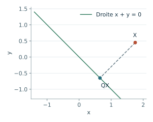
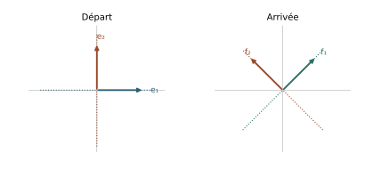
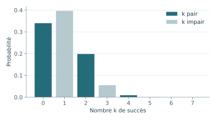
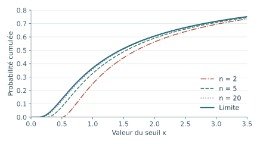
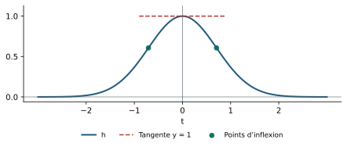
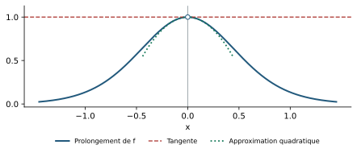

# Banque B/L — Mathématiques 2026 · Corrigé guidé

*Corrigé rédigé par IA, non officiel.*

**Rédaction** · modèle exact non renseigné (famille GPT-6) · effort non renseigné · vitesse non renseignée

**Révision (tour 1)** · GPT-6.2 Astra Ultra · vitesse non renseignée

**Révision (tour 2)** · GPT-6.2 Astra Ultra · vitesse non renseignée

La garde de l’Imprimerie nationale, conservée par l’APML, annonce quatre pages numérotées. Dans le PDF, elles occupent les pages 2 à 5. Les pages 6 et 7 sont blanches et la page 8 porte la mention de l’imprimeur. Le maximum brut annoncé est 66,5. Le tableau des coefficients totalise 64,5 et le rapport mentionne également un bonus ou malus de deux points. [Sujet diffusé par l’APML](https://apml-maths.com/wp-content/uploads/2026/05/Sujet-ecrit-ENS-2026.pdf) · [Rapport du jury](https://www.ens.psl.eu/sites/default/files/2026_bl_rapport_ecrit_mathematiques.pdf).

La composition commune à l’ENS Paris-PSL, l’ENS de Lyon, l’ENS Paris-Saclay, l’ENSAE et l’ENSAI dure quatre heures. La calculatrice est interdite.

Le problème A conduit d’une matrice concrète aux projecteurs orthogonaux. Le problème B compare une somme de Bernoulli à un maximum de variables à queue lourde. Le problème C étudie la moyenne de la fonction gaussienne sur un intervalle dont les deux bornes varient.

## Problème A — Applications linéaires et projecteurs

### Partie I — Des produits matriciels aux projecteurs

### Question 1a

> [!INDICATION]
> Vérifiez la linéarité de chaque coordonnée.

> [!INDICATION]
> Inscrivez en colonnes les images des trois vecteurs canoniques.

#### Solution

Chaque coordonnée est une combinaison linéaire de $x,y,z$. Les images des trois vecteurs de la base canonique forment les colonnes de la matrice
$$A=\frac12\begin{pmatrix}0&-1&1\\0&1&-1\\\sqrt2&1&1\end{pmatrix}.$$

### Question 1b

> [!INDICATION]
> Annulez simultanément les trois coordonnées de l’image.

> [!INDICATION]
> Les deux premières équations donnent la même relation.

#### Solution

L’équation $A(x,y,z)^{\mathsf T}=0$ se réduit à $z=y$ et $\sqrt2 x+2y=0$. Ainsi $\ker A=\operatorname{Vect}((-\sqrt2,1,1))$.

### Question 1c

> [!INDICATION]
> Quels coefficients entrent dans le calcul de la trace ?

> [!INDICATION]
> N’oubliez pas le facteur commun placé devant la matrice.

#### Solution

Additionner les coefficients diagonaux donne $\operatorname{tr}A=0+1/2+1/2=1$.

### Question 1d

> [!INDICATION]
> Reprenez le noyau obtenu en 1b.

> [!INDICATION]
> Quelle valeur propre correspond à un vecteur non nul envoyé sur zéro ?

#### Solution

Le vecteur $(-\sqrt2,1,1)$ de 1b est non nul et son image est nulle. Il est donc vecteur propre pour la valeur propre 0.

### Question 2a

> [!INDICATION]
> Les coefficients s’obtiennent paire par paire sur les colonnes.

> [!INDICATION]
> Servez-vous de la symétrie du produit pour contrôler les calculs.

#### Solution

Les coefficients de $A^{\mathsf T}A$ sont les produits scalaires entre les colonnes de $A$. Par exemple, l’entrée $(2,3)$ est $(-1-1+1)/4$. On obtient
$$P=\frac14\begin{pmatrix}2&\sqrt2&\sqrt2\\\sqrt2&3&-1\\\sqrt2&-1&3\end{pmatrix}.$$

### Question 2b

> [!INDICATION]
> Calculez cette fois les produits entre lignes.

> [!INDICATION]
> La première ligne est l’opposée de la deuxième.

#### Solution

Cette fois on forme les produits scalaires entre les lignes de $A$. Les deux premières sont opposées et la dernière leur est orthogonale. Ainsi
$$Q=\frac12\begin{pmatrix}1&-1&0\\-1&1&0\\0&0&2\end{pmatrix}.$$

### Question 2c

> [!INDICATION]
> Lisez les diagonales des deux produits.

> [!INDICATION]
> La somme des carrés des coefficients de A donne une vérification indépendante.

#### Solution

Par les diagonales des matrices calculées, $\operatorname{tr}P=(2+3+3)/4=2$ et $\operatorname{tr}Q=(1+1+2)/2=2$. Plus généralement ces deux traces valent la somme des carrés de tous les coefficients de $A$.

### Question 3a

> [!INDICATION]
> Évaluez l’effet du premier bloc 2 × 2 sur un vecteur.

> [!INDICATION]
> Une seconde application modifie-t-elle encore le résultat ?

#### Solution

Le premier bloc de $Q$ envoie $(x,y)$ sur $((x-y)/2,(y-x)/2)$, un couple de la forme $(u,-u)$ que ce bloc fixe. Le dernier coefficient laisse $z$ inchangé. Donc $Q^2=Q$, ce qui définit un projecteur. Son image est le plan $x+y=0$.

### Question 3b

> [!INDICATION]
> Écrivez le produit scalaire de PX avec X.

> [!INDICATION]
> Reliez-le au carré d’une norme, puis à 1b.

#### Solution

Si $AX=0$, alors $PX=A^{\mathsf T}AX=0$. Réciproquement, $PX=0$ entraîne $0=X^{\mathsf T}PX=\|AX\|^2$ et donc $AX=0$. Ainsi $\ker P=\ker A=\operatorname{Vect}((-\sqrt2,1,1))$.

### Question 4a

> [!INDICATION]
> Regroupez les facteurs intérieurs en BᵀB.

> [!INDICATION]
> Quel produit se simplifie par idempotence de R ?

#### Solution

Par associativité, $S^2=BRB^{\mathsf T}$ et $S^3=BR^2B^{\mathsf T}$. Or $R^2=R$, donc $S^3=S^2$.

### Question 4b

> [!INDICATION]
> Appliquez la relation de 4a à un vecteur propre.

> [!INDICATION]
> Quel rôle joue l’existence d’une base de vecteurs propres ?

#### Solution

Toute valeur propre réelle $\lambda$ de $S$ vérifie $\lambda^2(\lambda-1)=0$. Dans une base de diagonalisation, qui existe par hypothèse, $S$ est donc représentée par une diagonale de zéros et de uns. Chaque coefficient diagonal vérifie alors $\lambda^2=\lambda$. En revenant à la base canonique, on obtient $S^2=S$.

Concrètement, écrivons $S=VDV^{-1}$. L’identité $S^3=S^2$ entraîne $D^3=D^2$. Comme $D$ est diagonale, les égalités scalaires sur ses coefficients donnent aussitôt $D^2=D$, puis $S^2=S$. Le passage dans une base propre justifie l’abaissement de la puissance même si zéro est valeur propre.

### Question 5a

> [!INDICATION]
> Une inclusion suit aussitôt de la factorisation.

> [!INDICATION]
> Pour l’autre, prenez le produit scalaire avec le vecteur de départ.

#### Solution

$BX=0$ entraîne $RX=0$. Si $RX=0$, alors $\|BX\|^2=X^{\mathsf T}RX=0$ et $BX=0$. D’où $\ker R=\ker B$.

### Question 5b

> [!INDICATION]
> Quelle est la dimension du domaine de chaque application ?

> [!INDICATION]
> Utilisez l’égalité des noyaux et le théorème du rang.

#### Solution

Les deux applications ont même espace de départ, de dimension $k$, et même noyau par 5a. Le théorème du rang donne $\operatorname{rg}R=k-\dim\ker R=k-\dim\ker B=\operatorname{rg}B$.

### Question 5c

> [!INDICATION]
> Relisez 5a en remplaçant B par sa transposée.

> [!INDICATION]
> Comparez le rang d’une matrice avec celui de sa transposée.

#### Solution

Appliquer le résultat de 5a à la matrice $B^{\mathsf T}$ donne $\ker S=\ker B^{\mathsf T}$, donc $\operatorname{rg}S=\operatorname{rg}B^{\mathsf T}=\operatorname{rg}B$. On peut aussi utiliser $\operatorname{tr}S=\operatorname{tr}R$ et l’égalité trace–rang des deux projecteurs.

### Partie II — Projecteurs symétriques

### Question 6

> [!INDICATION]
> Quelle est la dimension du complément orthogonal de l’image ?

> [!INDICATION]
> Construisez-y une base par orthonormalisation.

#### Solution

La famille orthonormée est libre et son espace engendré a dimension $r$. Son orthogonal a dimension $k-r$. En y choisissant une base orthonormée par le procédé de Gram–Schmidt, on obtient les vecteurs $e_{r+1},\ldots,e_k$. La réunion est orthonormée de cardinal $k$ dans $\mathbb R^k$, donc c’est une base. Si $r=k$, il n’y a rien à ajouter.

### Question 7

> [!INDICATION]
> Exprimez les coordonnées des images de chaque vecteur de base.

> [!INDICATION]
> Une application linéaire est déterminée sur une base.

#### Solution

Les coordonnées de $f(e_i)-g(e_i)$ dans la base orthonormée sont les $\langle f(e_i)-g(e_i),e_j\rangle$, toutes nulles. Ainsi $f(e_i)=g(e_i)$ pour chaque $i$, puis $f=g$ par linéarité sur une base.

### Question 8a

> [!INDICATION]
> L’image de quel vecteur est nulle ?

> [!INDICATION]
> Dans les autres cas, utilisez l’orthonormalité des fᵢ.

#### Solution

Pour $i,j\le r$, les images sont $f_i,f_j$, de produit scalaire $\delta_{ij}$. Dès que $i>r$ ou $j>r$, une image est nulle. En résumé le produit vaut 1 si $i=j\le r$ et 0 sinon.

### Question 8b

> [!INDICATION]
> Appliquez le projecteur à un élément de son image.

> [!INDICATION]
> Comment tout point fixe peut-il s’écrire comme une image ?

#### Solution

Si $x=u(y)$ alors $u(x)=u^2(y)=u(y)=x$. Inversement tout point fixe $x=u(x)$ appartient à l’image, comme image de lui-même.

### Question 8c

> [!INDICATION]
> Les premiers vecteurs de base sont fixés.

> [!INDICATION]
> Pour les autres, déplacez l’endomorphisme dans le produit scalaire grâce à la symétrie.

#### Solution

Pour $i\le r$, $u(e_i)=e_i$ par 8b. Pour $i>r$, le vecteur $e_i$ est orthogonal à l’image de $u$. Par symétrie, pour tout $y$, $\langle u(e_i),y\rangle=\langle e_i,u(y)\rangle=0$, donc $u(e_i)=0$. Le produit demandé vaut 1 pour $i=j\le r$ et 0 autrement.

### Question 8d

> [!INDICATION]
> Écrivez le produit scalaire associé à CᵀC.

> [!INDICATION]
> Comparez les coefficients trouvés aux deux questions précédentes.

#### Solution

Pour tous $i,j$ on a $\langle C^{\mathsf T}Ce_i,e_j\rangle=\langle c(e_i),c(e_j)\rangle=\langle u(e_i),e_j\rangle$ par 8a et 8c. D’après 7, les deux endomorphismes sont égaux. Dans la base canonique on conclut $U=C^{\mathsf T}C$.

La construction se lit dans les deux espaces. L’adjoint $c^*$ envoie $f_i$ sur $e_i$ pour $i\le r$ et sur zéro pour $i>r$, puisque $\langle c^*(f_i),e_j\rangle=\langle f_i,c(e_j)\rangle$. Ainsi $c^*c$ fixe l’image de $U$ et annule son orthogonal. De même, $cc^*$ fixe l’image de $W$ et annule son orthogonal. Le premier produit est $U$, et le second est $W$.

## Problème B — Sommes et maxima de variables aléatoires

### Partie I — Lancers indépendants

### Question 9a

> [!INDICATION]
> Le gain ne prend que deux valeurs.

> [!INDICATION]
> Utilisez le paramètre de succès d’un seul lancer.

#### Solution

Notons $p=1/n$ et $q=1-p$. Le premier lancer donne $X_1\sim\mathcal B(p)$, loi de Bernoulli : $\mathbb P(X_1=1)=p$, $\mathbb P(X_1=0)=q$. Son espérance est $p=1/n$, sa variance $pq=(n-1)/n^2$.

### Question 9b

> [!INDICATION]
> Décomposez l’égalité en deux cas incompatibles.

> [!INDICATION]
> Les deux lancers sont indépendants.

#### Solution

Les résultats coïncident s’ils valent tous deux 1 ou tous deux 0. Ces événements sont disjoints. Par indépendance, $\mathbb P(X_1=X_2)=p^2+q^2=(1+(n-1)^2)/n^2$.

### Question 9c

> [!INDICATION]
> Quelles valeurs la puissance prend-elle pour 0 et 1 ?

> [!INDICATION]
> Faites la moyenne avec les deux probabilités de 9a.

#### Solution

$2^{X_1}$ vaut 1 si le lancer donne 0, et 2 s’il donne 1. Par le théorème de transfert, $\mathbb E(2^{X_1})=q+2p=1+1/n$.

### Question 9d

> [!INDICATION]
> Transformez la puissance d’une différence en produit.

> [!INDICATION]
> Peut-on factoriser l’espérance ici ?

#### Solution

Par indépendance, $\mathbb E(2^{X_1-X_2})=\mathbb E(2^{X_1})\mathbb E(2^{-X_2})$. Le second facteur vaut $q+p/2$. Le produit vaut $(1+1/n)(1-1/(2n))=1+(n-1)/(2n^2)$.

### Question 10a

> [!INDICATION]
> S compte des succès indépendants de même probabilité.

> [!INDICATION]
> Conservez la distinction entre une Bernoulli et une binomiale de n essais.

#### Solution

La somme $S$ compte les succès de $n$ essais indépendants de même probabilité $1/n$. Donc $S\sim\mathcal B(n,1/n)$, loi binomiale. Ainsi $\mathbb E S=np=1$ et $\operatorname{Var}(S)=npq=1-1/n$.

### Question 10b

> [!INDICATION]
> Reprenez la définition de la variance.

> [!INDICATION]
> Ajoutez le carré de l’espérance.

#### Solution

Par la formule de la variance, $\mathbb E(S^2)=\operatorname{Var}(S)+(\mathbb ES)^2=2-1/n$.

### Question 11a

> [!INDICATION]
> Il existe plusieurs façons de placer deux succès.

> [!INDICATION]
> Simplifiez le coefficient binomial avec deux facteurs n au dénominateur.

#### Solution

La loi binomiale donne $\mathbb P(S=2)=\binom n2 n^{-2}(1-1/n)^{n-2}=\tfrac12(1-1/n)^{n-1}$. Ce nombre est strictement positif pour tout $n\ge2$.

### Question 11b

> [!INDICATION]
> Sachant qu’il y a exactement deux succès, lesquels des couples de positions sont possibles ?

> [!INDICATION]
> Comptez ceux qui contiennent la première position.

#### Solution

Sachant $S=2$, les $\binom n2$ paires de positions de succès ont toutes la même probabilité, puisque chacune correspond à une suite de poids $p^2q^{n-2}$. Parmi elles, $n-1$ contiennent le premier lancer. Ainsi $\mathbb P(X_1=1\mid S=2)=(n-1)/\binom n2=2/n$.

### Question 12a

> [!INDICATION]
> Dans le produit SX₁, isolez le terme carré.

> [!INDICATION]
> Pour les autres termes, utilisez l’indépendance.

#### Solution

Développer $SX_1=X_1^2+\sum_{k=2}^n X_1X_k$. Comme $X_1^2=X_1$ et que les lancers différents sont indépendants, $\mathbb E(SX_1)=p+(n-1)p^2=(2n-1)/n^2$.

### Question 12b

> [!INDICATION]
> Le numérateur est une covariance.

> [!INDICATION]
> Quel facteur se simplifie avec le produit des écarts-types ?

#### Solution

La covariance vaut $\mathbb E(SX_1)-\mathbb ES\mathbb EX_1=(n-1)/n^2=pq$. Les deux variances sont strictement positives, donc le coefficient vaut $pq/\sqrt{pq\,npq}=1/\sqrt n$. L’association est positive car le premier succès ajoute une unité au total. Sa corrélation avec le total diminue quand la part des autres lancers augmente. Pour chaque $n$ fini, les deux variables sont dépendantes.

### Question 13a

> [!INDICATION]
> Reconnaissez le binôme de Newton dans la définition.

> [!INDICATION]
> Remplacez x par chacun des arguments demandés.

#### Solution

Le binôme de Newton donne $f_n(x)=(q+x/n)^n$. Donc $f_n(1)=1$ et $f_n(-1)=(1-2/n)^n$.

### Question 13b

> [!INDICATION]
> Écrivez une puissance variable comme une exponentielle.

> [!INDICATION]
> Développez son logarithme au premier ordre.

#### Solution

Pour $n>2$, $n\ln(1-2/n)\to-2$ par l’équivalent $\ln(1+u)\sim u$. Par continuité de l’exponentielle, $f_n(-1)\to e^{-2}$.

### Question 13c

> [!INDICATION]
> Quelle valeur prend (−1)ˢ selon la parité de S ?

> [!INDICATION]
> L’addition des deux valeurs de la génératrice élimine les termes impairs.

#### Solution

$f_n(x)=\sum_k\mathbb P(S=k)x^k$. Par conséquent $f_n(-1)=p_n-(1-p_n)$ et $f_n(1)=p_n+(1-p_n)$. En ajoutant, $p_n=(f_n(1)+f_n(-1))/2=(1+(1-2/n)^n)/2$.

### Question 13d

> [!INDICATION]
> Reprenez la formule de 13c.

> [!INDICATION]
> Passez à la limite grâce à 13b.

#### Solution

Par 13b et 13c, $p_n\to(1+e^{-2})/2\simeq0{,}568$.

### Partie II — Maxima normalisés

### Question 14a

> [!INDICATION]
> Vérifiez les deux limites aux infinis.

> [!INDICATION]
> Étudiez aussi la monotonie et le raccord en 1.

#### Solution

La fonction est constante nulle avant 1, continue en 1 et croissante après 1 puisque $1-1/x$ a pour dérivée $1/x^2>0$. Elle est donc croissante et continue à droite sur $\mathbb R$, de limites 0 en $-\infty$ et 1 en $+\infty$. Cela caractérise une fonction de répartition.

### Question 14b

> [!INDICATION]
> Dérivez séparément de chaque côté de 1.

> [!INDICATION]
> La valeur de la densité en un point ne modifie aucune probabilité.

#### Solution

En dérivant sur chaque intervalle, $f_Z(x)=0$ pour $x<1$, $f_Z(x)=1/x^2$ pour $x>1$. Cette densité intègre bien à 1. La valeur en un point est arbitraire.

### Question 14c

> [!INDICATION]
> Intégrez x fois sa densité sur la demi-droite.

> [!INDICATION]
> Quelle est la nature de l’intégrale de 1/x à l’infini ?

#### Solution

$Z\ge1$ presque sûrement. L’intégrale pour son espérance est $\int_1^\infty x\,x^{-2}\,dx=\int_1^\infty dx/x=+\infty$. La variable n’admet pas d’espérance finie. Fixer $f_Z(1)=1$ n’affecte pas ce résultat.

### Question 15

> [!INDICATION]
> Traduisez M₂ < 2 par deux bornes sur les valeurs observées.

> [!INDICATION]
> Écrivez l’intersection au numérateur avant de diviser.

#### Solution

L’événement $M_2<2$ équivaut à $Z_1<4$ et $Z_2<4$. Il est de probabilité $(3/4)^2$ par indépendance et continuité de la loi. L’intersection avec $Z_1<2$ est $\{Z_1<2,Z_2<4\}$, de probabilité $(1/2)(3/4)$. Le quotient vaut $2/3$.

### Question 16a

> [!INDICATION]
> Un maximum est inférieur à un seuil si toutes les observations le sont.

> [!INDICATION]
> Quel seuil correspond au facteur 1/n ?

#### Solution

$M_n\le x$ équivaut à $Z_i\le nx$ pour chaque $i$. Par indépendance sa probabilité vaut $F_Z(nx)^n$, donc $F_{M_n}(x)=0$ si $x<1/n$ et $F_{M_n}(x)=(1-1/(nx))^n$ si $x\ge1/n$.

### Question 16b

> [!INDICATION]
> Comparez le maximum à sa première composante.

> [!INDICATION]
> Conservez la division par n dans l’inégalité pour Mₙ.

#### Solution

On a $M_n\ge Z_1/n$ presque sûrement. Pour chaque entier $n\ge2$, $\mathbb E(Z_1/n)=+\infty$, donc $M_n$ n’a d’espérance finie pour aucun de ces $n$.

### Question 16c

> [!INDICATION]
> Fixez d’abord x, puis laissez n croître.

> [!INDICATION]
> Pour x strictement positif, utilisez un équivalent de logarithme en zéro.

#### Solution

Pour $x\le0$, $F_{M_n}(x)=0$ pour tout $n$. Pour $x>0$, la seconde branche s’applique à partir d’un certain rang. Comme $n\ln(1-1/(nx))\to-1/x$, la limite vaut $F(x)=e^{-1/x}$. Ainsi $F$ est nulle sur $]-\infty,0]$ et donnée par cette exponentielle sur $]0,+\infty[$.

### Question 16d

> [!INDICATION]
> Une limite de fonctions de répartition peut perdre de la masse à l’infini.

> [!INDICATION]
> Vérifiez ici les limites aux deux infinis et le raccord en zéro.

#### Solution

La fonction limite est croissante sur chaque intervalle et continue en zéro puisque $e^{-1/x}\to0$ quand $x\downarrow0$. Ses limites en $-\infty$ et en $+\infty$ sont respectivement 0 et 1. C’est donc une fonction de répartition. Ici, ces propriétés ont été vérifiées directement sur la limite.

La densité de la limite fournit un contrôle supplémentaire. Sur $x>0$, elle vaut $x^{-2}e^{-1/x}$ et elle est nulle sur $x<0$. En posant $t=1/x$, son intégrale sur la demi-droite positive devient $\int_0^\infty e^{-t}\,dt=1$. Comme $F(0)=F(0^-)=0$, aucune masse ponctuelle ne manque à l’origine.

## Problème C — Moyennes de la fonction gaussienne

### Question 17a

> [!INDICATION]
> Que devient l’exposant quand la valeur absolue de la variable grandit ?

> [!INDICATION]
> Utilisez la limite de l’exponentielle en moins l’infini.

#### Solution

La fonction étudiée est $h(t)=e^{-t^2}$. Lorsque $t\to\pm\infty$, $-t^2\to-\infty$, donc $h(t)\to0$ aux deux extrémités. L’axe des abscisses est une asymptote horizontale.

### Question 17b

> [!INDICATION]
> La fonction combine un polynôme et une exponentielle.

> [!INDICATION]
> Appliquez la règle de dérivation d’une composée à ces deux fonctions.

#### Solution

Le polynôme $t\mapsto -t^2$ est dérivable sur $\mathbb R$, et l’exponentielle est dérivable sur $\mathbb R$. Par composition, $h$ est dérivable sur $\mathbb R$ et $h'(t)=-2t e^{-t^2}$.

### Question 17c

> [!INDICATION]
> Utilisez la dérivée trouvée à la question précédente.

> [!INDICATION]
> Le signe de sa dérivée vient entièrement du facteur placé devant l’exponentielle.

#### Solution

Dans la dérivée de 17b, l’exponentielle est strictement positive. Ainsi $h$ croît strictement de zéro à un sur $]-\infty,0]$, puis décroît strictement de un à zéro sur $[0,+\infty[$, les deux valeurs nulles étant des limites. Son unique maximum vaut $h(0)=1$.

$$\begin{array}{c|ccccc}t&-\infty&&0&&+\infty\\ \hline h'(t)&&+&0&-&\\h(t)&0&\nearrow&1&\searrow&0\end{array}$$

### Question 17d

> [!INDICATION]
> Les changements de courbure se détectent à l’aide de la dérivée seconde.

> [!INDICATION]
> Factorisez l’exponentielle et étudiez le signe du facteur quadratique restant.

#### Solution

On a $h''(t)=(4t^2-2)e^{-t^2}$. Ce produit change de signe en $t=-1/\sqrt2$ et $t=1/\sqrt2$. La fonction est convexe sur les deux intervalles extérieurs et concave entre les deux abscisses. Ses deux points d’inflexion ont pour ordonnée $e^{-1/2}$.

### Question 17e

> [!INDICATION]
> Placez d’abord le maximum et les deux points d’inflexion.

> [!INDICATION]
> Pour la tangente en zéro, utilisez à la fois la valeur et la dérivée de la fonction.

#### Solution

La courbe est positive et paire, tend vers zéro aux deux extrémités, culmine en $(0,1)$ et change de courbure aux deux points de 17d. La tangente au maximum a pour équation $y=h(0)+h'(0)t=1$.

### Question 18a

> [!INDICATION]
> Distinguez l’existence de l’intégrale de celle du facteur placé devant.

> [!INDICATION]
> Les bornes peuvent être orientées dans les deux sens.

#### Solution

L’intégrande est continue sur tout intervalle borné d’extrémités $x$ et $2x$, même dans l’ordre décroissant. Le facteur $1/x$ est défini exactement lorsque $x\ne0$. Le domaine est donc $D_f=\mathbb R\setminus\{0\}$.

### Question 18b

> [!INDICATION]
> Ramenez toutes les intégrales à un même intervalle de longueur un.

> [!INDICATION]
> Essayez le changement de variable $t=xu$, y compris quand $x$ est négatif.

#### Solution

Pour $x\ne0$, le changement de variable $t=xu$ donne $\mathrm dt=x\,\mathrm du$, même lorsque $x$ est négatif. Les bornes deviennent un et deux, et
$$f(x)=\int_1^2 e^{-x^2u^2}\,\mathrm du.$$
Cette expression dépend seulement de $x^2$, et le domaine est symétrique. La fonction est donc paire.

### Question 19a

> [!INDICATION]
> Dans l’intervalle fixe de 18b, comparez le carré de la variable d’intégration à ses deux extrêmes.

> [!INDICATION]
> Intégrez les deux bornes constantes sur l’intervalle de longueur un.

#### Solution

Pour $1\leq u\leq2$ et tout $x\ne0$, $e^{-4x^2}\leq e^{-x^2u^2}\leq e^{-x^2}$. L’intégrale sur un intervalle de longueur un conserve ces bornes. Les deux inégalités sont même strictes car l’intégrande est strictement décroissante en $u$.

### Question 19b

> [!INDICATION]
> Regardez les bornes obtenues à la question précédente.

> [!INDICATION]
> Les deux expressions exponentielles ont la même limite en zéro.

#### Solution

Les deux bornes de 19a tendent vers un quand $x\to0^+$. Par encadrement, $f(x)\to1$. Par parité, cette limite est aussi la limite à gauche.

### Question 19c

> [!INDICATION]
> Quelle limite donne la majoration gaussienne à droite ?

> [!INDICATION]
> N’oubliez pas la positivité de la fonction.

#### Solution

Les bornes de 19a tendent toutes deux vers zéro lorsque $x\to+\infty$, d’où $f(x)\to0$.

### Question 19d

> [!INDICATION]
> Traitez séparément le voisinage de zéro et la queue de l’intégrale.

> [!INDICATION]
> Intégrez l’encadrement de 19a en faisant un changement d’échelle dans la gaussienne du bas.

#### Solution

La limite en zéro permet un prolongement continu à cette borne. En $+\infty$, la majoration de 19a par une gaussienne intégrable assure la convergence. L’intégration des deux bornes, avec $v=2x$ pour la borne inférieure et $\int_0^\infty e^{-v^2}\,\mathrm dv=\sqrt\pi/2$, donne
$$\frac{\sqrt\pi}{4}\leq\int_0^\infty f(x)\,\mathrm dx\leq\frac{\sqrt\pi}{2}.$$

Une vérification donne même la valeur entre les deux bornes. D’après 18b l’intégrande est positive. Le théorème de Tonelli autorise donc l’échange des intégrales en $u$ et en $x$. Pour $u\in[1,2]$, le changement de variable $v=ux$ donne $\int_0^\infty e^{-u^2x^2}\,dx=\sqrt\pi/(2u)$. Il en résulte $\int_0^\infty f(x)\,dx=(\sqrt\pi/2)\ln2$, bien comprise entre $\sqrt\pi/4$ et $\sqrt\pi/2$.

### Question 20a

> [!INDICATION]
> Exprimez le produit $xf(x)$ avec une primitive de l’intégrande.

> [!INDICATION]
> Dans la dérivée de la primitive composée, tenez compte du facteur deux.

#### Solution

Soit $H$ une primitive de $h$. Pour $x\ne0$, $xf(x)=H(2x)-H(x)$. Comme $H$ est dérivable, le quotient par $x\ne0$ rend $f$ dérivable sur $D_f$. En dérivant l’identité, $xf'(x)+f(x)=2e^{-4x^2}-e^{-x^2}$.

### Question 20b

> [!INDICATION]
> Isolez le produit $xf'(x)$ et majorez son terme en $-f(x)$.

> [!INDICATION]
> Traitez les réels positifs puis utilisez la parité.

#### Solution

Pour $x>0$, l’identité de 20a et la minoration de 19a donnent $xf'(x)\leq e^{-4x^2}-e^{-x^2}<0$. Par parité, $f'$ est de signe opposé sur la demi-droite négative. Ainsi $f$ croît strictement de zéro à un sur $]-\infty,0[$ et décroît strictement de un à zéro sur $]0,+\infty[$. Le tableau distingue les deux intervalles du domaine. Les valeurs aux extrémités sont des limites.

$$\begin{array}{c|ccc|ccc}x&-\infty&&0^-&0^+&&+\infty\\ \hline f'(x)&&+&&&-&\\ f(x)&0&\nearrow&1&1&\searrow&0\end{array}$$

### Question 21a

> [!INDICATION]
> Quel degré en l’exposant donne un degré six en la variable ?

> [!INDICATION]
> Composez le développement de l’exponentielle avec le carré négatif.

#### Solution

Pour $z\to0$, $e^z=1+z+z^2/2+z^3/6+o(z^3)$. En remplaçant $z$ par $-t^2$, on obtient $e^{-t^2}=1-t^2+t^4/2-t^6/6+o(t^6)$.

### Question 21b

> [!INDICATION]
> Utilisez le même changement de variable qu’en 18b.

> [!INDICATION]
> Majorez uniformément l’erreur sur l’intervalle rétréci autour de zéro.

#### Solution

Pour $x\ne0$, substituer $t=xu$ transforme la quantité à étudier en $\int_1^2u^2\varepsilon(xu)\,\mathrm du$. Sa valeur absolue est au plus $(7/3)\sup_{|v|\leq2|x|}|\varepsilon(v)|$. Ce supremum tend vers zéro par la continuité en zéro et $\varepsilon(0)=0$. Le raisonnement vaut des deux côtés de zéro.

Pour écrire directement la quantification, fixons $\eta>0$. Il existe $\delta>0$ tel que $|\varepsilon(v)|<3\eta/7$ dès que $|v|<\delta$. Si $0<|x|<\delta/2$, cette borne vaut pour tout $v=xu$ avec $1\le u\le2$. Comme $\int_1^2u^2\,du=7/3$, la valeur absolue de l’intégrale transformée est alors inférieure à $\eta$.

### Question 21c

> [!INDICATION]
> Intégrez les deux premiers termes du développement de l’intégrande.

> [!INDICATION]
> La question 21b contrôle précisément le reste après normalisation.

#### Solution

Écrivons $e^{-t^2}=1-t^2+t^2\varepsilon(t)$ avec $\varepsilon(t)\to0$, prolongée par zéro. L’intégration de $1-t^2$ entre $x$ et $2x$, suivie de la division par $x$, donne $1-(7/3)x^2$. En 21b on a précisément montré que le terme restant, après division par $x$, est $o(x^2)$. Ainsi $f(x)=1-\frac73x^2+o(x^2)$.

### Question 21d

> [!INDICATION]
> Distinguez la fonction donnée de son prolongement continu.

> [!INDICATION]
> Le terme quadratique place la courbe. Pour étudier la concavité de sa moyenne, dans quel intervalle faut-il maintenir $ux$ pour tout $u\in[1,2]$ en 17d ?

#### Solution

L’expression donnée exclut zéro. En prolongeant $f$ par $f(0)=1$, son développement donne $f'(0)=0$ et la tangente $y=1$. De part et d’autre, $f(x)-1\sim-(7/3)x^2<0$, donc la courbe est en dessous. Pour voir la concavité du prolongement, prenons $|x|<1/(2\sqrt2)$. Pour chaque $u\in[1,2]$, on a $|ux|<1/\sqrt2$. D’après 17d, $x\mapsto h(ux)$ est concave sur cet intervalle en $x$. L’inégalité de concavité se conserve en intégrant en $u$ de 1 à 2. D’après 18b, le prolongement de $f$ est donc concave de part et d’autre de zéro et n’y a aucun point d’inflexion.

### Question 22a

> [!INDICATION]
> Quelle est la variable de l’équation une fois $x$ fixé ?

> [!INDICATION]
> Étudiez l’image et la monotonie de l’exponentielle en cette variable positive.

#### Solution

Fixons $x>0$. L’application $a\mapsto e^{-(ax)^2}$ est continue, strictement décroissante sur $]0,+\infty[$, de limites un et zéro. Comme $0<f(x)<1$ par 19a, le théorème de la bijection donne une unique solution $\alpha_x>0$. Elle vaut aussi $\sqrt{-\log f(x)}/x$.

### Question 22b

> [!INDICATION]
> Relisez les cas d’égalité dans la moyenne de la question 19a.

> [!INDICATION]
> Passez des valeurs de la fonction aux antécédents en tenant compte du sens de variation.

#### Solution

Les bornes de 19a sont strictes pour $x>0$. On a donc $e^{-(2x)^2}<e^{-(\alpha_x x)^2}<e^{-x^2}$. Par stricte décroissance de la fonction de 22a, $1<\alpha_x<2$.

### Question 23a

> [!INDICATION]
> Remplacez $t$ par $xu$ dans l’intégrale pondérée.

> [!INDICATION]
> Séparez le facteur puissance de l’intégrale en la variable au carré.

#### Solution

Le changement de variable $t=xu$ donne $f_n(x)=x^n\int_1^2u^n e^{-x^2u^2}\,\mathrm du$. L’intégrale est paire, donc $f_n(-x)=(-1)^n f_n(x)$. La fonction est paire si $n$ est pair et impaire si $n$ est impair.

### Question 23b

> [!INDICATION]
> Cherchez une primitive par composition.

> [!INDICATION]
> La dérivée de l’exposant contient précisément le facteur linéaire recherché.

#### Solution

Comme $te^{-t^2}$ a pour primitive $-e^{-t^2}/2$, $f_1(x)=(e^{-x^2}-e^{-4x^2})/(2x)$ pour $x\ne0$.

### Question 23c

> [!INDICATION]
> Isolez un facteur $t$ dans la puissance pour une intégration par parties.

> [!INDICATION]
> Après dérivation de l’autre facteur, reconnaissez la définition pour l’indice diminué de deux.

#### Solution

Intégrons par parties avec $t^n e^{-t^2}=t^{n-1}(te^{-t^2})$. Pour $n\geq2$,
$$f_n(x)=\frac{x^{n-1}e^{-x^2}-(2x)^{n-1}e^{-4x^2}}{2x}+\frac{n-1}{2}f_{n-2}(x).$$
Le signe du premier terme vient de la primitive négative de $te^{-t^2}$. L’expression demeure valable pour les bornes orientées lorsque $x<0$.

## Bilan

En algèbre, le produit d’une matrice par sa transposée transforme un calcul de noyau en un carré de norme. En probabilités, le facteur 1/n porte sur le maximum tout entier ; il intervient dans le seuil de toute fonction de répartition. En analyse, ramener l’intégrale à un intervalle fixe permet de contrôler la monotonie et le développement limité avec les mêmes bornes.
