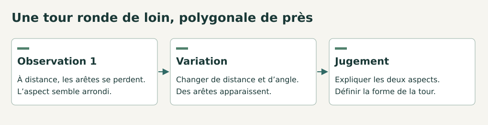
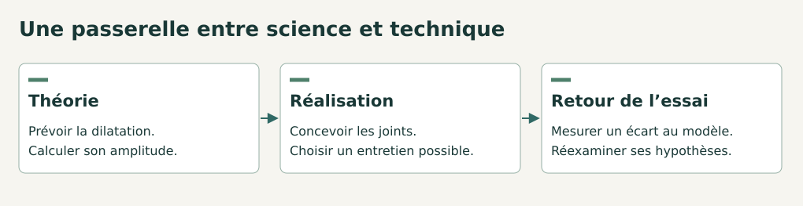
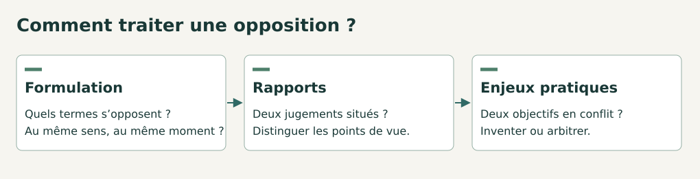

# ENS B/L · Oral de philosophie · 17 juin 2026 · Corrigé guidé

*Corrigé rédigé par IA, non officiel. Signalez toute erreur.*

**Rédaction** · GPT-6.2 Astra Ultra · vitesse non renseignée

**Autocontrôle** · GPT-6.2 Astra Ultra · vitesse non renseignée

**Révision (tour 1)** · GPT-6.2 Astra Ultra · vitesse non renseignée

La feuille du 17 juin réunit 11 tickets de deux sujets. Le candidat dispose de 1 h 30 de préparation et indique au jury son choix au moment du passage. Il présente un seul sujet pendant 20 minutes, puis répond aux questions durant 10 minutes. Les deux possibilités de chaque ticket sont traitées ici. Chaque relance met à l’épreuve une distinction précise. Pour développer oralement les propositions, reprendre l’exemple, en faire varier une condition, puis expliquer comment cette variation modifie la réponse.

## Ticket 1

### Qu’est-ce qu’une crise ?

Une rivière déborde chaque hiver. À partir de quand faut-il parler d’une crise, plutôt que d’un phénomène périodique ? L’intensité du désordre compte, mais elle ne suffit pas. La crue devient une crise pour la commune lorsque les habitudes de circulation, d’assistance ou de décision ne permettent plus de répondre à ce qui arrive. Il faut alors juger et choisir alors même que les repères du jugement deviennent incertains.

Le terme médical éclaire ce rapprochement. La crise désigne un moment décisif dans le cours d’une affection. Elle implique une modification de l’état du malade sans que l’issue favorable soit garantie. De même, une crise de confiance peut se déclarer brusquement tout en révélant une fragilité ancienne. Une suite d’incidents mineurs prend un sens nouveau lorsqu’elle atteint le crédit accordé aux explications et aux promesses. On ne sait plus seulement mal ce qui va arriver ; on ne sait plus à qui se fier pour l’établir.

Il faut enfin examiner celui qui donne ce nom à la situation. Déclarer une crise peut rendre une collectivité attentive à des souffrances auparavant invisibles. Cela peut également habiliter des mesures d’exception et faire négliger les possibilités d’une délibération ordinaire. Un usage rigoureux de la notion doit préciser quel fonctionnement est devenu intenable, pour qui, et sur quels signes on jugera que les moyens ordinaires sont redevenus suffisants. La crise est un changement dans les conditions de l’action autant qu’un bouleversement de ses circonstances.

> [!INDICATION]
> Une crise peut-elle durer plusieurs années ?

Oui, si le désajustement des institutions ou des repères se prolonge. Mais déclarer toute situation durablement critique oblige à expliquer ce qui la distingue encore d’un nouvel ordre, éventuellement injuste.

### L’apparence

De loin, la tour paraît ronde et je découvre en m’approchant qu’elle a plusieurs faces. Faut-il qualifier l’apparence de mensonge ? La tour m’est effectivement apparue ronde à cette distance. L’erreur commence si je conclus trop vite que sa forme doit correspondre, sous tous les points de vue, à ce premier aspect. Une apparence est d’abord la manière dont quelque chose se présente dans des conditions déterminées.

Cette dépendance rend possible sa correction. Le changement de perspective ne donne pas accès à une tour débarrassée de tout aspect sensible. Il permet de comprendre pourquoi un autre aspect se produisait et de rendre compatibles plusieurs observations. Dans le domaine social, cependant, un agent peut produire une apparence à dessein. Un bilan présenté en ne retenant que quelques mois favorables peut être composé de chiffres exacts et suggérer une tendance trompeuse. L’examen porte alors sur le dispositif de présentation autant que sur l’information isolée.

L’apparence joue enfin un rôle constitutif. Un sourire ou un geste d’accueil n’est pas seulement l’enveloppe extérieure d’une intention cachée. Dans certaines relations, c’est par le geste public que l’accueil a lieu. L’opposer systématiquement à une vérité située derrière lui effacerait ce pouvoir de manifestation. Il faut donc demander dans chaque cas si une apparence est l’aspect à expliquer, un indice à recouper ou une mise en scène calculée pour faire croire. La critique des apparences a besoin de leur diversité.

Distinguer les deux phrases « je vois un contour arrondi d’ici » et « la tour est ronde ». Une autre perspective peut conduire à réviser la seconde tout en confirmant les conditions dans lesquelles la première est exacte.

> [!INDICATION]
> Une illusion disparaît-elle dès qu’on la comprend ?

Les deux segments d’une illusion optique peuvent encore sembler inégaux après la mesure. Comprendre modifie le jugement sur ce qu’on voit sans supprimer nécessairement la manière dont on le voit.

## Ticket 2

### La politique est-elle un art ?

Un gouvernement qui sait obtenir l’adhésion de son public peut-il être dit excellent dans l’art politique ? La réponse dépend de ce qu’on lui demande de produire. Le mot art peut désigner une habileté acquise, la capacité d’inventer une forme adaptée à une situation, mais aussi une technique de persuasion dont la réussite se mesure à l’effet obtenu.

Aristote distingue dans le livre VI de l’*Éthique à Nicomaque* la production d’un ouvrage et la prudence dans l’action. Un artisan livre un objet susceptible d’être évalué séparément du geste qui l’a produit. L’action politique engage des citoyens dont la liberté et le jugement font partie du bien recherché. Réussir à imposer une mesure ne suffit donc pas à bien gouverner. Pourtant aucun savoir général ne dispense de saisir une occasion, de concilier des délais ou d’imaginer une institution capable de fonctionner. Si l’on appelle art ce discernement inventif, la politique a bien une dimension d’art.

Reste à savoir qui peut l’exercer. En attribuant tout le talent au chef, on efface l’expérience de ceux qui savent, par exemple, pourquoi une règle d’accès à un service ne fonctionne pas sur le terrain. Une décision peut résulter d’une enquête publique, d’un compromis et d’essais révisables. L’art politique consiste aussi à organiser les conditions dans lesquelles des personnes affectées par une décision peuvent contribuer à cette invention et en discuter les fins. Sa réussite se juge à la qualité de cette puissance commune autant qu’à l’adresse individuelle.

> [!INDICATION]
> Un compromis est-il toujours une prouesse politique ?

Il peut rendre une action légitime possible, mais aussi différer une injustice ou sacrifier des personnes absentes de la négociation. La qualité de l’accord dépend de son contenu et de ceux qu’il autorise à parler.

### L’inquiétude

L’inquiétude précède parfois tout danger identifiable. Après avoir envoyé un travail, je relis mentalement les objections qu’on pourrait me faire. Cette agitation me dispose-t-elle à mieux agir ou me prive-t-elle précisément du repos nécessaire au jugement ? L’inquiétude indique que quelque chose compte pour moi et que son avenir échappe en partie à mon pouvoir.

Son objet est souvent ouvert. La peur d’une chute se rapporte à un événement déterminé ; l’inquiétude de ne plus reconnaître sa propre vie peut persister quand aucun accident précis ne menace. Dans les *Nouveaux Essais*, Leibniz discute, à propos du désir et du terme anglais *uneasiness*, ces sollicitations parfois presque insensibles qui nous mettent en mouvement. Une absence complète d’inquiétude ne serait donc pas nécessairement la perfection : l’intérêt pour ce qui manque, pour autrui et pour la suite de ce que nous avons entrepris peut nourrir l’attention.

Mais l’anticipation tourne en cercle lorsqu’elle imagine indéfiniment des possibles sans modifier ni l’enquête ni l’action. Une personne responsable d’un trajet peut consulter les horaires, annoncer un retard probable, accepter enfin que les événements ne lui appartiennent pas tous. Apaiser l’inquiétude demande ici de distinguer les questions auxquelles une démarche peut répondre et l’incertitude qu’aucune préparation ne supprimera. Il existe aussi des inquiétudes qui exigent un soutien d’autrui. La valeur de l’inquiétude se mesure à la disponibilité qu’elle laisse pour éprouver le réel au lieu de le remplacer par l’enchaînement de nos anticipations.

> [!INDICATION]
> Une confiance raisonnable exclut-elle l’inquiétude ?

On peut faire confiance à quelqu’un tout en s’inquiétant de circonstances qui lui échappent. La confiance peut même permettre de parler de cette inquiétude et de distribuer les responsabilités.

## Ticket 3

### Que peut l’art ?

« Que peut l’art ? » invite à examiner des pouvoirs différents. Un roman peut m’émouvoir sans modifier une loi, et une commande publique peut modifier l’espace d’une ville sans que tous ses habitants en soient émus. Si l’on confond efficacité matérielle et expérience esthétique, on promet à l’art une puissance qu’il n’a pas ou l’on manque ce qu’il accomplit effectivement.

Considérons les souliers usés peints par Van Gogh. Le tableau ne répare pas les chaussures et ne donne pas un accès certain à l’identité de la personne qui les aurait portées. Il transforme pourtant des plis, des lacets, la rencontre d’une semelle avec le sol en objets d’attention prolongée. Des interprétations incompatibles ont d’ailleurs pris appui sur ces toiles. La forme rend possible un travail du regard dont elle n’impose pas univoquement le résultat. Ce pouvoir se retrouve dans le récit lorsque l’ordre des scènes nous fait éprouver une situation du point de vue d’une personne que nous aurions autrement négligée.

Il serait imprudent d’en conclure qu’une œuvre rend nécessairement meilleur. Elle peut flatter un préjugé, rester inaccessible ou recevoir un sens inattendu. Son efficacité sociale dépend de salles, de traductions, de publics et d’usages ; le pouvoir de ces institutions ne se confond pas avec celui de la forme. L’art peut donc produire des objets, redistribuer ce que nous remarquons et rendre certaines expériences partageables. Une de ses puissances propres est d’ouvrir un champ de réponses qu’il ne peut ni garantir ni gouverner entièrement.

> [!INDICATION]
> Une œuvre que personne ne voit a-t-elle un pouvoir ?

Elle peut posséder des possibilités que sa composition rend disponibles pour un futur public. Leur existence doit être distinguée d’un effet actuel sur des spectateurs réels.

### Perdre son âme

On dit d’une personne qu’elle a perdu son âme quand elle a obtenu ce qu’elle souhaitait au prix de ce qui rendait ce succès désirable. La formule concerne-t-elle la disparition d’une substance, la rupture d’une fidélité ou la transformation d’une manière de juger ? Une tradition religieuse peut désigner par là une perte spirituelle attachée au salut. L’expression reste intelligible en un sens moral lorsque les interlocuteurs ne partagent aucune doctrine de l’immortalité.

Une journaliste accepte de supprimer une information décisive pour conserver un poste qui devait lui permettre d’informer. Son acte particulier peut être excusé dans des circonstances difficiles ou corrigé par la suite. Parler de perte de l’âme devient plus précis si elle réorganise durablement ses critères afin de ne plus percevoir le conflit. Dans le *Gorgias*, Socrate soutient que commettre une injustice nuit à celui qui la commet jusque dans l’état de son âme. La réussite extérieure ne répare pas le désordre produit par une conduite injuste. On peut interroger cette idée sans transformer tout compromis en damnation.

L’identité morale ne doit toutefois pas devenir fidélité aveugle à celui qu’on était. Renoncer à une croyance injuste que l’on tenait pour centrale peut être une conquête. On perd donc moins son âme en changeant qu’en perdant la possibilité de répondre de ses raisons, de reconnaître ceux que son action affecte et de reprendre son jugement. Un aveu et une réparation ne font pas disparaître les conséquences du passé, mais ils contestent l’idée que cette perte devrait être irréversible.

> [!INDICATION]
> Peut-on parler de l’âme d’une institution ?

L’usage est analogique. Il vise les pratiques qui donnent un sens à sa mission. Pour être recevable, le jugement doit indiquer concrètement quelle pratique s’est perdue et pour quels usagers.

## Ticket 4

### La technique n’est-elle qu’une application de la science ?

Les constructeurs savent édifier des arches depuis longtemps lorsque la mécanique permet d’en formaliser l’équilibre. Ce décalage suffit à contester l’idée que toute technique commence par une découverte scientifique déjà achevée. Il n’explique pas à lui seul le dispositif contemporain dans lequel le calcul intervient dès la conception. Que reste-t-il à inventer une fois la loi connue ?

Connaître la dilatation des matériaux permet d’anticiper un changement de longueur. Cela ne détermine ni l’emplacement d’un joint, ni le matériau approprié, ni la méthode d’entretien. Le problème de la réalisation introduit des objectifs et des contraintes que la loi générale laisse ouverts. Inversement, une mesure scientifique dépend d’instruments. Le télescope ne donne pas simplement une réponse à une question déjà formée. Il rend observables des phénomènes qui conduisent à reprendre la question. Bachelard désigne par phénoménotechnique la production réglée de phénomènes dans l’expérience savante.

La technique possède donc des savoirs de fabrication, d’essai et de réparation. Cette autonomie relative ne l’autorise pas à ignorer les lois auxquelles le dispositif est soumis. Une erreur de calcul peut condamner l’ouvrage. Elle invite à décrire une circulation entre pratiques : une théorie oriente une invention, un prototype révèle une difficulté, une mesure oblige à refaire le modèle. L’application est l’une des relations possibles entre science et technique. Elle ne rend compte à elle seule ni de leur histoire ni du travail que demande leur rencontre.

> [!INDICATION]
> L’antériorité d’une invention prouve-t-elle que la science l’améliore toujours après coup ?

Elle montre qu’une invention a pu précéder sa théorie. De nouvelles théories peuvent transformer l’objet, en expliquer les limites ou rester sans effet pratique immédiat.

### L’insignifiant

Une virgule oubliée passe inaperçue dans un brouillon et peut changer le sens d’un engagement juridique. L’insignifiant désigne-t-il ce qui ne signifie rien, ce qui compte peu ou ce qu’une certaine activité n’a aucune raison de retenir ? Ces jugements divergent. Un mot de passe, suite de caractères dépourvue de sens pour moi, peut être décisif pour qui en a besoin.

Dans une enquête, on distingue un signal d’un bruit selon la question posée et les conditions d’observation. Le bruit pour un instrument peut devenir le phénomène à étudier lorsqu’on change d’échelle. Cela n’implique pas que chaque poussière possède une importance cachée. Cela oblige à indiquer les raisons pour lesquelles un détail peut être écarté. Une analyse littéraire doit montrer qu’une répétition infléchit la lecture au lieu d’attribuer la même valeur interprétative à toutes les coïncidences.

Il faut aussi entendre la dimension sociale de l’adjectif. Dire qu’un témoignage est insignifiant peut légitimement viser sa faible valeur pour établir un fait précis. Appliquer le mot à la personne qui parle convertit une limite de l’enquête en jugement sur sa valeur. Ce que l’on peut laisser passer a enfin une fonction positive : si tout exigeait une attention égale, aucun geste décidé ne serait possible. L’insignifiant résulte souvent d’une sélection justifiable. Cette sélection doit rester accessible à la révision lorsque la question ou les conséquences changent.

> [!INDICATION]
> L’attention du poète suffit-elle à donner un sens à un détail ?

Elle peut en faire un motif au sein d’une œuvre. Ce sens construit ne prouve pas que le détail était déjà, dans son contexte premier, le signe d’un événement particulier.

## Ticket 5

### Y a-t-il des questions sans réponse ?

« Que faisait cette personne hier à midi ? » peut rester sans réponse faute de traces. « Quelle est la dernière décimale de un tiers écrit en base dix ? » n’attend pas le même type de découverte. La première question porte sur un événement dont la connaissance nous échappe. La seconde demande un dernier chiffre à une écriture qui n’en a pas. Comment dire dans chaque cas ce qui fait défaut ?

Une réponse peut manquer aujourd’hui, ou être inaccessible en principe à partir de certains moyens. Si deux explications rendent compte de toutes les traces conservées et qu’aucun autre témoignage n’est disponible, l’enquête historique peut établir une limite de sa preuve sans transformer les deux récits en vérités équivalentes. Il faut encore distinguer les questions mal posées. Expliquer pourquoi la notion de dernière décimale ne convient pas apporte une réponse à l’interrogation, sans donner le chiffre demandé.

Les interrogations pratiques ouvrent une troisième difficulté. À la question « Que ferons-nous de cette place ? », aucune observation n’apporte à elle seule la décision collective. Faut-il y installer un jardin ou un marché ? Arguments, valeurs et procédure peuvent conduire à arrêter une réponse qui n’attendait pas toute faite. Certaines questions restent ouvertes, certaines rendent impossible la forme de réponse qu’elles réclament, d’autres appellent la construction d’une décision. Leur examen progresse par la justification de ces limites aussi bien que par la découverte d’une solution.

> [!INDICATION]
> Suffit-il de choisir une réponse pour résoudre une question de fait ?

Une convention peut fixer le nom ou la règle d’une pratique. Elle ne décide pas à elle seule qu’un événement passé s’est effectivement déroulé ainsi.

### Le fatalisme

À la veille d’un examen, on m’assure que le résultat est écrit d’avance et que rien de ce que je ferai n’y changera quoi que ce soit. Le fatalisme transforme une affirmation sur l’avenir en affirmation sur l’inefficacité de ma conduite. Est-ce la même chose que penser que tout événement dépend de causes ?

Dans une explication déterministe, mon travail, mon sommeil et la difficulté de l’épreuve peuvent faire partie des causes du résultat. Soutenir qu’un événement se produira indépendamment de mes démarches pose une thèse différente. Les stoïciens connaissaient l’« argument paresseux » : s’il est fixé que je guérirai ou que je ne guérirai pas, à quoi bon appeler le médecin ? Chrysippe répond, selon le témoignage de Cicéron dans le *Traité du destin*, que l’intervention du médecin et la guérison peuvent être liées dans le même enchaînement. L’action retrouve son statut de condition au sein d’un ordre causal.

Il existe néanmoins des événements sur lesquels ma volonté n’a aucune prise, comme le fait que le passé ait eu lieu. En prendre acte peut libérer une attention pour ce qui dépend encore de ma conduite : reconnaître un tort, agir sur ses suites ou témoigner de ce qui s’est produit. Le fatalisme devient une faute de raisonnement lorsqu’il étend l’irréversibilité de certaines données à toute relation entre choix et conséquence. Une réflexion sur les limites de notre pouvoir établit, cas par cas, quelles démarches peuvent encore faire une différence.

> [!INDICATION]
> L’incertitude prouve-t-elle que nous sommes libres ?

Ignorer une cause ne démontre pas que l’événement soit sans cause. L’argument contre le fatalisme montre ici que notre action peut produire un effet. Il ne tranche pas seul la question de la liberté.

## Ticket 6

### Le bonheur est-il une fin politique ?

Une ville peut ouvrir des parcs, loger ses habitants et assurer l’accès aux soins. Peut-elle promettre que chacun y sera heureux ? Le bonheur désigne tantôt un sentiment, tantôt la réussite d’une vie jugée dans son ensemble. Demander s’il constitue une fin politique exige de préciser à quels biens l’action commune a accès et à qui il revient de dire ce qu’est une vie réussie.

Aristote soutient dans la *Politique* que la cité, née en vue de la vie, existe en vue de la vie bonne. La communauté ne se réduit ni à un marché ni à un pacte de sécurité. Des institutions peuvent rendre possibles l’éducation, l’amitié civique et les conditions matérielles d’une existence digne. Pourtant les citoyens ne partagent ni les mêmes croyances ni les mêmes projets. Une autorité qui imposerait une pratique au motif qu’elle rend heureux ceux qui s’y livrent pourrait ôter à d’autres la possibilité de conduire leur vie.

Une politique peut garantir des libertés, limiter la misère, ouvrir des possibilités réelles et interroger les personnes sur les effets des décisions. Un indicateur de satisfaction peut révéler un problème sans fixer seul ce qui est juste. Le bonheur peut orienter la politique comme souci des conditions dans lesquelles chacun peut poursuivre une vie qu’il estime. Il ne devient pas pour autant un résultat individuel que l’État pourrait produire et distribuer directement.

> [!INDICATION]
> Suffirait-il de choisir la mesure qui rend heureuse la majorité ?

Le gain moyen peut masquer la privation grave d’une minorité. L’accès aux droits et la répartition des effets doivent être examinés avant de conclure à partir de la satisfaction majoritaire.

### L’embarras du choix

Un étudiant admis dans trois formations a davantage de possibilités qu’un candidat sans admission. Pourtant son embarras est réel. Aucun classement ne lui dit comment comparer la proximité de sa famille, l’intérêt des enseignements et le coût d’une année. L’abondance suffit-elle à expliquer cet embarras, ou est-ce la structure de la décision qui le produit ?

Le choix se simplifie quand un critère commun ordonne les options et que l’information est disponible. Pour deux billets identiques, le prix peut suffire. Quand les valeurs sont hétérogènes, ajouter des renseignements permet d’éviter une erreur sans fournir une unité commune. L’étudiant découvre qu’une formation dispense un cours décisif. Il lui reste à décider quelle place donner à cet intérêt dans sa vie. Sa préférence se forme en partie dans la délibération. Il ne retrouve pas seulement une préférence déjà arrêtée.

L’embarras tient enfin à ce qu’opter ferme d’autres perspectives. Anticiper les regrets peut paralyser celui qui demande à l’option gagnante de posséder tous les avantages des autres. Une décision raisonnable peut reconnaître une perte, fixer un délai proportionné à l’enjeu et prévoir ce qui pourrait être réévalué. Le choix est alors une liberté exigeante. Il devient un fardeau injustement distribué si l’on renvoie à l’individu la responsabilité d’arbitrer entre des options auxquelles le manque d’argent ou d’information lui interdit en réalité l’accès.

> [!INDICATION]
> Tirer au sort est-il toujours une démission ?

Entre des options suffisamment bonnes et impossibles à départager selon des raisons pertinentes, un tirage peut clore honnêtement la décision. Il devient défaillant s’il évite d’examiner une différence décisive pour quelqu’un.

## Ticket 7

### Est-on responsable de son passé ?

Une personne découvre à l’âge adulte une faute qu’elle a commise adolescente. L’auteur d’alors et celui à qui l’on demande aujourd’hui d’en répondre sont-ils suffisamment le même ? Le passé ne se présente pas tout entier comme une œuvre dont je serais l’auteur. Il comprend une naissance, des institutions et des circonstances que je n’ai pas choisies.

Quand il s’agit d’un acte, on doit déterminer de quelle liberté et de quelle connaissance disposait l’agent au moment de l’action. Une erreur peut être compréhensible avec les renseignements de l’époque ou révéler une négligence déjà évitable. Lui reprocher de n’avoir pas prévu ce que l’on sait aujourd’hui reviendrait parfois à changer rétroactivement les règles du jugement. Pourtant, ne plus partager le point de vue qu’on avait hier n’annule pas un engagement signé ou une souffrance infligée. Le bénéficiaire de ma promesse et la victime de mon geste ont eux aussi un passé qui continue à produire des effets.

L’expression « être responsable de son passé » reçoit alors un second sens. Il arrive qu’on doive répondre à une situation héritée sans être coupable de l’avoir créée. Une institution qui découvre une pratique discriminatoire ancienne peut ouvrir ses archives et réparer certains effets actuels, y compris lorsque ses dirigeants n’y ont pas personnellement participé. Tenir ensemble l’imputation d’un acte et la responsabilité présente de ses suites permet d’éviter à la fois la culpabilité indifférenciée et l’effacement du devoir de réparation.

> [!INDICATION]
> Oublier une faute suffit-il à éteindre toute responsabilité ?

L’oubli peut modifier ce que l’agent peut expliquer et doit rendre prudente l’attribution des intentions. Il n’efface pas à lui seul les traces, les engagements ni les droits des personnes affectées.

### Le comédien

Dans une représentation d’*Othello*, l’acteur laisse voir une jalousie qui bouleverse la salle. À la dernière scène, il peut relever sa partenaire et saluer sans éprouver envers elle la passion qu’il vient de jouer. Faut-il alors dire que le comédien trompe ou que son métier consiste à faire paraître vrai ce dont tout le monde sait le caractère joué ?

Le cadre théâtral établit une convention qui distingue le jeu de la fraude. Le spectateur sait qu’il est au théâtre et peut pourtant éprouver une véritable émotion. Le comédien doit rendre lisibles une succession d’actions et une relation avec les partenaires. Il adapte son rythme à une réplique, stabilise une articulation et reprend la scène le lendemain. Dans le *Paradoxe sur le comédien*, Diderot interroge l’idée qu’il suffirait de sentir intensément pour bien jouer. Le contrôle nécessaire à la répétition et à la construction d’un grand modèle explique l’importance du jugement dans l’expression.

Cette réflexion ne commande pas que l’acteur reste insensible à tout instant. Un geste imprévu d’un partenaire peut transformer l’écoute et produire une inflexion juste. Son art tient à sa capacité de mettre ce qui lui arrive au service de la forme commune, sans laisser son émotion privée rendre la scène inintelligible. Le comédien accomplit ainsi une action réelle de parole et de présence par laquelle une action fictive devient partageable. La valeur de son jeu se mesure à l’expérience qu’il rend possible, autant qu’à sa fidélité à un texte.

> [!INDICATION]
> Faut-il vivre personnellement toutes les situations que l’on joue ?

L’expérience peut fournir des ressources, mais l’observation, la composition et la convention permettent de représenter d’autres vies. Assimiler le rôle à la biographie supprimerait une dimension décisive de la représentation.

## Ticket 8

### Les œuvres d’art sont-elles éternelles ?

Une cathédrale subit l’érosion et une chanson ancienne se chante encore après la disparition de tous ceux qui l’ont entendue pour la première fois. Dans quel sens ces œuvres pourraient-elles être éternelles ? Il faut distinguer la durée matérielle, la possibilité de répétition et la prétention à une valeur qui dépasse les goûts d’une époque.

Un manuscrit est périssable. Une copie peut cependant transmettre le texte lorsque l’encre originale s’efface. Une partition réclame même des exécutions multiples, séparées dans le temps et différentes par les instruments et l’interprétation. Cette pluralité ne rend pas l’œuvre indestructible. Si toutes les traces et tous les usages disparaissent, elle peut devenir inaccessible. Sa continuité dépend donc d’actes datés : préserver, recopier, restaurer, traduire, parfois contester une restauration qui efface une particularité.

On parle également d’éternité quand une œuvre très ancienne s’adresse encore à nous. La tragédie d’Antigone ouvre des questions qui peuvent être reprises dans d’autres conditions politiques et familiales. Cela n’implique pas que l’Athènes du cinquième siècle et le public actuel interprètent chaque parole de la même manière. La pérennité peut tenir à la capacité d’une forme à supporter de nouveaux usages sans se dissoudre en eux. Affirmer l’éternité littérale de l’œuvre dépasse donc ce qu’atteste son histoire. Sa puissance de durer est réelle et d’autant plus remarquable qu’elle a besoin de pratiques humaines exposées à l’oubli.

> [!INDICATION]
> Une restauration radicale conserve-t-elle la même œuvre ?

Il faut préciser ce qui porte son identité dans le cas considéré : matériau original, forme, fonction, histoire des transformations. Le jugement doit expliquer quelles continuités et quelles pertes le traitement produit.

### La police

La police peut désigner une institution, une fonction de maintien de l’ordre ou, dans l’expression « police d’une assemblée », le réglage d’un espace commun. À quelles conditions cette organisation de la coexistence protège-t-elle la liberté de chacun ? Constater qu’un ordre existe ne répond pas à la question de sa justice.

Une règle qui garantit à chacun l’accès à une bibliothèque reste fragile si aucune autorité ne peut faire cesser une exclusion arbitraire. L’intervention publique a donc pour raison possible la protection de droits que les individus ne peuvent toujours faire respecter seuls. Mais ceux qui reçoivent des pouvoirs de contrainte acquièrent précisément la capacité d’altérer ces mêmes libertés. Il faut distinguer autorisation juridique, nécessité concrète, proportionnalité et possibilité de recours. Une procédure correctement suivie ne justifie pas automatiquement une règle injuste. Un objectif légitime ne justifie pas n’importe quelle intervention.

Au sens que Jacques Rancière donne au mot dans *La Mésentente*, la « police » désigne plus largement une distribution des places, des fonctions et de ceux dont la parole est audible. Ce déplacement conceptuel aide à poser une autre question : comment une société détermine-t-elle d’avance qui est réputé perturber l’ordre et qui est en mesure de le définir ? Ce sens ne doit pas être confondu avec l’institution particulière. Ensemble, les deux analyses expliquent pourquoi l’ordre public demande à la fois des institutions capables d’agir et des voies pour contester la manière dont elles définissent et appliquent leurs catégories.

> [!INDICATION]
> La tranquillité est-elle toujours un indice de liberté ?

Elle peut résulter d’une coexistence sûre ou du silence imposé à certaines personnes. Il faut aussi rechercher qui a pu parler, contester et faire valoir un droit.

## Ticket 9

### Peut-on concilier les contraires ?

Dire d’une même règle qu’elle est obligatoire et facultative pour la même personne dans les mêmes circonstances paraît contradictoire. Pourtant une pièce peut être chaude pour celui qui entre du dehors et fraîche pour celle qui arrive d’une serre. A-t-on concilié deux affirmations contraires, ou a-t-on découvert que leur opposition tenait à une précision manquante ?

Il faut commencer par distinguer la contradiction et la contrariété. Deux propositions contradictoires ne peuvent être toutes deux vraies au même sens et en même temps. Deux qualités contraires peuvent admettre un état intermédiaire. Le tiède n’est ni le chaud extrême ni le froid extrême. Dans l’exemple de la pièce, expliciter le rapport à des corps différemment habitués permet de maintenir les deux expériences sans attribuer au même objet deux mesures incompatibles. Il ne s’agit pas d’abandonner la cohérence, mais de déterminer à quelles conditions chaque affirmation est vraie.

Dans la vie pratique, des fins peuvent entrer en conflit sans se contredire logiquement. Une bibliothèque veut prolonger ses horaires et préserver les conditions de travail des employés. De nouveaux effectifs ou une réorganisation permettent parfois de satisfaire les deux fins ; en l’absence de moyens, le compromis suppose une perte qu’il faut reconnaître. Concilier n’est donc pas une vertu inconditionnelle. On concilie légitimement en retrouvant des différences de niveau, de temps ou de moyens. Une conciliation qui dissimule une incompatibilité réelle rendrait le jugement moins exact.

> [!INDICATION]
> Une moyenne concilie-t-elle deux témoignages contradictoires ?

Elle peut estimer une grandeur mesurée avec des erreurs indépendantes. Elle ne tranche pas un conflit sur la nature de l’événement sans examen des observations et de leur fiabilité.

### Imaginer

J’imagine une table à six pieds. Je puis en faire varier le nombre sans modifier aucun meuble autour de moi. Imaginer, est-ce uniquement reproduire une perception affaiblie ? Cette conception ne rend pas compte de l’invention ni de la possibilité de viser ce qui est absent, irréalisé ou même matériellement impossible.

Dans *L’Imaginaire*, Sartre distingue la conscience qui perçoit et celle qui vise son objet en image. Devant une table présente, je peux découvrir une nouvelle rayure en tournant autour. En imaginant une table, je ne dispose pas de la même réserve d’informations à observer. Je peux préciser l’image par un nouvel acte ou mobiliser une connaissance oubliée. L’objet imaginé est donné selon un mode différent, ce que masque l’idée qu’une image serait une petite chose enfermée dans la tête. Imaginer ne suppose d’ailleurs pas toujours de produire une image visuelle vivement colorée.

L’imagination intervient dans le jugement pratique. Avant de transformer une place, on essaie de se représenter le trajet d’un enfant, celui d’une personne chargée ou celui d’un usager du bus. Cette variation ouvre des possibilités d’enquête. Elle ne remplace pas le témoignage des personnes concernées ni la vérification des mesures. On risque sinon de projeter nos propres habitudes sous le nom d’autrui. Imaginer est donc une liberté de variation et d’anticipation qui gagne en justesse lorsqu’elle sait comment confronter ce qu’elle propose à ce qui lui résiste.

> [!INDICATION]
> L’impossible peut-il être imaginé ?

On peut raconter une situation physiquement impossible. Face à une contradiction logique, comme un carré circulaire au même sens, on peut juxtaposer les mots, sans avoir pour autant construit un objet cohérent répondant aux deux exigences.

## Ticket 10

### Que faire de nos passions ?

Une colère peut révéler une injustice et me faire accuser la mauvaise personne. Que faire de cette passion ? La supprimer d’emblée ferait perdre l’attention qu’elle porte à une offense. Lui confier la décision ferait du sentiment de certitude une preuve. La question vise la manière de transformer notre rapport à une force dont nous ne choisissons pas toujours l’apparition.

Descartes distingue dans *Les Passions de l’âme* l’utilité des passions et les erreurs qui peuvent venir de leur excès ou de leur mauvais usage. Une émotion mobilise le corps et fixe l’attention sur ce qui apparaît bon ou mauvais. Une volonté qui lui commande simplement de disparaître se heurte à sa persistance. En revanche une autre représentation, une habitude acquise ou une action différée peuvent modifier ses effets. Si j’ai reçu un message que je trouve injurieux, le relire dans son contexte et demander ce qui a été voulu introduit un contrôle sans nier l’émotion.

Il faut également examiner les situations qui produisent régulièrement ces passions. Une organisation qui entretient la crainte de perdre sa place change peu si chacun s’efforce seul d’être calme. Des règles de recours et un droit de réponse transforment les conditions de l’inquiétude. Nous pouvons donc accueillir la passion comme un indice de ce qui nous touche, vérifier ce qu’elle nous fait croire et organiser les circonstances de l’action. Une passion cesse de décider seule lorsqu’elle peut entrer dans le travail du jugement et dans une discussion avec d’autres.

> [!INDICATION]
> Pourquoi ne pas conserver une colère quand elle est juste ?

On peut en garder la force pour soutenir une demande de justice. Il reste à examiner la personne visée, la preuve du tort et l’effet de la réponse sur ceux qui sont concernés.

### Le besoin de philosophie

Le voyageur qui manque son train a besoin d’un nouvel horaire. A-t-il besoin de philosophie ? Une réponse trop rapide ferait de toute question une question philosophique. Pourtant, si les horaires disponibles supposent la maîtrise d’un outil inaccessible à certains usagers, il peut devenir nécessaire de demander ce qu’un service commun doit à chacun. Le besoin apparaît lorsque nos manières ordinaires de juger laissent échapper une difficulté sur leurs propres critères.

Aristote rapproche l’origine de la philosophie de l’étonnement au premier livre de la *Métaphysique*. Celui qui s’étonne sait déjà quelque chose : il reconnaît qu’une explication qu’il croyait suffisante lui manque. Ce désir de comprendre peut excéder toute urgence immédiate. En un autre sens, le besoin de philosophie se fait sentir au moment où plusieurs raisons d’agir se concurrencent, sans qu’une expertise particulière puisse les hiérarchiser. Les chiffres d’accès au service ne suffisent pas à dire quelle inégalité est acceptable.

Un tel besoin est-il universel ? Toutes les personnes rencontrent la difficulté de juger sans avoir consacré leur vie à une discipline. Nommer cette capacité commune ne rend pas superflus les textes, les objections précises ni l’apprentissage d’une argumentation. Inversement la philosophie peut perdre de vue le problème si elle se borne à reconnaître une référence consacrée. Son besoin se vérifie dans une pratique qui rend explicites les présupposés d’une question et permet de les contester, y compris lorsque la réponse la plus honnête consiste à reconnaître qu’une autre enquête est nécessaire.

> [!INDICATION]
> La philosophie est-elle utile si elle ne résout pas le problème matériel ?

Elle peut déterminer ce qu’il serait pertinent de résoudre et selon quels critères évaluer une solution. La réparation proprement dite exige encore des ressources et des connaissances techniques.

## Ticket 11

### Le mépris peut-il être justifié ?

Puis-je mépriser un mensonge ? Et puis-je mépriser la personne qui a menti ? Dans le premier cas, je juge une conduite indigne d’approbation. Dans le second, je risque de retirer à quelqu’un la considération qui lui est due comme personne. Le passage de l’un à l’autre est d’autant plus facile que le mépris est une manière de se situer au-dessus d’autrui.

L’indignation peut prendre un acte au sérieux au point d’en demander la sanction ou la réparation. Le mépris tend à traiter son objet comme trop bas pour mériter une réponse. Cette différence a des effets pratiques. Répondre à une parole mensongère en apportant une preuve offre encore à son auteur la possibilité de la retirer. Déclarer que rien de ce qu’il dira ne vaut d’être entendu ferme cette possibilité, y compris lorsqu’il s’agit de reconnaître un tort. Kant distingue dans la *Doctrine de la vertu* le jugement défavorable sur les vices et le respect dû à l’humanité en chaque personne. Cette exigence ne contraint personne à estimer également tous les caractères.

Il peut être juste de refuser toute complaisance envers certains actes et toute autorité à une parole qui a perdu son crédit. Le choix de la distance peut même protéger ceux qui en ont souffert. Mais si l’attitude suppose qu’une personne a définitivement moins de valeur en tant que personne, sa justification devient intenable. Le mépris traduit parfois une perception morale pertinente sur l’acte. Il faut encore demander si l’indignation, la sanction ou le refus de confiance n’expriment pas mieux ce jugement sans transformer la hiérarchie des conduites en hiérarchie des êtres.

> [!INDICATION]
> Faut-il accorder la même confiance à tous par respect ?

Respecter une personne demande de reconnaître ses droits et de pouvoir justifier nos jugements. La confiance porte sur une relation et sur des preuves de fiabilité qui peuvent varier.

### Rêver

En rêve, je cherche une maison dont chaque porte donne sur la même pièce. Tant que je dors, cette situation peut m’affecter avec la force d’un événement réel. À l’éveil, j’y reconnais un rêve. Le verbe « rêver » désigne pourtant aussi l’activité éveillée de celui qui imagine une autre vie. Qu’y a-t-il de commun entre une expérience que je subis et une projection à laquelle je contribue ?

Le rêve suspend certaines contraintes ordinaires de la perception et de l’action. Un lieu peut changer sans trajet, une personne connue recevoir un autre visage. Dans la première *Méditation*, Descartes s’appuie sur le fait d’avoir déjà cru, en rêve, accomplir une action familière telle que se tenir près du feu. Le doute porte sur la certitude que peut donner cette expérience isolée. Il ne conclut pas que toutes les expériences vécues sont identiques. L’enchaînement de la vie éveillée, les vérifications possibles et le témoignage d’autrui changent nos raisons de croire.

Dans la rêverie éveillée, la variation des situations permet de désirer ou de découvrir ce qu’on n’osait pas encore concevoir. Elle peut aussi devenir un substitut à l’action. Imaginer une réconciliation ne dispense pas d’entendre la personne avec laquelle il faudrait renouer. Rêver désigne ainsi diverses façons dont nous faisons l’expérience d’un possible avec une présence sensible et affective. Son intérêt pour la pensée tient à la fois à cette puissance de présentation et à la nécessité d’en distinguer l’évidence vécue de la vérité établie.

> [!INDICATION]
> Un rêve peut-il nous apprendre quelque chose si les événements qu’il montre sont fictifs ?

Le souvenir d’un rêve peut faire remarquer la persistance d’un souci et susciter une enquête. Une interprétation personnelle ne constitue pas à elle seule une preuve de la réalité de l’événement rêvé.

[Feuille officielle du 17 juin](https://www.ens.psl.eu/sites/default/files/sujet_oraux_bl_17_juin.pdf) · [Rapport du jury, conditions de passage et liste des sujets](https://www.ens.psl.eu/sites/default/files/2026_bl_rapport_oral_tronc_commun_philosophie.pdf)
