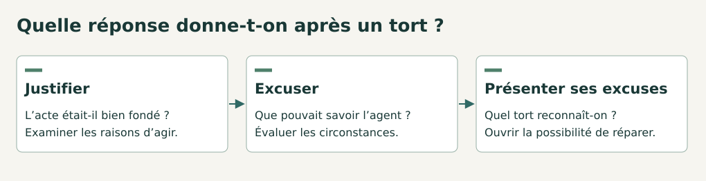

# ENS B/L · Oral de philosophie · 18 juin 2026 · Corrigé brut

*Corrigé rédigé par IA, non officiel. Signalez toute erreur.*

**Rédaction** · GPT-6.2 Astra Ultra · vitesse non renseignée

**Autocontrôle** · GPT-6.2 Astra Ultra · vitesse non renseignée

**Révision (tour 1)** · GPT-6.2 Astra Ultra · vitesse non renseignée

La feuille du 18 juin réunit 12 tickets de deux sujets. Le candidat dispose de 1 h 30 de préparation et indique au jury son choix au moment du passage. Il présente un seul sujet pendant 20 minutes, puis répond aux questions durant 10 minutes. Les deux possibilités de chaque ticket sont traitées ici.

## Ticket 1

### L’État doit-il être fort ?

Un État échoue à secourir les victimes d’une inondation faute d’agents, de moyens et de services capables de coopérer. On comprend le souhait qu’il devienne plus fort. Mais le même adjectif peut qualifier le pouvoir qui réduit au silence les citoyens. Il faut distinguer la capacité effective d’accomplir des tâches communes et la concentration d’un pouvoir dispensé de rendre compte.

Hobbes, dans le *Léviathan*, demande ce qui peut garantir les conventions si chacun demeure seul juge de leur exécution. Un pouvoir commun doit disposer de moyens suffisants pour rendre crédible la protection promise. Cette exigence ne fixe cependant pas à elle seule les limites de sa compétence. Une institution qui peut connaître et empêcher toute conduite privée risque de détruire la sécurité qu’elle prétend assurer. L’arbitraire fait craindre le protecteur lui-même.

Il ne s’ensuit pas que des pouvoirs divisés soient toujours faibles. Une justice indépendante rend un recours crédible, une administration compétente permet de tenir une promesse et un débat public peut révéler une erreur à temps. L’État doit être assez fort pour garantir effectivement les droits et la continuité d’une vie commune. Il faut ensuite demander en quoi consiste cette force, à quelles fins elle est affectée et quels contrôles lui permettent de durer sans devenir domination. La force politique se juge aussi à la possibilité pour le citoyen le moins puissant de faire valoir son droit contre l’État.

### Le talent

Au premier exercice de dessin, une élève saisit rapidement les proportions d’un visage. On lui attribue du talent. Ce mot décrit-il une réussite présente, une capacité d’en produire d’autres ou l’origine supposée naturelle de cette aisance ? Passer de la première observation à la troisième exige plus que l’étonnement du professeur.

Une disposition se reconnaît à une certaine régularité et à la capacité de varier l’exercice. Copier fidèlement un croquis connu n’est pas encore savoir rendre un visage de profil. Mais la facilité présente peut elle-même devoir beaucoup à des années de pratique informelle, à des outils disponibles et à un entourage attentif. L’appeler spontanée parce qu’on n’en connaît pas l’histoire prend notre ignorance pour une preuve. L’existence de différences dans les aptitudes n’autorise pas davantage à les traiter comme des limites définitives.

Le talent reçoit enfin une valeur dans une pratique collective. L’oreille d’une musicienne peut être appréciée comme justesse dans un cadre et comme capacité d’improviser dans un autre. Cette dépendance à des critères ne rend pas toute appréciation arbitraire : on peut montrer ce qui a été entendu, produit ou transformé. Attribuer un talent est donc une hypothèse sur un pouvoir de faire. Elle est féconde lorsqu’elle ouvre un apprentissage et reste révisable. Elle devient trompeuse lorsqu’elle transforme un verdict scolaire précoce en titre de mérite absolu ou en raison d’écarter les autres.

## Ticket 2

### Faut-il défendre la démocratie ?

Dans une démocratie, une majorité pourrait être tentée de rendre impossible la future victoire de ses adversaires. Respecter son vote suffit-il à défendre la démocratie ? Le problème naît de l’écart entre une décision particulière et les conditions qui permettent à cette décision d’être discutée et révisée par des citoyens égaux.

La démocratie a besoin d’élections régulières, d’une liberté de candidature, d’informations accessibles et de garanties pour les personnes qui contestent le gouvernement. La défense de ces conditions peut justifier l’existence de juges, de règles électorales et de libertés que la majorité du moment ne peut abolir sans procédure. Si les citoyens ne peuvent plus remplacer leurs représentants, la dernière victoire électorale a servi à supprimer le pouvoir politique des électeurs eux-mêmes. Protéger la possibilité de l’alternance répond donc à une raison démocratique.

Cette défense devient cependant suspecte si chaque critique du gouvernement est qualifiée d’hostilité envers la démocratie. Une décision restrictive demande des motifs précis, des garanties et une possibilité de contrôle. Elle doit viser des atteintes identifiables aux droits communs et laisser place à la discussion sur les institutions. Défendre la démocratie engage aussi des pratiques ordinaires : permettre à un adversaire de répondre, publier un résultat loyalement, former les citoyens au jugement. Une démocratie se défend ainsi en préservant le pouvoir d’autrui de nous contredire et, un jour, de nous remplacer.

### L’excès

Dire que quelqu’un travaille trop n’est pas indiquer un nombre absolu d’heures. Ce qui constitue un excès dépend de la charge réelle, de la santé et des autres engagements dont le travail rend l’accomplissement impossible. Mais si toute mesure est située, comment expliquer qu’un excès soit autre chose que ce qui déplaît à celui qui juge ?

Dans l’*Éthique à Nicomaque*, Aristote associe certaines vertus à un juste milieu relatif à nous, déterminé par la raison. Le courage, par exemple, ne se calcule pas en divisant par deux une quantité de peur. Il concerne ce qu’il convient de craindre et la manière d’y répondre. L’excès peut toucher l’intensité, l’objet, le moment ou la durée. Donner une somme importante n’est pas nécessairement excessif ; donner pour être admiré ce qui était dû à quelqu’un d’autre change la valeur du geste. Le critère dépend ici de raisons discutables et non d’une moyenne statistique.

Le mot peut aussi avoir une valeur positive. Une œuvre déborde les attentes d’un genre et révèle rétrospectivement l’étroitesse de la mesure ancienne. Cela invite à demander si la limite franchie protégeait un bien ou maintenait une convention injustifiée. L’excès désigne une relation à une mesure ; le jugement sur cette relation appelle à son tour une justification de la mesure. On n’évalue donc pas une conduite en concluant simplement qu’elle sort de l’ordinaire.

## Ticket 3

### Qu’apprend-on des romans ?

Un roman peut m’apprendre à quoi ressemblait une ville sans que son récit ait valeur d’archive. Il peut aussi m’apprendre quelque chose d’une jalousie inventée. Dans le premier cas, les détails demandent une vérification indépendante. Dans le second, qu’est-ce qui peut compter comme connaissance si les personnages n’ont jamais existé ?

En suivant ce qu’Emma attend des mots et des images dans *Madame Bovary*, le lecteur voit se constituer un désir à travers des modèles de vie empruntés. L’intrigue n’établit pas la fréquence de tels désirs dans la population française. Elle en rend intelligible une possibilité par l’enchaînement des situations, la circulation des paroles et le décalage entre le point de vue du personnage et celui que construit la narration. Un résumé énonçant « les lectures façonnent les désirs » perdrait une partie de ce travail, notamment la difficulté de distinguer une aspiration propre d’une formule reçue.

Le roman forme aussi le discernement en nous faisant réviser une interprétation à la lumière d’un détail ultérieur. Il peut néanmoins enfermer un lecteur dans des stéréotypes parfaitement cohérents à l’intérieur de la fiction. Sa cohérence ne prouve pas que le monde social fonctionne ainsi. On apprend donc des romans des possibilités d’expérience, des manières de voir et parfois des faits contrôlables. L’apprentissage le plus propre à la forme romanesque se mesure à ce que le lecteur sait désormais remarquer, comparer et interroger au-delà du cas raconté.

### L’immortalité

Un mort dont le nom subsiste est parfois dit immortel, tout comme une âme que certaines doctrines tiennent pour impérissable. Dans le premier cas, quelque chose de cette personne continue parmi les vivants. Dans le second, c’est l’existence du sujet même qu’on affirme. Les deux sens répondent-ils au même désir ?

La renommée dépend d’actes matériels et sociaux : on lit, on prononce un nom, on entretient un lieu. Ce qui demeure peut même trahir l’intention de la personne dont on conserve la mémoire. Cette immortalité ne donne donc pas au défunt la possibilité d’éprouver les hommages qui lui sont rendus. À l’inverse, supposer une vie personnelle indéfiniment prolongée pose le problème de l’identité. Qu’est-ce qui ferait de l’être futur la même personne si les souvenirs et les relations qui la singularisent devaient tous disparaître ?

Dans la *Lettre à Ménécée*, Épicure conteste que la mort soit pour nous une expérience de privation, puisque le sujet vivant et sa mort ne sont pas présents ensemble. Son argument ne répond pas directement au chagrin des survivants ni au souhait très actuel de finir une œuvre. Il aide à distinguer la peur d’un état futur et le souci des projets présents. L’immortalité peut désigner une espérance métaphysique ou une transmission historique, dont les preuves et les effets diffèrent. Examiner ce qui mérite de durer oblige aussi à se demander quelle valeur la limite temporelle donne aux liens et aux décisions.

## Ticket 4

### La société existe-t-elle ?

On ferme une gare et l’on déclare que la société a changé ses habitudes de déplacement. A-t-on nommé une réalité ou transformé en personne une multitude de décisions ? Personne n’a jamais rencontré « la société » comme on rencontre un voisin. Pourtant des relations, des règles et des ressources précèdent ma naissance et limitent ce que je peux faire seul.

Durkheim propose dans *Les Règles de la méthode sociologique* de traiter les faits sociaux comme des choses. Cela impose de les étudier à partir d’indices observables et des contraintes qu’ils exercent, sans supposer une conscience collective identique à une personne géante. La langue en donne un exemple. Chacun la parle d’une manière singulière, mais personne ne peut à lui seul changer le sens de tous les mots en conservant la possibilité d’être compris. La pratique des locuteurs fait vivre une structure qui excède chaque locuteur.

Il faut cependant expliquer les mécanismes de cet excès. Une statistique de fréquentation peut résulter des horaires imposés, du prix des billets et des décisions de familles qui s’ignorent mutuellement. Dire « la société préfère » efface alors les conflits et les inégalités qui ont formé le résultat. La société existe comme ensemble de relations organisées, transmises et transformables. Elle a des effets propres que l’on peut étudier. On ne peut pas en inférer, sans examen, qu’elle veuille d’une seule volonté ce qui arrive à ses membres.

### L’égarement

Se perdre dans une ville inconnue et s’égarer dans un raisonnement ont en commun la perte d’un repère, mais pas nécessairement celle du but. Je peux savoir où je veux aller et prendre une impasse, ou marcher avec assurance sans savoir quelle destination je poursuis vraiment. L’égarement demande de distinguer le chemin, le repère et la fin.

Une carte corrigera l’itinéraire si je sais la lire et si la rue figure encore sur le plan. Un raisonnement ne se corrige pas toujours en accumulant des étapes. Il faut parfois revenir à la question initiale et reconnaître que le premier concept employé ne convient pas. Une commission peut discuter très précisément la meilleure manière de classer des dossiers et oublier que le classement retenu ne mesure pas le besoin qu’elle s’était donné pour mission d’identifier. L’exactitude locale d’une procédure ne prévient pas un égarement collectif.

Le terme contient enfin un jugement sur la conduite. Qualifier une opposition d’égarement peut être une manière d’écarter un désaccord sans répondre à ses raisons. Celui qui corrige doit lui aussi justifier ses repères. Inversement, quitter provisoirement un chemin familier permet parfois de découvrir une solution que la routine excluait. L’égarement devient fécond lorsque l’écart peut être reconnu, décrit et repris dans une enquête. Sa gravité tient moins à l’écart seul qu’à la perte des moyens de comparer nos directions et de retrouver une orientation justifiable.

## Ticket 5

### Les sentiments peuvent-ils s’apprendre ?

Un enfant apprend que les pleurs d’un camarade peuvent exprimer la honte et non seulement une douleur physique. A-t-il appris un mot, une règle de conduite ou une manière nouvelle de sentir ? Le sentiment comprend une dimension corporelle que l’on ne commande pas directement, mais aussi une manière de percevoir la signification d’une situation.

La jalousie suppose de reconnaître certains liens, certaines attentes et le risque de les perdre. Les signes auxquels on apprend à prêter attention peuvent amplifier ou diminuer ce sentiment. De même, écouter un récit peut étendre la compassion à des personnes dont le sort demeurait abstrait. La transformation n’est pas une simple récitation des paroles socialement convenables : on peut présenter des condoléances impeccables sans éprouver de peine. Apprendre un sentiment suppose qu’une signification nouvelle modifie effectivement ce qui nous touche.

Cet apprentissage n’est ni assuré ni toujours souhaitable. Une éducation peut former le dégoût envers un groupe sur la base d’une image fausse. Les sentiments acquis demandent donc une critique de leurs objets, de leurs causes et des conduites qu’ils inspirent. Il serait tout aussi injuste de rendre chacun coupable de chaque émotion apprise que de dispenser chacun d’examiner ce qu’il en fait. Les sentiments s’apprennent dans la durée par des habitudes d’attention et des relations. On peut commencer à les transformer indirectement, en rencontrant autrement ce que l’on croyait déjà connaître.

### La culture de masse

Une série est suivie le même soir par des millions de personnes. Ce nombre suffit-il à définir une culture de masse ? Il faut distinguer l’ampleur du public, l’organisation industrielle qui produit et distribue l’œuvre et la manière dont des publics différents s’en emparent. Un chant transmis longtemps sans industrie peut être très répandu. Inversement, une production coûteuse et standardisée peut échouer commercialement.

Adorno et Horkheimer, dans leur critique de l’industrie culturelle, s’interrogent sur des formes de production où la standardisation des attentes devient un moyen de réduire le risque commercial. Les différences proposées au public peuvent alors reconduire une structure familière. La critique porte sur une organisation économique et sur ses effets possibles sur l’attention. La réduire au mépris des goûts populaires manquerait son objet.

Cependant un format commun ne commande pas entièrement la réception. Une famille discute la représentation du travail dans une série, une autre retient surtout le comique d’une situation, d’autres publics la détournent. Ces usages ne suppriment pas la concentration éventuelle du financement et de la visibilité. La question devient celle du pouvoir de produire, de circuler et de choisir : quelles œuvres rencontrent un public, et quelles expériences restent invisibles malgré leur intérêt ? La culture de masse est comprise lorsque l’on examine ensemble la fabrication de formes largement accessibles, les contraintes du marché et l’activité interprétative des spectateurs.

## Ticket 6

### Qu’est-ce qu’être en vie ?

Une graine sèche ne donne presque aucun signe visible d’activité, alors qu’une flamme grandit et se propage. De simples mouvements ou un changement de taille ne suffisent donc pas à définir ce qu’est être en vie. Faut-il chercher une propriété isolée ou une organisation dont plusieurs fonctions manifestent ensemble l’existence ?

Un organisme maintient une organisation à travers des échanges avec son milieu. Il transforme ce qu’il reçoit, se répare dans certaines limites et réagit à des variations. Une graine viable peut suspendre fortement son activité et germer lorsque les conditions deviennent favorables. La reproduction ne constitue pas une obligation pour chaque vivant individuel : un animal stérile demeure vivant. Il importe de distinguer le fonctionnement individuel de la continuité de lignées. Les cas limites, notamment les virus dont la multiplication dépend d’une cellule hôte, montrent que les critères et le niveau d’analyse doivent être précisés.

« Être en vie » a aussi un sens vécu. Quand quelqu’un affirme qu’il se sent à nouveau en vie après une longue épreuve, il ne prétend pas avoir cessé biologiquement de l’être. Il parle de sa capacité retrouvée à agir, à éprouver et à envisager des possibles. Cette distinction protège de deux confusions inverses : réduire toute signification de la vie à un indicateur biologique ou attribuer plus ou moins de valeur humaine aux individus selon la richesse apparente de leurs activités. Une définition biologique et une description de l’existence vécue répondent à des questions distinctes qui se croisent lorsque la vulnérabilité du corps affecte nos possibilités.

### L’ignorance

Un enfant refuse de répondre en classe parce qu’il ignore la solution. Un autre donne avec assurance une réponse fausse. Qui des deux se trouve en meilleure position pour apprendre ? L’ignorance peut être un simple manque, une méconnaissance de ce manque ou une limite identifiée grâce à une enquête.

Dans l’*Apologie de Socrate*, l’enquête menée auprès de ceux que l’on tient pour savants fait ressortir la différence entre ignorer et croire savoir ce que l’on ignore. Reconnaître son ignorance est déjà un jugement positif sur l’état de ses raisons. Ce jugement doit toutefois rester précis. Affirmer de façon générale qu’on ne sait rien risquerait de niveler la différence entre une réponse bien établie et une conjecture fragile. Un médecin qui demande un examen supplémentaire peut savoir exactement quelle donnée lui manque et pourquoi elle changerait sa décision.

Il existe aussi des formes d’ignorance entretenues. Un décideur peut éviter de demander un renseignement qui l’obligerait à agir. L’ignorance n’excuse donc pas toujours, mais son imputabilité dépend des moyens d’apprendre, du coût de l’enquête et des responsabilités de l’agent. Personne ne doit tout savoir. Une pratique raisonnable consiste à reconnaître ce que l’enjeu impose de vérifier, à savoir à qui s’adresser et à rendre les limites de sa connaissance visibles pour autrui. L’ignorance devient un point de départ lorsqu’elle peut se formuler en question déterminée.

## Ticket 7

### La morale est-elle ennemie du bonheur ?

Je peux renoncer, par devoir, à un avantage qui m’aurait rendu heureux aujourd’hui. Cela prouve-t-il que la morale est ennemie du bonheur ? La difficulté change selon que le bonheur désigne une satisfaction immédiate, la somme de mes plaisirs ou une vie dont je peux reconnaître l’ensemble comme réussi.

Tenir une promesse peut rendre une journée moins agréable et permettre pourtant une relation de confiance à laquelle je tiens davantage. Il serait cependant faux de supposer que tous les conflits se résolvent ainsi. Un lanceur d’alerte peut agir pour une raison juste et subir une perte durable de revenu ou de relations. La rectitude de sa décision n’est pas réfutée par son malheur, et on ne lui rendrait pas justice en prétendant qu’il a nécessairement été récompensé par un bonheur intérieur supérieur.

Kant distingue dans les *Fondements de la métaphysique des mœurs* le principe de la moralité et la recherche du bonheur. La diversité des inclinations rend celle-ci incertaine comme règle universelle du devoir. Cette distinction n’interdit ni d’être heureux ni d’aider autrui à l’être. Elle explique pourquoi une satisfaction attendue ne suffit pas à rendre un acte juste. Une morale qui exigerait la souffrance comme signe de pureté ferait d’ailleurs de l’état affectif un critère tout aussi trompeur. Morale et bonheur peuvent se soutenir ou entrer en conflit ; la morale devient ennemie d’une certaine poursuite du bonheur lorsqu’elle en refuse les moyens injustes.

### La virtuosité

Une pianiste enchaîne des traits rapides que peu pourraient exécuter. Est-elle virtuose par la vitesse, la difficulté affrontée ou la maîtrise qui lui permet d’en faire une phrase musicale ? Une performance mesurable ne suffit pas à expliquer l’admiration : une machine peut répéter les notes plus vite sans accomplir la même chose.

La virtuosité implique une aisance acquise par l’exercice, une sûreté dans des conditions incertaines et la capacité d’ajuster le geste à une fin. Une interprète peut ralentir une transition techniquement facile pour préparer une reprise, ou économiser ses effets pour rendre une tension audible. La maîtrise apparaît alors jusque dans la retenue. La difficulté a son importance parce que l’auditeur reconnaît ce qui risque d’échouer et ce que le geste rend possible.

Mais l’admiration peut porter exclusivement sur l’exécutant et éclipser la musique. Faut-il en conclure que la virtuosité ostensible est toujours vaine ? Dans une pièce composée autour du jeu avec les limites de l’instrument, l’éclat de l’exécution peut appartenir à l’œuvre. Le critère est le rapport entre ce qui est montré et ce que cette démonstration fait percevoir ou éprouver. La virtuosité n’est pas une vertu morale générale : on peut mettre une grande maîtrise au service d’une fin contestable. Dans un art, elle vaut comme liberté conquise à l’intérieur des contraintes d’une pratique, à condition de rendre compte de l’usage de cette liberté.

## Ticket 8

### Peut-on échapper à son temps ?

Un écrivain peut rompre avec les goûts de ses contemporains et rester dépendant d’une langue, d’un éditeur et de débats propres à son époque. Qu’est-ce qu’échapper à son temps ? Il faut distinguer sortir réellement des conditions historiques de son existence et acquérir une distance envers des manières de penser qui passent pour évidentes.

On ne choisit pas le siècle dans lequel on naît. Même la critique la plus radicale s’exprime avec des ressources disponibles, parfois empruntées à des traditions plus anciennes. Cela ne rend pas toutes les pensées interchangeables au sein d’une époque. Dans sa deuxième *Considération inactuelle*, Nietzsche examine les usages de l’histoire pour la vie et s’interroge sur un savoir historique qui paralyserait l’action. Une pensée peut ainsi être inactuelle en travaillant contre certaines habitudes de son présent, à partir de problèmes que ce présent lui donne les moyens d’apercevoir.

Le changement de perspective peut venir de la lecture d’un texte ancien ou de la confrontation de témoignages contemporains divergents. Il faut éviter de transformer l’anticipation reconnue après coup en miraculeuse absence de contexte. Une idée devenue influente plus tard a pu surgir autrefois pour des raisons très différentes. Échapper à son temps est impossible au sens de devenir sans histoire, mais possible comme travail situé de décentrement. Ce travail exige d’identifier les conditions dont on dépend et les alternatives que les récits dominants de l’époque ont laissées dans l’ombre.

### Le paysage

Deux passagers regardent par la même fenêtre. L’un voit une belle ligne de collines, l’autre reconnaît une parcelle qu’il travaille et l’endroit où le chemin disparaît sous les eaux. Le paysage est-il une portion de territoire, une composition du regard ou une relation entre un lieu et ceux qui l’habitent ?

Un relief, une haie et un ruisseau ont une existence matérielle indépendante de mon admiration. Cependant un paysage ne se réduit pas à leur inventaire. Il suppose un point de vue, des limites et une manière de rendre ces éléments solidaires. La peinture de paysage a contribué à former des habitudes de cadrage. Elle peut rendre visibles des détails auparavant négligés, mais aussi imposer un modèle pittoresque dans lequel le travail et les usages disparaissent. Un paysage de terrasses que l’on prend pour une pure œuvre de la nature peut porter des siècles d’entretien.

Il faut donc élargir l’expérience au déplacement, à la mémoire et aux pratiques. Le parcours quotidien du cultivateur ne donne pas la même unité au lieu que la photographie prise depuis un belvédère. Les deux peuvent être argumentés et discutés lorsqu’un aménagement transforme la vue, l’écoulement de l’eau ou l’accès. Le paysage est une réalité sensible et historique en partage. Son caractère construit ne supprime ni les contraintes du milieu ni les conflits légitimes entre des façons d’y vivre et de le regarder.

## Ticket 9

### Peut-on fuir la société ?

Robinson se retrouve loin des autres mais emporte avec lui une langue, des techniques et des habitudes acquises en commun. Sa solitude fait-elle de lui un homme sorti de la société ? Le mot « fuir » peut désigner le départ matériel d’un milieu particulier, le refus de certaines obligations ou l’effacement de toute relation sociale.

Au sens géographique, on peut effectivement quitter une ville, se retirer dans un lieu isolé et réduire ses échanges. Mais les outils disponibles, les droits sur le sol ou les savoirs qui permettent de se nourrir relient encore le retrait à un monde humain. Dans *Walden*, Thoreau raconte son séjour près de l’étang, à proximité de Concord. L’expérience met en question le genre de travail et de consommation qui paraît indispensable. Son intérêt tient précisément à la possibilité d’éprouver une autre manière de vivre et de s’adresser ensuite à des lecteurs.

La fuite peut être un choix de liberté pour qui dispose des moyens de partir, ou une nécessité pour celui qu’un groupe persécute. Ces situations ne se jugent pas de la même manière. Se soustraire à une relation oppressive peut exiger de nouer ailleurs de nouveaux liens sûrs. Même lorsque la sortie absolue demeure inaccessible, le déplacement transforme les dépendances, rend certaines obligations discutables et crée la possibilité d’un retour critique. Fuir la société est alors moins un effacement intégral du social qu’une action située sur la forme et l’intensité de ses relations.

### L’inestimable

Un assureur estime la valeur financière d’un tableau qu’une famille dit inestimable. Se contredisent-ils ? La somme envisage une indemnisation ou une transaction. La famille peut vouloir dire qu’aucun équivalent disponible ne restaurera la relation avec une personne dont ce tableau était le dernier souvenir. L’inestimable ne se confond donc pas avec un prix extrêmement élevé.

Certains objets sont difficiles à évaluer faute de comparaison ou d’informations. Une expertise ultérieure peut lever en partie cette difficulté. D’autres biens sont dits inestimables parce qu’on refuse de les traiter comme échangeables. Dans les *Fondements de la métaphysique des mœurs*, Kant distingue ce qui a un prix, donc un équivalent, et ce qui possède une dignité. Cette distinction porte sur le statut moral des personnes. Elle ne signifie pas que toute chose à laquelle nous tenons beaucoup possède, pour cette seule raison, la même dignité.

L’inestimable ne dispense pas non plus de décider. Reconnaître une indemnité après un préjudice peut donner des moyens de vivre et signifier publiquement une responsabilité. La somme ne prétend pas rendre la souffrance équivalente à de l’argent. Inversement, invoquer le caractère inestimable d’un paysage ne règle pas à lui seul un conflit d’usages : il faut encore présenter les raisons et entendre les personnes affectées. L’inestimable marque une limite à la substitution ou à la mesure commune. Cette limite exige de préciser ce que l’évaluation peut réparer, ce qu’elle peut comparer et ce qu’elle laissera irrémédiablement perdu.

## Ticket 10

### Faut-il être mesuré en toute chose ?

Accorder à deux plaintes le même temps d’audience paraît mesuré. Pourtant, si l’une concerne un retard mineur et l’autre un danger immédiat, la même durée peut devenir déraisonnable. Être mesuré désigne-t-il le respect d’une quantité moyenne ou le jugement qui assigne à chaque chose une réponse appropriée ?

Dans l’*Éthique à Nicomaque*, le milieu dont parle Aristote est relatif à nous et déterminé par la raison dans une situation. Il ne consiste pas à couper en deux la distance entre toutes les opinions. La vertu peut demander une réaction intense lorsque l’enjeu est grave. À l’inverse, la surenchère d’indignation ne suffit pas à manifester la justice d’une cause. L’objet, le moment et la personne visée entrent dans le jugement. Il existe en outre des actes dont le caractère injuste tient à ce qu’ils sont. Les accomplir avec modération n’en ferait pas des actes vertueux.

L’expression « en toute chose » peut donc être défendue si la mesure désigne l’attention portée aux proportions et aux conséquences. Elle devient abusive si elle discrédite par principe une création, une protestation ou un engagement exigeant au seul motif qu’il dépasse les habitudes. Certaines situations obligent justement à contester la mesure reçue. La mesure est une vertu de discernement à condition qu’elle sache justifier ses critères et admettre qu’une réponse forte puisse être la réponse proportionnée.

### Avoir des principes

Je m’interdis de communiquer une confidence. Ce principe simplifie certaines décisions et permet à un ami de se fier à moi. Que se passe-t-il cependant si cette confidence fait apparaître un grave danger pour une autre personne ? Avoir des principes signifie-t-il suivre une formule en toute circonstance ou savoir répondre de la règle que l’on se donne ?

Un principe se distingue d’une préférence occasionnelle par sa généralité et par la contrainte qu’on accepte d’y reconnaître, y compris lorsqu’elle contrarie l’intérêt immédiat. Sans cette stabilité, n’importe quelle exception peut prendre les apparences d’une justification. L’exigence kantienne d’universalisation interroge la maxime de l’action : puis-je vouloir que la raison que j’invoque soit recevable pour tous dans les mêmes conditions ? Ce test vise particulièrement les exceptions que l’on réserve tacitement à sa propre personne.

Cependant l’application d’un principe demande de qualifier la situation. Une règle de confidentialité peut comporter des conditions explicites, et la responsabilité envers une tierce personne peut soulever une difficulté non prévue. Modifier un principe après examen n’est pas nécessairement manquer de principes. L’important est de dire pourquoi les circonstances sont moralement pertinentes et si le même raisonnement vaudrait pour autrui. Avoir des principes implique donc constance, capacité d’interprétation et disposition à la critique. Celui qui ne cède jamais peut être cohérent dans la défense d’une règle injuste. Il doit encore répondre de la valeur du principe lui-même.

## Ticket 11

### Que valent les excuses ?

Je suis en retard parce qu’un train a été annulé. J’explique ce qui s’est passé et je présente mes excuses à ceux qui ont attendu. Est-ce une seule et même démarche ? Donner une excuse peut réduire l’imputation d’une faute, tandis que présenter ses excuses peut reconnaître un tort. La distinction importe particulièrement lorsque les circonstances n’effacent pas la responsabilité.

Dans son travail sur les excuses, J. L. Austin invite à regarder ce que les mots ordinaires distinguent. Une justification défend en substance le bien-fondé de l’action dans ces circonstances. Une excuse reconnaît plus volontiers qu’il y a eu quelque chose de regrettable tout en contestant que la responsabilité pèse entièrement sur l’agent. Une erreur raisonnable et une négligence évitable n’ont pas la même portée. Dire « je ne savais pas » appelle souvent la question de savoir si j’avais le devoir et la possibilité de vérifier.

Celui qui pouvait prévenir de son retard peut avoir une excuse pour le trajet et devoir encore des excuses pour le silence. La première réponse porte sur la maîtrise d’un événement, la seconde sur le tort effectivement laissé à la charge d’autrui.

Les excuses présentées à autrui possèdent aussi une valeur relationnelle. Elles peuvent nommer précisément le tort, reconnaître ses conséquences et ouvrir une réparation. Une formule qui déplore seulement la susceptibilité de l’autre évite justement cette reconnaissance. Même des excuses sincères ne donnent aucun droit immédiat au pardon. Leur valeur se juge à la vérité de l’explication, à la responsabilité reconnue et à ce que leur auteur fait ensuite pour réparer ou empêcher la répétition. Elles permettent alors de répondre de l’action sans prétendre annuler ce qui est arrivé.

### Poésie et philosophie

Lucrèce choisit le vers pour exposer la philosophie d’Épicure. Il compare son procédé au miel dont on enduit les bords d’une coupe afin que l’enfant accepte le remède amer. La poésie serait-elle seulement un agrément ajouté à une doctrine déjà formée ? Cette comparaison a elle-même une force de pensée : en donnant une forme sensible à la relation entre lecteur et enseignement, elle invite à examiner les conditions de notre adhésion.

La philosophie demande de formuler des distinctions, d’avancer des raisons et de répondre aux objections. Un vers ne prouve pas une thèse par sa beauté. Dans la *République*, Platon s’inquiète de l’autorité éducative d’images et de récits capables de former les émotions avant que l’auditeur ait examiné leur vérité ou leur justice. Mais la philosophie platonicienne elle-même recourt à des dialogues, des images et des récits qu’on perdrait à réduire à des conclusions isolées.

La poésie peut faire sentir une ambivalence de l’expérience que le langage ordinaire avait effacée. Une comparaison inattendue oblige à reprendre la question de ce qui est commun aux choses rapprochées. Inversement une analyse philosophique peut éprouver les limites de cette comparaison et demander où elle cesse de porter. Les deux pratiques se rencontrent dans un travail de langage et de déplacement du regard. Leur différence tient aux obligations qui demeurent après ce déplacement : l’argument doit pouvoir être discuté dans ses raisons, le poème peut conserver comme effet propre une pluralité sensible que la paraphrase n’épuise pas.

## Ticket 12

### À quoi bon les regrets ?

J’ai refusé une invitation et j’apprends après coup qu’elle aurait été la dernière occasion de revoir un ami. À quoi bon les regrets si rien ne peut changer le passé ? Leur utilité paraît faible lorsqu’on les mesure à une seule fin, refaire l’événement. Ils révèlent cependant une valeur et peuvent transformer la manière dont je traite ce qui demeure possible.

Il faut distinguer le regret et le remords. On peut regretter un événement qui n’est la faute de personne, ou un choix raisonnable avec les informations de l’époque. Le remords implique plus nettement que l’on s’impute un tort. Reconstituer les circonstances empêche de juger l’agent passé comme s’il avait connu le résultat. Cette prudence n’abolit pas tout apprentissage. Peut-être ai-je découvert que ma pratique habituelle consistant à différer les rencontres contredit la valeur que j’accorde à mes relations.

Le regret a également une fonction de reconnaissance. Dire à un ami qu’on regrette de ne pas avoir été présent peut reconnaître la perte qu’il a éprouvée, même si l’absence était défendable. Mais le regret tourne à la rumination lorsqu’il remplace toute attention au présent par l’image d’un possible idéalisé, dont on oublie les coûts ou l’incertitude. Un regret juste peut donc conserver le sens de ce qui a été perdu, distinguer une faute d’une malchance et orienter une action nouvelle. Il n’a pas besoin de rendre le passé réversible pour avoir une valeur.

### Décrire

Un témoin décrit une collision comme « une voiture qui est arrivée vite ». A-t-il seulement rapporté ce qu’il a vu ? Le terme « vite » suppose une comparaison et le point de vue du témoin ne donne pas directement la vitesse mesurée. Décrire exige de sélectionner des traits et de les ordonner dans des mots accessibles à une autre personne.

Cette sélection ne fait pas disparaître l’exigence d’exactitude. Une description peut distinguer l’observation directe, l’inférence et l’incertitude : le véhicule a franchi telle ligne, le témoin se trouvait à telle distance, il n’avait pas de chronomètre. D’autres descriptions du même événement privilégieront l’état du sol ou la visibilité. Leur diversité tient à des questions différentes ; un détail qui contredit une mesure ou la disposition des lieux ne devient pas exact pour cette raison.

La description littéraire met en lumière une autre dimension. Décrire une chambre à travers ce que remarque l’enfant qui y entre pour la première fois et à travers l’inventaire d’une succession fait apparaître deux mondes d’usage et de valeur. Aucun mot neutre ne remplacerait à lui seul toute cette variation. Décrire n’est donc ni copier passivement la chose ni l’inventer librement. C’est organiser un accès à ce dont on parle, sous des contraintes de fidélité et pour une fin identifiable. Une bonne description permet au lecteur de comprendre ce qui a été retenu et, si nécessaire, de vérifier ou de déplacer le point de vue adopté.

[Feuille officielle du 18 juin](https://www.ens.psl.eu/sites/default/files/sujet_oraux_bl_18_juin_philosophie.pdf) · [Rapport du jury, conditions de passage et liste des sujets](https://www.ens.psl.eu/sites/default/files/2026_bl_rapport_oral_tronc_commun_philosophie.pdf)
