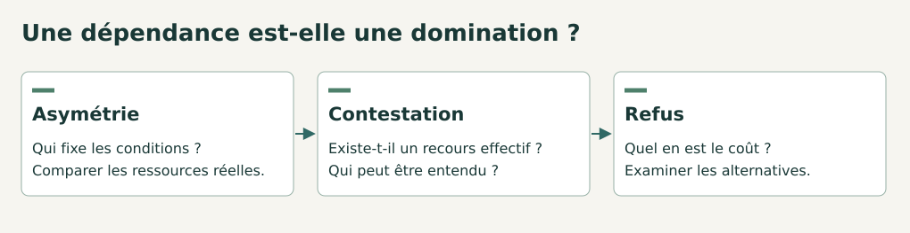

# ENS B/L · Oral de philosophie · 19 juin 2026 · Corrigé brut

*Corrigé rédigé par IA, non officiel. Signalez toute erreur.*

**Rédaction** · GPT-6.2 Astra Ultra · vitesse non renseignée

**Autocontrôle** · GPT-6.2 Astra Ultra · vitesse non renseignée

**Révision (tour 1)** · GPT-6.2 Astra Ultra · vitesse non renseignée

La feuille du 19 juin réunit 12 tickets de deux sujets. Le candidat dispose de 1 h 30 de préparation et indique au jury son choix au moment du passage. Il présente un seul sujet pendant 20 minutes, puis répond aux questions durant 10 minutes. Les deux possibilités de chaque ticket sont traitées ici.

## Ticket 1

### Choisit-on ses souvenirs ?

Un parfum fait revenir une scène d’enfance que je n’avais jamais essayé de conserver. À l’inverse, je répète un nom pour le retenir et je l’oublie au moment de le prononcer. Si nous choisissons parfois ce à quoi prêter attention, sommes-nous pour autant les auteurs souverains de nos souvenirs ?

La mémoire volontaire mobilise des moyens de recherche et d’organisation : une date, un lieu, un carnet. Quand j’apprends un poème, les reprises que je décide rendent sa récitation plus probable. Chez Proust, la madeleine rappelle au narrateur une expérience de Combray dont le surgissement contraste avec les efforts de la volonté. Ce souvenir n’est pas simplement un document intact : son développement dépend aussi d’un travail d’attention et d’écriture qui lui donne une forme partageable. L’événement de la réminiscence et l’usage qu’on en fait n’obéissent pas au même degré de choix.

Notre pouvoir s’exerce donc indirectement. Tenir un journal ou écouter des récits familiaux déplace les indices qui seront accessibles demain. Ces pratiques peuvent aussi sélectionner un passé flatteur, répéter une erreur ou donner à une histoire racontée l’apparence d’un souvenir personnel. Il faut alors confronter la mémoire aux traces et aux témoignages sans traiter sa vivacité comme garantie d’exactitude. Nous choisissons en partie les conditions de conservation, l’interprétation et la mise en récit. Ni l’apparition de chaque souvenir ni sa fidélité ne sont pour autant des décisions.

### La domination

Une salariée peut ne recevoir aucune menace explicite et dépendre néanmoins de la faveur de son supérieur pour conserver un horaire compatible avec la garde de son enfant. Faut-il une contrainte actuellement exercée pour qu’il y ait domination ? Le terme désigne une asymétrie durable dans la capacité de fixer les conditions d’action d’autrui.

La simple différence de compétence ne suffit pas. Le jugement du médecin sur un traitement peut être discuté, un deuxième avis est possible et la personne conserve des droits. L’asymétrie devient domination lorsque les moyens de contester, de refuser ou de partir sont absents ou excessivement coûteux. Dans la tradition républicaine contemporaine, Philip Pettit oppose la liberté comme non-domination à l’idée que l’absence d’interférence actuelle suffirait. Un maître bienveillant demeure maître tant qu’il conserve la capacité incontrôlée d’intervenir. La dépendance transforme déjà les anticipations et peut conduire à l’autocensure.

Un recours inscrit au règlement peut rester inaccessible si la personne chargée de l’instruire dépend elle-même de l’auteur de la décision. L’existence d’une procédure doit donc se vérifier à travers le coût du recours et l’indépendance de son examen.

La domination peut aussi se répartir entre des institutions sans qu’une personne ait conçu l’ensemble. Une procédure écrite, des ressources inégalement accessibles et des sanctions difficiles à contester peuvent se renforcer mutuellement. Dénoncer toute influence comme domination empêcherait cependant de comprendre les relations d’apprentissage ou d’entraide dont chacun peut discuter les termes. Il faut montrer qui dispose de quel pouvoir, quelles possibilités de recours existent réellement et à quel prix. La domination devient visible lorsque l’on suit la distribution du pouvoir de dire non autant que les interventions observées.

## Ticket 2

### Faut-il s’aimer soi-même ?

On recommande à une personne humiliée de retrouver l’estime d’elle-même et on reproche au vaniteux de trop s’aimer. Faut-il donc s’aimer soi-même ? La difficulté porte sur la forme et l’objet de cet amour. Tenir sa propre existence pour digne de soin et vouloir en toute circonstance être préféré aux autres ne sont pas des conduites équivalentes.

Rousseau distingue l’amour de soi, attaché à la conservation et au bien-être, et l’amour-propre, qui se développe dans la comparaison avec autrui. Cette distinction éclaire l’instabilité de l’estime obtenue par classement. Même favorisé, je reste dépendant de ceux dont je veux être préféré. L’amour de soi peut au contraire rendre possible une relation moins inquiète aux autres. Se traiter comme une personne dont les besoins et la dignité comptent aide à reconnaître que ce statut appartient aussi à chacun.

Pourtant on ne commande pas aisément un sentiment, surtout à celui qui souffre du regard porté sur lui. Un devoir de s’aimer devient injuste s’il ajoute le blâme à la souffrance. Il est plus intelligible comme exigence de ne pas se traiter volontairement comme un simple instrument et de prendre sa part de responsabilité pour sa propre vie. Cet amour n’impose ni de tout approuver de soi ni de se soustraire à la critique. Il permet de reconnaître une faute sans se réduire définitivement à elle et de recevoir l’aide d’autrui sans faire dépendre toute sa valeur de son approbation.

### Le commencement

À quel moment commence un concert ? À la première note, au geste de l’interprète ou au silence de la salle auquel ce geste répond ? La date qui marque le commencement dépend de ce que l’on cherche à délimiter. Pourtant le commencement n’est pas toujours une simple convention. Une note a réellement rompu le silence et rendu possible une phrase musicale qui n’existait pas encore.

On doit d’abord distinguer le premier instant repérable, les conditions antérieures et le principe qui explique une suite. Un contrat entre en vigueur à une date déterminée alors que les négociations ont commencé bien avant. À l’inverse, l’amitié n’a pas nécessairement un premier instant dont les amis pourraient s’accorder à faire un acte fondateur. Chercher un point absolument sans antécédent expose à reculer indéfiniment vers ce qui l’a préparé. Cela n’abolit pas toute nouveauté ; cela oblige à situer le changement au bon niveau.

Arendt associe la natalité à la capacité humaine de commencer, particulièrement dans l’action avec d’autres. Prendre la parole en public suppose une langue et des institutions déjà là, mais peut ouvrir une possibilité dont la suite n’était pas commandée. Le sens de ce commencement se révèle parfois après coup, à travers les réponses qu’il suscite. Commencer consiste donc autant à introduire une différence qui réorganise l’avenir qu’à occuper une première place sur une ligne du temps. L’enquête doit dire de quelle histoire l’événement est le commencement.

## Ticket 3

### L’artiste sait-il ce qu’il fait ?

Un graveur connaît l’ordre des opérations grâce auxquelles sa plaque donnera une épreuve. Il arrive pourtant qu’il découvre dans le premier tirage un effet qu’il n’avait pas prévu. Savoir ce que l’on fait signifie-t-il pouvoir exécuter un geste, connaître son intention ou prévoir le sens que prendra l’œuvre pour tous ses publics ?

L’habileté technique suppose des anticipations précises. Ignorer le sens dans lequel l’image s’inversera à l’impression peut compromettre une commande. Mais l’artiste travaille aussi en répondant à ce qui apparaît dans le matériau. Alain, dans le *Système des beaux-arts*, distingue l’exécution d’un projet dont l’idée précède entièrement l’objet et l’invention artistique dans laquelle l’idée se découvre dans le travail. Le trait imprévu peut être gardé, corrigé ou abandonné. L’absence de prévision totale n’implique donc pas l’absence de jugement ; elle donne à ce jugement une autre fonction.

L’artiste n’a pas davantage le monopole de l’interprétation. Un spectateur peut rendre visible un rapport que l’auteur ne formulait pas, à condition de l’étayer par l’œuvre et son contexte. Cela n’autorise pas à attribuer à l’auteur toute signification possible comme intention secrète. L’artiste sait ce qu’il fait de plusieurs façons, dans le geste, dans le choix de poursuivre et parfois dans le commentaire qu’il en donne. Le devenir de la forme excède une intention initiale sans transformer l’œuvre en résultat purement accidentel.

### Faire la paix

Deux États cessent les hostilités mais ne se sont entendus ni sur les recours des personnes déplacées ni sur la possibilité de reprendre des échanges ordinaires. Ont-ils fait la paix ? Suspendre les violences constitue déjà un changement décisif. Il reste à expliquer comment cette interruption peut devenir un ordre durable dans lequel les désaccords auront une autre issue.

Dans *Vers la paix perpétuelle*, Kant distingue le traité de paix qui met fin à un conflit particulier et la construction de relations de droit qui rendent possible une paix durable. L’enjeu tient à la capacité de chacun de ne plus dépendre seulement d’une promesse toujours révocable. Des procédures de règlement des différends, des engagements publiquement vérifiables et des institutions auxquelles les personnes peuvent faire appel transforment les conditions de la confiance.

La paix n’exige pas nécessairement que les mémoires deviennent identiques ni que les victimes pardonnent sur commande. La contrainte au silence peut rendre le calme apparent tout en laissant intact le tort subi. Inversement l’exigence d’un accord complet sur l’histoire ne devrait pas empêcher la protection immédiate des personnes et la reprise des droits. Faire la paix est donc un travail à plusieurs temporalités. Il faut rendre la coexistence possible aujourd’hui, donner des garanties pour demain et aménager une place pour établir les responsabilités passées. Le désaccord ne disparaît pas ; les personnes retrouvent la possibilité de le porter devant d’autres que celles dont dépend leur sécurité.

## Ticket 4

### Peut-on être esclave de soi-même ?

Je décide chaque soir de dormir plus tôt et je reprends pourtant l’activité qui me tient éveillé. Suis-je alors mon propre esclave ? L’image paraît paradoxale. Dans une relation d’esclavage, celui qui impose sa volonté et celui qui la subit sont distincts, avec des conséquences juridiques et historiques qu’on ne doit pas banaliser. En quel sens précis peut-on appliquer cette image au rapport à soi ?

La distinction porte d’abord sur différents rapports temporels du désir. Je peux vouloir un effet immédiat et désapprouver l’habitude dans laquelle ce geste s’inscrit. Spinoza appelle servitude, dans la quatrième partie de l’*Éthique*, l’impuissance humaine à régler les affects lorsque des causes nous déterminent sans que nous les comprenions suffisamment. Il ne suffit donc pas d’accuser un « moi faible ». Les objets disponibles, la répétition des situations et l’état du corps contribuent à la conduite. Modifier les circonstances ou demander de l’aide peut changer ce qu’une injonction intérieure ne modifie pas.

Il faut aussi distinguer contrainte et engagement. Le musicien qui se donne une discipline n’est pas nécessairement esclave du programme qu’il s’est fixé. Il peut en examiner la fin, l’interrompre et le modifier. L’image de la servitude intérieure devient pertinente lorsqu’une conduite réduit durablement ce pouvoir de révision, alors même qu’elle passe par nos propres désirs. Elle garde sa limite : la liberté qui se reconquiert ici consiste à accroître une puissance de comprendre et d’agir, non à libérer deux personnes juridiquement séparées.

### L’innovation

Une invention demeure dans un cahier pendant vingt ans, puis un atelier en modifie le procédé et l’utilise largement. Où se situe l’innovation ? La nouveauté d’une idée, la mise au point d’un dispositif et son adoption dans une pratique ne coïncident pas toujours. Une nouveauté peut être réelle sans transformer aucun usage, et un usage peut être bouleversé par l’agencement nouveau de techniques anciennes.

Schumpeter étudie l’innovation économique comme réalisation de combinaisons nouvelles. Il peut s’agir d’un procédé, d’un produit ou d’une organisation. Cette perspective déplace l’attention depuis l’inventeur isolé vers les conditions de réalisation et de diffusion. Une bibliothèque qui mutualise ses réserves avec d’autres peut modifier l’accès aux livres sans inventer un nouvel objet. Il faut montrer en quoi les capacités des acteurs et les pratiques ont effectivement changé.

Reste que le mot innovation sert fréquemment d’éloge. Or une application peut accroître la rapidité pour l’usager équipé d’un téléphone et supprimer une possibilité pour celui qui en est dépourvu. Il faut donc séparer la question de la nouveauté de celle du progrès. Comparer les effets dans la durée, identifier les bénéficiaires et les coûts, étudier si un service ancien reste accessible : ces démarches donnent un contenu au jugement. Une innovation mérite attention parce qu’elle introduit un changement dans des pratiques, et mérite approbation si ce changement résiste à l’examen des fins et des conséquences.

## Ticket 5

### La démocratie est-elle possible ?

La démocratie promet que les citoyens participent à l’ordre qui les gouverne. Pourtant une population nombreuse ne peut se réunir en permanence, et les inégalités de ressources pèsent sur la parole publique. Faut-il conclure à l’impossibilité de la démocratie ou demander quelles formes de participation et de contrôle rendent cette promesse effective ?

La difficulté apparaît dans le rapport entre la souveraineté du peuple et l’activité quotidienne des représentants. Une délégation peut rendre la décision possible à grande échelle. Elle risque aussi d’organiser l’autonomie durable des gouvernants. Les élections ouvrent un moyen de révocation périodique, sans garantir à elles seules l’égalité d’accès à l’information ou la liberté de contester. Associations, pluralité des médias, débats locaux et garanties juridiques comptent également pour déterminer qui peut produire une objection et être entendu.

Il serait toutefois excessif d’exiger l’accord de chaque personne à chaque décision pour reconnaître l’existence d’une démocratie. La possibilité du désaccord est au cœur de la question. Une décision collective peut lier temporairement des citoyens qui la contestent si les conditions de la discussion et de la révision demeurent ouvertes. La démocratie est ainsi possible comme organisation toujours imparfaite d’une égale capacité politique. Son caractère inachevé n’est pas un prétexte pour baptiser démocratique tout régime électoral. Il impose d’examiner concrètement les mécanismes qui permettent à ceux qui subissent une règle de contribuer à la modifier.

### L’accidentel

Une table est en bois et porte une trace de verre sur son plateau. La trace semble accidentelle, mais l’est-elle de la même manière que la rencontre fortuite de deux amis ? Le terme renvoie tantôt à ce qui pourrait changer sans que la chose cesse d’être ce qu’elle est, tantôt à un événement imprévu ou à une rencontre de séries causales.

Dans la tradition aristotélicienne, attribuer un caractère par accident revient à distinguer ce qui se trouve appartenir à un sujet et ce qui entre dans sa définition. Un géomètre peut être musicien ; sa compétence musicale ne suffit pas à expliquer la validité d’une preuve. Cette différence est relative à la question. La trace sans importance pour définir une table peut devenir essentielle dans une enquête recherchant l’histoire précise de ce meuble.

De même, la rencontre réputée accidentelle ne doit pas nécessairement être dépourvue de causes. Chaque ami avait ses raisons de passer dans la rue. Leur coïncidence n’avait pas été organisée autour d’une intention commune. Parler d’accident demande alors de préciser le point de vue depuis lequel l’événement n’était ni requis ni prévu. À l’inverse, invoquer l’accident pour clore une enquête peut dissimuler une régularité ou une négligence. L’accidentel n’est donc pas un résidu dépourvu d’intérêt. Il marque une distinction entre ordre explicatif, contingence et prévision qui doit être refaite pour chaque problème.

## Ticket 6

### Avons-nous besoin de métaphysique ?

Lorsque je me demande si je suis encore la même personne après avoir changé d’opinions et de corps, les mesures et les souvenirs ne suffisent pas à régler le sens du mot « même ». Une question métaphysique apparaît sur les conditions de l’identité. Cela montre-t-il que nous avons besoin d’une science qui décrirait ce qui se trouve au-delà de toute expérience ?

Les enquêtes ordinaires et scientifiques présupposent des distinctions entre une chose et ses propriétés, une cause et une simple succession, une possibilité et un fait. Ces distinctions peuvent orienter la recherche avant même qu’on les discute. Un besoin de métaphysique naît lorsque deux analyses travaillent avec des présupposés incompatibles et qu’aucune mesure isolée ne départage leurs concepts. Il faut alors les expliciter et examiner ce qu’ils permettent de rendre intelligible.

Cependant le besoin de répondre n’est pas la preuve que nous possédons les moyens de connaître toute réponse. Kant interroge dans la *Critique de la raison pure* le mouvement par lequel la raison cherche l’inconditionné et les illusions qui se forment quand elle étend ses concepts au-delà de leur usage légitime. Une métaphysique critique examine donc aussi les limites de ses prétentions. Nous avons besoin de pouvoir poser et contrôler les questions métaphysiques qui se présentent dans nos usages les plus familiers. Il ne s’ensuit pas qu’un système définitif sur la totalité du réel soit déjà possible ou indispensable à toute action.

### Bien juger

Deux personnes appliquent la même règle de retard : l’une sanctionne un voyageur dont le train a été supprimé, l’autre vérifie ce qui s’est passé avant de décider. La seconde juge-t-elle mieux parce qu’elle se montre plus indulgente ? La différence porte d’abord sur la qualification du cas et les raisons que la règle doit servir.

Bien juger suppose des informations suffisantes et une distinction entre ce qui est établi, probable ou inconnu. Il faut aussi déterminer quelle règle ou quelle valeur est pertinente. Dans l’*Éthique à Nicomaque*, Aristote étudie l’équité comme correction de ce que peut avoir d’insuffisant l’énoncé général de la loi face à un cas singulier. La correction ne donne pas toute licence au juge. Elle demande d’expliquer comment une circonstance particulière change ce que l’application fidèle de la fin de la loi exige.

Une décision juste par hasard ne manifeste pas encore une bonne faculté de juger. Celui qui condamne sur la base d’un préjugé et se trouve tomber sur le responsable n’a pas suivi des raisons fiables. Inversement un jugement raisonnable peut se révéler erroné après l’apparition d’un fait nouveau. Bien juger consiste à articuler faits, critères, comparaison avec des cas analogues et possibilité de révision. Cela réclame également de savoir quand suspendre son jugement et quand l’urgence oblige à décider avec une incertitude expressément reconnue.

## Ticket 7

### Le désespoir est-il une faute morale ?

Une personne ne croit plus possible l’amélioration de sa situation. Lui reprocher son désespoir suppose qu’elle aurait dû et pu éprouver une autre disposition. Est-il légitime de porter ce jugement moral sur une manière affective de vivre l’avenir ? Une émotion qui survient et la conduite que l’on adopte sous son effet n’engagent pas la responsabilité de la même manière.

Certaines traditions religieuses font de l’espérance une vertu et jugent fautif le refus de toute possibilité de salut. Une telle qualification dépend d’une conception précise de Dieu, de la promesse et de la liberté. Elle ne peut être appliquée indistinctement à toute souffrance humaine. Le deuil, l’épuisement ou la maladie peuvent réduire les possibilités qu’une personne parvient à percevoir sans traduire une volonté de manquer à un devoir. Le blâme risque alors d’accroître l’isolement là où une présence, des soins ou une transformation de la situation seraient nécessaires.

Une question morale peut néanmoins se poser lorsqu’une institution énonce qu’il n’y a plus rien à faire pour quelqu’un et se dispense ainsi d’examiner les options. Le jugement vise alors un abandon évitable, dont il faut établir les conditions, plutôt que l’état intime de la personne éprouvée. Une espérance imposée par formule peut également nier la gravité de ce qui arrive. Le désespoir en lui-même ne constitue donc pas une faute morale. Il oblige surtout ceux qui entourent la personne à distinguer l’émotion subie, la réalité des obstacles et les possibilités concrètes qu’une action commune pourrait rouvrir.

### L’imitation

L’apprenti recopie un dessin avant de composer le sien. S’il réussit à reproduire le modèle, a-t-il cessé de penser par lui-même ou appris une manière de voir ? Imiter veut tantôt dire produire une ressemblance extérieure, tantôt reprendre un geste ou une règle qui permettra d’agir autrement dans un cas nouveau.

Dans la *Poétique*, Aristote rattache l’imitation à l’apprentissage et au plaisir de reconnaître. La représentation d’une action peut rendre intelligible un enchaînement de motifs que la simple duplication des détails n’éclairerait pas. Le comédien qui joue l’hésitation ne reproduit pas exactement tous les gestes d’une personne réelle. Il compose des signes qu’un public pourra comprendre dans le temps particulier de la scène. L’imitation sélectionne, ordonne et transforme déjà ce qu’elle reprend.

Elle peut néanmoins devenir servile lorsqu’on retient les traits visibles sans saisir les raisons de leur emploi, ou frauduleuse lorsqu’on dissimule l’origine d’une œuvre pour s’en attribuer le mérite. La même copie peut avoir une valeur pédagogique en atelier et constituer une tromperie si on la vend sous une fausse signature. Juger l’imitation demande donc de préciser le rapport au modèle, l’intention, le cadre de réception et la capacité de transférer ce qui a été appris. Une invention personnelle peut surgir du travail par lequel on rencontre la résistance du modèle et découvre ce que sa simple reproduction ne permet pas.

## Ticket 8

### Pourquoi travailler ?

On répond souvent qu’il faut travailler pour vivre. Pourtant certaines personnes travaillent sans salaire auprès de proches et d’autres continuent après avoir acquis des ressources suffisantes. La nécessité matérielle est réelle, mais elle n’épuise pas les réponses à la question « pourquoi ? », qui peut viser une cause, une fin ou une justification sociale.

Le travail transforme des matières, entretient des lieux et fournit des services dont dépend la vie commune. Son organisation détermine la répartition de la contrainte. Un repas préparé dans une famille et un repas vendu en restauration demandent l’un et l’autre des efforts et des savoir-faire. Seul le second reçoit nécessairement un prix. Il faut se demander qui bénéficie du temps de travail de qui, avant de présenter toute activité rémunérée comme un choix individuel de réalisation.

Le travail peut aussi donner une forme durable à une capacité, fournir une reconnaissance et développer des relations. Ces biens n’accompagnent pas mécaniquement tout emploi. La répétition subie, le manque de contrôle et une rémunération insuffisante peuvent éloigner l’agent du sens de ce qu’il produit. La critique marxienne de l’aliénation invite à considérer le pouvoir du travailleur sur son activité et sur son produit. Travailler répond ainsi à des besoins, à des obligations distribuées et à des fins que l’on peut se donner. Une réflexion sur la valeur du travail doit demander quelles conditions permettent à l’activité nécessaire de devenir aussi une activité dont les participants peuvent comprendre et discuter le sens.

### La réforme

Une université modifie les modalités d’admission pour réduire les exclusions. La décision est nouvelle, mais les inégalités d’accès persistent sous une autre forme. A-t-on réellement réformé l’institution ? Au sens descriptif, sa règle a changé. Au sens normatif, parler de réforme suggère qu’on améliore une organisation en intervenant sur certains de ses ressorts.

La réforme se distingue généralement de la simple réparation, qui vise le rétablissement d’un état jugé satisfaisant, et d’une refondation qui transforme les principes constitutifs. Ces limites sont mouvantes. Changer un délai de recours peut apparaître mineur dans le texte et permettre à de nombreuses personnes de faire enfin valoir leurs droits. À l’inverse, rebaptiser toutes les catégories peut n’avoir presque aucun effet sur les pratiques. Le degré de transformation se mesure aux conséquences et aux pouvoirs modifiés, autant qu’à la longueur du texte adopté.

Il faut encore examiner la direction du changement. Une réforme n’acquiert pas sa valeur de son seul caractère nouveau. Qui a défini le problème ? Quels effets étaient attendus ? Les personnes concernées peuvent-elles montrer qu’un dispositif a déplacé l’exclusion au lieu de la réduire ? Une réforme justifiable comporte des critères d’évaluation et des conditions de révision. Elle porte la promesse d’une amélioration à l’intérieur d’une continuité institutionnelle, mais seule l’enquête sur son contenu et sur ses effets permet de distinguer cette promesse d’une simple annonce.

## Ticket 9

### Faut-il s’adapter ?

Une personne doit adapter son trajet après la fermeture d’un pont. Le conseil paraît raisonnable : l’obstacle est là. Mais demander à tous les usagers à mobilité réduite de « s’adapter » à une gare inaccessible serait faire peser sur eux une difficulté que l’équipement collectif peut résoudre. Le mot adaptation cache-t-il un choix sur ce qui doit changer et sur celui qui doit en supporter le coût ?

Dans un sens descriptif, un vivant entretient avec un milieu des relations qui rendent son existence possible. En biologie, l’adaptation évolutive concerne des populations et des générations ; elle ne commande pas moralement la conduite d’un individu. Transposer directement le terme en politique transforme un fait ou une contrainte locale en obligation générale. Il faut établir si la situation est modifiable, à quel prix et par qui. Canguilhem insiste sur la capacité normative du vivant, capable d’instituer de nouveaux rapports avec son milieu. S’adapter n’est pas toujours se conformer à un milieu laissé intact.

L’action raisonnable peut associer une réponse immédiate et une transformation durable. Installer provisoirement un accompagnement et entreprendre les travaux nécessaires n’ont ni les mêmes délais ni les mêmes conséquences pour l’autonomie. Faut-il s’adapter ? Oui lorsque reconnaître une contrainte permet de préserver une possibilité d’agir ; il faut aussi pouvoir refuser une adaptation qui reconduit une injustice évitable. Le jugement doit porter sur la répartition des charges et sur la liberté collective de changer les conditions auxquelles on s’adapte.

### L’ordre des choses

On dit qu’il est dans l’ordre des choses que l’hiver succède à l’automne, et parfois que certains occupent toujours les postes de décision. Le même mot peut recouvrir une régularité physique, un ordre explicatif et une hiérarchie instituée. La première relation suffit-elle à donner la nécessité et la légitimité que suggère la seconde formule ?

Une science recherche des rapports stables qui permettent de comprendre et de prévoir sous certaines conditions. La succession des saisons dépend de caractéristiques astronomiques ; elle n’est pas l’effet d’un décret. Une règle de succession à une charge peut, elle aussi, produire des résultats très réguliers durant des siècles. Cette régularité n’abolit ni les décisions qui l’ont établie ni la possibilité d’une autre organisation. Pour juger une hiérarchie, il faut chercher les règles de transmission des ressources, les exclusions et les moyens de contestation.

Il serait cependant excessif de conclure que toute contrainte est inventée et qu’un vote suffit à l’écarter. Réorganiser une ville ne supprime pas la gravité, l’espace disponible ou la nécessité d’approvisionner les bâtiments. L’action politique et technique se déploie au croisement de relations diverses. Invoquer l’ordre des choses n’est un argument que si l’on dit de quel ordre il s’agit, comment on l’établit et dans quelles limites il s’impose. Cette analyse permet à la fois de prendre au sérieux les conditions réelles et de rendre à la discussion ce que l’habitude avait présenté comme naturel.

## Ticket 10

### Est-il vrai que les animaux ne pensent pas ?

Un corbeau utilise un objet pour atteindre de la nourriture. Cette observation suffit-elle à prouver qu’il pense, ou faut-il supposer qu’une réponse apprise produit le même comportement ? L’énoncé du sujet porte sur tous les animaux et sur une faculté dont les critères sont discutés. Une réponse sérieuse doit préciser à la fois ce que l’on appelle penser et ce qu’une observation permet de conclure.

Si penser signifie former explicitement un jugement dans une langue humaine, le critère choisit d’avance une capacité très particulière. Or résoudre un problème nouveau, anticiper une conséquence ou ajuster une attente démentie constituent d’autres formes possibles d’activité cognitive. Des observations comparées peuvent tester si une conduite se transfère à une situation nouvelle lorsque les indices familiers disparaissent. Elles n’autorisent pas à tirer d’un seul succès une théorie complète de la conscience de l’animal. Des espèces et des individus peuvent aussi répondre de façon différente à une même épreuve.

L’erreur inverse serait d’exclure toute pensée animale parce qu’une espèce échoue à parler ou à suivre une consigne humaine. L’épreuve mesure aussi une perception, une motivation et un rapport particulier à l’expérimentateur. Il est donc injustifié de tenir pour vraie sans distinction la négation générale proposée. La question féconde devient celle des capacités déterminées, des indices indépendants qui les attestent et des limites de l’interprétation. Cette prudence vaut dans les deux sens : éviter de projeter une délibération humaine complète et éviter de confondre le silence avec une absence totale de pensée.

### La passivité

Dans une salle de concert, écouter immobile peut demander une attention soutenue. Dire que l’auditeur est passif revient-il à constater qu’il ne produit aucun son ou à lui refuser toute participation à l’expérience ? La passivité peut désigner le fait de subir une cause, de recevoir ce qui se donne ou de renoncer à agir alors qu’on le pourrait.

La perception comporte une dimension de réception. Je ne choisis pas librement la hauteur de la note que l’orchestre vient de jouer. Mais suivre une mélodie engage des attentes, la mémoire de ce qui précède et la surprise lorsque la suite diffère. Une activité de discernement peut donc s’exercer sur un donné qu’elle n’a pas produit. La rencontre d’autrui appelle une distinction semblable : écouter une plainte demande parfois de suspendre l’envie d’intervenir afin de laisser l’autre formuler ce qui lui arrive.

À l’inverse, la passivité reprochée à un responsable peut être l’omission d’un acte pour lequel il disposait du temps, des informations et du pouvoir nécessaires. Encore faut-il établir ces conditions. Qualifier de passives des personnes privées de moyens effectifs risque de transformer une contrainte subie en faute morale. La passivité n’est donc ni un défaut universel ni une vertu de disponibilité en toutes circonstances. Il faut examiner ce qui est reçu, quel pouvoir d’agir reste possible et ce que commande la situation. L’activité humaine gagne parfois à reconnaître la part de réceptivité grâce à laquelle elle peut matériellement répondre à quelque chose.

## Ticket 11

### Est-ce la majorité qui doit décider ?

Lors d’une assemblée, deux propositions incompatibles ont des partisans également autorisés à parler. Compter les voix permet de décider sans confier à un chef le privilège de trancher. Mais la majorité fournit-elle une raison de croire que la décision est vraie, juste ou simplement recevable comme décision commune ?

Pour choisir un horaire partagé, la préférence du plus grand nombre peut donner une règle raisonnable et contrôlable. Face à une question de fait, compter les croyances ne remplace pas la preuve. Dans une question de justice, la difficulté augmente encore si une majorité stable impose toujours les coûts à la même minorité. Tocqueville examine dans *De la démocratie en Amérique* le risque d’une tyrannie de la majorité, qui peut aussi s’exercer par la pression de l’opinion. La liberté politique demande alors des droits et des recours qui protègent ceux qui ont perdu le vote.

La règle de majorité ne prend sens qu’au terme d’une procédure. Qui a pu participer ? Quelle information a circulé ? Comment les options ont-elles été formulées ? Une majorité relative n’a pas le même sens qu’une majorité absolue, et des choix multiples peuvent produire des résultats sensibles à l’ordre des votes. La majorité doit souvent décider lorsque l’action commune réclame une issue et que les voix ont été comptées à égalité. Elle ne peut tirer de ce décompte une autorité illimitée sur les droits ni un monopole de la vérité. Son pouvoir est légitime lorsque la minorité peut continuer à parler et à devenir majorité.

### La curiosité

Une enfant démonte mentalement les étapes par lesquelles une graine devient une plante. Un voisin cherche à connaître les détails d’une rupture familiale. On parle dans les deux cas de curiosité, mais l’éloge de l’enquête et la critique de l’indiscrétion ne portent pas sur le même rapport à l’objet.

La curiosité commence par un écart entre ce que je sais et ce que j’aimerais apprendre. Elle peut inciter à formuler une question, à construire une observation et à accepter une réponse inattendue. L’amour du neuf peut cependant disperser l’attention avant même que l’on ait compris la première difficulté. Accumuler des anecdotes sur les plantes n’équivaut pas à comprendre les conditions de germination. La curiosité devient une disposition intellectuelle féconde lorsqu’elle supporte l’effort de vérifier et de poursuivre une question au-delà de la surprise initiale.

Sa valeur dépend aussi de la relation à autrui. Connaître un fait n’est pas toujours un bien qui m’est dû. La personne dont je veux connaître l’histoire a le pouvoir de choisir ce qu’elle partage, sauf raisons publiques précises qui justifieraient une enquête encadrée. La curiosité peut ouvrir à l’altérité si elle accepte la réponse et la possibilité d’un refus. Elle devient appropriation lorsqu’elle réduit quelqu’un à un spectacle disponible. Sa qualité se juge donc à l’objet recherché, aux moyens employés et à ce que la personne curieuse est prête à faire de ce qu’elle apprend.

## Ticket 12

### De quoi est-on malheureux ?

Deux personnes perdent leur emploi et ne vivent pas la perte de la même manière. L’une craint immédiatement de ne plus pouvoir se loger ; l’autre dispose d’une sécurité matérielle mais perd le sentiment d’avoir une place. De quoi est-on malheureux ? La question demande de distinguer la cause d’une épreuve, son objet vécu et les conditions qui permettent d’y répondre.

La dépendance au monde est réelle. La perte d’un proche, la maladie ou l’insécurité matérielle atteignent des biens qui ne sont jamais entièrement sous notre contrôle. Les présenter comme de simples erreurs de jugement serait nier ce que l’expérience a de relationnel. Inversement, une comparaison, une anticipation ou un sentiment de honte peuvent ajouter à la peine en lui donnant une certaine signification. Épictète invite à distinguer ce qui dépend de nous et les représentations par lesquelles nous accueillons les événements. Cette distinction peut ouvrir un espace d’action ; elle deviendrait cruelle si l’on en déduisait que toute personne éprouvée a choisi son malheur.

Enfin, on peut ignorer en partie ce dont on est malheureux. Une fatigue attribuée à un échec personnel peut tenir à des conditions de travail que d’autres partagent. La parole, l’enquête et le soutien collectif permettent de requalifier la situation. Le malheur naît de pertes et d’empêchements qui touchent des êtres attachés à des projets, à des personnes et à une place commune. Comprendre de quoi quelqu’un est malheureux exige d’entendre la signification qu’il donne à sa situation et de regarder les conditions réelles de son existence.

### L’indécision

Je diffère le choix d’un logement parce qu’il manque le coût du chauffage. Cette suspension est raisonnable. Mais si je redemande sans cesse une information déjà connue sans jamais modifier mon hésitation, la prudence change de sens. Où finit la délibération et où commence l’indécision ?

La décision demande des raisons suffisantes, pas toujours une certitude. Les critères peuvent être hétérogènes : l’un des logements rapproche du travail, l’autre d’un parent qu’on aide. Aucune mesure supplémentaire ne donnera mécaniquement la priorité à l’une des valeurs. Le choix engage alors celui qui décide, au lieu de se laisser simplement déduire des données. Chez Descartes, la morale par provision du *Discours de la méthode* recommande une certaine fermeté dans l’action lorsque l’on ne peut attendre une science complète. Cette fermeté répond au fait que le temps de vivre et celui de l’enquête ne coïncident pas toujours.

La décision ne doit pourtant pas devenir un culte de l’action rapide. Lorsque l’erreur serait irréversible et qu’une information décisive sera disponible à brève échéance, attendre peut être la meilleure manière d’assumer ses responsabilités. Il faut comparer le coût du délai, le degré d’incertitude, la possibilité de réviser le choix et les personnes qui subissent l’attente. L’indécision devient un défaut lorsque le refus d’assumer une perte ou une incertitude fait passer le maintien de la situation présente pour l’absence de toute décision. Reporter peut déjà décider du sort de l’option qui disparaît entre-temps.

[Feuille officielle du 19 juin](https://www.ens.psl.eu/sites/default/files/sujet_oraux_philosophie_bl_19_juin.pdf) · [Rapport du jury, conditions de passage et liste des sujets](https://www.ens.psl.eu/sites/default/files/2026_bl_rapport_oral_tronc_commun_philosophie.pdf)
