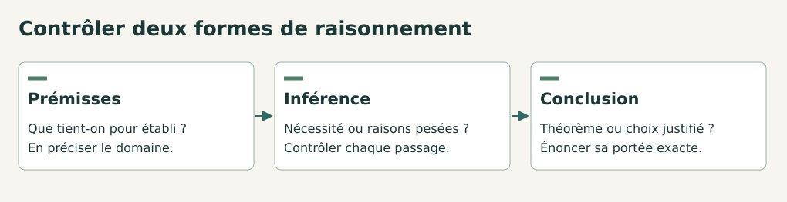
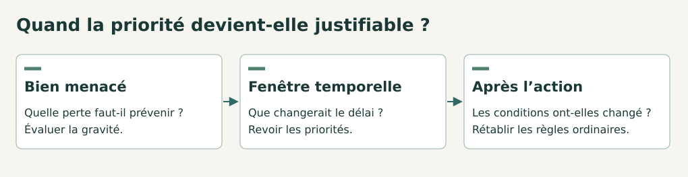
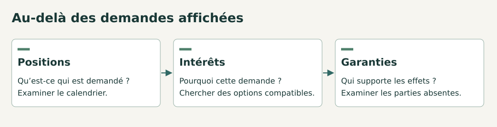

# ENS B/L · Oral de philosophie · 22 juin 2026 · Corrigé guidé

*Corrigé rédigé par IA, non officiel. Signalez toute erreur.*

**Rédaction** · GPT-6.2 Astra Ultra · vitesse non renseignée

**Autocontrôle** · GPT-6.2 Astra Ultra · vitesse non renseignée

**Révision (tour 1)** · GPT-6.2 Astra Ultra · vitesse non renseignée

La feuille du 22 juin réunit 12 tickets de deux sujets. Le candidat dispose de 1 h 30 de préparation et indique au jury son choix au moment du passage. Il présente un seul sujet pendant 20 minutes, puis répond aux questions durant 10 minutes. Les deux possibilités de chaque ticket sont traitées ici. Chaque relance met à l’épreuve une distinction précise. Pour développer oralement les propositions, reprendre l’exemple, en faire varier une condition, puis expliquer comment cette variation modifie la réponse.

## Ticket 1

### L’expérience instruit-elle ?

Une personne a pris chaque matin le même bus pendant dix ans. Cette expérience l’instruit-elle nécessairement sur la manière dont fonctionne le réseau ? Elle connaît des retards fréquents et des correspondances utiles ; elle peut aussi attribuer ces retards à une cause qu’elle n’a jamais vérifiée. La durée d’une exposition, la compétence pratique et la connaissance de la cause ne se confondent pas.

L’expérience instruit d’abord par la résistance du réel. Un geste qui échoue ou une attente déçue oblige à réviser quelque chose. Mais le même échec peut confirmer un préjugé si l’on ne compare jamais plusieurs explications. Hume souligne le rôle de l’habitude dans l’attente qu’un événement en suive un autre. Avoir toujours observé une succession ne fournit pas une démonstration logique de sa nécessité. L’enquête scientifique organise précisément des variations et des contrôles afin de distinguer des hypothèses compatibles avec une première observation.

L’expérience vécue conserve pourtant une valeur que l’on perdrait en l’évaluant seulement comme expérience de laboratoire. Le conducteur et l’usager peuvent savoir où un changement d’horaire rendrait une correspondance praticable, avant même qu’une statistique nationale fasse apparaître ce problème. Encore faut-il leur donner une occasion d’expliciter cette connaissance et d’en éprouver le domaine. L’expérience instruit lorsqu’elle devient matière à comparaison, description et révision. Elle ne dicte pas par elle-même une leçon unique, et sa fécondité dépend de la possibilité de reconnaître ce qu’elle oblige à repenser.

> [!INDICATION]
> Une seule expérience peut-elle suffire ?

Une observation fiable peut réfuter une affirmation strictement universelle en fournissant un contre-exemple. Elle ne suffit pas de ce seul fait à déterminer une loi générale de remplacement.

### La dignité

Un patient dépend entièrement d’autrui pour sa toilette. Dire qu’il aurait perdu sa dignité parce qu’il a perdu de l’autonomie risque de confondre sa valeur avec les conditions dans lesquelles cette valeur est respectée. La dignité est-elle un rang, une manière de se tenir ou une exigence attachée à la personne ?

Les anciens usages du mot peuvent désigner une charge et l’honneur qui lui correspond. On peut alors être élevé à une dignité ou en être démis. Dans un sens moral moderne, particulièrement chez Kant, la dignité renvoie à ce qui ne peut être remplacé par un équivalent et interdit de traiter la personne uniquement comme un moyen. Elle ne dépend donc pas du mérite, de l’élégance ou de la capacité présente de manifester sa volonté. Quelqu’un dont la dépendance s’accroît demande plus d’attention à son intimité, et non une moindre reconnaissance.

Il faut toutefois comprendre ce que les individus expriment lorsqu’ils disent se sentir humiliés ou privés de dignité. Le droit abstrait au respect ne rend pas cette expérience imaginaire. Un geste accompli sans prévenir, une décision prise sans demander un avis possible ou un lieu dépourvu d’intimité peuvent concrètement porter atteinte aux conditions du respect. Distinguer dignité inhérente et dignité éprouvée permet de maintenir l’égalité morale tout en entendant la parole singulière. La dignité ainsi comprise est un titre à des égards effectifs jusque dans les situations où la personne ne peut plus les revendiquer seule.

> [!INDICATION]
> Une personne peut-elle se conduire de manière indigne et garder sa dignité ?

On peut condamner un acte et retirer une fonction. Le devoir de respecter les droits fondamentaux de son auteur subsiste, y compris quand il doit répondre de sa conduite.

## Ticket 2

### Sommes-nous libres de nos pensées ?

Une mélodie revient sans que je le veuille et un stéréotype appris dans l’enfance précède parfois mon jugement. Sommes-nous libres de nos pensées si nous ne commandons pas leur surgissement ? Il faut distinguer l’apparition d’une représentation, l’attention qu’on lui accorde et l’assentiment qu’on donne à ce qu’elle suggère.

La pensée dépend d’une langue, d’une éducation et d’expériences dont le choix nous échappe en partie. Cela ne signifie pas que toute croyance serait définitivement imposée. Je peux demander une preuve, confronter deux témoignages et différer une conclusion. Dans la quatrième *Méditation*, Descartes analyse l’erreur à partir de l’assentiment qui va au-delà de ce que l’entendement perçoit clairement. Même si l’on ne reprend pas toute sa théorie de la volonté, la distinction éclaire une pratique : reconnaître qu’une idée me traverse ne m’engage pas à la déclarer vraie.

Ce pouvoir exige cependant des conditions matérielles et sociales. L’accès aux informations, le temps d’enquêter et la possibilité de parler sans intimidation élargissent la liberté intellectuelle. La concentration des sources ou la répétition d’un discours affectent ce que nous parvenons même à concevoir. Il est donc inadéquat de choisir entre souveraineté mentale absolue et détermination totale. Nous pouvons travailler sur nos habitudes de pensée et répondre des croyances que nous maintenons, avec des degrés de liberté qui varient selon les situations et qui dépendent aussi de ressources communes.

> [!INDICATION]
> Peut-on être responsable d’une pensée involontaire ?

Son apparition seule ne constitue pas une faute. La question change lorsqu’on choisit de l’entretenir, de la présenter comme certaine ou d’en tirer une conduite malgré des objections que l’on pouvait examiner.

### Avoir une idée fixe

Un chercheur revient pendant quinze ans à la même conjecture et finit par la résoudre. Une autre personne explique indifféremment tous les événements par la même hypothèse sans accepter de preuve contraire. Toutes deux ont de la constance. Laquelle a une « idée fixe », et selon quels critères ?

Le terme vise moins la durée que la relation aux raisons. Une recherche prolongée peut engendrer des essais nouveaux, enregistrer des échecs et modifier les hypothèses auxiliaires. L’idée demeure un problème sur lequel on travaille. Elle devient fixe dans un sens critique lorsqu’elle organise toute observation de façon à ne jamais pouvoir être mise en question. Une réponse négative est alors traitée comme la confirmation que l’information est cachée, un silence comme un accord et une objection comme une hostilité. On perd les conditions mêmes qui permettraient de distinguer preuve et réfutation.

Il existe cependant des pensées répétitives qui sont subies et font souffrir la personne. Les réduire à un entêtement volontaire reviendrait à juger sans comprendre la situation. Le vocabulaire ordinaire ne permet pas à lui seul un diagnostic. Pour évaluer une idée persistante, on peut demander si l’attention reste disponible pour d’autres objets, si des observations possibles compteraient contre elle et comment elle transforme la vie de la personne. La fermeté d’une conviction se reconnaît à sa capacité à répondre à des raisons ; sa fixation problématique peut tenir à la fermeture de cette capacité ou à une perte de liberté vécue.

> [!INDICATION]
> Une idée provisoirement invérifiable est-elle nécessairement une idée fixe ?

Une hypothèse peut rester ouverte en attendant une nouvelle méthode. L’attitude devient fermée si son auteur refuse d’avance toute distinction entre un résultat favorable et un résultat défavorable.

## Ticket 3

### Avons-nous besoin de héros ?

Le récit d’un sauveteur qui prend des risques pour un inconnu peut faire apercevoir un courage dont on doutait. Avons-nous besoin du héros pour agir ou pour apprendre à reconnaître une action exemplaire ? Le même récit peut encourager la solidarité et détourner l’attention des conditions de sécurité dont dépend une population entière.

Le héros donne une figure concrète à une possibilité. Un principe général paraît parfois hors de portée jusqu’à ce qu’une personne l’actualise dans une situation précise. Mais l’exemple n’agit moralement que si l’on en comprend les raisons et si l’on peut le discuter. Imiter les gestes extérieurs d’une autre situation sans ses moyens et ses responsabilités ne reproduit pas la valeur du choix initial. Le mythe héroïque peut aussi présenter comme l’exploit solitaire d’un individu ce qui dépend d’équipes, de connaissances collectives et d’institutions.

Enfin, le statut de héros est attribué par un public et à travers un récit. Il sélectionne des actes, des personnes et des valeurs. Les figures honorées peuvent exclure des contributions plus discrètes, comme le soin quotidien. Une société peut donc avoir besoin d’exemples qui ouvrent son imagination morale, sans devoir placer ces exemples au-dessus de la critique ni attendre des sacrifices exceptionnels pour faire fonctionner ses institutions. Le meilleur usage du héros consiste parfois à rendre visible une capacité commune et les conditions dans lesquelles un plus grand nombre pourrait l’exercer.

> [!INDICATION]
> Refuser le culte des héros revient-il à minimiser un acte courageux ?

On peut reconnaître précisément le risque pris et le secours apporté, tout en refusant de rendre son auteur infaillible ou de reporter sur d’autres la même exigence d’exception.

### Démontrer et argumenter

Démontrer qu’il n’existe pas de plus grand nombre premier et argumenter pour installer une bibliothèque n’imposent pas la même épreuve. La démonstration vise une conclusion nécessaire à partir de prémisses et de règles. L’argumentation cherche à établir des raisons contrôlables pour un jugement sur lequel une discussion reste possible. Faut-il en conclure que l’une atteint toujours le vrai et que l’autre ne fait que persuader ?

La démonstration d’Euclide suppose un nombre fini de nombres premiers dans une liste qui se voudrait exhaustive. Le produit de tous ces nombres, augmenté d’une unité, n’est divisible par aucun d’entre eux ; il possède donc un diviseur premier absent de la liste. Le raisonnement n’exige pas que le nombre construit soit lui-même premier. Sa nécessité tient à une suite d’inférences dont on peut contrôler chaque étape. Une suite de symboles peut néanmoins comporter une erreur, et les prémisses d’une démonstration appliquée au réel doivent encore convenir à la situation.

Pour la bibliothèque, statistiques de fréquentation, coûts et égalité d’accès éclairent une décision sans la rendre mathématiquement nécessaire. Une argumentation rationnelle expose ses hypothèses, répond aux objections et distingue un fait d’une priorité collective. Elle peut inclure une démonstration sur un point particulier, par exemple une borne budgétaire. L’opposition pertinente concerne le régime de justification et la force de la conclusion. L’argumentation n’est pas inférieure par principe : elle répond à des questions pratiques pour lesquelles la pluralité des raisons pertinentes ne forme pas un système déductif unique.

Essayer l’exemple d’un produit augmenté de un qui soit composé. La démonstration résiste à cet essai dès lors qu’elle porte sur le diviseur premier, ce qui permet d’isoler l’étape nécessaire de l’argument.

> [!INDICATION]
> Une démonstration dispense-t-elle de convaincre ?

Sa validité ne dépend pas de l’adhésion du public. Pour la transmettre, il faut pourtant montrer le rôle des prémisses et les inférences afin que l’interlocuteur puisse en vérifier la nécessité.

## Ticket 4

### Faut-il se cultiver ?

Une personne connaît les noms de toutes les œuvres d’une exposition et en regarde à peine une. Une autre sait comparer les couleurs et les gestes, mais ignore l’histoire du mouvement auquel ces tableaux appartiennent. Que signifie se cultiver, et pourquoi pourrait-on en faire une obligation ? L’accumulation de références, l’exercice d’une faculté et la transformation du jugement ne sont pas identiques.

La culture rend accessibles des expériences qui n’étaient pas données par la seule familiarité. Lire un récit ancien peut révéler qu’une idée tenue pour naturelle a une histoire. Écouter une musique inconnue forme la perception de différences jusque-là inaudibles. Cette capacité de sortir de soi donne une raison de se cultiver sans imposer à tous les mêmes objets ni établir une hiérarchie de valeur entre les personnes. Un savoir de métier ou une tradition orale peuvent soutenir une attention aussi exigeante qu’un répertoire consacré.

Mais « il faut se cultiver » peut aussi servir à distinguer ceux qui disposent déjà des codes sociaux et du temps de les transmettre. Les analyses de Bourdieu sur la distinction invitent à examiner l’accès aux lieux, aux apprentissages et aux signes de légitimité. Cette critique n’abolit pas le plaisir de connaître ; elle invite à rendre les possibilités de rencontre plus réellement communes. Se cultiver vaut comme exigence d’élargir et de mettre à l’épreuve ses jugements. Elle cesse d’être émancipatrice lorsqu’elle réduit la valeur personnelle à la possession des signes que reconnaît un milieu.

> [!INDICATION]
> Un plaisir culturel doit-il toujours produire une leçon ?

L’attention et le plaisir ont une valeur propre et peuvent modifier la sensibilité sans déboucher sur une maxime explicite. Transformer chaque expérience en interrogation scolaire risquerait d’en appauvrir l’usage.

### Le chef

Un orchestre peut avoir besoin d’une personne qui fixe le départ et coordonne une interprétation. Cela suffit-il à donner à son chef toute autorité sur les musiciens ? Le mot rapproche plusieurs fonctions : coordonner, prendre une décision lorsque l’accord manque, représenter le groupe et parfois commander sous peine de sanction. Leur réunion dans une seule personne doit être expliquée.

Une tâche collective peut nécessiter une information partagée et une décision au bon moment. L’absence de coordination ne garantit ni la liberté ni l’égalité ; elle peut donner davantage d’influence à celui qui dispose déjà des moyens les plus importants. Mais la compétence pour coordonner ne confère pas automatiquement le droit de fixer toutes les fins. Les musiciens, la direction de l’institution et le public produisent chacun des exigences distinctes. L’autorité du chef demande un mandat, une compétence déterminée et des procédures par lesquelles son action peut être évaluée.

Max Weber distingue différentes revendications de légitimité, notamment le charisme attaché à une qualité tenue pour extraordinaire et l’autorité liée à une fonction réglée. Comprendre pourquoi on obéit ne suffit pas encore à dire si l’on a raison d’obéir. Une capacité d’initiative peut être précieuse sans rendre son titulaire irremplaçable. On juge donc le chef à la tâche qu’il rend possible, à la responsabilité dont il accepte de répondre et à la place qu’il laisse aux savoirs de ceux qu’il coordonne.

> [!INDICATION]
> La rotation des responsabilités suffit-elle à supprimer les mauvais usages du pouvoir ?

Elle limite certaines dépendances mais peut laisser intactes des règles opaques ou une distribution inégale de l’information. Le contrôle du mandat reste nécessaire.

## Ticket 5

### Qu’est-ce qu’un monstre ?

Une créature de récit peut réunir des formes animales incompatibles, tandis qu’un criminel peut être appelé un monstre sans présenter aucune singularité physique. Que relient ces usages ? Le monstre marque une rupture avec une attente sur ce qu’un être devrait être. Il faut dire à chaque fois de quelle attente et de quel jugement il s’agit.

En histoire naturelle, une forme rare peut avoir été décrite comme monstrueuse lorsqu’elle ne trouvait pas place dans des classifications habituelles. L’écart à une fréquence ne contient pourtant aucun jugement moral. Comprendre les variations d’un vivant demande d’étudier ses conditions de développement et son rapport au milieu. Canguilhem permet de distinguer l’anomalie comme variation et le jugement de valeur qu’une société peut lui associer. Appliquer le mot à une personne sur la seule base d’une différence corporelle transforme abusivement une singularité en exclusion.

Dans le récit, le monstre peut matérialiser l’angoisse suscitée par une frontière incertaine entre humain et non-humain. Dans le jugement moral, il qualifie la gravité exceptionnelle d’une conduite. Ce dernier usage a cependant un coût : présenter un auteur d’actes terribles comme étranger à l’humanité peut empêcher d’examiner les choix, les institutions et les responsabilités qui ont rendu les actes possibles. Le concept révèle autant les catégories de celui qui nomme que la chose nommée. Il demande une description précise de l’écart et une vigilance sur les effets d’un mot qui peut faire obstacle à l’explication.

> [!INDICATION]
> Expliquer un acte qualifié de monstrueux revient-il à l’excuser ?

Reconstruire ses conditions rend possible une attribution plus exacte de responsabilités. La justification morale est une question différente et n’est pas contenue dans l’explication causale.

### L’urgence

Un service d’urgence traite d’abord un patient arrivé après d’autres. L’ordre d’arrivée cède devant un jugement sur la gravité et sur le délai pendant lequel une intervention reste possible. L’urgence est-elle une propriété objective de la situation ou une façon d’exiger que les autres abandonnent ce qu’ils faisaient ?

Une situation est urgente lorsqu’un délai modifie gravement la possibilité d’agir ou les conséquences de l’action. Un geste peut être très important sans être pressant, et un dossier marqué « urgent » peut seulement servir l’intérêt de celui qui l’envoie. Il faut rendre explicites le bien menacé, le délai réel et le moyen disponible. Dans un service de soins, les catégories de priorité demandent une réévaluation parce que la situation de ceux qui attendent peut changer. Une bonne organisation de l’urgence comprend donc aussi la capacité de réviser un premier classement.

L’urgence rend parfois impossible une enquête complète, mais elle n’abolit ni le jugement ni la responsabilité. Des règles préparées à l’avance, la répartition des tâches et un compte rendu après coup permettent de décider vite sans transformer la précipitation en principe. À l’échelle politique, qualifier durablement toute situation d’exception peut suspendre des possibilités de contestation sans limite déterminée. L’urgence doit donc être à la fois prise au sérieux comme contrainte du temps et justifiée comme priorité imposée à autrui. Son traitement raisonnable prépare le moment où les procédures ordinaires pourront reprendre.

> [!INDICATION]
> Une urgence impose-t-elle toujours d’agir immédiatement ?

Il faut distinguer l’urgence du résultat et le choix du moyen. Quelques instants consacrés à vérifier une information décisive peuvent éviter une action rapide qui aggraverait la situation.

## Ticket 6

### L’histoire est-elle une science ?

L’historien étudie des événements singuliers qu’il ne peut reproduire à volonté. Faut-il en conclure que l’histoire est un récit libre, étranger à la science ? La difficulté tient au sens donné au mot science. Si l’on exige une expérimentation répétée sur l’objet même, l’histoire diffère des sciences expérimentales. Si l’on demande des procédures publiques de preuve et de réfutation, sa scientificité peut être examinée autrement.

Dans l’*Apologie pour l’histoire*, Marc Bloch insiste sur l’enquête et sur la critique des témoignages. Une charte probablement fausse peut renseigner sur les intérêts de ceux qui l’ont produite ; une archive authentique peut contenir une erreur. La critique doit établir l’origine, le contexte, la question posée et la confrontation avec des traces indépendantes. Les objets ne sont pas choisis arbitrairement : l’enquête détermine ce que permettent les sources et peut obliger à abandonner une hypothèse.

L’explication historique combine parfois séries quantitatives, comparaison et reconstruction d’intentions. Elle ne transforme pas un événement irréversible en loi nécessaire. Plusieurs récits peuvent faire apparaître des dimensions complémentaires, mais tous ne résistent pas également aux traces. Le désaccord argumenté et la révision à partir d’archives nouvelles ne sont pas des preuves d’arbitraire. L’histoire peut donc être une science du passé humain dans la mesure où elle construit des problèmes contrôlables et soumet ses résultats à l’objection. Sa pratique narrative et la singularité de ses objets précisent cette scientificité au lieu de la supprimer.

> [!INDICATION]
> La prise en compte du point de vue de l’historien affaiblit-elle nécessairement la preuve ?

Rendre ses catégories et ses choix explicites permet à d’autres d’en discuter la portée. Une affirmation peut rester contrôlable tout en répondant à une question située.

### La beauté du monde

Un paysage de haute montagne peut être magnifique pour le voyageur et inquiétant pour l’habitant qui redoute une crue. Faut-il traiter l’un de ces regards comme une erreur ? Parler de la beauté du monde pose à la fois la question de ce qui se donne à nos sens et de la portée du jugement qui nous fait souhaiter l’accord d’autrui.

Dans la *Critique de la faculté de juger*, Kant analyse le jugement de goût à partir d’un plaisir qui ne dépend pas de la possession ou de l’usage de l’objet. La beauté d’un arbre ne se réduit donc ni à la valeur de son bois ni à l’utilité de son ombre. Ce jugement est éprouvé par un sujet, mais il ne se formule pas tout à fait comme le simple constat d’une préférence privée. Celui qui invite autrui à regarder suppose possible un partage, sans disposer d’une règle qui contraindrait au même plaisir.

Le mot « monde » élargit pourtant la difficulté. La beauté de certains phénomènes ne prouve ni que tout ce qui arrive est bon ni que les souffrances prendraient sens dans un beau spectacle d’ensemble. Une nature dévastatrice peut présenter une puissance sensible qui trouble le jugement et rappelle la vulnérabilité de l’observateur. Prendre soin d’un milieu ne peut dépendre uniquement de son charme visuel. Reconnaître la beauté du monde revient ainsi à décrire une rencontre sensible capable de relation et d’attention, tout en maintenant ouvertes la diversité des regards et la question indépendante du bien.

> [!INDICATION]
> La beauté d’un lieu suffit-elle à justifier sa protection ?

Elle peut donner une raison réelle de protection. Des raisons écologiques, historiques et sociales peuvent aussi exiger de préserver des lieux peu spectaculaires ou jugés laids.

## Ticket 7

### Y a-t-il un mal absolu ?

Qualifier un acte de mal absolu peut signifier qu’aucune circonstance ne saurait le justifier, qu’il serait le pire de tous les maux ou qu’il révélerait une volonté du mal pour lui-même. Ces propositions sont différentes. Une comparaison des souffrances est particulièrement fragile lorsque leurs formes et leurs effets ne sont pas commensurables. En revanche on peut chercher à établir que certains actes sont inconditionnellement interdits.

La volonté de détruire un groupe en tant que tel vise les membres au titre de leur appartenance et entend abolir leur possibilité même d’exister ensemble. Sa condamnation ne dépend pas d’un calcul des bénéfices que ses auteurs prétendraient en tirer. Le jugement d’injustifiabilité ne demande pas de construire un palmarès des crimes et ne rend pas inutile l’étude des faits, des intentions et des responsabilités. Au contraire, établir les actes concrets et leur qualification exige une enquête précise.

La notion kantienne de mal radical renvoie, dans *La Religion dans les limites de la simple raison*, à l’ordre des maximes par lequel le sujet peut subordonner la loi morale à ses penchants. « Radical » désigne la racine du principe et ne mesure pas le degré extrême d’une atrocité. Cette distinction prévient une confusion entre explication morale et qualification historique. Il y a un sens défendable du mal absolu si l’on vise une injustice qu’aucun avantage ne pourrait rendre bonne. Parler d’un mal absolument incompréhensible serait en revanche dangereux si cette formule dispensait d’en rechercher les causes et les responsabilités.

> [!INDICATION]
> Reconnaître des degrés de responsabilité relativise-t-il l’interdit ?

L’interdit porte sur le type d’acte. Le jugement sur chaque personne exige encore d’établir ce qu’elle a fait, voulu, su et pu empêcher.

### Survivre

Une personne survit à un accident et déclare plus tard avoir mis des mois à retrouver une vie qu’elle puisse appeler sienne. « Survivre » signifie d’abord continuer d’exister après un danger. Le mot peut aussi désigner une vie réduite aux conditions les plus précaires ou ce qui demeure de quelqu’un après sa mort. Que partage cette diversité d’usages ?

La survie biologique est une condition des projets, mais elle n’en fixe pas tout le sens. Avoir un abri, des relations, des droits et une possibilité de décider du lendemain transforme la manière dont la vie peut être vécue. Parler de simple survie peut rendre visible une privation matérielle ou politique. Pourtant il faut refuser d’inférer de la précarité qu’une personne n’aurait plus de désirs, de liens ni de capacité d’initiative. Une description extérieure du dénuement ne doit pas annuler la parole de la personne qui le traverse.

Survivre peut également être survivre à quelqu’un et porter la mémoire de ce qu’on a partagé. Le devoir éventuel de témoigner doit respecter la possibilité pour le survivant de se taire et de poursuivre sa propre existence. Enfin, lorsqu’une œuvre ou une institution survit à son auteur, la continuité porte sur des formes et des usages, non sur une conscience personnelle dont on aurait démontré la persistance. Le mot invite donc à préciser ce qui continue après quelle rupture, avec quels soutiens, et jusqu’à quel point le maintien de la vie permet de rouvrir une histoire au lieu de la réduire à sa seule conservation.

> [!INDICATION]
> La survie constitue-t-elle toujours la seule fin raisonnable ?

Elle est une condition majeure d’autres biens. Mais les personnes peuvent aussi accorder de l’importance à leurs liens, à leurs convictions et à leur dignité ; les dilemmes qui en résultent ne se résolvent pas par un slogan.

## Ticket 8

### L’ordinaire

Aller chercher du pain fait partie de l’ordinaire pour l’habitant du quartier. Qu’une panne ferme la boulangerie et l’on découvre aussitôt combien cet acte simple supposait d’approvisionnement, de travail et de confiance. L’ordinaire désigne-t-il ce qui arrive souvent, ce qui ne retient plus notre attention ou ce qui rend le reste possible ?

Une chose fréquente peut rester spectaculaire, tandis qu’un acte peu fréquent, comme renouveler un document, peut suivre une routine établie. L’ordinaire est donc moins une propriété statistique qu’un rapport de familiarité. Il permet de ne pas tout réinventer à chaque instant. Wittgenstein insiste, dans les *Recherches philosophiques*, sur l’importance des usages du langage ordinaire. Examiner comment un mot intervient dans une demande, une promesse ou un jeu peut dissiper un problème né lorsqu’on l’a isolé de sa pratique. L’ordinaire contient des différences qu’un regard trop rapide tenait pour inexistantes.

Cependant ce qui va de soi pour les uns peut être difficile ou inaccessible pour d’autres. Un parcours réputé ordinaire peut comporter un obstacle décisif pour une personne handicapée. Décrire les conditions matérielles et sociales du quotidien peut alors en révéler le caractère situé et transformable. L’ordinaire n’est ni médiocre par nature ni sage par définition. Il constitue le fond de pratiques sur lequel nos actions prennent sens ; le rendre visible permet d’en conserver les ressources et d’en discuter les exclusions.

> [!INDICATION]
> L’attention à l’ordinaire le transforme-t-elle nécessairement en extraordinaire ?

Elle peut suspendre la familiarité le temps de décrire un usage, puis rendre cet usage plus intelligible sans le rendre rare ni spectaculaire.

### Avons-nous peur de la liberté ?

Un salarié souhaite choisir son emploi du temps, puis s’inquiète quand il doit effectivement déterminer seul ses horaires. Cette hésitation prouve-t-elle qu’il aurait peur de la liberté ? Elle peut traduire une incertitude sur ses ressources ou la difficulté réelle de porter un choix dont les effets s’étendent à d’autres. Le mot « peur » demande que l’on précise son objet.

La liberté ouvre plusieurs possibles sans garantir la réussite de celui qui agit. L’angoisse analysée par Sartre apparaît lorsque le sujet aperçoit qu’une situation n’impose pas mécaniquement la décision qu’il prendra et qu’il devra en répondre. Une règle toute faite peut alors attirer, parce qu’elle promet de déplacer la responsabilité sur une autorité. Toutefois l’appui sur autrui et sur des règles communes ne révèle pas toujours une fuite. Les institutions peuvent rendre une liberté praticable en garantissant des droits et en donnant les informations nécessaires pour choisir.

Le pronom « nous » ne doit pas effacer les différences de situation. Proposer de choisir entre des options toutes ruineuses, puis reprocher l’hésitation à une peur de la liberté, revient à dissimuler une contrainte sous le vocabulaire de l’autonomie. Il peut donc exister une peur de l’indétermination et de la responsabilité qu’ouvre la liberté. Elle se comprend mieux si l’on distingue la charge propre à toute décision et les risques évitables qu’une organisation fait supporter à certains. Accroître la liberté peut demander à la fois de former le jugement et de transformer les conditions du choix.

> [!INDICATION]
> Une liberté accompagnée est-elle encore une liberté ?

L’aide peut élargir les options et rendre leurs conséquences intelligibles. Elle devient tutelle lorsqu’elle substitue systématiquement le jugement de l’accompagnant à celui de la personne concernée.

## Ticket 9

### Faut-il avoir peur des habitudes ?

Une pianiste souhaite que les mouvements des doigts lui deviennent habituels pour pouvoir se consacrer à la phrase musicale. Un conducteur qui répète mécaniquement son trajet risque en revanche de ne plus remarquer un changement de signalisation. Pourquoi craindre les habitudes si elles conditionnent aussi nos capacités les plus fines ?

L’habitude économise l’attention et rend possible une continuité de l’action. Ce que mes doigts ont appris n’est pas seulement une décharge mécanique : une habileté bien formée sait s’ajuster à un clavier légèrement différent ou au jeu d’un partenaire. Plus largement des habitudes sociales, comme attendre son tour, rendent les conduites mutuellement prévisibles. Mais cette même stabilité peut masquer une règle injuste ou maintenir un geste devenu inadapté. Le problème commence lorsque la réussite passée empêche de percevoir les indices qui devraient provoquer une révision.

Il faut donc distinguer la régularité souple et la rigidité. Une habitude peut inclure le contrôle de ses propres conditions : vérifier la pédale avant de jouer, écouter une objection avant de répondre, réévaluer une procédure après un incident. Il existe aussi des dépendances difficiles à modifier sans soutien extérieur ; les réduire à un défaut de volonté serait insuffisant. Une crainte raisonnable porte sur la fermeture possible de la perception et de la liberté de reprise. Former des habitudes et garder la capacité de les interrompre font partie du même apprentissage d’une conduite autonome.

> [!INDICATION]
> Une habitude peut-elle être créatrice ?

Une technique familière libère l’attention pour essayer un rythme, un raccord ou un geste nouveau. L’invention dépend souvent d’une base acquise que l’on peut faire varier.

### L’esthète

À table, une personne remarque l’accord des couleurs et de la lumière, une autre le travail rendu invisible de celui qui a préparé le repas. L’esthète, qui fait de l’expérience de la beauté une orientation de sa vie, nous apprend-il à mieux voir ou soumet-il toute chose à son seul plaisir ?

Le regard esthétique peut libérer un objet de sa seule fonction. Observer une théière comme volume, matière et équilibre rend sensible un travail de forme que l’usage rapide laissait dans l’ombre. Cette attention peut se partager par une description et se cultiver par la comparaison. Elle ne se réduit pas au luxe ni à la possession d’objets rares. Mais le goût peut aussi devenir un signe d’appartenance et de supériorité lorsque l’on confond la familiarité avec certains codes et la valeur des personnes.

Le danger devient moral quand l’esthète traite la souffrance ou la pauvreté comme le simple décor d’une scène intéressante. L’attention à la forme peut-elle au contraire ouvrir une attention aux personnes ? Elle le peut si elle accepte de rencontrer ce qui résiste à l’appropriation esthétique, notamment le témoignage et le droit d’autrui à ne pas être exposé. Une vie esthétique est donc défendable comme exercice de perception et de partage. Ériger la beauté en critère unique conduirait en revanche à manquer les raisons pratiques, politiques ou morales qui s’attachent à ce que l’on contemple.

> [!INDICATION]
> Doit-on renoncer à décrire la beauté d’une œuvre consacrée à un drame ?

On peut analyser comment la forme construit l’expérience du spectateur. Il faut aussi demander ce que cette forme rend perceptible ou risque d’effacer des personnes et des faits représentés.

## Ticket 10

### La science commence-t-elle avec la perception ?

À l’œil nu, le Soleil semble se déplacer autour de nous. Cette perception peut susciter une question d’astronomie. Pourtant le modèle qui expliquera les mouvements apparents ne se lit pas immédiatement dans ce que chacun voit. Dire que la science commence avec la perception peut désigner une origine dans l’expérience, un premier acte de recherche ou un fondement de la preuve.

L’attention à une variation sensible peut provoquer une enquête. Elle n’est cependant pas une réception absolument neutre. Mesurer une ombre suppose déjà de choisir une heure, un objet et une unité. Un instrument scientifique, de plus, rend accessible ce qu’aucun organe sensoriel ne livrerait directement. Le signal d’un détecteur doit être étalonné, comparé et interprété. Ce que l’on appelle observation scientifique comporte donc une organisation conceptuelle et technique. Bachelard souligne la rupture parfois nécessaire avec les évidences premières dont la familiarité peut faire obstacle à la connaissance.

Cela ne rend pas la science indépendante de toute perception. Une théorie physique doit produire, par des médiations appropriées, des différences observables susceptibles de lui résister. Les mathématiques présentent un autre cas : un dessin peut suggérer un théorème, tandis que la démonstration porte sur toutes les figures satisfaisant les hypothèses, y compris celles qu’on n’a pas tracées. La perception est donc une occasion et une dimension du contrôle pour plusieurs sciences. Elle n’est ni le commencement unique de toutes les sciences ni une preuve qui parlerait avant tout problème posé.

> [!INDICATION]
> Observer avec un instrument rend-il un résultat purement subjectif ?

L’étalonnage, la reproduction et la comparaison entre méthodes permettent de contrôler les médiations. Une observation construite peut être plus fiable qu’une impression sans contrôle.

### La négociation

Deux communes veulent décider du partage d’une ressource en eau. Chacune a des raisons et des contraintes qu’aucune autorité commune ne connaît entièrement. Négocier consiste-t-il à partager en deux leurs demandes ou à construire les conditions d’un accord que les positions initiales ne laissaient pas prévoir ?

Dans une négociation, les parties ont besoin les unes des autres sans poursuivre exactement les mêmes fins. Une discussion peut faire apparaître que leur demande maximale porte sur des périodes différentes et qu’un accord sur le calendrier préserve des intérêts que le partage uniforme menaçait. Il faut distinguer les positions affichées, les intérêts qu’elles expriment et les limites justifiées par des droits ou des contraintes physiques. Une négociation réussie peut produire une information nouvelle, sans que tout désaccord devienne pour autant soluble.

Le rapport de force pèse sur ce qui sera accepté. Une signature obtenue lorsque l’une des parties n’a aucun moyen de refuser ne prouve pas à elle seule l’équité des termes. Les personnes absentes de la table et les générations futures peuvent aussi supporter des coûts que les deux négociateurs immédiats ont intérêt à ignorer. D’où la nécessité de règles de représentation, de transparence sur les engagements et de recours. La négociation est une forme de décision entre des acteurs distincts. Sa valeur tient à l’accord praticable qu’elle permet et à la manière dont elle rend les intérêts, les droits et les asymétries discutables plutôt que simplement décisifs.

> [!INDICATION]
> Peut-on négocier un fait ?

On peut négocier la méthode de mesure ou les engagements qui découleront d’un résultat. L’accord des parties ne modifie pas à lui seul le débit physique du cours d’eau.

## Ticket 11

### À quoi servent les machines ?

Une machine à laver réduit le temps passé à frotter du linge. Il ne s’ensuit pas que tout le temps gagné soit devenu loisir : les normes de propreté peuvent changer et l’entretien du dispositif demande lui aussi du travail. À quoi sert une machine ? Son effet physique, l’usage qu’en fait une organisation et la fin collective qu’elle sert doivent être distingués.

La machine combine des mécanismes et une énergie pour accomplir ou régler une opération. Elle peut alléger un effort, augmenter la précision ou produire des gestes dangereux à distance des personnes. Son usage dépend toutefois des conditions d’accès, de l’organisation du travail et de la manière dont sont répartis les gains. Dans une entreprise, l’accélération d’une tâche peut réduire sa pénibilité ou augmenter la cadence exigée. Les analyses de Marx sur le machinisme invitent à examiner les rapports de production autant que le fonctionnement de la machine.

Les machines ne sont pas non plus de simples moyens indifférents à toutes les fins. Leur conception favorise certains usages, impose des dépendances de maintenance et peut modifier ce qu’une institution estime possible ou souhaitable. Un appareil réparable localement et un appareil tributaire d’un fournisseur unique distribuent différemment le pouvoir d’agir. Demander à quoi servent les machines revient donc à examiner quelle opération elles rendent possible, à qui profitent ses effets et quelles fins leur déploiement contribue lui-même à redéfinir.

> [!INDICATION]
> Automatiser une opération supprime-t-il le travail correspondant ?

Cela peut supprimer certaines tâches et en créer d’autres, parfois moins visibles, de contrôle, de maintenance ou de nettoyage. Il faut examiner le travail total et sa répartition effective.

### Contempler

Contempler un arbre pendant plusieurs minutes paraît être ne rien faire. Pourtant celui qui reste disponible à la variation des ombres n’accomplit pas la même chose que celui qui s’est simplement arrêté faute d’énergie. Contempler implique une orientation de l’attention qui suspend au moins provisoirement le désir d’utiliser ou de modifier l’objet.

Cette suspension peut rendre visible ce que l’action efficace laisse de côté. Le menuisier considère certaines propriétés du bois en fonction d’un projet ; le promeneur peut se rendre attentif à un détail sans pouvoir annoncer d’avance à quoi il servira. Cela ne crée pas deux espèces de personnes. Une même personne peut alterner les attitudes et enrichir son action par une perception qui s’est libérée un moment de l’urgence. Dans la tradition aristotélicienne, la vie contemplative possède aussi la valeur d’une activité de l’intelligence poursuivie pour elle-même. Le mot ne désigne donc pas seulement une immobilité du regard.

Il reste à demander qui dispose du loisir nécessaire et si l’abstention est toujours légitime. Contempler un paysage ne soulève pas la même question que regarder sans intervenir une situation où l’on pouvait secourir autrui. La valeur de la contemplation tient à la reconnaissance de fins qui ne sont pas réductibles à l’utilité immédiate. Elle ne dispense pas de répondre aux exigences de l’action lorsqu’elles deviennent pressantes. Elle peut en revanche former une attention grâce à laquelle nous remarquons mieux ce qui demande ensuite notre intervention.

> [!INDICATION]
> Faut-il que la contemplation ait une utilité ultérieure pour la justifier ?

On peut lui reconnaître une valeur en tant qu’expérience ou connaissance désirable pour elle-même. Ses effets sur l’action sont possibles sans constituer son seul titre à exister.

## Ticket 12

### Peut-on être trop sensible ?

Une infirmière remarque à un changement de voix qu’un patient souffre ; une autre personne se trouve submergée par un bruit que son entourage juge ordinaire. Dans les deux cas, la sensibilité rend certains signes particulièrement présents. Mais « trop sensible » peut qualifier une perception fine, une souffrance ou un jugement social sur des émotions jugées gênantes. Qui fixe le seuil ?

La sensibilité possède un objet, une intensité et un contexte. Une réaction très vive à une injustice peut être proportionnée à sa gravité, même si la majorité s’y est habituée. Inversement, une émotion durable peut devenir douloureuse ou rendre difficile la poursuite d’une activité désirée. Reconnaître cette difficulté ne transforme pas la personne en faute morale. Il peut être pertinent de modifier le milieu, de prévoir des pauses ou de chercher un accompagnement selon les besoins, au lieu d’exiger de l’individu qu’il demeure identique dans n’importe quelles conditions.

Le jugement doit aussi distinguer l’émotion et la conclusion qu’on en tire. Je peux être réellement blessé par une remarque sans savoir encore si celui qui l’a faite souhaitait me blesser. Prendre son sentiment au sérieux est compatible avec une enquête sur les faits. On peut être trop sensible relativement à une tâche, à un environnement ou à une souffrance éprouvée. Le mot devient injuste lorsqu’il invalide d’avance une parole qui dérange, ou lorsqu’il confond une capacité précieuse d’attention avec l’obligation de rester sans cesse exposé à tout.

> [!INDICATION]
> Une émotion partagée par très peu de personnes est-elle nécessairement excessive ?

Le nombre ne permet pas de juger l’objet, l’intensité ni les conditions de l’émotion. Une minorité peut remarquer un tort que la plupart n’ont pas eu l’occasion de connaître.

### Le monde du travail

Entrer dans le « monde du travail » signifie souvent obtenir un premier emploi. Pourtant la personne qui prend soin d’un proche, l’étudiant qui prépare un concours et le bénévole qui organise des repas accomplissent déjà des activités exigeantes. Que rend visible et qu’efface la désignation d’un monde du travail ?

Le travail salarié possède des institutions spécifiques : contrat, rémunération, temps défini, hiérarchie, représentation collective et protections sociales. Ces règles constituent un monde de relations et d’attentes qui déborde l’échange d’un effort contre un salaire. Le lieu de travail peut être source de coopération, d’identité professionnelle et de conflit sur la qualité de ce qu’il faut produire. Le travail prescrit par la fiche de poste et le travail réel que demandent les incidents quotidiens ne coïncident pas toujours. Repérer cet écart permet de mieux comprendre les compétences qui restent invisibles lorsqu’on ne regarde que les tâches annoncées.

Cependant le fonctionnement de ce monde dépend aussi d’activités domestiques, de soin et de formation dont la rémunération est variable ou inexistante. L’expression au singulier peut masquer les différences entre emploi stable, indépendance, précarité et travail informel. Elle ouvre une enquête si l’on étudie les institutions qui distribuent temps, droits et reconnaissance. Elle la ferme si l’on prend la frontière du salariat pour la frontière naturelle de toute contribution sociale. Comprendre le monde du travail demande donc d’en décrire à la fois les règles propres et les dépendances qui traversent ses frontières.

> [!INDICATION]
> L’absence de salaire prouve-t-elle qu’une activité est entièrement libre ?

Des obligations familiales, des attentes sociales ou l’absence de services publics peuvent rendre une activité très contrainte. La liberté effective doit être examinée indépendamment de la rémunération.

[Feuille officielle du 22 juin](https://www.ens.psl.eu/sites/default/files/sujet_oraux_philosophie_22_juin_b.pdf) · [Rapport du jury, conditions de passage et liste des sujets](https://www.ens.psl.eu/sites/default/files/2026_bl_rapport_oral_tronc_commun_philosophie.pdf)

Pour « Peut-on être trop sensible ? », le mot « trop » suit le relevé du jury, qui corrige la coquille de la feuille.
