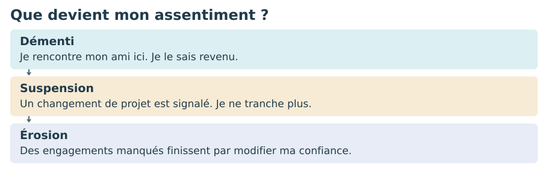

# BEL B/L — Philosophie 2026 · Corrigé brut

*Corrigé rédigé par IA, non officiel.*

**Rédaction** · modèle exact non renseigné (famille GPT-6) · effort non renseigné · vitesse non renseignée

**Révision** · modèle exact non renseigné (famille GPT-6) · effort non renseigné · vitesse non renseignée

**Lecture du rapport du jury** · GPT-6.2 Astra Ultra · vitesse non renseignée

**Révision** · GPT-6.2 Astra Ultra · vitesse non renseignée

**Révision (tour 3)** · GPT-6.2 Astra Ultra · vitesse non renseignée

**Révision (tour 4)** · GPT-6.2 Astra Ultra · vitesse non renseignée · 26 novembre 2026

**Sujet** — Peut-on cesser de croire ?

Composition de philosophie, écrit commun B/L. Durée de six heures. Le rapport de l’ENS Paris-PSL indique le coefficient 3. Le jury reproduit l’énoncé intégral en tête du rapport.

[Énoncé dans le rapport officiel, p. 1](https://www.ens.psl.eu/sites/default/files/2026_bl_rapport_ecrit_tronc_commun_philosophie_v2.pdf#page=1) · [Rapport du jury, p. 1–11](https://www.ens.psl.eu/sites/default/files/2026_bl_rapport_ecrit_tronc_commun_philosophie_v2.pdf)

## Introduction

Je croyais mon ami parti. Il entre dans la pièce et s’assied en face de moi. Je pourrais dater à la seconde près le moment où j’ai cessé de le croire absent. Voici pourtant un autre cas. Un homme découvre, au cours d’une cérémonie religieuse dont il connaît encore tous les gestes, qu’il a perdu la foi. À quand remonte cette perte ? Il serait bien en peine de le dire. Dans le premier cas, une réponse vient prendre la place d’une autre. Dans le second, subsistent des habitudes et des attachements dont une certitude s’est retirée. Dans ces deux expériences, la conduite familière ne s’appuie plus sur la même adhésion. Aucun des deux sujets ne paraît avoir choisi le moment de la rupture. Et qu’arriverait-il à celui qui prétendrait cesser de croire absolument, sans préciser à quoi ? Pour reconnaître une erreur, il s’est déjà fié à une voix, à des souvenirs, à sa propre capacité de les comparer. Quel pouvoir exerçons-nous donc sur la durée de nos croyances, et à quelles conditions l’exercice de ce pouvoir peut-il être juste ? Nous distinguerons d’abord les événements qui mettent fin à une croyance. Nous chercherons ensuite ce qu’une épreuve volontaire change à cette fin. Nous pourrons alors examiner ce qui autorise une personne ou une collectivité à retirer sa confiance.

## I. Une croyance peut finir sans que nous ayons voulu sa fin

Croire qu’un ami est ailleurs, c’est compter avec son absence. Je choisis de lui écrire au lieu de frapper à sa porte. Il serait vain de chercher, dans les heures qui suivent, une phrase que je me répéterais secrètement pour maintenir ma croyance en vie. Je travaille, je m’endors, je pense à toute autre chose. Demain encore, je lui adresserai un message. Oublier un instant ce que je crois laisse intact mon rapport à cette proposition. En revanche, si, après l’avoir revu, je vais à sa rencontre, une attente qui commandait mes actions a pris fin. Pour identifier la cessation, il faut comparer ce que je suis prêt à tenir pour vrai dans deux circonstances similaires. La simple interruption d’une pensée consciente ne suffit pas.

La forme de cette fin varie. Si mon ami parle devant moi, je peux passer de l’affirmation à la négation de son absence. Mais quelqu’un m’apprend qu’il aurait changé ses projets, sans avoir de nouvelles sûres. La conduite raisonnable consiste alors à retirer mon assentiment et à laisser la question ouverte. J’ai cessé de tenir son départ pour établi. Il serait aussi imprudent de l’attendre à la gare que de compter avec certitude sur sa présence ici. Je puis enfin n’avoir rencontré aucun démenti déterminé. Les raisons de me fier à une personne perdent peu à peu leur force à la suite d’engagements manqués. Un jour je constate que je ne lui confierais plus ce projet. L’instant de cette constatation arrive après le changement de mes dispositions. Il existe des ruptures sans réfutation et des fins dont le sujet lui-même ne sait fixer la date.

Pour saisir plus précisément l’écart entre le démenti et le doute, supposons que mon ami m’appelle de son portable. J’avais déduit son absence de son silence, car je croyais qu’il répondrait toujours s’il était ici. Il m’explique qu’il avait perdu son appareil. Je ne peux plus invoquer son silence comme preuve du départ. La nouvelle information ruine le lien entre l’indice et ma conclusion. Elle ne m’apprend pourtant rien de décisif sur le lieu où il se trouve. J’ai ici une raison positive de suspendre ma croyance, alors même que la proposition à laquelle je renonce pourrait être vraie.

La fiction offre une autre épreuve. Le spectateur d’*Othello* sait que le soupçon d’infidélité entretenu par Iago est mensonger. Lorsqu’Othello croit tenir une preuve, le spectateur peut éprouver une inquiétude très vive sans partager un seul instant sa croyance. À la sortie du théâtre, le spectateur cesse de suivre la scène comme présente, et l’émotion peut durer. Othello, lui, aurait à réexaminer l’origine et la portée de l’indice pour se détromper. Employer « ne plus y croire » dans ces deux situations recouvrirait deux opérations distinctes. Dans l’une, on quitte une situation de jeu que l’on savait telle. Dans l’autre, on révise ce que l’on tenait pour vrai. Une émotion persistante ne permet donc pas, à elle seule, de conclure à une croyance persistante.

Ces distinctions font apparaître une limite de notre pouvoir immédiat. Je peux prononcer maintenant une phrase annonçant que je crois mon ami à Paris. Puis-je, en la prononçant, régler la question pour moi-même alors que je viens de le voir entrer ? Je saurais que mon affirmation procède de l’ordre que je me donne et cette origine lui ôterait précisément sa valeur de raison. La volonté dispose de mes paroles, le monde conserve une prise sur mon assentiment. Il reste cependant une différence entre attendre passivement d’être démenti et se mettre en situation de découvrir une erreur. C’est dans cet écart qu’un pouvoir de cesser pourrait trouver à s’exercer.

## II. Nous pouvons organiser une suspension, mais son étendue et sa durée rencontrent des limites

Au début de la première des *Méditations métaphysiques*, Descartes revient sur les opinions reçues depuis l’enfance. Les examiner séparément lui demanderait une tâche infinie. Il choisit d’éprouver les principes sur lesquels des ensembles entiers reposent. L’expérience des sens parfois trompeurs puis l’hypothèse du rêve donnent une raison d’interrompre la créance ordinaire. Ce qui compte ici est l’effort requis pour prolonger l’interruption. À la fin de la méditation, les anciennes opinions reviennent avec la force que leur a donnée l’habitude. La fiction du malin génie sert d’exercice contre cette pente. Le méditant n’a pas acquis la conviction durable qu’il vit dans un rêve. Il a construit une situation dans laquelle il s’abstiendra de faire fond sur ce qui lui paraissait jusque-là assuré. Un pouvoir indirect s’exerce par le choix d’une épreuve et par la discipline nécessaire pour la soutenir. Cette distinction a une conséquence temporelle. Je peux fixer le début d’un exercice de doute et son terme. Je n’ai pourtant pas fixé le jour où une raison plus forte mettra effectivement fin à l’une de mes anciennes convictions.

Combien de temps cette suspension dure-t-elle quand nous retrouvons une vie ordinaire ? L’*Enquête sur l’entendement humain* de Hume, dans sa section V, fait dépendre nos attentes concernant les faits de l’accoutumance à des conjonctions répétées. Une démonstration ne me garantit pas que le pain me nourrira demain comme il m’a nourri hier. Avoir compris cette limite logique ne me dispense pourtant pas d’acheter de quoi dîner. L’avenir continue à se présenter à moi sous la figure du probable, avec une vivacité qu’un simple possible imaginé ne possède pas. L’argument critique atteint la garantie que j’attribuais à mon attente. L’expérience répétée entretient l’attente elle-même. Il arrive ainsi que je cesse de croire à la certitude d’un fait tout en continuant de compter sur lui. La distinction importe pour le savoir. Vérifier qu’un pont est ouvert peut transformer en connaissance justifiée mon opinion initiale. Je continue à tenir pour vraie la même proposition. Ce qui a cessé est mon incertitude sur ses raisons. Dire que tout accroissement du savoir ferait disparaître le fait de croire reviendrait à confondre l’adhésion avec l’insuffisance de sa justification.

Peut-on du moins étendre la suspension à tous ses objets simultanément ? Dans *De la certitude* (§§ 341–343), Wittgenstein compare à des gonds certaines propositions que nos questions et nos doutes laissent fixes. Supposons que je vérifie une date dans un registre. Je peux avoir de bonnes raisons de soupçonner le registre lui-même, par exemple si deux éditions donnent des dates incompatibles. Je vais alors comparer les manuscrits ou interroger des témoins. Si je récuse simultanément toute possibilité de reconnaître des signes, de distinguer deux pages et de retenir le début de ma question, je perds jusqu’aux conditions qui permettraient d’achever la vérification. Ce raisonnement ne sanctifie aucun document. Il établit que le doute déterminé a besoin de prises et qu’elles peuvent changer avec l’enquête. La formule « je cesse de croire absolument » perd son sens si elle prétend décrire l’acte justifié d’un enquêteur qui conserve le moyen de constater son succès. Il faut alors déplacer la question. Si une certaine confiance soutient la mise à l’épreuve de mes croyances, sur quoi pourrais-je m’appuyer pour justifier, devant autrui, le retrait particulier que j’effectue ?

## III. Il nous incombe de répondre de la façon dont nous retirons notre confiance

La question change encore lorsqu’une personne nous demande de la croire. Une collègue signale qu’une machine fonctionne par intermittence en dehors des réglages annoncés. La réception d’un relevé rassurant suffit-elle à mettre fin à ma croyance dans son témoignage ? L’enregistrement peut être exact et la panne échapper à l’intervalle qu’il couvre. Il y a ici un véritable risque moral à prendre le premier motif de soulagement pour un démenti. Une enquête juste comparera les heures, recueillera les observations des personnes concernées, précisera ce que l’instrument mesure. Continuer à prendre une parole au sérieux est compatible avec une suspension du jugement sur la cause. Inversement, la loyauté ne saurait m’obliger à défendre une explication que les contrôles ont réfutée. Je dois à mon interlocutrice une certaine qualité d’attention et la possibilité d’une réponse. Mes devoirs portent sur des actes à ma portée, jusque dans une affaire où je ne commande pas à mon sentiment de certitude.

Ce pouvoir est aussi collectif. Si la direction retient pour le rapport final les seuls relevés qui confirment son diagnostic initial, l’inquiétude de chaque agent restera isolée. Chacun pourra croire que les autres tiennent la machine pour sûre et continuer d’agir en conséquence. Ouvrir le registre des incidents à tous les opérateurs permet de découvrir la répétition de ce que chacun avait d’abord pris pour une exception. La croyance publique peut alors tomber au cours d’une réunion précise après avoir vacillé en privé depuis des semaines. L’institution ne peut décréter une conviction sincère. Elle peut rendre certaines observations audibles et offrir une procédure pour retirer une affirmation sans effacer les raisons qui avaient conduit à l’admettre. Inversement, l’institution peut retirer publiquement son diagnostic alors que plusieurs membres y croient encore. Le collectif a cessé d’en faire une règle de décision dès que les procédures changent. Une gamme d’adhésions privées subsiste. Pour dater une cessation collective, il faut donc préciser qui avait pouvoir d’engager le groupe et quelle pratique exprimait son assentiment.

Il subsiste cependant un cas où cette responsabilité rencontre son bord. Celui qui perd la foi peut encore souhaiter croire, lire, prier, revenir auprès d’une communauté. Il maîtrise certains de ces actes. Il lui est impossible d’en garantir la réussite si la confiance que la prière supposait s’est retirée. Son entourage aurait tort de conclure de la répétition des gestes à la persistance de la foi, ou de la perte de celle-ci à une faute délibérée. On peut demander à quelqu’un d’examiner ce qui ébranle une relation, de parler loyalement à ceux qu’un changement affecte. Exiger de lui qu’il trouve vrai ce qu’il ne peut plus tenir pour tel ferait de la sincérité même une faute. À la différence de la vérification d’un relevé, aucun résultat prédéfini par autrui ne permet ici de mesurer l’honnêteté du travail accompli. Il importe, enfin, de séparer le droit de changer de foi, qui engage la liberté de conscience, et la question de savoir si une assertion publique était assez fondée pour être défendue. L’une se joue dans la possibilité de demeurer sincère, l’autre dans la qualité de raisons communicables.

## Conclusion

Oui, on peut cesser de tenir pour vrai ce qu’on croyait. Une rencontre peut mettre fin à une erreur, une information peut enlever sa force à un indice, la confiance peut s’user avant qu’on sache en dater la perte. On peut aussi organiser un examen et en choisir les conditions. Le pouvoir qui nous revient porte d’abord sur l’attention que nous accordons aux témoignages et sur les occasions que nous donnons à nos convictions d’être éprouvées. Il ne garantit ni le résultat que l’on souhaite ni la disparition de toute disposition à croire. Pour un groupe, le retrait devient effectif lorsque ses pratiques et ses décisions changent, parfois longtemps avant l’accord des consciences. Pour un individu comme pour un groupe, une cessation peut ainsi être réelle sans être choisie, choisie dans ses moyens sans être assurée de réussir, ou accomplie sans être justifiée. C’est en distinguant ces possibilités que l’on peut répondre de la manière dont on a cessé de croire.
