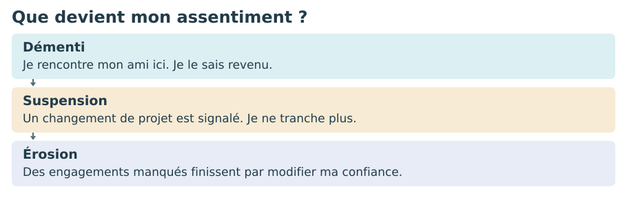
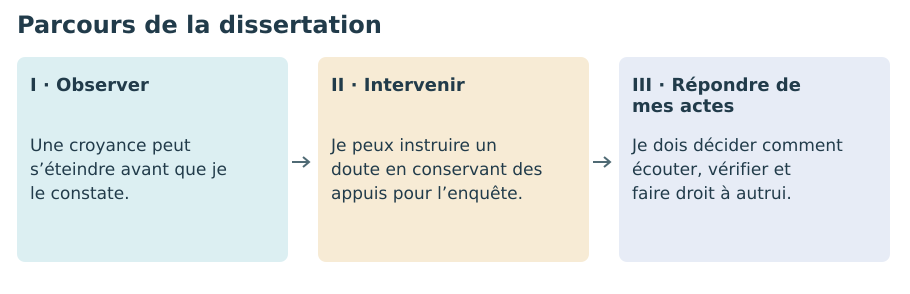
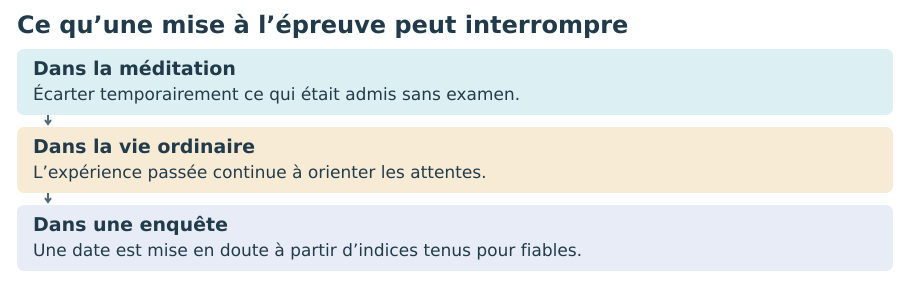

# BEL B/L — Philosophie 2026 · Corrigé guidé

*Corrigé rédigé par IA, non officiel.*

**Rédaction** · modèle exact non renseigné (famille GPT-6) · effort non renseigné · vitesse non renseignée

**Révision** · modèle exact non renseigné (famille GPT-6) · effort non renseigné · vitesse non renseignée

**Lecture du rapport du jury** · GPT-6.2 Astra Ultra · vitesse non renseignée

**Révision** · GPT-6.2 Astra Ultra · vitesse non renseignée

**Sujet** — Peut-on cesser de croire ?

[Libellé reproduit par le jury, p. 1](https://www.ens.psl.eu/sites/default/files/2026_bl_rapport_ecrit_tronc_commun_philosophie_v2.pdf#page=1) · [Rapport officiel](https://www.ens.psl.eu/sites/default/files/2026_bl_rapport_ecrit_tronc_commun_philosophie_v2.pdf)

## Entrer dans le sujet

Le rapport reproduit intégralement le sujet en première page. L’épreuve commune dure six heures et son coefficient est de 3. Le jury demande d’aborder la croyance à partir de sa cessation. Les pages 4 à 6 distinguent les manières de croire et les formes temporelles de leur interruption. Les pages 8 à 11 en examinent les dimensions pratique et morale ainsi que plusieurs démarches recevables.

> [!INDICATION]
> « Je ne pense plus à lui » peut signaler que mon attention est ailleurs. « Je ne le crois plus » indique un changement de ma disposition à accepter sa parole. Imaginer le geste que je ferais demain permet de distinguer les deux cas.

## Construire le problème

Le même résultat apparent peut avoir des causes différentes. Mon ami ouvre la porte et entre chez nous. Je constate qu’il est rentré. Une information incertaine suffit seulement à me faire suspendre le jugement. Quel pouvoir ai-je sur ces modifications ? Cette première question conduit à celle de l’étendue. Une démarche qui ébranle une conviction localisée pourrait-elle en défaire toutes les autres à la fois ? L’enjeu moral apparaît dès que retirer une croyance revient à retirer à quelqu’un son crédit.

## Éprouver les articulations

La première *Méditation* donne un exemple d’intervention volontaire sur les conditions de l’assentiment. La section V de l’*Enquête sur l’entendement humain* aide à comprendre pourquoi les attentes pratiques retrouvent malgré tout leur force. Les « gonds » de *De la certitude* permettent enfin de se demander ce que l’enquête doit encore pouvoir présupposer quand une ancienne assurance est mise en cause. Pour chacune de ces références, préciser exactement ce qui cesse et ce qui rend la cessation possible.

> [!PIEGE]
> Une loyauté a une portée morale, une hypothèse a des conditions de vérification. Face à un témoignage professionnel, on peut respecter la parole d’une personne et suspendre son jugement sur son explication. Dire pourquoi évite de confondre le retrait d’une croyance avec un jugement sur l’honnêteté du témoin.

## Proposition de dissertation

### Introduction

Je croyais mon ami parti. Il entre dans la pièce et s’assied en face de moi. Je pourrais dater à la seconde près le moment où j’ai cessé de le croire absent. Voici pourtant un autre cas. Un homme découvre, au cours d’une cérémonie religieuse dont il connaît encore tous les gestes, qu’il a perdu la foi. À quand remonte cette perte ? Il serait bien en peine de le dire. Dans le premier cas, une réponse vient prendre la place d’une autre. Dans le second, subsistent des habitudes et des attachements dont une certitude s’est retirée. Les deux hommes ont cessé de croire quelque chose. Aucun ne paraît avoir choisi le moment de la rupture. Et qu’arriverait-il à celui qui prétendrait cesser de croire absolument, sans préciser à quoi ? Pour reconnaître une erreur, il s’est déjà fié à une voix, à des souvenirs, à sa propre capacité de les comparer. Quel pouvoir exerçons-nous donc sur la durée de nos croyances, et à quelles conditions l’exercice de ce pouvoir peut-il être juste ?

### I. Une croyance peut finir sans que nous ayons voulu sa fin

Croire qu’un ami est ailleurs, c’est compter avec son absence. Je choisis de lui écrire au lieu de frapper à sa porte. Il serait vain de chercher, dans les heures qui suivent, une phrase que je me répéterais secrètement pour maintenir ma croyance en vie. Je travaille, je m’endors, je pense à toute autre chose ; demain encore, je lui adresserai un message. Oublier un instant ce que je crois laisse intact mon rapport à cette proposition. En revanche, si, après l’avoir revu, je vais à sa rencontre, une attente qui commandait mes actions a pris fin. Pour identifier la cessation, il faut comparer ce que je suis prêt à tenir pour vrai dans deux circonstances similaires. La simple interruption d’une pensée consciente ne suffit pas.

La forme de cette fin varie. Si mon ami parle devant moi, je peux passer de l’affirmation à la négation de son absence. Mais quelqu’un m’apprend qu’il aurait changé ses projets, sans avoir de nouvelles sûres. La conduite raisonnable consiste alors à retirer mon assentiment et à laisser la question ouverte. J’ai cessé de tenir son départ pour établi. Il serait aussi imprudent de l’attendre à la gare que de compter avec certitude sur sa présence ici. Je puis enfin n’avoir rencontré aucun démenti déterminé. Les raisons de me fier à une personne perdent peu à peu leur force à la suite d’engagements manqués. Un jour je constate que je ne lui confierais plus ce projet. L’instant de cette constatation arrive après le changement de mes dispositions. Il existe des ruptures sans réfutation et des fins dont le sujet lui-même ne sait fixer la date.

Supposons que mon ami m’appelle de son portable. Sa voix m’apprend qu’il peut me parler. Elle laisse entière la question du lieu d’où il appelle. Si ma seule raison de le croire absent était son silence, cet appel peut cependant me faire cesser de croire à son absence sans me convaincre de sa présence. La même information retire ici sa raison à une croyance sans en donner une suffisante à la croyance contraire.

Ces distinctions font apparaître une limite de notre pouvoir immédiat. Je peux prononcer maintenant une phrase annonçant que je crois mon ami à Paris. Puis-je, en la prononçant, régler la question pour moi-même alors que je viens de le voir entrer ? Je saurais que mon affirmation procède de l’ordre que je me donne et cette origine lui ôterait précisément sa valeur de raison. La volonté dispose de mes paroles, le monde conserve une prise sur mon assentiment. Il reste cependant une différence entre attendre passivement d’être démenti et se mettre en situation de découvrir une erreur. C’est dans cet écart qu’un pouvoir de cesser pourrait trouver à s’exercer.

### II. Nous pouvons organiser une suspension, mais son étendue et sa durée rencontrent des limites

Au début de la première des *Méditations métaphysiques*, Descartes revient sur les opinions reçues depuis l’enfance. Les examiner séparément lui demanderait une tâche infinie. Il choisit d’éprouver les principes sur lesquels des ensembles entiers reposent. L’expérience des sens parfois trompeurs puis l’hypothèse du rêve donnent une raison d’interrompre la créance ordinaire. Ce qui compte ici est l’effort requis pour prolonger l’interruption. À la fin de la méditation, les anciennes opinions reviennent avec la force que leur a donnée l’habitude. La fiction du malin génie sert d’exercice contre cette pente. Le méditant n’a pas acquis la conviction durable qu’il vit dans un rêve. Il a construit une situation dans laquelle il s’abstiendra de faire fond sur ce qui lui paraissait jusque-là assuré. Un pouvoir indirect s’exerce par le choix d’une épreuve et par la discipline nécessaire pour la soutenir.

Combien de temps cette suspension dure-t-elle quand nous retrouvons une vie ordinaire ? L’*Enquête sur l’entendement humain* de Hume, dans sa section V, fait dépendre nos attentes concernant les faits de l’accoutumance à des conjonctions répétées. Une démonstration ne me garantit pas que le pain me nourrira demain comme il m’a nourri hier. Avoir compris cette limite logique ne me dispense pourtant pas d’acheter de quoi dîner. L’avenir continue à se présenter à moi sous la figure du probable, avec une vivacité qu’un simple possible imaginé ne possède pas. L’argument critique atteint la garantie que j’attribuais à mon attente. L’expérience répétée entretient l’attente elle-même. Il arrive ainsi que je cesse de croire à la certitude d’un fait tout en continuant de compter sur lui.

Peut-on du moins étendre la suspension à tous ses objets simultanément ? Dans *De la certitude* (§§ 341–343), Wittgenstein compare à des gonds certaines propositions que nos questions et nos doutes laissent fixes. Supposons que je vérifie une date dans un registre. Je peux avoir de bonnes raisons de soupçonner le registre lui-même, par exemple si deux éditions donnent des dates incompatibles. Je vais alors comparer les manuscrits ou interroger des témoins. Si je récuse simultanément toute possibilité de reconnaître des signes, de distinguer deux pages et de retenir le début de ma question, je perds jusqu’aux conditions qui permettraient d’achever la vérification. Ce raisonnement ne sanctifie aucun document. Il établit que le doute déterminé a besoin de prises et qu’elles peuvent changer avec l’enquête. La formule « je cesse de croire absolument » perd son sens si elle prétend décrire l’acte justifié d’un enquêteur qui conserve le moyen de constater son succès.

### III. Il nous incombe de répondre de la façon dont nous retirons notre confiance

La question change encore lorsqu’une personne nous demande de la croire. Une collègue signale qu’une machine fonctionne par intermittence en dehors des réglages annoncés. La réception d’un relevé rassurant suffit-elle à mettre fin à ma croyance dans son témoignage ? L’enregistrement peut être exact et la panne échapper à l’intervalle qu’il couvre. Il y a ici un véritable risque moral à prendre le premier motif de soulagement pour un démenti. Une enquête juste comparera les heures, recueillera les observations des personnes concernées, précisera ce que l’instrument mesure. Continuer à prendre une parole au sérieux est compatible avec une suspension du jugement sur la cause. Inversement, la loyauté ne saurait m’obliger à défendre une explication que les contrôles ont réfutée. Je dois à mon interlocutrice une certaine qualité d’attention et la possibilité d’une réponse. Mes devoirs portent sur des actes à ma portée, jusque dans une affaire où je ne commande pas à mon sentiment de certitude.

Ce pouvoir est aussi collectif. Si la direction retient pour le rapport final les seuls relevés qui confirment son diagnostic initial, l’inquiétude de chaque agent restera isolée. Chacun pourra croire que les autres tiennent la machine pour sûre et continuer d’agir en conséquence. Ouvrir le registre des incidents à tous les opérateurs permet de découvrir la répétition de ce que chacun avait d’abord pris pour une exception. La croyance publique peut alors tomber au cours d’une réunion précise après avoir vacillé en privé depuis des semaines. L’institution ne peut décréter une conviction sincère. Elle peut rendre certaines observations audibles et offrir une procédure pour retirer une affirmation sans effacer les raisons qui avaient conduit à l’admettre.

Il subsiste cependant un cas où cette responsabilité rencontre son bord. Celui qui perd la foi peut encore souhaiter croire, lire, prier, revenir auprès d’une communauté. Il maîtrise certains de ces actes. Il lui est impossible d’en garantir la réussite si la confiance que la prière supposait s’est retirée. Son entourage aurait tort de conclure de la répétition des gestes à la persistance de la foi, ou de la perte de celle-ci à une faute délibérée. On peut demander à quelqu’un d’examiner ce qui ébranle une relation, de parler loyalement à ceux qu’un changement affecte. Exiger de lui qu’il trouve vrai ce qu’il ne peut plus tenir pour tel ferait de la sincérité même une faute. À la différence de la vérification d’un relevé, aucun résultat prédéfini par autrui ne permet ici de mesurer l’honnêteté du travail accompli.

### Conclusion

Il y a plusieurs manières pour une croyance de finir. Une nouvelle évidence la défait, un doute en suspend l’usage, une confiance s’use avant que nous puissions nommer sa perte. Nous pouvons agir sur la durée de nos adhésions en réglant ce que nous vérifions, ce que nous écoutons et les objections auxquelles nous nous exposons. Nous ne choisissons pas à volonté ce qui, au terme de cette épreuve, nous semblera vrai. Quant à l’ambition de tout suspendre d’un seul geste, elle ruinerait les moyens mêmes par lesquels un doute peut aboutir. Notre responsabilité est de rendre possible une fin lorsqu’elle devient justifiée et d’en répondre auprès de ceux que notre croyance engageait.
