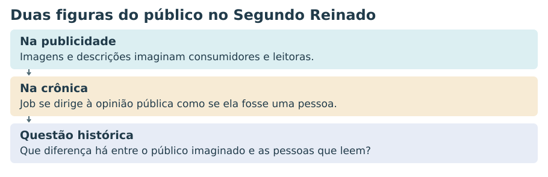
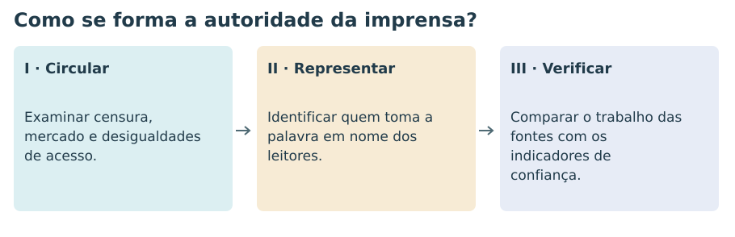
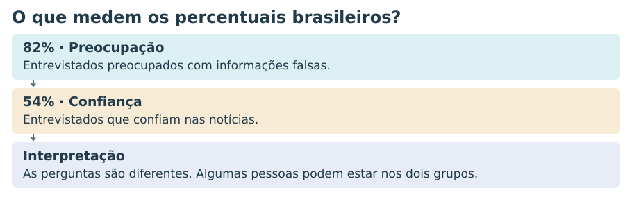

# BEL B/L — Portugais 2026 · Corrigé guidé

*Corrigé rédigé par IA, non officiel.*

**Rédaction** · Modèle : OpenAI Codex (famille GPT-6) · Effort de raisonnement : non renseigné · Mode de vitesse : non renseigné.

**Révision** · Modèle : OpenAI Codex (famille GPT-6) · Effort de raisonnement : non renseigné · Mode de vitesse : non renseigné.

**Question directrice** — Como se constitui a autoridade da imprensa quando mudam os meios de circulação e as figuras do público?

[Sujet officiel, p. 31 à 36](https://www.ens.psl.eu/sites/default/files/livret_lve_allege.pdf#page=31)

## Identifier les six sources sur la presse brésilienne

Le livret demande de commenter les six documents en portugais. Le texte le plus ancien par sa date de rédaction est la chronique de 1867. Le premier document du dossier, lui, paraît en 1966 et porte rétrospectivement sur la période coloniale. La consigne de l’épreuve écrite donne six heures.

| Source | Statut du document et apport |
|---|---|
| 1. Nelson Werneck Sodré, 1966 | Histoire de la presse. L’organisation de la censure, le développement minier et la scolarisation décrivent les conditions de circulation des livres. |
| 2. Ana Maria Mauad, 1997 | Étude de la culture visuelle et des publics visés par les annonces et les chroniques dans le Rio du XIXe siècle. |
| 3. Machado de Assis, 1867 | Chronique signée Job ; l’opinion publique est apostrophée comme si elle était une personne réelle. |
| 4. Carlos Eduardo Lins da Silva | Témoignage d’un correspondant à Washington repris dans un ouvrage de 1997. La métaphore du cinéma donne une forme à sa distance professionnelle. |
| 5. Zélia Leal Adghirni, 2002 | Réflexion sur la vérification et les frontières professionnelles à l’époque du journalisme en ligne. |
| 6. Edson Rossi, 2021 | Article de *IstoÉ Dinheiro* rendant compte d’une enquête du Reuters Institute, dans le contexte de la pandémie. |

## Lire les chiffres comme des réponses à des questions

Le sixième document rapporte deux pourcentages distincts pour le Brésil. La proportion de répondants qui cochent les deux réponses à la fois reste inconnue. L’inquiétude déclarée face aux fausses nouvelles ne mesure pas le nombre de fausses informations effectivement reçues. Cette précision fait dialoguer la source avec le travail de vérification que décrit le cinquième document.

## Mettre en relation la forme et le public

L’ironie de Machado repose sur une circularité. Les journaux proclament l’existence de la souveraine « opinion publique », et le chroniqueur feint de les croire sur parole. Chez Lins da Silva, la métaphore du noir et blanc oriente aussi le jugement du lecteur. Examiner ce qu’elle permet d’observer et ce qu’elle ne suffit pas à prouver.

> [!METHODE]
> Relever pour chaque pièce qui observe le lectorat, ce qui est effectivement observable et la date de l’observation. Un journal impérial imagine un public, un correspondant compare des usages professionnels, une enquête compte des réponses. Ces démarches justifient des conclusions de portée différente.

## Commentaire rédigé en portugais

### Introdução

Em 1867, um cronista do *Diário do Rio de Janeiro* decide apresentar-se a uma senhora de cuja existência ele próprio parece duvidar. Trata-se da opinião pública. Todos falam em nome dela, observa a personagem criada por Machado de Assis; seria indelicado começar a escrever nos jornais sem antes cumprimentar a dona da casa. Em 2021, uma reportagem da *IstoÉ Dinheiro* oferece outro modo de falar do público brasileiro. Já se pode expressar em porcentagens a preocupação dos entrevistados com notícias falsas e sua confiança no jornalismo. Entre a senhora imaginária e as respostas medidas há mais que uma sucessão de técnicas. Cada fonte propõe uma maneira de localizar quem lê, o que se pode dizer em seu nome e de onde viria a autoridade para dizê-lo. O historiador Nelson Werneck Sodré e a historiadora Ana Maria Mauad permitem remontar às condições da circulação dos impressos. Machado, o correspondente Carlos Eduardo Lins da Silva, a pesquisadora Zélia Leal Adghirni e o jornalista Edson Rossi examinam, de lugares diferentes, o valor do trabalho que se faz diante do leitor. Como se constitui a autoridade da imprensa quando mudam, ao mesmo tempo, os meios de circulação e as figuras do público a que ela se dirige?

### I. A possibilidade de publicar depende das relações entre poder, mercado e leitores

A primeira distinção proposta pela *História da imprensa no Brasil* (1966, documento 1) diz respeito a dois atos que facilmente confundimos. Autorizar a impressão de um livro e permitir que ele circule podem depender de instâncias diferentes. O quadro das censuras civis e religiosas no mundo português mostra o cuidado com que se distribuía o poder sobre essas operações. Sodré associa as limitações da colônia escravista à organização do ensino, à estrutura de sua economia e ao controle metropolitano. Quando aparecem poucas referências a livros nos inventários que consulta, isso constitui um indício sobre os bens registrados naqueles meios sociais. Seria temerário deduzir dali que ninguém teve contato com um texto. Os filhos de famílias abastadas enviados a Coimbra ajudam a perceber uma desigualdade menos simples que a oposição entre presença e ausência de cultura: os recursos e os percursos que davam acesso aos livros estavam concentrados.

A mineração altera esse quadro em duas direções. A população cresce, amplia-se o mercado interno e aparecem atividades especializadas. Ao mesmo tempo, a metrópole reforça a vigilância sobre a colônia. A existência de possíveis leitores, portanto, não produz por si só uma livre circulação de impressos. O próprio historiador pergunta por que México e Peru conheceram tipografias coloniais mais cedo, embora Espanha e Portugal tivessem interesses de dominação comparáveis. A interrogação introduz uma dificuldade no modelo explicativo que o texto acaba de esboçar. Na comparação entre os documentos, convém conservar esse cuidado diante de relações de causa e efeito apresentadas como evidentes.

No Rio de Janeiro do Segundo Reinado estudado por Mauad (documento 2), os anúncios passam das páginas dos jornais para as paredes da cidade. O percurso muda a pergunta histórica. Importa saber agora quem se deseja atrair e que modos de vida a imagem apresenta como desejáveis. A ligação de uma loja com uma casa estrangeira transforma a procedência da mercadoria em motivo de confiança; um anúncio de colchões procura a atenção pelo humor e pela alusão à intimidade doméstica. A descrição de crônicas voltadas para mulheres deixa ver um público que não se confunde com o dos eleitores ou dos parlamentares. Convém distinguir a consumidora imaginada pelo anúncio da mulher que eventualmente o leu. O texto publicitário documenta diretamente uma expectativa sobre o público; os hábitos efetivos de todas as leitoras exigiriam outras fontes.

### II. A imprensa também inventa a pessoa a quem parece obedecer

Na crônica assinada por Job (documento 3), a opinião pública ganha um tratamento cerimonioso. A repetição de «V. Excia.» parece colocá-la acima daquele que escreve. Mas o raciocínio que comprovaria sua existência depende inteiramente dos que já costumam invocá-la. A tribuna e a rua falam em seu nome, a imprensa diz que ela manda na imprensa, e o novo cronista declara acreditar em tudo aquilo que dizem as gazetas. O círculo produz o efeito cômico. A comparação com uma santa a quem se recorre nas tempestades sugere uma prática bastante terrena: pode ser conveniente prestar homenagem ao público na hora em que se precisa de sua autorização. O narrador afirma que não vota, lê a Constituição e descreve as visitas interessadas que deixa de receber. A variedade desses gestos separa a voz de um leitor da voz de um eleitor e ambas da autoridade abstrata que os discursos dizem representar. As declarações da personagem sobre a monarquia precisam ser lidas à luz desse jogo, que impede de tratá-las simplesmente como profissão de fé do autor.

A reflexão de Lins da Silva (documento 4, publicada em 1997) desloca o problema para o interior de uma redação e para o olhar de um correspondente brasileiro em Washington. A analogia com os anjos de Wim Wenders lhe permite situar o paradoxo de acompanhar de perto o jornalismo brasileiro estando fisicamente distante e sem participar das decisões que o orientam. A passagem do preto e branco à cor introduz então a questão do que um jornal supõe que seus leitores estejam dispostos a aceitar. A adoção gradual da cor pelo *New York Times* aparece como uma decisão que leva em conta tanto anunciantes quanto leitores. A comparação com as cores presentes nos jornais brasileiros poderia desembocar num catálogo de supostos temperamentos nacionais. O correspondente prefere acompanhar a reelaboração brasileira de práticas jornalísticas norte-americanas. Repertórios técnicos atravessam fronteiras sem produzir os mesmos resultados em todas as redações.

O paralelo com Mauad põe à prova a própria metáfora do cronista. Que uma superfície seja colorida não demonstra que uma reportagem seja superficial. Já no Império, a descrição minuciosa ou o desenho atraíam a atenção para certas qualidades dos produtos. A pergunta decisiva é o que a escolha visual permite ver e a que interesse serve, tanto num anúncio quanto numa primeira página. Como Machado, Lins da Silva faz da sua posição de observador uma parte do argumento, em vez de supor que o público fale por si.

### III. Em ambiente digital, a confiança exige distinguir verificação profissional e opinião medida

No documento 5, publicado em 2002, Adghirni reivindica uma diferença entre recolher material de segunda mão e telefonar para a fonte, situar um fato e compará-lo a outros. A fronteira que traça entre jornalista e produtor de conteúdo passa pelo método. Um profissional da internet pode cumprir esse trabalho e uma redação estabelecida pode abreviá-lo sob a pressão da urgência. A referência a Pierre Bourdieu introduz precisamente essa possibilidade incômoda. Se todos vigiam o concorrente e disputam a publicação mais rápida, títulos diferentes podem reproduzir o mesmo erro sem que ninguém retorne à fonte. A multiplicação de notas dá então uma aparência de confirmação comparável à unanimidade que fazia a personagem machadiana reverenciar sua destinatária.

Adghirni também previa uma concorrência marginal dos produtores amadores e atribuía à marca jornalística uma função de referência. É importante ler a previsão como intervenção numa disputa profissional de 2002. O documento 6 registra outro momento, o da pandemia. Edson Rossi noticia que, na pesquisa do Reuters Institute, 82% dos entrevistados no Brasil manifestaram preocupação com notícias falsas e 54% indicaram confiar nas notícias. Os dados se referem a perguntas distintas. É possível que a mesma pessoa receie a circulação de falsidades e procure fontes jornalísticas nas quais confia. Sem a distribuição conjunta das respostas, não se pode calcular quantas pessoas pertencem aos dois grupos. Tampouco o primeiro percentual mede a quantidade de notícias falsas que circulava no país. O título oferece a figura de um Brasil singularmente preocupado; a leitura da pesquisa exige voltar ao que foi perguntado, aos países comparados e à conjuntura em que se fez a medição.

Assim, a preocupação registrada em 2021 não prova por si só a previsão de 2002 nem a refuta. Ela dá novo peso ao trabalho que o documento 5 descrevia. O leitor também depende da redação para distinguir o levantamento original, a interpretação do repórter e a formulação mais enfática escolhida para o título. Haveria aí um bom teste da confiança que o próprio jornal mede: oferecer aos leitores elementos suficientes para que possam examinar a sua afirmação.

### Conclusão

A história da imprensa brasileira apresentada pelo dossiê reúne formas de autorização muito diferentes. A licença para imprimir, o poder de compra do consumidor, a opinião invocada na crônica, a confiança numa marca e a resposta a uma pesquisa jamais têm exatamente o mesmo titular. Da página de Machado aos números de Rossi, o leitor está presente tanto como interlocutor efetivo quanto como figura construída por quem escreve. A autoridade jornalística pode ser examinada perguntando quem controla a circulação, que público uma forma de escrita pressupõe e que trabalho verificável permite a esse público aceitar ou contestar o que lê.
