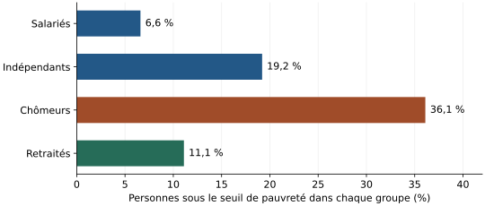
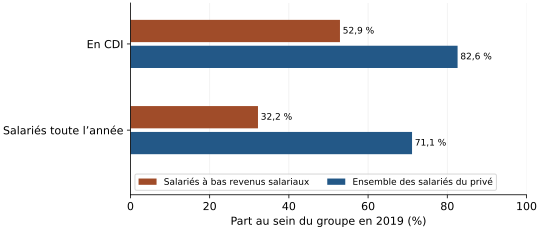
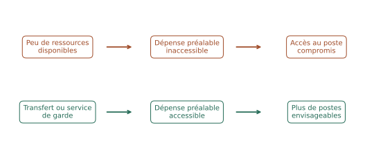

# BEL B/L — Sciences sociales 2026 · Corrigé brut

*Corrigé rédigé par IA, non officiel.*

**Rédaction** · modèle exact non renseigné (famille GPT-6) · effort non renseigné · vitesse non renseignée

**Lecture du rapport du jury** · GPT-6.2 Astra Ultra · vitesse non renseignée

**Révision** · GPT-6.2 Astra Ultra · vitesse non renseignée

**Révision (tour 2)** · GPT-6.2 Astra Ultra · vitesse non renseignée · 26 novembre 2026

**L’emploi contre la pauvreté ?**

## Introduction

Depuis le milieu des années 2010, la baisse du taux de chômage en France s’accompagne d’une hausse du taux de pauvreté. C’est ce que permet de lire le document 1, là où les deux courbes du dossier avaient plus souvent évolué dans le même sens auparavant. L’observation surprend si l’on admet qu’un revenu du travail doit protéger de la pauvreté. Pourtant, les deux taux n’ont pas le même dénominateur. Le chômage se mesure au sein des actifs, selon les critères du Bureau international du travail. Le taux de pauvreté monétaire mesure la part des personnes dont le niveau de vie est inférieur à un seuil, ici 60 % du niveau de vie médian. Ce niveau de vie rapporte le revenu disponible du ménage à ses unités de consommation. Avoir un emploi est une caractéristique individuelle. Être pauvre dépend aussi de la composition du foyer et de ses autres ressources.

Le point d’interrogation porte également sur le rôle que la collectivité donne à l’emploi. Y voit-elle une protection effectivement procurée par une activité rémunérée, une condition à réunir pour bénéficier d’un soutien ou un horizon vers lequel une politique cherche à conduire les personnes pauvres ? On peut occuper un emploi salarié ou indépendant, durable ou intermittent. Il existe aussi des activités indispensables à la vie du ménage, comme s’occuper d’un enfant, qui constituent du travail sans procurer le revenu ni les droits d’un emploi. **À quelles conditions l’accès à un emploi permet-il de sortir de la pauvreté, et que devient cette protection lorsqu’on fait du retour à l’emploi une obligation sans agir sur les emplois accessibles ?**

## I. En procurant un revenu, des droits et des liens durables, l’emploi peut soustraire un ménage à plusieurs formes de pauvreté

### Le risque monétaire dépend fortement de la situation d’activité

En France métropolitaine, dans le champ de l’enquête Revenus fiscaux et sociaux de 2023 (document 2), 8,3 % des personnes en emploi vivent sous le seuil de pauvreté, contre 36,1 % des chômeurs. L’écart est de 27,8 **points de pourcentage**. Il compare deux risques au sein de deux populations distinctes. Il ne représente pas le gain qu’une personne donnée obtiendrait en signant un contrat, car les caractéristiques et les ressources familiales des deux groupes diffèrent. La comparaison établit néanmoins que le chômage s’accompagne d’une exposition beaucoup plus fréquente à la pauvreté. La situation des retraités, dont 11,1 % sont sous le seuil, précise le mécanisme. On peut avoir cessé d’occuper un emploi et conserver un revenu lié aux périodes antérieures de travail et aux droits à pension acquis.

Le même tableau permet de changer de question. Combien de personnes pauvres occupent un emploi ? On en compte 2,264 millions, pour 796 000 chômeurs pauvres, soit environ 2,84 fois plus. Les personnes en emploi sont en effet beaucoup plus nombreuses dans la population. Ainsi le risque individuel mesuré est plus élevé au chômage, tandis qu’en nombre absolu la pauvreté atteint davantage de personnes en emploi. Une politique qui ne s’adresserait qu’aux chômeurs laisserait donc hors de son champ ces travailleurs pauvres.

Une heure supplémentaire rémunérée modifie d’abord les ressources d’un ménage. À prix inchangés, elle peut permettre de payer un déplacement ou de chauffer une pièce. Avec un revenu stable, la famille peut aussi engager une dépense dont le bénéfice est différé. Pouvoir avancer une caution ouvre l’accès à un logement proche d’un bassin d’emploi. L’emploi protège alors en élargissant les choix futurs. Une prestation qui rend possible le même investissement peut, réciproquement, faciliter l’accès à l’emploi. Le sens de la relation entre emploi et pauvreté mérite d’être établi et non présumé.

### La qualité de la protection est une construction collective

Le salaire versé ce mois-ci n’épuise pas ce que procure le salariat. Les protections contre la maladie, la vieillesse ou la perte d’emploi se sont construites avec des institutions qui mutualisent des risques individuels. Dans *Les Métamorphoses de la question sociale*, Robert Castel montre comment le salariat, longtemps synonyme de vulnérabilité, a pu devenir un support d’intégration. L’emploi stable permet également de nouer des relations, d’exercer un savoir reconnu et d’organiser son temps. L’enquête de Marie Jahoda, Paul Lazarsfeld et Hans Zeisel sur les chômeurs de Marienthal rend visible ce qui se perd lorsqu’une fermeture prive une communauté entière de ces points d’appui. Ces dimensions ne se confondent pas avec le revenu, mais elles pèsent sur la possibilité de sortir durablement d’une situation de privation.

Cette protection s’étend au-delà du titulaire de l’emploi. Dans les ménages d’auto-entrepreneurs étudiés par Sarah Abdelnour (document 7), le salaire stable d’un conjoint absorbe une partie des fluctuations de l’activité indépendante. L’accès au logement peut rester adossé au salariat du ménage. Le même chiffre d’affaires ne garantit donc pas le même niveau de sécurité à deux indépendants. Ce que nous attribuons à la seule activité de l’un peut être en partie produit par la situation professionnelle de l’autre.

## II. L’existence d’un poste ne garantit ni un volume annuel de travail suffisant ni un partage égal de la sécurité

### Compter les heures payées sur l’année

Le document 4 porte sur les salariés du privé en 2019 et met en regard des salariés durablement à bas revenus salariaux avec l’ensemble du champ. Le champ retient des salariés payés au moins 0,8 SMIC horaire et ayant travaillé au moins un mois et 152 heures dans l’année. Parmi les premiers, 52,9 % ont un CDI, contre 82,6 % des salariés du privé pris ensemble. Il serait erroné d’en déduire que la majorité des personnes en CDI sont pauvres. On observe ici la composition des groupes de salariés et un revenu salarial individuel, non la proportion de ménages pauvres au sein de chaque type de contrat. Le tableau indique également que 32,2 % seulement du premier groupe ont été salariés toute l’année, contre 71,1 % de l’ensemble. Cet écart de 38,9 points aide à comprendre comment un taux de salaire horaire et un revenu salarial annuel peuvent raconter deux histoires différentes.

Un contrat interrompu, des semaines sans heures payées ou un temps partiel subi empêchent de cumuler les revenus nécessaires. La segmentation entre un marché primaire d’emplois stables et un marché secondaire d’emplois peu sécurisés, analysée par Peter Doeringer et Michael Piore, donne une explication institutionnelle à cette répétition. Les trajectoires dépendent aussi des arrangements domestiques. Une personne qui assure seule une part importante des soins aux enfants ne peut accepter n’importe quel horaire ; l’insuffisance des solutions de garde pèse particulièrement sur les femmes. Les bas revenus ne se réduisent donc ni au prix d’une heure ni à une préférence individuelle pour le temps libre.

### Changer de catégorie statistique ne signifie pas sortir de la pauvreté

Le document 2 permet d’isoler un contraste au sein même de l’emploi. Les indépendants ont un niveau de vie médian de 28 200 euros, assez proche des 28 800 euros des salariés. Pourtant, 19,2 % des indépendants sont sous le seuil de pauvreté, contre 6,6 % des salariés. Les médianes ne décrivent pas le bas des distributions. L’enquête sur les auto-entrepreneurs éclaire l’hétérogénéité que masquent ces agrégats. Tel enquêté complète un salaire, tel autre tente de constituer une activité principale avec une clientèle incertaine. Une inscription comme indépendant peut accompagner la sortie de la catégorie A des demandeurs d’emploi avant que cette activité n’assure un revenu suffisant. Les catégories administratives de demandeurs d’emploi et les catégories du BIT répondent d’ailleurs à des définitions différentes.

Cela aide à interpréter la divergence constatée au document 1. Une économie peut créer des emplois à faible volume horaire ou à revenus très variables et voir reculer le chômage sans réduire autant la pauvreté. Des personnes sans emploi peuvent aussi cesser d’être comptées dans le chômage lorsqu’elles ne remplissent plus les critères de disponibilité ou de recherche active. La figure nationale ne permet pas à elle seule de départager ces mécanismes. Il faudrait suivre les transitions des individus et les revenus de leurs ménages avant et après la reprise d’un emploi. Une politique évaluée uniquement sur le nombre d’entrées en emploi risque donc de tenir pour acquise la protection qu’elle devrait mesurer.

## III. Pour faire de l’emploi une protection, il faut agir sur les obstacles à l’activité autant que sur les conditions de sa rémunération

### Séparer l’incitation financière et les contraintes qui empêchent de travailler

Le document 3 discute deux sens de la « trappe ». Dans un modèle d’offre de travail, accepter une activité peut apporter un faible supplément de revenu disponible si des transferts diminuent et si le déplacement et la garde deviennent payants. Cette comparaison est pertinente pour une offre accessible, à un salaire et à des horaires déterminés. Elle n’explique pas le chômage de celui à qui aucun employeur ne propose de poste. Dans un autre mécanisme, c’est la faiblesse des ressources initiales qui empêche un investissement rentable. Un ménage ne peut payer à l’avance une réparation ou un abonnement de transport, manque un poste puis reste privé du revenu qui aurait financé cette dépense. Ici, un transfert ou un service de garde peut rompre le cercle et accroître la possibilité de travailler. Les deux mécanismes conduisent à des évaluations fort différentes d’une même aide.

Le document 5 éclaire les normes qui orientent ces politiques. Entre 1990 et 2022, le graphique permet de comparer les trajectoires des montants du RMI puis du RSA, de l’AAH et du minimum vieillesse devenu ASPA, rapportés au SMIC net à temps plein. À la fin de la période, le forfait du RSA représente environ 35 % du SMIC net, contre plus de 55 % pour le montant maximal de l’AAH. Ce sont des ratios de barèmes, pas des taux de pauvreté de leurs bénéficiaires. La divergence traduit notamment le traitement différencié des catégories jugées capables de travailler. Les minima financés par la solidarité nationale relèvent de l’assistance ; on ne peut expliquer leur évolution relative par la baisse des cotisations d’un salarié. Maintenir une incitation financière n’implique pas que chaque bénéficiaire dispose d’une offre adéquate ni qu’une baisse du soutien améliore sa capacité de recherche.

### Évaluer le contenu d’un accompagnement et le résultat pour le ménage

Le document 6 analyse les politiques d’activation et la loi pour le plein emploi de 2023. Le rapprochement des fichiers par France Travail peut mieux renseigner sur les situations. Les heures d’activité demandées selon les parcours ne correspondent pas nécessairement à des heures d’emploi rémunéré. L’accompagnement individualisé peut permettre de repérer un problème de mobilité ou d’orienter une personne vers une formation. Le contrôle des démarches et les sanctions associées peuvent aussi faire peser sur les bénéficiaires la responsabilité de l’absence d’emploi. Une difficulté commune à tout un territoire, par exemple la fermeture de son principal employeur, est alors traitée comme un défaut individuel de recherche. Réduire une allocation peut aggraver la privation en attendant une embauche incertaine. Le contraste entre l’accompagnement et la sanction doit donc être testé sur les moyens réellement engagés et sur les situations des personnes, pas seulement sur le vocabulaire administratif du dispositif.

Une évaluation adaptée suivrait au moins la durée de l’emploi, les heures rémunérées, les gains nets de transferts et de frais ainsi que le niveau de vie de tous les membres du ménage. Elle comparerait les trajectoires à celles de personnes similaires confrontées aux mêmes possibilités d’embauche. Si l’obstacle est la rareté des postes, améliorer le seul appariement ne suffit pas. Si l’obstacle est l’instabilité des heures, une meilleure prévisibilité peut protéger davantage qu’une simple succession de placements. L’enjeu des politiques de l’emploi est ainsi de modifier les conditions collectives dans lesquelles un travail rémunéré devient une ressource durable.

## Conclusion

L’emploi protège fréquemment de la pauvreté parce qu’il apporte des ressources et peut ouvrir des droits utilisables bien au-delà du mois travaillé. La comparaison des salariés, des indépendants et des chômeurs confirme l’importance de cette protection tout en montrant ses conditions. Elle dépend de la continuité des revenus, du statut, des solidarités du ménage et des institutions qui permettent de faire face aux interruptions. Une politique qui fait de l’emploi une simple contrepartie risque de fragiliser les ressources nécessaires pour y accéder. Son succès se mesure à la diminution durable des privations des ménages, ce qui oblige à regarder comment et combien les personnes travaillent après leur retour à l’emploi.

## Vérification sur le sujet

Les sept documents du fac-similé et leur analyse par le jury ont été vérifiés dans les deux copies. Les données du tableau d’activité distinguent taux par statut, effectifs en milliers et revenu du ménage par unité de consommation.

Dans le document 2, parmi les 2,264 millions de personnes pauvres en emploi, 1,574 million sont salariées et 0,690 million indépendantes. Les indépendants constituent environ 30,5 % des personnes pauvres en emploi, alors que le taux de pauvreté au sein des indépendants est de 19,2 %. Le premier calcul renseigne sur la composition de la population à protéger. Le second renseigne sur le risque au sein d’un statut. Leur distinction permet de soutenir simultanément deux politiques, l’une visant un groupe vulnérable, l’autre tenant compte du nombre de personnes concernées.
