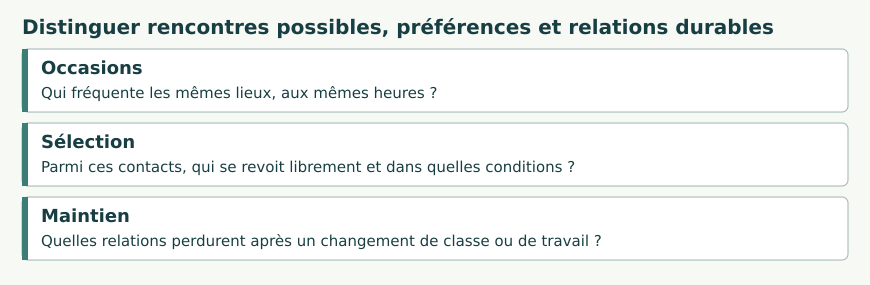

# ENS B/L · Sociologie (oral à option) — 25 juin, sujet 1 (2026) · Corrigé brut

*Corrigé rédigé par IA, non officiel. Signalez toute erreur.*

**Rédaction** · GPT-6.2 Astra Ultra · vitesse non renseignée

**Autocontrôle** · GPT-6.2 Astra Ultra · vitesse non renseignée

**Révision (tour 1)** · GPT-6.2 Astra Ultra · vitesse non renseignée

**Révision (tour 2)** · GPT-6.2 Astra Ultra · vitesse non renseignée · 26 novembre 2026

**Couverture vérifiée.** Les deux intitulés de la planche ont chacun un exposé complet dans les deux éditions. La relecture a porté sur les fins poursuivies, les conditions de décision et la sélection des liens amicaux. Les exemples d’enquête rendent explicite ce qui permettrait de départager les interprétations.

Le candidat choisit un seul des deux sujets après le tirage de la planche. Le jury accorde 1 h 30 de préparation, puis 15 minutes d’exposé et 15 minutes de discussion. Les deux développements correspondent aux deux choix possibles.

## Les élites sont-elles rationnelles ?

Une dirigeante publique qui refuse un poste très rémunéré à l’étranger peut paraître choisir contre son intérêt. Mais lequel ? Conserver une influence au sein d’un corps, prolonger un projet professionnel ou rendre compatible une carrière avec une vie familiale sont aussi des fins possibles. Par « élites », j’entends ici les groupes placés durablement en position de décider de l’accès à des ressources rares. Les dirigeants économiques, politiques et administratifs n’occupent pas les mêmes positions. La question n’est donc soluble ni par un jugement sur leur intelligence ni par le récit de ce que chacun dit avoir voulu. Comment les institutions forment-elles leurs critères de choix, et comment les choix ainsi produits affectent-ils l’action collective ?

**Des raisonnements socialement formés.** Weber distingue une action organisée en fonction d’une fin et une action conduite par fidélité à une valeur. Cette différence éclaire le cas de deux membres d’une grande école qui choisiraient la même carrière publique, l’un pour l’avantage professionnel futur, l’autre par conception du service. Dans *La Noblesse d’État*, Bourdieu étudie comment les institutions scolaires distinguent, classent et consacrent leurs élèves. Le rang, les conseils des anciens et ce que les pairs considèrent comme une réussite rendent certains choix plus pensables que d’autres. On peut comparer les vœux d’affectation avant et après une expérience de terrain pour déterminer à quel moment un projet change.

**Une décision raisonnable pour chaque membre peut devenir coûteuse pour le groupe.** Le recrutement par cooptation réduit l’incertitude du recruteur. Un candidat recommandé par un collègue a un parcours qu’il pense pouvoir évaluer. Répétée dans toute une organisation, la pratique risque de reproduire les mêmes informations et de laisser passer une erreur partagée. Le scandale d’une mauvaise prévision ne prouve pas à lui seul l’irrationalité des individus. Il faut retrouver quelles informations circulaient, qui pouvait contredire une prévision et ce que coûtait ce désaccord en carrière.

Pour distinguer objectif et rationalité, un dossier de décision devrait conserver les propositions écartées, les informations disponibles ce jour-là et les objections consignées. Qu’un investissement échoue après un changement de conjoncture renseigne sur sa conséquence. L’irrationalité du choix demanderait une autre preuve, par exemple que ses propres partisans ont laissé de côté une information accessible et pertinente au regard de leur objectif.

**La capacité à imposer un calcul fait partie du pouvoir.** Un dirigeant peut défendre une fermeture de service en comparant deux budgets. Le temps désormais passé par les usagers ne figure dans aucun des deux. Une autre comptabilité peut rendre le choix contestable. Les élites raisonnent avec des instruments et des catégories dont elles contribuent à définir la valeur. Une enquête solide comparerait leurs calculs avant la décision, les justifications publiques et les conséquences observées, y compris pour les groupes qui n’ont pas participé à la décision.

## L’amitié

On dit volontiers que l’on choisit ses amis. Pourtant deux personnes présentant des goûts identiques peuvent ne jamais se rencontrer. La présence régulière dans le même établissement, la possibilité d’inviter chez soi et le temps libre contribuent à déterminer quelles affinités deviendront des relations durables. Une amitié se distingue d’une simple coprésence par une reconnaissance personnelle et une certaine réciprocité. Comment expliquer sa sélectivité sociale sans retirer aux amis le choix dont ils font effectivement l’expérience ?

**L’organisation de la rencontre.** La sociologie des réseaux appelle homophilie la fréquence des liens entre personnes semblables. Une part de cette ressemblance vient de la composition du collège, du quartier ou du métier. Dans une classe presque entièrement issue d’un même milieu, la majorité des amitiés se formera à l’intérieur de celui-ci, même sans préférence. Les travaux de Claire Bidart sur l’amitié suivent l’enchaînement des rencontres et des transformations du lien. On gagne à comparer les amis déclarés aux personnes que chacun avait concrètement l’occasion de fréquenter.

À la rentrée, deux élèves peuvent se revoir chaque jour parce que leur emploi du temps les réunit. Si l’une change de classe, un rendez-vous librement pris ou une invitation chez elle donne une autre indication sur la relation. Suivre le même binôme avant et après le changement permet de distinguer la rencontre imposée par l’établissement du travail nécessaire pour entretenir une amitié.

**Du camarade à l’ami.** Affronter ensemble une épreuve, se confier ou échanger des visites détache progressivement la relation du cadre où elle est née. Ce passage demande des ressources. Un salarié qui dispose de ses soirées peut répondre régulièrement à une invitation, alors qu’un collègue dont les horaires changent et qui prend soin d’un enfant y renonce. Avec le temps, cette répétition peut être interprétée comme un manque d’affinité. Une enquête sur les emplois du temps donne alors un sens différent à l’entretien où chacun affirme simplement avoir suivi ses préférences.

Une enquête de réseau peut comparer la part d’amis de même origine dans deux classes. Si tous les élèves d’une classe ont la même origine, presque toute amitié interne sera homogène, même avec des choix indifférents à l’origine. Comparer les affinités exige donc de reconstruire les personnes que chacun a eu l’occasion de rencontrer, puis de séparer les liens déclarés d’un seul côté des liens réciproques.

**La relation agit à son tour sur les trajectoires.** Une amie peut procurer une aide quotidienne ou révéler une voie d’études jusque-là inconnue. Il faut distinguer ce soutien des informations inédites que peuvent fournir des relations moins proches, comme le montre Granovetter à propos des liens faibles dans la recherche d’emploi. Un ami rencontré au travail peut aussi maintenir un attachement alors que les positions s’éloignent. L’amitié apparaît ainsi comme une relation élective produite dans des cadres sociaux, assez consistante parfois pour survivre à leur disparition. Pour le vérifier, on suivrait les mêmes relations après un déménagement ou un changement de métier.

[Planche officielle](https://www.ens.psl.eu/sites/default/files/elites_amitie.pdf) · [Rapport du jury](https://www.ens.psl.eu/sites/default/files/2026_bl_rapport_oral_option_sociologie.pdf)
