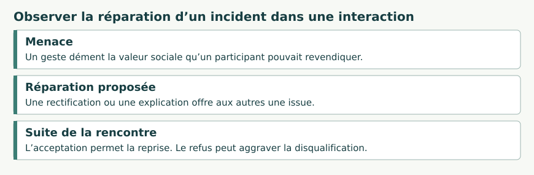

# ENS B/L · Sociologie (oral à option) — 25 juin, sujet 4 (2026) · Corrigé brut

*Corrigé rédigé par IA, non officiel. Signalez toute erreur.*

**Rédaction** · GPT-6.2 Astra Ultra · vitesse non renseignée

**Autocontrôle** · GPT-6.2 Astra Ultra · vitesse non renseignée

**Révision (tour 1)** · GPT-6.2 Astra Ultra · vitesse non renseignée

**Révision (tour 2)** · GPT-6.2 Astra Ultra · vitesse non renseignée · 26 novembre 2026

**Couverture vérifiée.** Les deux intitulés de la planche ont chacun un exposé complet dans les deux éditions. La relecture a porté sur les rites de réparation et le problème de la représentation des intérêts communs d’une classe. Les exemples d’enquête rendent explicite ce qui permettrait de départager les interprétations.

Le candidat choisit un seul des deux sujets après le tirage de la planche. Le jury accorde 1 h 30 de préparation, puis 15 minutes d’exposé et 15 minutes de discussion. Les deux développements correspondent aux deux choix possibles.

## Garder la face

Un enseignant se trompe de prénom, l’élève répond et la classe poursuit la discussion sans souligner l’erreur. Personne n’a grandi en prestige, mais tous ont contribué à rendre l’interaction viable. Chez Erving Goffman, la face désigne la valeur sociale positive qu’une personne revendique implicitement par la ligne de conduite que les autres lui attribuent dans une rencontre. Avoir une réputation en dehors de la salle ne suffit pas à la conserver dans l’échange. Comment une propriété si personnelle dépend-elle du travail des autres, et quelles inégalités règlent ce travail ?

**Une coopération observable.** Dans *Les Rites d’interaction*, Goffman décrit les pratiques par lesquelles les partenaires évitent un incident ou en réparent les conséquences. L’auteur de l’erreur rectifie, un interlocuteur accepte l’explication, les autres reprennent le fil. La réparation se distingue d’un sentiment intérieur de honte. Elle demande des gestes publics et peut réussir même si la gêne persiste. Inversement, insister sur l’importance d’une bévue au moment de présenter des excuses peut la rendre plus visible. On observerait les silences, les changements de sujet et les reprises avant de demander après coup ce que chacun pensait avoir fait.

Au guichet, l’usager qui a oublié un justificatif peut proposer de le rapporter le lendemain. Si l’agent lui donne un nouveau rendez-vous et revient aux autres pièces du dossier, la suite de la conversation atteste que la réparation a été acceptée. Si l’agent continue à lui reprocher l’oubli, le même geste ouvre une autre séquence.

**Les protections sont socialement distribuées.** Un conseiller reçoit un usager qui n’a pas apporté une pièce attendue. Décrire l’incident comme une difficulté réparable préserve la possibilité d’une demande ultérieure. Le qualifier d’irresponsabilité risque de disqualifier la personne et sa requête ensemble. Le conseiller peut agir sur l’accès à une ressource. L’usager dépend davantage de la poursuite courtoise de l’échange. L’étude des guichets de Vincent Dubois permet précisément de relier le face-à-face à la position institutionnelle de ceux qui s’y rencontrent. La réciprocité rituelle ne donne donc pas les mêmes moyens d’exiger une réparation.

Deux réunions peuvent comporter la même erreur de prénom. Dans la première, le destinataire corrige discrètement et les autres reprennent la discussion. Dans la seconde, le président exige une justification publique. En comparant la séquence des interventions et la possibilité de reprendre la parole, on saisit le travail collectif qui rend la réparation possible et le pouvoir inégal de l’accepter.

**Quand les publics se multiplient.** Une maladresse tolérée entre collègues peut devenir une faute si un extrait de la discussion circule ailleurs. Le contexte et ceux qui avaient accepté la réparation disparaissent. Dans un entretien de recrutement à distance, il serait intéressant d’observer comment un incident technique est attribué au candidat, à l’outil ou à l’organisation. Garder la face est ainsi un accomplissement collectif sous contraintes. Sa perte produit des effets durables quand l’institution inscrit le jugement local dans un dossier ou une évaluation.

## « Le gouvernement moderne n’est qu’un comité qui gère les affaires communes de toute la classe bourgeoise » (Friedrich Engels et Karl Marx, 1848)

La formule de Marx et Engels, tirée du *Manifeste du parti communiste* (1848), donne au gouvernement moderne la fonction d’un comité chargé des affaires communes de la classe bourgeoise. « Communes » est ici décisif. Un gouvernement peut contrarier un propriétaire particulier tout en maintenant des conditions dont dépend une économie fondée sur la propriété et le salariat. Comment étudier cette relation sans supposer que chaque décision ministérielle se lit directement dans la volonté d’un capitaliste ?

**Ce que la mise en commun exige.** Des entreprises concurrentes peuvent souhaiter individuellement payer moins d’impôts tout en ayant besoin d’infrastructures, d’un droit des contrats et d’une monnaie stable. Ces biens et règles supposent une organisation susceptible d’imposer des décisions collectives. La thèse de 1848 invite donc à examiner le contenu social des institutions présentées comme universelles. Une enquête suivrait l’élaboration d’une norme, la distribution des coûts entre entreprises et salariés et la façon dont les organisations patronales formulent un intérêt commun. Le succès d’une entreprise après une réforme ne suffit pas à prouver qu’elle l’a commandée.

**Les mécanismes de transmission sont pluriels.** Le passage de responsables entre ministères et entreprises facilite des échanges d’informations et une familiarité commune. Une dépendance fiscale ou la crainte de pertes d’emplois peut aussi orienter une décision même en l’absence de rencontre personnelle. Ces mécanismes donnent des prédictions différentes. Le premier conduit à rechercher des carrières, des correspondances et des interventions concrètes. Le second exige de comparer les choix d’administrations soumises à des contraintes économiques différentes. La bourgeoisie est de surcroît divisée entre secteurs, créanciers, employeurs et propriétaires de tailles diverses.

Prenons une règle uniforme d’information comptable. Une entreprise peut combattre le coût immédiat de la règle alors que plusieurs créanciers y voient une condition de confiance dans l’ensemble du marché. Pour éprouver la formule du Manifeste, il faudrait reconstituer les désaccords patronaux, les arbitrages administratifs et les bénéficiaires effectifs. La convergence finale avec des intérêts économiques ne suffit pas à prouver que chaque décision a été dictée en amont.

**L’autonomie politique a des effets observables.** Dans *Le 18 Brumaire de Louis Bonaparte*, Marx lui-même analyse les divisions de classe, leurs formes de représentation et l’autonomisation du pouvoir exécutif dans une conjoncture donnée. Les administrations ont également leurs savoirs et leurs intérêts professionnels. Des mobilisations salariales ou électorales peuvent faire adopter des protections auxquelles s’opposent des employeurs. Pour juger la formule, il faut examiner la chronologie de la décision et ce que les groupes opposés pouvaient obtenir. La formule éclaire la construction étatique des conditions de l’accumulation. Comme explication exhaustive de chaque politique, elle laisserait inexpliqués les conflits et les compromis qui en déterminent la forme.

[Planche officielle](https://www.ens.psl.eu/sites/default/files/marx_face.pdf) · [Rapport du jury](https://www.ens.psl.eu/sites/default/files/2026_bl_rapport_oral_option_sociologie.pdf)
