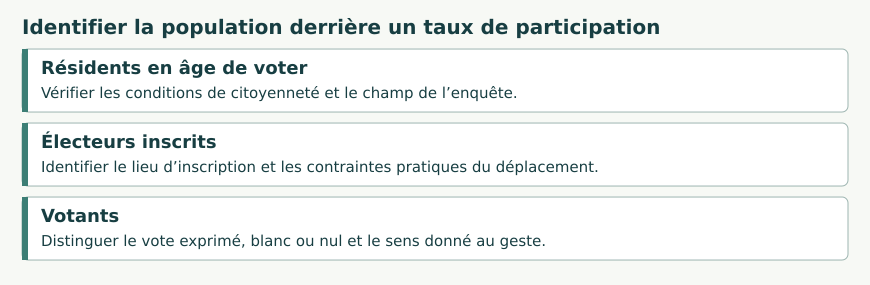

# ENS B/L · Sociologie (oral à option) — 26 juin, sujet 1 (2026) · Corrigé guidé

*Corrigé rédigé par IA, non officiel. Signalez toute erreur.*

**Rédaction** · GPT-6.2 Astra Ultra · vitesse non renseignée

**Autocontrôle** · GPT-6.2 Astra Ultra · vitesse non renseignée

**Révision (tour 1)** · GPT-6.2 Astra Ultra · vitesse non renseignée

**Révision (tour 2)** · GPT-6.2 Astra Ultra · vitesse non renseignée · 26 novembre 2026

**Couverture vérifiée.** Les deux intitulés de la planche ont chacun un exposé complet dans les deux éditions. La relecture a porté sur les dénominateurs de la participation électorale et les rétributions du désintéressement. Les exemples d’enquête rendent explicite ce qui permettrait de départager les interprétations.

Le candidat choisit un seul des deux sujets après le tirage de la planche. Le jury accorde 1 h 30 de préparation, puis 15 minutes d’exposé et 15 minutes de discussion. Les deux développements correspondent aux deux choix possibles. Pour préparer l’exposé, annoncer une question précise, développer chaque mécanisme à partir d’une enquête ou d’une situation et indiquer quelles observations permettraient de départager deux explications. Chaque développement est suivi d’un exercice de préparation et d’une relance.

## « Élections, pièges à cons » ?

Ce slogan transforme un acte ordinairement célébré comme devoir civique en soupçon de dépossession. Il faut identifier ce qui ferait « piège ». Le dispositif pourrait masquer des inégalités de participation, enfermer des aspirations dans une offre que les électeurs n’ont pas choisie, ou substituer périodiquement le vote à tout autre moyen de s’exprimer. Mais prendre le slogan à la lettre ferait disparaître les situations où une élection permet précisément une sanction ou un changement de politique. Quelles conditions transforment le droit de voter en prise effective sur les décisions ?

**Une invitation formellement égale peut être socialement sélective.** Dans *Le Cens caché*, Daniel Gaxie relie l’inégalité de participation aux ressources et au sentiment de compétence politique. Céline Braconnier et Jean-Yves Dormagen, dans *La Démocratie de l’abstention*, étudient aussi la mal-inscription et les mobilisations familiales et locales. Le rendez-vous électoral suppose une inscription au bon endroit, une disponibilité et parfois une incitation de l’entourage. Des votes exprimés également dans l’urne sont précédés d’inégalités de possibilité de s’y rendre. Pour les mesurer, il faut distinguer population en âge de voter, électeurs inscrits et votants.

**Qui fixe les termes du choix ?** Les partis recrutent des candidats, élaborent les programmes et hiérarchisent les enjeux. Une contestation portant sur un problème local peut avoir du mal à entrer dans une offre nationale. De plus, choisir le même bulletin peut signifier approuver un programme, s’opposer à un adversaire ou rester fidèle à un groupe. Le résultat agrège ces sens sans les restituer. Une enquête auprès des électeurs complétée par l’étude de la campagne permet de comprendre ce travail de traduction. La délégation libère du temps et rend possible l’action à grande échelle, mais elle donne aux représentants le pouvoir d’interpréter le mandat.

L’abstention peut aussi changer de signification au cours de la vie d’une même personne. Après un déménagement, elle peut rester inscrite loin de son domicile ; une autre fois, elle peut renoncer au vote par défiance. Des entretiens répétés, rapprochés du lieu d’inscription et de la compétition proposée, aideraient à séparer la contrainte pratique du refus politique. Une seule proportion départementale confond ces mécanismes.

**L’issue conserve une portée conditionnelle.** Une alternance peut modifier un budget, la composition d’une assemblée et la trajectoire d’une revendication. Même un candidat battu peut introduire un enjeu jusque-là écarté. L’élection prend alors sens dans un ensemble de mobilisations, d’organisations et de contrôles qui la précèdent et la suivent. Une abstention voulue comme protestation sera confondue dans les totaux avec une absence liée au déménagement. Le piège apparaît lorsque des suffrages socialement et politiquement ambigus sont présentés comme une approbation complète. Ces limites justifient de chercher quand et pour qui le vote permet néanmoins d’obtenir un résultat.

### Préparer la discussion du sujet A

Comparer le nombre d’inscrits, les bulletins déposés et les voix retenues dans les suffrages exprimés. Une différence de dénominateur fait apparaître des phénomènes politiques différents. Le slogan invite ensuite à interroger la construction des choix disponibles.

> [!INDICATION]
> Une hausse de la participation signifie-t-elle une réduction des inégalités politiques ?

La participation peut augmenter surtout dans des groupes déjà mobilisés. Il faut comparer les variations par groupe et vérifier ensuite comment leurs enjeux entrent dans les candidatures et les décisions.

Dans un bureau fictif de 80 inscrits, 60 votent. Parmi leurs bulletins se trouvent cinq blancs et deux nuls. La participation reste de 60 sur 80 inscrits, soit 75 %. Les 53 suffrages exprimés forment ensuite le dénominateur qui sert à mesurer le score d’une candidature.

## Avoir intérêt au désintéressement

Un chercheur communique ses données pour qu’un autre laboratoire puisse les vérifier. Il peut être sincèrement attaché à la connaissance et recevoir du prestige de son geste. L’enjeu est de comprendre comment une conduite qui écarte un profit immédiat devient tenable et reconnue. Par intérêt, on peut désigner un gain anticipé, l’attachement à un milieu ou le bénéfice effectivement obtenu après coup. Les confondre conduirait à faire de tout geste généreux une ruse impossible à réfuter.

**Des mondes où certaines rétributions comptent plus que d’autres.** Pour Bourdieu, l’illusio est l’investissement dans les enjeux propres à un champ. Le scientifique qui renonce à un contrat lucratif pour préserver l’indépendance de sa recherche peut valoriser une reconnaissance par les pairs qui ne s’achète pas directement. Les institutions enseignent les conduites dignes de cette reconnaissance et sanctionnent parfois leur conversion trop visible en avantages matériels. Observer les carrières et les décisions de revues permet d’établir quelles récompenses existent effectivement. Leur existence ne prouve pas que la personne ait consciemment calculé leur rendement.

Une action peut procurer à son auteur une réputation sans avoir été entreprise dans ce but. Pour établir un intérêt sociologique au désintéressement, on peut suivre ce qu’un collectif distingue et sanctionne, par exemple la visibilité du partage des données et les conditions d’une promotion scientifique. La seule constatation d’un avantage ultérieur ne permet pas d’attribuer un calcul secret au chercheur.

**Le décalage temporel entretient plusieurs significations.** Dans l’analyse maussienne du don, le retour n’est pas un prix fixé et immédiatement exigible. Il suppose une relation et laisse ouverte la forme de la réponse. Bénévoles et associations peuvent acquérir des compétences ou des réseaux, et pourtant poursuivre des fins collectives auxquelles ils tiennent. Une personne disposant d’un revenu stable peut plus facilement supporter une activité durablement gratuite. La présentation comme seul don de soi risque alors d’invisibiliser le coût payé par ceux qui ont peu de temps disponible. Des entretiens répétés à l’entrée, après une promotion et après une déception permettent de suivre l’évolution de l’engagement.

**Qui décide de la sincérité ?** Un même geste peut être valorisé chez un bénévole ancien et soupçonné de communication chez un nouvel arrivant. Comparer les jugements des bénéficiaires, des pairs et des bailleurs éclaire les intérêts de ceux qui attribuent le désintéressement. Un geste anonyme sans perspective de reconnaissance constitue aussi une épreuve pour l’hypothèse d’une recherche systématique de prestige. La sociologie gagne à montrer les conditions sociales d’un engagement sincère, les rétributions qu’il autorise et les usages inégaux qu’on peut en faire. Elle doit encore établir, pour chaque cas, lesquelles ont compté.

### Préparer la discussion du sujet B

Tester trois interprétations d’un même don. Le donateur a-t-il anticipé un profit, tient-il aux enjeux d’un milieu, ou a-t-il reçu une gratification inattendue ? Les conséquences ultérieures ne fournissent pas à elles seules la réponse.

> [!INDICATION]
> Que montre le refus public d’une récompense ?

Il peut traduire une conviction, préserver une autonomie ou produire une autre reconnaissance. L’issue symbolique observable n’établit pas la motivation. On peut étudier les raisons déjà exprimées avant la proposition et les conséquences du refus sur les relations de travail.

[Planche officielle](https://www.ens.psl.eu/sites/default/files/election_desint.pdf) · [Rapport du jury](https://www.ens.psl.eu/sites/default/files/2026_bl_rapport_oral_option_sociologie.pdf)
