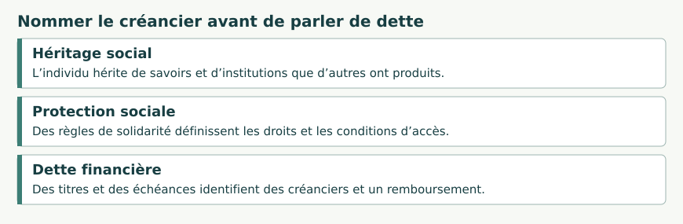

# ENS B/L · Sociologie (oral à option) — 26 juin, sujet 2 (2026) · Corrigé guidé

*Corrigé rédigé par IA, non officiel. Signalez toute erreur.*

**Rédaction** · GPT-6.2 Astra Ultra · vitesse non renseignée

**Autocontrôle** · GPT-6.2 Astra Ultra · vitesse non renseignée

**Révision (tour 1)** · GPT-6.2 Astra Ultra · vitesse non renseignée

**Révision (tour 2)** · GPT-6.2 Astra Ultra · vitesse non renseignée · 26 novembre 2026

**Couverture vérifiée.** Les deux intitulés de la planche ont chacun un exposé complet dans les deux éditions. La relecture a porté sur les trois sens de la dette sociale et les modes d’appropriation culturelle. Les exemples d’enquête rendent explicite ce qui permettrait de départager les interprétations.

Le candidat choisit un seul des deux sujets après le tirage de la planche. Le jury accorde 1 h 30 de préparation, puis 15 minutes d’exposé et 15 minutes de discussion. Les deux développements correspondent aux deux choix possibles. Pour préparer l’exposé, annoncer une question précise, développer chaque mécanisme à partir d’une enquête ou d’une situation et indiquer quelles observations permettraient de départager deux explications. Chaque développement est suivi d’un exercice de préparation et d’une relance.

## La dette sociale

Une personne qui reçoit une prestation dit parfois avoir « cotisé toute sa vie », une autre qu’elle doit à la collectivité les études qui lui ont permis de travailler. La première revendique une créance, la seconde reconnaît une dette. Dans les deux cas, une relation sociale est interprétée dans le vocabulaire de l’obligation. Il faut en distinguer un troisième usage, comptable, quand des déficits passés de la protection sociale font l’objet d’un financement. Qui doit quoi, à qui, et comment la réponse change-t-elle selon l’institution qui tient les comptes ?

**L’héritage commun comme fondement de la solidarité.** À la fin du XIXe siècle, le solidarisme de Léon Bourgeois souligne que chacun bénéficie d’institutions, de techniques et de connaissances accumulées avant sa naissance. La dette envers la société ne résulte pas d’un contrat individuellement négocié. L’idée de quasi-contrat cherche à fonder des obligations réciproques sur l’interdépendance. Celui qui bénéficie d’un réseau d’instruction contribue, par exemple, à sa transmission. Reste à déterminer la répartition de la charge. Deux diplômés aux revenus très différents ont reçu des enseignements voisins, mais n’ont ni la même capacité contributive ni nécessairement les mêmes bénéfices professionnels.

Pour comparer deux discours sur la dette sociale, préciser dans chaque cas le créancier, la date exigible et ce qui éteindrait l’obligation. Un titre arrivant à échéance permet au porteur de réclamer le paiement prévu. La dette envers les générations qui ont financé une école n’a ni porteur individuel ni date d’extinction. Elle peut néanmoins soutenir une revendication politique de solidarité entre générations.

**Une institution transforme les rapports entre donneur et receveur.** Dans une assurance sociale, des règles fixent les conditions d’ouverture d’un droit. Les cotisations et les risques sont mutualisés. Le versement à une personne malade ne se calcule donc pas comme le retrait de son épargne individuelle. Dans une assistance soumise à conditions de ressources, les justificatifs demandés peuvent faire éprouver différemment la dépendance à la collectivité. Les enquêtes aux guichets permettent d’observer comment un droit devient une demande jugée plus ou moins légitime par l’agent et par le demandeur lui-même. Le non-recours modifie ensuite la distribution réelle de la dépense.

**Que signifie reporter une dette dans le temps ?** En France, la CADES créée en 1996 amortit des dettes sociales qui lui ont été transférées. Une dette financière a des créanciers identifiables, des échéances et des recettes affectées. La dette morale des générations les unes envers les autres n’a pas ces mêmes propriétés. Dire que « les jeunes paieront » sans examiner les prestations reçues, les prélèvements, les patrimoines transmis et les inégalités au sein d’une génération confond ces niveaux. On peut comparer plusieurs cohortes, à la fois selon leurs contributions et selon les risques dont la couverture les a protégées. Le langage de la dette éclaire la réciprocité, mais l’enquête doit encore dire qui est reconnu comme créancier et qui peut effectivement faire valoir ses droits.

### Préparer la discussion du sujet A

Suivre une cotisation, une prestation et un titre de dette. Identifier dans chaque cas la personne ou l’institution qui verse, celle qui reçoit et la règle qui fixe le montant. Revenir ensuite à la dette morale de Bourgeois.

> [!INDICATION]
> Un système de retraite par répartition est-il une dette financière au sens d’une obligation négociable ?

Les cotisations actuelles financent des pensions actuelles selon des droits définis par la loi. Les engagements futurs peuvent être étudiés et projetés. Ils n’ont pas pour autant les mêmes créanciers, échéances ou modalités de cession qu’un titre financier.

Pour suivre les positions de débiteur et de créancier, partez du bénéficiaire d’une prestation. Il peut en réclamer le versement lorsque les conditions légales sont réunies. S’il se dit redevable aux générations précédentes, identifiez ensuite le collectif envers lequel il exprime cette obligation et le type de retour envisageable.

## La distinction : permanences et mutations

Deux personnes écoutent le même morceau. L’une le tient pour un souvenir familial, l’autre pour une rareté qu’elle est fière d’avoir découverte. Une distribution sociale des goûts peut se déplacer des objets choisis aux façons de les découvrir, de les nommer et de les présenter. La distinction suppose un classement des pratiques et un jugement sur leurs pratiquants. Comment reconnaître une permanence de ce mécanisme lorsque les répertoires culturels se transforment ?

**Goûts et conditions d’appropriation.** Dans *La Distinction* (1979), Bourdieu relie préférences, manières et styles de vie au volume et à la composition des capitaux. Un haut diplôme et un revenu élevé ne dotent pas nécessairement leurs détenteurs des mêmes ressources culturelles. Le cours de musique dans l’enfance, les conversations familiales, la proximité d’un équipement et la maîtrise du langage critique conditionnent l’expérience d’un concert. Un prix d’entrée réduit n’efface pas automatiquement ces différences. On distinguerait fréquentation, familiarité avec les codes et sentiment d’être à sa place.

Une liste de titres écoutés sur une plateforme peut attribuer le même éclectisme à deux auditeurs. Un entretien sur la découverte des œuvres, la capacité à en parler et les publics devant lesquels on les cite peut faire apparaître des usages différents. Comparer ménages de même âge situés à des positions sociales différentes permettrait aussi de séparer une frontière sociale d’un simple effet de génération.

**L’éclectisme change le terrain de l’enquête.** Les travaux de Richard Peterson et Roger Kern sur la musique aux États-Unis ont popularisé l’image de l’omnivore culturel. Certains groupes à statut élevé déclarent apprécier un répertoire étendu, au-delà des seuls genres consacrés. L’équivalence des goûts ne s’ensuit pas. Pouvoir circuler entre les genres, choisir certains artistes et commenter ce choix peut être en soi une compétence distinctive. Bernard Lahire, dans *La Culture des individus*, examine la pluralité des socialisations et les profils dissonants au sein d’un même individu. Les cas atypiques obligent à préciser l’échelle de l’analyse sans faire disparaître les inégalités entre groupes.

**Une plateforme rend-elle les frontières plus faibles ?** Un catalogue commun rend une écoute peu coûteuse, tandis que les réseaux amicaux, les recommandations et le temps de recherche différencient les découvertes. Pour tester une mutation, on comparerait plusieurs cohortes et des personnes de milieux différents au même âge. Les historiques d’écoute donneraient la variété observée et les entretiens le sens que chacun attribue à cette variété. Une permanence de la distinction ne se prouve pas en trouvant après coup un détail qui sépare deux groupes. Il faut établir le classement qui donne valeur à ce détail et ses conséquences, par exemple lors d’une rencontre où des codes culturels fondent une reconnaissance mutuelle.

### Préparer la discussion du sujet B

Construire deux portraits qui déclarent écouter le même genre. Varier les conditions de découverte, l’éventail des œuvres et les occasions d’en parler. Se demander quel jugement social rend ces écarts distinctifs.

> [!INDICATION]
> L’augmentation du nombre de genres écoutés suffit-elle à démontrer une démocratisation ?

Elle peut traduire un changement de nomenclature, un usage plus intense ou une ouverture effective. Il faut encore identifier quels groupes élargissent leurs pratiques, à quel coût et si les jugements portés sur leurs goûts ont changé.

[Planche officielle](https://www.ens.psl.eu/sites/default/files/dette_distinction.pdf) · [Rapport du jury](https://www.ens.psl.eu/sites/default/files/2026_bl_rapport_oral_option_sociologie.pdf)
