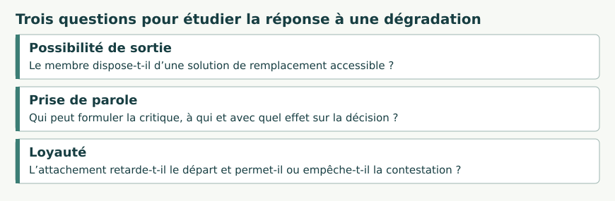

# ENS B/L · Sociologie (oral à option) — 26 juin, sujet 3 (2026) · Corrigé brut

*Corrigé rédigé par IA, non officiel. Signalez toute erreur.*

**Rédaction** · GPT-6.2 Astra Ultra · vitesse non renseignée

**Autocontrôle** · GPT-6.2 Astra Ultra · vitesse non renseignée

**Révision (tour 1)** · GPT-6.2 Astra Ultra · vitesse non renseignée

**Révision (tour 2)** · GPT-6.2 Astra Ultra · vitesse non renseignée · 26 novembre 2026

**Couverture vérifiée.** Les deux intitulés de la planche ont chacun un exposé complet dans les deux éditions. La relecture a porté sur la propriété, les droits d’usage et les conditions du choix entre départ et prise de parole. Les exemples d’enquête rendent explicite ce qui permettrait de départager les interprétations.

Le candidat choisit un seul des deux sujets après le tirage de la planche. Le jury accorde 1 h 30 de préparation, puis 15 minutes d’exposé et 15 minutes de discussion. Les deux développements correspondent aux deux choix possibles.

## Famille et propriété

Une maison peut être le domicile d’une famille, appartenir à un seul de ses membres et représenter l’essentiel de l’héritage des enfants. Vivre dans les mêmes murs, porter le titre de propriété et décider de la transmission sont des rapports différents. L’intimité familiale peut les rendre peu visibles tant que personne ne se sépare et qu’aucune succession ne s’ouvre. Comment la famille organise-t-elle la propriété, et comment la répartition des biens transforme-t-elle en retour les relations familiales ?

**Des droits distincts dans un ménage.** Les ressources courantes financent un logement et la vie quotidienne. Lorsque les titres sur les actifs, les remboursements et le travail domestique ne sont pas répartis de la même manière, le niveau de vie commun peut masquer des patrimoines individuels très différents. L’un peut se rendre disponible pour le travail rémunéré de l’autre en prenant en charge les enfants. Ce transfert de temps n’apparaît pas mécaniquement comme une créance patrimoniale. Pour identifier le résultat d’une séparation, il faut examiner les titres, le régime matrimonial ou la forme d’union, la chronologie des acquisitions et les possibilités concrètes de faire valoir un droit.

**La transmission reproduit et transforme les écarts.** Dans *Le Genre du capital*, Céline Bessière et Sibylle Gollac étudient les pratiques familiales et professionnelles qui organisent le partage. Conserver une entreprise ou une maison « dans la famille » peut conduire à attribuer le bien à une personne et à calculer la compensation des autres à partir d’une valeur discutée. Une distribution présentée comme égale prend un autre sens si une entreprise est évaluée modestement ou si des dons antérieurs ont été oubliés. L’analyse d’une succession doit alors associer les comptes, les négociations, les services rendus et le rôle des professionnels. Le traitement des enfants peut varier selon le genre, le rang, l’activité exercée ou la proximité géographique.

Dans une transmission, deux lots déclarés de même valeur peuvent offrir des pouvoirs différents. Le logement familial permet d’habiter ou de percevoir un loyer ; une part indivise peut exiger l’accord d’autres héritiers pour vendre. Relier les actes de partage aux usages et aux négociations après le décès permet d’étudier ce que l’égalité comptable laisse ouvert dans les rapports entre héritiers.

**Ceux qui ne possèdent pas de patrimoine transmettent aussi des ressources.** Un hébergement temporaire, du temps de garde ou un garant peuvent permettre à un jeune adulte d’accéder à un logement. Ces aides ne suppriment pas la hiérarchie entre familles propriétaires et familles sans actif. Elles montrent que la production d’autonomie s’appuie souvent sur des relations de dépendance. Dans l’autre sens, des charges associées à un bien peuvent contraindre une personne à accepter une vente ou à s’éloigner d’un parent. L’étude des familles gagne donc à suivre la circulation des biens et les décisions de ceux qui peuvent les détenir, les administrer ou s’en défaire.

## Exit, Voice and Loyalty

Face à la dégradation d’un service, un usager peut aller ailleurs, demander un changement ou rester fidèle à l’organisation. Dans le livre d’Albert Hirschman paru en 1970, la défection et la prise de parole sont des réactions possibles au déclin d’une entreprise ou d’une organisation. La loyauté modifie leurs conditions respectives. Une fréquentation inchangée peut traduire une confiance active, un attachement, une protestation en cours ou l’absence d’alternative. Comment distinguer ces situations et leurs effets pour l’organisation ?

**Les moyens de partir.** Changer de fournisseur est plus facile lorsque les alternatives sont proches, les tarifs connus et les contrats réversibles. Changer de domicile pour changer d’école suppose davantage de temps, de ressources et d’informations. La sortie des usagers les mieux dotés peut alerter la direction par une baisse des inscriptions. Elle peut aussi priver le public restant de personnes capables d’organiser une revendication. L’effet dépend de ce que perd l’organisation en cas de départ et de la capacité des décideurs à en comprendre le motif. Une baisse d’effectifs sans explication ne dit pas quelle réforme rétablirait la confiance.

**Dire une insatisfaction est un travail.** Pour qu’une plainte individuelle devienne une prise de parole collective, il faut souvent des relais, un interlocuteur et un vocabulaire reconnu. Des parents dont les horaires de travail les empêchent de participer à une réunion peuvent partager les critiques sans être entendus. Comparer une pétition, des entretiens avec les non-signataires et les décisions du conseil d’établissement permettrait de séparer absence de désaccord et absence de canal pour l’exprimer. Une menace crédible de départ peut renforcer la parole. À l’inverse, la possibilité de partir rapidement peut décourager l’investissement dans la contestation.

Deux parents restent dans la même école après la suppression d’une activité. Le premier dispose d’une autre place mais reste pour soutenir une pétition. Le second n’a aucun autre établissement accessible. Le registre des inscriptions enregistre la même conduite ; un entretien sur les solutions réellement disponibles permet de distinguer fidélité et sortie empêchée.

Une association perd ses membres les mieux informés à mesure que la qualité du service décline. Son nombre d’adhérents baisse et les plaintes peuvent se raréfier au même moment. Observer seulement les plaintes ferait alors croire à une amélioration. Dans la grille de Hirschman, il faut suivre les sortants et les prises de parole avant le départ pour déterminer si la défection prive l’organisation d’une information utile.

**Ce que fait la loyauté.** Un membre attaché à son association peut rester assez longtemps pour lui donner le temps de répondre, puis partir si la réponse déçoit. Un autre, également attaché, peut taire durablement sa critique de peur de nuire au collectif. Le maintien dans l’organisation ne manifeste donc pas toujours la même loyauté. Une enquête longitudinale examinerait la séquence, les options réellement ouvertes et la réponse donnée aux alertes. L’intérêt de Hirschman est de distinguer les mécanismes par lesquels une organisation apprend de son déclin et les circonstances sociales qui empêchent cet apprentissage. Il ouvre aussi une question sur les membres dont le départ ou la parole est le moins coûteux à ignorer.

[Planche officielle](https://www.ens.psl.eu/sites/default/files/famille_loyalty.pdf) · [Rapport du jury](https://www.ens.psl.eu/sites/default/files/2026_bl_rapport_oral_option_sociologie.pdf)
