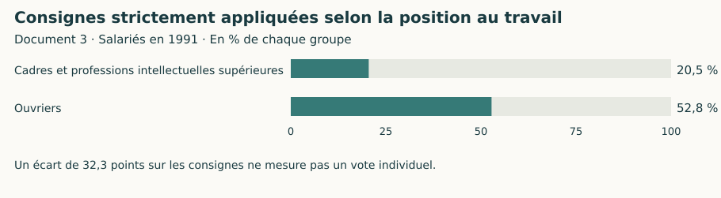

# ENS B/L · Sociologie (oral commun) — 22 juin, sujet 1 (2026) · Corrigé guidé

*Corrigé rédigé par IA, non officiel. Signalez toute erreur.*

**Rédaction** · GPT-6.2 Astra Ultra · vitesse non renseignée

**Autocontrôle** · GPT-6.2 Astra Ultra · vitesse non renseignée

**Révision (tour 1)** · GPT-6.2 Astra Ultra · vitesse non renseignée

**Révision (tour 2)** · GPT-6.2 Astra Ultra · vitesse non renseignée · 26 novembre 2026

**Couverture vérifiée.** Les sept documents du dossier sont traités dans les deux éditions. Les champs des tableaux Dares, les quatre vagues sur les consignes, les différents répondants de Réponse et le rapprochement entre travail individuel et vote communal ont été contrôlés.

Le dossier de huit pages comporte sept documents. L’oral comprend 15 minutes d’exposé et 15 minutes de discussion après 1 h 30 de préparation.

## De la démocratie en entreprise

Le citoyen vote à égalité avec les autres électeurs, mais passe une partie de sa journée dans une organisation où l’employeur définit le travail et contrôle son exécution. Le dossier demande jusqu’où cette hiérarchie peut accueillir la démocratie. Il faut distinguer l’autonomie dans une tâche, la représentation collective des salariés et la possibilité que l’expérience professionnelle modifie les dispositions politiques. L’observation d’une marge de liberté à un de ces niveaux ne renseigne pas automatiquement sur les deux autres.

### Le travail peut faire apprendre l’initiative ou l’obéissance

Georges Friedmann se demande en 1949 si un travail parcellaire et répétitif affaiblit les dispositions critiques nécessaires à la démocratie (doc. 1). Il formule une hypothèse sur la socialisation quotidienne. Le tableau de la Dares permet d’en préciser la première condition (doc. 3). En 1991, 20,5 % des salariés cadres et professions intellectuelles supérieures disent appliquer strictement les consignes, contre 52,8 % des ouvriers. L’écart de 32,3 points concerne des déclarations de pratique au travail. Une réponse « sans objet » est prévue pour ceux qui ne reçoivent pas de telles consignes. La ranger avec les personnes qui désobéissent confondrait deux situations. L’autonomie déclarée peut résulter d’une position de qualification ou d’une nécessité pratique de s’adapter à un travail impossible à prescrire complètement.

Pour éprouver l’hypothèse d’un apprentissage politique, il faudrait suivre des personnes avant et après un changement d’organisation du travail. L’origine sociale, les préférences antérieures et le choix du métier peuvent en effet influer ensemble sur le poste occupé et sur la politique. Friedmann donne au dossier une question. Le simple constat d’une différence entre catégories professionnelles ne suffit pas à la trancher.

La comparaison se déplace avec le temps. En 2013, 41,8 % des ouvriers et 18,4 % des cadres déclarent appliquer strictement les consignes. L’écart atteint alors 23,4 points, contre 32,3 en 1991. Il s’est resserré de 8,9 points entre ces deux enquêtes. Les répondants peuvent changer d’une vague à l’autre. Ce résultat décrit l’évolution des deux catégories et laisse ouverte la trajectoire de chaque salarié.

### La représentation donne une prise inégale sur la décision

L’enquête de Maïlys Gantois dans une PME de transport (doc. 2) montre comment la direction prétend définir les formes légitimes de la discussion. Elle adresse des lettres aux salariés, tout en reprochant aux représentants d’avoir distribué un tract avant une négociation. L’existence d’une instance ne garantit donc pas le droit pratique de fixer l’ordre du jour ou d’informer les collègues par ses propres canaux. La taille de l’entreprise modifie les possibilités de négocier. En 2024, les entreprises de 10 à 49 salariés constituent 82,3 % des entreprises du champ privé non agricole mais emploient 27,1 % de ses salariés. Dans cette tranche de taille, 9,8 % sont concernées par au moins une négociation (doc. 4). On comprend qu’une faible part d’entreprises négociatrices puisse couvrir une part bien supérieure de travailleurs.

Que produit la négociation ? Les salaires et primes sont négociés dans 10,3 % des entreprises du champ du document 5. Parmi celles qui abordent le thème, 71,6 % concluent un accord. Les entreprises concluant un accord sur ce thème emploient 35,8 % des salariés. Ces trois chiffres mesurent respectivement une fréquence parmi les entreprises, un taux conditionnel d’aboutissement et une couverture en salariés. Un accord peut acter une concession importante ou formaliser un déséquilibre. L’enquête Réponse (doc. 6) ajoute le regard des intéressés. En 2023, 83 % des salariés mandatés disent que les représentants du personnel traduisent bien leurs aspirations. Le tableau sur les représentants des directions et du personnel compte quant à lui des établissements. La pluralité des points de vue fait partie du phénomène à expliquer.

Gantois observe aussi que la direction renvoie un problème matériel du dépôt au comité spécialisé et reçoit séparément trois des quatre signataires des revendications. Ces choix modifient qui parle devant qui et avec quel appui. Cette attention aux positions aide à lire Réponse : à la même question sur la traduction des aspirations, 83 % des salariés mandatés se disent d’accord, contre 50 % des non-mandatés et 51 % de l’ensemble. Le mandat peut à la fois sélectionner des salariés plus confiants et transformer leur expérience de la représentation.

### Jusqu’où l’expérience professionnelle informe-t-elle la citoyenneté ?

Le document 7 rapproche l’enquête de 2016 sur les conditions de travail des résultats du premier tour présidentiel de 2017 dans la commune de résidence. Parmi les répondants des communes où prédomine l’abstention, 21 % travaillent de nuit ou tôt le matin. Les contraintes physiques concernent 37 % des salariés des communes classées dans la colonne Le Pen et 22 % de ceux de la colonne Macron. L’écart de 15 points caractérise des contextes résidentiels. Il ne donne le vote d’aucun de ces salariés. Les qualifications, secteurs, histoires locales et choix résidentiels contribuent à la composition des communes. Il faudrait disposer des pratiques politiques individuelles et de trajectoires professionnelles comparables pour isoler un éventuel effet du travail.

La démocratie en entreprise repose donc sur des moyens concrets de discuter le travail, d’informer ses collègues et de négocier avec un interlocuteur tenu de répondre. Ces pratiques peuvent former des capacités politiques. Les documents montrent mieux leur répartition sociale et leurs conditions institutionnelles qu’ils ne démontrent un effet causal sur le bulletin individuel.

Reprenez les deux lignes du document 3 : 52,8 divisé par 20,5 donne environ 2,6. Le rapport compare la fréquence d’une réponse entre catégories professionnelles. Aucune des deux lignes ne contient un comportement électoral.

## Questions du jury

> [!INDICATION]
> Quel dénominateur permet de retrouver directement les 7,4 % de la ligne « salaires et primes » ?

La colonne « accords conclus, ensemble des entreprises » prend toutes les entreprises de 10 salariés ou plus du champ, France hors Mayotte, secteur privé non agricole, hors négociation de groupe. Pour expliquer les 35,8 %, on compte les salariés employés par ces entreprises. Une entreprise de grande taille pèse donc davantage dans cette dernière colonne.

> [!INDICATION]
> Pourquoi 71,6 % d’accords sur les salaires ne signifie-t-il pas que sept entreprises sur dix en concluent un ?

La base correspond aux seules entreprises qui ont ouvert une négociation sur les salaires. Dans le champ du document 5, multiplier 10,3 % par 71,6 % donne environ 7,4 % de l’ensemble des entreprises, sous réserve des arrondis. Le taux de 35,8 % est, lui, pondéré par les salariés.

> [!INDICATION]
> Quelle enquête prolongerait les documents 1 et 7 ?

Suivre individuellement des salariés comparables avant et après une réorganisation permettrait de documenter les changements d’autonomie, d’expression et de participation politique. Il faudrait conserver un groupe de comparaison et vérifier si l’évolution avait commencé avant la réorganisation.

[Dossier officiel](https://www.ens.psl.eu/sites/default/files/dossier_democratie_entreprise.pdf) · [Rapport du jury](https://www.ens.psl.eu/sites/default/files/2026_bl_rapport_oral_tronc_commun_sociologie.pdf)
