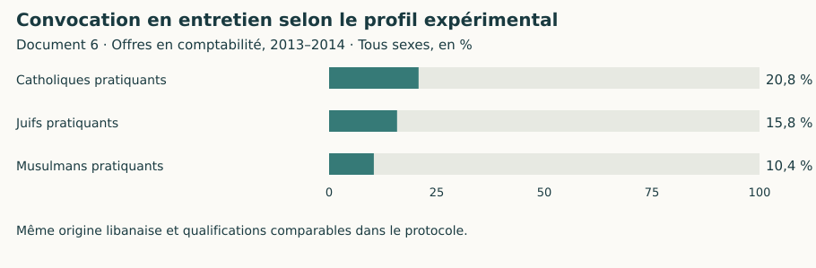

# ENS B/L · Sociologie (oral commun) — 22 juin, sujet 2 (2026) · Corrigé brut

*Corrigé rédigé par IA, non officiel. Signalez toute erreur.*

**Rédaction** · GPT-6.2 Astra Ultra · vitesse non renseignée

**Autocontrôle** · GPT-6.2 Astra Ultra · vitesse non renseignée

**Révision (tour 1)** · GPT-6.2 Astra Ultra · vitesse non renseignée

**Révision (tour 2)** · GPT-6.2 Astra Ultra · vitesse non renseignée · 26 novembre 2026

**Couverture vérifiée.** Les sept documents du dossier sont traités dans les deux éditions. Les taux déclarés, rapports de cotes, deux populations de victimes, taux de convocation du testing et champs de la mesure situationnelle ont été relus sur les graphiques et sur le tableau.

Le dossier de huit pages comporte sept documents. L’oral comprend 15 minutes d’exposé et 15 minutes de discussion après 1 h 30 de préparation.

## Discriminations

Deux candidatures de même qualification peuvent susciter des réponses différentes, mais la personne qui reçoit un refus ne connaît pas le sort réservé à son double. À l’inverse, le chercheur qui observe un écart entre deux populations ne sait pas toujours à quelle décision l’attribuer. Le dossier traite ce double problème. Comment caractériser un mécanisme de traitement défavorable et mesurer ses effets lorsque chaque source ne rend visible qu’une partie de l’expérience ?

### Un classement social produit des différences de traitement

Chez Goffman (doc. 1), un stigmate tient à la relation entre un attribut et les attentes d’autrui dans une situation. L’attribut peut prendre le pas sur les autres caractéristiques de la personne. Une entreprise peut ainsi tirer d’un nom ou d’un engagement associatif une conclusion sur le candidat qui ne renseigne pas sur sa capacité à tenir le poste. Brinbaum, Safi et Simon (doc. 2) distinguent la comparaison expérimentale, l’estimation d’un écart net à caractéristiques observables comparables, la déclaration des personnes et les données policières ou judiciaires. Une plainte documente une voie de recours. Elle laisse invisibles les personnes qui n’ont pas identifié le motif, n’ont pas pu le prouver ou ont renoncé à saisir l’institution. Un résidu statistique peut signaler un traitement différencié, mais dépend également des variables mesurées et de la façon de construire les groupes.

### Le résultat dépend de la question et de l’exposition

En France métropolitaine, parmi les 18–50 ans de l’enquête TeO de 2008 (doc. 3), 26,2 % des immigrés disent avoir souvent ou parfois subi une discrimination ou un traitement inégal au cours des cinq années précédentes. La figure affiche environ 10 % pour le groupe majoritaire. La déclaration dépend de l’expérience, des occasions d’exposition et de la manière dont le répondant reconnaît et nomme le traitement. Le document 7 confronte deux manières d’interroger les mêmes domaines. Parmi les immigrés arrivés adultes, 26 % déclarent globalement une discrimination et 36 % rapportent au moins une situation discriminatoire lorsqu’on parcourt les domaines de la vie sociale. L’écart de 10 points aide à comprendre combien l’évocation d’une situation concrète peut changer le résultat. On ne peut pas additionner les domaines, car une personne peut être concernée dans plusieurs.

Le modèle du document 4 compare les modalités à une référence en tenant constantes les autres caractéristiques introduites. La cote de déclarer une discrimination est multipliée par 1,75 pour les chômeurs par rapport aux actifs en emploi. La cote est le rapport entre probabilité de déclaration et probabilité complémentaire. Le coefficient ne signifie ni une hausse de 75 points de pourcentage ni une identification certaine de la cause du chômage. Le document 5 change de champ et de période. Dans l’enquête Vécu et ressenti en matière de sécurité, 48 % des personnes victimes d’au moins une discrimination attribuent la dernière à leur origine réelle ou supposée. Parmi les victimes de violence à caractère discriminatoire, 42 % indiquent le sexe comme motif. Les populations de départ diffèrent et plusieurs motifs peuvent être cités. L’écart des deux pourcentages ne mesure donc pas une différence entre les sexes.

Dans le document 7, les immigrés arrivés adultes sont exposés à 11,9 situations en moyenne, contre 15,3 dans la population majoritaire. Pourtant, 29 % du premier groupe ont rencontré au moins une situation qu’ils attribuent à un motif ethno-racial, contre 3 % du second. Ce contraste persiste malgré un nombre moyen d’occasions plus faible. Pour comparer le risque dans une situation donnée, il faudrait connaître les personnes effectivement exposées à cette même situation dans chaque groupe.

### Le testing isole un traitement à une étape précise

Marie-Anne Valfort compare des candidatures fictives à des emplois en comptabilité en France en 2013–2014 (doc. 6). Elles présentent une origine libanaise commune, des études et expériences comparables et signalent des appartenances religieuses différentes. Tous sexes confondus, 20,8 % des candidatures catholiques pratiquantes sont convoquées, contre 15,8 % des juives pratiquantes et 10,4 % des musulmanes pratiquantes. L’écart entre la première et la dernière est de 10,4 points et le rapport de deux. Chez les hommes, les taux correspondants sont 17,9 % et 4,7 %, soit un rapport d’environ 3,8. Le contraste entre profils comparables apporte une information que le seul décompte des plaintes ne pourrait fournir. Il porte sur une convocation, des postes et des profils précis. Il ne mesure ni l’ensemble d’une carrière ni l’intention de chaque recruteur.

Chez les femmes, les taux de convocation sont de 23,5 % pour le profil catholique et de 16,4 % pour le profil musulman. L’écart de 7,1 points est inférieur aux 13,2 points observés chez les hommes. L’écart entre ces deux écarts est de 6,1 points. Les accolades publiées signalent des comparaisons à l’intérieur de chaque groupe ; une conclusion sur cette interaction demanderait un test portant directement sur les deux écarts.

Pour cent candidatures de chaque profil, les taux correspondent à environ 21 convocations du premier profil, 16 du deuxième et 10 du troisième. L’entretien est une étape du recrutement. Les écarts de convocation renseignent sur cette première sélection, dont dépendent les possibilités de défendre ensuite sa candidature.

La confrontation des sept documents fait ainsi apparaître trois objets différents, la décision dans une situation contrôlée, l’inégalité cumulée entre trajectoires et la reconnaissance de l’expérience par les personnes ou les institutions. Chacun appelle une mesure adaptée. Leur accord sur certains résultats renforce l’interprétation, et leurs écarts indiquent où poursuivre l’enquête.

[Dossier officiel](https://www.ens.psl.eu/sites/default/files/dossier_discriminations.pdf) · [Rapport du jury](https://www.ens.psl.eu/sites/default/files/2026_bl_rapport_oral_tronc_commun_sociologie.pdf)
