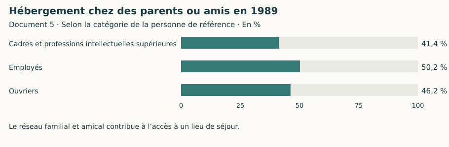

# ENS B/L · Sociologie (oral commun) — 22 juin, sujet 3 (2026) · Corrigé guidé

*Corrigé rédigé par IA, non officiel. Signalez toute erreur.*

**Rédaction** · GPT-6.2 Astra Ultra · vitesse non renseignée

**Autocontrôle** · GPT-6.2 Astra Ultra · vitesse non renseignée

Le dossier de huit pages comporte sept documents. L’oral comprend 15 minutes d’exposé et 15 minutes de discussion après 1 h 30 de préparation.

## Les pratiques touristiques

Sur une même plage, on peut rechercher le soleil ou s’en protéger pour manifester le statut auquel on tient. Avant même ces différences, certains ne partent jamais et d’autres disposent de plusieurs lieux où séjourner. Il faut donc interroger les pratiques touristiques à trois moments, l’accès au départ, les ressources qui donnent au séjour sa forme et la manière dont ses usages classent les vacanciers. Comment le temps de vacances recompose-t-il des inégalités déjà présentes dans la vie quotidienne ?

### L’accès au départ dépend des ressources du ménage

Dans l’enquête Vacances (doc. 3), il faut au moins quatre nuits consécutives hors du domicile pour un motif non professionnel. En 1999, 70 % des moins de 14 ans sont partis, 39 % de l’ensemble de cette classe d’âge ont effectué au moins un séjour à la mer et 29 % ont fréquenté au moins deux types d’environnements. Ces catégories se recouvrent. Une famille qui rend visite à des proches peut entrer dans la mesure, une sortie locale d’une journée ou un week-end de deux nuits en sont exclus. L’écart entre groupes reflète donc des ressources mais aussi les formes d’une mobilité que la définition capture plus ou moins bien.

Le document 4 interroge les non-partants sur l’avenir. Parmi les personnes empêchées par des raisons financières en 1998–1999, 62 % pensent ne pas partir dans les douze mois suivants. L’anticipation d’un empêchement durable peut infléchir les projets formulés. Ce résultat ne renseigne pas sur leur départ effectif l’année suivante. Le document 5 montre aussi la fonction des relations personnelles en 1989. La modalité « chez des parents ou amis » atteint 45,4 % dans l’ensemble, 50,2 % chez les employés et 41,4 % chez les cadres et professions intellectuelles supérieures. Le réseau d’hébergement peut donc réduire la dépense initiale, mais ses possibilités dépendent de la localisation et des conditions de logement des proches. La résidence secondaire figure à 11,7 % chez les cadres, contre 4,5 % chez les ouvriers. C’est une autre manière de pouvoir partir sans payer une chambre au prix du marché.

### Le voyage transmet des dispositions déjà inégalement distribuées

Anne-Catherine Wagner observe la place du voyage dans l’éducation des classes supérieures (doc. 1). Au lycée international de Saint-Germain-en-Laye, 15 des 22 voyages scolaires organisés en 2004–2005 se déroulent à l’étranger. L’établissement prolonge chez beaucoup d’élèves la familiarité familiale avec les langues et le déplacement international. Une occasion d’apprendre peut également consacrer une aisance déjà acquise. Le document 6 invite à tenir compte du sexe, de l’âge et de la période. En 1979, les femmes de 20 ans totalisent 6,2 millions de journées de vacances, contre 4,7 millions pour les hommes du même âge. En 2004, ce sont 6,6 et 5,8 millions. Ces volumes agrégés ne sont pas des durées individuelles. Il faudrait les rapporter aux effectifs de chaque groupe et distinguer le nombre de partants de la durée de leur séjour.

Les villages de vacances étudiés par Bertrand Réau (doc. 7) offrent des services comparables en apparence, mais accueillent des clientèles différentes. Hors vacances, 69,6 % des vacanciers du Club Med déclarent aller au restaurant lorsqu’ils sortent le soir, contre 48,7 % au VVF. L’écart de 20,9 points concerne une pratique ordinaire observée chez des personnes classées par lieu de séjour. Il invite à chercher comment la clientèle se sélectionne. L’âge, le revenu, les habitudes de loisirs et l’offre du lieu peuvent ensuite expliquer conjointement les activités pratiquées pendant le séjour.

### Une même pratique prend des sens différents selon le public de retour

Sur la plage algérienne de Capritour, Jennifer Bidet (doc. 2) compare notamment de jeunes descendants d’immigrés résidant en France et des familles algériennes aisées. Pour les premiers, rentrer bronzé en France peut signifier que l’on a eu de vraies vacances. Pour d’autres, une peau plus claire est valorisée dans une hiérarchie locale où intervient le colorisme. Les deux groupes partagent un espace sans partager le public auquel la pratique s’adresse. Le corps rend visible un déplacement, mais sa valeur dépend des classements qui attendent les vacanciers à leur retour.

Ainsi, compter les départs permet de repérer une privation sans décrire ce que l’on apprend, affirme ou transmet en voyage. Inversement, les observations sur la plage ou dans un lycée ne permettent pas d’estimer à elles seules la fréquence de ces pratiques dans toute la population. L’intérêt du dossier est de relier l’accès matériel à des usages et à des jugements socialement situés.

## Questions du jury

> [!INDICATION]
> Peut-on calculer la fraction approximative des enfants partis ayant séjourné à la mer ?

Oui, si l’on conserve le même champ et la même période. La part est d’environ 39 / 70, soit 56 % des partants de moins de 14 ans. Les chiffres du tableau étant arrondis, la valeur est approximative.

> [!INDICATION]
> Les deux clubs prouvent-ils que le séjour change la manière de sortir au restaurant ?

Le document 7 porte ici sur une pratique hors vacances et les clients ne sont pas affectés au hasard aux deux sites. Les écarts de clientèle peuvent précéder le séjour. Il faudrait suivre les mêmes personnes avant et après le départ et disposer d’une comparaison pour étudier un effet du séjour.

[Dossier officiel](https://www.ens.psl.eu/sites/default/files/dossier_tourisme.pdf) · [Rapport du jury](https://www.ens.psl.eu/sites/default/files/2026_bl_rapport_oral_tronc_commun_sociologie.pdf)
