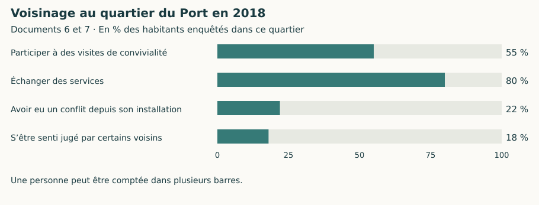

# ENS B/L · Sociologie (oral commun) — 22 juin, sujet 4 (2026) · Corrigé guidé

*Corrigé rédigé par IA, non officiel. Signalez toute erreur.*

**Rédaction** · GPT-6.2 Astra Ultra · vitesse non renseignée

**Autocontrôle** · GPT-6.2 Astra Ultra · vitesse non renseignée

**Révision (tour 1)** · GPT-6.2 Astra Ultra · vitesse non renseignée

**Révision (tour 2)** · GPT-6.2 Astra Ultra · vitesse non renseignée · 26 novembre 2026

**Couverture vérifiée.** Les sept documents du dossier sont traités dans les deux éditions. Les axes du nuage, les bases des tableaux par âge, statut et quartier, et les deux panneaux sur les conflits et les jugements ont été contrôlés. Le panneau 7a omet Auteuil, présent sur le panneau 7b.

Le dossier de huit pages comporte sept documents. L’oral comprend 15 minutes d’exposé et 15 minutes de discussion après 1 h 30 de préparation.

## Voisiner

Partager un palier peut permettre une aide décisive sans conduire à une invitation à dîner. Un bruit familier pour son auteur peut être entendu par le voisin comme un manque d’égards. « Voisiner » désigne ainsi une activité relationnelle qui va de la coprésence à l’entraide, à la visite ou à la dispute. Comment la proximité matérielle devient-elle un lien, et pourquoi ce lien conserve-t-il des frontières dans des quartiers socialement mélangés ?

### Être proches dans l’espace laisse ouvertes plusieurs relations

À Creil et Antony dans les années 1960, Chamboredon et Lemaire montrent que le peuplement des grands ensembles réunit des ménages aux trajectoires et attentes différentes (doc. 1). Pour certains, le logement est une étape vers une promotion résidentielle, pour d’autres une position appelée à durer. Le bruit est une gêne matérielle autant qu’une façon de juger les horaires, le soin aux enfants et les habitudes des autres. Dire qu’un quartier est à la fois trop mêlé et isolant devient intelligible si les personnes sont proches sans partager les mêmes usages de la rencontre.

L’enquête Contacts de 1982–1983 et l’enquête Mon quartier, mes voisins de 2018 donnent au terme « lien » une portée observable (doc. 2). La seconde porte sur quatorze quartiers des régions parisienne et lyonnaise, choisis pour leurs contextes résidentiels contrastés. Les relations comprenant une visite, les petits services et les liens d’amitié ne s’additionnent pas librement dans toutes les tables. Dans la classification de Contacts (doc. 3), les liens étroits désignent le niveau le plus intense. Chez les ménages dont le chef est agriculteur et a 18–34 ans, 48,9 % atteignent ce niveau, 34 % relèvent des petits services et 17 % des relations limitées. L’arrondi explique que la somme soit 99,9 %. Ces proportions décrivent une situation historique, où milieu professionnel et domicile peuvent se recouper.

Contacts a interrogé 5 900 ménages représentatifs des ménages ordinaires en 1982–1983. En 2018, Mon quartier, mes voisins tire une partie de son échantillon au sort et en obtient une autre par les réseaux, dans sept types de quartiers de chacune des deux régions. Une moyenne sur ces terrains n’est donc pas directement un nouvel estimateur national. La stabilité qu’évoquent les auteurs appelle d’abord la comparaison de pratiques définies de la même manière.

### L’entraide ne circule pas uniformément

Le nuage du document 4 place chaque catégorie professionnelle selon le nombre moyen de ménages voisins auxquels un service a été rendu et de ménages dont un service a été reçu. Compter les voisins concernés ne donne ni le nombre total des gestes ni leur coût. Une garde d’enfant répétée et le prêt occasionnel d’un outil peuvent chacun ne compter que pour un voisin. La position d’un groupe par rapport à la diagonale indique une asymétrie entre les nombres déclarés de partenaires. Elle ne suffit pas à conclure que chaque membre est débiteur, généreux ou isolé. Les relations entre groupes et la mémoire de ce qui mérite le nom de service doivent être étudiées.

Le point des ingénieurs illustre la lecture du nuage. Il se situe autour de 1,9 ménage voisin pour chacun des deux axes. Celui des employés de commerce se lit autour de 0,8 sur chaque axe. Les deux catégories sont près de la diagonale mais éloignées l’une de l’autre. Une même proximité entre services reçus et rendus peut donc accompagner des réseaux de taille très différente.

Le tableau des statuts d’occupation (doc. 5) donne, en ligne, la composition du réseau déclaré. Dans les quatorze quartiers, les réseaux des locataires HLM comprennent 89 % de locataires HLM, alors que ceux des propriétaires comprennent 68 % de propriétaires et 2 % de locataires HLM. Le reste du réseau des propriétaires est formé de 30 % de locataires du privé. Cette concentration documente une homophilie résidentielle. Elle résulte en partie des personnes que l’on peut rencontrer dans les mêmes immeubles et rues. Pour évaluer une préférence, il faudrait comparer la composition des réseaux avec celle de l’entourage effectivement accessible à chaque enquêté.

### La mixité organise des occasions, des distances et parfois des conflits

Le document 6 dissocie les visites de convivialité et les services. Dans le quartier du Port, où des immeubles sociaux et privés ont été construits dans le même projet, 55 % des habitants participent à des visites et 80 % échangent des services. L’écart de 25 points montre que les pratiques n’ont pas la même fréquence. Comme elles peuvent concerner les mêmes habitants, il n’établit pas que 25 % exactement échangent des services sans jamais rendre visite. À Marolles, commune rurale périurbaine de l’enquête, les niveaux sont respectivement 84 % et 90 %. Le type d’habitat, l’ancienneté et la composition de la population peuvent participer à ces écarts.

Les deux graphiques du document 7 portent le même intitulé général sur quatorze quartiers. Le panneau 7a ne comporte que treize barres. Auteuil figure en 7b avec 29 % d’habitants qui se sont sentis jugés ; sa fréquence de conflits n’est pas donnée en 7a.

Le document 7 refuse une équation simple entre rencontre, mélange et dispute. Au quartier du Port, 22 % déclarent au moins un conflit depuis l’emménagement et 18 % s’être sentis jugés. Aux Batignolles, les chiffres sont de 29 % et 28 %. Le temps écoulé depuis l’installation varie entre quartiers et modifie l’occasion d’avoir un conflit. Ces résultats invitent aussi à distinguer désaccord exprimé et contrôle ressenti. L’observation initiale de Chamboredon et Lemaire éclaire le sens possible des tensions, tandis que la comparaison de 2018 empêche d’en faire une loi universelle de la mixité. Voisiner engage des relations choisies au sein d’une proximité en partie imposée, dont services, convivialité, frontières et jugements sont des dimensions distinctes.

Sur cent habitants du Port, 80 déclarent des échanges de services et 55 des visites. Au moins 35 doivent donc figurer dans les deux groupes, à l’arrondi près. Le tableau ne donne pas leur nombre exact.

## Questions du jury

> [!INDICATION]
> Quel intervalle peut-on établir pour les habitants du Port qui échangent des services sans participer aux visites ?

Sur cent habitants, entre 35 et 55 peuvent appartenir aux deux groupes, d’après les marges de 80 pour les services et 55 pour les visites. En retranchant ce recouvrement de 80, on obtient entre 25 et 45 habitants participant seulement aux services, à l’arrondi près. Un tableau croisé serait nécessaire pour préciser ce chiffre.

> [!INDICATION]
> Pourquoi 89 % dans la ligne des locataires HLM ne veut-il pas dire que 89 % des habitants du quartier sont locataires HLM ?

Le dénominateur est constitué des relations déclarées par les personnes relevant de cette ligne. Le tableau décrit leurs réseaux, sans donner la répartition de tous les logements ni la proportion de personnes ayant au moins un ami HLM.

> [!INDICATION]
> Un quartier où chacun salue ses voisins peut-il afficher peu de « liens étroits » ?

Oui. Les salutations et les conversations peuvent être courantes sans visites amicales, sorties communes ou entraide soutenue. C’est pourquoi la définition de chaque indicateur précède son interprétation.

[Dossier officiel](https://www.ens.psl.eu/sites/default/files/sujet_socio_voisiner.pdf) · [Rapport du jury](https://www.ens.psl.eu/sites/default/files/2026_bl_rapport_oral_tronc_commun_sociologie.pdf)
