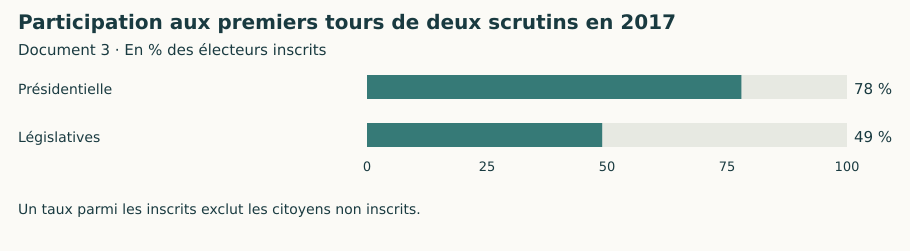

# ENS B/L · Sociologie (oral commun) — 23 et 24 juin, sujet 1 (2026) · Corrigé guidé

*Corrigé rédigé par IA, non officiel. Signalez toute erreur.*

**Rédaction** · GPT-6.2 Astra Ultra · vitesse non renseignée

**Autocontrôle** · GPT-6.2 Astra Ultra · vitesse non renseignée

**Révision (tour 1)** · GPT-6.2 Astra Ultra · vitesse non renseignée

**Révision (tour 2)** · GPT-6.2 Astra Ultra · vitesse non renseignée · 26 novembre 2026

Le dossier de huit pages comporte sept documents. L’oral comprend 15 minutes d’exposé et 15 minutes de discussion après 1 h 30 de préparation.

## L’abstention

Un électeur inscrit empêché de se déplacer, une personne absente des listes et un résident privé du droit de voter peuvent tous manquer dans le résultat final. Seul le premier entre dans le calcul de l’abstention parmi les inscrits. Ce calcul recense aussi bien les absences contraintes que les abstentions délibérées. Comment les institutions, les positions sociales et les circonstances du scrutin sélectionnent-elles les personnes dont la voix pourra être comptée ?

### Compter les absences fait partie de l’explication

Bourdieu (doc. 1) analyse les non-réponses aux sondages. Les retirer déplace le dénominateur et peut faire disparaître un effet de compétence socialement reconnue ou de tension devant la question. L’analogie avec l’élection appelle une distinction. Un blanc ou un nul résulte d’un déplacement aux urnes. Il n’entre pas dans les suffrages exprimés, mais son auteur a participé. Patrick Lehingue (doc. 2) propose de prendre au sérieux le décrochage d’une partie des classes populaires. Affirmer qu’elles auraient transféré leur voix d’un parti vers un autre sans examiner la montée des absences revient à supposer stable la population des votants.

Le document 5 permet de remonter de la population professionnelle aux votants. Parmi les employés de commerce, 5,5 % sont étrangers. Parmi les Français de ce groupe, 7,5 % ne sont pas inscrits. Enfin 11,6 % des inscrits s’abstiennent constamment aux quatre tours pris en compte. Sur 100 personnes, on obtient environ 5,5 personnes dans la première situation, 7,1 dans la suivante et 10,1 dans la dernière. Le résultat approché avec les valeurs affichées atteint 22,7 %, tandis que le total publié est 22,3 %. La note et ce total ne se raccordent pas exactement avec les pourcentages affichés. La conclusion solide est qu’un peu plus d’un cinquième du groupe se trouve hors de ces votes pour des raisons distinctes. Additionner directement les trois taux mélangerait leurs bases.

### Le calendrier électoral rend les écarts plus ou moins visibles

En 2017, 78 % des inscrits participent au premier tour de la présidentielle, contre 49 % au premier tour des législatives (doc. 3). L’écart de 29 points montre que l’absence est aussi liée à l’événement. Les résultats agrégés ne disent pas qui sont les individus passés du vote à l’abstention. Dans la même année (doc. 4), l’écart d’abstention entre les 25–29 ans et les 65–69 ans atteint 18,2 points au premier tour présidentiel et 35,1 points au premier tour législatif. L’écart entre ouvriers et cadres atteint respectivement 12,55 et 25,8 points. Les inégalités de ressources pratiques, d’incitation de l’entourage et de familiarité institutionnelle peuvent peser davantage lorsque la mobilisation est moins intense. La comparaison entre scrutins rapproche ces observations, sans mesurer séparément chacun des mécanismes.

### Les raisons données et les contextes donnent plusieurs sens à une absence

La consultation citoyenne de 2021 (doc. 6) compare des répondants déclarant n’avoir voté à aucun scrutin à d’autres ayant voté aux présidentielles et municipales, mais ayant manqué au moins une élection secondaire. Le mécontentement est cité par 73,6 % des premiers et 47,1 % des seconds. Un empêchement est cité plus souvent par les intermittents. Les répondants peuvent choisir plusieurs motifs et s’être portés volontaires pour cette consultation. Ces proportions documentent des différences de récits au sein de l’échantillon. Elles ne dénombrent pas tous les abstentionnistes de France.

Le document 7 territorialise le problème. Il représente les comportements en pourcentage des inscrits et réunit dans une même catégorie les abstentions et les bulletins blancs ou nuls. La barre correspondante apparaît plus longue dans les quartiers prioritaires que dans l’ensemble du pays. Une partie de l’écart peut tenir aux âges, aux lieux d’inscription et à l’offre électorale. Déduire de la barre qu’un habitant particulier se désintéresse de la politique confondrait son territoire et sa conduite. L’abstention peut signaler un retrait, un obstacle ou une forme de refus. Pour les distinguer, il faudrait relier émargements à plusieurs tours, conditions de participation et récits individuels.

Reconstituez les taux d’abstention par complément à 100. Les 29 points de différence sont un solde entre deux mobilisations. Des personnes différentes peuvent être entrées dans la participation et en être sorties.

## Questions du jury

> [!INDICATION]
> En 2017, l’écart de 35,1 points donne-t-il le taux d’abstention des jeunes aux législatives ?

Il donne la différence entre deux catégories d’âge au premier tour. Il faudrait connaître le taux de l’un des groupes pour en déduire l’autre.

> [!INDICATION]
> Pourquoi une enquête sur les seules personnes inscrites sous-estime-t-elle certains écarts ?

Elle écarte les conditions d’accès au registre, qui peuvent varier avec la nationalité, les déménagements et les ressources. Il faut préciser si la question porte sur l’usage d’un droit déjà ouvert ou sur la représentation politique d’une population entière.

[Dossier officiel](https://www.ens.psl.eu/sites/default/files/dossier_abstention.pdf) · [Rapport du jury](https://www.ens.psl.eu/sites/default/files/2026_bl_rapport_oral_tronc_commun_sociologie.pdf)

## Vérification sur le dossier

Le dossier relie les conditions sociales de la prise de parole et du vote aux différences de scrutin, de profession, de motivation déclarée et de territoire. Les pourcentages de participation, les écarts en points et les groupes de non-votants ont été vérifiés séparément.

Le tableau du document 4 donne un écart d’abstention entre les 25–29 ans et les 65–69 ans de 8,9 points au premier tour présidentiel de 2007 et de 18,2 points en 2017. L’écart s’est donc accru de 9,3 points, sur ce scrutin et entre ces classes d’âge. Il s’agit de deux comparaisons transversales. L’information nécessaire pour séparer l’effet de l’âge de celui du remplacement des générations serait un suivi de plusieurs cohortes.
