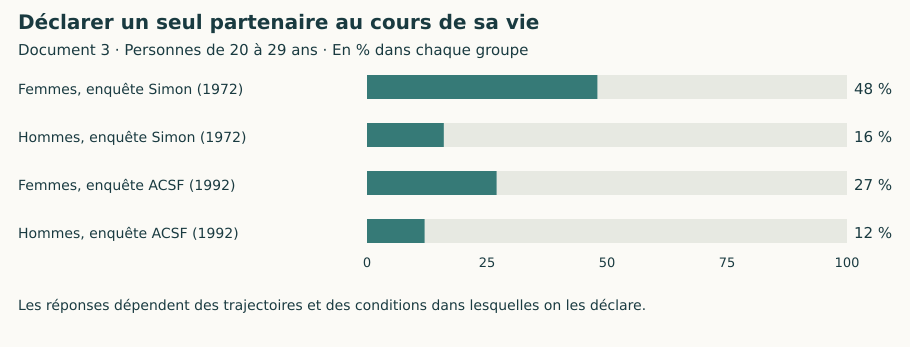

# ENS B/L · Sociologie (oral commun) — 23 et 24 juin, sujet 2 (2026) · Corrigé brut

*Corrigé rédigé par IA, non officiel. Signalez toute erreur.*

**Rédaction** · GPT-6.2 Astra Ultra · vitesse non renseignée

**Autocontrôle** · GPT-6.2 Astra Ultra · vitesse non renseignée

**Révision (tour 1)** · GPT-6.2 Astra Ultra · vitesse non renseignée

**Révision (tour 2)** · GPT-6.2 Astra Ultra · vitesse non renseignée · 26 novembre 2026

Le dossier de huit pages comporte sept documents. L’oral comprend 15 minutes d’exposé et 15 minutes de discussion après 1 h 30 de préparation.

## La contraception

Une personne qui dispose du pouvoir de choisir si elle veut une grossesse peut également devenir celle à qui son entourage attribue l’entière responsabilité de l’éviter. Les deux effets peuvent se produire ensemble. Le dossier invite à comprendre comment une transformation des méthodes redistribue le pouvoir de décision, le travail de prévention et les inégalités d’accès.

### Une autonomie décisive peut s’accompagner d’une nouvelle obligation

Bajos et Ferrand (doc. 1) montrent que la possibilité de dissocier sexualité et procréation transforme les projets d’études, de travail et de famille. Elle change aussi les jugements sur la « bonne » période pour avoir un enfant et sur la responsabilité qui incomberait à la femme en cas de grossesse non prévue. Les trajectoires d’emploi et les attentes envers les mères ne disparaissent pas avec l’accès à une méthode contraceptive. Thomé et Rouzaud-Cornabas (doc. 2) déplacent l’observation vers le travail quotidien que supposent l’information, le rendez-vous, le renouvellement et la discussion au sein du couple. Même lorsque la décision est annoncée comme commune, ce travail peut rester inégalement réparti.

Les déclarations sur la sexualité changent dans le temps (doc. 3). Dans l’enquête Simon de 1972, 48 % des femmes de 20 à 29 ans déclarent n’avoir eu qu’un partenaire dans leur vie, contre 27 % dans ACSF en 1992. Pour les hommes du même âge, les chiffres sont 16 et 12 %. L’écart entre femmes et hommes passe de 32 à 15 points. L’évolution peut mêler transformations des trajectoires et des normes de déclaration. Plusieurs autres indicateurs du tableau changent de formulation ou de période de référence. On ne peut donc pas attribuer mécaniquement les écarts au seul développement d’une méthode contraceptive.

Sur vingt ans, la part déclarant un seul partenaire diminue de 21 points chez les femmes de 20 à 29 ans et de 4 points chez les hommes du même âge. Les deux enquêtes interrogent des générations différentes au même âge. L’écart entre ces évolutions invite à interroger les normes de déclaration en même temps que les trajectoires.

### La diversification des méthodes n’égalise pas toutes les conditions de choix

Le document 5 retrace la composition des méthodes entre 1978 et 2010 pour les femmes de 20 à 44 ans du champ défini. La part de la pilule augmente pendant plusieurs décennies, tandis que des catégories anciennes reculent et que d’autres méthodes se diffusent. Le document 6 compare 2010 à 2016 pour des âges et un champ en partie différents. L’usage de la pilule recule dans plusieurs classes d’âge et la composition des méthodes varie avec l’âge. En 2016, 4,7 % des femmes de 20 à 24 ans du champ déclarent le dispositif intra-utérin comme principale méthode. C’est une fréquence d’usage, pas une mesure de l’adéquation d’une méthode à une personne. Une histoire de la « norme contraceptive » doit interroger ce que proposent les soignants, les préférences des personnes et ce qu’elles peuvent effectivement obtenir.

Les données de l’Assurance maladie en 2019 (doc. 4) documentent le recours aux contraceptifs remboursés selon l’âge et la précarité. Aux âges représentés, les femmes classées comme précaires recourent moins à ce type de contraception. Chez les 20–24 ans, le graphique indique environ 41 % contre 53 % pour les femmes non précaires. Cet écart d’environ 12 points mesure un recours enregistré pour des produits remboursés. La composition des groupes, les préférences, les autres méthodes et le parcours de soins devraient être examinés avant d’en déduire une inégalité portant sur toute contraception ou sur la fécondité souhaitée.

### Le résultat d’une politique ne se lit pas dans un seul compteur

En 2020, le document 7 compte environ 222 000 IVG en France, dont 72,4 % médicamenteuses. L’axe de gauche indique un effectif en milliers et celui de droite une part parmi les IVG. La hausse de la seconde série rend compte de la transformation des modalités de prise en charge. Pour étudier un risque de grossesse non prévue, il faudrait au minimum une population exposée, une période, les intentions des personnes et des informations sur leurs parcours. Le nombre d’IVG dépend également de l’accès à ce droit et des décisions prises lorsqu’une grossesse survient. Le champ géographique de la série est la France hors Mayotte jusqu’en 2013, puis la France.

Mesurer seulement les méthodes utilisées effacerait donc la négociation qui les rend praticables. Mesurer seulement les issues de grossesse effacerait les préférences et les conditions de recours aux soins. La portée émancipatrice de la contraception se juge aussi à la capacité d’exercer un choix éclairé et d’en partager les contraintes matérielles au sein des relations.

[Dossier officiel](https://www.ens.psl.eu/sites/default/files/dossier_contraception.pdf) · [Rapport du jury](https://www.ens.psl.eu/sites/default/files/2026_bl_rapport_oral_tronc_commun_sociologie.pdf)

## Vérification sur le dossier

Les deux extraits sur les normes de genre et la charge de la contraception ont été relus avec les cinq documents statistiques. Chaque comparaison identifie la période, la population enquêtée et l’objet mesuré, des méthodes remboursées à la part des IVG médicamenteuses.

Dans le document 7, le nombre total d’IVG et la part médicamenteuse sont représentés sur deux axes. La lecture pour 2020 donne 222 000 et 72,4 %. Leur produit est d’environ 160 700 IVG médicamenteuses. Les données initiales étant arrondies, il faut aussi arrondir ce résultat. Mesurer la fréquence dans une population demanderait de rapporter un effectif à la population correspondante, au cours de la même période.
