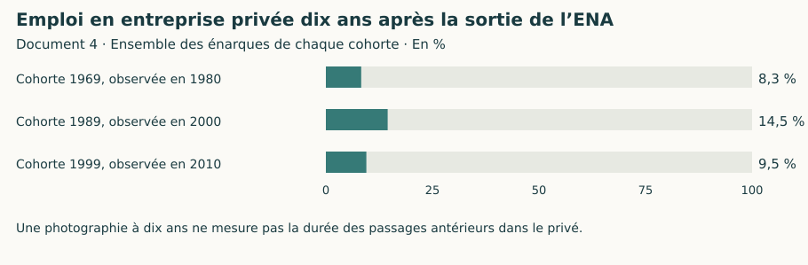

# ENS B/L · Sociologie (oral commun) — 23 et 24 juin, sujet 3 (2026) · Corrigé guidé

*Corrigé rédigé par IA, non officiel. Signalez toute erreur.*

**Rédaction** · GPT-6.2 Astra Ultra · vitesse non renseignée

**Autocontrôle** · GPT-6.2 Astra Ultra · vitesse non renseignée

**Révision (tour 1)** · GPT-6.2 Astra Ultra · vitesse non renseignée

**Révision (tour 2)** · GPT-6.2 Astra Ultra · vitesse non renseignée · 26 novembre 2026

Le dossier de huit pages comporte sept documents. L’oral comprend 15 minutes d’exposé et 15 minutes de discussion après 1 h 30 de préparation.

## Une nouvelle noblesse d’État ?

Un haut fonctionnaire parti dans une entreprise privée cesse d’être employé par l’administration, mais son titre scolaire, ses savoirs et ses relations peuvent rester décisifs pour son nouvel employeur. Le point d’interrogation du titre invite à prendre la mesure d’une transformation. Il faut distinguer la sélection d’un groupe, les emplois qu’il occupe et la manière dont une circulation devient un problème de contrôle public.

### Un titre qui vaut au-delà de la fonction qu’il ouvre

Dans *La Noblesse d’État* (doc. 1), Bourdieu rapproche les titres scolaires, la reproduction des positions dominantes et le travail de légitimation des dirigeants. Ceux qui doivent leur rang à une sélection au nom de l’intérêt général sont aussi tenus de présenter leurs actes dans ce langage. Cette exigence peut les contraindre, y compris lorsque des intérêts particuliers sont en jeu. France et Vauchez (doc. 2) étudient notamment le rapprochement entre professions politiques, cabinets d’avocats et activités de conseil. Le fait que des acteurs de l’État soient recrutés pour conseiller des clients privés indique la valeur de leur connaissance du droit et des circuits de décision. Une proximité professionnelle ne suffit pas à établir une intervention illicite. Il faut identifier l’activité concrète, les dossiers et les obligations de la fonction.

### Comparer des promotions permet d’éprouver la nouveauté annoncée

Luc Rouban (doc. 3) réunit par deux des promotions de la fin des années 1960, 1980 et 1990, soit 195, 220 et 205 élèves. Le poids des grands corps à la sortie est respectivement de 14,9 %, 16,8 % et 18,1 %. La démission immédiate pour le privé concerne 9,2 %, puis 0 %, puis 2,5 %. Cette séquence interdit d’extrapoler une croissance continue de tous les départs. L’emploi occupé environ dix ans après la sortie (doc. 4) fournit une autre mesure. Toutes voies confondues, la part en entreprise privée passe de 8,3 % dans la première cohorte à 14,5 % dans la deuxième et 9,5 % dans la dernière. Pour les seuls membres des grands corps, les proportions correspondantes sont 17,2 %, 40,5 % et 32 %. Un écart entre ces colonnes dit qui circule davantage. La situation à une date ne dit pas combien d’années ont été passées dans chaque secteur.

Le document 5 précise la transformation des formations. Dans les grands corps, la proportion avec diplôme en économie passe de 10 % pour la cohorte 1969 à 49 % pour la cohorte 1999. Les catégories sont cumulables et les effectifs de certaines cases réduits. Une formation économique peut faciliter les circulations professionnelles ou répondre à la transformation des missions publiques elles-mêmes. Pour décider entre ces explications, on croiserait formations, départs et fonctions exercées individuellement, au lieu de comparer seulement les courbes de plusieurs promotions.

### La mobilité enregistrée et le contrôle de ses conditions

Au 31 décembre 2023 (doc. 6), 49 membres de l’Inspection des finances sur 184 sont en fonction dans le privé, soit environ 27 %. Six mobilités sont dénombrées dans l’année. Le premier chiffre est un stock et le second un flux. Pour les ingénieurs des ponts, des eaux et des forêts, 339 sur 2 790 sont dans le privé, soit 12,1 %. Ces corps ne recrutent pas aux mêmes fonctions. La variation des taux peut refléter les débouchés comme les règles de carrière. Les demandes d’autorisation déposées auprès des autorités hiérarchiques (doc. 7a) mesurent encore autre chose. Elles incluent des dossiers traités par l’administration elle-même. Les 1 016 demandes signalées en 2023 dans le champ indiqué de l’Éducation nationale ne sauraient être comparées à sept demandes à l’Inspection générale des finances sans les effectifs correspondants.

En 2023, 12 % des avis de la HATVP figurent au total des catégories incompétence, irrecevabilité et non-lieu à statuer (doc. 7b). Ce ne sont pas des taux de manquement. Les documents éclairent donc une recomposition des titres, positions et marchés où l’expertise publique est utile. Pour savoir si ce qui circule est une compétence mise en commun ou une captation au bénéfice d’un client, il faut reconstituer les carrières, les dossiers et les décisions sur lesquelles les anciens collègues peuvent encore intervenir.

Lisez la note au bas du document 4. En 2010, les colonnes 1 et 3 donnent 9,5 % et 32 %. Soustraire donne 22,5 points entre un sous-groupe et la moyenne de la cohorte. Pour comparer directement grands corps et autres énarques, il faudrait isoler ces derniers.

## Questions du jury

> [!INDICATION]
> Pourquoi les pourcentages de formation du document 5 peuvent-ils dépasser 100 % lorsqu’on les additionne ?

Une même personne peut détenir plusieurs des titres relevés. Les colonnes ne constituent pas une partition et les petits effectifs rendent certaines proportions sensibles à un seul individu.

> [!INDICATION]
> Un nombre élevé de demandes à la HATVP signale-t-il beaucoup de conflits d’intérêts avérés ?

Une demande est un acte de procédure, qui peut traduire une obligation plus étendue ou un meilleur repérage des situations. Il faudrait examiner les avis au fond, leurs éventuelles réserves et les suites réellement données.

[Dossier officiel](https://www.ens.psl.eu/sites/default/files/dossier_ne.pdf) · [Rapport du jury](https://www.ens.psl.eu/sites/default/files/2026_bl_rapport_oral_tronc_commun_sociologie.pdf)

## Vérification sur le dossier

Les extraits de Bourdieu et de France et Vauchez ont été rapprochés des cohortes de Rouban, des stocks et flux dans les corps et des deux volets du tableau d’activité de la HATVP. La lecture distingue titres, positions dix ans après la sortie, demandes administratives et avis rendus.

Le document 7a indique, pour le ministère de l’Éducation nationale et de la Jeunesse, 800 demandes en 2020 et 1 016 en 2023. La hausse est de 216 dossiers, soit 27 % de l’effectif initial. Sans nombre d’agents en poste, on ne peut en déduire la fréquence individuelle d’un départ. Le document 7b donne des catégories d’avis rendus, dans un autre champ. Additionner dossiers et avis compterait deux opérations différentes.
