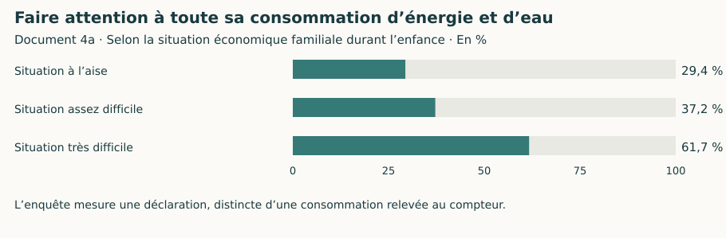

# ENS B/L · Sociologie (oral commun) — 23 et 24 juin, sujet 4 (2026) · Corrigé brut

*Corrigé rédigé par IA, non officiel. Signalez toute erreur.*

**Rédaction** · GPT-6.2 Astra Ultra · vitesse non renseignée

**Autocontrôle** · GPT-6.2 Astra Ultra · vitesse non renseignée

**Révision (tour 1)** · GPT-6.2 Astra Ultra · vitesse non renseignée

**Révision (tour 2)** · GPT-6.2 Astra Ultra · vitesse non renseignée · 26 novembre 2026

Le dossier de huit pages comporte sept documents. L’oral comprend 15 minutes d’exposé et 15 minutes de discussion après 1 h 30 de préparation.

## Sobriété et classes sociales

La première page du fascicule énumère les sept documents sans imprimer de titre général. Leur rapprochement pose une question précise. Deux ménages qui renoncent au même achat réalisent-ils la même forme de sobriété ? Les conséquences matérielles, les justifications données et la possibilité de faire autrement peuvent diverger. Les déclarations sur des consommations économisées demandent donc à être reliées aux ressources, aux socialisations et aux équipements disponibles.

### Économiser est une disposition acquise autant qu’une contrainte présente

Dans l’enquête d’Olivier Schwartz (doc. 1), faire soi-même mobilise des savoir-faire et limite la dépense. La profusion de plantes et la présence d’objets de consommation chez Éric Rouet donnent aussi au foyer le sens d’un espace de dignité et d’abondance. La frugalité populaire n’est pas un refus homogène du confort. Dans l’enquête de Caveng et Thine (doc. 2), Sylvie et Bruno discutent l’attention à l’éclairage et aux équipements du foyer. Bruno admet surveiller certaines dépenses professionnelles qu’il ne souhaite pas suivre aussi attentivement chez lui. L’entretien de couple donne à voir une négociation et une distribution du travail de vigilance qu’une réponse unique au nom du ménage effacerait.

Dans VertPom 2018–2020 (doc. 3), 48,4 % des 31 ouvriers interrogés déclarent faire attention à tout en matière d’énergie et d’eau, contre 22,5 % des 40 cadres et professions intellectuelles de la comparaison. L’écart de 25,9 points porte sur des déclarations dans de petits groupes. Il ne classe pas les consommations mesurées au compteur. Le document 4 rattache aussi cette disposition à l’enfance. Parmi les répondants ayant connu une situation économique familiale très difficile, 61,7 % disent aujourd’hui faire attention à tout, contre 29,4 % parmi ceux qui décrivent leur famille comme à l’aise. Pour isoler un effet de socialisation, il faudrait tenir compte de la situation présente. La mémoire de l’enfance peut elle-même être réinterprétée à la lumière de la trajectoire ultérieure.

L’écart entre enfances décrites comme très difficiles et enfances à l’aise est de 32,3 points. Le questionnaire réunit toutefois deux déclarations actuelles, l’une sur des circonstances passées et l’autre sur des pratiques présentes. Des entretiens sur les apprentissages domestiques aideraient à comprendre comment l’habitude d’économiser se transmet et dans quels logements elle peut s’exercer.

### Les effets concrets varient selon le domaine et les infrastructures

L’enquête Budget de famille (doc. 5) porte sur des achats de graisses par personne, en kilogrammes annuels, classés selon le diplôme le plus élevé des conjoints. Chez les ménages sous le certificat d’études primaires, la lecture fournie donne 6,9 kg de graisses animales et 9,4 kg de graisses végétales par personne et par an. Les quantités achetées peuvent traduire habitudes alimentaires, tailles des ménages, prix et préparation domestique. Elles ne donnent ni le gaspillage ni l’empreinte environnementale totale des repas. Le document permet surtout de discuter l’idée qu’un classement scolaire se traduirait mécaniquement par une même sobriété dans tous les domaines.

Dans le baromètre de l’ADEME de 2024 (doc. 6), les tableaux se lisent en ligne. Parmi les personnes utilisant la voiture tous les jours par contrainte, 55 % résident dans les couronnes périurbaines, contre 41 % de l’ensemble de l’échantillon. Il serait erroné d’en conclure que 55 % des habitants des couronnes déclarent cet usage. L’éloignement du travail et la rareté des transports collectifs constituent des explications à examiner, par comparaison de ménages de même position professionnelle et de distances différentes. Le tableau sur le diplôme décrit lui aussi la composition des groupes d’usagers, pas le taux d’usage de chaque niveau de diplôme.

### Un même renoncement peut obéir à plusieurs logiques

En 2024, dans le panel ELIPSS de 2 305 adultes de France métropolitaine (doc. 7), 8,9 % disent avoir renoncé à l’achat d’un appareil numérique dans les douze mois pour des raisons environnementales, et 28,6 % pour des raisons financières. L’écart de 19,7 points concerne des motifs déclarés. La modalité « non » est exclusive, les différents « oui » ne le sont pas. Le ménage qui a renoncé à cause du prix peut en tirer une satisfaction écologique et le ménage qui revendique un motif écologique peut posséder déjà des équipements nombreux. Mesurer l’empreinte demanderait encore les durées d’usage et les achats évités, ainsi que le service rendu à chacun.

La sobriété devient donc un objet sociologique quand on sépare conditions du choix, classement moral du geste et effet matériel. Un discours public qui félicite seulement le renoncement formulé dans les termes de la protection de l’environnement risque de manquer des économies réelles imposées par le budget, et d’oublier les dépenses qu’une infrastructure rend difficiles à éviter.

[Dossier officiel](https://www.ens.psl.eu/sites/default/files/dossier_sobriete.pdf) · [Rapport du jury](https://www.ens.psl.eu/sites/default/files/2026_bl_rapport_oral_tronc_commun_sociologie.pdf)

## Vérification sur le dossier

Les entretiens sur les usages domestiques ont été mis en relation avec les tableaux d’attention aux consommations, les achats alimentaires, les usages de la voiture et le renoncement à l’achat numérique. Les pourcentages de ligne du document automobile ont été distingués de la fréquence d’une pratique dans un groupe social.

Le document 4a indique que 61,7 % des personnes décrivant une situation familiale « très difficile » dans leur enfance déclarent aujourd’hui faire attention à tout pour l’énergie et l’eau, contre 29,4 % de celles qui disent leur famille « à l’aise ». La différence de 32,3 points associe un souvenir et une pratique déclarée. Le montant des factures, la qualité du logement et la contrainte de revenu actuelle éclaireraient les mécanismes de cette association.
