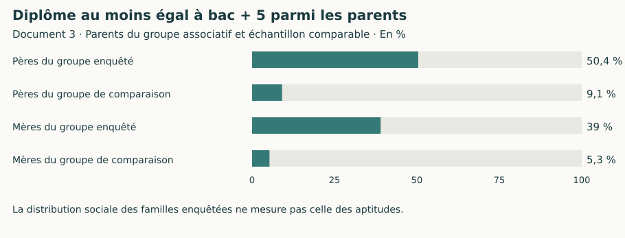

# ENS B/L · Sociologie (oral commun) — 23 et 24 juin, sujet 5 (2026) · Corrigé brut

*Corrigé rédigé par IA, non officiel. Signalez toute erreur.*

**Rédaction** · GPT-6.2 Astra Ultra · vitesse non renseignée

**Autocontrôle** · GPT-6.2 Astra Ultra · vitesse non renseignée

**Révision (tour 1)** · GPT-6.2 Astra Ultra · vitesse non renseignée

**Révision (tour 2)** · GPT-6.2 Astra Ultra · vitesse non renseignée · 26 novembre 2026

Le dossier de huit pages comporte sept documents. L’oral comprend 15 minutes d’exposé et 15 minutes de discussion après 1 h 30 de préparation.

## Les enfants surdoués

Entre une performance à une épreuve cognitive et l’identité d’« enfant surdoué » dont se saisit une famille, plusieurs opérations interviennent. Il faut qu’un adulte s’interroge, qu’un test soit accessible et qu’un résultat prenne un sens dans l’existence scolaire. Le dossier demande comment une catégorie de classement transforme des trajectoires et pourquoi son appropriation est socialement sélective.

### Une aptitude s’actualise dans une relation éducative

Norbert Elias (doc. 1) analyse le parcours de Mozart. La précocité musicale s’exerce au contact d’un père musicien, d’un entraînement intense et d’un monde où certaines formes musicales sont reconnues. Retracer ces conditions ne signifie ni que n’importe quel enfant aurait eu la même trajectoire ni que toutes les dispositions soient fixées à la naissance. Cela déplace la question vers les apprentissages, les encouragements et les occasions de faire reconnaître un talent. Le terrain de Wilfried Lignier (doc. 2) porte sur des parents adhérant à une association autour de la précocité. Son objet est l’appropriation sociale d’un résultat et d’une appellation. Ce recrutement ne représente pas tous les enfants qui auraient un score élevé lors d’un test systématique de la population.

Cette distinction éclaire le document 3. Dans l’échantillon de familles enquêtées, 50,4 % des pères dont le diplôme est renseigné ont au moins un niveau bac + 5, contre 9,1 % dans l’échantillon comparable de l’enquête Éducation et famille de 2003. Chez les mères, les proportions sont 39 % et 5,3 %. Il s’agit de la part des diplômés parmi les parents d’un groupe sélectionné. Pour calculer la probabilité qu’un enfant de diplômé soit reconnu précoce, il faudrait un dénominateur comprenant tous les enfants de diplômés et distinguer les étapes menant à cette reconnaissance.

La surreprésentation relative atteint environ 5,5 pour les pères diplômés à bac + 5 ou au-delà (50,4 divisé par 9,1) et 7,4 pour les mères (39 divisé par 5,3). La seconde valeur est plus élevée alors que, dans le groupe associatif, la proportion des mères très diplômées est inférieure à celle des pères. Les populations de comparaison expliquent ce classement.

### Découvrir une catégorie suppose des ressources et des attentes

Les professions paternelles (doc. 4) indiquent des formes différenciées de sélection. Les enfants de pères ouvriers représentent 2,8 % des familles enquêtées contre 36,4 % dans l’échantillon comparable. Les professions libérales en représentent 10,5 % contre 1,5 %, soit sept fois plus en proportion. Une famille peut avoir davantage d’occasions de connaître un professionnel, de financer une consultation, de comprendre le résultat et de demander un aménagement scolaire. L’enquête ne permet pas d’attribuer à chacun de ces mécanismes tout l’écart observé. Elle rend en revanche peu plausible l’idée d’un recrutement socialement indifférent.

Le document 5 renseigne sur le genre et le travail parental. Les filles constituent 26,3 % des enfants de référence. Ce chiffre invite à étudier les écarts d’orientation vers le test, d’interprétation des conduites et d’adhésion associative. Il ne mesure pas la répartition par sexe des aptitudes. Par ailleurs, 43,2 % des enfants du groupe sont scolarisés dans le privé contre 14,3 % dans l’échantillon de comparaison. Des parents sont aussi plus présents dans les associations scolaires. Un changement d’école peut faire suite au diagnostic, ou une recherche d’alternative l’avoir précédé. Des chronologies familiales aideraient à démêler les deux effets.

### Les activités et l’école produisent des différences observables

Dans le document 6, 54,3 % des enfants du groupe enquêté jouent d’un instrument contre 11,5 % dans le groupe comparable. Les activités musicales ou sportives requièrent de l’argent, des déplacements et des horaires familiaux compatibles. Elles offrent à la fois un apprentissage et des occasions pour les adultes de repérer des réussites. L’investissement parental peut donc produire et faire reconnaître des compétences. Le document 7 change entièrement de population. En 2022, les scores de langage en petite section se situent autour de 270 pour le milieu très favorisé et de 238 pour le milieu défavorisé. Les 32 points d’écart correspondent à 0,64 écart-type sur une échelle centrée à 250, d’écart-type 50. Ce ne sont ni des points de QI ni des probabilités de diagnostic. L’observation d’écarts très précoces rend intelligible le rôle de socialisations antérieures et des situations d’évaluation.

Le dossier permet ainsi d’expliquer comment se constitue une population reconnue comme exceptionnelle. Il faudrait une autre enquête pour mesurer toutes les aptitudes d’une cohorte. L’enquête sociologique gagne en précision en étudiant les conditions de passation, de reconnaissance et d’usage des résultats, y compris leurs bénéfices ou leurs contraintes pour l’enfant.

[Dossier officiel](https://www.ens.psl.eu/sites/default/files/dossier_surdouance.pdf) · [Rapport du jury](https://www.ens.psl.eu/sites/default/files/2026_bl_rapport_oral_tronc_commun_sociologie.pdf)

## Vérification sur le dossier

Élias et Lignier éclairent la formation des aptitudes et l’identification du diagnostic. Les tableaux sur les diplômes, la profession paternelle, les investissements parentaux et les activités des enfants puis les scores de maternelle ont été confrontés aux deux copies.

Le document 6 distingue le nombre d’activités du fait de pratiquer au moins un sport. Trois activités ou davantage concernent 39,2 % du groupe enquêté et 6,1 % du groupe comparable. L’écart vaut 33,1 points et le rapport environ 6,4. Ces calculs décrivent les groupes constitués par l’enquête, dont le premier passe par une association de familles. Ils ne mesurent pas l’effet d’une activité supplémentaire sur un test individuel.
