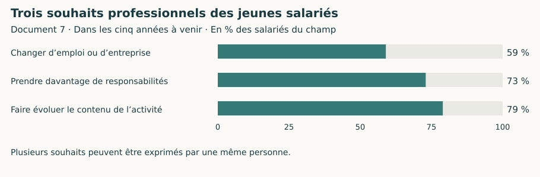

# ENS B/L · Sociologie (oral commun) — 23 et 24 juin, sujet 6 (2026) · Corrigé brut

*Corrigé rédigé par IA, non officiel. Signalez toute erreur.*

**Rédaction** · GPT-6.2 Astra Ultra · vitesse non renseignée

**Autocontrôle** · GPT-6.2 Astra Ultra · vitesse non renseignée

**Révision (tour 1)** · GPT-6.2 Astra Ultra · vitesse non renseignée

**Révision (tour 2)** · GPT-6.2 Astra Ultra · vitesse non renseignée · 26 novembre 2026

Le dossier de huit pages comporte sept documents. L’oral comprend 15 minutes d’exposé et 15 minutes de discussion après 1 h 30 de préparation.

## La transition vers l’âge adulte

À 23 ans, Joël peut alterner foyer et domicile parental tout en se disant adulte parce qu’il subvient à ses besoins. L’exemple oblige à distinguer l’âge civil, l’acquisition d’un revenu, le départ du domicile et le sentiment de responsabilité. Ces dimensions ne surviennent pas dans un ordre universel. Comment les ressources familiales, les institutions et le marché du travail organisent-ils la possibilité de choisir cet ordre et le sens que les jeunes lui donnent ?

### Les passages ont une signification sociale et biographique

Bourdieu (doc. 1) oppose l’intervalle d’études prolongé dont peut disposer une jeunesse bourgeoise à l’entrée précoce dans la production qui permet, par exemple, à un fils de mineur d’être reconnu parmi les adultes. Le contraste porte sur le droit d’attendre et sur ce que l’on gagne en n’attendant pas. L’enquête longitudinale de Bidart et Lavenu (doc. 2) fait entendre des définitions situées. Pour Joël, la capacité de subvenir à ses besoins compte malgré la résidence intermittente chez les parents. Pour Vanessa, jeune mère, le sentiment de responsabilité passe notamment par ses deux enfants. Les termes « dépendant » et « indépendant » changent donc de portée selon la ressource et le lien considérés.

Les itinéraires types du document 3 combinent emploi, décohabitation, mise en couple et calendrier familial. Chez les hommes d’origine ouvrière, 35,6 % suivent le profil de formation relativement précoce d’une famille de deux enfants, contre 19,2 % des hommes d’origine supérieure. Parmi les femmes de ces deux origines, l’itinéraire « INACT-3ENF » représente 17,1 % et 5,5 %. Ces typologies portent sur des personnes nées de 1932 à 1975 et observées dans l’enquête Santé et itinéraire professionnel. Elles décrivent des regroupements de parcours, sans assigner un destin aux individus. La construction de deux profils d’inactivité spécifiques aux femmes traduit une division historiquement inégale du travail rémunéré et parental.

### L’autonomie acquise peut être financée par d’autres

En 2014, dans l’enquête sur les ressources des 18–24 ans (doc. 4), 27,9 % des étudiants ont un père cadre ou exerçant une profession libérale, contre 9 % des non-étudiants. Ce sont des compositions de groupes. Elles ne donnent pas directement les taux d’accès aux études par origine. La résidence hors du domicile parental peut être facilitée par un soutien familial, tandis qu’un jeune resté au domicile peut financer une part des dépenses communes. Le tableau confirme l’intérêt de séparer activité, inscription en formation, couple et cohabitation.

Le document 5 valorise le service de logement reçu quand on cohabite. Il représente 46 % des ressources individuelles moyennes des jeunes du premier décile de niveau de vie, contre 27 % dans le dernier. Il s’agit d’une valeur imputée, qui ne peut pas être librement dépensée au supermarché. Les aides monétaires des parents et les revenus du travail jouent encore d’autres rôles. L’aide publique arrive parfois chez les parents (doc. 6). L’enquête estime à 55 euros mensuels, pour les jeunes du premier décile dans la définition de ce graphique, le supplément moyen de prestations sociales versées aux parents en raison de leur présence. Les réductions d’impôts liées au rattachement fiscal pèsent davantage dans les déciles élevés. Une politique peut donc favoriser le jeune au travers de sa famille sans lui donner le contrôle direct de la somme. Les déciles du document 6 sont définis sur le ménage élargi, ce qui invite à la prudence pour comparer terme à terme les deux graphiques.

### L’emploi ouvre des possibles tout en créant des contraintes

Le document 7 porte sur de jeunes salariés du champ de l’enquête Défis. Dans les cinq années à venir, 59 % disent souhaiter trouver un autre emploi ou changer d’entreprise, 73 % prendre davantage de responsabilités et 79 % faire évoluer le contenu de leur activité. Ces réponses peuvent se cumuler. Les salariés à temps partiel sont 70 % à souhaiter changer d’emploi ou d’entreprise contre 58 % des salariés en CDI, deux catégories qui peuvent elles-mêmes se chevaucher. Les intentions témoignent d’une marge de projection, sans garantir la mobilité future. Il faut aussi prendre en compte l’offre d’emploi, le logement, les charges familiales et le risque attaché à une démission.

L’évolution du contenu du travail recueille 79 % des réponses, le souhait de changer d’emploi ou d’entreprise 59 %. Certains jeunes peuvent vouloir les deux. À l’inverse, une nouvelle responsabilité ou un changement de tâches peuvent être recherchés dans l’entreprise actuelle. L’aspiration au changement recouvre donc des projets professionnels distincts.

Le passage à l’âge adulte combine ainsi différents pouvoirs, gagner une ressource, en disposer, habiter ailleurs et répondre d’autrui. Une chronologie individuelle, mise en regard des aides reçues et des possibilités de choix, explique davantage qu’un seuil d’âge unique.

[Dossier officiel](https://www.ens.psl.eu/sites/default/files/dossier_transition_adulte.pdf) · [Rapport du jury](https://www.ens.psl.eu/sites/default/files/2026_bl_rapport_oral_tronc_commun_sociologie.pdf)

## Vérification sur le dossier

Les deux enquêtes qualitatives et les cinq documents quantitatifs ont été contrôlés. Itinéraires, composition des ressources, aides aux parents ou aux jeunes et souhaits des salariés sont rapportés à leurs populations respectives.

Dans le document 4, la part des pères cadres ou exerçant une profession libérale vaut 27,9 % parmi les étudiants et 9 % parmi les non-étudiants. Le premier groupe présente une part supérieure de 18,9 points, environ 3,1 fois celle du second. Les colonnes sont constituées selon la situation d’études. Pour calculer la probabilité d’être étudiant parmi les enfants de cadres, il faudrait inverser le conditionnement à partir des effectifs ou des parts pondérées de chaque groupe.
