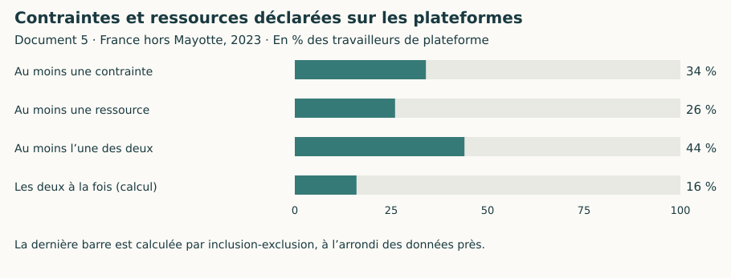

# ENS B/L · Sociologie (oral commun) — 23 et 24 juin, sujet 7 (2026) · Corrigé guidé

*Corrigé rédigé par IA, non officiel. Signalez toute erreur.*

**Rédaction** · GPT-6.2 Astra Ultra · vitesse non renseignée

**Autocontrôle** · GPT-6.2 Astra Ultra · vitesse non renseignée

**Révision (tour 1)** · GPT-6.2 Astra Ultra · vitesse non renseignée

**Révision (tour 2)** · GPT-6.2 Astra Ultra · vitesse non renseignée · 26 novembre 2026

Le dossier de huit pages comporte sept documents. L’oral comprend 15 minutes d’exposé et 15 minutes de discussion après 1 h 30 de préparation.

## Le travail de plateforme

Un chauffeur peut choisir de se connecter le soir tout en constatant que les périodes de majoration lui laissent peu de choix pour gagner sa vie. Une consultante qui trouve occasionnellement un client par un site peut être beaucoup moins dépendante. Les deux entrent pourtant dans la définition large du dossier. À quelles conditions l’intermédiation numérique transforme-t-elle l’autonomie professionnelle, l’organisation du travail et la répartition de ses coûts ?

### Un marché construit par les entreprises et les pouvoirs publics

Sophie Bernard (doc. 1) décrit les aspirations de chauffeurs Uber ayant parfois occupé des emplois physiques et peu autonomes. La promesse de travailler à son compte prend son sens par rapport à cette trajectoire antérieure. La disponibilité d’un grand nombre de chauffeurs permet de répondre vite au client, mais le temps d’attente et les horaires atypiques peuvent peser sur les revenus et la santé des conducteurs. Marion Flécher (doc. 2) replace l’essor des start-up dans des politiques de soutien à l’innovation, d’intermédiation financière et de valorisation de la croissance. Les travailleurs n’affrontent donc pas une technologie isolée. Ils entrent dans des marchés dont l’investissement public, les financements privés et les règles sociales ont contribué à façonner les conditions.

La Dares adopte dans Tracov 2 une définition précise (doc. 3). Elle interroge des indépendants ou micro-entrepreneurs accédant à des clients par au moins une application ou un site, que cet accès représente une faible part ou la plus grande part de leur activité. Près de 600 personnes répondent dans l’une de ces catégories. En 2023, 18 % des travailleurs de plateforme sont des intermédiaires et prestataires de services et les dix groupes les plus représentés totalisent 71 %. Le taxi et le VTC sont des exemples dans une catégorie plus large d’artisans de services. Assimiler tout l’ensemble aux chauffeurs détournerait la définition de l’enquête.

### L’indépendance statutaire et le contrôle du travail se combinent

Dans le document 4, 57 % des travailleurs de plateforme sont des hommes, contre 50 % des salariés et 61 % des autres indépendants. La pluriactivité concerne 14 %, 6 % et 12 % de ces groupes respectivement. Ces valeurs se lisent en colonne. La faible part des travailleurs de plateforme dans l’emploi total empêche de déduire du premier chiffre que la plupart des hommes travaillent sur plateforme. L’activité peut compléter d’autres revenus ou en fournir l’essentiel, ce qui modifie le coût d’un refus de mission.

Le document 5 montre que 21 % des travailleurs de plateforme déclarent recevoir des instructions précises sur la manière de travailler, et 20 % un contrôle de la réalisation des tâches. Au total, 34 % subissent au moins une des contraintes relevées et 26 % disposent d’au moins une ressource fournie, comme une formation. Leur union représente 44 %. À l’arrondi près, 16 % des travailleurs connaissent donc à la fois une contrainte et une ressource. Les autres peuvent subir une dépendance économique non captée par les seules instructions. Pour qualifier juridiquement une relation, la seule présence d’une plateforme ne suffirait pas. Sociologiquement, on étudiera aussi fixation des prix, accès aux clients, possibilité de se déconnecter et conséquences concrètes d’un refus.

### Qui supporte le coût de la flexibilité ?

Le schéma du Sénat (doc. 6) compare un exemple d’intérim à 17,50 euros de coût horaire et une facturation à 15 euros par mise à disposition d’autoentrepreneurs. L’écart de 2,50 euros représente environ 14,3 % du premier coût. Les postes ne se répartissent pas de façon identique, notamment pour les cotisations et les indemnités associées à l’intérim. La baisse du prix facturé n’équivaut pas à une hausse du revenu net et ne suffit pas à mesurer une productivité. Comptent aussi le temps consacré à trouver des missions, les interruptions d’activité et la couverture des risques.

Dans l’hébergement touristique (doc. 7), les nuitées en logements particuliers proposés par les plateformes progressent d’environ 30 % de 2015 à 2016 alors que les logements professionnels connaissent un léger recul et que l’ensemble augmente faiblement. Une progression forte dans une catégorie de poids initial réduit est compatible avec cette faible progression totale. Elle ne mesure ni la part des réservations désormais réalisées par plateforme ni le nombre d’emplois créés. On pourrait chercher qui réalise le ménage, reçoit les clients et assume les périodes sans réservation. L’intermédiation rend visibles des activités et peut en déplacer les coûts vers d’autres acteurs. Son effet sur l’autonomie dépend du pouvoir réel de quitter la plateforme, de négocier et de supporter les aléas.

Reconstituez les quatre groupes exclusifs. Soustrayez les 16 cas communs aux 34 cas de contrainte et aux 26 cas de ressource, puis complétez à 100. On obtient 18, 10, 16 et 56, à l’arrondi près.

## Questions du jury

> [!INDICATION]
> Comment calcule-t-on la part qui cumule contrainte et ressource ?

Par inclusion-exclusion, 34 + 26 − 44 = 16 % environ. L’addition directe compterait deux fois les personnes figurant dans les deux catégories.

> [!INDICATION]
> Peut-on attribuer aux plateformes la totalité du recul des hébergements professionnels ?

Le document décrit deux évolutions sur un an. Pour identifier un transfert causal, il faudrait notamment observer les lieux, les clientèles, la capacité d’hébergement, les prix et l’évolution attendue sans cette nouvelle offre.

[Dossier officiel](https://www.ens.psl.eu/sites/default/files/dossier_travail_plateforme.pdf) · [Rapport du jury](https://www.ens.psl.eu/sites/default/files/2026_bl_rapport_oral_tronc_commun_sociologie.pdf)

## Vérification sur le dossier

Les témoignages de chauffeurs et l’action des investisseurs publics ont été reliés à la diversité des métiers, aux profils sociaux, aux contraintes et ressources de l’intermédiation. Le coût horaire et la variation des nuitées sont distingués des revenus des personnes.

Dans le document 3, les dix groupes professionnels nommés totalisent 71 % des travailleurs de plateforme interrogés. Les intermédiaires et prestataires de services en représentent 18 % à eux seuls. Environ 29 % de l’ensemble se trouvent donc dans des métiers extérieurs aux dix catégories dominantes. Généraliser aux indépendants de plateforme le seul cas des chauffeurs présenté au document 1 écarterait une grande partie des situations du dossier.
