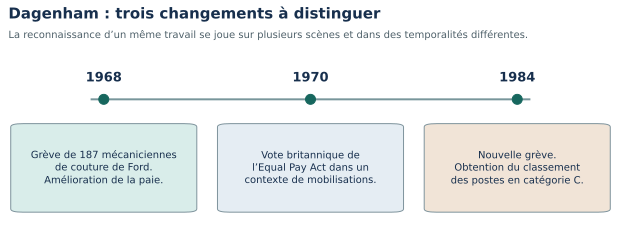

# BEL B/L — Sociologie 2026 · Corrigé brut

*Corrigé rédigé par IA, non officiel.*

**Rédaction** · modèle exact non renseigné (famille GPT-6) · effort non renseigné · vitesse non renseignée

**Révision** · modèle exact non renseigné (famille GPT-6) · effort non renseigné · vitesse non renseignée

**Révision** · GPT-6.2 Astra Ultra · vitesse non renseignée

**Révision (tour 3)** · GPT-6.2 Astra Ultra · vitesse non renseignée

**Révision (tour 4)** · GPT-6.2 Astra Ultra · vitesse non renseignée · 26 novembre 2026

**Sujet** — Le travail comme (re)production des rapports sociaux

## Introduction

Une housse de siège automobile ne quitte pas seule la machine à coudre. Il faut maintenir deux épaisseurs de tissu, conduire la couture dans une courbe et répéter le geste au rythme de la chaîne. Chez Ford, à Dagenham, les ouvrières qui accomplissent ce travail se mettent en grève en 1968. Elles contestent notamment le classement de leur poste. Le conflit ne porte donc pas seulement sur le prix d’une heure de travail. Il porte sur le pouvoir de dire si ce que l’on fait requiert une qualification. La facilité apparente d’un geste peut servir à en diminuer la valeur quand on suppose que toute femme en est capable. Les mêmes gestes, interrompus collectivement, peuvent rendre visible la dépendance d’une usine entière envers celles qui les accomplissent.

Un rapport social lie durablement des groupes placés dans des positions différentes à l’égard d’un enjeu, par exemple la maîtrise de la production ou la répartition du travail domestique. Il se joue dans les relations entre des personnes sans pouvoir s’expliquer par leurs seules affinités. Quant au travail, il comprend aussi bien l’activité faisant l’objet d’une rémunération que le soin quotidien grâce auquel d’autres peuvent vivre et travailler. Les parenthèses du sujet invitent à prendre au sérieux deux opérations. Le travail reconduit des hiérarchies antérieures à l’embauche ; il donne aussi à ces hiérarchies des formes que ni le contrat ni les dispositions acquises ne déterminent entièrement. **Par quels actes le travail quotidien rend-il durables des rapports de pouvoir, et à quelles conditions ceux qui les font exister peuvent-ils en modifier les termes ?**

## I. Affecter les personnes aux tâches, puis donner une valeur aux tâches, fait durer les hiérarchies

Le partage du travail commence avant l’ouverture de l’entreprise. Un salarié dont la journée peut finir tard doit pouvoir compter sur quelqu’un pour aller chercher un enfant ou préparer un repas. La régularité de sa présence chez l’employeur se paie par la disponibilité d’une autre personne, ou par une dépense qui assure la prise en charge. Dans un couple où l’un gagne déjà davantage, il peut sembler raisonnable que l’autre réduise son temps de travail. Une décision avantageuse à brève échéance pour le budget du ménage peut alors diminuer les chances de promotion et les droits futurs à pension de la personne qui a réduit ses heures. L’inégalité de départ produit donc certains des éléments qui paraîtront justifier le choix suivant. Ce raisonnement n’exige de prêter à aucun des conjoints l’intention de reproduire une domination.

La sociologie de la division sexuelle du travail distingue, avec Helena Hirata et Danièle Kergoat, deux principes. La séparation assigne plus souvent certaines tâches aux femmes et d’autres aux hommes. La hiérarchie accorde une valeur sociale supérieure aux travaux associés aux hommes. Il importe de distinguer les deux. Prenons le soin à une personne âgée. Savoir repérer une modification de ses habitudes, la mobiliser sans la faire tomber et obtenir son accord requiert des apprentissages. Si l’on fait de la patience une qualité féminine spontanée, une compétence exercée quotidiennement devient difficile à faire reconnaître comme telle dans une classification. L’entrée dans le salariat change le statut de l’activité et procure un revenu. Elle peut laisser subsister cette manière d’en mesurer la valeur.

Déléguer le soin à domicile transforme d’ailleurs la portée de ce partage. Une famille qui peut payer quelques heures libère du temps, notamment pour celle de ses membres qui aurait pris en charge la tâche. Un rapport d’emploi se forme alors entre des femmes dont les ressources et les possibilités de négocier leurs horaires diffèrent. Dans *Les Aides à domicile*, Christelle Avril montre, à partir d’une enquête auprès de salariées, combien leurs trajectoires sociales, leurs rapports au métier et la valeur qu’elles donnent à certaines tâches sont hétérogènes. Les regrouper sous l’étiquette de « femmes peu qualifiées » efface justement ce qui rend possible une division du travail à l’intérieur du métier. Une meilleure disponibilité professionnelle pour les unes peut ainsi s’appuyer sur des journées discontinues pour les autres. La reproduction du rapport social de sexe passe ici par une modification de son organisation et mobilise des écarts de classe.

## II. Le travail en train de se faire produit des groupes, des règles et des frontières

Un contrat fixe une durée, une rémunération et certaines obligations. Il ne détermine pas à lui seul à quelle allure on travaillera, ce qu’un collègue montrera au nouvel arrivant ou qui prendra un risque pour rattraper un retard. C’est dans cet intervalle que se construit le rapport des salariés à l’employeur et de différentes fractions de salariés entre elles. Il ne suffit donc pas de reconnaître sur les lieux du travail les inégalités déjà observées à leur porte. Il faut observer les règles que les travailleurs élaborent pour pouvoir accomplir le travail, et demander ensuite à qui ces règles profitent.

Michael Burawoy a travaillé comme opérateur de machines dans une usine de la région de Chicago. Dans *Manufacturing Consent*, il décrit le jeu consistant à atteindre ou dépasser un objectif de production, le *making out*. Un ouvrier peut attacher de l’importance au tour de main qui économise quelques secondes, à la réputation qu’il acquiert ou à la latitude qui lui reste pour organiser sa journée. Cette expérience donne une réalité à son autonomie. Or, à mesure que la réussite se mesure à l’intérieur du jeu, l’objectif de produire pour l’entreprise s’impose aussi aux participants. Une partie des tensions peut porter sur l’affectation aux bonnes machines ou aux tâches avantageuses, au lieu de porter sur la fixation de la règle elle-même. Le consentement au mode d’organisation se fabrique ainsi par une activité dans laquelle les ouvriers investissent leur intelligence. La perspective ne suppose ni qu’ils soient dupes ni que chaque atelier fonctionne de la même manière.

L’enquête de Nicolas Jounin sur les chantiers de béton armé de la région parisienne met en évidence un autre processus. Des personnes travaillent sur le même ouvrage, parfois côte à côte, mais l’entreprise principale, un sous-traitant et une agence d’intérim peuvent être leurs employeurs respectifs. Celui qui dépend du renouvellement de sa mission dispose de moins de prise pour refuser un travail pénible ou signaler un danger. L’affectation répétée des travailleurs les plus précaires à certaines tâches finit par accréditer parmi les équipes une représentation de leurs aptitudes. Lorsque le recrutement et les affectations s’appuient aussi sur des catégories d’origine, celles-ci peuvent passer pour une description naturelle des spécialisations de chantier. Le travail produit une frontière ethnicisée en même temps que ses résultats matériels. Le statut juridique, la nationalité et les catégories employées par les collègues ne se confondent pas. C’est précisément parce qu’ils peuvent se renforcer qu’il faut reconstituer leur articulation.

Ces observations changent la manière de lire une différence statistique entre professions. La concentration d’un groupe dans un emploi indique une distribution. Elle ne permet pas à elle seule de conclure à des préférences pour ces tâches, à une décision discriminatoire unique ou à une exposition identique chez tous ses membres. Observer qui distribue les postes, à qui un salarié ose demander de l’aide, ou ce qu’il risque en refusant une affectation donne accès aux relations qui produisent cette concentration. Et suivre les salariés d’un employeur à l’autre révèle que la répartition peut rester ordonnée alors même que les équipes changent.

## III. L’interdépendance créée par le travail peut devenir une ressource pour transformer les rapports sociaux

Une division du travail assigne des places, mais elle fait également dépendre les places les unes des autres. Le produit ne sort que si des opérations réalisées dans des ateliers différents peuvent s’accorder. Des salariés apparemment remplaçables pris un à un peuvent posséder ensemble un savoir et une capacité d’arrêt sans lesquels le travail des autres est suspendu. Le passage de cette puissance potentielle à une action commune ne va pas de soi. Le risque de perdre son poste, la dispersion des lieux de travail et la division entre employeurs peuvent rendre coûteuse la rencontre de personnes qui subissent pourtant une même règle. À l’inverse, des moments et des lieux pour comparer les situations permettent de découvrir que ce qu’on croyait être une difficulté personnelle est une expérience partagée.

En 1968, à Dagenham, 187 mécaniciennes de couture de Ford cessent le travail. Les housses de sièges qu’elles fabriquent sont nécessaires à la poursuite de la production automobile. Leur demande de reclassement s’appuie à la fois sur une compétence, qu’elles disent sous-évaluée, et sur cette interdépendance. Elle les oblige à contester la définition industrielle de la qualification autant que la différence de rémunération entre femmes et hommes. Deux temporalités apparaissent alors. En 1968, la reprise s’effectue sur une offre qui porte le taux des mécaniciennes à 92 % du taux masculin de la catégorie B. Le choix du dénominateur importe. Obtenir davantage à l’intérieur de B laisse intacte la définition du poste qui leur ferme la catégorie C. Un même accord peut donc déplacer le rapport salarial et reconduire, pour un temps, la hiérarchie des qualifications. La loi britannique sur l’égalité de rémunération est votée en 1970 dans un contexte de mobilisations plus large. Pourtant, il faut une nouvelle grève en 1984 pour que les mécaniciennes obtiennent le classement en catégorie C qu’elles demandaient. Le vote d’une norme, la modification du salaire et la reconnaissance d’une qualification ont des effets distincts et n’obéissent pas au même calendrier.

Seize ans séparent les deux accords d’atelier. Pendant cet intervalle, le salaire de référence de la catégorie B permet de mesurer une concession obtenue par les ouvrières. La catégorie attribuée au poste permet de suivre ce que cet accord laisse en suspens.

Pourquoi cet écart ? Lorsqu’une direction consent à rapprocher les rémunérations à l’intérieur d’une catégorie, elle peut conserver le pouvoir de fixer les frontières entre les catégories. Reconnaître la technicité d’un travail oblige à réexaminer ces frontières et, potentiellement, les comparaisons avec d’autres postes. Le conflit transforme donc l’enjeu lui-même. La discussion sur ce qu’une ouvrière doit toucher se prolonge en discussion sur les gestes qui comptent, les personnes autorisées à les évaluer et les procédures qui rendent leur jugement contestable. Un rapport social change lorsque ses règles s’inscrivent différemment dans des institutions, mais aussi lorsque des personnes acquièrent une capacité durable à intervenir dans la production de ces règles.

Il serait néanmoins hâtif de faire de tout collectif de travail une force de transformation générale. Les liens qui donnent aux salariés stables la capacité de protéger leur métier peuvent fermer aux intérimaires l’accès aux mêmes ressources. Et une revalorisation d’emploi ne partage pas à elle seule le travail domestique au sein de chaque foyer. Pour apprécier la portée d’un changement, il faut suivre ce qui se passe de part et d’autre de la frontière déplacée. Qui peut désormais obtenir la qualification ? Qui conserve le pouvoir d’attribuer les postes ? Qui assure les tâches que le nouvel arrangement laisse à accomplir ? Ces questions rejoignent celles que posait le passage de l’aide familiale à l’aide salariée.

## Conclusion

Le travail reconduit les rapports sociaux parce que sa répartition transforme des écarts de ressources et de disponibilité en différences de carrière, de reconnaissance ou de sécurité. Il les produit aussi, chaque fois qu’un objectif d’atelier, un mode de recrutement ou une classification acquiert la force d’une règle à laquelle les groupes se mesurent. Les deux processus sont donc liés. La hiérarchie ne dure qu’à travers des activités qui la rétablissent dans des conditions changeantes. Parce que les personnes qui travaillent assurent ensemble la continuité de ces activités, elles peuvent aussi en suspendre le cours et en discuter les règles. La portée de cette capacité se juge à ce qu’elle change concrètement à l’assignation des tâches, à leur valeur et au pouvoir de décider de l’une et de l’autre.

## Vérification sur le sujet

Le titre unique reproduit dans les annales pédagogiques a été comparé aux deux copies. L’analyse porte sur la distribution du travail domestique et salarié, les règles de qualification, les rapports de classe, de genre et de racialisation, ainsi que sur leur transformation collective.

À Dagenham, une hausse du taux de rémunération dans la catégorie B et le reclassement du poste en catégorie C sont deux résultats empiriques distincts. Pour tester la reproduction d’une hiérarchie, on peut suivre, entre deux accords, les tâches attribuées, le groupe qui les exerce et le droit d’en fixer la valeur. Une hausse du salaire avec maintien du classement modifie la rémunération immédiate. Une nouvelle classification peut aussi modifier la référence applicable aux futures recrues. L’exemple rend ainsi observables à deux dates les processus visés par les parenthèses du sujet.

Le libellé est reproduit dans les annales pédagogiques de la filière. La notice du concours décrit le format. La vérification porte sur cette dissertation et aucune pièce supplémentaire n’est annoncée sur la page qui la reproduit.
