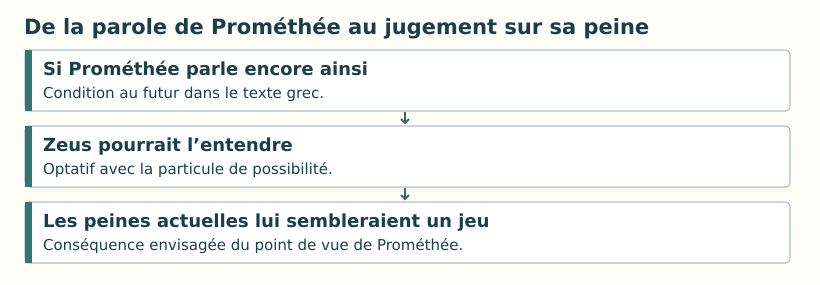

# BEL B/L — Version grecque 2026 · Corrigé brut

*Corrigé rédigé par IA, non officiel. Signalez toute erreur.*

**Lecture du rapport du jury** · GPT-6.2 Astra Ultra · vitesse non renseignée

**Rédaction** · GPT-6.2 Astra Ultra · vitesse non renseignée

**Autocontrôle** · GPT-6.2 Astra Ultra · vitesse non renseignée

**Révision (tour 1)** · GPT-6.2 Astra Ultra · vitesse non renseignée

## Faire profil bas

Le rapport officiel intitule la version « Faire profil bas » et situe l’extrait aux vers 304–324 du *Prométhée enchaîné* du Pseudo-Eschyle. Il cite la condition prononcée par Océan, le potentiel de la réponse et plusieurs mots du passage. Ces indices concordent avec les vers 306–326 de l’édition de Herbert Weir Smyth (1922), de δέρκου θέαμα à τραχὺς μόναρχος οὐδ’ ὑπεύθυνος κρατεῖ. **Couverture partielle.** La traduction suit les vingt et un vers de Smyth. Le fascicule distribué manque pour confirmer ses bornes mot à mot, ses leçons et la teneur exacte des notes données aux candidats.

## Traduction

**Prométhée.** Regarde quel spectacle je t’offre, moi, l’ami de Zeus, moi qui l’ai aidé à établir sa souveraineté ! Vois sous quelles souffrances il me fait plier !

**Océan.** Je le vois, Prométhée, et je veux te conseiller au mieux de tes intérêts, si habile que tu sois. Connais-toi toi-même et adopte des façons d’agir nouvelles, car il est nouveau, lui aussi, le souverain qui règne parmi les dieux. Si tu vas lancer des paroles aussi dures et aussi acérées, Zeus pourrait bien t’entendre, même tout en siégeant très loin au-dessus de nous. Alors tout le poids des peines qui t’accablent maintenant te semblerait un jeu d’enfant.

Allons, malheureux, laisse là la colère qui t’anime et cherche comment te délivrer de ces maux. Peut-être trouves-tu que je te débite là de vieilles maximes. Voilà pourtant, Prométhée, le salaire d’une langue qui parle de trop haut. Toi, tu ne baisses toujours pas la tête, tu ne cèdes pas non plus sous le poids des malheurs. À ceux que tu subis, tu veux en ajouter d’autres. Si donc tu me prends pour maître, tu n’iras pas ruer contre l’aiguillon. Tu vois en effet que celui qui commande est un souverain dur, qui n’a de comptes à rendre à personne.

**Repère de lecture**

Océan envisage ce qui pourrait arriver si Prométhée persistait à parler ainsi. La peine qu’il endure déjà devient le terme de comparaison d’un mal possible. Le conditionnel français permet de laisser cette conséquence en suspens et de préserver la force de l’avertissement.

[Rapport du jury, p. 1–2](https://www.ens.psl.eu/sites/default/files/2026_bl_rapport_ecrit_et_oral_grec_ancien.pdf#page=1) · [Texte grec, édition Smyth, v. 306–326](https://scaife.perseus.org/reader/urn:cts:greekLit:tlg0085.tlg003.perseus-grc2:306-326/)
