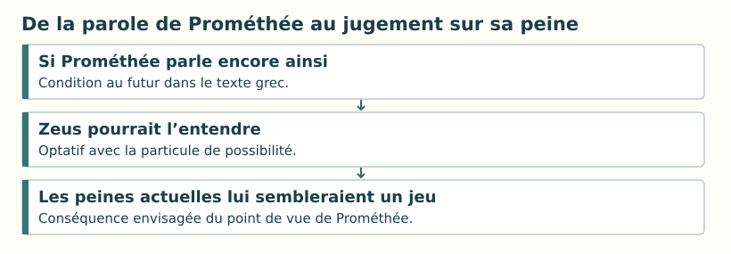

# BEL B/L — Version grecque 2026 · Corrigé guidé

*Corrigé rédigé par IA, non officiel. Signalez toute erreur.*

**Lecture du rapport du jury** · GPT-6.2 Astra Ultra · vitesse non renseignée

**Rédaction** · GPT-6.2 Astra Ultra · vitesse non renseignée

**Autocontrôle** · GPT-6.2 Astra Ultra · vitesse non renseignée

**Révision (tour 1)** · GPT-6.2 Astra Ultra · vitesse non renseignée

## Faire profil bas

Le rapport officiel intitule la version « Faire profil bas » et situe l’extrait aux vers 304–324 du *Prométhée enchaîné* du Pseudo-Eschyle. Il cite la condition prononcée par Océan, le potentiel de la réponse et plusieurs mots du passage. Ces indices concordent avec les vers 306–326 de l’édition de Herbert Weir Smyth (1922), de δέρκου θέαμα à τραχὺς μόναρχος οὐδ’ ὑπεύθυνος κρατεῖ. **Couverture partielle.** La traduction suit les vingt et un vers de Smyth. Le fascicule distribué manque pour confirmer ses bornes mot à mot, ses leçons et la teneur exacte des notes données aux candidats.

## Du spectacle à la mise en garde

Les trois premiers vers appartiennent à Prométhée. La réponse d’Océan commence au premier « je vois ». Au brouillon, encadrer les verbes qui désignent celui qui regarde, puis ceux qui désignent celui qui souffre. Le français doit donner à entendre que « l’ami de Zeus » et le prisonnier qui parle sont un seul homme. Celui qui a contribué à établir le nouveau pouvoir en subit maintenant les rigueurs.

> [!INDICATION]
> Δέρκου est un impératif de deuxième personne. Dans « οἵαις ὑπ’ αὐτοῦ πημοναῖσι κάμπτομαι », quel mot donne le sujet du verbe et à qui renvoie αὐτοῦ ?

La première personne de κάμπτομαι ramène au locuteur. Le groupe ὑπ’ αὐτοῦ désigne Zeus comme agent. L’adjectif οἵαις s’accorde au datif pluriel avec πημοναῖσι, « sous quelles souffrances ». La reprise française « vois » permet de passer de l’homme montré à ce qu’il endure, sans changer de personnage.

## Distinguer les trois moments de la menace

Dans les vers repérés à partir du rapport, distinguer la condition de son effet possible, puis demander à quel personnage les peines actuelles paraîtraient un jeu. Ce point de vue commande le choix du pronom français.

> [!INDICATION]
> Aux vers 311–314 dans la numérotation du jury, demander successivement qui parle, qui risque d’entendre et à qui les peines actuelles paraîtront légères.

Dans la condition εἰ … ῥίψεις, le futur grec donne du relief à la menace de continuer à lancer de telles paroles. En français, le présent après « si » suffit. τραχεῖς et τεθηγμένους qualifient λόγους. Le participe parfait τεθηγμένους fait de ces paroles des objets déjà aiguisés. Dans la principale, le sujet Ζεύς est rejeté derrière le verbe. L’optatif κλύοι, accompagné de ἄν, présente son écoute comme une possibilité. Traduire par un futur assuré ferait annoncer par Océan une réaction de Zeus qu’il cherche justement à prévenir. Le génitif σου dépend du verbe d’audition. Enfin, σοι désigne celui à qui les peines sembleraient un jeu. La construction ὥστε … δοκεῖν développe la conséquence envisagée. Océan invite Prométhée à mesurer ses maux présents à ceux qu’il risque de s’attirer.

## Donner aux conseils leur ton

La concession καίπερ ὄντι ποικίλῳ reconnaît la finesse de celui qu’on va conseiller. Le participe et l’adjectif sont au datif comme σοι. « Connais-toi toi-même » invite ici Prométhée à mesurer sa position dans un ordre nouveau. Le rapprochement de νέους et νέος porte sur deux substantifs différents. Prométhée doit changer ses façons de se conduire parce que le maître lui-même est nouveau. Dans ἃς ἔχεις ὀργὰς ἄφες, le nom de la colère est inclus dans la relative. Le français le replace devant elle, « abandonne la colère qui t’anime ». ἄφες et ζήτει sont deux ordres successifs, adressés à Prométhée par Océan.

L’expression τἀπίχειρα désigne ce qu’un acte rapporte à son auteur. Une « récompense » serait ici amère. Le mot « salaire » conserve cette ironie. Dans la dernière image, le membre que l’on allonge vers l’aiguillon est celui de l’animal qui rue. Son mouvement tourne contre lui la pointe à laquelle il voudrait résister. Le conseil se termine sur une raison politique. Zeus est οὐδ’ ὑπεύθυνος, exempt de l’obligation de rendre des comptes. Ce n’est donc pas à sa propre responsabilité qu’Océan invite Prométhée à se soustraire.

## Traduction suivie

**Prométhée.** Regarde quel spectacle je t’offre, moi, l’ami de Zeus, moi qui l’ai aidé à établir sa souveraineté ! Vois sous quelles souffrances il me fait plier !

**Océan.** Je le vois, Prométhée, et je veux te conseiller au mieux de tes intérêts, si habile que tu sois. Connais-toi toi-même et adopte des façons d’agir nouvelles, car il est nouveau, lui aussi, le souverain qui règne parmi les dieux. Si tu vas lancer des paroles aussi dures et aussi acérées, Zeus pourrait bien t’entendre, même tout en siégeant très loin au-dessus de nous. Alors tout le poids des peines qui t’accablent maintenant te semblerait un jeu d’enfant.

Allons, malheureux, laisse là la colère qui t’anime et cherche comment te délivrer de ces maux. Peut-être trouves-tu que je te débite là de vieilles maximes. Voilà pourtant, Prométhée, le salaire d’une langue qui parle de trop haut. Toi, tu ne baisses toujours pas la tête, tu ne cèdes pas non plus sous le poids des malheurs. À ceux que tu subis, tu veux en ajouter d’autres. Si donc tu me prends pour maître, tu n’iras pas ruer contre l’aiguillon. Tu vois en effet que celui qui commande est un souverain dur, qui n’a de comptes à rendre à personne.

[Rapport du jury, p. 1–2](https://www.ens.psl.eu/sites/default/files/2026_bl_rapport_ecrit_et_oral_grec_ancien.pdf#page=1) · [Texte grec, édition Smyth, v. 306–326](https://scaife.perseus.org/reader/urn:cts:greekLit:tlg0085.tlg003.perseus-grc2:306-326/)
