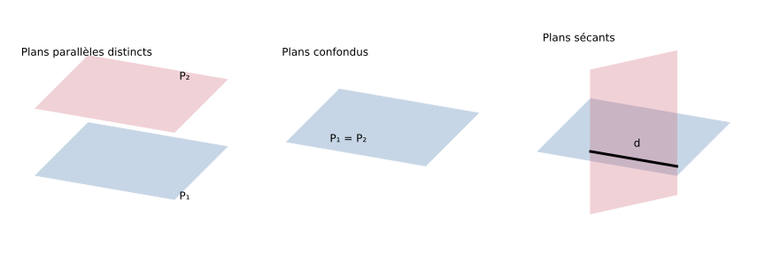

# CAPES Maths — Épreuve d'admissibilité 2 (bac+3) 2026 · Corrigé guidé

*Corrigé rédigé par IA, non officiel. Signalez toute erreur.*

## Présentation du sujet

**Format.** Épreuve écrite d'admissibilité de 4 heures (coefficient 4), calculatrice autorisée dans les conditions de la circulaire du 17 juin 2021, sans aucun ouvrage ni document. Le sujet comporte **trois parties indépendantes** et **deux documents joints** : 30 items en tout (3 exercices de critique en Partie 1, 20 questions en Partie 2, 7 questions en Partie 3). L'épreuve « évalue les compétences disciplinaires » : il s'agit d'analyser, critiquer et compléter les documents pour répondre aux questions et résoudre les exercices.

**Contenu des parties.**

- **Partie 1** : trois « corrigés » d'exercices sont proposés, tous faux ou mal rédigés ; il faut repérer les erreurs, critiquer la rédaction, puis rédiger une réponse correcte. Les pièges : raisonnement par analyse sans synthèse (Exercice 1), inversion de quantificateurs (Exercice 2), récurrence mal conduite et conclusion « croissante donc convergente » (Exercice 3).
- **Partie 2** : 20 questions sur le Document 1 (extraits de cours) : méthode de Gauss, rang, systèmes linéaires (Rouché-Fontené), faisceaux de plans, formes linéaires, dualité, hyperplans.
- **Partie 3** : 7 questions sur le Document 2 (un cube et des intersections de plans dans $\mathbb R^3$), où le repère n'est pas explicité : $I=(1,0,1)$, $J=(1,1,0)$, $K=(0,1,1)$, $F=(1,1,1)$,
 avec $I,J,K$ milieux des arêtes issues de $F$.

**Notions du programme mobilisées.** Raisonnement logique et quantificateurs ; continuité et théorème des valeurs intermédiaires ; suites, suites récurrentes, suites arithmético-géométriques ; systèmes linéaires et algorithme du pivot de Gauss ; espaces vectoriels de dimension finie, rang, matrices ; valeurs propres ; formes linéaires, dualité, hyperplans ; géométrie affine de $\mathbb R^3$ (plans, droites, produit vectoriel, faisceaux).

**Ce que dit le rapport du jury de la session 2026.** Pour l'ensemble des candidats, la seconde épreuve a une moyenne de 9,43, une médiane de 10,07, un écart-type de 3,55 et un maximum de 18,00. Le jury prévient : « Les barèmes ou grilles de notation internes au jury permettent d'obtenir la note de 20/20 sans nécessairement traiter l'intégralité des sujets. […] Que ces remarques n'incitent cependant pas au « grappillage » qui, lui, a pu être sanctionné. » Sur la forme : « Les copies sont trop souvent lapidaires : les raisonnements sont trop peu explicités, les liens logiques peu formulés et les réponses trop rarement justifiées », et « pour rendre l'utilisation d'une propriété mathématique […] pleinement convaincante, il convient de la nommer, au moins lors de sa première utilisation dans la copie ».

**Difficulté et gestion du temps.** Beaucoup d'items, peu de questions vraiment difficiles, mais des consignes de méthode à respecter à la lettre (« à l'aide d'un calcul de rang », « en utilisant les résultats qui précèdent ») : le jury sanctionne celles et ceux qui ne les respectent pas. Ordre conseillé : Partie 1 (rapide et rentable), puis Partie 2 en commençant par les questions 1 à 5, 8, 9, 13, puis la dualité (16 à 19) et la Partie 3. Comptez environ 45 minutes pour la Partie 1, 2 h 15 pour la Partie 2, 45 minutes pour la Partie 3, et gardez 15 minutes de relecture (numérotation des questions, opérations de Gauss écrites une par étape, résultats encadrés).

## Partie 1 — Exercices de critique et rédaction mathématique

### Exercice 1

> [!INDICATION]
> Le « corrigé » proposé multiplie l'équation par $x$ : que devient une équivalence quand on multiplie par une inconnue ? Quelles valeurs obtient-on, et lesquelles faut-il encore tester ?

> [!INDICATION]
> Pour la rédaction correcte, factorisez plutôt que de discuter : regroupe les termes deux à deux.

#### Solution

**Critique.** Le raisonnement proposé n'est qu'une **analyse** : il établit une condition nécessaire ($x$ solution $\Rightarrow x^4=1$, donc $x\in\{-1,1\}$), mais la **synthèse** manque : rien ne garantit que $-1$ et $1$
 sont effectivement solutions. Or $1$ n'est pas solution ($1+1+1+1=4\neq0$). De plus, multiplier une équation par $x$ n'est pas une équivalence : cela peut introduire une racine parasite ($x=0$).

**Rédaction correcte.** Pour tout $x\in\mathbb R$,

$$
\begin{aligned}
x^3+x^2+x+1&=x^2(x+1)+(x+1)\\
&=(x+1)(x^2+1).
\end{aligned}
$$

Or $x^2+1>0$ pour tout réel $x$, donc

$$
\begin{aligned}
x^3+x^2+x+1=0&\iff x+1=0\\
&\iff x=-1.
\end{aligned}
$$

$$
\boxed{\mathcal S=\{-1\}.}
$$

> [!JURY]
> « Le jury regrette que les candidats n'identifient pas bien le raisonnement par analyse/synthèse ou encore que les factorisations de polynômes donnent lieu à des discussions fleuves. »

### Exercice 2

> [!INDICATION]
> L'hypothèse donne, pour chaque $x$, une valeur $f(x)$ dans $\{-1,1\}$ : cette valeur dépend-elle a priori de $x$ ? Écrivez les quantificateurs dans le bon ordre.

> [!INDICATION]
> Pour exclure un « saut » de $1$ à $-1$, utilisez la continuité et un théorème que vous nommerez.

#### Solution

**Critique.** L'hypothèse s'écrit $\forall x\in\mathbb R,\ \exists\varepsilon\in\{-1,1\},\ f(x)=\varepsilon$, où $\varepsilon$ dépend *a priori* de $x$ : la réponse proposée échange les quantificateurs ($\exists\varepsilon\ \forall x$). Rien ne garantit que la valeur choisie ne change pas avec $x$. L'hypothèse de continuité, pourtant décisive, n'est pas utilisée.

**Rédaction correcte.** Par hypothèse, $\forall x\in\mathbb R,\ f(x)\in\{-1,1\}$. Supposons $f$ non constante : il existe $x_1,x_2\in\mathbb R$ tels que $f(x_1)\neq f(x_2)$, par exemple $f(x_1)=1$
 et $f(x_2)=-1$. La fonction $f$ étant continue sur $\mathbb R$, elle est continue sur le segment $[x_1,x_2]$ ; comme $0$
 est strictement compris entre $f(x_2)=-1$ et $f(x_1)=1$, le **théorème des valeurs intermédiaires** fournit $x_3\in[x_1,x_2]$ tel que $f(x_3)=0$. Mais alors $(f(x_3))^2=0\neq1$,
 ce qui contredit l'hypothèse. Donc $f$ est constante.

$$
\boxed{f\text{ est constante, égale à }1\text{ ou à }-1.}
$$

> [!JURY]
> « Il faut justifier proprement la permutation d'un quantificateur ∀ avec ∃. Si l'hypothèse de continuité est évidemment indispensable, il revient au candidat de justifier pourquoi. Le jury s'agace d'un argument magique « c'est continue, donc ça ne marche pas ! ». »

### Exercice 3

> [!INDICATION]
> La suite est définie par une relation arithmético-géométrique : cherchez un point fixe et un changement de suite auxiliaire qui rende la relation géométrique.

> [!INDICATION]
> Dans la rédaction proposée, « croissante donc convergente » est faux sans majoration : relevez-le, et remarquez qu'une limite négative contredit la positivité.

#### Solution

**Critique.** Trois défauts. (i) La proposition de récurrence est mal quantifiée (« on suppose $\mathcal H_n$ vraie pour tout $n$ »). (ii) « Croissante donc convergente » est faux : il faut de plus que la suite soit **majorée**. (iii) La limite trouvée, $\ell=-1<0$, contredit la positivité de la suite : cette contradiction aurait dû alerter. La suite est en réalité divergente.

**Rédaction correcte.** Posons $v_n=u_n+1$. Alors

$$
\begin{aligned}
v_{n+1}&=u_{n+1}+1\\
&=2u_n+2=2v_n.
\end{aligned}
$$

et $v_0=u_0+1=2$. La suite $(v_n)$ est donc géométrique de raison $2$ et de premier terme $2$ :

$$
\boxed{u_n=2^{n+1}-1\quad(n\in\mathbb N).}
$$

Comme $2^{n+1}\to+\infty$, la suite $(u_n)$ **diverge vers $+\infty$** : elle n'est pas convergente.

*Variante.* Une récurrence immédiate donne $u_n\geq0$, et $u_{n+1}-u_n=u_n+1>0$ : la suite est strictement croissante. Si elle était majorée, elle convergerait vers un réel $\ell$ qui, par continuité de $x\mapsto2x+1$, vérifierait $\ell=2\ell+1$,
 soit $\ell=-1$. Or $u_n\geq0$ pour tout $n$ entraîne $\ell\geq0$ : contradiction. La suite n'est donc pas majorée et diverge vers $+\infty$.
 $\square$

> [!JURY]
> « Le jury s'étonne, outre le fait que très peu de candidats voient que l'on peut obtenir une expression explicite de $u_n$ en fonction de $n$, de la très faible maîtrise de notions pourtant fondamentales telles que les récurrences ou encore de résultats classiques sur les suites. »

## Partie 2 — Questions sur le document 1

### Question 1

> [!INDICATION]
> Échelonnez par pivot de Gauss en écrivant chaque opération élémentaire au-dessus de la flèche.

#### Solution

$$
\begin{pmatrix}1&1&1\\-1&2&3\\2&2&1\end{pmatrix}\xrightarrow[\substack{L_2\leftarrow L_2+L_1\\ L_3\leftarrow L_3-2L_1}]{}\begin{pmatrix}1&1&1\\0&3&4\\0&0&-1\end{pmatrix}.
$$

La matrice obtenue est échelonnée, de pivots $1$, $3$, $-1$. Le rang d'une matrice échelonnée étant le nombre de ses lignes non nulles :

$$
\boxed{\operatorname{rg}\begin{pmatrix}1&1&1\\-1&2&3\\2&2&1\end{pmatrix}=3.}
$$

> [!JURY]
> « Le jury déplore trop de calculs faux/mal présentés, quand on attend d'une copie d'être lisible et compréhensible. »

### Question 2

> [!INDICATION]
> Pour qu'un ensemble non vide soit un sous-espace vectoriel, quelles stabilités faut-il montrer ? Pensez aux scalaires, pas seulement à la somme.

#### Solution

Notons $E_0=\{X\in\mathbb R^n : AX=0_{\mathbb R^m}\}$. On a $A\,0_{\mathbb R^n}=0_{\mathbb R^m}$, donc $0_{\mathbb R^n}\in E_0$. Soient $X_1,X_2\in E_0$ et $\lambda,\mu\in\mathbb R$. Par linéarité du produit matriciel :

$$
\begin{aligned}
A(\lambda X_1+\mu X_2)&=\lambda AX_1+\mu AX_2\\
&=\lambda\,0_{\mathbb R^m}+\mu\,0_{\mathbb R^m}\\
&=0_{\mathbb R^m}.
\end{aligned}
$$

Donc $\lambda X_1+\mu X_2\in E_0$ : $E_0$ est stable par combinaison linéaire et non vide, c'est donc un sous-espace vectoriel de $\mathbb R^n$. $\square$

> [!JURY]
> « Beaucoup de candidats se contentent de montrer la stabilité pour la loi +, alors qu'il convient de montrer la stabilité par combinaison linéaire. »

### Question 3

> [!INDICATION]
> La consigne impose un calcul de rang : échelonnez $U-\lambda I_3$ et discutez les pivots selon les valeurs de $\lambda$ (ne prenez pas de déterminant).

> [!INDICATION]
> Valeurs propres = valeurs de $\lambda$ telles que $U-\lambda I_3$ n'est pas inversible ; concluez avec la Proposition 2.

#### Solution

$$
U-\lambda I_3=\begin{pmatrix}1-\lambda&1&1\\1&1-\lambda&1\\1&1&1-\lambda\end{pmatrix}\xrightarrow[L_1\leftrightarrow L_3]{}\begin{pmatrix}1&1&1-\lambda\\1&1-\lambda&1\\1-\lambda&1&1\end{pmatrix}
$$

$$
\xrightarrow[\substack{L_2\leftarrow L_2-L_1\\ L_3\leftarrow L_3-(1-\lambda)L_1}]{}\begin{pmatrix}1&1&1-\lambda\\0&-\lambda&\lambda\\0&\lambda&2\lambda-\lambda^2\end{pmatrix}\xrightarrow[L_3\leftarrow L_3+L_2]{}\begin{pmatrix}1&1&1-\lambda\\0&-\lambda&\lambda\\0&0&\lambda(3-\lambda)\end{pmatrix}.
$$

Les opérations élémentaires ne changent pas le rang (Proposition 1), qui vaut le nombre de lignes non nulles de la forme échelonnée :

- si $\lambda=0$ : $\operatorname{rg}(U-\lambda I_3)=1$ ;
- si $\lambda=3$ : $\operatorname{rg}(U-\lambda I_3)=2$ ;
- sinon : $\operatorname{rg}(U-\lambda I_3)=3$.

Une matrice carrée est inversible si et seulement si son rang est maximal (Proposition 2) ; $\lambda$ est valeur propre de $U$ si et seulement si $U-\lambda I_3$ n'est pas inversible, c'est-à-dire $\operatorname{rg}(U-\lambda I_3)<3$.

$$
\boxed{\operatorname{Sp}(U)=\{0,3\}.}
$$

> [!JURY]
> « Les candidats qui calculent det(U − λI₃) pour obtenir les valeurs propres de U ont été sanctionnés car la question demande explicitement de déterminer le rang de U − λI₃. »

### Question 4

> [!INDICATION]
> Écrivez la chaîne d'équivalences $AX=B \iff A(X-X_0)=0 \iff X-X_0\in E_0$ : elle traite les deux inclusions d'un coup.

#### Solution

Soit $X_0$ une solution de $AX=B$. Pour $X\in\mathbb R^n$ :

$$
\begin{aligned}
AX=B&\iff AX-AX_0=0_{\mathbb R^m}\\
&\iff A(X-X_0)=0_{\mathbb R^m}\\
&\iff X-X_0\in E_0\\
&\iff X\in X_0+E_0.
\end{aligned}
$$

L'ensemble des solutions est donc exactement $\{X_0+u : u\in E_0\}$. $\square$

> [!JURY]
> « Beaucoup de candidats ne traitent qu'une seule inclusion. »

### Question 5

> [!INDICATION]
> Dans $y'=ay+b$, que vaut l'ensemble des solutions si on connaît une solution particulière ? Et quelles solutions forment un espace vectoriel ?

#### Solution

Dans les deux cas, l'ensemble des solutions d'un problème **affine** (système non homogène $AX=B$, ou équation $y'=ay+b$) s'écrit :

**une solution particulière + l'espace vectoriel des solutions du problème homogène associé.**

Pour $AX=B$ : $\mathrm{Sol}=X_0+E_0$ avec $E_0$ sous-espace vectoriel de $\mathbb R^n$. Pour $y'=ay+b$
 : si $y_0$ est une solution particulière, $\mathrm{Sol}=\{y_0+y_h\}$ où les solutions $y_h$ de $y'=ay$ forment une droite vectorielle (sous-espace vectoriel de dimension $1$).
 C'est la **structure affine** de l'ensemble des solutions. $\square$

> [!JURY]
> « La structure affine de l'ensemble des solutions n'a que très rarement été mise en évidence. »

### Question 6

> [!INDICATION]
> Appliquez Gauss à $S$ : quelles inconnues s'expriment en fonction des autres ? Éliminez ces inconnues de $(E)$ par combinaison linéaire.

> [!INDICATION]
> $(E)$ est combinaison linéaire des équations de $S$ exactement quand l'équation réduite ne porte plus que sur les inconnues libres de façon triviale ; sinon, elle réduit strictement l'ensemble des solutions.

#### Solution

Appliquons l'algorithme de Gauss à $S$ : on obtient un système échelonné équivalent, de rang $r$ ; d'après la Remarque 3, $r$ inconnues (les inconnues principales) s'expriment en fonction des $n-r$ autres, libres. L'équation $(E)$
 peut, par combinaison linéaire des $r$ équations échelonnées, être débarrassée des inconnues principales : on obtient une équation $(E')$ ne portant que sur les $n-r$ inconnues libres, et $(E)$ est combinaison linéaire des équations de $S$
 si et seulement si $(E')$ est l'équation triviale $0=0$.

Supposons que $S'$ ait les mêmes solutions que $S$. Si $(E')$ n'était pas triviale, elle imposerait une contrainte supplémentaire sur les inconnues libres, et l'ensemble des solutions de $S'$ serait strictement inclus dans celui de $S$
 (les inconnues libres peuvent prendre toutes les valeurs réelles dans une solution de $S$). Cela contredit l'égalité des ensembles de solutions. Donc $(E')$ est triviale, c'est-à-dire que $(E)$ est combinaison linéaire des équations de $S$. $\square$

> [!JURY]
> « Question mal traitée, les justifications données manquant souvent de précision et de concision. »

### Question 7

> [!INDICATION]
> Une équivalence se traite en deux implications : le sens direct est la Question 6 ; pour la réciproque, pensez à une opération élémentaire sur la ligne de $(E)$.

#### Solution

**Oui**, l'équivalence est valide. Notons $S'=S\cup\{(E)\}$.

- ($\Rightarrow$) Si $S'$ a les mêmes solutions que $S$, le Théorème 2 (Question 6) donne : $(E)$ est combinaison linéaire des équations de $S$.
- ($\Leftarrow$) Réciproquement, si $(E)=\sum_{i=1}^m\alpha_i E_i$, alors toute solution de $S$ vérifie $(E)$, donc $\mathrm{Sol}(S')=\mathrm{Sol}(S)\cap\mathrm{Sol}(E)=\mathrm{Sol}(S)$
 (l'opération élémentaire $L_{m+1}\leftarrow L_{m+1}-\sum_i\alpha_i L_i$ transforme $(E)$ en $0=0$). $\square$

> [!JURY]
> « De plus, beaucoup de candidats oublient de traiter les deux implications. »

### Question 8

> [!INDICATION]
> $M\in P$ équivaut à la liaison de la famille $(\overrightarrow{OM},\vec\imath,\vec\jmath+2\vec k)$ : traduisez « famille liée » avec un rang, puis échelonnez en faisant apparaître $z-2y$.

#### Solution

Soit $M=(x,y,z)$. Dans la base $(\vec\imath,\vec\jmath,\vec k)$, $\vec\imath=(1,0,0)$ et $\vec\jmath+2\vec k=(0,1,2)$. Par définition de $P$ :

$$
M\in P\iff (\overrightarrow{OM},\vec\imath,\vec\jmath+2\vec k)\text{ est liée}\iff \operatorname{rg}\begin{pmatrix}x&1&0\\y&0&1\\z&0&2\end{pmatrix}<3.
$$

Par opérations sur les colonnes puis sur les lignes :

$$
\operatorname{rg}\begin{pmatrix}x&1&0\\y&0&1\\z&0&2\end{pmatrix}=\operatorname{rg}\begin{pmatrix}1&0&x\\0&1&y\\0&2&z\end{pmatrix}=\operatorname{rg}\begin{pmatrix}1&0&x\\0&1&y\\0&0&z-2y\end{pmatrix}.
$$

Cette dernière matrice est échelonnée ; son rang est $<3$ si et seulement si sa troisième ligne est nulle, c'est-à-dire $z-2y=0$. Donc

$$
\boxed{P=\{(x,y,z)\in\mathbb R^3 : z-2y=0\}.}
$$

$\square$

> [!JURY]
> « La question impose d'utiliser des considérations de rang, le jury sanctionne donc logiquement les candidats qui ne veulent pas respecter la consigne. »

### Question 9

> [!INDICATION]
> Échelonnez la matrice augmentée, exprimez deux inconnues en fonction de la troisième, et concluez point + vecteur directeur dans $\mathbb R^3$.

#### Solution

Le système est $\begin{cases}x+y+z=5\\3x+4y-z=1\end{cases}$. Matrice augmentée :

$$
\begin{pmatrix}1&1&1&\vline&5\\3&4&-1&\vline&1\end{pmatrix}\xrightarrow[L_2\leftarrow L_2-3L_1]{}\begin{pmatrix}1&1&1&\vline&5\\0&1&-4&\vline&-14\end{pmatrix}.
$$

On en tire $y=-14+4z$ et $x=5-y-z=19-5z$. En prenant $z$ comme paramètre :

$$
(x,y,z)=(19,-14,0)+z\,(-5,4,1).
$$

$$
\boxed{P_1\cap P_2\text{ est la droite passant par }A(19,-14,0)\text{ et de vecteur directeur }\vec u(-5,4,1).}
$$

> [!JURY]
> « Le jury déplore que certains candidats résolvent bien le système mais présentent la droite comme une partie de R². »

### Question 10

> [!INDICATION]
> Deux plans : la matrice des coefficients a un rang dans $\{1,2\}$ ; discutez $\operatorname{rg}(A)$ et $\operatorname{rg}(A')$ avec Rouché-Fontené.

> [!INDICATION]
> Trois cas à illustrer : sécants (droite), parallèles stricts (vide), confondus.

#### Solution

Écrivons $(E_1):a_1x+b_1y+c_1z=d_1$ et $(E_2):a_2x+b_2y+c_2z=d_2$, $A=\begin{pmatrix}a_1&b_1&c_1\\a_2&b_2&c_2\end{pmatrix}$ et $A'=(A\,|\,B)$. Les plans étant donnés par une équation, $\operatorname{rg}(A)\in\{1,2\}$. D'après le théorème de Rouché-Fontené :

- **Cas $\operatorname{rg}(A')>\operatorname{rg}(A)$** (donc $\operatorname{rg}(A')=2$ et $\operatorname{rg}(A)=1$) : le système est incompatible. Les deux plans ont la même direction mais sont distincts : **plans strictement parallèles**, $P_1\cap P_2=\varnothing$. *Croquis : deux plans horizontaux superposés en perspective, distincts, sans point commun.*
- **Cas $\operatorname{rg}(A')=\operatorname{rg}(A)=1$** : les deux équations sont proportionnelles, les plans sont **confondus**, $P_1\cap P_2=P_1$. *Croquis : un seul plan dessiné.*
- **Cas $\operatorname{rg}(A')=\operatorname{rg}(A)=2$** : le système est compatible avec $n-r=3-2=1$ indéterminée : **l'intersection est une droite**. *Croquis : deux plans sécants se coupant suivant une droite tracée en gras.*

Le cas $\operatorname{rg}(A)=3$ est impossible (deux équations seulement). $\square$

> [!JURY]
> « Question peu traitée ; le jury a valorisé les schémas clairs et explicites. »

### Question 11

> [!INDICATION]
> (i) Parallélisme de plans = colinéarité des normales = produit vectoriel nul. (ii) Calculez $\vec n_1\wedge\vec n_2$ et résolvez la nullité composante par composante.

#### Solution

**i)** $P_1\parallel P_2$ signifie que leurs directions coïncident, c'est-à-dire que les normales $\vec n_1,\vec n_2$ sont colinéaires. Or deux vecteurs de $\mathbb R^3$ sont colinéaires si et seulement si leur produit vectoriel est nul. $\square$

**ii)** Les normales sont $\vec n_1=(1-m,2+m,-1)$ et $\vec n_2=(2,4-2m,m-2)$. Leur produit vectoriel vaut

$$
\vec n_1\wedge\vec n_2=\big(m(m-2),\ m(m-3),\ 2m(m-4)\big).
$$

Les plans sont parallèles si et seulement si ce vecteur est nul, c'est-à-dire

$$
\begin{aligned}
m(m-2)&=0,\quad m(m-3)=0,\\
2m(m-4)&=0.
\end{aligned}
$$

dont la seule solution commune est $m=0$.

$$
\boxed{\text{Les plans sont parallèles si et seulement si }m=0.}
$$

**iii)** Pour $m=0$, les équations deviennent $x+2y-z=3$ et $2x+4y-2z=0$, soit $x+2y-z=0$ après division par $2$.
 Les premiers membres sont proportionnels mais les seconds membres ($3$ et $0$) diffèrent : les plans sont strictement parallèles, **non confondus** (par exemple $(0,0,0)$ appartient au second, pas au premier).

$$
\boxed{\text{Pour }m=0,\text{ les plans sont parallèles non confondus.}}
$$

> [!JURY]
> « Le jury note que la distinction entre le produit scalaire et le produit vectoriel de deux vecteurs n'est pas claire. »

### Question 12

> [!INDICATION]
> L'équation $\alpha(E_1)+\beta(E_2)$ est un plan si et seulement si son triplet de coefficients est non nul : utilisez la liberté de $(\vec n_1,\vec n_2)$.

#### Solution

Écrivons $(E_1):ax+by+cz=d$ et $(E_2):a'x+b'y+c'z=d'$. L'équation $\alpha(E_1)+\beta(E_2)$ s'écrit

$$
(\alpha a+\beta a')x+(\alpha b+\beta b')y+(\alpha c+\beta c')z=\alpha d+\beta d'.
$$

C'est l'équation d'un plan si et seulement si le triplet de coefficients $(\alpha a+\beta a',\alpha b+\beta b',\alpha c+\beta c')$ est non nul. Or $P_1$ et $P_2$ non parallèles ont des normales $\vec n_1=(a,b,c)$ et $\vec n_2=(a',b',c')$
 non colinéaires : la famille $(\vec n_1,\vec n_2)$ est libre. Si $\alpha\vec n_1+\beta\vec n_2=\vec 0$ avec $(\alpha,\beta)\neq(0,0)$, on contredit cette liberté. Le triplet est donc non nul, et $\alpha(E_1)+\beta(E_2)$ représente bien toujours un plan. $\square$

> [!JURY]
> « Dire qu'une équation de α(E₁) + β(E₂) est du type ax + by + cz + d = 0 ne suffit pas à justifier que α(E₁) + β(E₂) est un plan. Encore faut-il s'assurer que (a,b,c) ≠ (0,0,0). »

### Question 13

> [!INDICATION]
> (i) Linéarité = stabilité par combinaison linéaire, pas seulement par somme. (ii) Double somme et interversion. (iii) Un coefficient bien choisi fait l'affaire. (iv) Faites commuter $\phi$ avec les produits de matrices de la base canonique.

#### Solution

**i)** Pour $A=(a_{ij}),B=(b_{ij})\in\mathcal M_n$ et $\lambda\in\mathbb R$ :

$$
\begin{aligned}
\operatorname{tr}(\lambda A+B)&=\sum_{i=1}^n(\lambda a_{ii}+b_{ii})\\
&=\lambda\sum_{i=1}^n a_{ii}+\sum_{i=1}^n b_{ii}\\
&=\lambda\operatorname{tr}(A)+\operatorname{tr}(B).
\end{aligned}
$$

C'est une application linéaire à valeurs dans $\mathbb R$ : une forme linéaire sur $\mathcal M_n$.

**ii)** Avec $A=(a_{ij}),B=(b_{ij})$ :

$$
\begin{aligned}
\operatorname{tr}(AB)&=\sum_{i=1}^n\Big(\sum_{k=1}^n a_{ik}b_{ki}\Big)\\
&=\sum_{k=1}^n\sum_{i=1}^n b_{ki}a_{ik}\\
&=\operatorname{tr}(BA),
\end{aligned}
$$

par interversion des sommes finies.

**iii)** Prenons $n=2$ et $\phi:M=(m_{ij})\mapsto m_{1,1}$, qui est linéaire. Avec $A=E_{1,2}$ et $B=E_{2,1}$ : $AB=E_{1,1}$
 donc $\phi(AB)=1$, tandis que $BA=E_{2,2}$ donc $\phi(BA)=0$. Ainsi $\phi(AB)\neq\phi(BA)$.

**iv)** Soit $\phi$ une forme linéaire sur $\mathcal M_n$ telle que $\forall(A,B)\in\mathcal M_n^2,\ \phi(AB)=\phi(BA)$. Utilisons la base canonique $(E_{ij})$ et $E_{ij}E_{kl}=\delta_{jk}E_{il}$.

- Pour $i\neq j$ : $\phi(E_{ii})=\phi(E_{ij}E_{ji})=\phi(E_{ji}E_{ij})=\phi(E_{jj})$. Tous les $\phi(E_{ii})$ sont donc égaux à un même réel $\lambda$.
- Pour $i\neq j$ : $\phi(E_{ij})=\phi(E_{ii}E_{ij})=\phi(E_{ij}E_{ii})=\phi(0)=0$.

Pour $M=\sum_{i,j}m_{ij}E_{ij}$, par linéarité :

$$
\begin{aligned}
\phi(M)&=\sum_{i,j}m_{ij}\phi(E_{ij})\\
&=\lambda\sum_{i}m_{ii}=\lambda\operatorname{tr}(M).
\end{aligned}
$$

Donc $\phi=\lambda\operatorname{tr}$. $\square$

> [!JURY]
> « Beaucoup de candidats se contentent de montrer que tr(A+B) = tr(A)+tr(B). La définition d'application linéaire n'est donc pas bien connue. » ; « Rappelons ici que ni le déterminant (pour n ≥ 2), ni le rang ne sont des formes linéaires. » ; pour le iv) : « Question presque jamais correctement traitée. »

### Question 14

> [!INDICATION]
> Appliquez la trace aux deux membres de l'égalité supposée $AB-BA=I_n$.

#### Solution

Pour tous $A,B\in\mathcal M_n$, par linéarité de la trace et la Question 13(ii) :

$$
\operatorname{tr}(AB-BA)=\operatorname{tr}(AB)-\operatorname{tr}(BA)=0.
$$

Or $\operatorname{tr}(I_n)=n\neq0$. Si $AB-BA=I_n$ était réalisée, on aurait $0=n$ : contradiction.

$$
\boxed{\text{Il n'existe pas de telles matrices }A,B.}\quad\square
$$

> [!JURY]
> « Question mal traitée, alors que les questions précédentes invitent largement les candidats à utiliser la trace. »

### Question 15

> [!INDICATION]
> L'image d'une forme linéaire est un sous-espace vectoriel de $\mathbb R$ : quels sont les sous-espaces vectoriels de $\mathbb R$ ?

> [!INDICATION]
> Pour l'injectivité, appliquez le théorème du rang.

#### Solution

- **Surjectivité.** $\operatorname{Im}\phi$ est un sous-espace vectoriel de $\mathbb R$, non réduit à $\{0\}$ car $\phi\neq0$. Le seul sous-espace vectoriel non nul de $\mathbb R$
 est $\mathbb R$ lui-même : $\operatorname{Im}\phi=\mathbb R$. **Toute forme linéaire non nulle est surjective.**
- **Injectivité.** Par le théorème du rang, $\dim\ker\phi=\dim E-\operatorname{rg}\phi=\dim E-1$. La forme $\phi$ est injective si et seulement si $\ker\phi=\{0\}$, c'est-à-dire $\dim E=1$. Elle n'est donc **pas toujours injective** (dès que $\dim E\geq2$,
 par exemple $\phi:(x,y)\mapsto x$ sur $\mathbb R^2$).

$$
\boxed{\text{Non toujours injective ; toujours surjective.}}
$$

> [!JURY]
> « Le fait qu'une forme linéaire non nulle soit automatiquement surjective est rarement bien traité et encore moins démontré. »

### Question 16

> [!INDICATION]
> Évaluez chaque polynôme en $0,1,2$ : que remarquez-vous ? Liberté par évaluation, cardinal = dimension.

#### Solution

Posons $P_0=\tfrac12X(X-1)$, $P_1=\tfrac12(X-1)(X-2)$, $P_2=-X(X-2)$, et notons $\mathrm{ev}_a$ la forme « évaluation en $a$ » pour $a\in\{0,1,2\}$. On calcule :

$$
\begin{aligned}
\mathrm{ev}_0(P_0)=0,&\quad \mathrm{ev}_1(P_0)=0,\quad \mathrm{ev}_2(P_0)=1,\\
\mathrm{ev}_0(P_1)=1,&\quad \mathrm{ev}_1(P_1)=0,\quad \mathrm{ev}_2(P_1)=0,\\
\mathrm{ev}_0(P_2)=0,&\quad \mathrm{ev}_1(P_2)=1,\quad \mathrm{ev}_2(P_2)=0.
\end{aligned}
$$

**Liberté.** Si $\alpha P_0+\beta P_1+\gamma P_2=0$, en évaluant en $0$ on obtient $\beta=0$, en $1$ on obtient $\gamma=0$,
 en $2$ on obtient $\alpha=0$. La famille est libre. Elle compte $3$ vecteurs dans $\mathbb R_2[X]$, espace de dimension $3$
 : c'est une **base** de $\mathbb R_2[X]$ (ce sont les polynômes de Lagrange associés aux nœuds $0,1,2$, dans l'ordre $2,0,1$).

**Base duale.** La base duale $(P_0^*,P_1^*,P_2^*)$ vérifie $P_i^*(P_j)=\delta_{ij}$. D'après le calcul ci-dessus :

$$
\boxed{\begin{aligned}
P_0^*&=\mathrm{ev}_2,\quad P_1^*=\mathrm{ev}_0,\\
P_2^*&=\mathrm{ev}_1.
\end{aligned}}
$$

> [!JURY]
> « Cette question a donné lieu à des développements inappropriés ; encore une fois, le manque de recul et de concision dans les justifications est regretté. »

> [!METHODE]
> Reconnaître des polynômes de Lagrange (ils valent 1 en un nœud et 0 aux autres) rend la liberté et la base duale immédiates : c'est un réflexe à avoir sur toute famille de polynômes « en cloche » aux nœuds.

### Question 17

> [!INDICATION]
> Trois points s'enchaînent : la décomposition dans la base, la valeur sur les vecteurs de base, puis la liberté (évaluer la combinaison nulle sur $e_j$).

#### Solution

Soit $\mathcal B=(e_1,\dots,e_n)$ une base de $E$ et, pour $x\in E$, $x_i$ sa $i$-ème coordonnée ; posons $\varphi_i(x)=x_i$.

1. Par définition des coordonnées : $\forall x\in E,\ x=\sum_{i=1}^n x_i e_i=\sum_{i=1}^n\varphi_i(x)e_i$.
2. Les coordonnées de $e_j$ sont $(\delta_{1j},\dots,\delta_{nj})$, donc $\varphi_i(e_j)=\delta_{ij}$.
3. **Liberté de $(\varphi_1,\dots,\varphi_n)$** : si $\sum_i\alpha_i\varphi_i=0$ (forme nulle), en évaluant sur $e_j$ : $\sum_i\alpha_i\varphi_i(e_j)=\alpha_j=0$ pour tout $j$.
 La famille est libre. Comme $\dim E^*=n$ (Remarque 8) et qu'elle compte $n$ vecteurs libres, c'est une base de $E^*$ : la **base duale** de $\mathcal B$. $\square$

> [!JURY]
> « Question rarement traitée ; le jury remarque que trop de candidats écrivent des idées sans lien apparent entre elles. »

### Question 18

> [!INDICATION]
> Point 1) : deux implications. ($\Leftarrow$) rang de $\phi$ puis théorème du rang. ($\Rightarrow$) compléter une base de $H$, prendre la dernière forme de la base duale, double inclusion.

> [!INDICATION]
> Point 2) : prendre $a\notin H$, poser $\lambda=\varphi(a)/\psi(a)$, et utiliser que $\varphi,\psi$ s'annulent sur $H$.

#### Solution

**1)** Soit $H$ un sous-espace vectoriel de $E$. Montrons : $H$ hyperplan $\iff H=\ker\varphi$ pour une forme linéaire non nulle $\varphi$.

($\Leftarrow$) Soit $\varphi\in E^*$, $\varphi\neq0$, et $H=\ker\varphi$. L'image $\operatorname{Im}\varphi$
 est un sous-espace vectoriel non nul de $\mathbb R$, donc $\operatorname{Im}\varphi=\mathbb R$ : $\operatorname{rg}\varphi=1$. Par le théorème du rang, $\dim H=\dim E-1$ : $H$ est un hyperplan.

($\Rightarrow$) Soit $H$ un hyperplan. Prenons une base $(e_1,\dots,e_{n-1})$ de $H$ et complétons-la en une base $(e_1,\dots,e_n)$
 de $E$ ; soit $(\varphi_1,\dots,\varphi_n)$ la base duale associée. Montrons $H=\ker\varphi_n$ par double inclusion. Pour $i<n$, $\varphi_n(e_i)=0$,
 donc $H=\mathrm{Vect}(e_1,\dots,e_{n-1})\subseteq\ker\varphi_n$. Réciproquement, si $x=\sum_{i=1}^n x_ie_i\in\ker\varphi_n$, alors $x_n=\varphi_n(x)=0$, donc $x\in\mathrm{Vect}(e_1,\dots,e_{n-1})=H$. Ainsi $H=\ker\varphi_n$
 avec $\varphi_n\neq0$.

**2)** Soient $\varphi,\psi\in E^*$ non nulles telles que $\ker\varphi=\ker\psi=H$. Prenons $a\notin H$ (possible car $H\neq E$) ; alors $\psi(a)\neq0$.
 Posons $\lambda=\dfrac{\varphi(a)}{\psi(a)}\in\mathbb R^*$. Prenons $(e_1,\dots,e_{n-1})$ une base de $H$ et $e_n=a$ : c'est une base de $E$
 (Proposition 6). Tout $x=\sum_{i=1}^n x_ie_i$ vérifie $\varphi(x)=x_n\varphi(a)$ et $\psi(x)=x_n\psi(a)$ (car $\varphi$ et $\psi$
 s'annulent sur $H$). Donc :

$$
\begin{aligned}
\varphi(x)&=x_n\varphi(a)\\
&=\lambda\,x_n\psi(a)\\
&=\lambda\psi(x).
\end{aligned}
$$

Ainsi $\varphi=\lambda\psi$ avec $\lambda\neq0$. $\square$

> [!JURY]
> « Question peu traitée ; certains candidats oublient de prouver les deux sens dans le point 1) du théorème 4. »

### Question 19

> [!INDICATION]
> Premier point : écrivez $a_i=\varphi(e_i)$ et évaluez en $e_j$ pour l'unicité. Second point : Théorème 5 (intersection d'hyperplans) + Théorème 4 (hyperplan = noyau) + premier point.

#### Solution

**Premier point.** Soit $(e_1,\dots,e_n)$ la base canonique de $\mathbb R^n$. *Existence* : posons $a_i=\varphi(e_i)$ ; alors, par linéarité, $\varphi(x_1,\dots,x_n)=\varphi\big(\sum_i x_ie_i\big)=\sum_i x_i\varphi(e_i)=\sum_i a_ix_i$. *Unicité* : si $\sum_i a_ix_i=\sum_i a_i'x_i$
 pour tout $x$, en prenant $x=e_j$ on obtient $a_j=a_j'$ pour tout $j$.

$$
\boxed{\text{Le vecteur }(a_1,\dots,a_n)\text{ existe et est unique.}}
$$

**Second point.** Soit $F$ un sous-espace vectoriel de $E$ de dimension $k\in\llbracket1,n-1\rrbracket$, $\mathcal B=(e_1,\dots,e_n)$ une base de $E$.
 Par le Théorème 5, $F=\bigcap_{i=1}^{n-k}H_i$ où les $H_i$ sont des hyperplans vectoriels. Par le Théorème 4, chaque $H_i=\ker\varphi_i$ pour une forme linéaire non nulle $\varphi_i$. D'après le premier point, il existe $(a_{i,1},\dots,a_{i,n})$
 tel que $\varphi_i(x)=\sum_j a_{i,j}x_j$. Posons $A=(a_{i,j})\in\mathcal M_{n-k,n}$. Alors :

$$
\begin{aligned}
x\in F&\iff \forall i\in\llbracket1,n-k\rrbracket,\ x\in H_i\\
&\iff \forall i,\ a_{i,1}x_1+\dots+a_{i,n}x_n=0,
\end{aligned}
$$

ce qui est exactement le système annoncé (les $n-k$ équations définissent $F$ comme intersection d'hyperplans). $\square$

> [!JURY]
> « Question de synthèse peu traitée. »

### Question 20

> [!INDICATION]
> Un plan parallèle à $P$ a la même partie linéaire que $P$ : seule la constante change ; déterminez-la avec le point donné.

#### Solution

Un plan affine parallèle à $P$ a une équation de la forme $z-2y=d$ (même partie linéaire). Le point $(1,2,-1)$ donne $d=(-1)-2\times2=-5$. Donc :

$$
\boxed{\mathcal P:\ z-2y+5=0.}\quad\square
$$

> [!JURY]
> « Question peu traitée, pourtant élémentaire. Trop de candidats tentent une entourloupe avec des phrases comme « il est clair que », « on voit que », etc. »

## Partie 3 — Questions sur le document 2

On rappelle que $I=(1,0,1)$, $J=(1,1,0)$, $K=(0,1,1)$, $F=(1,1,1)$, et que $I,J,K$
 sont les milieux respectifs des arêtes $[EF]$, $[FB]$, $[FG]$ du cube $ABCDEFGH$. On confond un point avec ses coordonnées.

### Question A

> [!INDICATION]
> Les relations de milieu donnent $E,G,B$ en fonction de $F$ ; établissez ensuite que le centre du cube est l'origine, puis obtenez les autres sommets par symétrie centrale.

#### Solution

$I$ milieu de $[EF]$ donne $E=2I-F=(1,-1,1)$. $K$ milieu de $[FG]$
 donne $G=2K-F=(-1,1,1)$. $J$ milieu de $[FB]$ donne $B=2J-F=(1,1,-1)$.

Les trois arêtes issues de $F$ ont pour vecteurs $\overrightarrow{FE}$, $\overrightarrow{FG}$, $\overrightarrow{FB}$, et le sommet opposé à $F$ est $F+\overrightarrow{FE}+\overrightarrow{FG}+\overrightarrow{FB}=E+G+B-2F$. Le centre du cube est donc

$$
O=\frac{F+(E+G+B-2F)}{2}=\frac{E+G+B-F}{2}.
$$

Or $E+G+B=(1,-1,1)+(-1,1,1)+(1,1,-1)=(1,1,1)=F$, donc $O=(0,0,0)$ : **le centre du cube est l'origine du repère**.

Par symétrie centrale de centre $O$, les sommets opposés sont : $A=-G=(1,-1,-1)$, $C=-E=(-1,1,-1)$, $D=-F=(-1,-1,-1)$, $H=-B=(-1,-1,1)$. Récapitulatif :

$$
A(1,-1,-1),\ B(1,1,-1),\ C(-1,1,-1),\ D(-1,-1,-1),
$$

$$
E(1,-1,1),\ F(1,1,1),\ G(-1,1,1),\ H(-1,-1,1).
$$

Toutes les coordonnées valent bien $\pm1$. $\square$

> [!JURY]
> « L'exercice ne précise pas que le centre du cube est bien l'origine du repère, il faut donc l'établir. »

### Question B

> [!INDICATION]
> $(ABC)$ se lit sur la cote. Pour $(IJK)$, calculez une normale par produit vectoriel. Pour le faisceau, vérifiez que la combinaison a bien un vecteur normal non nul.

#### Solution

$A,B,C$ ont pour cote $z=-1$, donc :

$$
\boxed{(ABC):\ z=-1.}
$$

soit $(E_1):\ z+1=0$.
Pour $(IJK)$ : $\overrightarrow{IJ}=(0,1,-1)$, $\overrightarrow{IK}=(-1,1,0)$, et

$$
\overrightarrow{IJ}\wedge\overrightarrow{IK}=(1,1,1).
$$

Le plan passant par $I=(1,0,1)$ de normale $(1,1,1)$ a pour équation $(x-1)+y+(z-1)=0$, soit :

$$
\boxed{(IJK):\ x+y+z=2.}
$$

soit $(E_2):\ x+y+z-2=0$.
Les normales $(0,0,1)$ et $(1,1,1)$ ne sont pas colinéaires : les plans sont sécants. Le faisceau engendré par $(ABC)$ et $(IJK)$ est l'ensemble des plans d'équation $\alpha(E_1)+\beta(E_2)=0$ avec $(\alpha,\beta)\neq(0,0)$ :

$$
\boxed{\mathcal F:\ \beta x+\beta y+(\alpha+\beta)z+(\alpha-2\beta)=0,\quad(\alpha,\beta)\neq(0,0).}
$$

Le vecteur normal $(\beta,\beta,\alpha+\beta)$ est non nul dès que $(\alpha,\beta)\neq(0,0)$ (sinon $\beta=0$ puis $\alpha=0$) : chaque combinaison est bien une équation de plan. D'après le Théorème 3, comme les plans sont sécants, ce faisceau est l'ensemble de tous les plans contenant la droite $(ABC)\cap(IJK)$. $\square$

> [!JURY]
> « De plus il convenait de vérifier que la combinaison des deux équations de plan constituait bien une équation de plan. »

### Question C

> [!INDICATION]
> Paramétrez $(IJ)$ et $(AB)$, résolvez ; faites de même pour $(JK)$ et $(BC)$. Justifiez en exhibant l'intersection des deux droites.

#### Solution

La droite $(IJ)$ se paramètre en $I+t\,\overrightarrow{IJ}=(1,t,1-t)$, $t\in\mathbb R$. La droite $(AB)$ est $\{(1,s,-1):s\in\mathbb R\}$
 ($x=1$, $z=-1$). L'intersection impose $1-t=-1$, soit $t=2$ :

$$
\boxed{M=(1,2,-1).}
$$

(On vérifie que $J$ est le milieu de $[IM]$ : $\tfrac12(I+M)=(1,1,0)=J$.)

La droite $(JK)$ se paramètre en $J+t\,\overrightarrow{JK}=(1-t,1,t)$ et $(BC)=\{(s,1,-1):s\in\mathbb R\}$ ($y=1$, $z=-1$). L'intersection impose $t=-1$ :

$$
\boxed{N=(2,1,-1).}
$$

(On vérifie que $J$ est le milieu de $[NK]$ : $\tfrac12(N+K)=(1,1,0)=J$.) $\square$

> [!JURY]
> « Les coordonnées des points M et N sont trop souvent données sans justification. »

### Question D

> [!INDICATION]
> Il suffit d'exprimer $\overrightarrow{IO}$ comme combinaison de $\overrightarrow{IJ}$ et $\overrightarrow{IP}$.

#### Solution

On a $\overrightarrow{IO}=O-I=(-1,0,-1)$, $\overrightarrow{IJ}=(0,1,-1)$, $\overrightarrow{IP}=P-I=(-1,1,-2)$, et :

$$
\overrightarrow{IP}-\overrightarrow{IJ}=(-1,0,-1)=\overrightarrow{IO}.
$$

Le vecteur $\overrightarrow{IO}$ est combinaison linéaire de $\overrightarrow{IJ}$ et $\overrightarrow{IP}$, qui engendrent le plan $(IJP)$ passant par $I$.
 Donc $O\in(IJP)$. $\square$

> [!JURY]
> « Question assez bien traitée lorsqu'elle l'est. »

### Question E

> [!INDICATION]
> Déterminez d'abord une équation de $(IJP)$ (plan vectoriel passant par $O$), puis paramétrez $(EH)$ ; vérifiez que la droite n'est pas parallèle au plan avant de conclure.

#### Solution

D'après la Question D, $O\in(IJP)$ : ce plan est vectoriel, engendré par $\overrightarrow{OI}=(1,0,1)$ et $\overrightarrow{OJ}=(1,1,0)$. Une normale est

$$
\overrightarrow{OI}\wedge\overrightarrow{OJ}=(-1,1,1),
$$

d'où $(IJP):\ -x+y+z=0$, soit $x-y-z=0$.

La droite $(EH)$, avec $E=(1,-1,1)$ et $H=(-1,-1,1)$, est $\{(x,-1,1):x\in\mathbb R\}$, de vecteur directeur $(1,0,0)$.
 Ce vecteur n'est pas orthogonal à la normale $(-1,1,1)$ : $(1,0,0)\cdot(-1,1,1)=-1\neq0$, donc la droite n'est pas parallèle au plan et l'intersection est un unique point. On résout $x-(-1)-1=0$, soit $x=0$ :

$$
\boxed{(IJP)\cap(EH)=\{(0,-1,1)\}.}\quad\square
$$

> [!JURY]
> « Rappelons néanmoins que, dans R³, l'intersection d'une droite et d'un plan n'est pas automatiquement un point. »

### Question F

> [!INDICATION]
> L'équation de $(IJP)$ se lit comme un noyau de forme linéaire ; pour l'unicité, invoquez le Théorème 4(2).

#### Solution

D'après la Question E, $(IJP)=\{(x,y,z):x-y-z=0\}$. Posons

$$
\boxed{\phi:(x,y,z)\mapsto x-y-z.}
$$

Alors $\ker\phi=(IJP)$. La forme n'est **pas unique** : pour tout $\mu\in\mathbb R^*$, $\ker(\mu\phi)=\ker\phi$. Réciproquement, d'après le Théorème 4(2), toute forme linéaire non nulle de noyau $(IJP)$ est de la forme $\mu\phi$
 avec $\mu\neq0$ : $\phi$ est unique **à un facteur multiplicatif non nul près**. $\square$

> [!JURY]
> « Question rarement traitée. »

### Question G

> [!INDICATION]
> $I,J,K$ déterminent-ils $F$ ? Utilisez les distances $FI=FJ=FK$ (arêtes de longueur 2) et la géométrie du triangle équilatéral $IJK$.

#### Solution

Elle est **nécessaire** : $F$ n'est pas déterminé par $I,J,K$ seuls. En effet, si $a$ désigne la longueur d'une arête, le triangle $FIJ$ est rectangle isocèle en $F$, avec $FI=FJ=a/2$. Or les coordonnées données, indépendantes de $F$, donnent $IJ=\sqrt2$. Ainsi $IJ^2=2(a/2)^2$, donc $a=2$ et $FI=FJ=FK=1$. Le triangle $IJK$ est équilatéral de côté $\sqrt2$ (par exemple $|IJ|=\sqrt2$). Le point $F$
 est donc à l'intersection des trois sphères de rayon $1$ centrées en $I,J,K$ : il se trouve sur la droite passant par le centre de gravité $\Omega=\big(\tfrac23,\tfrac23,\tfrac23\big)$ du triangle $IJK$, orthogonale au plan $(IJK)$
 (de normale $(1,1,1)$) : $F=\Omega+t(1,1,1)$. La condition $FI^2=1$ s'écrit :

$$
\begin{aligned}
FI^2=1&\iff 3t^2+\tfrac23=1\\
&\iff t^2=\tfrac19\\
&\iff t=\pm\tfrac13.
\end{aligned}
$$

Pour $t=\tfrac13$ : $F=(1,1,1)$ ; pour $t=-\tfrac13$ : $F=\big(\tfrac13,\tfrac13,\tfrac13\big)$. Deux positions de $F$
 sont compatibles avec $I,J,K$. En effet, ces deux points sont symétriques par rapport au plan $(IJK)$ : la réflexion du premier cube dans ce plan fixe ses trois milieux $I,J,K$ et donne un second cube. L'hypothèse sur $F$ ne peut donc pas en être déduite, elle est nécessaire. $\square$

> [!JURY]
> « Question rarement traitée. »

## Bilan

**Méthodes à retenir.**

- **Critique de « corrigés » (Partie 1)** : repérer le raisonnement par analyse/synthèse (une implication ne suffit pas, il faut tester les candidats), l'ordre des quantificateurs, et les enchaînements faux (« croissante donc convergente » sans majoration). Pour la rédaction correcte, privilégiez les méthodes directes (factorisation, forme explicite d'une suite arithmético-géométrique).
- **Rang et Gauss** : écrire les opérations élémentaires une par étape au-dessus des flèches ; le rang d'une matrice échelonnée est son nombre de lignes non nulles ; Rouché-Fontené se discute sur $\operatorname{rg}(A)$ et $\operatorname{rg}(A')$.
- **Structure affine des solutions** : ensemble des solutions = solution particulière + espace vectoriel des solutions homogènes (systèmes comme équations différentielles).
- **Dualité** : base duale par évaluation (polynômes de Lagrange), théorème du rang pour $\ker\phi$, hyperplan = noyau d'une forme linéaire non nulle, unicité à scalaire près ; la trace caractérise les formes linéaires qui commutent avec tous les produits.
- **Géométrie de $\mathbb R^3$** : parallélisme par le produit vectoriel des normales, faisceaux de plans $\alpha(E_1)+\beta(E_2)$ (vérifier que le normal est non nul), intersection droite/plan en vérifiant la non-parallélisme.

**Consignes du sujet à respecter à la lettre.** « À l'aide d'un calcul de rang » (Questions 3, 8) interdit le déterminant ; « en utilisant les résultats qui précèdent » (Questions 6, 17) interdit de réinventer ; présentez la droite de la Question 9 dans $\mathbb R^3$, pas dans $\mathbb R^2$.

**Pièges fréquents signalés par le rapport de la session 2026.** Stability par combinaison linéaire (et non par simple somme) pour un sous-espace vectoriel ; les deux inclusions dans les doubles implications ; les deux implications d'une équivalence ; nommer les théorèmes utilisés ; justifier les coordonnées trouvées ; ne pas écrire « il est clair que ».

**Pré-requis à revoir.** Quantificateurs et négation ; TVI ; suites arithmético-géométriques ; pivot de Gauss et rang ; théorème du rang ; formes linéaires et base duale ; hyperplans ; produit vectoriel.

**Questions classiques transposables.** Toute équation $AB-BA=I_n$ est impossible (trace) ; toute forme linéaire non nulle est surjective ; les polynômes de Lagrange forment une base et leur base duale est l'évaluation ; un sous-espace de dimension $k$ de $\mathbb R^n$ est intersection de $n-k$ hyperplans.
