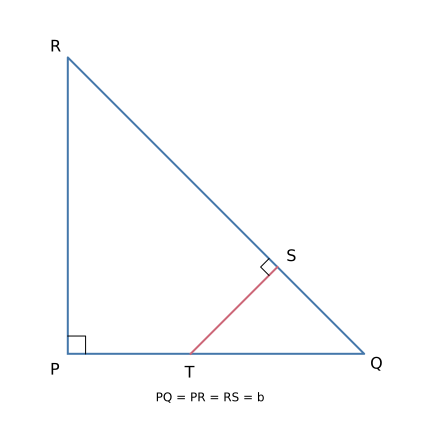
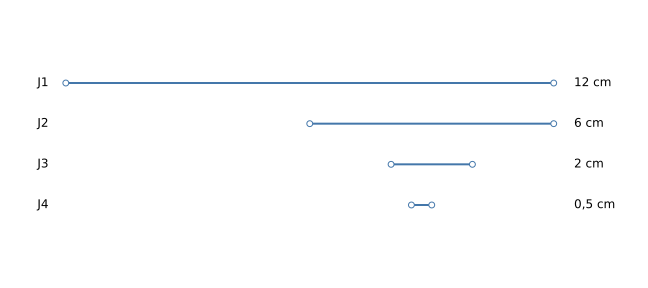

# CAPES Maths — Épreuve disciplinaire (bac+5) 2026 · Corrigé brut

*Corrigé rédigé par IA, non officiel. Signalez toute erreur.*

Session 2026, concours externe et troisième concours, section mathématiques. Épreuve disciplinaire : durée 5 heures, constituée de deux problèmes indépendants. L'usage de la calculatrice est autorisé dans les conditions de la circulaire du 17 juin 2021 ; l'usage de tout ouvrage de référence, dictionnaire ou autre matériel électronique est interdit. Notations de l'énoncé : $\mathbb N$, $\mathbb N^*$, $\mathbb R$, $\mathbb R^*$, $\mathbb C$.

## Problème 1 : Vrai-Faux

Pour chacun des items suivants, préciser si l'assertion finale est vraie ou fausse et justifier la réponse donnée. Une réponse non argumentée ne sera pas prise en compte.

**Calculs dans $\mathbb R$**

### 1.

Si $2\le x\le 6$ et $3\le y\le 4$, alors $-4\le -y\le -3$, d'où $2-4\le x-y\le 6-3$, soit $-2\le x-y\le 3$. L'encadrement $-1\le x-y\le 2$ est trop étroit (prendre $x=2,y=4$ : $x-y=-2<-1$). **FAUX.**

### 2.

Un taux annuel moyen $t$ vérifie $(1+t)^{10}=1{,}35$, donc $t=1{,}35^{1/10}-1\approx 0{,}0304$, soit $\approx 3{,}04\%\ne 3{,}5\%$. De plus $1{,}035^{10}\approx 1{,}41\ne 1{,}35$. **FAUX.**

### 3.

$P(1)=2+5-1-6=0$ : $(X-1)$ divise $P$. Mais $P(2)=16+20-2-6=28\ne 0$ : $(X-2)$ ne divise pas $P$. L'assertion (les deux facteurs) est **FAUSSE.**

### 4.

Contre-exemple : $a=1,b=2,c=5$ (distincts, non nuls) donne $1+\tfrac12+\tfrac15=\tfrac{17}{10}=1{,}7$, qui **est** décimal. L'assertion universelle « n'est pas un nombre décimal » est **FAUSSE.** $\square$

**Analyse réelle**

### 5.

Soit $(u_n)$ convergente de limite $\ell$. Avec $\varepsilon=1$, il existe $N$ tel que $\forall n\ge N,\ |u_n-\ell|<1$, donc $|u_n|<|\ell|+1$. Posons $M=\max(|u_0|,\dots,|u_{N-1}|,|\ell|+1)$ : alors $|u_n|\le M$ pour tout $n$. $(u_n)$ est bornée. **VRAI.**

### 6.

Pour $f(x)=2^x=\mathrm e^{x\ln 2}$, $f'(x)=\ln 2\cdot 2^{x}$. La formule proposée $x\,2^{x-1}$ (dérivation « en puissance » erronée) diffère de $f'$ : par exemple en $x=0$, $f'(0)=\ln2\approx0{,}69$ tandis que $0\cdot 2^{-1}=0$. **FAUX.**

### 7.

$u_n=\dfrac{1+2+\cdots+n}{n^2}=\dfrac{n(n+1)/2}{n^2}=\dfrac{n+1}{2n}\xrightarrow[n\to\infty]{}\dfrac12\ne 0.$ **FAUX.**

### 8.

$f(x)=x|x|$ vaut $x^2$ pour $x\ge0$ et $-x^2$ pour $x<0$ : $f$ est dérivable sur $\mathbb R^*$. En $0$, $\dfrac{f(x)-f(0)}{x}=\dfrac{x|x|}{x}=|x|\xrightarrow[x\to0]{}0$ : le taux d'accroissement a une limite, donc $f$ est dérivable en $0$ (avec $f'(0)=0$). $f$ est dérivable sur $\mathbb R$. **VRAI.**

### 9.

Pour $t\in[0,1]$, $0\le \dfrac{t^n}{1+t^2}\le t^n$, d'où (croissance de l'intégrale, intégrandes continues) $0\le I_n\le \int_0^1 t^n\,\mathrm dt=\dfrac1{n+1}\to0$. $(I_n)$ converge (vers $0$). **VRAI.**

### 10.

$f$ paire : $\forall x,\ f(-x)=f(x)$. $f$ dérivable, on dérive cette égalité : $-f'(-x)=f'(x)$, soit $f'(-x)=-f'(x)$. $f'$ est impaire. **VRAI.**

### 11.

$f$ paire continue : la primitive $G(x)=\int_0^x f$ est impaire. Mais une primitive **quelconque** s'écrit $F=G+C$, et $F$ impaire $\iff F(0)=0\iff C=0$. Avec $C\ne 0$, $F$ n'est pas impaire. L'assertion « toute primitive » est **FAUSSE.**

### 12.

$F'=f=\mathrm e^{x^2}>0$ et $F''=f'=2x\,\mathrm e^{x^2}$, de signe celui de $x$. $F''<0$ sur $]-\infty,0[$ : $F$ n'est pas convexe sur $\mathbb R$ (elle l'est seulement sur $[0,+\infty[$). **FAUX.**

### 13.

$f(x)=x+\ln|\mathrm e^x-1|$ sur $\mathbb R^*$.
- Sur $]0,+\infty[$ : $f(x)=x+\ln(\mathrm e^x-1)$, $f'(x)=1+\dfrac{\mathrm e^x}{\mathrm e^x-1}>0$ ; $f\to-\infty$ en $0^+$, $f\to+\infty$ en $+\infty$. Strictement croissante : **une** solution.
- Sur $]-\infty,0[$ : $f(x)=x+\ln(1-\mathrm e^x)$, $f'(x)=\dfrac{1-2\mathrm e^x}{1-\mathrm e^x}$, nul en $x=-\ln2$ (maximum). Or $f(-\ln2)=-\ln2+\ln\tfrac12=-2\ln2<0$ : $f<0$ sur $]-\infty,0[$, **aucune** solution.

Au total l'équation admet exactement **une** solution. L'assertion (deux solutions) est **FAUSSE.** $\square$

**Arithmétique**

### 14.

Contre-exemple : $n=5$ (premier), $5!+1=121=11^2$, non premier. **FAUX.**

### 15.

$n(n^2+5)=n^3+5n=(n-1)n(n+1)+6n$. Le produit $(n-1)n(n+1)$ de trois entiers consécutifs est divisible par $3$, et $6n$ l'est aussi ; donc $3\mid n(n^2+5)$ pour tout $n$. **VRAI.**

### 16.

$\binom n2-\binom n1=\dfrac{n(n-1)}2-n=\dfrac{n(n-3)}2=9\iff n(n-3)=18\iff (n-6)(n+3)=0$. Comme $n\in\mathbb N^*$, $n=6$, multiple de $3$. **VRAI.** $\square$

**Géométrie et nombres complexes**

### 17.

$A(1,-1,0)$ vérifie $\mathcal P_1$ ($1+1-0=2$) et $\mathcal P_2$ ($3+1+0=4$). Les normales $\vec{n_1}=(1,-1,-1)$, $\vec{n_2}=(3,-1,1)$ donnent $\vec{n_1}\wedge\vec{n_2}=(-2,-4,2)=-2(1,2,-1)$ : les plans sont sécants (normales non colinéaires) et $\vec v=(1,2,-1)$ dirige la droite d'intersection, qui passe par $A$. **VRAI.**

### 18.

Repère $A(0,0,0),B(a,0,0),D(0,b,0),E(0,0,c)$, d'où $F(a,0,c),H(0,b,c)$ ; $I=\text{mil}[EF]=(a/2,0,c)$, $K=\text{mil}[AE]=(0,0,c/2)$. Alors $\vec{AI}=(a/2,0,c)$ et $\vec{KH}=(0,b,c/2)$ ont des premières composantes $a/2\ne 0$ et $0$ : non colinéaires. $(AI)$ et $(KH)$ ne sont pas parallèles. **FAUX.**

### 19.

La composée de deux homothéties de rapports $k$ et $1/k$ a pour rapport $k\cdot\frac1k=1$ : c'est une translation. Comme les centres $\Omega\ne\Omega'$ sont distincts, cette translation est de vecteur non nul, donc différente de l'identité. **FAUX.**

### 20.

$z'=-z+b$ s'écrit $z'=2\omega-z$ avec $\omega=\dfrac b2$ : c'est la symétrie centrale de centre le point d'affixe $b/2$. **VRAI.**

### 21.

La contraposée de $P\Rightarrow Q$ est $(\neg Q)\Rightarrow(\neg P)$. Ici $P=$ « $z$ réel ET $z'$ réel », donc $\neg P=$ « $z$ non réel **OU** $z'$ non réel ». La proposition avancée (« $z$ et $z'$ ne sont pas réels », c.-à-d. les **deux** non réels) correspond à $\neg P$ mal formée. **FAUX.** $\square$

**Dénombrement et probabilités**

### 22.

Un tirage à « exactement un rouge » est une paire {un rouge, un vert}. Il faut en outre « exactement un jeton n° 2 » (porteurs : $R_2$ et $G_2$).
- $R_2$ avec un vert $\ne G_2$ : $3$ choix ($G_1,G_3,G_4$) ;
- un rouge $\ne R_2$ avec $G_2$ : $4$ choix ($R_1,R_3,R_4,R_5$).

Total $3+4=7\ne 10$. **FAUX.**

### 23.

Répartitions totales : $3^4=81$. Par le crible, « au moins une urne vide » $=\binom31 2^4-\binom32 1^4+\binom33 0^4=48-3+0=45$. La valeur $3\times2^4=48$ oublie la correction $-3$. **FAUX.** (La bonne valeur est $45$.)

### 24.

À l'étape $k$, l'urne contient $k$ verts et $1$ rouge ($k+1$ jetons) : $P(\text{vert})=\frac{k}{k+1}$, $P(\text{rouge})=\frac1{k+1}$. Donc

$$
P(X=n)=\Big(\prod_{k=1}^{n-1}\tfrac{k}{k+1}\Big)\cdot\tfrac1{n+1}=\tfrac1n\cdot\tfrac1{n+1}=\tfrac1{n(n+1)},
$$

le produit étant télescopique. **VRAI.** $\square$

**Algèbre linéaire**

### 25.

$A^2=\begin{pmatrix}2&2\\2&2\end{pmatrix}=2A$. Par récurrence, si $A^n=2^{n-1}A$ alors $A^{n+1}=A^n A=2^{n-1}\cdot 2A=2^nA$ ; initialisation $A^1=2^0A$. Donc $\forall n\in\mathbb N^*,\ A^n=2^{n-1}A$. **VRAI.**

### 26.

$(AB)^\top=B^\top A^\top=BA$ (car $A,B$ symétriques). Ainsi $AB$ symétrique $\iff AB=BA$, non vérifié en général. Contre-exemple : $A=\begin{pmatrix}1&0\\0&0\end{pmatrix}$, $B=\begin{pmatrix}0&1\\1&0\end{pmatrix}$ symétriques, $AB=\begin{pmatrix}0&1\\0&0\end{pmatrix}$ non symétrique. **FAUX.** $\square$

## Problème 2 : calcul et géométrie

*Dans tout le problème, les configurations géométriques sont supposées non dégénérées (triangles non aplatis).*

**I. Autour du triangle rectangle**

**A. Démonstration du théorème de Pythagore (Garfield)**

### 1.

$ABC$ est rectangle en $A$, donc $\widehat{ABC}+\widehat{ACB}=90^\circ$. Le triangle $DEB$ ayant les mêmes dimensions, rectangle en $D$ avec $BD=b,\ DE=c$, on a $\tan\widehat{DBE}=\dfrac{DE}{BD}=\dfrac cb=\tan\widehat{ACB}$, d'où $\widehat{DBE}=\widehat{ACB}$. Comme $A,B,D$ sont alignés, les angles en $B$ vérifient $\widehat{ABC}+\widehat{CBE}+\widehat{EBD}=180^\circ$, donc

$$
\widehat{CBE}=180^\circ-\widehat{ABC}-\widehat{DBE}=180^\circ-\widehat{ABC}-\widehat{ACB}=180^\circ-90^\circ=90^\circ.
$$

Les droites $(BC)$ et $(BE)$ sont perpendiculaires. $\square$

### 2.

$(AC)\perp(AD)$ (angle droit en $A$) et $(DE)\perp(AD)$ (angle droit en $D$), donc $(AC)\parallel(DE)$. Le quadrilatère $ADEC$ possède deux côtés parallèles $[AC]$ et $[DE]$ : c'est un trapèze (rectangle). $\square$

### 3.

*Première méthode (trapèze).* Bases $AC=b$, $DE=c$, hauteur $AD=AB+BD=c+b$ :

$$
\mathcal A=\tfrac12(b+c)(b+c)=\tfrac12(b+c)^2.
$$

*Seconde méthode (découpage).* $\mathcal A=\text{aire}(ABC)+\text{aire}(DEB)+\text{aire}(BCE)=\tfrac12bc+\tfrac12bc+\tfrac12a^2$ (le triangle $BCE$ est rectangle en $B$ d'après I.1, de côtés $BC=BE=a$). En égalant :

$$
\tfrac12(b+c)^2=bc+\tfrac12a^2\ \Longrightarrow\ \tfrac12b^2+bc+\tfrac12c^2=bc+\tfrac12a^2\ \Longrightarrow\ \boxed{a^2=b^2+c^2.}\ \square
$$

**B. Irrationalité de $\sqrt2$ (Apostol)**

On suppose $\sqrt2=\dfrac ab$ irréductible, $(a,b)\in(\mathbb N^*)^2$.

### 4.

$1^2=1<2<4=2^2$ et $x\mapsto\sqrt x$ croissante donnent $1<\sqrt2<2$. $\square$

### 5.

$a-b>0$ car $\sqrt2>1\Rightarrow a>b$. L'égalité $\dfrac ab=\dfrac{2b-a}{a-b}$ équivaut à $a(a-b)=b(2b-a)$, soit $a^2-ab=2b^2-ab$, soit $a^2=2b^2$, vraie. $\square$

### 6.

[Figure : triangle $PQR$ rectangle isocèle en $P$, $PQ=PR=b$ ; $S\in[QR]$ avec $RS=RP=b$ ; $T\in[PQ]$, $(ST)\perp(QR)$.]



### 7.

$QR$ est l'hypoténuse : $QR=b\sqrt2=b\cdot\dfrac ab=a$. $\square$

### 8.

$\widehat{SQT}=\widehat{PQR}=45^\circ$ (angle à la base du triangle rectangle isocèle). Comme $(ST)\perp(QR)$, $\widehat{TSQ}=90^\circ$, d'où $\widehat{QTS}=45^\circ$ : $QST$ est rectangle isocèle en $S$ (donc $SQ=ST$). $\square$

### 9.

$SQ=QR-RS=a-b$ (car $RS=RP=b$). Dans $QST$ rectangle isocèle en $S$, $TQ=SQ\sqrt2=(a-b)\sqrt2=(a-b)\dfrac ab$. Donc

$$
\frac{TQ}{SQ}=\sqrt2=\frac ab=\frac{2b-a}{a-b}\quad\text{(d'après I.5)}.\ \square
$$

### 10.

On a $\dfrac ab=\dfrac{2b-a}{a-b}$ avec $0<a-b<b$ (car $b<a<2b$ d'après I.4) et $2b-a>0$. Ainsi $\sqrt2$ s'écrit avec un dénominateur entier $a-b$ **strictement plus petit** que $b$, ce qui contredit la minimalité de $b$ (fraction irréductible). Par descente infinie, $\sqrt2\notin\mathbb Q$. $\square$

**II. Autour du triangle équilatéral**

**A. Irrationalité de $\sqrt3$**

On suppose $\sqrt3=\dfrac ab$ irréductible.

### 11.

$\sqrt3(2b-a)=2b\sqrt3-a\sqrt3$. Or $2b\sqrt3=2b\cdot\dfrac ab=2a$ et $a\sqrt3=a\cdot\dfrac ab=\dfrac{a^2}{b}=\dfrac{3b^2}{b}=3b$ (car $a^2=3b^2$). Donc $\sqrt3(2b-a)=2a-3b$. $\square$

### 12.

La hauteur d'un triangle équilatéral de côté $s$ vaut $\sqrt{s^2-(s/2)^2}=\dfrac{s\sqrt3}2$. Donc $\mathcal A=\dfrac12\cdot s\cdot\dfrac{s\sqrt3}2=\dfrac{\sqrt3}4 s^2.$ $\square$

### 13.

$\text{aire}(ABC)=\dfrac{\sqrt3}4a^2=\dfrac{\sqrt3}4\cdot 3b^2=3\cdot\dfrac{\sqrt3}4b^2=3\,\text{aire}(AGH)$ (car $a^2=3b^2$). $\square$

### 14.

$1<3<4\Rightarrow 1<\sqrt3<2$, donc $b<a<2b$. Sur un côté de longueur $a$, les deux petits triangles de côté $b$ placés aux deux extrémités occupent une longueur totale $2b>a$ : ils se **chevauchent**. Les recouvrements engendrent les quatre triangles $IGN,KMH,PLJ$ (coins) et $MNP$ (central). $\square$

### 15.

Chaque triangle du recouvrement est bordé par des côtés de triangles équilatéraux, faisant des angles de $60^\circ$ ; ayant deux (donc trois) angles de $60^\circ$, ils sont **équilatéraux**. $\square$

### 16.

Sur un côté, les sommets intérieurs sont à distance $a-b$ et $b$ de l'extrémité ; la longueur de chevauchement est $b-(a-b)=2b-a$. Les trois triangles de coin $IGN,KMH,PLJ$ ont donc pour côté $\boxed{2b-a}$. Pour le triangle central, $KL=b$. On a $AH=b$ et $AK=AC-CK=a-b$, donc $HK=2b-a$. Les triangles équilatéraux $KMH$ et $PLJ$ donnent $KM=PL=2b-a$. Les points $K,M,P,L$ étant alignés dans cet ordre,

$$
MP=KL-KM-PL=b-2(2b-a)=2a-3b.
$$

Le triangle $MNP$ est équilatéral d'après la question 15, donc son côté vaut $\boxed{2a-3b}$. Il est strictement positif car $\sqrt3>3/2$ (puisque $3>9/4$), et $a=b\sqrt3$. $\square$

### 17.

Les triangles étant équilatéraux, le rapport des aires est le carré du rapport des côtés. Or, avec $a^2=3b^2$ :

$$
(2a-3b)^2=4a^2-12ab+9b^2=12b^2+9b^2-12ab=21b^2-12ab,
$$

$$
3(2b-a)^2=3(4b^2-4ab+a^2)=3(7b^2-4ab)=21b^2-12ab,
$$

donc $(2a-3b)^2=3(2b-a)^2$, soit $\text{aire}(MNP)=3\,\text{aire}(KMH)$. (La configuration centrale est une copie réduite de la grande : la relation de II.13 s'y transpose, comme le suggère l'énoncé.) $\square$

### 18.

De $\text{aire}(MNP)=3\,\text{aire}(KMH)$ et II.12 : $\dfrac{\sqrt3}4(2a-3b)^2=3\cdot\dfrac{\sqrt3}4(2b-a)^2$, d'où $2a-3b=\sqrt3(2b-a)$ (racines positives) — c'est l'égalité de II.11. On en tire $\sqrt3=\dfrac{2a-3b}{2b-a}$ avec $0<2b-a<b$ (car $b<a<2b$) : dénominateur entier strictement plus petit que $b$, contradiction avec l'irréductibilité. Donc $\sqrt3\notin\mathbb Q$. $\square$

**B. Théorème de Lucas**

### 19.

$ABC$ équilatéral direct : $C$ est l'image de $B$ par la rotation de centre $A$ et d'angle $+\dfrac\pi3$. Donc $z_C-z_A=\mathrm e^{i\pi/3}(z_B-z_A)$, soit $\dfrac{z_C-z_A}{z_B-z_A}=\mathrm e^{i\pi/3}.$ $\square$

### 20.

Supposons $A,B,C$ distincts, à coordonnées rationnelles, sommets d'un triangle équilatéral (direct, quitte à échanger). Les affixes sont dans $\mathbb Q(i)=\mathbb Q+i\mathbb Q$, et $z_B-z_A\ne0$. Le quotient de deux éléments de $\mathbb Q(i)$ reste dans $\mathbb Q(i)$, donc $\dfrac{z_C-z_A}{z_B-z_A}$ a parties réelle et imaginaire rationnelles. Or ce quotient vaut $\mathrm e^{i\pi/3}=\dfrac12+i\dfrac{\sqrt3}2$, dont la partie imaginaire $\dfrac{\sqrt3}2$ est irrationnelle (d'après II.18) : contradiction. (Cas indirect : $\mathrm e^{-i\pi/3}$, partie imaginaire $-\frac{\sqrt3}2$, même conclusion.) Donc trois points à coordonnées rationnelles ne sont jamais sommets d'un triangle équilatéral. $\square$

**III. Irrationalité de $e$ (méthode de Sondow)**

On admet l'existence/unicité de $\exp$ : $\exp'=\exp$, $\exp(0)=1$, $e=\exp(1)$ ; aucune autre propriété n'est supposée.

### 21.a.

$\varphi(x)=\exp(x)\exp(-x)$. Comme $\big(x\mapsto\exp(-x)\big)'=-\exp(-x)$, $\varphi'(x)=\exp(x)\exp(-x)-\exp(x)\exp(-x)=0$. Donc $\varphi$ est constante, égale à $\varphi(0)=\exp(0)^2=1$. Ainsi $\exp(x)\exp(-x)=1$, ce qui impose $\exp(x)\ne0$ pour tout $x$. $\square$

### 21.b.

$\exp$ est dérivable donc continue, ne s'annule pas (21.a) et $\exp(0)=1>0$ : par le théorème des valeurs intermédiaires, $\exp$ garde un signe constant, donc $\exp>0$ sur $\mathbb R$. Alors $\exp'=\exp>0$ : $\exp$ est strictement croissante. $\square$

### 22.a.

Sur $[0,1]$, $\dfrac{(1-t)^n}{n!}\mathrm e^{t}>0$ sauf en $t=1$ : par positivité stricte de l'intégrale d'une fonction continue positive non identiquement nulle, $I_n>0$. De plus $\exp$ croissante donne $\exp(t)\le e$ sur $[0,1]$, d'où

$$
I_n\le \frac e{n!}\int_0^1(1-t)^n\,\mathrm dt=\frac e{n!}\cdot\frac1{n+1}=\frac e{(n+1)!},
$$

inégalité stricte (comparaison stricte sauf aux bornes). Donc $0<I_n<\dfrac e{(n+1)!}.$ $\square$

### 22.b.

Intégration par parties sur $I_n$ ($u=\exp$ de classe $C^1$, $v'(t)=\dfrac{(1-t)^n}{n!}$, $v(t)=-\dfrac{(1-t)^{n+1}}{(n+1)!}$, toutes deux $C^1$) :

$$
I_n=\Big[-\exp(t)\tfrac{(1-t)^{n+1}}{(n+1)!}\Big]_0^1+\int_0^1\exp(t)\tfrac{(1-t)^{n+1}}{(n+1)!}\,\mathrm dt=\frac1{(n+1)!}+I_{n+1}.
$$

Donc $I_{n+1}=I_n-\dfrac1{(n+1)!}.$ $\square$

### 22.c.

Récurrence. $n=0$ : $I_0=\int_0^1\exp=[\exp]_0^1=e-1$ (car $\exp$ est sa propre primitive) et $S_0=1$, donc $S_0+I_0=e$. Hérédité : si $e=S_n+I_n$, alors $S_{n+1}+I_{n+1}=\big(S_n+\tfrac1{(n+1)!}\big)+\big(I_n-\tfrac1{(n+1)!}\big)=S_n+I_n=e$. Donc $\forall n,\ e=S_n+I_n.$ $\square$

### 22.d.

$e-S_n=I_n$ et $0<I_n<\dfrac e{(n+1)!}\to0$ (croissances comparées), donc $S_n\to e$. $\square$

### 23.a.

Récurrence pour $k\ge4$. $k=4$ : $24>16$. Hérédité : $(k+1)!=(k+1)k!>(k+1)2^k>2\cdot2^k=2^{k+1}$ (car $k+1\ge5>2$). $\square$

### 23.b.

Via $I_{n+1}=I_n-\frac1{(n+1)!}$ et $I_0=e-1$ : $I_1=(e-1)-1=e-2$, $I_2=(e-2)-\tfrac12=e-\tfrac52$. $\square$

### 23.c.

$I_2=e-\tfrac52$ et $0<I_2<\dfrac e{3!}=\dfrac e6$ donnent $e-\tfrac52<\dfrac e6$, soit $\tfrac56 e<\tfrac52$, d'où $e<3$. $\square$

### 23.d.

Pour $n\ge2$ : $e<3\le n+1$, donc $I_n<\dfrac e{(n+1)!}<\dfrac{n+1}{(n+1)!}=\dfrac1{n!}$. Pour $n=1$ : $I_1=e-2<1=\dfrac1{1!}$ (car $e<3$). Donc $\forall n\ge1,\ I_n<\dfrac1{n!}.$ $\square$

### 23.e.

$2^{-k}<10^{-3}\iff 2^k>1000$. Or $2^9=512<1000<1024=2^{10}$, donc le plus petit entier est $k=10$. $\square$

### 23.f.

$|e-S_n|=I_n<\dfrac1{n!}$ (23.d). Pour $n\ge4$, $n!>2^n$ (23.a), donc $I_n<2^{-n}$ ; et $2^{-n}<10^{-3}$ dès $n\ge10$ (23.e). On prend $r=S_{10}\in\mathbb Q$ : alors $|e-r|<2^{-10}<10^{-3}$. Numériquement $S_{10}\approx 2{,}7182818$, d'où la valeur décimale approchée $\boxed{e\approx 2{,}718}$ à $10^{-3}$ près. $\square$

### 23.g.

```python
from math import factorial

def approximation(m):
    seuil = 10**(-m)
    S = 0.0
    k = 0
    while 1/factorial(k) >= seuil:   # on cumule tant que le terme reste grand
        S += 1/factorial(k)
        k += 1
    S += 1/factorial(k)              # ce terme < seuil garantit |e - S| = I_k < 1/k! < 10^(-m)
    return S
```
Justification : à la sortie $S=S_k$ avec $\dfrac1{k!}<10^{-m}$, et $|e-S_k|=I_k<\dfrac1{k!}<10^{-m}$. $\square$

### 24.a.

[Figure : quatre segments horizontaux superposés, unité $12$ cm ; $J_1=\,]2,3[$ large de $12$ cm ; $J_2\subset J_1$ large de $6$ cm ($=\frac{12}{2!}$) collé à droite ; $J_3\subset J_2$ large de $2$ cm ($=\frac{12}{3!}$) ; $J_4\subset J_3$ large de $0{,}5$ cm.]



### 24.b.

$S_2=\tfrac52=\tfrac5{2!}$ et $S_2+\tfrac1{2!}=3=\tfrac6{2!}$ : $J_2=\big]\tfrac5{2!},\tfrac6{2!}\big[$. $S_3=\tfrac52+\tfrac16=\tfrac{16}6=\tfrac{16}{3!}$, $S_3+\tfrac1{3!}=\tfrac{17}{3!}$. $S_4=\tfrac{16}6+\tfrac1{24}=\tfrac{65}{24}=\tfrac{65}{4!}$, $S_4+\tfrac1{4!}=\tfrac{66}{4!}$. $\square$

### 24.c.

Extrémité gauche : $S_{n+1}=S_n+\tfrac1{(n+1)!}>S_n$. Extrémité droite : $S_{n+1}+\tfrac1{(n+1)!}=S_n+\tfrac2{(n+1)!}\le S_n+\tfrac{n+1}{(n+1)!}=S_n+\tfrac1{n!}$ dès que $2\le n+1$, i.e. $n\ge1$. Donc $J_{n+1}\subset J_n$. $\square$

### 24.d.

$e=S_n+I_n$ avec $0<I_n<\tfrac1{n!}$ (23.d), donc $S_n<e<S_n+\tfrac1{n!}$, i.e. $e\in J_n$ pour tout $n\ge1$. Ainsi $e\in\bigcap_{n\ge1}J_n$. $\square$

### 24.e.

Posons $p_n=\sum_{j=0}^n\dfrac{n!}{j!}\in\mathbb N$ ; alors $S_n=\dfrac{p_n}{n!}$ et $S_n+\dfrac1{n!}=\dfrac{p_n+1}{n!}$, donc $J_n=\Big]\dfrac{p_n}{n!},\dfrac{p_n+1}{n!}\Big[$. Pour $k\in\mathbb N$, $\dfrac k{n!}\in J_n\iff p_n<k<p_n+1$ : impossible pour un entier $k$. Donc $\dfrac k{n!}\notin J_n$. $\square$

### 24.f.

Si $e=\dfrac{p'}{q'}$ ($p',q'\in\mathbb N^*$), alors $e=\dfrac{p'\,(q'-1)!}{q'!}=\dfrac p{q!}$ avec $p=p'(q'-1)!\in\mathbb N^*$ et $q=q'$. Mais $e\in J_q$ (24.d) tandis que $\dfrac p{q!}\notin J_q$ (24.e) : contradiction. Donc $e$ est **irrationnel**. $\square$

**IV. Polygones à angles rationnels**

**A. Un premier exemple**

### 25.a.

$\sin(3x)=\sin(2x+x)=\sin2x\cos x+\cos2x\sin x=2\sin x\cos^2x+(1-2\sin^2x)\sin x$
$=2\sin x(1-\sin^2x)+\sin x-2\sin^3x=3\sin x-4\sin^3x.$ $\square$

### 25.b.

Pour $x=\dfrac\pi{18}$, $3x=\dfrac\pi6$, $\sin(3x)=\dfrac12$. D'où $\dfrac12=3\sin x-4\sin^3x$, soit $8\sin^3x-6\sin x+1=0$ : $\sin\!\big(\tfrac\pi{18}\big)$ est racine de $P(X)=8X^3-6X+1$. $\square$

### 26.a.

$f(x)=8x^3-6x+1$, $f'(x)=24x^2-6=6(2x-1)(2x+1)$, nul en $\pm\tfrac12$. $f$ croît sur $]-\infty,-\tfrac12]$, décroît sur $[-\tfrac12,\tfrac12]$, croît sur $[\tfrac12,+\infty[$ ; $f(-\tfrac12)=3$ (max local), $f(\tfrac12)=-1$ (min local) ; $\lim_{-\infty}f=-\infty$, $\lim_{+\infty}f=+\infty$.

[Tableau de variations : $-\infty\nearrow 3\searrow -1\nearrow +\infty$.]

### 26.b.

$f(-1)=-1<0<3=f(-\tfrac12)$ : racine $\alpha\in]-1,-\tfrac12[$. $f(\tfrac18)=\tfrac1{64}-\tfrac34+1=\tfrac{17}{64}>0>f(\tfrac14)=\tfrac18-\tfrac32+1=-\tfrac38$ : racine $\beta\in]\tfrac18,\tfrac14[$. $f(\tfrac12)=-1<0<3=f(1)$ : racine $\gamma\in]\tfrac12,1[$. Trois racines réelles (le max local est $>0$, le min local $<0$). $\square$

### 27.a.

On suppose que $P$ admet une racine rationnelle $r=\dfrac st$ écrite sous forme irréductible. Si $\gcd(a,b)=1$, tout premier $p\mid b^k$ divise $b$, donc ne divise pas $a$ ; aucun premier ne divise à la fois $a$ et $b^k$, d'où $\gcd(a,b^k)=1$. $\square$

### 27.b.

$8\big(\tfrac st\big)^3-6\big(\tfrac st\big)+1=0$ ; en multipliant par $t^3$ : $8s^3-6st^2+t^3=0$. $\square$

### 27.c.

De $8s^3=6st^2-t^3=t^2(6s-t)$, on tire $t^2\mid 8s^3$. Comme $\gcd(s,t)=1$, $\gcd(s^3,t^2)=1$ (27.a), donc $t^2\mid8$. Les carrés divisant $8$ sont $1$ et $4$, d'où $t\in\{-2,-1,1,2\}$. $\square$

### 27.d.

De même $t^3=6st^2-8s^3=s(6t^2-8s^2)$, donc $s\mid t^3$ ; $\gcd(s,t^3)=1$ (27.a) impose $s=\pm1$. Les racines rationnelles possibles sont donc $r\in\{\pm1,\pm\tfrac12\}$. Or $P(1)=3,\ P(-1)=-1,\ P(\tfrac12)=-1,\ P(-\tfrac12)=3$ : aucune n'est nulle. Contradiction. Donc $P$ n'a pas de racine rationnelle, et $\alpha,\beta,\gamma$ sont **irrationnels**. $\square$

### 28.

Dans un triangle rectangle de côtés rationnels possédant un angle $\dfrac\pi{18}$, on aurait $\sin\!\big(\tfrac\pi{18}\big)=\dfrac{\text{côté opposé}}{\text{hypoténuse}}\in\mathbb Q$. Mais $\sin\!\big(\tfrac\pi{18}\big)$ est racine de $P$, donc irrationnel (27). Contradiction : **un tel triangle n'existe pas**. $\square$

**B. Théorème de Niven**

### 29.a.

$P(s/t)=0$ et multiplication par $t^d$ : $\sum_{k=0}^d c_k s^k t^{d-k}=0$. Le terme $k=d$ vaut $c_d s^d=s^d$ (unitaire), d'où $s^d=-\sum_{k=0}^{d-1}c_k s^k t^{d-k}=-t\sum_{k=0}^{d-1}c_k s^k t^{d-k-1}$ (chaque $d-k\ge1$). $\square$

### 29.b.

D'après 29.a, $t\mid s^d$ ; or $\gcd(s^d,t)=1$ (27.a), donc $t=\pm1$ et $r=\pm s\in\mathbb Z$. $\square$

### 30.a.

$P_2=X^2-2$, $P_3=XP_2-P_1=X^3-3X$, $P_4=XP_3-P_2=X^4-4X^2+2.$

### 30.b.

Récurrence (double). $P_1=X$, $P_2=X^2-2$ sont unitaires de degrés $1,2$, à coefficients entiers. Si $P_{n+1}$ est unitaire de degré $n+1$ et $P_n$ de degré $n$ (entiers), alors $P_{n+2}=XP_{n+1}-P_n$ a pour terme dominant $X\cdot X^{n+1}=X^{n+2}$ (unitaire, degré $n+2$) et des coefficients entiers. $\square$

### 30.c.

Récurrence (double) sur $P_n(2\cos x)=2\cos(nx)$. $n=0$ : $P_0=2=2\cos0$. $n=1$ : $2\cos x=2\cos x$. Hérédité :

$$
P_{n+2}(2\cos x)=2\cos x\cdot 2\cos((n{+}1)x)-2\cos(nx)=2\big[\cos((n{+}2)x)+\cos(nx)\big]-2\cos(nx)=2\cos((n{+}2)x),
$$

en utilisant $2\cos x\cos((n{+}1)x)=\cos((n{+}2)x)+\cos(nx)$. $\square$

### 31.a.

Soit $r=\dfrac st$ irréductible. Alors $t\cdot r\pi=s\pi$ et $P_t(2\cos(r\pi))=2\cos(tr\pi)=2\cos(s\pi)=2(-1)^s$. Posons $Q(X)=P_t(X)-2(-1)^s$ : $Q$ est unitaire, à coefficients entiers, de degré $t\ge1$, et $Q(2\cos(r\pi))=0$. $\square$

### 31.b.

Soit $\theta=r\pi$ un angle rationnel avec $\cos\theta\in\mathbb Q$. Alors $2\cos\theta$ est une racine **rationnelle** de $Q$ (unitaire, à coefficients entiers). Si $2\cos\theta\ne0$, 29.b donne $2\cos\theta\in\mathbb Z$ ; comme $2\cos\theta\in[-2,2]$, il vaut $-2,-1,0,1,2$. Le cas $2\cos\theta=0$ donne $\cos\theta=0$, déjà dans la liste. Donc $\cos\theta\in\big\{-1,-\tfrac12,0,\tfrac12,1\big\}$. $\square$

**C. Applications**

### 32.

Côtés $a,b,c\in\mathbb Q$. La formule d'Al-Kashi donne $\cos\widehat A=\dfrac{b^2+c^2-a^2}{2bc}\in\mathbb Q$ (opérations rationnelles, $bc\ne0$), et de même $\cos\widehat B,\cos\widehat C\in\mathbb Q$. $\square$

### 33.

Si les trois angles sont rationnels, ils ont des cosinus rationnels (IV.32) ; par Niven (IV.31.b), chaque $\cos\in\{-1,-\tfrac12,0,\tfrac12,1\}$. Comme un angle de triangle vérifie $0<\theta<\pi$, $\cos\theta\in(-1,1)$, donc $\cos\theta\in\{-\tfrac12,0,\tfrac12\}$, soit $\theta\in\{\tfrac{2\pi}3,\tfrac\pi2,\tfrac\pi3\}$. La somme des trois valant $\pi$, la seule combinaison possible (en degrés, parmi $120,90,60$ sommant à $180$) est $60+60+60$ : le triangle est **équilatéral**. $\square$
