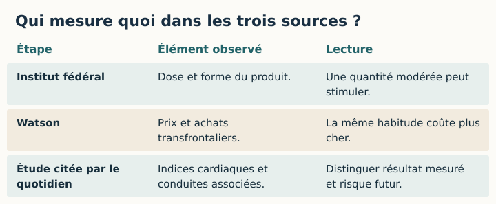

# CCINP — Allemand LVA 2026 · Corrigé guidé

*Corrigé rédigé par IA, non officiel. Signalez toute erreur.*

**Rédaction** · GPT-6.2 Astra Ultra · vitesse non renseignée

## Lire la consigne

Le fascicule accorde trois heures pour une synthèse en allemand de 400 mots, titre inclus, avec une tolérance de 10 %. Les 3 documents ont le même poids. L’introduction doit identifier simplement la source et la date de chacun. La numérotation des documents peut ensuite servir de repère.

## Croiser les documents

Le BfR pose deux questions distinctes, celles de la quantité absorbée et du contexte d’absorption. Pour les mettre en relation avec la source 3, reprendre les paramètres effectivement comparés chez les jeunes, puis les conduites associées. L’absence de différence durable constatée sur le cœur ne démontre pas l’innocuité de toutes les habitudes de consommation.

Dans la partie économique, le prix vient après les usages quotidiens. Watson présente la spéculation comme la principale explication de la hausse, mentionne les vols et rattache les achats néerlandais à un écart de prix concret. Le rapport du jury signale ces trois points, ainsi que l’intérêt de faire entendre l’effet positif de doses modérées.

## Koffein im Alltag zwischen Gewohnheit, Preis und Gesundheitsrisiko

Das Bundesinstitut für Risikobewertung vom 25. März 2025, watson.de vom 12. August | 2025 und die Berliner Morgenpost vom 31. August 2025 beleuchten einen Stoff, dessen Bedeutung weit über die einzelne Tasse hinausreicht. | Was entscheidet darüber, welchen Nutzen oder welche Belastung koffeinhaltige Produkte für ihre Käufer bedeuten? Neben der Dosis spielen das Umfeld | des Konsums und die Entwicklung der Preise eine Rolle.

Dass Menschen bei ihren Gewohnheiten bleiben wollen, zeigt besonders der Kauf | von Bohnenkaffee. In Deutschland wurden 2023 pro Kopf 164 Liter getrunken, wesentlich mehr als von den verschiedenen Teesorten. Kaffee dient | morgens als Wachmacher, nach dem Essen gegen Müdigkeit und zwischendurch als Genuss. Bei Jugendlichen erreichen inzwischen auch Energydrinks ein großes | Publikum; selbst bekannte Persönlichkeiten aus dem Internet vermarkten eigene Sorten. Der anregende Effekt des Koffeins ist nach Einschätzung des Bundesinstituts | in mäßiger Menge durchaus erwünscht. Dasselbe Mittel erreicht Verbraucher jedoch auch mit Tee, Cola oder Schokolade, ohne dass sie jeden | Beitrag zur Tagesmenge bewusst wahrnehmen.

Beim Kaffee macht sich die Nachfrage inzwischen an der Ladenkasse bemerkbar. Schwierige Anbaubedingungen erklären die | Teuerung laut watson nur teilweise; den größeren Anteil schreiben die dort herangezogenen Berichte der Spekulation zu. Steigende Preise verändern sogar | den Ort des Einkaufs. Kunden aus Niedersachsen nehmen die Fahrt in die Niederlande auf sich, wo das Kilo bis zu | zehn Euro weniger kosten kann, und kaufen für Angehörige mit. Manche deutschen Händler schließen die Ware inzwischen ein, weil wiederholt | wertvolle Bestände gestohlen wurden. Beliebtheit garantiert also weder einen erschwinglichen Preis noch den gewohnten Zugang.

Gesundheitlich kommt es ebenfalls auf | die Umstände an. Das Institut unterscheidet zwischen einer einzelnen Portion und der über den Tag verteilten Aufnahme; bei Kindern zählt | insbesondere das Körpergewicht. Konzentrierte Nahrungsergänzungsmittel erschweren die Einschätzung der Menge. Bei Energydrinks wiederum kann gleichzeitig getrunkener Alkohol die Belastung für | den Kreislauf erhöhen. Die von der Morgenpost vorgestellte Untersuchung verglich 97 Jugendliche mit längerfristig hohem Konsum mit einer Kontrollgruppe. Bei | Herzfunktion, Blutdruck und Herzfrequenz ließ sich kein bleibender Unterschied feststellen. Allerdings schliefen die Vieltrinker weniger und konsumierten häufiger Alkohol, Tabak | oder Cannabis. Die Befunde erlauben somit eine Unterscheidung: Die Untersuchung fand bei den gemessenen Herzmerkmalen keine dauerhafte Schädigung, während die | begleitenden Gewohnheiten längerfristig gerade jene Gesundheit gefährden können, die mit dem Vergleich untersucht wurde.

*374 mots, titre inclus. Une barre marque chaque vingtième mot.*

[Sujet officiel](https://www.concours-commun-inp.fr/_resource/annales%20%C3%A9crits/2026/Ep%20communes/2026_LVA6AllArabe.pdf#page=2) · [Rapport du jury, allemand](https://www.concours-commun-inp.fr/_resource/annales%20%C3%A9crits/2026/Ep%20communes/LV_ECRIT_2026_05.10.pdf#page=3)
