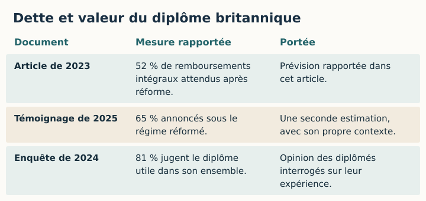

# CCINP MP-MPI-PC-PSI-TPC-TSI — Anglais 2026 · Corrigé brut

*Corrigé rédigé par IA, non officiel. Signalez toute erreur.*

**Rédaction** · Claude Opus 5.5 · effort non renseigné · vitesse non renseignée

**Révision** · Claude Opus 5.5 · effort non renseigné · vitesse non renseignée

**Révision** · GPT-6.2 Astra Ultra · vitesse non renseignée

**Révision (tour 3)** · GPT-6.2 Astra Ultra · vitesse non renseignée

**Problématique** : *whether the benefits of a UK university degree still justify its cost* (coût croissant et dette d'un côté, valeur personnelle et sociale de l'autre).

Durée : 3 h, sans machine ; épreuve commune aux six filières, mutualisée avec e3a-Polytech. Synthèse en anglais de quatre documents d'égale importance, en 400 mots ± 10 % (360 à 440), titre obligatoire et compris dans le total ; source et date seules dans la présentation du corpus, renvoi par « Doc.1 », « Doc.2 »… ; nombre total de mots indiqué et trait vertical tous les vingt mots. Le rapport commun, p. 1, demande de numéroter les documents dans l’introduction. Chaque source et chaque date y comptent pour un mot. Les barres partent du titre et le mot FIN clôt la composition après le total.

## Synthèse

**The Cost and Value of University Education in the UK**

Four sources examine higher education in the UK. On thetimes.com | (Doc.1, August 2023), rising debt prompts doubts. The Higher Education Policy Institute (Doc.2, February 2025) considers wider benefits, while theguardian.com (Doc.3, August 2024) reports borrowers’ worries | and the Policy Institute at King’s College London (Doc.4, May 2024) surveys graduates. How do its costs and benefits compare?

For applicants, going to university is | increasingly a financial decision. Since 1998, tuition fees have risen from £1,000 to £9,000, and students can leave with over | £60,000 of debt (Doc.1), sometimes up to £120,000 once interest has been added (Doc.3). As the maintenance loan no longer | covers the cost of living, many students also work about 14.5 hours a week (Doc.2). Yet the return on this | investment is uncertain: five years after graduating, the typical graduate earns only slightly more than the average young worker, while | women and students from poorer backgrounds earn even less (Doc.1).

Repayment is also lasting longer, as the reform extends the | period before outstanding debt is written off from 30 to 40 years. Doc.1 puts the expected share repaying in full | at 52%, while the later Doc.2 reports a forecast of 65%. This burden shapes graduates' lives: some turn down promotions | or settle for part-time jobs to avoid higher repayments, while debt makes it harder to buy a home and weighs | on mental health and family plans (Doc.3). Some respondents in lower-paid fields feel "trapped" and "misled", and most respondents to | the newspaper’s appeal say they did not fully understand the terms of their loans (Doc.3). Doc.1 even fears that university | may become reserved for the wealthy, although record numbers of disadvantaged students are still enrolling (Doc.2).

Nevertheless, graduates still value | what university brings beyond money. It fosters independence, resilience and people skills, exposes students to people from diverse backgrounds and | opens doors to work placements (Doc.2). Accordingly, 81% of graduates surveyed in 2024 consider their degree worth it overall, and | 84% value the knowledge gained, whereas only 66% say so about their career prospects (Doc.4). Asked what they would choose | again, 48% would take the same degree, 39% a different one and 8% would skip university (Doc.4). Changing courses thus | attracts more graduates than abandoning university, even if one doctor now advises her younger relatives to skip it (Doc.3).

Overall, | a university education in the UK remains a valued experience, but its financial benefit increasingly depends on gender, social background | and career path.

**(403 words, title included)**

FIN

[Sujet officiel](https://www.concours-commun-inp.fr/_resource/annales%20%C3%A9crits/2026/Ep%20communes/2026_LVA6AN.pdf) · [Rapport du jury](https://www.concours-commun-inp.fr/_resource/annales%20%C3%A9crits/2026/Ep%20communes/LV_ECRIT_2026_05.10.pdf)
