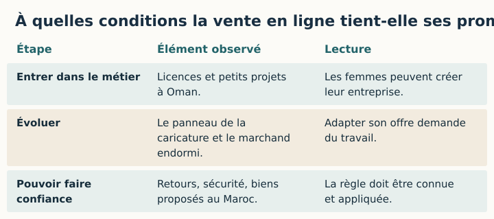

# CCINP — Arabe LVA 2026 · Corrigé guidé

*Corrigé rédigé par IA, non officiel. Signalez toute erreur.*

**Rédaction** · GPT-6.2 Astra Ultra · vitesse non renseignée

## Lire la consigne

Le fascicule accorde trois heures pour une synthèse en arabe de 400 mots, titre inclus, avec une tolérance de 10 %. Les 4 documents ont le même poids. L’introduction doit identifier simplement la source et la date de chacun. La numérotation des documents peut ensuite servir de repère.

## Croiser les documents

La caricature de la page 8 porte deux inscriptions. Le panneau dirige le regard vers le commerce électronique ; la silhouette endormie représente le commerçant traditionnel. Le dessin pose la question de l’adaptation. La mise en garde d’Al Jazeera sur les profits prétendument immédiats empêche de lire la flèche comme la promesse d’un enrichissement automatique.

Distinguer les chiffres des licences à Oman, l’évolution des comportements au Maroc et les risques concrets des achats à distance. Le document 4 cite la douane et le droit de la consommation. Dans le document 1, l’exemple des entrepreneuses apporte une dimension de participation économique que les seuls chiffres d’affaires ne montreraient pas. Le jury signale que le troisième document était souvent négligé.

## التجارة الإلكترونية بين اتساع فرص العمل وشروط الثقة في السوق

تتناول مواد نشرتها العربي الجديد في 30 يوليو 2025، والجزيرة | نت في 29 مايو 2023، ومجلة الوفاق في 15 فبراير 2022، وهسبريس في 10 نوفمبر 2023، التحول الذي طرأ على | البيع والشراء مع انتقالهما إلى الشبكة. فكيف يتيح هذا التحول موارد جديدة للبائع والمشتري، وما الذي يجعل الوصول إلى السوق | أسهل من ضمان النجاح فيها؟

تتضح سعة الفرصة في تجربة عُمان، حيث تجاوز عدد التراخيص عشرة آلاف وخمسمائة وبلغت الزيادة | السنوية مائة وواحدا وتسعين في المائة. تتيح وسائل التواصل لصاحب المشروع الصغير أن يعرض بضاعته على زبائن لم يكن يستطيع | الوصول إليهم من متجر محلي. ووجد شباب وشابات في مرونة العمل وسيلة لزيادة الدخل، كما أنشأت نساء مشروعات خاصة بهن | في قطاعات منها الملابس والعطور. وفي المغرب أيضا دخل شبان إلى السوق من خلال صفحات مخصصة للبيع، بعدما كان التعامل | مع مقترحات من بلدان بعيدة يبدو عسيرا. ويربط التقرير العماني هذه الفرص بمسعى أوسع إلى تنويع مصادر الدخل في البلاد. |

غير أن سهولة الطلب من البيت لا تعني أن يكفي فتح موقع لتحصيل الأرباح. فالجزيرة تبيّن أن التاجر يحتاج إلى | معرفة جمهوره وكسب ثقته، وأن الاستعانة بشخص مؤثر تنجح بقدر ما يقدر المشترون رأيه وخبرته. وتختصر مجلة الوفاق المسافة بين | نمطين من العمل في مشهد ساخر: رجل يقف مشيرا إلى الطريق الذي كتب عليه اسم التجارة الإلكترونية، بينما ينام التاجر | التقليدي منكبا على ما لديه. ليست الإشارة وعدا بأن كل من يسلك الطريق سيغتني؛ فالمقال الاقتصادي يحذر بالضبط من الوعود | بعائد فوري لمجرد إنشاء متجر. التغير الذي يتهدد من يغفله يقتضي كذلك تعلما ومتابعة ممن يقبل عليه.

وتظهر حدود الانفتاح | حين لا يملك المشتري وسيلة للتحقق من هوية البائع أو صلاحية ما يعرضه. ففي عُمان تثير جودة السلع وإلغاء الطلبات | وشروط الإرجاع وحماية المعلومات الشخصية أسئلة تحدد استعداد الناس للشراء مرة أخرى. وفي المغرب قد تتخفى مواد ممنوعة وراء أوصاف | مضللة، وتعرض منتجات صحية لا يضمن أحد سلامتها. وتشير هسبريس إلى دور الجمارك وإلى قانون حماية المستهلك، مع التنبيه إلى | الفارق بين وجود النص ومعرفة الناس بالحقوق التي يتيحها. وتتطلب المتابعة عملا من الجهات الرقابية ومن الجمعيات التي تعرّف المشترين | بحقوقهم. وهكذا يرتبط استمرار الإقبال بما يستطيع كل طرف التأكد منه بعد إتمام الطلب أيضا: قدرة البائع على الوفاء بما | عرضه، وقدرة المشتري على الاعتراض إذا خالف ما تسلمه الوعد الذي دفع ثمنه.

*373 mots, titre inclus. Une barre marque chaque vingtième mot.*

[Sujet officiel](https://www.concours-commun-inp.fr/_resource/annales%20%C3%A9crits/2026/Ep%20communes/2026_LVA6AllArabe.pdf#page=5) · [Rapport du jury, arabe](https://www.concours-commun-inp.fr/_resource/annales%20%C3%A9crits/2026/Ep%20communes/LV_ECRIT_2026_05.10.pdf#page=15)
